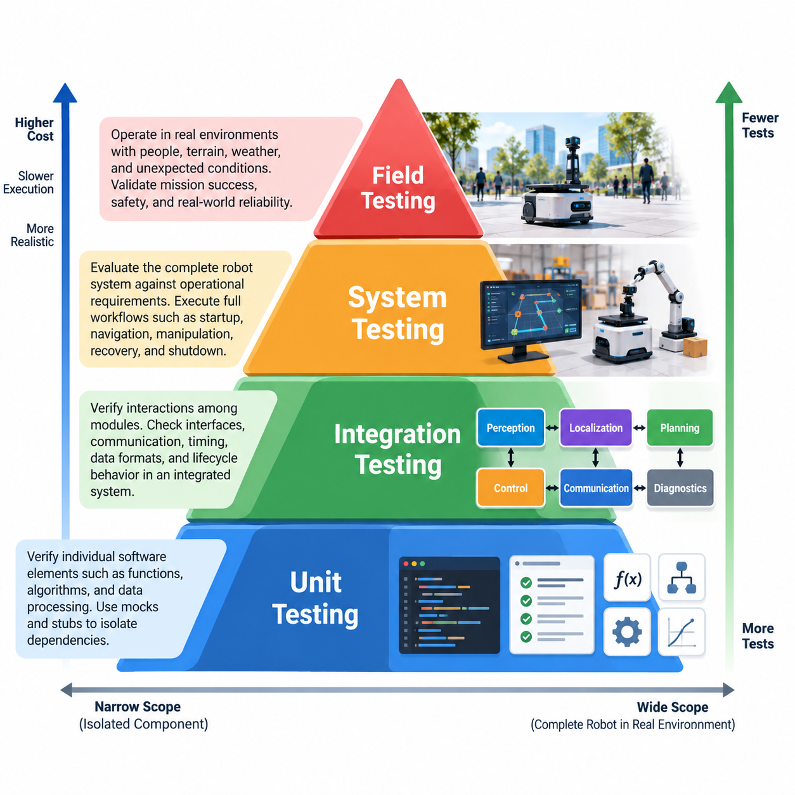
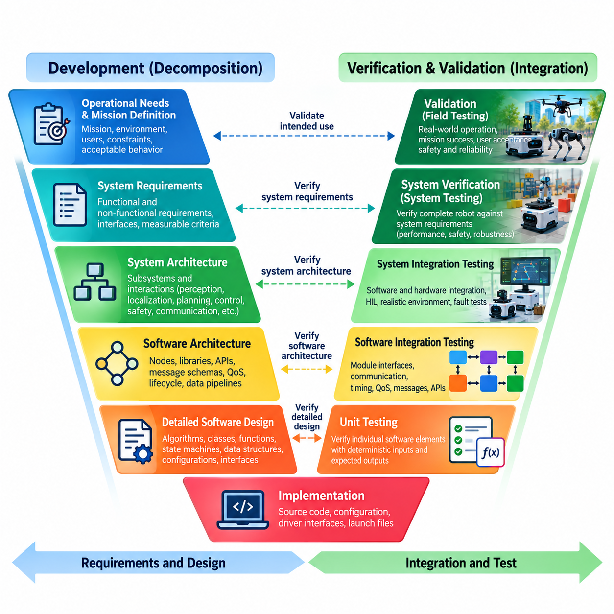
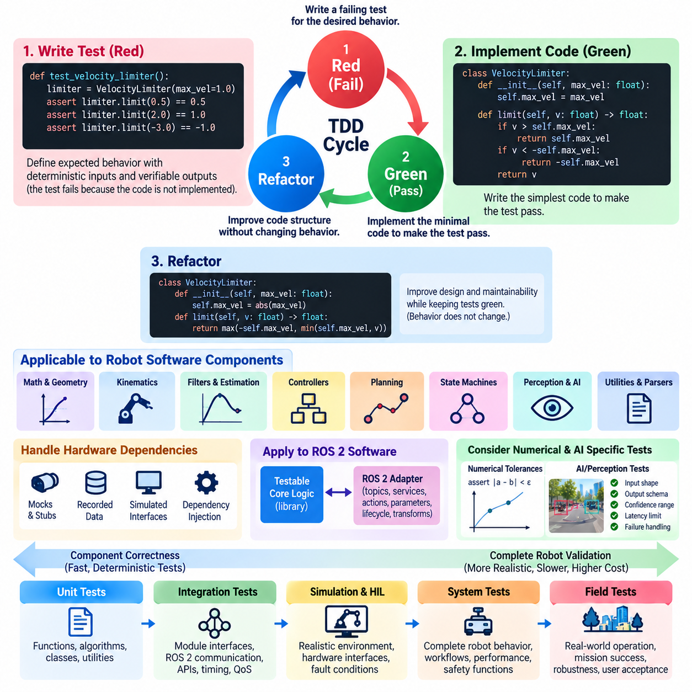
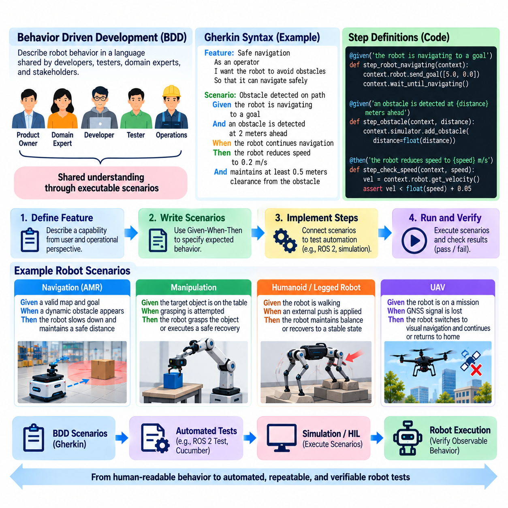
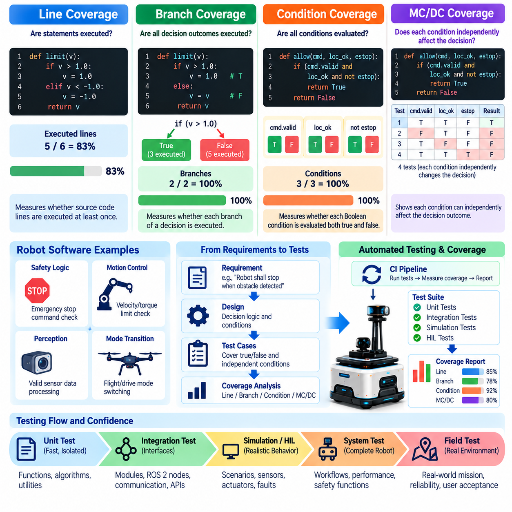
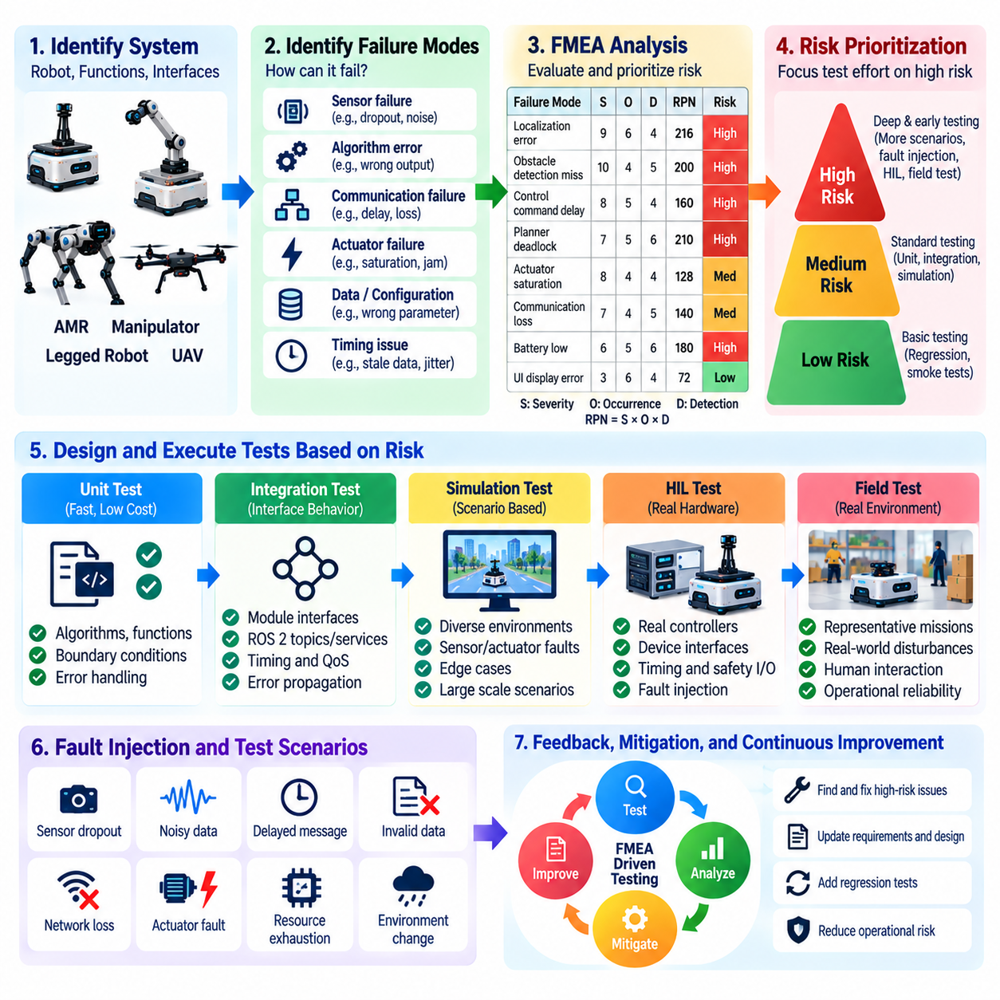
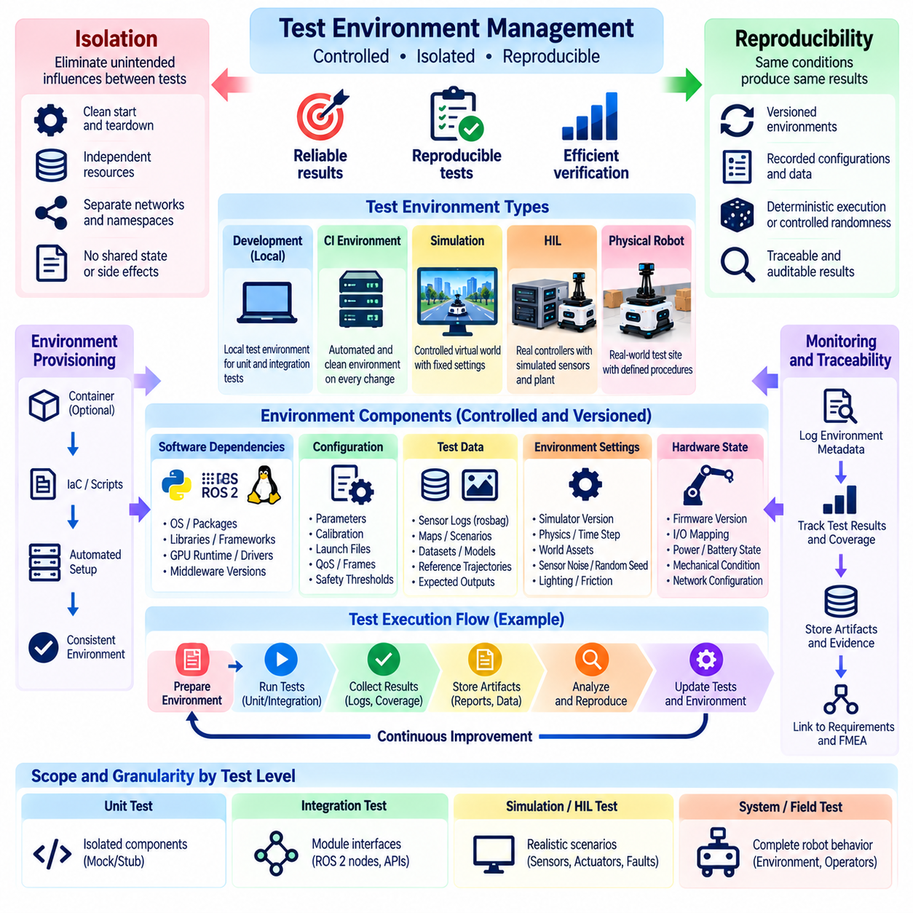
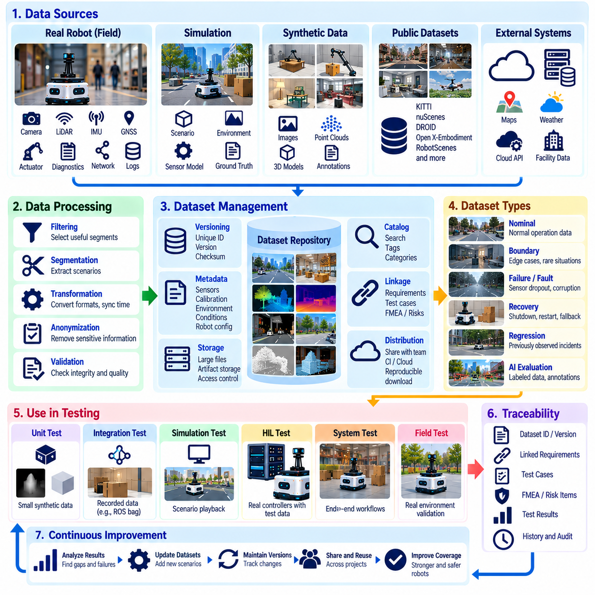
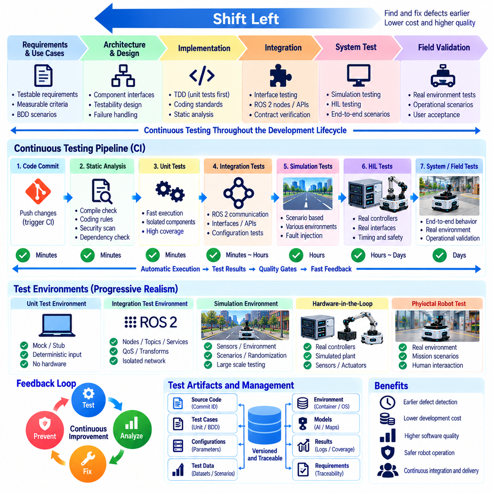
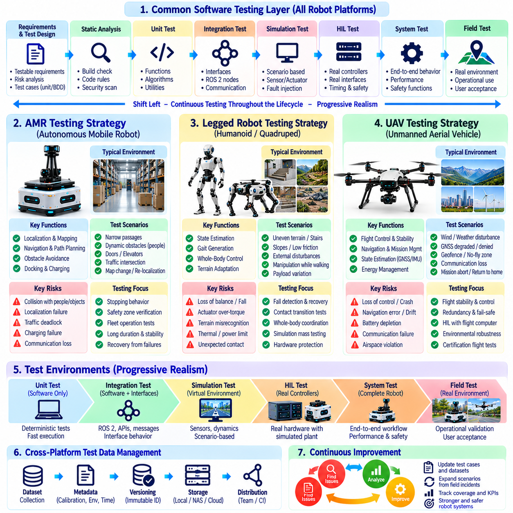

**Volume 25. Testing Validation and Benchmarking**

# Chapter 01. Testing Fundamentals

## 01.01. Testing Pyramid Unit Integration System Field

{width="7.268055555555556in" height="7.268055555555556in"}

The testing pyramid provides a layered strategy for verifying robot software from small deterministic components to complete machines operating in real environments. Its central principle is to place a large number of fast, inexpensive, highly isolated tests near the bottom and progressively reduce test count as execution becomes slower, more expensive, and more dependent on hardware and environmental conditions. Volume_25_Testing_Validation_an...

Unit testing forms the foundation of the pyramid. A unit test verifies a narrowly defined software element such as a mathematical function, state transition, controller calculation, coordinate transformation, message parser, trajectory constraint, or safety condition. Dependencies should normally be isolated through mocks, stubs, fixtures, or simulated interfaces so that failures can be attributed directly to the component under examination.

For robotics, unit tests are particularly valuable because many algorithms can be verified without launching a simulator or connecting physical hardware. Kinematic calculations, PID controller equations, filtering functions, collision predicates, command limiters, sensor conversions, and perception preprocessing stages can be exercised with deterministic inputs and expected outputs. Fast execution allows thousands of such checks to run whenever software changes.

Integration testing moves upward from individual components to interactions among modules. The objective is no longer simply to prove that each function works independently, but to determine whether interfaces, timing assumptions, data representations, communication protocols, and lifecycle behavior remain correct when components operate together. This layer is essential in distributed robot architectures where independently correct modules may still fail when connected.

A ROS 2 robot illustrates this distinction clearly. Localization, perception, planning, and control nodes may each pass their unit tests while the integrated system fails because of incompatible QoS settings, incorrect coordinate frames, stale timestamps, message-rate mismatches, namespace errors, or lifecycle sequencing. Integration tests therefore examine node graphs, topics, services, actions, middleware behavior, APIs, databases, and other boundaries between subsystems.

System testing evaluates the robot software as a complete operational system against system-level requirements. Instead of replacing most dependencies with test doubles, it brings together realistic software configurations and, where practical, representative hardware or high-fidelity simulation. Tests may execute complete workflows such as startup, localization, navigation, obstacle avoidance, manipulation, docking, fault recovery, shutdown, or mission completion.

System-level verification should emphasize externally observable behavior and requirement satisfaction rather than implementation details. An autonomous mobile robot, for example, may be evaluated for its ability to reach a target, avoid prohibited regions, maintain safe separation, recover from localization disturbances, and stop correctly when a safety condition occurs. The internal algorithm matters less at this level than whether the integrated robot satisfies its operational contract.

Simulation provides an important bridge between software integration and physical system testing. Software-in-the-loop and model-in-the-loop environments can execute repeatable scenarios at much greater scale than physical testing, while high-fidelity simulators can expose navigation, manipulation, locomotion, or flight software to environmental variation and edge cases. The broader testing structure explicitly extends this approach into scenario-based and statistical validation. Volume_25_Testing_Validation_an...

Hardware-in-the-loop testing moves validation closer to the physical machine by connecting real controllers, interfaces, networks, or electronic components to simulated plants and sensor stimuli. It is especially useful for verifying timing-sensitive behavior, motor interfaces, sensor pathways, communication buses, safety functions, and fault responses before exposing a complete robot to potentially hazardous conditions. This layer complements rather than replaces system testing.

Field testing occupies the highest and usually most expensive level of the robotics testing pyramid. The robot operates in representative or actual environments where lighting, terrain, people, communication quality, temperature, vibration, object variation, traffic, weather, and unexpected interactions cannot be perfectly reproduced in laboratory conditions. Field testing therefore reveals failures caused by the complex coupling between software, hardware, environment, and human activity.

A disciplined field campaign begins with explicit scope, protocols, instrumentation, safety controls, measurable KPIs, and data-collection procedures rather than informal demonstrations. Logged telemetry should make observed behavior traceable to software versions, configuration parameters, hardware states, environmental conditions, and test scenarios. Incident reporting and root-cause analysis then convert field failures into reproducible engineering evidence and regression tests. Volume_25_Testing_Validation_an...

The pyramid shape expresses an economic principle as much as a technical one. Unit tests are normally cheap enough to execute continuously, integration tests require more infrastructure, system tests consume substantial compute or laboratory resources, and field tests require physical assets, operators, safety preparation, and time. Discovering a defect near the bottom therefore usually provides faster diagnosis and lower correction cost than discovering the same defect during field deployment.

The layers should not be interpreted as isolated gates. A mature robot development process creates traceability across them. A requirement may produce unit-level checks for critical calculations, integration tests for interfaces, system scenarios for complete behavior, and field procedures for operational evidence. When a defect is discovered at a higher layer, engineers should reproduce it at the lowest practical layer so that future regressions can be detected earlier and more economically.

Test distribution also depends on the robot platform and its risk profile. An AMR may emphasize navigation, localization, obstacle interaction, and endurance; a legged robot may require extensive balance and terrain testing; a humanoid adds manipulation and human interaction; and a UAV requires flight-control, navigation, redundancy, and operational safety verification. The volume therefore ultimately extends the common testing foundation into platform-specific strategies. Volume_25_Testing_Validation_an...

AI-enabled robots complicate the traditional pyramid because learned components are probabilistic and sensitive to data distributions. A perception or policy model may pass deterministic software-interface tests while failing on unfamiliar objects, lighting conditions, scenes, or physical interactions. Consequently, conventional unit and integration testing must be supplemented by dataset evaluation, scenario coverage, robustness testing, simulation campaigns, and real-world performance measurements.

The pyramid should therefore be understood as a continuous evidence architecture rather than a rigid hierarchy. Unit, integration, system, simulation, hardware-in-the-loop, and field tests progressively expose the robot to greater interaction complexity and physical realism. Together they create complementary evidence that software components are correct, subsystems cooperate properly, complete behavior satisfies requirements, and the deployed robot remains dependable under real operating conditions.

## 01.02. V Model for Robot SW Development and Testing

{width="7.268055555555556in" height="7.268055555555556in"}

The V-model provides a structured framework for connecting robot software development activities with corresponding verification and validation activities. The left side represents progressive decomposition from operational needs toward detailed implementation, while the right side represents progressive integration and testing. Each development artifact is therefore associated with evidence showing that the implemented robot satisfies the intent defined at the corresponding abstraction level.

At the highest development level, stakeholders define the robot's intended mission, operating environment, users, constraints, and acceptable behavior. Requirements may describe navigation capability, manipulation performance, flight behavior, human interaction, availability, safety, or environmental limits. These statements must be measurable enough to support later acceptance testing, because ambiguous operational expectations cannot be objectively validated after the robot has been built.

System requirements translate operational expectations into technical behavior that the complete robot must provide. They define interfaces between software, computing hardware, sensors, actuators, communication networks, safety systems, and external infrastructure. Performance limits such as positioning accuracy, response time, stopping distance, control frequency, inference latency, mission duration, or fault-recovery behavior should be expressed with explicit conditions and measurable acceptance criteria.

System architecture then decomposes these requirements into interacting subsystems. A mobile robot may contain perception, localization, mapping, planning, control, diagnostics, safety, data logging, and fleet communication functions. A humanoid or manipulator introduces additional motion, force, grasping, and whole-body coordination functions, while a UAV adds flight control, navigation, redundancy, and mission-management components. Each architectural boundary creates interfaces that must later be tested.

Software architecture refines the system design into processes, services, ROS 2 nodes, libraries, APIs, data pipelines, state machines, and deployment units. Engineers define message schemas, coordinate frames, timing relationships, QoS policies, lifecycle states, error handling, computational allocation, and hardware abstraction boundaries. Verification planning should begin here rather than after implementation, because architectural decisions determine which interactions require integration testing and instrumentation.

Detailed software design further decomposes components into algorithms, classes, functions, state transitions, data structures, configuration parameters, and internal interfaces. Testability becomes a design property at this level. Deterministic computation should be separable from hardware dependencies, sensor access should be abstracted where appropriate, and expected behavior should be expressible through inputs, outputs, invariants, tolerances, and failure conditions that can be exercised automatically.

Implementation occupies the bottom of the V, where detailed designs become executable software and configuration. Source code, AI inference wrappers, controller implementations, device interfaces, launch configurations, and supporting assets must remain traceable to their originating requirements and design decisions. Static analysis, code review, build checks, coding-rule enforcement, and local developer tests provide early evidence before components enter formal integration.

The ascending side begins with unit testing, which verifies individual software elements against detailed design expectations. Mathematical functions, controller equations, transformations, filters, parsers, state machines, safety predicates, and utility libraries can be exercised using deterministic inputs and expected outputs. Hardware dependencies are commonly replaced with mocks or stubs so failures remain localized and tests can execute rapidly during development and continuous integration.

Software integration testing corresponds closely to software architectural design. Components that work independently are assembled and their interfaces are examined under realistic communication and timing conditions. In ROS 2 systems, this may include topics, services, actions, lifecycle transitions, namespaces, QoS compatibility, timestamps, transform trees, and node startup sequences. API contracts, database interfaces, data pipelines, and external middleware may require similar verification.

System integration testing evaluates whether software and physical or simulated hardware cooperate according to the system architecture. Sensors, actuators, motor controllers, embedded computers, networks, safety devices, and AI accelerators may progressively enter the test configuration. Simulation and hardware-in-the-loop environments are valuable at this stage because they allow realistic timing, interfaces, and fault conditions to be exercised before potentially hazardous tests on a complete physical robot.

System verification determines whether the integrated robot satisfies its specified technical requirements. Tests should map directly to requirement identifiers and produce objective pass/fail evidence. Navigation accuracy, trajectory tracking, manipulation precision, control latency, communication behavior, emergency stopping, degraded-mode operation, resource consumption, and recovery from injected faults are examples of properties that can be verified against predefined quantitative limits.

Validation operates at the higher level of intended use and asks whether the resulting robot is suitable for its actual mission and operating context. A technically correct navigation stack may still be unsuitable for a crowded warehouse, and a manipulation policy with high laboratory success may fail with realistic object variation. Validation therefore requires representative scenarios, environmental conditions, operators, workflows, and performance expectations rather than relying exclusively on internal software correctness.

Field testing provides important validation evidence because real environments introduce combinations of uncertainty that laboratory environments cannot completely reproduce. Lighting, terrain, vibration, temperature, wireless connectivity, human behavior, object diversity, weather, and long-duration operation can expose emergent failures. Field procedures should retain traceability to operational requirements while recording software versions, configuration, hardware state, scenario conditions, telemetry, and observed outcomes.

Traceability is the mechanism that connects the two sides of the V-model. A requirements traceability matrix can associate stakeholder needs with system requirements, architectural components, detailed designs, implementation artifacts, test cases, results, defects, and acceptance evidence. Bidirectional traceability helps identify requirements without tests, tests without justified requirements, and software changes whose verification impact has not yet been evaluated.

The V-model should not be interpreted as requiring a purely sequential development process. Modern robot programs can apply it within iterative, Agile, DevOps, and continuous-integration workflows. Requirements, architecture, implementation, and tests may evolve in short increments while preserving the fundamental relationship between specification and evidence. Automated unit, integration, simulation, and regression tests allow each iteration to rebuild part of the verification chain.

For AI-enabled robots, the V-model must also accommodate learned behavior whose performance cannot be completely specified through deterministic input-output rules. Dataset requirements, model assumptions, training configurations, scenario distributions, robustness criteria, and operational boundaries become additional development artifacts. Their corresponding evaluation activities include offline metrics, simulation scenarios, out-of-distribution testing, real-world trials, and monitoring for performance degradation.

The principal value of the V-model in robotics is therefore disciplined alignment between what is designed and what is tested. It prevents verification from becoming an unrelated activity performed only after implementation and encourages test planning while requirements and architecture are still being defined. Combined with unit, integration, system, simulation, HIL, and field testing, it creates a traceable path from operational intent to measurable evidence that the robot behaves as required.

## 01.03. Test Driven Development TDD for Robot SW [w/Code]

{width="7.268055555555556in" height="7.268055555555556in"}

Test-driven development (TDD) is a software engineering practice in which automated tests are written before the production code intended to satisfy them. For robot software, this reverses the common pattern of implementing an algorithm first and testing it later. Expected behavior, interfaces, tolerances, and failure conditions are expressed early, making testability part of software design rather than a final quality-control activity.

The basic TDD cycle is commonly described as Red, Green, and Refactor. During Red, the developer creates a small test describing behavior that does not yet exist and confirms that the test fails for the expected reason. During Green, only enough implementation is added to make the test pass. During Refactor, the code structure is improved without changing externally observable behavior, while the existing tests continuously verify that functionality remains intact.

The Red stage is particularly important because a test that has never demonstrated failure may provide false confidence. A robot developer implementing a velocity limiter, for example, can first specify expected outputs for commands inside and outside permitted limits. Running the test before implementation confirms that the test can detect the missing behavior. Similar methods apply to coordinate transformations, trajectory constraints, sensor validation, state transitions, and safety predicates.

The Green stage favors the smallest implementation that satisfies the current behavioral requirement. This discipline discourages premature complexity and keeps development focused on observable requirements. A controller utility might initially support one clearly defined operating condition before additional tests introduce saturation, invalid input, timing constraints, or boundary cases. Each new behavior is therefore introduced together with executable evidence defining what correct behavior means.

Refactoring becomes safer when a sufficiently strong automated test suite protects existing behavior. Robot software frequently evolves as algorithms are optimized, hardware interfaces change, middleware components are reorganized, or computational workloads move between embedded, edge, and cloud resources. TDD allows internal implementation to change while tests preserve interface contracts and behavioral invariants, reducing the probability that architectural improvements introduce unnoticed regressions.

TDD is most straightforward for deterministic robot software. Mathematical utilities, kinematics, geometry, filters, parsers, configuration validators, command limiters, state machines, planners with controlled inputs, and controller calculations can often be tested without physical hardware. Developers provide known inputs and compare outputs against expected values or tolerances, allowing large numbers of tests to execute rapidly on development machines and continuous integration infrastructure.

Numerical robotics algorithms require careful assertions because floating-point results should rarely be compared using exact equality. Tests should define meaningful absolute or relative tolerances derived from algorithmic and system requirements. Transformation matrices can be checked for expected pose relationships, inverse consistency, and normalization properties, while trajectory calculations can be tested for boundary conditions, continuity, velocity limits, acceleration constraints, and physically invalid inputs.

Hardware dependencies present a major challenge because conventional TDD assumes fast, repeatable, isolated execution. Direct access to cameras, LiDAR, IMUs, motor drivers, GNSS receivers, or robot buses can make tests slow and nondeterministic. Hardware abstraction layers and dependency injection can separate decision logic from device access, allowing mocks, stubs, recorded data, or simulated interfaces to provide controlled observations and capture generated commands.

ROS 2 software can apply TDD by separating node behavior from communication infrastructure wherever practical. Core calculations and decision logic can reside in independently testable libraries, while thin ROS 2 adapters handle topics, services, actions, parameters, lifecycle transitions, and transforms. Unit tests then exercise deterministic logic rapidly, and dedicated integration tests verify middleware behavior such as QoS compatibility, message flow, timestamps, namespaces, and node interactions.

Controller development also benefits from specification through tests. Before implementing a PID controller, trajectory tracker, gait component, or actuator command processor, developers can define expected responses to nominal inputs, saturation, zero error, invalid parameters, extreme values, and state resets. These tests do not prove closed-loop stability of the complete physical robot, but they establish reliable behavior for software components before simulation, HIL, and system-level validation.

Perception and AI components require an adapted interpretation of TDD because outputs may be probabilistic and model performance cannot usually be represented by a single deterministic assertion. Tests can still define preprocessing dimensions, tensor types, normalization, model loading, output schemas, confidence ranges, latency limits, and failure handling. Dataset-level evaluation and scenario-based validation must then supplement these software tests to assess statistical performance and generalization.

TDD should distinguish component correctness from complete robot validation. Passing unit tests does not demonstrate that an AMR can navigate safely through a warehouse, that a humanoid can maintain balance while manipulating an object, or that a UAV can tolerate realistic disturbances. The broader testing structure therefore extends from software unit and integration testing into HIL, simulation-based validation, field testing, AI evaluation, safety testing, benchmarking, and certification activities. Volume_25_Testing_Validation_an...

Continuous integration amplifies the value of TDD because every committed change can automatically rebuild the software and execute the accumulated regression suite. A defect discovered during development can first be converted into a failing test that reproduces the problem. After the implementation is corrected, that test remains permanently in the suite, converting a specific failure into reusable evidence that prevents the same behavior from silently returning in future revisions.

Test quality is more important than simply increasing test count. Tests should be understandable, deterministic, independent, fast enough for their intended execution frequency, and explicit about the behavior being verified. Excessive dependence on internal implementation details can make tests fragile, causing harmless refactoring to break the suite. Good TDD therefore emphasizes externally meaningful behavior and stable contracts while avoiding unnecessary coupling between tests and private implementation structures.

Safety-related robot software requires additional discipline. TDD can encode expected behavior for command limits, watchdogs, state transitions, plausibility checks, fault responses, and safety-related software logic, but it cannot independently establish functional safety compliance. Safety requirements require traceability, appropriate verification rigor, independence where required, fault-injection testing, system evidence, and potentially certification activities beyond the normal developer-oriented TDD workflow.

A practical robot software organization combines TDD with the testing pyramid and V-model rather than treating it as a replacement for either. TDD strengthens the lower levels by creating executable specifications close to implementation, while integration, system, simulation, HIL, and field tests progressively evaluate interactions and physical behavior. Requirements traceability connects these layers so that developer tests contribute to a larger verification and validation evidence chain.

The long-term benefit of TDD is not merely a larger collection of tests but a development culture in which software behavior is continuously specified and challenged before implementation grows complex. For robotics, where failures often emerge from interactions among algorithms, middleware, hardware, AI models, and physical environments, this discipline creates a reliable software foundation from which progressively more realistic verification and validation can proceed.

## 01.04. Behavior Driven Development BDD Gherkin [w/Code]

{width="7.268055555555556in" height="7.268055555555556in"}

Behavior-driven development (BDD) is a collaborative software development approach that expresses expected system behavior in language understandable by developers, testers, domain experts, and other stakeholders. For robot software, BDD connects operational intentions with executable tests by describing what the robot should do under specific conditions rather than concentrating primarily on internal implementation details. This makes behavior a shared engineering contract.

BDD complements test-driven development by shifting attention from individual functions toward externally meaningful behavior. TDD may verify that a velocity-limiting function returns a correct numerical value, while BDD can specify that a mobile robot reduces speed when entering a restricted zone. Both approaches support automated verification, but BDD emphasizes scenarios that describe how software capabilities contribute to observable robot behavior.

Gherkin is a structured language commonly used to express BDD scenarios in a readable and executable form. Its core vocabulary includes Feature, Scenario, Given, When, Then, And, and related constructs. A feature represents a capability being specified, while each scenario describes one concrete behavioral example. The vocabulary creates enough structure for automation while remaining understandable to people who do not need to inspect source code.

The Given-When-Then pattern provides the central behavioral structure. Given establishes the initial context and relevant preconditions, When describes an event or action, and Then defines the expected observable result. For example, the initial context may establish that an autonomous mobile robot is navigating normally, the event may introduce an obstacle into its path, and the expected result may require the robot to decelerate or stop according to defined safety behavior.

Good BDD scenarios describe behavior rather than implementation mechanisms. A scenario should generally state that a robot reaches a destination, rejects an unsafe command, transitions to a safe state, or reports a detected fault instead of specifying private methods or internal class structures. This separation allows engineers to refactor algorithms and architectures without unnecessarily rewriting behavioral specifications, provided the externally required behavior remains unchanged.

BDD is especially useful when robotics requirements contain terminology shared across software, systems, safety, and operations teams. Statements such as safe stop, docking complete, localization lost, mission aborted, operator takeover, or obstacle detected can be given precise operational meanings. Collaborative review of scenarios helps expose ambiguous requirements before implementation and encourages stakeholders to agree on conditions, events, outcomes, tolerances, and exceptional behavior.

Scenario design for robot software must account for physical quantities and tolerances. A statement that a robot "stops safely" is insufficient unless the project defines measurable conditions such as maximum stopping distance, velocity threshold, response time, or protected-zone boundary. Gherkin scenarios can retain readable domain language while step implementations translate those expressions into quantitative assertions against telemetry, state variables, messages, or recorded measurements.

ROS 2 systems provide many observable boundaries suitable for BDD automation. Scenario steps can establish node lifecycle states, publish sensor observations, configure parameters, issue service requests or actions, and then verify topics, transforms, diagnostic states, or resulting commands. The behavioral specification should remain independent of unnecessary middleware detail, while the underlying step definitions perform the technical interaction required to execute the scenario.

For navigation software, BDD scenarios can capture operational situations such as blocked paths, localization degradation, goal cancellation, restricted areas, docking failures, or dynamic obstacles. A scenario might establish a valid map and localized robot, introduce an obstacle during navigation, and require the robot to maintain clearance while reaching the goal or entering a defined recovery state. Such scenarios bridge requirements and end-to-end integration testing.

Manipulation systems can similarly describe behavior around object acquisition, grasp failure, force limits, workspace constraints, and recovery. Instead of testing only the mathematical output of a grasp planner, a BDD scenario can express that when an object becomes unreachable or measured force exceeds an allowed threshold, the robot must stop the current action and transition to an appropriate recovery state without issuing unsafe actuator commands.

For humanoid and legged robots, scenarios may represent balance recovery, terrain transitions, contact changes, operator interaction, or task interruption. For UAV systems, they may describe loss of communication, navigation degradation, mission cancellation, geofence interaction, or emergency behavior. The same BDD structure can therefore describe platform-specific operational behavior while preserving a consistent specification style across a robotics organization.

BDD can also support AI-enabled robot functions, although probabilistic behavior requires careful formulation. A scenario should avoid assuming that every model inference produces an identical result when such determinism is not guaranteed. Instead, BDD can verify system-level responses to model outputs, confidence conditions, invalid observations, unavailable models, or operational boundaries, while statistical model quality is evaluated separately through datasets and dedicated AI evaluation protocols.

Scenario outlines and parameterized examples are useful when the same behavior must be evaluated under multiple conditions. Instead of duplicating nearly identical scenarios for several velocity limits, obstacle distances, payload states, or operating modes, a common behavioral structure can be exercised with different values. This improves coverage while keeping specifications readable, although excessive parameterization can make scenarios difficult for stakeholders to understand and should therefore be controlled.

Step definitions form the automation layer connecting readable Gherkin statements to executable test code. They may invoke APIs, publish ROS 2 messages, manipulate simulated environments, inspect telemetry, query state machines, or evaluate recorded outputs. Step implementations should be reusable and stable, because poorly designed step libraries can create duplicated automation logic and make behavioral specifications difficult to maintain as the robot architecture evolves.

BDD scenarios can execute at several levels of the testing pyramid. Lightweight scenarios may exercise software components using mocks, while integration scenarios can launch groups of ROS 2 nodes and system scenarios can operate against simulation or HIL environments. More expensive behavioral scenarios may also become controlled field-test procedures. The broader testing structure explicitly extends robot verification through software integration, HIL, simulation, and field testing. Volume_25_Testing_Validation_an...

Continuous integration allows executable BDD scenarios to become regression tests. When a requirement or defect is translated into a scenario, the scenario can be executed automatically whenever relevant software changes. Failures then communicate not only that code has broken but which expected behavior is no longer satisfied. This behavioral reporting can provide more useful information to multidisciplinary teams than low-level test failures alone.

BDD also improves traceability when scenarios are linked to requirements, hazards, user stories, or acceptance criteria. A safety or operational requirement can be associated with one or more scenarios demonstrating expected behavior under nominal and abnormal conditions. Test results then provide evidence connecting the requirement to executable verification. This relationship complements the V-model by strengthening the connection between high-level specifications and corresponding validation activities.

BDD should not replace unit testing, statistical AI evaluation, simulation campaigns, HIL testing, safety analysis, or field validation. Behavioral scenarios describe selected examples of expected system behavior and cannot exhaustively represent every physical interaction or environmental uncertainty. Their strongest role is to create a common, executable language connecting stakeholder intent, requirements, software implementation, and observable verification across the robot development lifecycle.

A mature robotics workflow therefore combines BDD and Gherkin with TDD, the testing pyramid, requirements traceability, and continuous testing. TDD protects detailed software behavior, while BDD captures meaningful operational examples that teams can discuss before implementation and execute afterward. Together they transform requirements from static prose into increasingly precise and testable engineering evidence, reducing ambiguity between what a robot was intended to do and what its software actually does.

## 01.05. Test Coverage Metrics Line Branch MC DC [w/Code]

{width="7.268055555555556in" height="7.268055555555556in"}

Test coverage metrics provide quantitative evidence about which parts of a software implementation have been exercised by a test suite. In robot software, coverage analysis is especially valuable because control, perception, planning, safety, communication, and hardware-interface components often contain many conditional paths. Coverage does not prove correctness, but it reveals portions of implementation that have received little or no execution during testing.

Line coverage measures whether executable source-code lines have been executed by at least one test. If a module contains one hundred executable lines and tests execute ninety of them, its line coverage is approximately ninety percent. This metric is simple to understand and useful for identifying completely untested functions or blocks, making it a practical baseline for unit-testing and continuous-integration pipelines.

High line coverage alone can provide misleading confidence because executing a line does not demonstrate that every decision affecting that line has been evaluated. A conditional statement may be executed repeatedly while always taking the same outcome. Robot software frequently contains logic for valid and invalid sensor data, communication failures, degraded states, actuator limits, and safety responses, so decision behavior must be examined beyond simple execution counts.

Branch coverage measures whether alternative outcomes of control-flow decisions have been exercised. For an if-else statement, tests should normally cause both the true and false branches to execute. Similar reasoning applies to switch cases, loop conditions, exception paths, and compound decisions. Branch coverage therefore provides stronger evidence than line coverage that tests explore different behavioral paths through a software component.

Consider a robot motion command that is accepted only when localization is valid and the emergency stop is inactive. Tests that exercise only normal operation may execute the relevant source lines while leaving important decision outcomes unexplored. Branch-oriented testing introduces cases involving invalid localization, an active emergency stop, and other relevant conditions, exposing logic that might otherwise remain dormant until abnormal operation occurs in the physical system.

Condition coverage examines the individual Boolean conditions forming a compound decision. If a decision depends on localization validity, obstacle clearance, and communication health, each condition should be shown to evaluate both true and false during testing. This provides more detailed evidence than merely observing the final decision outcome, although condition coverage by itself does not necessarily demonstrate that each condition independently influences that outcome.

Modified Condition/Decision Coverage (MC/DC) strengthens this concept by requiring evidence that each individual condition can independently affect the result of a decision. For every condition in a compound Boolean expression, suitable test pairs demonstrate that changing that condition while holding the relevant other conditions fixed changes the overall decision outcome. This makes MC/DC particularly useful for complex decision logic in high-integrity software.

MC/DC can substantially reduce the number of tests compared with exhaustive evaluation of every possible Boolean combination while still demonstrating meaningful independence among conditions. A decision containing several Boolean inputs can theoretically produce many combinations, but MC/DC seeks a carefully selected set showing the independent effect of each input. The objective is structural rigor rather than brute-force enumeration of the entire truth table.

In robotics, MC/DC is most relevant to software whose incorrect decision behavior could contribute to hazardous outcomes. Examples include command authorization, safety-state transitions, actuator enabling, fault reactions, flight-mode transitions, motion inhibition, or degraded-operation logic. Applying stronger coverage criteria to such components helps reveal unintended coupling, masked conditions, and Boolean expressions that ordinary line or branch coverage may not adequately challenge.

Coverage targets should therefore be selected according to software criticality and risk rather than applying one percentage uniformly to an entire robot codebase. A visualization utility and a safety-related motion-permission module do not necessarily require identical structural evidence. Risk-based testing can assign stronger criteria and review requirements to components associated with hazards, while less critical support software may use simpler coverage objectives.

Coverage analysis should also include meaningful treatment of unreachable or defensive code. Some branches may exist to handle hardware failures, corrupted messages, invalid states, or conditions that are difficult to reproduce during normal execution. Rather than excluding such code automatically, engineers should determine whether it can be exercised using mocks, fault injection, simulation, or HIL. Genuine unreachable code should be justified, reviewed, and documented.

Generated code, third-party libraries, middleware internals, and platform-specific sections require explicit coverage policy. Measuring every dependency can distort project metrics because development teams may not control or test external implementation in the same manner as their own software. Coverage scope should therefore define which source files, generated artifacts, adapters, libraries, and test utilities are included so that reported percentages remain interpretable and comparable.

ROS 2 robot software benefits from combining structural coverage with interface-oriented testing. Core libraries can be instrumented for line, branch, and condition coverage during fast unit tests, while integration tests exercise node communication, services, actions, parameters, lifecycle behavior, and transforms. Coverage data collected across several test stages can then reveal logic reached only through integrated execution and logic that remains untested despite system-level scenarios.

Controller and numerical software require coverage metrics to be combined with boundary-value and numerical testing. Executing both sides of a saturation condition does not prove that behavior near the limit is correct. Tests should examine values below, at, and above important thresholds and should consider floating-point tolerances, invalid values, initialization states, reset behavior, and numerical extremes. Structural coverage identifies execution paths, while assertions establish whether results are correct.

AI-enabled robot software introduces another distinction because source-code coverage does not measure the behavioral coverage of a learned model. A neural network inference wrapper may achieve complete line coverage while the model has never encountered important object classes, environmental conditions, or out-of-distribution inputs. AI evaluation therefore requires dataset, scenario, distribution, robustness, and task-performance coverage in addition to conventional software structural metrics.

Coverage measurement becomes most useful when integrated into continuous integration. Every software change can trigger tests, collect coverage information, compare results against defined thresholds, and identify newly uncovered code. Teams can prevent important coverage regressions while retaining historical trends. However, developers should avoid writing superficial tests solely to increase percentages, because execution without meaningful assertions produces coverage statistics without equivalent verification value.

Coverage reports should support investigation rather than function only as management scores. Engineers need to inspect uncovered lines, branches, and decisions and determine why they remain untested. The result may indicate a missing test, obsolete code, an untestable architecture, insufficient fault injection, or an unjustified defensive path. Coverage analysis therefore provides feedback not only about test completeness but also about software design and testability.

Coverage must ultimately be interpreted together with requirements traceability, test quality, risk analysis, and higher-level validation. Even one hundred percent structural coverage cannot demonstrate that requirements are complete, algorithms are correct, timing is acceptable, or a physical robot behaves safely in its environment. The broader testing structure consequently extends software testing into HIL, simulation, field testing, safety evaluation, benchmarking, and certification activities. Volume_25_Testing_Validation_an...

A mature robotics testing strategy treats line, branch, condition, and MC/DC coverage as progressively stronger forms of structural evidence rather than interchangeable percentages. Line coverage identifies executed implementation, branch coverage challenges decision outcomes, and MC/DC examines the independent influence of conditions within critical decisions. Used with risk-based objectives and meaningful assertions, these metrics help transform test execution into measurable evidence about the depth of software verification.

## 01.06. Risk Based Testing Prioritization FMEA Driven

{width="7.268055555555556in" height="7.268055555555556in"}

Risk-based testing prioritizes verification effort according to the consequences and likelihood of failures rather than distributing test resources uniformly across all robot software. This approach is especially important when development time, hardware access, simulation capacity, and field-test opportunities are limited. Components associated with safety, mission loss, equipment damage, or major operational disruption receive deeper and earlier testing than low-impact functions.

Failure Mode and Effects Analysis (FMEA) provides a systematic foundation for this prioritization. Engineers examine a component, function, interface, or operational process and identify credible ways in which it can fail. For each failure mode, the analysis considers its local effect, propagation through connected subsystems, possible system-level consequences, existing controls, and the ability of the system or testing process to detect the problem before harmful behavior occurs.

In robot software, failure modes can originate from algorithms, communication, timing, configuration, data, hardware interfaces, or incorrect assumptions about the physical environment. Examples include stale localization data, corrupted sensor measurements, delayed control commands, incorrect coordinate transforms, planner deadlock, actuator saturation, lost communication, invalid AI inference, memory exhaustion, or failure to transition into a safe state when abnormal conditions are detected.

Traditional FMEA commonly evaluates severity, occurrence, and detection. Severity represents the seriousness of the resulting effect, occurrence estimates how likely the failure mode is to arise, and detection reflects how likely existing controls are to identify it before unacceptable consequences occur. These factors can be combined into a risk priority number or interpreted through a project-specific risk matrix, but numerical rankings should support engineering judgment rather than replace it.

Severity deserves particular attention in physical robotics because software decisions can produce motion and physical forces. A visualization defect may inconvenience an operator, whereas an incorrect motion-permission decision could allow movement in a protected area. Similarly, a localization error might range from a minor navigation inefficiency to a collision hazard depending on robot speed, environment, redundancy, and the mechanisms available to detect and contain the error.

Occurrence estimates should be grounded in available evidence whenever possible. Sources may include defect history, field telemetry, component complexity, interface instability, simulation results, previous robot generations, supplier information, or engineering experience. For new technologies such as learned policies or novel sensors, occurrence estimates may contain substantial uncertainty. Such uncertainty can itself justify additional testing rather than being interpreted as evidence of low risk.

Detection analysis asks whether a failure is likely to remain hidden until it affects system behavior. Diagnostic monitors, plausibility checks, watchdogs, redundant sensors, command validation, health reporting, and runtime safety mechanisms can improve detectability. Testing should challenge these mechanisms directly, because a failure mode with moderate occurrence may still deserve high priority when it is difficult to detect before propagating into motion or mission-level behavior.

The FMEA results can be translated into a test-prioritization strategy. High-risk failure modes should receive stronger requirements traceability, more detailed unit and integration tests, fault-injection scenarios, boundary testing, simulation campaigns, HIL verification, and carefully controlled physical tests. Lower-risk functions may rely on lighter structural testing and routine regression coverage, allowing scarce engineering resources to concentrate on failures with the greatest potential consequences.

Risk-based prioritization also influences the order in which tests are executed. Fast tests targeting critical safety and control logic can run on every software change, while computationally expensive simulation scenarios may run periodically or before release candidates. HIL and physical robot tests can then focus on risk areas that cannot be adequately resolved through lower-cost environments. This creates an escalation of test realism based on both risk and evidence needs.

Fault injection is particularly valuable for FMEA-driven testing because many important failure modes rarely appear during nominal operation. Engineers can deliberately introduce sensor dropout, delayed messages, corrupted values, network loss, actuator faults, invalid timestamps, resource exhaustion, or degraded localization. The objective is not merely to cause failure but to verify that detection, containment, fallback behavior, diagnostics, and recovery mechanisms operate according to defined requirements.

Interface failures deserve special attention because robot systems combine many independently developed components. A perception module may generate valid outputs that become unsafe when interpreted with an incorrect coordinate frame, unit, timestamp, or semantic convention. FMEA should therefore consider not only component-internal failures but also mismatched assumptions between sensors, ROS 2 nodes, controllers, AI models, databases, cloud services, and external fleet or mission-management systems.

Timing-related failure modes are equally important in real-time robot software. Data may be logically correct but too old to support safe control, or a command may arrive after the physical situation has changed. Risk-based tests should therefore evaluate latency, jitter, missed deadlines, queue buildup, stale-data rejection, synchronization loss, and recovery after timing disturbances. These characteristics often require integration, simulation, or HIL environments rather than isolated unit tests.

AI-enabled robots require FMEA to extend beyond conventional deterministic software failures. Failure modes may include misclassification, confidence miscalibration, out-of-distribution inputs, perception blind spots, policy instability, inappropriate generalization, or model latency under resource contention. Because these failures are often data-dependent, testing must combine conventional software verification with dataset evaluation, scenario coverage, robustness testing, simulation, and controlled real-world trials.

Risk analysis should remain connected to the testing pyramid rather than creating a separate test process. A high-risk hazard may generate unit tests for decision logic, integration tests for interfaces, system tests for complete responses, simulation scenarios for environmental variation, HIL tests for timing and hardware behavior, and field tests for operational validation. The testing structure explicitly provides these progressively more realistic validation environments. Volume_25_Testing_Validation_an...

FMEA should also influence regression testing. When a defect or field incident reveals a previously underestimated failure mode, its risk assessment should be reconsidered and an appropriate regression test should be added at the lowest practical test level. Serious failures may require corresponding scenarios at multiple levels. In this way, operational experience continuously improves both the risk model and the automated verification suite instead of remaining isolated in incident reports.

Traceability allows teams to connect failure modes to hazards, requirements, mitigations, test cases, results, and residual risk. A high-risk FMEA item should not disappear after a mitigation is implemented; evidence should demonstrate that the mitigation actually works under relevant conditions. Linking risk records with verification artifacts also supports technical reviews, release decisions, safety cases, and later certification evidence when formal compliance activities are required.

Risk-based testing should not be reduced to sorting tests by a single risk priority number. Different combinations of severity, occurrence, and detection can produce similar numerical values while demanding different engineering responses. Extremely severe but low-frequency hazards may justify rigorous testing despite a moderate aggregate score, while uncertain failure modes may require exploratory testing. Expert review and explicit rationale therefore remain essential parts of prioritization.

The risk model must evolve as the robot architecture, software, hardware, operating environment, and field evidence change. New sensors, AI models, control strategies, payloads, firmware, or deployment environments can introduce failure modes that were absent from the original analysis. Periodic FMEA review, change-impact analysis, defect trends, telemetry, and incident data should therefore feed back into test selection, coverage objectives, and release criteria.

A mature FMEA-driven testing strategy ultimately converts risk analysis into measurable verification action. Instead of asking only how many tests exist or what percentage of code is covered, the organization asks whether the most consequential failures have been identified, challenged, detected, contained, and verified. This creates a direct relationship between engineering risk, testing depth, resource allocation, and evidence that the robot can operate dependably under both normal and abnormal conditions.

## 01.07. Test Environment Management Isolation Reproducibility

{width="7.268055555555556in" height="7.268055555555556in"}

Test environment management establishes the controlled conditions under which robot software is verified and validated. A test result is meaningful only when engineers can identify the software version, dependencies, configuration, hardware state, test data, simulator settings, and environmental assumptions that produced it. Without disciplined environment management, failures become difficult to reproduce and successful results may not provide reliable evidence for later releases.

Isolation is a fundamental property of a dependable test environment. Each test should minimize unintended influence from previous tests, parallel processes, developer machines, shared services, persistent files, network state, or physical hardware history. A test that passes only because another test initialized a parameter, populated a database, warmed a cache, or left a ROS 2 node running creates hidden dependencies and can produce misleading results.

Software dependencies should therefore be explicitly controlled. Compiler versions, operating-system packages, Python libraries, ROS 2 distributions, middleware implementations, GPU runtimes, device drivers, simulation engines, and AI frameworks can all influence robot behavior. Dependency versions should be pinned or otherwise recorded so that a test executed today can be reconstructed later without silently incorporating incompatible library or runtime changes.

Containerization provides one practical mechanism for isolating software dependencies. Containers can package application binaries, libraries, runtime settings, and test tools into repeatable execution environments that behave consistently across developer workstations and continuous-integration infrastructure. Containers do not automatically guarantee reproducibility, however, because kernel behavior, GPU drivers, physical devices, network configuration, timing, and external services may still differ between hosts.

Configuration management is equally important because robot behavior is frequently determined by parameters rather than source code alone. Controller gains, sensor calibration, coordinate frames, planner limits, safety thresholds, model paths, QoS settings, map versions, and launch parameters should be version-controlled or uniquely identifiable. A test report that records only a software commit but not the configuration used cannot fully reconstruct the tested robot state.

Test data must also be treated as part of the environment. Sensor recordings, maps, calibration files, synthetic datasets, reference trajectories, expected outputs, AI models, and scenario definitions should have stable identifiers and controlled versions. If a rosbag, point cloud, image dataset, or map changes while retaining the same name, identical test code may produce different results without an obvious explanation, undermining reproducibility and regression analysis.

Deterministic execution should be pursued wherever practical. Random-number generators should use recorded seeds, scenario initialization should follow defined procedures, simulation time should be controlled, and asynchronous processes should avoid unnecessary dependence on wall-clock timing. Exact determinism is not always achievable in distributed robotics, GPU computation, physics simulation, or learned systems, so reproducibility may instead require statistically defined tolerances and repeated trials.

ROS 2 environments require particular attention to isolation because discovery, namespaces, domain identifiers, QoS policies, transforms, and lifecycle state can allow independent tests to interfere with one another. Separate ROS domains or network namespaces can isolate test instances, while unique node names and temporary resources reduce collisions. Test teardown must reliably terminate nodes and remove transient state so that subsequent runs begin from a known baseline.

External services create another source of nondeterminism. Robot software may depend on databases, fleet servers, cloud APIs, map services, authentication systems, or telemetry backends whose availability and data change over time. Unit and integration environments can replace such services with controlled substitutes where appropriate, while dedicated system environments may deploy versioned service instances. The chosen strategy should reflect what the test is intended to verify.

Simulation environments require configuration control beyond ordinary software dependencies. Physics-engine versions, time steps, solver settings, sensor noise models, environment assets, robot models, collision properties, friction coefficients, lighting, randomization parameters, and scenario seeds can materially affect outcomes. Reproducing a simulation failure therefore requires preserving not only application software but also the simulation world and its execution parameters.

Hardware-in-the-loop environments introduce additional configuration dimensions because physical controllers and interfaces participate in the test. Firmware versions, wiring, I/O mappings, bus configuration, calibration, power conditions, real-time simulator models, and test equipment must be recorded. Automated environment checks can confirm that the HIL bench is in the expected state before execution and prevent invalid results caused by an incorrectly configured laboratory setup.

Physical robot test environments require even stronger state management. Battery state, payload, tire condition, joint calibration, sensor cleanliness, temperature, network connectivity, map version, safety configuration, and mechanical modifications can influence results. A repeatable test protocol should define preparation and reset procedures so that differences between runs reflect the variable under investigation rather than uncontrolled changes in the robot or facility.

Environment provisioning should be automated where feasible. Infrastructure scripts, container definitions, package lock files, launch configurations, simulation manifests, and setup procedures can reconstruct known test environments with less manual variation. Continuous integration can create an environment, execute tests, archive evidence, and destroy temporary resources afterward. Immutable or short-lived environments reduce configuration drift and make failures easier to reproduce outside the original execution system.

Environment validation should occur before test execution rather than assuming that provisioning succeeded. Automated preflight checks can verify software versions, available devices, network connectivity, time synchronization, storage capacity, GPU accessibility, calibration identifiers, safety states, and required services. If prerequisites are incorrect, the test should be marked as an environment failure rather than incorrectly reporting a product failure or pass.

Reproducibility also requires comprehensive test metadata. Results should identify source revisions, build artifacts, configuration hashes, dependency versions, test-data versions, environment images, hardware identifiers, timestamps, random seeds, scenario parameters, and relevant logs. This metadata creates a provenance chain that allows engineers to reconstruct the conditions surrounding a failure and distinguish software regressions from environmental changes.

Flaky tests are a major warning sign of insufficient isolation or uncontrolled nondeterminism. Repeatedly rerunning a failing test until it passes can conceal race conditions, timing assumptions, resource contention, shared-state leakage, or unstable infrastructure. Flakiness should be measured and investigated as an engineering defect. Quarantining a test may temporarily protect the pipeline, but the underlying source of nondeterminism should still be identified and corrected.

Environment management must span the broader testing hierarchy because different levels require different forms of control. Software tests emphasize dependency and process isolation, simulation adds model and scenario control, HIL adds physical interfaces and real-time equipment, and field testing adds environmental and operational variables. The volume explicitly develops these stages from software integration through HIL, simulation, and field methodology. Volume_25_Testing_Validation_an...

A useful reproducibility strategy distinguishes exact repetition from representative repetition. A unit test should normally reproduce nearly identical results, while a stochastic AI evaluation or physical field trial may naturally vary. In the latter cases, reproducibility means preserving the experimental protocol, distributions, acceptance criteria, sample size, and analysis method so that repeated campaigns produce statistically comparable conclusions rather than identical individual measurements.

Test environments should evolve under formal change control. Updating an operating system, simulator, compiler, firmware, driver, AI runtime, or calibration can invalidate historical comparisons even when application source code remains unchanged. Environment changes should therefore trigger impact analysis and, where necessary, baseline regeneration or regression testing. Treating the environment itself as a versioned engineering artifact prevents infrastructure changes from becoming invisible experimental variables.

A mature robotics organization ultimately treats isolation and reproducibility as properties of the verification system rather than conveniences for developers. Every important test should answer not only whether the robot software passed, but exactly what was tested, under which conditions, and whether those conditions can be recreated. This discipline transforms test results into durable engineering evidence that can support debugging, regression analysis, release decisions, validation, and certification.

## 01.08. Test Data Management for Robot SW

{width="7.268055555555556in" height="7.268055555555556in"}

Test data management defines how the datasets, recordings, configurations, reference outputs, and scenario inputs used to verify robot software are created, identified, stored, versioned, distributed, and retired. Because robot behavior depends strongly on sensor observations and environmental conditions, test results cannot be interpreted reliably unless the exact data used during execution can be identified and reproduced.

Robot test data can originate from many sources. Unit tests may use small synthetic inputs and predefined expected values, while integration tests may consume recorded ROS 2 messages, maps, trajectories, or database fixtures. Simulation produces scenario configurations and synthetic sensor streams, and field testing generates large volumes of camera, LiDAR, radar, IMU, GNSS, actuator, diagnostic, network, and mission telemetry requiring systematic management.

A useful test dataset should have an explicit purpose rather than being accumulated simply because data is available. Each dataset may represent nominal operation, boundary conditions, known defects, safety-relevant situations, environmental variation, hardware faults, or previously observed field incidents. Connecting datasets to requirements, risks, test cases, and expected behavior makes them reusable verification assets rather than unstructured collections of recorded robot activity.

Version control is essential because changing test data can change test results even when software remains identical. Large binary artifacts such as rosbags, images, point clouds, maps, neural-network models, and simulation recordings may require storage systems separate from normal source repositories. Regardless of storage technology, each dataset should have a stable identifier, version, checksum, or immutable reference that allows a test result to identify its exact inputs.

Metadata provides the context required to interpret recorded data correctly. A robotics dataset may need timestamps, sensor models, calibration identifiers, coordinate frames, sampling rates, units, firmware versions, robot configuration, payload, map version, weather, lighting, location category, operating mode, and software revision. Without this information, apparently valuable sensor recordings may become difficult to reuse because engineers cannot reconstruct the conditions under which they were collected.

Time synchronization is particularly important for multi-sensor robot data. Camera frames, LiDAR scans, IMU measurements, GNSS observations, joint states, control commands, and diagnostic events must be related to a consistent time basis when tests evaluate sensor fusion or causal behavior. Dataset metadata should therefore preserve clock sources, synchronization status, timestamp semantics, and known timing errors where these characteristics affect interpretation.

Calibration information must also remain associated with test data. Camera intrinsics, sensor extrinsics, LiDAR alignment, IMU calibration, wheel parameters, joint offsets, and coordinate transforms can change during a robot's lifetime. Replaying historical data with a newer calibration file may produce results that differ from the original experiment. Tests should therefore reference the calibration version that belongs to the dataset rather than silently using the latest available values.

Reference outputs, often called golden data or baselines, can support regression testing when expected behavior is sufficiently stable. A localization algorithm might be compared against reference poses, a parser against known decoded messages, or a trajectory generator against accepted output characteristics. Baselines should be reviewed carefully because treating historical output as automatically correct can preserve old defects or prevent legitimate algorithm improvements.

Test data should include abnormal and boundary conditions rather than representing only successful nominal operation. Sensor dropout, invalid timestamps, corrupted messages, extreme ranges, communication loss, localization degradation, actuator saturation, unusual object arrangements, and recovery events can expose logic that ordinary recordings rarely exercise. FMEA-driven risk analysis can help identify which failure-oriented datasets deserve priority within the regression suite.

Field incidents are especially valuable sources of regression data. When a deployed robot encounters an unexpected obstacle configuration, localization failure, communication disturbance, planner error, or unusual human interaction, relevant logs can be extracted and converted into a reproducible test asset. After the underlying defect is corrected, the incident dataset can remain in the regression suite so future software versions are challenged by the same condition.

Data reduction is often necessary because raw robot recordings can become extremely large. Continuous high-resolution cameras and LiDAR streams may generate far more data than is practical to retain indefinitely. Engineers can preserve complete evidence for critical events while extracting smaller windows around relevant failures, representative scenarios, or boundary conditions. Reduction procedures should preserve the information required for reproduction and avoid removing context that changes test meaning.

Dataset quality requires validation just as software does. Automated checks can identify missing files, corrupted records, inconsistent timestamps, invalid schemas, impossible values, incomplete calibration, duplicate samples, or broken references. A dataset that silently changes or contains malformed inputs can create false regressions and misleading passes. Integrity checks and checksums help distinguish genuine software behavior changes from damaged test assets.

Access control and privacy may become important when robot datasets contain people, facilities, vehicle identifiers, audio, operational layouts, or customer information. Test-data pipelines should define who may access sensitive recordings, how long they are retained, whether anonymization is required, and where they may be copied. Development convenience should not cause production-derived data to be distributed without appropriate governance and security controls.

Simulation and synthetic data provide an alternative when real-world examples are scarce, hazardous, expensive, or difficult to reproduce. Controlled generation can vary lighting, terrain, obstacle placement, sensor noise, weather, payload, or fault conditions systematically. Synthetic datasets should still retain generator versions, world assets, random seeds, parameter distributions, and simulator configurations so that scenarios can be reconstructed and compared across software revisions.

AI-enabled robot testing requires broader data-management practices because model behavior depends on distributions rather than only individual examples. Evaluation sets should distinguish training, validation, regression, safety, edge-case, and out-of-distribution data where appropriate. Dataset leakage must be avoided, and changes to evaluation sets should be versioned because modifying sample composition can alter reported accuracy, robustness, or task-success metrics without any model change.

Representativeness is as important as dataset size. Millions of nearly identical observations may provide less verification value than a smaller collection covering meaningful variations in objects, environments, speeds, payloads, lighting, terrain, human behavior, and failure conditions. Coverage analysis should therefore consider scenario and operational-domain diversity rather than counting only files, frames, kilometers, or hours of recorded data.

Test data should integrate with continuous testing so that different suites can retrieve the correct version automatically. Fast unit tests may use compact fixtures stored with source code, while larger integration and simulation suites retrieve immutable artifacts from managed storage. Release validation may reference certified dataset collections whose contents are frozen, reviewed, and linked to specific acceptance criteria, enabling consistent comparison among candidate software versions.

Traceability connects test data with the broader verification process. A test result should identify not only the software build and environment but also dataset identifiers, configuration, calibration, scenario definition, expected outputs, and analysis version. The broader testing structure extends these principles across software integration, simulation, HIL, field testing, and AI evaluation, all of which depend on controlled evidence and repeatable inputs. Volume_25_Testing_Validation_an...

Retention and lifecycle policies prevent test repositories from becoming uncontrolled archives. High-value datasets associated with safety evidence, certification, field incidents, or release baselines may require long-term preservation, while temporary debug recordings can expire after a defined period. Superseded datasets should be archived or retired in a controlled manner without destroying traceability to historical test results that depended on them.

A mature robotics organization ultimately treats test data as a versioned engineering asset comparable to source code and configuration. The objective is not simply to store large quantities of sensor information, but to maintain trustworthy, representative, traceable, and reproducible inputs for verification. Effective test data management turns field experience, simulation scenarios, known failures, and expected behavior into reusable evidence that continuously strengthens robot software quality.

## 01.09. Continuous Testing Philosophy Shift Left

{width="7.268055555555556in" height="7.268055555555556in"}

Continuous testing is a development philosophy in which verification activities are performed throughout the software lifecycle rather than concentrated near release. For robot software, this means continuously evaluating code, interfaces, algorithms, configurations, models, and system behavior as changes are introduced. The objective is to shorten the time between creating a defect and detecting it, when diagnosis and correction are usually less expensive.

Shift-left testing moves verification activities toward earlier stages of development. Instead of waiting for an integrated robot to expose problems, teams begin testing during requirements definition, architecture, detailed design, and implementation. Requirements are reviewed for testability, interfaces are specified with measurable contracts, and software components are designed so that they can be exercised independently before expensive simulation, HIL, or physical testing becomes necessary.

The shift-left philosophy does not simply mean running unit tests earlier. It requires test considerations to influence engineering decisions from the beginning. A requirement such as "the robot shall stop safely" must be transformed into measurable criteria involving response time, stopping distance, velocity, or safety-zone boundaries. Defining these conditions early prevents ambiguous expectations from reaching integration and field testing, where resolving them becomes considerably more expensive.

Architecture also becomes an important testing activity under shift-left development. Engineers identify component boundaries, interfaces, timing assumptions, failure responses, and dependencies before implementation is complete. ROS 2 nodes, libraries, hardware abstraction layers, state machines, and AI inference components can be structured so that deterministic logic is separated from hardware and communication mechanisms, allowing lower-cost tests to exercise critical behavior without requiring a complete robot.

Test-driven development and behavior-driven development reinforce continuous shift-left testing. TDD creates executable expectations before detailed implementation, while BDD expresses operational behavior in scenarios understandable across engineering disciplines. Together they encourage teams to clarify what correct behavior means before software complexity increases. Tests therefore become executable engineering specifications rather than artifacts created only after implementation has already stabilized.

Static analysis provides another early verification layer because many defects can be detected without executing software. Compiler warnings, type checking, coding-rule analysis, dependency scanning, formatting checks, complexity analysis, and security inspection can identify problems immediately after code changes. These checks are inexpensive compared with physical robot tests and can run frequently, making them suitable for developer workstations, pre-commit workflows, and continuous-integration pipelines.

Fast automated unit tests form the foundation of continuous testing. Mathematical utilities, coordinate transformations, filters, parsers, state machines, command validators, controller calculations, and planning functions can be evaluated whenever code changes. Mocks, stubs, dependency injection, and recorded inputs allow tests to isolate software logic from cameras, LiDAR, motor controllers, networks, or other hardware whose availability would otherwise limit testing frequency.

Integration testing should also move left whenever interfaces can be exercised before the complete system exists. ROS 2 message contracts, topics, services, actions, QoS policies, transforms, lifecycle transitions, timestamps, and node startup behavior can be tested using controlled environments. Early interface verification is especially valuable because many robotics defects emerge not from individual algorithms but from inconsistent assumptions about units, frames, timing, configuration, and data semantics.

Simulation extends continuous testing toward system behavior without requiring every test to use physical hardware. Navigation, manipulation, locomotion, perception, and mission logic can be evaluated against repeatable scenarios while environmental variables and faults are systematically introduced. Simulation does not eliminate the need for real-world validation, but it enables many integration problems and behavioral regressions to be discovered before scarce robot hardware or field facilities are scheduled.

Hardware-in-the-loop testing provides a further stage of progressive realism. Real controllers, communication interfaces, embedded computers, or selected devices can interact with simulated plants and environments before full physical deployment. HIL is particularly useful for timing, communication, actuator interfaces, safety functions, and fault responses that cannot be represented adequately through software-only tests but are too costly or hazardous to investigate first on an operational robot.

Continuous integration provides the execution mechanism that makes shift-left testing scalable. Every meaningful change can trigger compilation, static checks, unit tests, selected integration tests, coverage analysis, packaging, and artifact generation. More expensive simulation or HIL suites may run on scheduled pipelines or release candidates. Test frequency is therefore matched to execution cost while maintaining progressively stronger verification as software moves toward deployment.

A layered pipeline should provide rapid feedback before expensive tests begin. If compilation, static analysis, or unit testing already reveals a defect, there is little value in consuming simulation clusters or physical robot time on the same build. Fast checks act as quality gates for slower stages, while successful builds advance toward integration, simulation, HIL, and eventually field testing. This structure follows the economic logic of the testing pyramid.

Risk-based testing determines which checks deserve the earliest and most frequent execution. Safety-state logic, motion authorization, watchdogs, command limits, localization validity, actuator control, and fault handling may run on every relevant change because their failures can have serious consequences. Lower-risk functions may be evaluated less frequently. FMEA results can therefore influence pipeline ordering, coverage targets, fault-injection scenarios, and release gates.

Continuous testing also depends on reproducible environments and controlled test data. A failure discovered early has limited value if engineers cannot recreate the software dependencies, configuration, dataset, calibration, simulation world, random seed, or hardware state that produced it. Containerization, versioned configuration, immutable datasets, environment metadata, and automated provisioning help ensure that results from developer machines and CI infrastructure remain comparable.

AI-enabled robot software requires shift-left principles to extend into data and model development. Dataset validation, preprocessing checks, model interface tests, tensor-shape verification, inference compatibility, latency measurements, and basic robustness checks can occur before system integration. Statistical performance, generalization, and real-world behavior still require broader evaluation, but many pipeline and integration defects can be detected immediately when models or datasets change.

Regression testing converts previously discovered defects into permanent verification assets. When a bug is found during simulation, HIL, or field operation, engineers can reproduce it and create an automated test at the lowest practical level. The correction is then protected against future reintroduction. Over time, operational experience therefore strengthens the shift-left suite, allowing failures originally discovered late to be detected much earlier in subsequent development cycles.

Shift-left testing should not be interpreted as eliminating later validation. Robot behavior emerges from interactions among software, computation, sensors, actuators, networks, people, and physical environments that cannot be completely represented by early tests. Unit and integration tests establish software confidence, while simulation, HIL, system testing, field trials, safety evaluation, and benchmarking provide progressively more realistic evidence that the complete robot satisfies its intended purpose.

Metrics for continuous testing should emphasize feedback quality rather than test quantity alone. Useful indicators include time to detect defects, pipeline duration, pass and failure trends, flaky-test rates, coverage changes, escaped defects, regression recurrence, and failure localization. A large test suite that provides slow or unreliable feedback can obstruct development, whereas a carefully layered suite can detect important problems quickly while reserving expensive resources for higher-value validation.

Continuous testing also changes engineering responsibility. Testing is no longer an activity owned only by a separate quality team near the end of development. Developers, system engineers, safety engineers, AI engineers, test engineers, and operations teams contribute specifications, test cases, datasets, scenarios, automation, and field evidence. Shared responsibility encourages testability to become an architectural quality and verification evidence to evolve together with the robot software.

A mature shift-left strategy ultimately creates a continuous chain of evidence from requirements to implementation and deployment. Each change is challenged as early as practical by inexpensive automated checks and then progressively exposed to more realistic environments as confidence increases. For robotics, this approach reduces late integration surprises, improves defect localization, protects scarce hardware resources, and establishes a disciplined foundation for reliable system validation and release.

## 01.10. Testing Strategy by Robot Platform AMR Legged UAV

{width="7.268055555555556in" height="7.268055555555556in"}

Robot testing strategy should reflect the physical structure, mobility mechanism, operating environment, autonomy level, and failure consequences of each platform. Although AMRs, legged robots, and UAVs share common software layers such as perception, localization, planning, control, communication, and diagnostics, their dominant risks differ substantially. A useful strategy therefore combines common software verification practices with platform-specific system and field validation.

At the common software level, all three platforms benefit from static analysis, unit testing, interface testing, integration testing, simulation, HIL, regression testing, and controlled field evaluation. Mathematical functions, state machines, coordinate transformations, communication interfaces, command validation, and fault-handling logic should be tested before complete hardware integration. Higher-level tests then progressively introduce realistic sensors, actuators, dynamics, environments, and operational disturbances.

Autonomous mobile robots (AMRs) primarily operate on supporting surfaces where wheel-ground interaction constrains motion. Their testing strategy therefore emphasizes localization accuracy, map consistency, obstacle detection, path planning, trajectory tracking, stopping behavior, docking, traffic interaction, and safe navigation around people. Indoor AMRs additionally require extensive evaluation of narrow passages, intersections, doors, elevators, reflective surfaces, dynamic obstacles, and changing facility layouts.

AMR localization testing should cover both nominal accuracy and degradation. Tests can introduce missing landmarks, LiDAR occlusion, repetitive corridors, wheel slip, map changes, temporary obstacles, or poor visual conditions and observe whether localization confidence and recovery mechanisms behave correctly. Navigation software should not merely reach a destination; it should recognize when pose uncertainty becomes unacceptable and transition to recovery, reduced-speed operation, or a safe stop when required.

Obstacle avoidance and safety-zone behavior are central AMR test areas because the platform commonly operates close to workers and infrastructure. Scenarios should vary obstacle size, approach direction, relative velocity, sensor visibility, robot speed, payload, and stopping distance. Tests should distinguish normal planning behavior from independent safety functions and verify that communication or planning failures cannot bypass motion inhibition, emergency stop, or other protective mechanisms.

AMR fleet operation introduces additional distributed-system testing. Multiple robots may compete for intersections, charging stations, elevators, narrow aisles, or mission resources. Tests should examine traffic deadlocks, delayed fleet commands, network disconnection, duplicated missions, map-version mismatches, server restart, and recovery after communication loss. Long-duration testing is also important for exposing memory growth, accumulated localization error, charging failures, and scheduling instability.

Legged robots introduce substantially different verification challenges because locomotion depends on dynamic balance and repeated contact transitions. Testing must address state estimation, gait generation, foot placement, contact detection, whole-body control, joint limits, actuator torque, terrain adaptation, and fall handling. Small errors that would cause modest tracking deviation in an AMR can destabilize a legged platform and rapidly produce a complete loss of posture.

Simulation has particularly high value for legged robots because large numbers of falls, disturbances, and terrain variations can be evaluated without repeatedly damaging physical hardware. Tests can vary friction, slopes, stairs, stepping stones, compliant surfaces, external pushes, payload distribution, and sensor noise. Simulation should challenge both nominal locomotion and recovery behavior while recognizing that contact dynamics and actuator characteristics may differ from those of the physical robot.

Physical testing of legged robots should increase difficulty progressively. Initial experiments can use support structures, reduced velocity, limited workspaces, and conservative torque or motion limits before introducing free locomotion and stronger disturbances. Fall detection, protective shutdown, actuator fault handling, thermal limits, joint-limit protection, and emergency-stop behavior require explicit verification because failures can damage the robot or create hazards for nearby personnel.

Legged robots performing manipulation require combined locomotion and manipulation tests because upper-body actions alter balance and contact forces. Reaching, carrying, pushing, pulling, or using both arms changes the center of mass and momentum of the complete system. Testing should therefore evaluate whole-body coordination under different payloads, support configurations, contact transitions, and disturbances rather than validating walking and manipulation exclusively as independent capabilities.

Unmanned aerial vehicles (UAVs) present another risk profile because loss of control can result in uncontrolled three-dimensional motion and impact. Testing therefore emphasizes flight-control stability, state estimation, navigation, propulsion, communication, geofencing, mission management, energy state, redundancy, and emergency behavior. Software verification must be closely connected to vehicle dynamics because timing errors or incorrect commands can rapidly become safety-critical during flight.

UAV testing should progress from software-only simulation toward HIL and carefully controlled flight tests. Simulation can evaluate guidance, navigation, mission logic, wind disturbances, sensor failures, and large scenario sets. HIL can connect actual flight computers and communication interfaces to real-time vehicle models, allowing timing, autopilot behavior, I/O, and fault responses to be examined before exposing an aircraft to equivalent conditions in physical flight.

State-estimation testing for UAVs should include degradation or loss of GNSS, IMU anomalies, magnetometer disturbances, barometric errors, visual-navigation degradation, and inconsistent sensor measurements. The system should demonstrate defined behavior when navigation confidence deteriorates. Depending on mission and architecture, responses may include switching estimation sources, limiting operation, holding position, returning, landing, or entering another predefined contingency state.

Propulsion and energy management require explicit UAV verification because remaining flight capability depends directly on available thrust and battery condition. Tests should examine low battery, voltage sag, propulsion degradation, unexpected energy consumption, payload changes, and mission decisions near endurance limits. Fault scenarios must evaluate whether the vehicle can detect reduced capability and execute the intended contingency behavior before control authority or usable energy becomes insufficient.

Communication-loss testing differs across platforms but is especially important for remotely supervised UAV operations. The aircraft should not depend on continuous connectivity for immediate stabilization, and mission-level responses to lost command or telemetry links must be deterministic and verified. Similar principles apply to AMRs and legged robots, although their safe states may differ because a ground robot can often stop in place while an airborne platform must continue active control.

Environmental testing should also reflect platform-specific exposure. AMRs may face floor contamination, ramps, lighting changes, dust, narrow spaces, and pedestrian traffic. Legged robots encounter irregular terrain, uncertain contacts, impacts, and rapid load redistribution. UAVs experience wind, turbulence, vibration, temperature variation, precipitation constraints, electromagnetic interference, and changing GNSS conditions. Test scenarios should reproduce the environmental factors that materially influence each platform\'s sensing and control.

AI-enabled functions require platform-specific scenario coverage in addition to conventional software testing. An AMR perception model may require diverse pedestrians, pallets, corridors, and floor conditions; a legged robot policy may require terrain, contact, and disturbance diversity; and a UAV perception system may require altitude, viewpoint, weather, background, and target variation. Model accuracy alone is insufficient unless evaluation reflects the operational conditions in which decisions are used.

Risk-based testing provides a common framework for deciding how deeply each platform capability should be evaluated. FMEA can connect platform-specific failure modes to unit, integration, simulation, HIL, and field tests. High-consequence behaviors such as AMR motion authorization, legged-robot balance protection, and UAV flight-control or contingency logic should receive stronger coverage, fault injection, traceability, and regression protection than functions with limited operational consequences.

Field validation should reproduce representative missions rather than isolated technical demonstrations. AMRs should complete realistic transport or service workflows, legged robots should traverse and interact with representative terrain and objects, and UAVs should execute complete flight missions under defined operating conditions. Mission-level testing exposes interactions among perception, planning, control, communication, energy management, operators, and environmental uncertainty that component tests cannot fully reproduce.

Despite their differences, all three platforms benefit from the same progressive testing philosophy: detect inexpensive software defects early, evaluate interfaces before full integration, use simulation to explore broad scenario spaces, employ HIL where real hardware behavior matters, and reserve physical testing for questions that require real dynamics and environments. Test evidence should remain traceable to requirements, risks, software versions, configurations, datasets, and platform states.

A mature platform-specific strategy therefore does not create three completely separate testing disciplines. It establishes a shared verification foundation and adapts the upper testing layers to each robot\'s physical behavior and dominant hazards. AMRs emphasize navigation and human-shared ground operation, legged robots emphasize balance and contact-rich dynamics, and UAVs emphasize flight stability and airborne contingencies, while all depend on disciplined software verification and progressively realistic validation.
