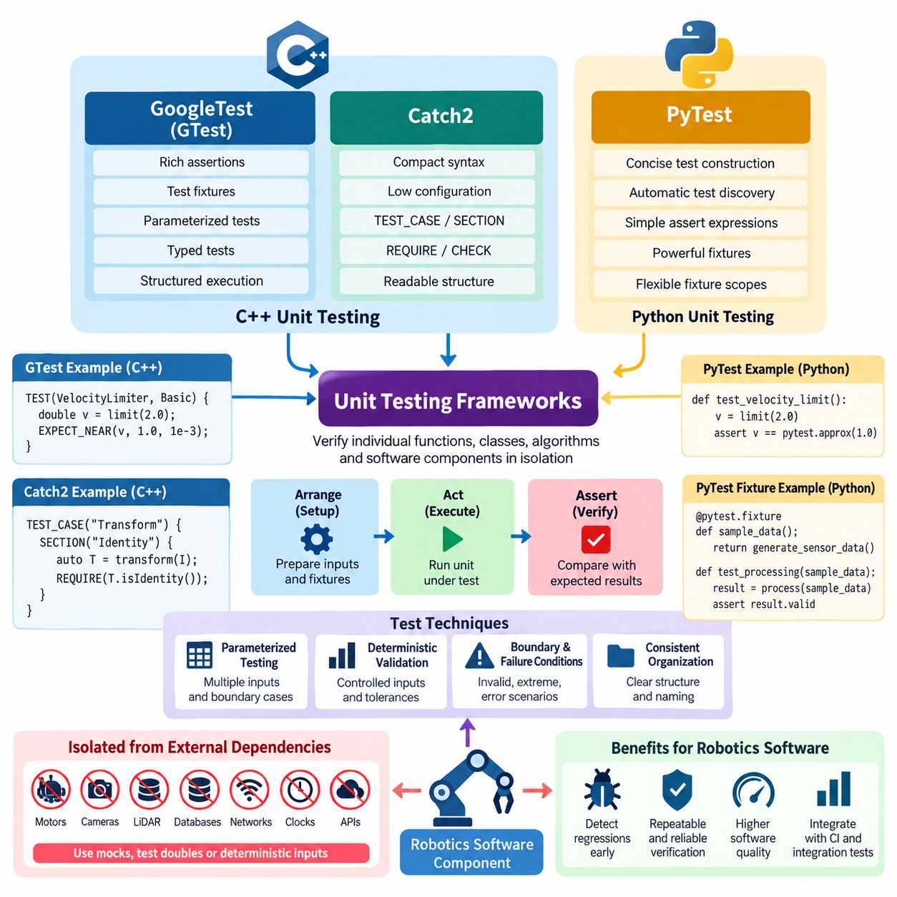
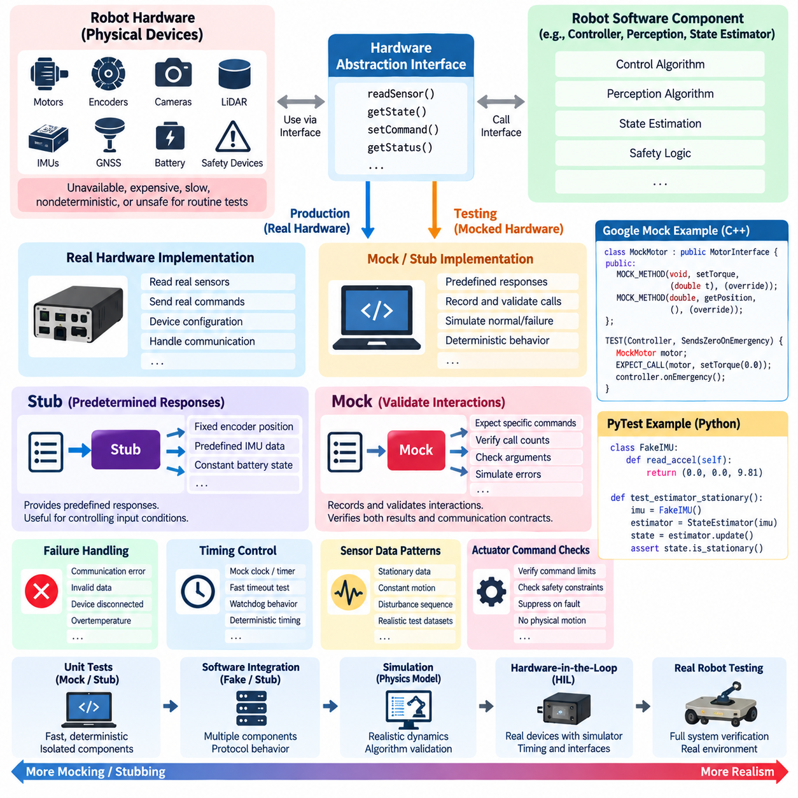
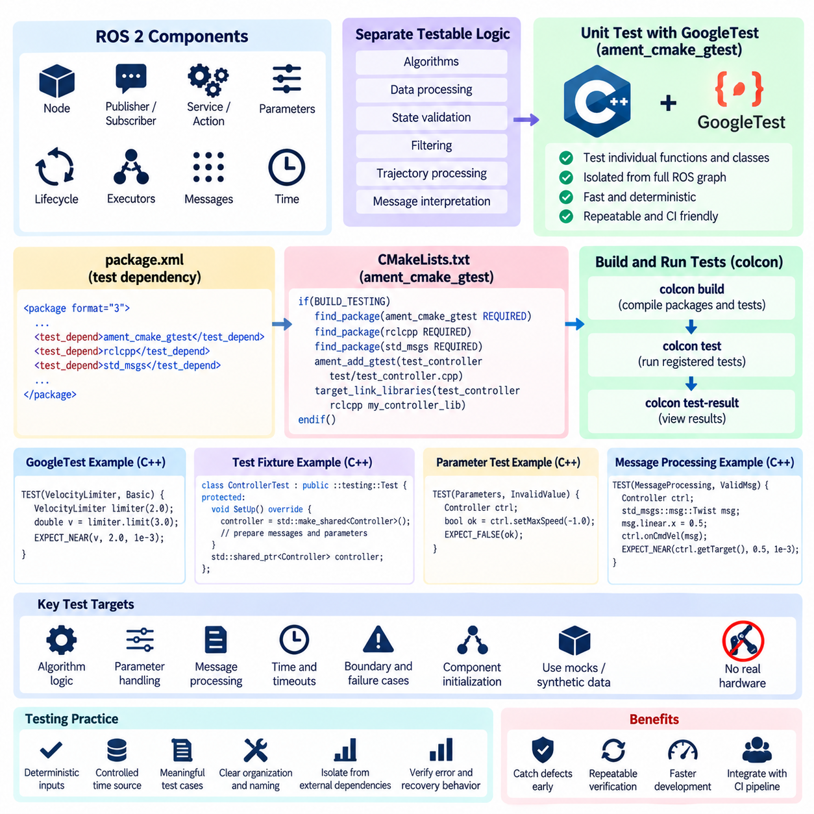
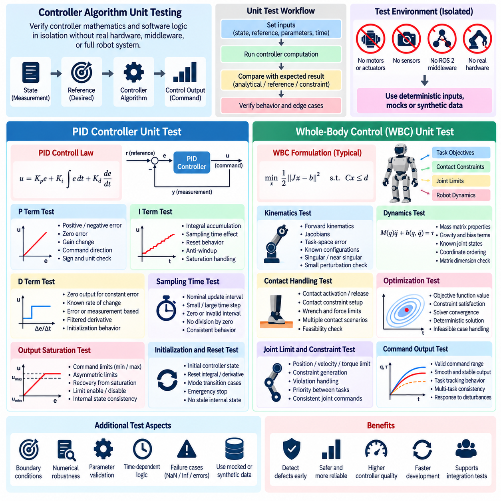
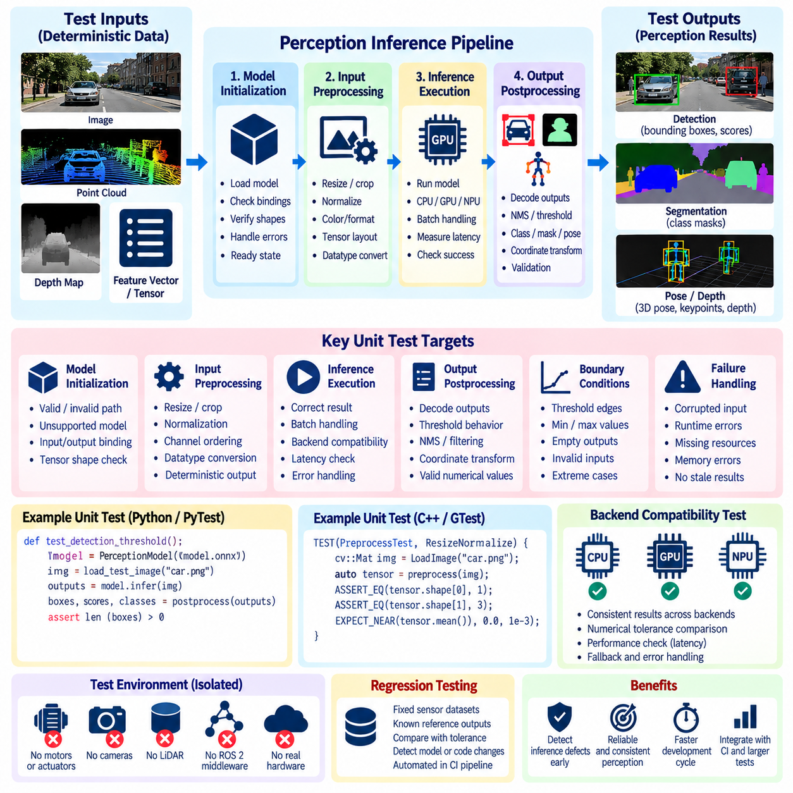
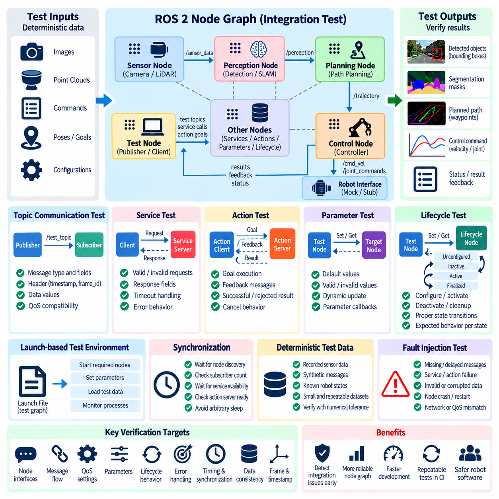
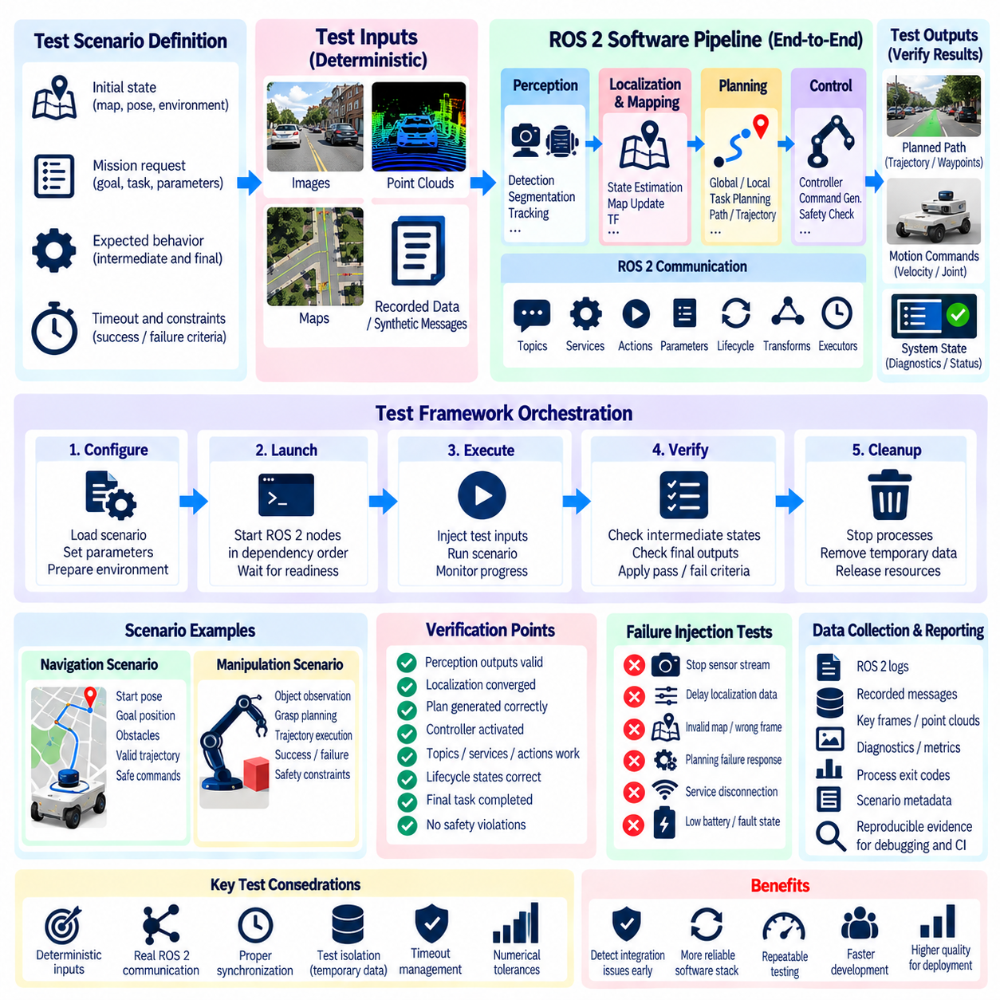
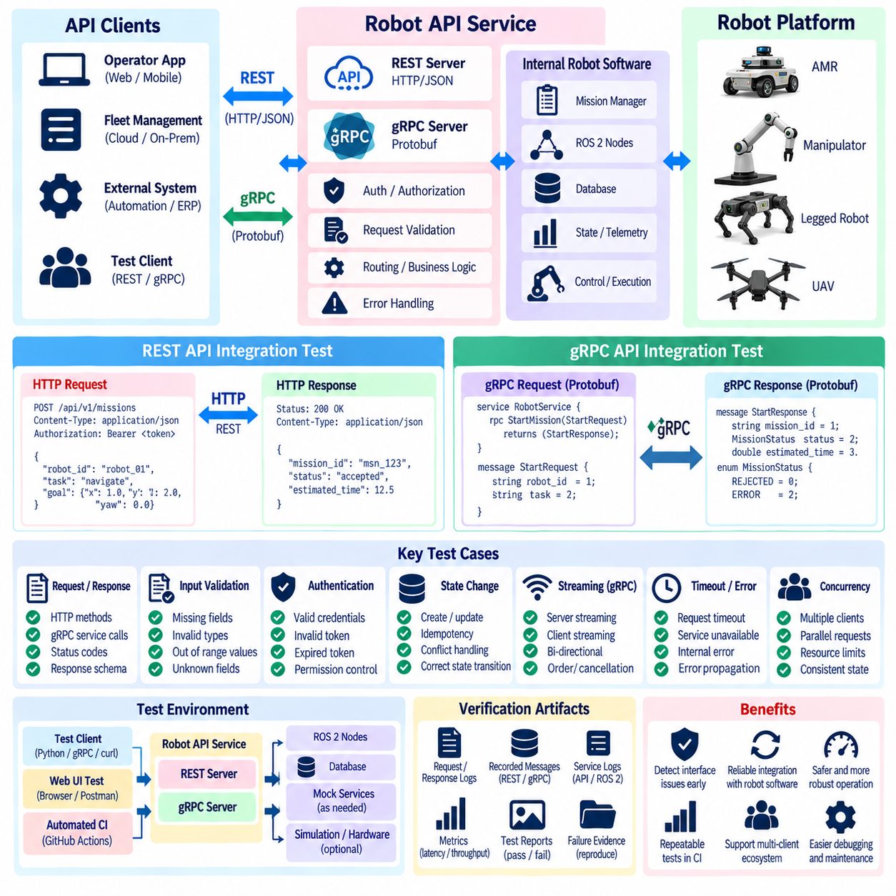
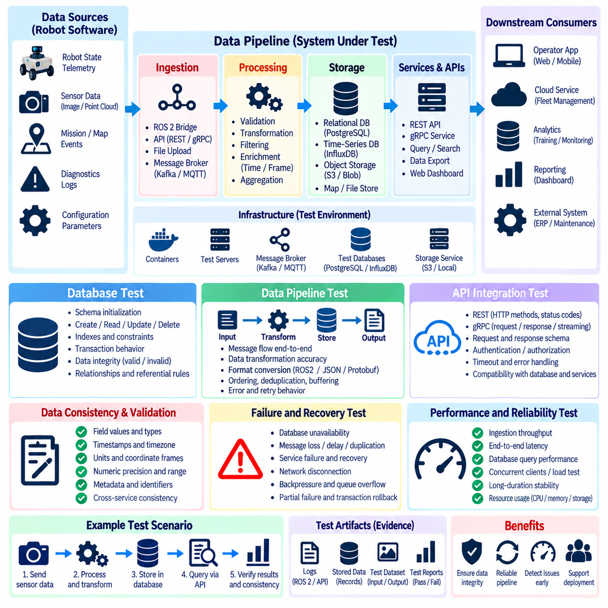
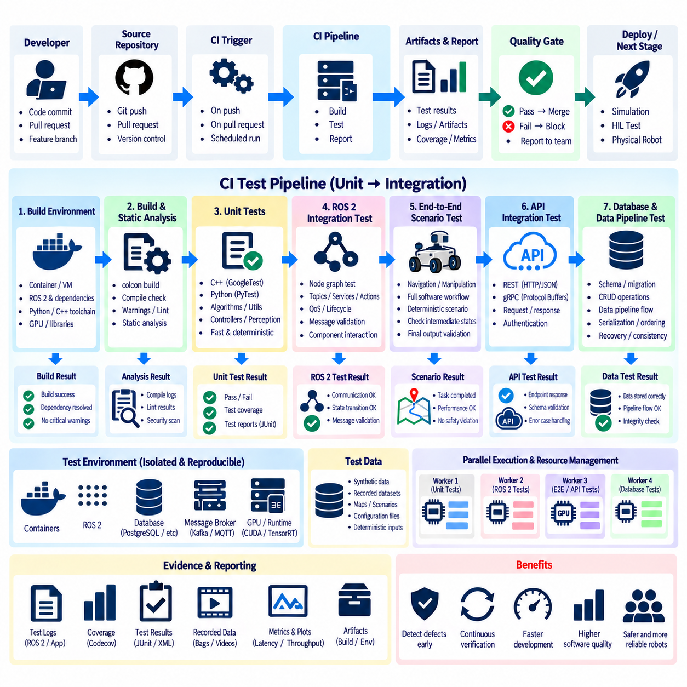

**Volume 25. Testing Validation and Benchmarking**

# Chapter 02. Software Unit and Integration Testing

## 02.01. Unit Testing Frameworks GTest Catch2 PyTest [w/Code]

{width="7.268055555555556in" height="7.268055555555556in"}

Unit testing provides the first executable verification layer for robotics software by checking individual functions, classes, algorithms, and software components in isolation. Within a broader software unit and integration testing strategy, frameworks such as GoogleTest, Catch2, and PyTest provide repeatable mechanisms for expressing expected behavior, detecting regressions, and producing machine-readable results that can later be incorporated into automated integration and CI pipelines.

GoogleTest, commonly called GTest, is widely used for C++ robotics software because it supports assertions, test fixtures, parameterized tests, typed tests, and structured test execution. A typical test creates controlled inputs, invokes the unit under test, and compares the observed result with an expected value using assertions such as EXPECT_EQ, EXPECT_NEAR, or ASSERT_TRUE. This pattern works well for deterministic mathematical and control-oriented components.

Test fixtures in GoogleTest are particularly useful when multiple tests require the same initialization procedure. A fixture can construct controller objects, initialize configuration parameters, allocate representative sensor messages, or prepare synthetic robot states before each test executes. Setup and teardown logic therefore remains separate from individual test intentions, reducing duplication and helping engineers maintain consistent initial conditions across a large regression suite.

Parameterized testing extends this approach by executing the same test logic over many input combinations. A velocity limiter, coordinate transformation, kinematic solver, trajectory interpolator, or safety threshold function can be evaluated against normal values, boundary conditions, invalid inputs, and extreme operating cases without duplicating test code. For robotics systems, this technique is valuable because physical behavior often depends on continuous variables with many important boundary regions.

Catch2 provides another C++ testing approach with a compact syntax and relatively low configuration overhead. Its TEST_CASE and SECTION concepts allow related behaviors to be expressed in readable test structures, while REQUIRE and CHECK assertions distinguish between conditions that must terminate a test path and conditions that may permit additional checks. Catch2 can therefore be attractive for libraries or algorithm modules where developers want tests to remain close to ordinary C++ expressions.

The choice between GoogleTest and Catch2 should normally follow the surrounding build environment, dependency policy, team conventions, and existing test infrastructure rather than syntax preference alone. GoogleTest is often suitable for large C++ projects with established fixtures and extensive automation, while Catch2 can provide concise organization for smaller libraries and focused components. Consistency across a robotics codebase is generally more valuable than mixing frameworks without a clear engineering reason.

PyTest serves a similar role for Python components but uses Python\'s dynamic language features to make test construction highly concise. Test discovery can identify appropriately named test files and functions automatically, while ordinary assert expressions express expected behavior without specialized assertion macros. This makes PyTest useful for robot orchestration logic, data processing utilities, AI preprocessing code, configuration validation, service clients, and other Python-based subsystems.

PyTest fixtures provide reusable initialization and dependency management for tests. A fixture may generate synthetic sensor observations, create temporary configuration files, initialize mock interfaces, prepare sample inference tensors, or establish temporary data directories. Fixtures can be scoped according to function, class, module, or session requirements, allowing expensive setup operations to be shared when appropriate while preserving isolation for state-sensitive software components.

A robust robotics unit test should isolate the software unit from physical hardware and external services whenever possible. Motor drivers, cameras, LiDAR devices, databases, networks, clocks, and remote APIs introduce nondeterminism and operational dependencies that make failures difficult to reproduce. Their behavior should instead be represented through controlled interfaces, test doubles, or deterministic inputs, leaving hardware-dependent verification to later integration, simulation, and HIL stages.

Determinism is especially important for control and estimation algorithms. Tests should define explicit initial states, timestamps, parameters, coordinate frames, and numerical tolerances so that repeated execution produces equivalent conclusions. Floating-point calculations should usually be compared using tolerances rather than exact equality. A kinematic transformation, PID calculation, filter update, or trajectory sample can then be validated against analytically derived or previously verified reference results.

Boundary and failure conditions deserve the same attention as nominal behavior. A unit test suite should examine empty inputs, maximum and minimum values, invalid configuration parameters, unavailable data, numerical singularities, NaN values, timeout conditions, and unexpected state transitions where applicable. Robotics software interacts continuously with imperfect sensors and changing environments, so software that succeeds only with ideal inputs cannot be considered adequately verified.

Test organization should mirror software architecture closely enough that failures can be localized rapidly. Tests can be grouped around libraries, classes, algorithms, or component responsibilities, with names describing the behavior being verified rather than implementation details. When a regression occurs, a descriptive test such as rejecting an invalid joint limit communicates more diagnostic information than a generic identifier, reducing the time required to understand the affected requirement and code path.

Unit tests should also remain independent of execution order. One test must not rely on state created accidentally by another test, because parallel execution, selective execution, or CI sharding can change ordering. Mutable global state should therefore be minimized or reset explicitly. Temporary files and generated resources should be isolated and cleaned automatically so that local development, container execution, and continuous integration environments produce comparable results.

Performance-sensitive robot functions can include lightweight timing checks, but unit tests should distinguish functional correctness from formal performance benchmarking. A test can detect a severe computational regression in a frequently executed routine, yet execution time varies with processors, operating systems, scheduling, and CI load. Strict real-time latency requirements are better verified under controlled integration, real-time, HIL, or benchmark environments designed for timing measurements.

The three frameworks can coexist in a heterogeneous robot platform when language boundaries require it. A C++ motion-control library may use GoogleTest, a compact C++ utility library may use Catch2, and Python perception utilities may use PyTest. The important architectural objective is to normalize how these suites are invoked and reported so that developers receive a unified pass/fail view despite differences in implementation language and framework conventions.

Automation turns individual tests into an engineering quality gate. Build systems and CI pipelines should execute unit tests whenever relevant source code changes, capture failure logs, preserve test reports, and reject changes that violate defined quality criteria. Because Chapter 02 progresses from framework-level unit testing toward mocking, ROS 2 testing, controller and perception tests, integration tests, APIs, data pipelines, and CI integration, unit frameworks form the foundation for progressively broader verification.

Effective unit testing is ultimately less about maximizing the number of test cases than about establishing fast, deterministic evidence that software components satisfy their intended contracts. GoogleTest, Catch2, and PyTest provide different language-specific mechanisms for building that evidence, but the core discipline remains consistent: isolate behavior, control inputs, define observable expectations, exercise boundaries, report failures clearly, and run the suite continuously as the robot software evolves.

## 02.02. Mocking and Stubbing for Robot HW Dependencies [w/Code]

{width="7.268055555555556in" height="7.268055555555556in"}

Robotics software frequently depends on physical devices that are unavailable, expensive, slow, nondeterministic, or unsafe to operate during routine software testing. Motors, encoders, cameras, LiDAR sensors, IMUs, GNSS receivers, battery controllers, and safety devices can therefore prevent conventional unit tests from remaining fast and repeatable. Mocking and stubbing replace these hardware dependencies with controlled software representations so individual components can be verified independently.

A hardware abstraction boundary is the foundation of effective mocking. Instead of allowing control or perception algorithms to communicate directly with a device driver, the software exposes an interface describing operations such as reading encoder positions, obtaining IMU measurements, sending motor commands, or checking device status. Production code connects this interface to real hardware, while unit tests substitute a mock or stub implementation without changing the component being tested.

A stub provides predetermined responses to requests from the software under test. For example, an encoder stub may always return a known wheel position, an IMU stub may provide a predefined acceleration vector, and a battery stub may report a fixed state of charge. Stubs are especially useful when the purpose of the test is to control input conditions rather than verify detailed interactions between the tested component and its dependency.

Mocks extend this concept by recording or validating interactions. A mock motor interface can verify that a controller issued a specific torque command, that an emergency condition resulted in a zero-velocity request, or that initialization invoked device configuration in the required sequence. Tests can define expectations for function arguments, invocation counts, return values, and error behavior, allowing both computational results and communication contracts to be verified.

Dependency injection makes these substitutions practical. A robot component can receive a hardware interface through its constructor, initialization function, or configuration mechanism rather than constructing a concrete hardware driver internally. During normal operation, the real implementation is injected; during testing, a mock implementation is supplied. This design reduces coupling between algorithm logic and device-specific code while improving testability and architectural modularity.

C++ robotics projects can combine interface-oriented design with mocking facilities such as Google Mock. A virtual hardware interface may define methods such as readPosition(), readVelocity(), setTorque(), or getStatus(), while a mock class implements corresponding mock methods. The test then configures expected calls and return values before executing the controller, enabling hardware-facing behavior to be examined without connecting an actual actuator or sensor.

Python software can achieve similar isolation through mock objects, monkeypatching, fixtures, or lightweight fake classes. A test may replace a camera API with a function returning a synthetic frame or substitute a network-connected sensor client with an object that generates deterministic messages. PyTest fixtures can package these replacements so the same simulated dependency is reused consistently across related test cases while remaining isolated from production resources.

Mocking becomes particularly important when testing failure handling. Real hardware failures are often difficult or undesirable to reproduce deliberately, whereas a mock can generate them deterministically. A sensor interface can raise a communication error, return stale timestamps, report invalid measurements, or simulate a disconnected device. A motor driver mock can reject commands or report an overtemperature state, allowing recovery and fault-management logic to be exercised safely.

Timing-related dependencies also require careful treatment. Robot software often uses clocks, timers, watchdogs, and timeout mechanisms that would make tests unnecessarily slow if they depended on wall-clock time. A mock clock can advance time programmatically, enabling a test to verify a 500 ms timeout or multi-second watchdog transition almost instantly. Controlling time also eliminates scheduling variations that might otherwise create intermittent and difficult-to-reproduce test failures.

Sensor stubs should represent meaningful physical conditions rather than arbitrary values. An IMU test sequence might represent a stationary robot, constant angular motion, or a sudden disturbance, while encoder values may describe forward travel or wheel slip. By constructing inputs around recognizable operating conditions, developers can relate test failures to expected robot behavior and build reusable datasets for algorithm-level regression testing.

Actuator mocking focuses primarily on commands and safety constraints because no physical motion occurs. Tests can confirm that velocity, current, torque, steering angle, or joint-position commands remain within configured limits. They can also verify that invalid state estimates, communication failures, or safety events suppress normal commands. This approach provides early evidence that software respects command contracts before the same logic is connected to real actuators.

Mocks should not reproduce every internal detail of the real device. Excessively detailed mocks can become alternative implementations of the hardware driver and may duplicate its defects or assumptions. A better design models only the externally observable contract required by the software under test. When realistic device dynamics or protocol behavior becomes necessary, testing should progressively move toward simulation, software integration, or hardware-in-the-loop environments.

Stubs, mocks, fakes, and simulators therefore serve different verification purposes. A stub supplies controlled data, a mock verifies interactions, and a fake may provide a simplified but functional implementation such as an in-memory device service. A simulator represents physical or temporal behavior at greater fidelity. Selecting the smallest test double that satisfies the verification objective keeps unit tests understandable, deterministic, and computationally inexpensive.

Test doubles must also reproduce abnormal boundary conditions that are difficult to obtain with healthy hardware. These include saturated sensor values, packet loss, delayed responses, invalid checksums, repeated timestamps, encoder rollover, intermittent connectivity, and initialization failures. Systematically injecting such conditions helps determine whether robot software transitions to defined degraded or safe states rather than propagating corrupted data or uncontrolled commands.

The boundary between mocking and integration testing should remain explicit. A controller tested against a mock motor driver demonstrates that the controller uses the driver interface correctly, but it does not prove that the production driver communicates correctly with the physical motor. That evidence must come from higher test levels. The testing structure therefore progresses from isolated software dependencies toward ROS 2 node integration, end-to-end software integration, and eventually hardware-oriented verification.

Mock-based tests are most valuable when executed automatically as part of continuous integration. Because they require no robot hardware, large suites can run whenever software changes and can execute concurrently across build agents. Failures can identify whether an interface contract, safety response, error path, or algorithm assumption has changed. This rapid feedback prevents many hardware-dependent defects from surviving until expensive laboratory or field-testing stages.

Effective mocking and stubbing ultimately depend on good software architecture. Hardware interfaces should be narrow, explicit, replaceable, and separated from algorithmic responsibilities. Tests should control inputs and failure modes without becoming tightly coupled to implementation details. When these principles are applied consistently, hardware-dependent robot software becomes easier to verify, failures become more reproducible, and later integration with real devices can focus on genuine hardware and system-level behavior.

## 02.03. ROS2 Unit Test ament cmake gtest [w/Code]

{width="7.268055555555556in" height="7.268055555555556in"}

ROS 2 software combines ordinary C++ logic with middleware-specific concepts such as nodes, publishers, subscribers, services, parameters, executors, and lifecycle behavior. Unit testing should therefore verify algorithmic and component behavior before larger node graphs are assembled. Within the software unit and integration testing structure, ament_cmake_gtest provides a standard way to connect GoogleTest-based C++ tests with ROS 2 package builds and automated test execution.

The ROS 2 build environment is based on ament and commonly uses ament_cmake for C++ packages. Tests are normally declared in the package CMake configuration so they become part of the same dependency and build model as production code. Instead of compiling a standalone test manually, developers register the test target through ament_cmake_gtest, associate the required libraries and ROS 2 dependencies, and allow the build system to manage execution and result collection.

A typical ROS 2 unit test separates reusable logic from the executable node that hosts it. Algorithms for coordinate conversion, command limiting, state validation, filtering, trajectory processing, or message interpretation can be implemented in ordinary C++ classes or libraries. GoogleTest can then instantiate those objects directly without launching an entire ROS graph, making failures easier to localize and keeping execution significantly faster than system-level tests.

The CMakeLists.txt file acts as the integration point between GoogleTest and the ROS 2 package. Testing configuration is generally placed behind the BUILD_TESTING condition so production builds do not unnecessarily configure test targets. The package locates ament_cmake_gtest as a test dependency and registers a source file as a GoogleTest executable. Additional target dependencies are then attached according to the interfaces exercised by the unit under test.

Package metadata should describe testing dependencies separately from normal runtime requirements where appropriate. Declaring the testing framework in package.xml allows dependency management tools and CI environments to reproduce the required build environment. This is important for robotics projects because tests may execute on developer workstations, container images, dedicated build servers, or multiple target architectures, and each environment must resolve the same package-level testing requirements.

GoogleTest assertions provide the fundamental verification mechanism inside ROS 2 C++ unit tests. EXPECT_EQ can verify discrete states or identifiers, EXPECT_TRUE can validate logical conditions, and EXPECT_NEAR is appropriate for numerical calculations involving floating-point tolerances. ASSERT-style checks terminate the current test when a prerequisite fails, preventing later expressions from operating on invalid objects or meaningless intermediate results.

Test fixtures are useful when ROS 2-related initialization is shared across several test cases. A fixture can construct a component, prepare messages, initialize parameters, or create deterministic test inputs before each test. Common cleanup can also be centralized. When ROS client-library initialization is actually required, its lifecycle should be controlled explicitly so repeated tests do not inherit hidden middleware state from previous cases.

Parameter handling is an important target for ROS 2 unit tests because many robot behaviors are configured at deployment time. Tests can verify default values, valid overrides, range checks, missing configuration, and rejection of invalid combinations. A velocity controller, for example, should behave predictably when maximum speed or acceleration parameters are changed and should not silently accept values that violate the component\'s defined operating constraints.

ROS 2 message-processing functions should also be tested independently whenever possible. A callback often contains validation, conversion, filtering, or state-update logic that does not fundamentally require DDS communication. Extracting this logic into testable functions allows synthetic geometry, sensor, navigation, or control messages to be passed directly into the unit, enabling deterministic verification without discovery delays, network transport, or executor scheduling effects.

Time introduces another important boundary. Robot nodes frequently evaluate message age, timeout conditions, watchdog intervals, and timestamp consistency. Tests should avoid unnecessary dependence on uncontrolled wall-clock timing because scheduling variations can create flaky results. Where architecture permits, time should be supplied through a controllable abstraction or explicit timestamp input so timeout and stale-data behavior can be verified quickly and repeatably.

Hardware access should remain outside the scope of most ROS 2 unit tests. A controller node should not require a real motor drive simply to test command saturation, and a perception component should not require a physical camera to test message validation. Hardware interfaces can instead be replaced with mocks, stubs, or synthetic data, preserving the isolation established by unit testing while leaving actual device communication for later integration and HIL verification.

The colcon workflow allows tests from multiple ROS 2 packages to be built and executed consistently across a workspace. After compilation, registered tests can be executed through the workspace testing process, and their results can be inspected in a consolidated form. This enables developers to detect failures across package boundaries while still retaining individual GoogleTest diagnostics that identify the exact test case and assertion responsible for a regression.

A useful ROS 2 unit test should remain independent of discovery timing and communication races whenever the behavior under examination does not require them. Tests that depend on publishers discovering subscribers, executors spinning for arbitrary delays, or messages arriving within loosely selected sleep intervals begin to behave like integration tests. Such behavior belongs in a later layer where ROS 2 communication semantics are deliberately part of the verification objective.

The distinction between unit and integration testing is therefore architectural rather than merely based on which framework launches the test. A GoogleTest executable that directly verifies a command-limiting class is a unit test, while a test that creates multiple ROS 2 nodes and verifies messages traveling through topics exercises integration behavior. Keeping this boundary explicit helps teams maintain fast unit suites while developing separate tests for node graph communication.

Failure-path testing is particularly valuable for robot nodes. Synthetic inputs can represent malformed messages, out-of-range commands, stale sensor data, unavailable configuration, invalid state transitions, or numerical anomalies. The expected result may be rejection, diagnostic reporting, command suppression, or transition into a defined safe state. Testing these conditions without physical hardware provides rapid evidence that defensive software behavior remains intact after code changes.

ROS 2 unit tests become most effective when integrated into continuous integration. Each change can trigger package compilation followed by registered ament tests, with failed assertions preventing defective changes from progressing further through the delivery pipeline. Because isolated tests are relatively fast and require little infrastructure, they can run much more frequently than simulation, HIL, or field tests and provide the earliest ROS-specific regression feedback.

Maintaining these tests requires the same discipline as maintaining production code. Test names should describe observable behavior, fixtures should avoid unnecessary complexity, numerical tolerances should have engineering justification, and tests should not depend excessively on private implementation details. When an internal refactoring preserves the external contract of a component, well-designed tests should normally continue to pass rather than requiring extensive modification.

ament_cmake_gtest therefore connects conventional C++ unit-testing practice with the ROS 2 package and build ecosystem. Its primary value is not simply launching GoogleTest, but making component-level verification reproducible within the same workspace used to build robot software. Combined with clean interfaces, controlled dependencies, deterministic inputs, and CI execution, it establishes a fast verification layer before ROS 2 node integration, end-to-end software testing, simulation, and hardware validation.

## 02.04. Controller Algorithm Unit Test PID WBC [w/Code]

{width="7.268055555555556in" height="7.268055555555556in"}

Controller algorithms transform desired robot behavior into commands that ultimately drive physical actuators, making software defects capable of producing instability, saturation, excessive force, or unsafe motion. Unit testing provides an early verification layer in which controller mathematics and software logic are examined without motors, sensors, middleware timing, or complete robot hardware. PID and whole-body control algorithms represent two important examples of this controller-level verification.

A controller unit test should isolate the computational function that maps state, reference, parameters, and time information into a control output. Instead of running a complete robot node, the test supplies deterministic position, velocity, force, or pose values directly to the controller. The resulting command is then compared with an analytically calculated value, a trusted reference implementation, or explicitly defined behavioral constraints.

PID controller testing begins with the proportional term because its expected behavior is straightforward. For a known reference and measured state, the error can be calculated directly and multiplied by the proportional gain. Tests should verify positive and negative errors, zero error, gain changes, and command direction. Such cases can reveal sign mistakes, incorrect error definitions, unit conversion defects, or accidental use of an incorrect gain parameter.

The integral term requires tests that explicitly control elapsed time and accumulated error. A sequence of constant errors should produce predictable integral growth according to the configured sampling interval. Tests should also verify reset behavior, integral limits, and anti-windup mechanisms. When an actuator command reaches saturation, the integral state must behave according to the controller design rather than continuing uncontrolled accumulation that could delay recovery.

Derivative behavior should be tested using controlled changes in error or measurement. A constant error should normally produce no derivative contribution after initialization, while a known rate of change should generate a predictable response. Tests must account for whether differentiation is performed on error or measurement and whether filtering is applied. Initialization deserves special attention because an undefined previous sample can otherwise generate an artificial derivative spike.

Sampling time is a critical input for discrete controllers. Unit tests should evaluate nominal update intervals as well as zero, unusually small, large, or inconsistent time steps according to the controller\'s defined contract. A controller should not silently divide by an invalid interval or produce unbounded output. Explicit control of time also prevents test results from depending on workstation scheduling or nondeterministic wall-clock execution.

Output saturation tests verify that controller commands remain within actuator or system limits. Large tracking errors can be intentionally supplied so the unconstrained PID result exceeds the configured maximum or minimum command. The test then confirms that the final output is clamped correctly. Related tests should verify asymmetric limits, disabled limits, configuration changes, and recovery from saturation without violating the intended internal controller state.

Controller state initialization and reset behavior are equally important. A newly constructed controller should begin from a documented internal state, and reset operations should clear or preserve integral, derivative, filter, and previous-sample values exactly as specified. These tests are particularly useful after mode transitions, emergency stops, controller switching, or trajectory restarts where stale internal state could generate an unexpected command.

Numerical robustness should be verified around boundary conditions. Tests can provide extremely small errors, values close to configured limits, large but valid state values, and floating-point conditions relevant to the implementation. Comparisons should use engineering tolerances rather than exact equality where appropriate. Invalid NaN or infinite inputs should be handled according to an explicit software policy instead of being allowed to propagate unpredictably into actuator commands.

Whole-body control(WBC) requires a broader unit-testing strategy because its output may depend on robot dynamics, task objectives, contact constraints, joint limits, and optimization variables. The test should decompose the implementation into independently verifiable mathematical components wherever possible. Kinematic mappings, Jacobians, task errors, dynamic terms, constraint construction, and optimization outputs can then be examined before testing the complete WBC computation.

Kinematic quantities provide useful deterministic test targets. For a predefined robot configuration, a unit test can compare calculated forward kinematics, Jacobians, or task-space errors with trusted reference values. Special configurations should be included where relevant because singular or nearly singular Jacobians can expose numerical weaknesses. Small perturbations of joint states can also verify whether calculated task-space changes remain consistent with expected local kinematic behavior.

Dynamic computations can be tested using fixed joint position and velocity vectors together with known robot-model parameters. Mass matrices should satisfy expected dimensional and structural properties, while gravity and bias terms can be compared against reference calculations. Unit tests should verify coordinate ordering and matrix dimensions carefully because indexing mistakes may produce numerically valid outputs that nevertheless correspond to the wrong joints or degrees of freedom.

Contact handling is central to many WBC implementations for humanoids, quadrupeds, and mobile manipulators. Tests can construct predefined contact states and verify that the appropriate constraints are activated or removed. Contact forces, friction constraints, support conditions, and allowable motion directions should be checked against the controller formulation. Switching a foot or end effector between contact and free motion should result in predictable changes to the optimization problem.

Task prioritization must also be verified when WBC combines several objectives. A test can introduce conflicting posture, end-effector, balance, or center-of-mass objectives and examine whether the resulting solution follows the configured hierarchy or weighting policy. Changing task weights should influence the solution in the intended direction. Such tests are valuable because configuration or matrix-assembly defects can silently reverse priorities without causing a solver failure.

Constraint tests should examine joint position, velocity, torque, acceleration, and contact-force limits where they are part of the controller formulation. Inputs can deliberately request an infeasible or near-limit motion so the test can verify whether constraints are respected. The expected behavior for an infeasible optimization problem should also be defined, including whether the controller reports failure, retains a previous command, or transitions toward a safe fallback.

Optimization-based controllers require verification beyond checking that the solver reports success. Tests should inspect solution dimensions, finite numerical values, constraint satisfaction, residuals, and relevant optimality conditions when practical. A solver can return a technically successful result while upstream matrices contain incorrect signs or coordinate mappings. Reference scenarios with simple known solutions are therefore especially valuable for detecting formulation errors.

Determinism is essential for controller regression testing. Identical state vectors, references, model parameters, and time steps should produce equivalent results within defined numerical tolerances. Randomized tests may supplement deterministic cases, but their seeds should be controlled so failures can be reproduced. Controller tests should execute without ROS 2 communication, physical actuators, or real-time scheduling unless those mechanisms are specifically part of a higher-level verification objective.

Controller unit tests provide mathematical and software evidence, not proof of physical stability on a real robot. A PID test can establish correct equations and saturation behavior, while WBC tests can establish correct matrix construction and constraint handling. Actual timing, actuator dynamics, sensor noise, communication delay, structural compliance, and contact uncertainty require later simulation, integration, HIL, and field validation stages within the broader testing hierarchy.

When incorporated into continuous integration, PID and WBC unit tests become regression guards for safety-critical control software. Changes to gains, robot models, optimization libraries, numerical routines, or controller architecture can automatically trigger deterministic verification before deployment. This preserves a fast feedback layer between low-level software changes and more expensive physical testing, while providing traceable evidence that fundamental controller behavior remains consistent as the robot platform evolves.

## 02.05. Perception Model Inference Unit Test [w/Code]

{width="7.268055555555556in" height="7.268055555555556in"}

Perception model inference is a critical software boundary between raw sensor observations and the higher-level decisions made by a robot. Unit testing at this boundary verifies that model loading, input preparation, inference execution, output interpretation, and failure handling behave consistently before the perception component is evaluated as part of a complete ROS 2 graph or physical robot. This testing layer belongs within the broader software unit and integration testing structure.

An inference unit test should isolate the smallest practical execution path around the deployed model. The test can provide a deterministic image, point cloud tensor, depth map, feature vector, or other predefined input directly to the inference interface and inspect the resulting outputs. Camera drivers, ROS 2 transport, network services, and physical sensors should normally remain outside this test boundary so failures can be attributed specifically to inference software.

Model initialization is one of the first behaviors that should be verified. Tests should confirm that a valid model artifact can be loaded, required input and output bindings are available, expected tensor dimensions are recognized, and the inference object reaches a usable state. Invalid model paths, incompatible artifacts, missing metadata, unsupported tensor shapes, or initialization failures should produce explicit errors rather than undefined behavior later in execution.

Input preprocessing must be tested independently because small preprocessing differences can significantly change AI model outputs. Image resizing, cropping, normalization, channel ordering, color conversion, tensor layout, and datatype conversion should produce known results for controlled inputs. For LiDAR or depth models, tests may similarly verify coordinate normalization, range filtering, voxelization, padding, or point sampling before the data reaches the network.

Tensor shape and datatype validation provide an important defensive boundary. Tests should supply correctly shaped tensors as well as inputs with missing dimensions, unexpected batch sizes, incompatible channel counts, or unsupported numerical types. The inference wrapper should either transform supported inputs according to its contract or reject invalid data clearly. Silent reinterpretation of an incorrectly shaped tensor can produce plausible but dangerously incorrect perception results.

Deterministic reference inputs are useful for regression testing. A small set of fixed sensor samples can be passed through the same deployed model version and the outputs compared against stored reference characteristics. Exact equality may not always be appropriate because GPU kernels, optimization backends, or numerical precision can introduce small variations. Tests should therefore define tolerances that reflect the numerical behavior of the deployment environment.

Output postprocessing requires its own unit-level verification. Object detection software may decode bounding boxes, confidence values, class indices, and non-maximum suppression results, while segmentation software may convert logits into class masks. Pose or depth models can require coordinate transformations or scaling. Testing these operations separately helps distinguish neural-network inference defects from errors introduced by conventional software surrounding the model.

Threshold behavior should be tested at meaningful boundaries. Confidence scores immediately below, equal to, and above a configured detection threshold can verify whether filtering semantics are implemented correctly. Similar tests can examine intersection-over-union thresholds, minimum depth values, range gates, or segmentation confidence criteria. Boundary-focused tests are particularly useful because comparison-operator errors can remain hidden during normal model evaluation.

Tests should also verify empty and low-confidence outputs. A valid perception model may legitimately detect no objects or produce no result that satisfies a configured threshold. The software should return a well-defined empty representation rather than generating invalid indices, null dereferences, stale detections, or exceptions. Downstream robotics components often depend on this distinction between a valid empty observation and an inference failure.

Batch handling deserves explicit verification when the deployment interface supports multiple inputs. Tests should confirm that batch dimensions are interpreted correctly, outputs remain associated with the corresponding input samples, and single-sample operation remains valid. Dynamic batch sizes should be checked against the model contract because assumptions introduced during optimization or deployment conversion may differ from those used during model training.

Failure-path tests should exercise corrupted input, unavailable model resources, inference backend errors, memory allocation failures where they can be represented safely, and unexpected output dimensions. The inference layer should convert such failures into defined software states or exceptions that higher-level components can handle. A perception pipeline should never reuse an old detection silently simply because the current inference invocation failed.

Numerical validity is another important property. Output tensors should be checked for NaN, infinity, invalid probabilities, impossible coordinates, or values outside defined physical ranges when such restrictions apply. These checks are particularly useful after model conversion, quantization, or accelerator optimization because a technically successful inference call does not guarantee that the returned tensor contains meaningful numerical values.

CPU, GPU, and accelerator backends may require compatibility-oriented unit tests when the same perception component supports several execution targets. The purpose is not to benchmark their performance but to verify that each supported backend accepts the defined model and input contract and returns structurally compatible results. Numerical tolerances may differ between FP32, FP16, INT8, or other optimized representations and should be defined accordingly.

Quantized models require additional attention because preprocessing scales, zero points, calibration assumptions, and output dequantization can introduce implementation errors outside the neural network itself. Unit tests can use controlled numerical inputs to verify quantization and dequantization paths independently. This provides a simple method for detecting deployment conversion defects before they appear as unexplained degradation in robot perception performance.

Inference unit testing should distinguish software correctness from model-quality evaluation. A test confirming that an object detector returns tensors with correct shapes and correctly decoded boxes does not establish adequate detection accuracy, robustness, or generalization. Metrics such as mAP, IoU, localization error, OOD robustness, and task-level performance belong to broader AI model evaluation and benchmarking activities rather than basic inference unit verification.

Synthetic inputs are useful when they test software contracts, but they should not be mistaken for realistic perception validation. Constant images, zero tensors, structured point sets, and manually constructed logits can precisely exercise preprocessing and postprocessing functions. Recorded real sensor samples can complement these cases for regression purposes, while large datasets and scenario distributions are better handled in dedicated model-evaluation and system-validation pipelines.

Inference tests should remain independent of unnecessary middleware and hardware timing. If the objective is to verify preprocessing, model invocation, and output decoding, the test should call those functions directly rather than waiting for camera topics or ROS 2 executors. Communication behavior can then be tested separately during node integration, preserving a clear boundary between fast perception unit tests and more complex software integration tests.

Continuous integration turns these tests into safeguards against model and software changes. Updating an inference engine, model artifact, preprocessing library, accelerator runtime, or postprocessing implementation can automatically trigger reference tests. Failures then reveal incompatible tensor contracts, changed numerical behavior, missing resources, or decoding regressions before the modified perception stack reaches simulation, HIL, or robot deployment.

A well-designed perception inference unit-test suite therefore verifies the complete software contract immediately surrounding an AI model without attempting to prove the model\'s overall intelligence. By controlling inputs, validating preprocessing, checking inference interfaces, examining numerical outputs, testing postprocessing, and exercising failure paths, the suite provides fast and reproducible evidence that the deployed perception model is being executed and interpreted correctly.

## 02.06. Integration Test ROS2 Node Graph [w/Code]

{width="7.268055555555556in" height="7.268055555555556in"}

ROS 2 node-graph integration testing verifies that independently tested software components operate correctly when connected through the middleware mechanisms used by the robot. Unlike unit tests that isolate algorithms or classes, these tests intentionally exercise publishers, subscribers, services, actions, parameters, executors, and lifecycle interactions. Within the chapter structure, this stage follows component-level unit testing and precedes broader end-to-end software integration testing.

A node graph represents the runtime relationships among ROS 2 nodes and their communication interfaces. An integration test constructs a controlled subset of this graph, launches the required nodes, injects known inputs, and observes messages or state transitions at defined outputs. The objective is not simply to prove that individual nodes start successfully, but to verify that interfaces between nodes satisfy the communication and behavioral contracts assumed by the overall robot software.

Topic integration testing verifies publisher-to-subscriber communication under realistic ROS 2 execution. A test publisher can inject deterministic sensor, command, state, or diagnostic messages while one or more production nodes process them. The test then observes downstream topics and checks message type, header information, values, timestamps, frame identifiers, and other application-specific fields against expected results.

Communication tests should account for ROS 2 Quality of Service(QoS) because compatible message types alone do not guarantee successful data exchange. Reliability, durability, history, queue depth, and deadline policies can influence whether endpoints communicate as intended. Integration tests should therefore use the QoS configurations expected in deployment and detect incompatible settings that might otherwise appear as unexplained message loss when the robot is assembled.

Service integration tests verify synchronous request-response contracts between nodes. The test can issue valid and invalid requests, confirm response fields, and evaluate behavior when the requested operation cannot be completed. Configuration services, mode changes, map queries, or device-management interfaces are suitable examples. Timeout and error behavior should be explicitly tested so a missing response does not cause an uncontrolled wait in dependent software.

ROS 2 actions require additional verification because they represent longer-running operations with goals, feedback, and final results. Integration tests can submit a known goal, observe intermediate feedback, and verify successful completion or rejection. Cancellation should also be tested where supported. Navigation, manipulation, docking, and trajectory execution commonly depend on these semantics, making action-state transitions important integration boundaries.

Parameter interactions should be verified when node behavior depends on configuration established during startup or changed dynamically. Tests can launch nodes with controlled parameter sets and confirm that the resulting behavior matches the configuration. Invalid values, missing parameters, dynamic updates, and parameter callbacks should be exercised according to the component contract, particularly when configuration influences limits, safety behavior, coordinate frames, or algorithm selection.

Lifecycle nodes introduce explicit state transitions such as unconfigured, inactive, active, and finalized states. Integration tests should verify that dependent communication begins only in appropriate states and that configure, activate, deactivate, cleanup, and shutdown transitions produce expected effects. Failed initialization should not leave a node appearing operational, and dependent nodes should respond predictably when a lifecycle-managed component becomes unavailable.

Launch-based testing is useful for constructing reproducible node graphs. Instead of requiring an engineer to start several terminals manually, a test launch description can start the required production nodes, supporting processes, and test components with known configuration. The test environment can then monitor process exit codes and communication behavior, allowing the same graph to execute on developer systems and continuous-integration workers.

Discovery and startup synchronization require deliberate handling. ROS 2 communication endpoints may need time to discover each other, so tests should avoid relying on arbitrary sleep intervals whenever possible. A more robust test waits for observable readiness conditions such as subscriber counts, available services, action servers, lifecycle states, or explicit initialization signals. This reduces flaky failures caused by differences in processor speed or CI workload.

Deterministic test data is essential for interpreting graph-level failures. Recorded or synthetic sensor messages can represent known robot states, obstacles, poses, trajectories, or commands. When identical inputs are injected, downstream outputs should satisfy predefined expectations within suitable numerical tolerances. The dataset should remain small enough for rapid execution while still exercising the interface behavior that distinguishes integration testing from isolated unit verification.

Timestamp and coordinate-frame consistency should receive particular attention because many robotics integration defects arise at these boundaries. Tests can verify that message timestamps remain logically ordered, stale inputs are rejected correctly, and frame identifiers match the expected coordinate system. When transform-dependent processing is involved, the test environment should provide controlled transformations so missing or inconsistent frames produce predictable diagnostic or failure behavior.

Fault injection expands integration testing beyond nominal message flow. A publisher can stop unexpectedly, a service can become unavailable, malformed data can be injected, or a component can report an internal fault. The surrounding node graph should react according to its design, such as suppressing commands, generating diagnostics, entering a degraded state, or waiting for recovery. These tests verify interactions that cannot be established by testing each node independently.

Integration tests should also examine message rates and queue behavior where correctness depends on continuous data flow. A perception or localization node may receive sensor messages faster than it can process them, while a controller may require state updates within a defined interval. Tests can introduce controlled publishing rates and verify that queue configuration, callback execution, and stale-data handling preserve the intended behavior without turning the test into a full performance benchmark.

Executors and callback groups can expose concurrency defects that do not appear during isolated unit testing. Multi-threaded execution may reveal race conditions, shared-state synchronization problems, callback ordering assumptions, or deadlocks. Integration tests should exercise the executor configuration used by the deployed component when concurrency is part of its architecture, while keeping test inputs deterministic enough that failures remain reproducible.

The test boundary should remain narrower than a complete robot system. A navigation-related integration test might include localization, planning, and command interfaces while replacing physical sensors and motor hardware with controlled sources and sinks. This allows ROS 2 communication and software composition to be tested without introducing hardware uncertainty. Complete physical behavior belongs to later simulation, HIL, system, and field-validation stages.

Pass and fail criteria should describe observable graph behavior rather than internal implementation details. Examples include receiving a valid command within a defined condition, rejecting an invalid request, reaching an expected lifecycle state, or ceasing command publication after input loss. Tests based on external contracts remain useful when nodes are internally refactored, whereas tests tightly coupled to private implementation details become unnecessarily fragile.

ROS 2 node-graph integration tests should be incorporated into continuous integration after fast unit tests have passed. The pipeline can build the workspace, launch controlled node groups, execute communication scenarios, collect test results, and terminate all processes cleanly. Because these tests require more middleware resources and execution time than unit tests, they can form a second verification layer before more expensive end-to-end, simulation, HIL, and physical testing.

A successful node-graph integration test does not prove that the entire robot will behave correctly in the real world. It establishes that selected ROS 2 components can discover each other, exchange compatible information, coordinate state, and handle defined faults under controlled software conditions. This evidence closes the gap between isolated unit correctness and complete software integration, providing a reproducible foundation for the subsequent end-to-end testing stage defined in the chapter structure.

## 02.07. End to End SW Integration Test Framework [w/Code]

{width="7.268055555555556in" height="7.268055555555556in"}

End-to-end software integration testing verifies complete functional paths across multiple robot software subsystems after unit-level and ROS 2 node-graph integration tests have established lower-level correctness. Instead of testing one class, node, or communication interface, an end-to-end framework follows information from an external input or mission request through perception, state estimation, planning, control, and supporting services to an observable software output.

The test boundary should represent a meaningful robot workflow while remaining controllable and reproducible. For an autonomous mobile robot, a scenario may begin with a navigation goal and predefined sensor observations, pass through localization and path planning, and terminate at generated motion commands. A manipulation scenario may begin with an object observation and task request and continue through pose estimation, grasp planning, trajectory generation, and controller command output.

An effective framework separates test orchestration from the production software being evaluated. The orchestration layer prepares configuration, launches required processes, injects test data, observes system outputs, applies pass or fail criteria, and performs cleanup. Production nodes should execute with configurations that closely represent deployment so the test evaluates actual software composition rather than a special implementation created only for testing.

Scenario definitions provide the primary abstraction for end-to-end testing. Each scenario describes an initial state, required configuration, input events, expected intermediate conditions, final success criteria, and timeout behavior. A navigation scenario might define a starting pose, map, goal, and obstacle sequence, while the expected outcome specifies whether a valid trajectory and safe command stream must be produced within defined constraints.

Input sources should be deterministic whenever possible. Synthetic messages, recorded sensor sequences, predefined maps, database fixtures, or controlled service responses can reproduce a known operating condition without physical hardware. The same scenario should produce equivalent conclusions when executed repeatedly. Deterministic inputs make regression failures easier to diagnose and allow the framework to compare software versions under identical conditions.

End-to-end tests should validate intermediate checkpoints as well as final outputs. A robot may eventually produce a command even though localization briefly became invalid or planning generated an unsafe intermediate state. Observing key states across the pipeline allows failures to be localized more effectively. Checkpoints can include valid localization, perception output availability, successful plan generation, controller activation, diagnostics, and expected lifecycle states.

ROS 2 communication remains an important part of the execution path. Topics, services, actions, parameters, lifecycle transitions, transforms, and executors should operate as they do in the target software architecture. Unlike isolated node-graph tests, however, the objective is not to verify each interface independently. The framework verifies that multiple interfaces cooperate correctly to complete a higher-level robot function from beginning to end.

Launch orchestration should manage all required software processes predictably. The framework needs to start components in the correct dependency order, determine when they are ready, execute the scenario, and terminate them cleanly. Readiness should preferably be based on observable conditions such as lifecycle states, service availability, action-server availability, or required topic connections rather than fixed sleep periods that can cause flaky tests.

Timeout management prevents a failed workflow from blocking the entire test campaign. Each scenario should define reasonable limits for initialization, communication, planning, execution, and shutdown where appropriate. A timeout is itself an observable failure condition and should generate diagnostic evidence showing which expected event did not occur. This makes stalled software paths distinguishable from incorrect numerical outputs or explicit process failures.

System-level assertions should focus on externally meaningful behavior. A navigation pipeline can be required to produce bounded velocity commands only after localization is valid, while a manipulation pipeline can be required to reject an unreachable target without issuing unsafe actuator commands. Such assertions remain useful even when internal algorithms are replaced because they describe the functional contract of the integrated software rather than private implementation details.

Failure injection is essential for verifying robustness across subsystem boundaries. The framework can stop a perception stream, delay localization updates, return a failed planning result, disconnect a supporting service, or inject invalid state data. The integrated system should react according to its design by suppressing commands, retrying an operation, entering a degraded mode, reporting diagnostics, or transitioning to a defined safe state.

Data collection should be integrated into the framework rather than added manually after a failure. Test execution can preserve logs, ROS 2 messages, diagnostic events, process exit codes, parameter snapshots, timestamps, and scenario metadata. These artifacts make failures reproducible and provide evidence for regression analysis. A failed CI run should contain enough information for an engineer to identify the affected stage without rerunning the complete scenario interactively.

Test isolation is necessary because end-to-end scenarios involve substantial shared state. Temporary maps, configuration files, databases, caches, namespaces, ports, and generated outputs should be separated between test runs. Processes from a previous scenario must not remain active and influence subsequent execution. Reliable cleanup is therefore part of the framework itself rather than an optional convenience after a successful test.

Environment reproducibility becomes increasingly important as the integration scope grows. Container images, pinned dependencies, known ROS 2 configurations, controlled model artifacts, and versioned test datasets can reduce differences between developer machines and CI workers. The software revision, configuration revision, test-data version, and relevant runtime dependencies should be traceable so a historical failure can be reconstructed when necessary.

Parallel execution can reduce test duration, but scenarios should be parallelized only when resources and namespaces are sufficiently isolated. Multiple ROS 2 graphs may otherwise interfere through discovery, shared network resources, databases, GPU allocation, or fixed device names. Resource-aware scheduling is particularly important when perception models or computationally expensive planners compete for accelerators and memory on the same test worker.

Performance observations can be collected during end-to-end execution without turning every scenario into a benchmark. The framework may record processing latency, message age, dropped updates, planning duration, or resource usage and compare them with broad regression thresholds. Strict performance certification should remain a separate activity, but large changes in timing can provide early evidence of integration problems that functional pass or fail checks alone may miss.

The framework should support both positive and negative scenarios. Positive tests verify that valid requests can complete successfully, while negative tests verify that invalid, unavailable, or unsafe conditions are rejected correctly. A mature suite includes nominal workflows, boundary cases, recovery paths, and representative failures so software integration is evaluated not only by its ability to succeed but also by its ability to fail safely.

Continuous integration should execute end-to-end tests after faster unit and focused integration suites have passed. This ordering avoids consuming expensive resources on software that already violates lower-level contracts. Selected smoke scenarios can run on every change, while broader regression suites can run on scheduled or release-oriented pipelines. Test results should remain machine-readable so failures can be tracked across software revisions.

End-to-end software integration testing still does not replace simulation, HIL, or field validation. Controlled software inputs cannot fully reproduce physical dynamics, sensor uncertainty, actuator behavior, environmental variability, or real-time hardware interactions. Instead, this framework establishes that the integrated software stack can execute complete robot workflows coherently before those workflows are exposed to increasingly realistic and expensive verification environments.

A well-designed end-to-end framework therefore connects component correctness with system-level software behavior. By combining reproducible scenarios, controlled inputs, production-like ROS 2 composition, intermediate checkpoints, failure injection, automated evidence collection, and CI execution, it provides a repeatable method for determining whether the robot software stack operates as one coordinated system before verification progresses to APIs, data pipelines, HIL, simulation, and physical testing.

## 02.08. API Integration Test REST gRPC Robot [w/Code]

{width="7.268055555555556in" height="7.268055555555556in"}

Robot software increasingly exposes application programming interfaces that connect onboard autonomy, fleet management, cloud services, operator applications, databases, and external automation systems. API integration testing verifies that these interfaces exchange commands, state, telemetry, and results correctly across real software boundaries. Within the chapter structure, REST and gRPC testing extends integration verification beyond ROS 2 node graphs and end-to-end internal software workflows.

An API integration test should exercise the deployed interface rather than call the underlying business logic directly. The test client sends a request through the actual HTTP or gRPC endpoint, allowing serialization, transport, routing, authentication hooks, validation, service logic, and response generation to participate. This distinguishes API integration testing from unit tests that verify handler functions or message conversion utilities in isolation.

The test environment should reproduce the service topology required by the API while controlling dependencies that are outside the verification objective. A robot API service may communicate with mission management, telemetry storage, ROS 2 gateways, or fleet services. Required components can run as real integration targets, while unrelated cloud or hardware dependencies can be represented by controlled substitutes to keep execution deterministic and failures diagnosable.

REST API testing begins with verification of HTTP methods, resource paths, request headers, payload formats, and response status codes. Tests should confirm that valid GET, POST, PUT, PATCH, or DELETE operations behave according to the defined contract. Robot-specific resources may include missions, maps, robot state, configuration, charging requests, task assignments, diagnostics, or software-management operations depending on the platform architecture.

Request-schema validation should be exercised systematically. Tests can submit complete valid payloads, omit mandatory fields, provide unknown fields, use incorrect data types, or supply values outside allowed ranges. The API should reject invalid commands before they propagate into robot control logic. This is particularly important for parameters such as velocity limits, target poses, task identifiers, map references, or operational modes that can influence physical behavior.

Response validation should examine more than the HTTP status code. A successful response should contain the expected schema, field types, identifiers, timestamps, state values, and application-level result information. Error responses should also follow a predictable structure so clients can distinguish validation failures, unavailable resources, conflicting state, authorization problems, internal errors, and temporary service unavailability without parsing arbitrary text.

State-changing REST operations require careful integration testing because repeated requests may produce unintended robot actions. Where the API contract requires idempotency, tests should verify that retrying the same request does not create duplicate missions or repeated commands. Where operations are intentionally non-idempotent, the resulting state transitions should be explicit. This becomes important when clients automatically retry requests after communication interruptions.

gRPC integration testing focuses on the service and message contracts defined through Protocol Buffers. A test client can invoke the generated service stub using known request messages and inspect the returned response. The test should verify field semantics, enumeration values, nested messages, optional or required application-level information, and compatibility between the client and server implementations rather than merely confirming that the remote procedure call completed.

Unary gRPC calls can be tested similarly to conventional request-response operations, but streaming interfaces require additional scenarios. Server streaming may deliver continuous robot telemetry, client streaming may upload sequences of data, and bidirectional streaming may support interactive control or status exchange. Tests should verify stream establishment, message ordering where guaranteed, normal completion, cancellation, disconnection, and recovery behavior according to the service contract.

Deadlines and timeouts are essential for robot APIs because waiting indefinitely for a remote operation can block higher-level autonomy or operator workflows. Integration tests should configure realistic deadlines and deliberately delay or suppress responses to confirm that clients and servers handle expiration correctly. A timeout should result in a defined error path, diagnostic event, retry policy, or safe application state rather than an uncontrolled blocking condition.

API tests should verify error propagation across software layers. A REST endpoint may successfully receive a request while an internal ROS 2 service, database operation, or mission manager fails. Similarly, a gRPC server may accept a command but be unable to execute the requested robot operation. Integration testing should confirm that internal failures are translated into stable external error contracts without exposing implementation details or falsely reporting success.

Authentication and authorization behavior should be included when they are part of the deployed API contract. Tests can verify accepted credentials, missing credentials, expired or invalid credentials, and attempts to invoke operations without the required permission. Security testing is broader than functional API integration testing, but basic access-control behavior should still be verified because incorrect authorization can expose safety-relevant robot commands or sensitive operational data.

Concurrency scenarios are important when multiple clients can interact with the same robot or fleet service. Tests can issue simultaneous task requests, configuration updates, or state queries and observe whether shared resources remain consistent. Conflicting commands should be resolved according to a defined policy rather than producing race-dependent behavior. Transaction identifiers, revision numbers, locks, or explicit conflict responses can be validated where the architecture provides them.

Robot API integration tests should also examine the boundary between external interfaces and ROS 2. A REST mission request may be converted into a ROS 2 action goal, while telemetry from ROS 2 topics may be transformed into REST responses or gRPC streams. Tests should verify field mapping, units, coordinate frames, timestamps, identifiers, and state semantics across this gateway because translation errors can remain invisible when either side is tested independently.

Test data should include both nominal and boundary scenarios. A target pose may be valid, outside an allowed operating area, malformed, or associated with an unavailable map. A mission identifier may exist, be unknown, or refer to a completed operation. By controlling these conditions, the test suite verifies not only successful API communication but also the behavior of the integrated software when requests cannot legitimately be executed.

Service availability and reconnection should be tested where distributed robot software must tolerate temporary network failures. The test framework can terminate an API server, interrupt a dependent service, or force a connection to close and then restore it. Clients should respond according to their defined recovery strategy, avoiding uncontrolled request duplication, stale state, or indefinite blocking when communication becomes available again.

Version compatibility becomes important as robot and fleet software evolve independently. Integration tests can verify that supported API versions preserve required fields and semantics and that incompatible versions fail clearly. For Protocol Buffers, changes to field definitions should respect the intended compatibility strategy. REST APIs may use explicit versioned paths or schemas, and regression tests should protect externally consumed contracts during internal refactoring.

Observability should be incorporated into API testing so failures can be traced across distributed services. Request identifiers, timestamps, service logs, gRPC status information, HTTP responses, and relevant ROS 2 events can be collected with each scenario. Correlating these records helps determine whether a failure originated in transport, validation, gateway conversion, robot software, or a downstream service rather than simply reporting that the external request failed.

Continuous integration can execute API integration tests after unit and focused component tests succeed. The pipeline can start the required services, wait for readiness, execute REST and gRPC scenarios, collect results, and shut down the environment cleanly. Contract-focused smoke tests may run frequently, while larger failure, concurrency, compatibility, and recovery suites can execute in broader regression pipelines before release.

API integration testing therefore verifies the software boundary through which robot capabilities become accessible to other systems. By exercising actual REST and gRPC transports, validating schemas and state transitions, testing failures and timeouts, checking ROS 2 gateway mappings, and preserving reproducible evidence, the test framework establishes confidence that external clients can interact with robot software predictably before verification expands to data pipelines and complete deployment environments.

## 02.09. Database and Data Pipeline Integration Test [w/Code]

{width="7.268055555555556in" height="7.268055555555556in"}

Database and data-pipeline integration testing verifies that robot software can persist, retrieve, transform, transport, and consume operational data correctly across service boundaries. Modern robots generate mission records, maps, telemetry, diagnostics, perception results, configuration histories, and maintenance information. Testing these paths ensures that valid information remains consistent from the robot software that produces it to the applications and services that later consume it.

The integration boundary should include the real database interface and the important stages of the data pipeline rather than replacing every dependency with an in-memory mock. A controlled test environment can instantiate the database, schema, message broker, storage service, or processing component required by the architecture. External systems outside the verification objective may still be substituted so that failures remain reproducible and attributable to the tested pipeline.

Database schema initialization is a fundamental test target. A fresh environment should create the required tables, collections, indexes, constraints, and metadata without manual intervention. Tests should also confirm that application services can start against the initialized schema and that expected fields use compatible types and constraints. Missing indexes or incorrect relationships may not cause immediate functional failure but can reveal deployment inconsistencies.

Create, read, update, and delete operations should be verified through the same repository or service interfaces used by production robot software. A mission record written by one component should be retrievable by another with equivalent identifiers, timestamps, state fields, and associated metadata. Updates should modify only intended fields, while deletion or archival behavior should preserve referential and operational rules defined by the system.

Transaction behavior becomes important when a robot operation modifies several related records. Assigning a mission may update the mission state, robot allocation, event history, and scheduling information as one logical operation. Integration tests should deliberately cause failure during intermediate steps and verify that the database preserves the intended atomicity. Partially committed state can otherwise leave fleet software with contradictory information about robot availability or task ownership.

Data integrity constraints should be exercised with both valid and invalid records. Tests can attempt to insert duplicate identifiers, missing required fields, invalid references, malformed timestamps, or values outside application-defined ranges. The database and application layer should reject inconsistent information according to their respective responsibilities. Error handling should remain predictable so upstream services can distinguish validation failures from infrastructure failures.

Robot timestamps deserve particular attention because data may originate from multiple computers, sensors, and cloud services. Integration tests should verify timestamp representation, timezone handling, precision, ordering, and conversion across storage boundaries. Telemetry or event pipelines should preserve the temporal relationships needed for diagnostics and replay. Incorrect conversions can make valid robot events appear out of order even when every individual message is otherwise correct.

Data serialization and deserialization should preserve the semantic content of robot information. ROS 2 messages, JSON documents, Protocol Buffer messages, binary sensor records, or custom structures may be transformed before storage or transmission. Tests should verify field mapping, units, coordinate-frame identifiers, enumeration values, optional fields, and numerical precision so information does not silently change meaning while crossing representation boundaries.

A data pipeline often contains producers, brokers, processors, storage systems, and downstream consumers. Integration testing should follow representative records through these stages and confirm that each expected transformation occurs. For example, robot telemetry may be published by an onboard service, normalized by a gateway, transferred through a message system, stored in a time-series database, and later retrieved by a monitoring application.

Ordering behavior should be tested when downstream logic depends on event sequence. Distributed systems can introduce delayed, duplicated, or reordered messages even when individual producers behave correctly. The pipeline should define how sequence numbers, timestamps, partitioning, or application logic preserve required ordering. Tests can intentionally alter arrival order and verify that consumers either reconstruct the intended sequence or handle unordered information safely.

Duplicate delivery is another important integration condition because many messaging systems provide at-least-once delivery semantics. A test can deliver the same telemetry record, mission event, or processing request multiple times and observe whether duplicate storage or repeated side effects occur. Where idempotent processing is required, stable event identifiers or deduplication logic should ensure that retries do not corrupt accumulated robot state.

Missing or delayed data should produce defined behavior. A telemetry pipeline may temporarily lose network connectivity, a database may become unavailable, or a processing service may stop consuming messages. Tests should verify buffering, retry, backpressure, expiration, or failure-reporting policies according to the architecture. Recovery should not silently discard critical records or overwhelm downstream services with uncontrolled retransmission.

Pipeline transformation logic should be tested with known input and expected output datasets. Raw robot observations may be filtered, aggregated, enriched with metadata, converted into engineering units, or summarized into operational metrics. Deterministic fixtures allow the transformed records to be compared field by field with expected values. This separates transformation correctness from broader analytics or machine-learning quality evaluation.

Large binary artifacts require additional integration checks when the robot stores maps, images, point clouds, logs, or AI-related datasets outside the primary database. Metadata records should reference the correct object, version, checksum, location, and ownership information. Tests should verify that an artifact written through the storage interface can later be retrieved and associated with the correct robot, mission, timestamp, or dataset without ambiguity.

Schema migration testing protects systems that evolve while retaining historical robot data. A test environment can begin with an earlier supported schema, populate representative records, execute the migration, and verify that the updated application can read and modify the migrated data. Migration tests should detect lost fields, incorrect defaults, incompatible type conversions, or changes that break services still expecting a supported historical representation.

Concurrent access should be evaluated when multiple robot or fleet services read and update shared information. Tests can simulate simultaneous mission assignment, robot-state updates, configuration changes, or telemetry writes. The resulting records should satisfy the defined consistency model. Lost updates, conflicting ownership, or race-dependent state transitions should be detected before deployment where concurrency is significantly harder to reproduce.

Failure injection should include database disconnection, broker interruption, malformed records, processing exceptions, and temporary downstream unavailability. The objective is to verify the behavior of the integrated pipeline rather than merely confirm that an exception occurs. Components should preserve recoverable data, report meaningful diagnostics, avoid uncontrolled retry loops, and resume processing according to the defined recovery strategy when dependencies return.

Observability is essential because a pipeline failure may occur several services away from the original robot event. Integration tests should capture correlation identifiers, processing timestamps, queue state, database errors, transformation logs, retry counts, and relevant service diagnostics. These records make it possible to determine where a message was delayed, rejected, duplicated, transformed incorrectly, or lost during a regression test.

Test isolation should prevent one execution from contaminating another. Each scenario can use a dedicated database, schema, namespace, topic, bucket, or temporary storage location depending on the technology. Test data should be created automatically and removed or reset after execution. Reliable isolation enables parallel CI runs and prevents old robot records from producing false positives or hiding failures in later scenarios.

Continuous integration can execute focused database and pipeline tests after unit, node-graph, end-to-end, and API contract checks have established earlier software correctness. The pipeline can provision temporary infrastructure, apply schemas, load deterministic fixtures, execute data flows, inspect stored results, and destroy the environment. More expensive migration, recovery, concurrency, and volume-oriented scenarios can run in scheduled regression pipelines.

Database and data-pipeline integration testing therefore establishes confidence that robot information remains usable beyond the process that originally created it. By verifying persistence, transactions, schemas, serialization, ordering, duplicate handling, transformations, migrations, recovery, and observability, the test framework protects the continuity of operational data across the robot software ecosystem and prepares the integrated stack for subsequent performance and reliability testing.

## 02.10. CI Integrated Unit and Integration Test Pipeline [w/Code]

{width="7.268055555555556in" height="7.268055555555556in"}

A continuous integration pipeline for robot software combines unit and integration testing into an automated verification sequence that executes whenever software changes. Its purpose is to detect defects before they propagate into simulation, HIL, or physical robot testing. The pipeline connects source-code changes with reproducible builds, deterministic tests, evidence collection, and acceptance gates so software quality is evaluated continuously rather than only before release.

The pipeline should organize tests according to verification scope and execution cost. Fast unit tests normally run first because they isolate algorithms, utilities, controllers, perception inference wrappers, and other software components without requiring distributed services. More expensive ROS 2 integration, end-to-end, API, and data-pipeline tests follow only after the fundamental software checks succeed, reducing wasted compute resources and shortening feedback time for developers.

A CI run begins from a defined source revision and a reproducible build environment. Compiler versions, ROS 2 dependencies, middleware configuration, Python packages, inference runtimes, and external libraries should be controlled through versioned configuration or container images where practical. The pipeline should record the exact software revision and relevant environment information so a failed test can later be reproduced under equivalent conditions.

The build stage should verify that packages compile cleanly before functional tests begin. ROS 2 workspaces can be built with the required package dependencies and test options enabled, while compiler warnings and static-analysis findings may be collected according to project policy. A build failure should terminate dependent stages because integration results are not meaningful when the tested software artifact cannot be produced consistently.

Unit tests form the first executable verification gate. C++ tests based on GoogleTest or similar frameworks and Python tests based on PyTest can validate mathematical functions, state machines, controller algorithms, message-processing logic, inference preprocessing, and failure handling. These tests should remain deterministic and independent of unnecessary middleware, network, database, or physical hardware dependencies so they can execute rapidly on every relevant change.

ROS 2 package tests should integrate naturally with the workspace build and test system. Tests registered through ament can be executed as part of the automated pipeline, with results collected in a machine-readable form. Failed assertions, process errors, and package-level test results should be preserved as artifacts. This provides immediate traceability from a CI failure to the package and test case responsible for the regression.

After unit verification succeeds, focused ROS 2 node-graph integration tests can validate communication between production components. The pipeline may launch selected publishers, subscribers, services, actions, lifecycle nodes, and supporting processes using controlled configurations. Tests should wait for observable readiness conditions instead of arbitrary delays and then verify message exchange, QoS compatibility, state transitions, transforms, and defined failure behavior.

End-to-end software scenarios extend the pipeline across complete functional paths. A controlled navigation, manipulation, perception, or mission workflow can inject known inputs and observe intermediate checkpoints and final outputs. These scenarios should use production-like software composition while replacing physical hardware with deterministic sources where appropriate. The objective is to verify coordinated software behavior before introducing simulation or real-world uncertainty.

API integration stages can verify REST and gRPC boundaries used by fleet systems, operator applications, cloud services, or external automation. The CI environment can start the required API services, issue controlled requests, validate schemas and responses, exercise timeout and error paths, and confirm mappings into internal ROS 2 operations. Contract failures should be detected before incompatible software revisions are deployed together.

Database and data-pipeline tests can provision temporary infrastructure for persistence and information-flow verification. The pipeline may initialize schemas, load deterministic fixtures, execute representative telemetry or mission-data flows, and inspect stored or transformed results. Transaction behavior, serialization, duplicate handling, ordering, migration, and recovery scenarios can be included according to execution cost and the risk associated with the modified components.

Test environments should be isolated from one another to prevent state leakage. ROS 2 namespaces, databases, temporary files, network ports, caches, message queues, and generated artifacts should be separated when tests run concurrently or sequentially on shared workers. Cleanup must execute reliably even after failure so a crashed scenario does not leave processes or data that alter the outcome of subsequent CI jobs.

Parallelization can reduce total verification time when tests are independent and infrastructure resources permit it. Unit-test packages can often execute concurrently, while integration scenarios may require more careful scheduling because they compete for CPU, memory, network resources, databases, or GPUs. Resource-aware execution prevents unrelated tests from producing timing failures merely because several computationally intensive robotics workloads were scheduled on the same worker.

Flaky tests should be treated as engineering defects rather than hidden through unlimited retries. A test that intermittently fails because of arbitrary sleeps, uncontrolled timing, shared state, random seeds, or discovery races weakens confidence in the complete pipeline. CI infrastructure should preserve enough evidence to distinguish product failures from test-environment instability, while retries, if permitted, should remain bounded and visible in the reported result.

Failure diagnostics should be collected automatically at every significant stage. Useful evidence can include test reports, process logs, ROS 2 diagnostics, message traces, parameter snapshots, database errors, API responses, timestamps, core dumps, and relevant runtime metadata. Artifacts should be associated with the source revision and test scenario so engineers can investigate a regression without first attempting to reproduce an incompletely documented CI environment.

Coverage information can supplement test results by identifying software paths that are exercised or left untested. Line, branch, or function coverage may help reveal important gaps, but coverage percentage should not be treated as proof of behavioral correctness. Safety-relevant error handling, boundary conditions, state transitions, and interface contracts require explicit test scenarios even when overall numerical coverage appears high.

Pipeline gates should reflect the criticality and maturity of the robot software. A pull request may require successful compilation and all fast unit tests, while merging into a protected branch can additionally require ROS 2 integration and selected end-to-end scenarios. Release candidates can trigger broader API, database, recovery, compatibility, and regression suites. This layered policy balances rapid developer feedback with increasingly comprehensive verification.

Change-aware test selection can improve efficiency when the software repository becomes large. Modifications to a controller library may immediately trigger its unit tests and dependent ROS 2 integration scenarios, while changes to shared interfaces can require a much broader suite. Dependency information can guide selection, but periodic complete regression runs remain important because indirect interactions may not be captured perfectly by automated impact analysis.

The CI pipeline should enforce reproducibility while recognizing that some robotics tests require specialized resources. GPU inference tests, real-time workloads, HIL systems, or licensed simulation environments may not be available on every worker. Such tests can be assigned to dedicated runners or later verification pipelines while the main CI path preserves fast software-only feedback. Resource requirements and skipped tests should remain explicit rather than silently reducing verification scope.

Trend information across CI runs can reveal degradation that individual pass or fail results do not expose. Test duration, initialization time, inference latency, memory consumption, failure frequency, and other selected observations can be tracked across revisions. These measurements are not substitutes for dedicated benchmarking, but significant changes can identify emerging integration problems or infrastructure regressions before they become functional failures.

A successful CI pipeline should produce a traceable verification record linking the source revision, build environment, executed tests, results, and retained evidence. This record supports debugging, release decisions, regression analysis, and later validation activities. When a defect is discovered in simulation or on a physical robot, an appropriate lower-level regression test should be added where possible so the same defect is detected earlier in future development cycles.

An integrated unit and integration test pipeline therefore acts as the automated quality backbone of robot software development. By ordering tests from fast isolated verification to broader software integration, controlling environments, preserving diagnostics, enforcing gates, and continuously executing regression scenarios, CI prevents many software defects from reaching expensive downstream testing and establishes a repeatable foundation for HIL, simulation, validation, benchmarking, and field testing.
