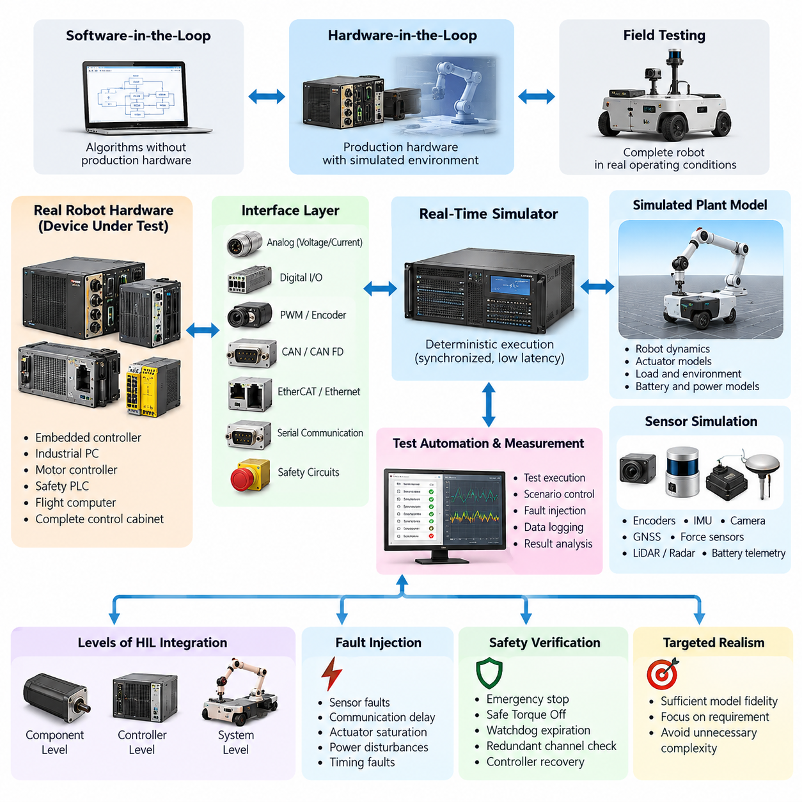
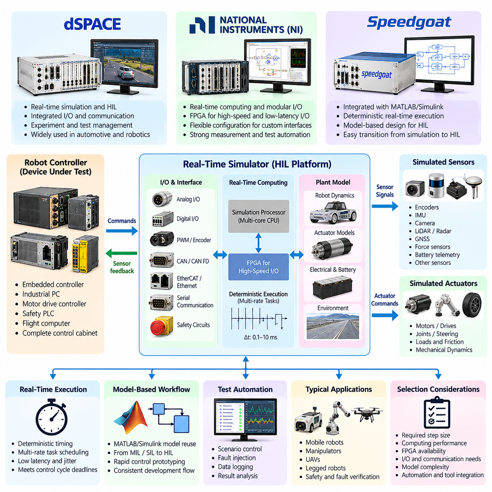
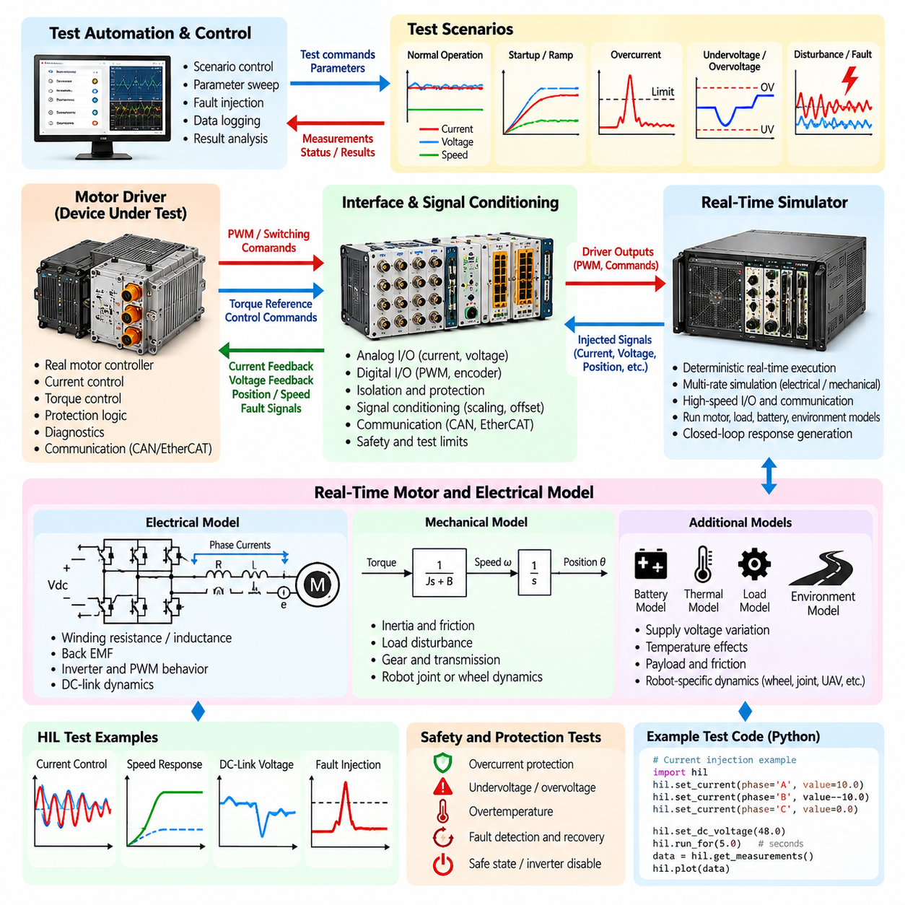
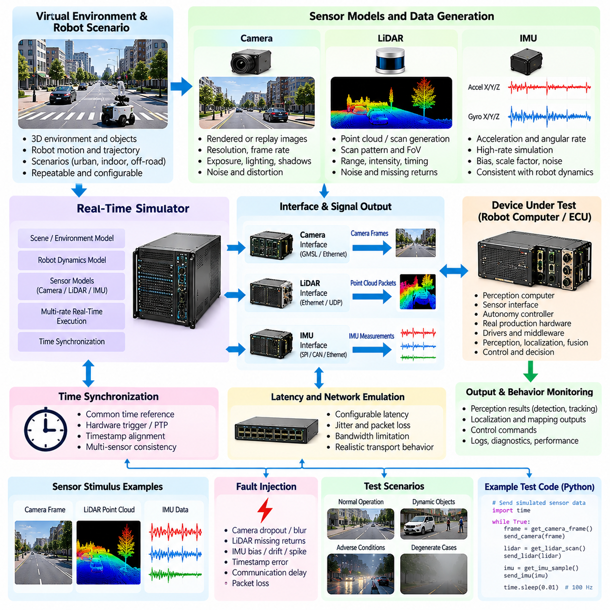
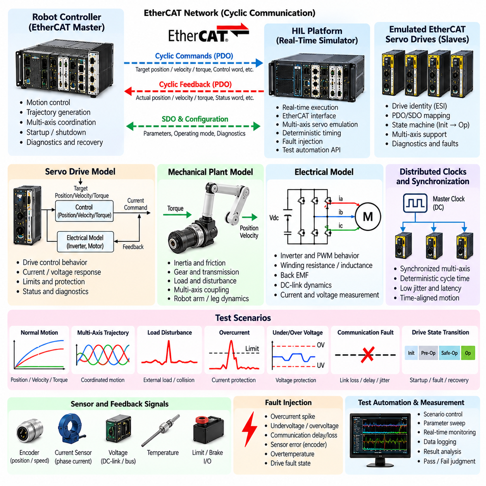
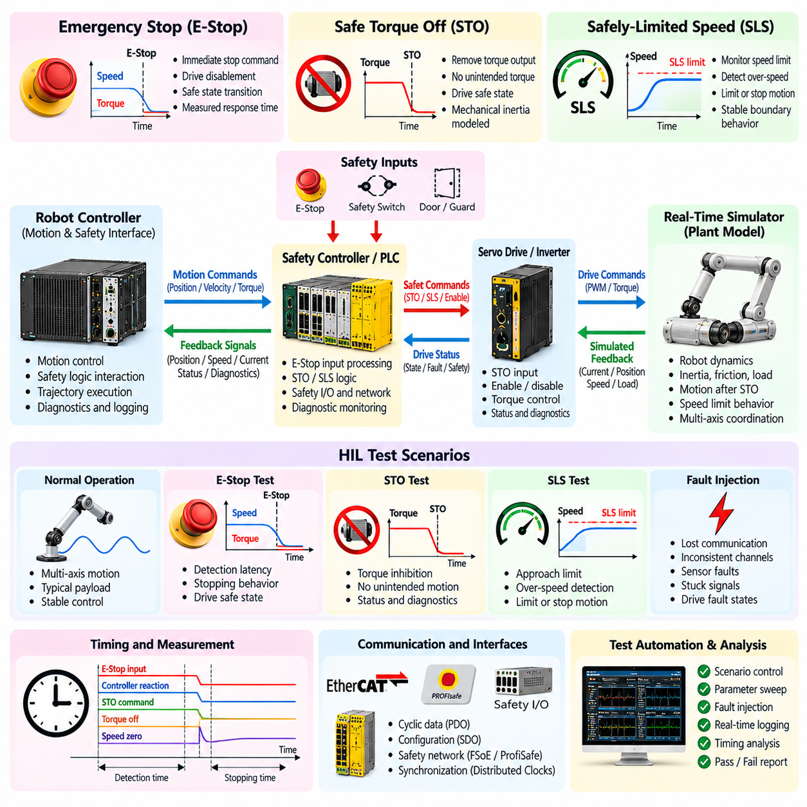
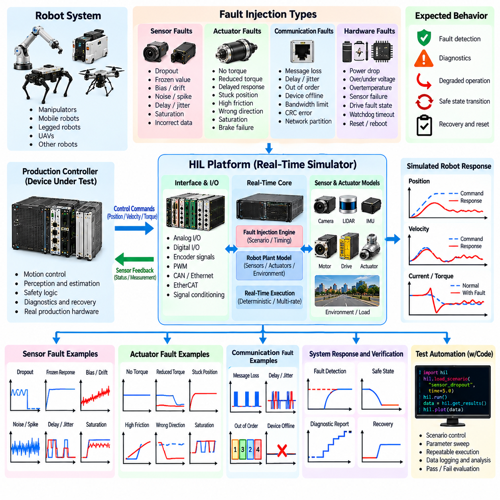
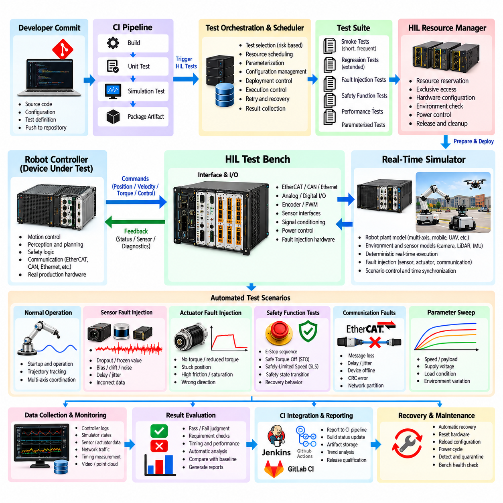
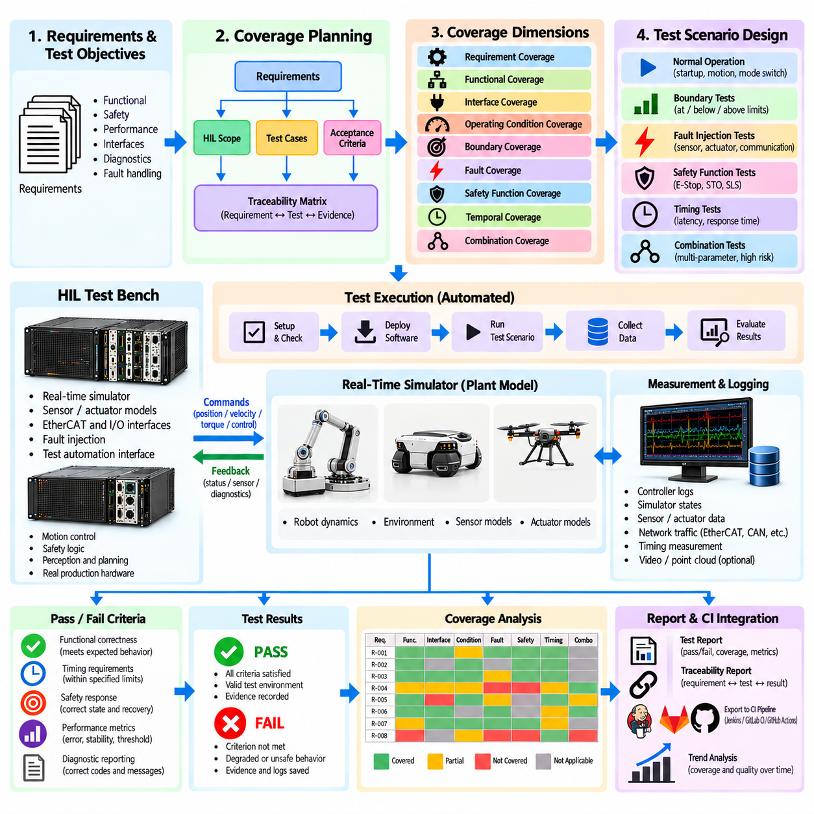
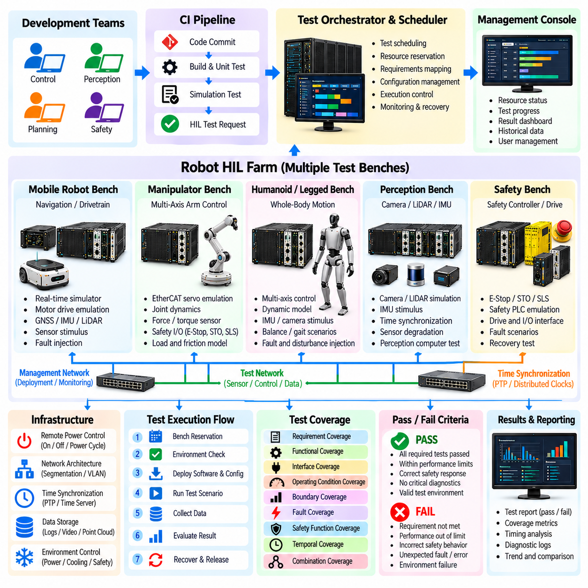

**Volume 25. Testing Validation and Benchmarking**

# Chapter 03. Hardware in the Loop Testing

## 03.01. HIL Test Concepts and Architecture for Robots

{width="7.268055555555556in" height="7.268055555555556in"}

Hardware-in-the-Loop (HIL) testing is a verification method in which real robot hardware or production electronic control units operate against a simulated representation of the physical system and environment. Instead of requiring the complete robot to be assembled, HIL connects actual controllers, computers, communication interfaces, and safety devices to deterministic simulation equipment that reproduces sensors, actuators, loads, and plant dynamics.

Within the testing hierarchy, HIL occupies the critical boundary between software-oriented simulation and full physical-system testing. Software-in-the-Loop can validate algorithms without production hardware, while field testing exposes the complete robot to real operating conditions. HIL provides an intermediate environment where production software executes on representative hardware while the surrounding robot dynamics remain controllable, repeatable, measurable, and safe.

A typical robot HIL architecture contains a device under test, a real-time simulator, physical or electrical interface hardware, test automation software, and measurement infrastructure. The device under test may be an embedded controller, industrial PC, motor controller, safety PLC, flight computer, or complete robot control cabinet. The real-time simulator continuously calculates the behavior of the simulated robot plant and exchanges signals with this hardware.

The central architectural requirement is closed-loop execution. Commands generated by the real controller are captured by the HIL system and applied to simulated motors, joints, wheels, batteries, aerodynamic models, or other plant components. The resulting virtual physical state is converted into realistic sensor feedback and returned to the controller. This loop repeats under deterministic timing so that the controller behaves as though it were connected to the actual machine.

Real-time behavior distinguishes HIL from ordinary offline simulation. If a robot controller expects a control cycle every millisecond, the simulator must calculate the plant response and exchange required signals within the corresponding timing constraint. Excessive computation time, scheduling jitter, or communication delay can alter controller behavior and invalidate the experiment. HIL platforms therefore emphasize deterministic execution, synchronized clocks, bounded latency, and predictable input/output processing.

The interface layer bridges mathematical simulation and production electronics. Depending on the robot architecture, interfaces can include analog voltage and current channels, digital input/output, PWM, encoder signals, CAN or CAN FD, EtherCAT, Ethernet, serial communication, and dedicated safety circuits. Signal conditioning and isolation are often required so that voltage levels, impedance, timing, and electrical behavior match the interfaces expected by the real hardware.

Robot HIL systems can be organized at several levels of integration. Component-level HIL may validate a motor controller or sensor interface independently. Controller-level HIL can connect a central robot computer to simulated actuators and sensors. System-level HIL can reproduce most of the robot around a real control cabinet, allowing navigation, motion control, safety logic, communication, and fault handling to operate together before the complete physical platform is available.

The plant model determines how realistically the HIL environment responds to controller commands. For a mobile robot, it may represent drivetrain dynamics, wheel-ground interaction, steering, payload, battery behavior, and environmental resistance. Manipulator models may reproduce joint inertia, friction, gravity, transmission characteristics, contact forces, and payload changes. Legged robots and UAVs require sufficiently accurate multibody or flight dynamics to expose control behavior under realistic transient conditions.

Sensor simulation complements the plant model by transforming simulated physical states into signals that production software can consume. Encoder positions, IMU measurements, GNSS data, proximity signals, force measurements, battery telemetry, and other feedback can be synthesized directly. More complex perception pipelines may require camera, LiDAR, or radar stimulation through dedicated interfaces, prerecorded data, rendering systems, or synchronized sensor emulation mechanisms.

HIL architecture must preserve the distinction between functional realism and unnecessary simulation complexity. A model does not need to reproduce every physical phenomenon with maximum fidelity. It must reproduce the behaviors that influence the requirement under test with sufficient accuracy. A motor-control test may require detailed electrical and mechanical dynamics, while a communication-failure test may only require realistic message timing, state transitions, and interface behavior.

A major advantage of HIL is controlled fault injection. Conditions that are expensive, destructive, intermittent, or dangerous on a physical robot can be introduced systematically in the laboratory. Sensor dropout, encoder corruption, communication delay, actuator saturation, motor overheating, battery undervoltage, bus interruption, stuck signals, and timing faults can be generated at precise moments. The controller response can then be evaluated without intentionally damaging production hardware.

Safety verification is particularly well suited to HIL because abnormal operating states can be reproduced repeatedly. Emergency-stop sequences, Safe Torque Off, speed limitations, watchdog expiration, communication loss, redundant-channel disagreement, and controller recovery can be exercised while observing both logical and timing behavior. This provides a controlled bridge toward the dedicated safety-function and fault-injection testing addressed later in the HIL test structure.

Repeatability is another fundamental property of a useful HIL environment. The same initial conditions, robot states, disturbances, faults, and timing sequences should produce comparable test conditions across repeated executions. Deterministic scenarios allow engineering teams to reproduce defects discovered during integration or field operation. Recorded field conditions can also be converted into regression scenarios so that corrected software is automatically checked against previously observed failures.

Test automation surrounds the real-time loop with configuration, orchestration, observation, and evaluation functions. An automated test can deploy software, configure the simulator, initialize robot state, start execution, inject events, collect synchronized measurements, calculate metrics, and determine pass or fail status. This architecture enables HIL to evolve from an engineering laboratory tool into a repeatable verification environment connected to continuous integration and release processes.

Observability must be designed into the architecture rather than added after failures occur. Controller states, simulator variables, network traffic, actuator commands, sensor outputs, safety signals, CPU load, timestamps, and test events should be recorded against a common time reference. Synchronized evidence allows engineers to reconstruct causal sequences and distinguish defects in control software from simulator errors, interface faults, timing violations, or incorrect test configuration.

Configuration management is equally important because HIL results depend on multiple interacting versions. Controller firmware, robot software, plant models, parameter sets, interface mappings, simulator configuration, test scripts, calibration data, and hardware revisions should be traceable to each execution. Without this information, a passing or failing result may be impossible to reproduce after the robot software or test infrastructure changes.

A scalable HIL architecture separates reusable infrastructure from robot-specific configuration. Common services can provide scheduling, logging, signal routing, reporting, fault injection, synchronization, and automation, while platform adapters define the interfaces and plant models for AMRs, manipulators, quadrupeds, humanoids, or UAVs. This separation reduces duplicated engineering effort and allows a common verification philosophy to be applied across heterogeneous robot programs.

HIL should ultimately be viewed as part of a larger validation continuum rather than as a replacement for simulation or field testing. Unit and integration tests identify software defects efficiently, simulation explores large scenario spaces, HIL validates software-hardware interaction under deterministic conditions, and physical testing confirms behavior in the real environment. The broader volume deliberately places HIL between software integration testing and simulation-based and field validation stages.

A mature robot HIL environment therefore acts as a controlled digital counterpart of the physical machine around selected real hardware. Its value comes from combining deterministic real-time simulation, production interfaces, representative dynamics, synchronized instrumentation, repeatable fault injection, and automated evaluation. When these elements are architected together, HIL becomes a powerful mechanism for discovering integration, timing, safety, and robustness defects before they reach expensive prototypes or deployed robots.

## 03.02. Real Time Simulator for HIL dSPACE NI Speedgoat

{width="7.268055555555556in" height="7.268055555555556in"}

A real-time simulator is the computational core of a Hardware-in-the-Loop environment, executing mathematical models of robot dynamics, sensors, actuators, electrical systems, and environmental interactions within strict timing constraints. Unlike conventional simulation, which may run faster or slower than physical time, an HIL simulator must complete each calculation cycle before the next real-time deadline so that connected production hardware receives physically consistent signals.

The simulator operates as a virtual plant surrounding the device under test. Commands from a robot controller, motor drive, safety controller, or embedded computer enter the simulator through physical or network interfaces. The simulator calculates the corresponding system response and returns encoder positions, currents, velocities, forces, IMU measurements, digital states, or other feedback. This continuous exchange forms the deterministic closed loop required for realistic controller verification.

Real-time execution depends on a predictable scheduling architecture. Plant models are divided into tasks that execute at defined sample periods, ranging from sub-millisecond electrical models to slower thermal, battery, or environmental processes. The platform must guarantee that computation, input acquisition, output generation, and communication complete within their assigned periods. Execution overruns and excessive jitter can create artificial behavior that would not occur on the physical robot.

The required simulator performance therefore depends strongly on the system being tested. High-bandwidth motor-control HIL may require very short time steps to represent current loops, PWM behavior, motor electrical dynamics, and encoder feedback. Robot motion and navigation models can generally operate at slower rates, while safety interfaces may require deterministic event handling and accurate response-time measurement. Multi-rate execution allows these different dynamics to coexist efficiently within one HIL system.

dSPACE platforms are commonly associated with real-time control development and HIL testing environments that integrate simulation processors, configurable I/O, automotive and industrial communication interfaces, and experiment-management software. In robotics applications, such an architecture can connect production controllers to simulated motors, vehicle dynamics, sensors, networks, and safety functions while providing engineers with centralized configuration, measurement, calibration, and automated test capabilities.

A dSPACE-based robot HIL configuration can separate computational models from interface processing so that complex plant dynamics execute deterministically while dedicated hardware handles signal generation and communication. Controller commands can be mapped to simulated actuator models, and calculated states can be transformed into electrical or bus-level feedback. This arrangement is particularly useful when validating embedded controllers whose behavior depends on precise signal timing rather than only numerical data exchange.

National Instruments (NI) platforms provide another approach to constructing real-time HIL systems through combinations of real-time computing, modular measurement and I/O hardware, FPGA resources, and test automation software. The modular architecture is useful when a robot test bench requires customized combinations of analog channels, digital interfaces, communication buses, timing functions, and high-speed signal processing rather than a fixed set of simulator interfaces.

FPGA-based processing can be especially valuable for robotics HIL when signal timing must be reproduced with very low latency. Encoder pulse generation, PWM capture, high-speed digital protocols, trigger processing, or custom interface behavior can be implemented close to the physical I/O while the main processor executes higher-level plant models. This division reduces dependence on operating-system scheduling for functions that require precise cycle-level timing.

Speedgoat real-time target machines are closely integrated with MATLAB and Simulink workflows and are frequently used when control algorithms and plant models are developed in a model-based engineering environment. Models created in Simulink can be configured for deterministic real-time execution on target hardware, allowing engineering teams to move from desktop simulation toward rapid control prototyping and HIL verification while maintaining a closely related modeling workflow.

For robot development, this model-based approach can simplify transitions between Model-in-the-Loop, Software-in-the-Loop, rapid control prototyping, and Hardware-in-the-Loop stages. A drivetrain, manipulator, UAV, or legged-robot model developed during simulation can be adapted for real-time execution, connected to appropriate I/O interfaces, and used to stimulate production control hardware. Model reuse improves consistency between early algorithm development and later verification activities.

Selecting among dSPACE, NI, Speedgoat, or another real-time platform should begin with test requirements rather than vendor preference. Important factors include minimum achievable step size, processor performance, FPGA availability, analog and digital channel requirements, communication interfaces, synchronization capability, model complexity, automation APIs, scalability, and integration with existing engineering tools. The correct platform is the one that satisfies the timing and fidelity requirements of the intended robot tests.

I/O capability is often as important as computational performance. A simulator may execute sophisticated robot dynamics but still fail to reproduce the real system if its physical interfaces cannot match the controller. Robot HIL benches may require encoder emulation, resolver interfaces, current and voltage measurement, analog sensor signals, CAN, EtherCAT, Ethernet, serial buses, digital safety channels, hardware triggers, or synchronized timestamping. Interface expansion should therefore be considered during initial architecture design.

Communication timing deserves special attention because modern robots increasingly distribute control functions across multiple computing nodes. EtherCAT servo networks, CAN-based embedded devices, Ethernet sensors, ROS 2 computers, and safety controllers may operate simultaneously at different frequencies. The HIL platform must reproduce relevant message rates, synchronization behavior, delays, packet conditions, and device states while maintaining deterministic interaction with the simulated plant.

Time synchronization becomes more important as the HIL configuration grows. Simulator processors, FPGA modules, measurement equipment, external computers, and the device under test should share a sufficiently accurate temporal reference when measurements from different sources are compared. Hardware triggering, synchronized clocks, or precision time mechanisms can establish consistent timestamps and make it possible to reconstruct the exact sequence between controller commands, simulated physical events, and resulting responses.

Model partitioning is necessary when a complete robot model cannot execute within a single real-time step. Computationally intensive dynamics may be distributed across processor cores or multiple target machines, while selected functions are transferred to FPGA hardware. Engineers must ensure that partition boundaries do not introduce unrealistic delays or numerical artifacts. Communication between partitions becomes part of the real-time performance budget and must therefore be measured and controlled.

Real-time models also require deliberate fidelity management. High-fidelity offline models may contain computationally expensive contact solvers, flexible-body dynamics, detailed tire or terrain models, fluid effects, or complex sensor rendering that cannot meet deterministic deadlines. HIL engineers often simplify these models while preserving the dominant dynamics relevant to the requirement being tested. The objective is not maximum mathematical complexity but sufficient physical fidelity within guaranteed execution time.

Performance monitoring is therefore an essential simulator function. Engineers should observe task execution time, maximum cycle time, processor utilization, communication latency, I/O timing, model overruns, and synchronization errors during every demanding test configuration. A scenario that technically executes in real time but leaves almost no computational margin may become unstable when additional logging, fault injection, or test automation is enabled. Capacity margins should be treated as part of test-environment qualification.

The real-time simulator must also support controlled fault generation. Sensor signals can be frozen, biased, delayed, saturated, or removed; communication messages can be interrupted or corrupted; actuator responses can be degraded; and electrical conditions can be changed according to predefined scenarios. Combining deterministic plant simulation with repeatable fault injection enables engineers to evaluate diagnostic logic, degraded modes, safety responses, and recovery behavior without exposing a complete robot to hazardous conditions.

Automation interfaces transform the simulator from an interactive engineering instrument into scalable verification infrastructure. Test software can load models, modify parameters, initialize states, start and stop execution, inject faults, capture measurements, and evaluate acceptance criteria without manual intervention. Such capabilities are fundamental to the later HIL automation and CI integration stage defined within the chapter structure, where repeated hardware testing becomes part of systematic regression verification.

A production-grade robot HIL simulator should ultimately be treated as calibrated test equipment rather than merely a powerful computer running a physics model. Its timing accuracy, I/O behavior, synchronization, numerical fidelity, interface mappings, and software configuration must be controlled and traceable. When these properties are engineered systematically, platforms such as dSPACE, NI, and Speedgoat provide the deterministic computational foundation needed to connect realistic robot simulation with actual control hardware.

## 03.03. Motor Driver HIL Current Voltage Injection [w/Code]

{width="7.268055555555556in" height="7.268055555555556in"}

Motor-driver Hardware-in-the-Loop testing verifies drive electronics and embedded control software by connecting the real motor controller to a deterministic simulator that reproduces electrical and mechanical behavior. Instead of requiring an actual motor and mechanical load for every test, the HIL environment generates representative current, voltage, position, speed, and fault signals while monitoring the commands produced by the physical motor driver.

Current and voltage injection are central techniques because motor-drive control logic depends directly on electrical feedback. The HIL system can generate controlled representations of phase current, DC-link voltage, supply voltage, and related measurements at the interfaces expected by the controller. By varying these values according to predefined operating scenarios, engineers can examine how current regulation, torque control, protection logic, diagnostics, and state transitions respond.

A typical test configuration contains the motor driver under test, a real-time simulator, analog and digital I/O, signal-conditioning circuits, communication interfaces, and measurement equipment. The simulator executes the motor and load models while the interface layer converts calculated values into signals compatible with the controller. Commands returned from the driver are captured and applied to the simulated plant, producing a closed-loop electrical and mechanical response.

The motor model must represent the dynamics relevant to the controller being evaluated. Depending on the application, this can include winding resistance and inductance, back electromotive force, rotor position, electromagnetic torque, inertia, friction, and load disturbance. For permanent-magnet synchronous motors, brushless DC motors, or other robot actuators, model parameters should correspond closely enough to the intended hardware to reproduce meaningful transient and steady-state behavior.

Current feedback can be injected through interfaces corresponding to the controller\'s sensing architecture. The simulator calculates phase currents from the motor model and converts them into representative sensor signals. These signals may emulate current sensors, amplifier outputs, or conditioned analog measurements. Accurate scaling, offset, bandwidth, and timing are important because even small deviations can influence current-loop behavior and produce misleading conclusions about controller performance.

Voltage injection provides controlled stimulation of supply and measurement channels. Nominal voltage, startup ramps, battery discharge behavior, DC-link variation, undervoltage, overvoltage, ripple, and transient disturbances can be represented according to the test objective. Robot motor drives can therefore be evaluated across operating conditions that would otherwise require programmable power equipment, repeated battery states, or potentially stressful manipulation of the physical electrical system.

Closed-loop HIL execution connects electrical feedback to the commands generated by the real driver. PWM duty cycles, switching commands, torque references, or other outputs are captured by the test system and interpreted by the real-time model. The resulting motor state is calculated and converted back into current, voltage, position, and speed feedback. Maintaining this causal loop is essential when evaluating dynamic controller behavior rather than isolated input processing.

The real-time step size must be selected according to the bandwidth of the drive-control functions under test. Electrical dynamics and fast current loops generally require substantially shorter update periods than mechanical motion models. If the simulation interval is too large, phase-current transients and control responses may be distorted. Multi-rate execution can allow fast electrical models and slower mechanical, thermal, or supervisory models to operate together without unnecessary computational overhead.

Signal conditioning protects both the HIL equipment and the motor driver while ensuring electrical compatibility. Voltage ranges, current limits, grounding, isolation, impedance, and connector assignments must be verified before injection begins. Where the controller expects sensor-level signals rather than power-level energy, the HIL interface should reproduce the required measurement behavior without exposing either system to unintended electrical conditions. Test limits should be enforced independently of software commands.

Calibration is required to establish confidence that injected signals correspond to intended physical quantities. Engineers can compare commanded injection values with measurements at the controller interface and characterize gain, offset, noise, delay, and channel-to-channel variation. Calibration records should be associated with the HIL configuration so that changes in interface modules, wiring, signal-conditioning hardware, or measurement devices do not silently alter regression-test results.

Controlled current injection enables systematic evaluation of overcurrent protection and diagnostic behavior. The test environment can gradually approach configured limits, cross protection thresholds, introduce short-duration peaks, or emulate implausible sensor values. Engineers can observe whether the controller detects the condition, limits torque, disables switching, records diagnostic information, enters a safe state, and follows the required recovery sequence without creating an actual destructive current event.

Voltage-related protection can be tested in a similarly repeatable manner. Supply voltage can be reduced toward undervoltage thresholds or increased toward overvoltage limits while the controller remains connected to the simulated plant. Rapid voltage drops, recovery events, unstable supply conditions, or measurement inconsistencies can be introduced at precise times. This makes it possible to verify both threshold behavior and temporal requirements such as debounce, filtering, shutdown delay, and restart logic.

Fault injection can extend beyond simple threshold testing. Current-sensor offset, frozen measurements, reversed polarity, missing phases, implausible phase relationships, voltage-sensor drift, intermittent wiring, and communication-related measurement faults can be represented systematically. These scenarios are particularly valuable for verifying diagnostic coverage because they reproduce abnormal states that may be difficult, dangerous, or expensive to create using a real motor and power stage.

Motor-driver HIL should also evaluate interaction between electrical protection and higher-level robot control. A drive fault may propagate through EtherCAT, CAN, or another control network to a motion controller, safety controller, or robot computer. The HIL environment can observe whether the drive reports the correct state and whether upstream software stops motion, inhibits new commands, changes operating mode, or initiates recovery according to the intended system-level behavior.

Measurement synchronization is critical when analyzing fast events. Injected current and voltage, PWM activity, controller state, communication messages, simulated rotor position, fault flags, and shutdown outputs should be recorded against a consistent time reference. Synchronized traces allow engineers to determine whether protection was activated within the required response time and to distinguish controller delays from simulator latency, interface delay, or measurement-system timing errors.

Automated test sequences can sweep operating conditions far more consistently than manual experiments. Current magnitude, supply voltage, speed, load, temperature-related parameters, and fault timing can be varied across defined ranges while the automation framework records responses and evaluates acceptance criteria. Boundary values around protection thresholds deserve particular attention because small parameter changes can reveal filtering errors, incorrect hysteresis, unstable state transitions, or inconsistent recovery behavior.

Pass and fail criteria should be linked to explicit requirements rather than visual inspection of waveforms alone. Criteria may include current-regulation error, voltage operating range, fault-detection threshold, response time, torque-disable behavior, diagnostic reporting, recovery sequence, and absence of unintended output. Each result should preserve the software version, motor-model parameters, HIL configuration, calibration state, injected waveform, and synchronized measurement evidence needed for reproducibility.

The chapter structure places motor-driver current and voltage injection before sensor stimulus, EtherCAT drive emulation, safety-function testing, fault injection, and HIL automation. This progression establishes electrical actuator verification as a foundation for increasingly integrated robot HIL testing, where individual drive behavior is eventually evaluated together with sensors, networks, safety mechanisms, and automated regression infrastructure.

A mature motor-driver HIL environment therefore combines deterministic real-time motor models, calibrated current and voltage interfaces, synchronized measurement, controlled fault injection, protection mechanisms, and automated evaluation. Used correctly, it allows engineers to investigate normal operation, electrical boundaries, diagnostic behavior, and failure responses repeatedly without relying on destructive physical tests, making it an important bridge between embedded drive development and complete robot validation.

## 03.04. Sensor Stimulus HIL Camera LiDAR IMU [w/Code]

{width="7.268055555555556in" height="7.268055555555556in"}

Sensor-stimulus Hardware-in-the-Loop testing verifies robot perception and sensor-processing systems by supplying controlled sensor inputs to real production hardware and software. Instead of depending entirely on physical cameras, LiDARs, IMUs, and real environments, the HIL system generates or replays representative sensor signals while the actual robot computer, perception ECU, sensor interface, or autonomy controller processes them under realistic timing conditions.

The purpose of sensor stimulation is not simply to provide artificial data but to reproduce the interfaces, timing, synchronization, and failure characteristics expected by the device under test. Camera frames, LiDAR point clouds, inertial measurements, timestamps, triggers, and communication packets must arrive with sufficiently realistic properties. This allows engineers to evaluate the complete path from sensor reception through drivers and middleware to perception, localization, fusion, and control functions.

A sensor HIL architecture typically combines a real-time simulator, scene or motion model, sensor-data generator, interface hardware, synchronization infrastructure, and the production computing platform under test. The simulator determines the virtual robot state and environment, while sensor models transform that state into measurements. Interface components then deliver those measurements through interfaces that resemble the actual robot sensor connections as closely as required by the verification objective.

Camera stimulation can operate at several levels of fidelity. A simple test may replay previously recorded image sequences through the software interface, while a more integrated HIL configuration can generate rendered scenes from a virtual environment and transmit frames through representative camera interfaces. Frame rate, image resolution, exposure-related characteristics, timestamps, triggering, and transport latency should be controlled when these properties affect the perception pipeline being evaluated.

Rendered camera stimulation enables repeatable testing of visual perception under controlled environmental conditions. Lighting, shadows, object positions, textures, motion, visibility, and camera pose can be changed without rebuilding a physical test site. The same scene can be executed repeatedly after changes to detection, tracking, localization, or visual navigation software, allowing engineers to determine whether an update improves performance without introducing regressions in previously validated scenarios.

LiDAR stimulation requires representation of range measurements and their spatial and temporal structure. Depending on the sensor and test interface, the HIL system may generate point clouds, packets, scans, timestamps, intensity values, or other measurement fields expected by production software. Virtual rays can be evaluated against a simulated environment so that changing robot pose and surrounding geometry produce corresponding LiDAR observations throughout the test.

Accurate LiDAR stimulation must consider more than geometric point locations. Scan frequency, channel arrangement, field of view, packet order, measurement timing, range limitations, noise, missing returns, and motion during acquisition can influence downstream algorithms. When these properties are relevant, the sensor model should reproduce them sufficiently well to exercise localization, obstacle detection, mapping, tracking, and sensor-fusion functions under representative conditions.

IMU stimulation differs from camera and LiDAR stimulation because inertial signals are closely coupled to robot dynamics and require high-rate temporal consistency. The simulator calculates linear acceleration and angular velocity from the virtual robot motion and converts them into measurements expected by the production interface. Orientation, gravity, vibration, bias, scale factors, and noise can be included according to the fidelity required by the state-estimation or control functions under test.

IMU data often operate at substantially higher update rates than camera frames or complete LiDAR scans. The HIL architecture must therefore support multi-rate sensor execution while preserving a consistent physical timeline. A robot maneuver represented in the simulation should produce mutually compatible camera motion, LiDAR geometry, and inertial measurements. If individual sensor streams describe different virtual states because of timing errors, sensor-fusion results may become invalid even when each stream appears reasonable independently.

Time synchronization is therefore one of the most important requirements in multi-sensor HIL. Camera exposure time, LiDAR acquisition timing, IMU samples, simulator state, and controller messages should be associated with a consistent time reference. Hardware triggers, synchronized clocks, timestamp propagation, or equivalent mechanisms can be used depending on the architecture. The objective is to preserve the temporal relationships that production perception and localization algorithms rely upon.

Sensor latency must also be represented intentionally. Real sensors and their processing pipelines introduce acquisition, serialization, transmission, buffering, driver, and middleware delays. Delivering ideal zero-latency data may hide defects that appear on the physical robot. HIL testing can introduce known delays and jitter so that engineers can evaluate whether synchronization, prediction, buffering, and state-estimation algorithms remain stable within the expected operating envelope.

Noise modeling helps bridge the gap between ideal simulation and physical sensing. Camera images may include brightness variation or image degradation, LiDAR measurements may contain range noise or missing returns, and IMU signals may include bias and stochastic noise. The required model complexity depends on the verification goal. HIL should introduce enough imperfection to exercise relevant software behavior without adding poorly characterized effects that make results difficult to reproduce.

Controlled sensor fault injection is particularly valuable because many failures are difficult to reproduce reliably with physical sensors. Camera frames can be delayed, frozen, dropped, or corrupted; LiDAR packets can be lost or ranges made invalid; IMU measurements can develop bias, saturation, spikes, or complete dropout. These conditions allow engineers to verify diagnostics, sensor-health monitoring, redundancy management, degraded operation, and safe transitions without physically damaging sensors.

Multi-sensor inconsistency provides another important class of HIL scenarios. A camera may report normal images while LiDAR data become delayed, or an IMU may develop a slowly increasing bias while visual and geometric sensors remain correct. Such scenarios test whether fusion algorithms detect disagreement and whether the system assigns confidence appropriately. They are especially important for robots whose localization and autonomy depend on several complementary sensing modalities.

Sensor stimulation should preserve the production software path whenever the verification objective concerns integration behavior. Bypassing device drivers or middleware may accelerate algorithm testing, but it can miss faults in packet handling, timestamp conversion, buffering, synchronization, or transport configuration. Higher-fidelity HIL therefore attempts to inject data at an interface sufficiently close to the physical sensor boundary so that as much of the production stack as practical remains under test.

The perception output should be evaluated together with the known simulation ground truth. Because the HIL system controls the virtual environment and robot state, expected object locations, poses, trajectories, obstacles, and motion can be recorded precisely. Detected objects, localization estimates, maps, or fused states can then be compared with this reference. This provides quantitative evidence rather than relying only on visual inspection of perception outputs.

Repeatability enables sensor HIL to become a regression-testing mechanism. A difficult lighting transition, sparse LiDAR region, high-angular-rate maneuver, temporary sensor dropout, or synchronization disturbance can be stored as a defined scenario and executed whenever software changes. If identical stimulus conditions are maintained, differences in output can be attributed more confidently to changes in the device under test rather than uncontrolled environmental variation.

Automation frameworks can configure scenarios, select sensor models, initialize virtual robot states, start synchronized data streams, inject faults, collect outputs, and calculate acceptance metrics. Large scenario suites can therefore be executed without manually arranging cameras, targets, obstacles, or robot motion for every run. Automated execution is especially useful when sensor HIL becomes part of continuous regression testing across multiple software versions and computing platforms.

Pass and fail criteria should reflect the function being verified. Relevant measures may include frame and packet reception, timestamp error, dropped-data rate, localization accuracy, detection performance, fusion consistency, processing latency, fault-detection time, and recovery behavior. Test evidence should preserve sensor-model configuration, scenario version, timing parameters, software revision, injected faults, and synchronized output logs so that results remain reproducible.

Within the chapter structure, camera, LiDAR, and IMU stimulus testing follows motor-driver current and voltage injection and precedes EtherCAT servo-drive emulation, safety-function HIL, fault injection, and automation. This progression expands HIL from actuator-side electrical verification toward perception and state-estimation interfaces before integrating communication, safety, and system-level failure behavior.

A mature sensor-stimulus HIL environment therefore combines realistic sensor generation, deterministic timing, production-representative interfaces, multi-sensor synchronization, controlled noise and faults, ground-truth comparison, and automated evaluation. Such an environment allows camera, LiDAR, and IMU processing to be tested repeatedly under normal, boundary, and failure conditions before relying on costly and less controllable full-robot field experiments.

## 03.05. EtherCAT HIL Servo Drive Emulation [w/Code]

{width="7.268055555555556in" height="7.268055555555556in"}

EtherCAT Hardware-in-the-Loop servo-drive emulation verifies robot motion-control systems by replacing physical servo drives, motors, or selected EtherCAT slave devices with deterministic real-time models. The actual robot controller or EtherCAT master communicates with the HIL platform as though it were connected to production drives, allowing communication, command processing, synchronization, motion behavior, diagnostics, and failure responses to be tested before the complete actuator system is available.

EtherCAT is particularly important in robots that require tightly synchronized multi-axis motion. Manipulators, humanoids, quadrupeds, mobile manipulators, and precision motion platforms may exchange cyclic position, velocity, torque, status, and diagnostic information across many servo axes. HIL emulation allows these networks to be reproduced without operating every physical motor, gearbox, brake, and mechanical joint during software integration and regression testing.

A typical architecture contains the production EtherCAT master, a real-time HIL target, EtherCAT interface hardware, emulated slave devices, servo and mechanical models, and test automation infrastructure. The master sends cyclic commands to the emulated drives, while the simulator calculates the resulting actuator states and returns representative feedback. From the controller perspective, the virtual drives should behave sufficiently like the intended production devices for the requirements under test.

Device emulation must reproduce more than numerical motion values. The HIL environment should represent relevant EtherCAT slave identity, process-data mapping, state transitions, status information, and communication behavior expected by the production master. When these properties are accurately configured, the robot controller can initialize the network, discover expected devices, transition them into operational states, exchange cyclic process data, and execute motion sequences using its normal software path.

Process Data Objects (PDOs) are central to cyclic servo communication. The HIL system can receive target position, target velocity, target torque, control words, and other command variables while returning actual position, velocity, torque, status words, and diagnostic values. Correct data layout, scaling, update frequency, and interpretation are essential because an interface that is numerically plausible but inconsistent with the production mapping can invalidate system-level verification.

Service Data Objects (SDOs) and configuration functions may also need to be represented when the robot controller configures drives during startup or maintenance. Parameters such as operating mode, limits, gains, device settings, or diagnostic information can influence initialization behavior. The required emulation depth should be determined by the test objective: some tests require only cyclic PDO behavior, while others must reproduce configuration and diagnostic interactions more completely.

Servo-drive state behavior is another important part of emulation. Robot controllers commonly expect drives to follow defined enable, disable, fault, reset, and operational sequences. The HIL model should respond consistently to control commands and expose appropriate status transitions. This allows startup procedures, motion enabling, controlled shutdown, fault recovery, and unexpected state transitions to be tested without repeatedly manipulating physical power stages.

The simulated servo model translates network commands into actuator behavior. Depending on the required fidelity, it can represent position, velocity, or torque control response together with inertia, friction, transmission ratio, load, saturation, limits, and disturbances. A simplified model may be sufficient for network integration, whereas controller-performance testing can require more detailed dynamics so that feedback responds realistically to rapidly changing commands and external loads.

Distributed Clocks are important when multiple EtherCAT devices must operate on a common time base. Multi-axis robots can be sensitive to small timing differences because coordinated joints must execute commands consistently. A suitable HIL implementation should reproduce the synchronization behavior relevant to the system under test and allow engineers to observe timing errors, cycle deviations, or synchronization loss that could affect coordinated motion.

The EtherCAT cycle period must remain compatible with the production control architecture. If the robot controller operates a one-kilohertz servo loop, the emulated devices must exchange and process required data within the corresponding cycle budget. Excessive latency or jitter can create behavior unrelated to the real actuator system. Real-time execution, deterministic network processing, and sufficient computational margin are therefore essential properties of the HIL target.

Multi-axis emulation provides one of the strongest benefits of EtherCAT HIL. A single real-time system can represent many servo drives and mechanical axes, enabling the production controller to execute coordinated trajectories without energizing a complete robot. Joint positions, velocities, torques, following errors, and limit conditions can be generated independently while still participating in a common simulated mechanical system.

Mechanical coupling can be incorporated when axis behavior is not independent. A humanoid leg, robotic arm, or parallel mechanism may experience gravity, payload forces, contact loads, and dynamic coupling between joints. The real-time plant model can calculate these interactions and return corresponding drive feedback. This extends EtherCAT emulation beyond protocol verification toward closed-loop testing of coordinated robot motion and controller behavior.

Fault injection enables abnormal EtherCAT and servo conditions to be created repeatably. An emulated drive can enter a fault state, stop responding, report an implausible position, exceed a torque limit, or produce a following error. Communication disturbances can also be introduced according to the capabilities of the HIL architecture. These scenarios allow the controller\'s diagnostic, isolation, fallback, and recovery mechanisms to be evaluated without intentionally damaging physical drives.

Network-level failures deserve separate attention from simulated mechanical faults. Missing devices, incorrect configuration, delayed process data, synchronization problems, communication interruption, or unexpected state changes can challenge startup and runtime supervision logic. The HIL environment can reproduce such conditions at controlled times and determine whether the EtherCAT master detects them, inhibits unsafe motion, reports meaningful diagnostics, and performs the intended recovery sequence.

Servo-drive emulation is particularly valuable for safety-related motion behavior when combined with appropriate safety interfaces. A controller can be exposed to simulated overspeed, excessive position error, drive unavailability, or motion-control faults while the HIL system observes whether higher-level safety and supervisory functions respond correctly. Dedicated validation of E-Stop, STO, SLS, and related functions can then build on this communication and drive-emulation foundation.

Observability is essential for diagnosing failures across the network and simulated plant. EtherCAT commands, PDO feedback, device states, simulator variables, joint motion, fault events, and controller outputs should be captured against a common time reference. Synchronized traces help engineers determine whether a failure originated in the master software, network interaction, emulated drive behavior, mechanical model, or timing infrastructure.

Automated testing can repeatedly initialize the EtherCAT network, transition emulated drives through operating states, execute trajectories, modify loads, inject faults, and evaluate controller responses. Test sequences can cover normal startup, shutdown, repeated enable cycles, communication disturbances, boundary conditions, and recovery procedures. Automation turns the HIL setup into a regression platform capable of validating changes to motion-control software without requiring continuous access to a complete robot.

Pass and fail criteria should be derived from explicit communication and motion requirements. Relevant measures can include successful network initialization, correct state transitions, cycle timing, synchronization error, trajectory tracking, command and feedback consistency, fault-detection latency, safe response, and recovery success. Results should retain the EtherCAT configuration, slave model versions, control software revision, plant parameters, fault scenario, and synchronized logs required for reproduction.

Within the chapter structure, EtherCAT servo-drive emulation follows motor-driver electrical injection and camera, LiDAR, and IMU sensor stimulation, while preceding safety-function HIL, generalized fault injection, automation, coverage analysis, and HIL-farm operation. The sequence expands verification from individual electrical and sensing interfaces toward synchronized distributed motion-control integration and then broader system-level validation.

A mature EtherCAT HIL environment therefore combines production-representative network behavior, deterministic cyclic communication, synchronized multi-axis servo models, realistic mechanical dynamics, controlled fault injection, comprehensive logging, and automated evaluation. It enables complex robot motion-control software to interact with a reproducible virtual actuator system, reducing dependence on scarce physical prototypes while exposing communication, timing, integration, and recovery defects early in development.

## 03.06. Safety Function HIL E Stop STO SLS [w/Code]

{width="7.268055555555556in" height="7.268055555555556in"}

Safety-function Hardware-in-the-Loop testing verifies whether robot controllers, safety controllers, drives, and supervisory software respond correctly when safety mechanisms are activated or abnormal conditions occur. The HIL environment reproduces robot motion, actuator behavior, sensor feedback, and safety interfaces while real control hardware executes production logic. This enables hazardous situations to be evaluated repeatedly without intentionally creating equivalent physical danger.

Emergency Stop, Safe Torque Off, and Safely-Limited Speed represent different layers of protective behavior. E-Stop initiates an emergency response when immediate intervention is required, STO prevents a drive from generating torque, and SLS supervises motion so that speed remains below a defined safe limit. HIL testing evaluates not only whether these functions activate, but also whether their timing, state transitions, diagnostics, and recovery behavior satisfy system requirements.

A safety HIL architecture can contain the production robot controller, safety PLC or safety controller, servo-drive interfaces, real-time simulator, safety I/O, communication interfaces, and synchronized measurement equipment. The simulator represents the mechanical plant and actuator response, while real safety logic receives representative signals and produces actual safety commands. This preserves the interaction between functional control and safety control without requiring unrestricted physical motion.

Emergency-stop testing begins by reproducing realistic robot operating states before activating the E-Stop input. The simulated robot may be moving, accelerating, carrying a load, manipulating an object, or executing a coordinated trajectory. The HIL system can then trigger the emergency input at a precisely defined time and record how motion commands, drive states, braking behavior, safety outputs, and supervisory software change throughout the stopping sequence.

The effectiveness of an E-Stop response depends on more than a logical state change. Engineers must examine detection latency, command propagation, deceleration behavior, final motion state, drive disablement, and the condition reached after stopping. HIL provides synchronized evidence that allows the interval between emergency activation and each subsequent response to be measured, helping distinguish controller delay, network delay, drive behavior, and simulated mechanical stopping effects.

Safe Torque Off testing focuses on whether torque-producing capability is removed when the corresponding safety function is requested. In an HIL configuration, the drive or drive model can expose relevant enable states, torque commands, status information, and simulated mechanical response. The test verifies that commanded torque is inhibited according to the intended architecture and that ordinary motion commands cannot unintentionally restore torque while the STO condition remains active.

STO does not necessarily imply that a moving mechanism stops instantaneously. Once torque generation is disabled, the simulated mechanical system may continue moving because of inertia, gravity, external force, or stored mechanical energy. A useful HIL model therefore preserves relevant mechanical dynamics after STO activation. This allows engineers to evaluate the difference between torque removal and actual motion cessation and to verify assumptions made by higher-level safety logic.

Safely-Limited Speed testing requires the HIL environment to control and observe motion around a defined speed boundary. The simulator can gradually increase joint, wheel, or vehicle speed toward the configured limit and then create controlled threshold crossings. Engineers can determine whether the safety system detects excessive speed, activates the intended protective response, and maintains behavior within specified timing and state requirements.

Boundary testing is particularly important for SLS because filtering, measurement resolution, hysteresis, and timing can influence the response near the limit. Repeated HIL runs can approach the threshold from different directions, remain close to it, briefly exceed it, or oscillate around it. Such scenarios help reveal unstable switching, delayed detection, incorrect threshold configuration, or unintended interaction between normal motion control and safety supervision.

Safety functions rarely operate independently of the robot\'s communication architecture. An E-Stop event may propagate through safety I/O, a safety network, servo drives, motion controllers, and supervisory software. HIL instrumentation should therefore capture the complete chain of events. This makes it possible to determine whether each subsystem receives the expected safety state and whether inconsistent or delayed information creates potentially unsafe intermediate conditions.

Safety-related communication can also be exercised under abnormal conditions. The test environment may reproduce loss of communication, delayed state updates, inconsistent channels, or unavailable drive information while the robot is represented as moving. The purpose is to verify that the safety architecture fails toward the intended state rather than relying on ideal communication. Such testing is especially important for distributed robots with multiple controllers and networked actuators.

Redundant safety channels should be evaluated both in agreement and disagreement conditions. HIL can reproduce simultaneous channel activation, single-channel failure, timing skew between redundant inputs, stuck signals, or contradictory states. The safety controller\'s diagnostic response can then be observed without rewiring the physical robot for every case. This provides a repeatable method for examining channel monitoring and fault-detection behavior.

Safety-function testing must include reset and restart behavior as carefully as activation behavior. After an E-Stop or STO condition is cleared, the robot should not automatically resume hazardous motion unless the intended architecture explicitly permits the required transition. HIL tests can verify reset sequencing, acknowledgement requirements, drive re-enablement, command clearing, state initialization, and prevention of unexpected motion when the system returns to an operational state.

Interactions between E-Stop, STO, and SLS should also be examined because multiple safety conditions may occur simultaneously or sequentially. A robot operating under SLS may receive an E-Stop, or an STO state may occur while another safety restriction is active. The HIL system can reproduce these combinations deterministically and verify that safety-state priorities, transitions, and recovery sequences remain consistent under overlapping demands.

Fault injection expands safety verification beyond nominal activation. Sensor feedback can be frozen, speed estimates corrupted, drive states made inconsistent, communication interrupted, or safety inputs delayed while the simulated robot remains in motion. These tests examine whether the safety system depends on assumptions that fail under abnormal conditions and whether independent protective mechanisms respond when primary information becomes unreliable.

Accurate time measurement is fundamental because many safety requirements include response-time constraints. E-Stop input transitions, safety-controller decisions, network messages, STO activation, simulated torque reduction, speed changes, and final stopping states should be captured using a synchronized time reference. The resulting traces provide quantitative evidence for determining whether the complete safety chain responds within its allocated timing budget.

Mechanical models influence interpretation of safety results. Robot mass, inertia, payload, friction, slope, gravity, and actuator characteristics can alter stopping distance and residual motion after a safety action. HIL allows these parameters to be varied systematically so that the same safety logic can be examined under different operating conditions. This is particularly valuable when testing robots whose configuration or payload changes during normal operation.

Automated safety regression testing can execute predefined operating states, activate safety functions at controlled times, collect synchronized measurements, and evaluate expected outcomes. Repeated runs can cover different speeds, loads, axes, operating modes, and fault combinations. Automation reduces dependence on manual emergency testing and makes it practical to repeat critical safety scenarios whenever control software, drive firmware, or system configuration changes.

Pass and fail criteria should be directly linked to documented safety requirements. Relevant criteria can include correct safety-state transition, maximum response time, successful torque inhibition, speed-limit enforcement, absence of unintended restart, correct diagnostic reporting, and required behavior under channel or communication faults. Each result should preserve configuration versions, parameters, trigger conditions, timing evidence, and recorded system states for traceability.

Within the supplied chapter structure, safety-function HIL for E-Stop, STO, and SLS follows motor-driver injection, sensor stimulation, and EtherCAT servo-drive emulation, and precedes generalized sensor and actuator fault injection, HIL automation, coverage assessment, and HIL-farm operation. This positions safety-function verification as the transition from interface-level HIL toward systematic failure-oriented and automated system validation.

A mature safety-function HIL environment therefore combines real production safety logic, deterministic plant simulation, representative drive and network behavior, synchronized timing measurement, controlled fault injection, and automated acceptance evaluation. It cannot replace every physical safety validation activity, but it provides a powerful and repeatable environment for identifying logical, timing, integration, and recovery defects before hazardous tests are performed on a complete robot.

## 03.07. Fault Injection HIL Sensor Actuator Failure [w/Code]

{width="7.268055555555556in" height="7.268055555555556in"}

Fault-injection Hardware-in-the-Loop testing deliberately introduces controlled sensor, actuator, communication, and hardware-related failures while real robot controllers execute production software. The objective is to determine whether the system detects abnormal behavior, isolates the affected function, transitions into an appropriate degraded or safe state, reports useful diagnostics, and recovers correctly without exposing a complete physical robot to unnecessary risk.

Unlike normal functional testing, fault injection evaluates the robot when assumptions about healthy hardware are intentionally violated. Sensors may provide incorrect information, actuators may stop following commands, and communication paths may become unreliable. Because the HIL environment controls both the simulated plant and injected failure, identical faults can be reproduced at precise times, allowing software revisions and safety mechanisms to be compared under consistent conditions.

A fault-injection HIL architecture typically includes the production controller, real-time plant simulator, sensor and actuator models, physical or network interfaces, fault-management logic, synchronized instrumentation, and test automation software. The simulator executes normal robot behavior until a defined trigger occurs. It then modifies selected signals or model behavior while the production controller continues operating without being explicitly informed that the test environment has introduced a fault.

Sensor failures can be represented at several abstraction levels. A signal may disappear completely, remain frozen at its last valid value, become biased, drift gradually, saturate, contain spikes, exhibit excessive noise, or update with abnormal delay. These fault patterns can be applied to encoders, IMUs, cameras, LiDARs, proximity sensors, force sensors, GNSS receivers, battery measurements, and other feedback sources used by the robot.

A complete sensor dropout tests whether software recognizes that information is no longer available. The HIL environment can stop updates or remove the relevant data stream while the simulated robot remains in motion. Engineers can observe timeout detection, health-state transitions, diagnostic reporting, fallback estimation, redundancy management, and whether continued operation is permitted only when sufficient independent information remains available.

Frozen-value failures are particularly important because a sensor may continue transmitting apparently valid data even though its measurement no longer changes. An encoder can remain fixed while a simulated joint moves, or an IMU can report constant angular velocity during a maneuver. Such failures test plausibility checking and cross-sensor consistency mechanisms rather than simple communication timeout detection.

Bias and drift faults evaluate the ability of estimation algorithms to handle gradually degrading sensors. An IMU bias can increase slowly, a range sensor can develop an offset, or a position measurement can diverge progressively from ground truth. Gradual faults are often more difficult to detect than abrupt failures because individual measurements may remain within valid numerical limits while accumulated estimation error becomes operationally significant.

Intermittent sensor failures reproduce conditions that appear and disappear over time. Packets may be lost periodically, measurements may alternate between valid and invalid states, or noise may increase only under selected operating conditions. Deterministic HIL execution allows the exact failure pattern to be repeated, making it possible to evaluate debounce logic, temporal filtering, fault counters, confidence estimation, and transitions between normal and degraded operation.

Actuator fault injection modifies how the simulated plant responds to controller commands. A motor may produce no torque, reduced torque, delayed response, excessive friction, incorrect direction, saturation, or unstable output. Steering mechanisms, manipulator joints, wheels, brakes, and other actuators can be degraded independently or in combination. The controller must recognize the resulting discrepancy between commanded and observed behavior.

A stuck actuator represents an important failure class. The HIL model can hold a steering angle, joint position, brake state, or drive output at a fixed condition even while the controller requests changes. The resulting position or velocity error propagates through the real control software, allowing engineers to examine following-error detection, motion supervision, fault escalation, trajectory cancellation, and safe-state transitions.

Partial actuator degradation can be more challenging than total failure because the robot may continue moving while performance deteriorates. Reduced motor torque, increased friction, asymmetric wheel response, or limited joint velocity can cause tracking errors without immediately triggering simple failure thresholds. HIL testing can vary degradation continuously to identify the point at which diagnostics activate and determine whether fallback behavior remains stable.

Sensor and actuator faults should also be combined when system behavior depends on interacting failures. For example, an actuator can lose effectiveness while the sensor used to monitor it simultaneously develops a bias. Such combinations help evaluate whether diagnostic mechanisms remain effective when redundancy assumptions are weakened. However, combination testing should be prioritized systematically because the number of possible multi-fault scenarios can grow rapidly.

Communication failures form another important fault category because distributed robot systems rely on networks connecting controllers, sensors, drives, and safety devices. HIL can reproduce missing messages, delayed updates, device disappearance, stale data, or interrupted communication. The objective is to determine whether network faults are distinguished from physical sensor or actuator failures and whether the robot reaches the intended operational state when communication becomes unreliable.

Fault timing strongly influences system response. The same failure may produce different consequences during startup, acceleration, high-speed travel, manipulation, docking, braking, or shutdown. HIL scenarios should therefore define not only the fault type but also the robot state and exact injection time. Trigger conditions can be based on elapsed time, position, velocity, controller state, communication events, or other observable variables.

Fault duration is equally important. Transient faults may require filtering or tolerance, while persistent failures may require isolation and shutdown. The HIL framework can generate millisecond disturbances, intermittent events, or permanent failures and evaluate whether the controller responds proportionally. Excessively sensitive logic may create unnecessary stops, whereas insufficient sensitivity can allow unsafe operation to continue.

Fault detection is only the first part of the response chain. The test should evaluate detection, diagnosis, isolation, mitigation, reporting, and recovery as connected behaviors. A controller may correctly identify a failed sensor but still select an inappropriate fallback source, continue an unsafe trajectory, or restore operation prematurely. HIL provides a controlled environment for observing the complete fault-management lifecycle rather than a single diagnostic flag.

Degraded operation should be explicitly tested when the robot architecture permits continued service after a failure. A robot may reduce speed, disable a manipulator, rely on redundant sensing, restrict its operating area, or navigate toward a safe location. The HIL plant can continue evolving after fault detection so that engineers can determine whether the degraded strategy remains dynamically stable and operationally appropriate.

Recovery testing verifies behavior after the injected fault disappears or a simulated component is restored. Software may need to confirm signal validity, clear latched diagnostics, reinitialize estimators, synchronize state, or require operator acknowledgement before returning to normal operation. Automatic recovery should be examined carefully because premature reintegration of an unstable sensor or actuator can create a second hazardous transition.

Synchronized logging is essential for determining causal relationships during fault tests. Injection commands, sensor values, actuator commands, plant states, diagnostic events, network messages, controller modes, and safety outputs should share a common time reference. Engineers can then measure detection latency, isolation time, mitigation response, and recovery duration while distinguishing actual controller behavior from HIL interface or simulator timing effects.

Automated fault campaigns can execute large matrices of failure type, magnitude, timing, duration, operating state, and recovery condition. Each run can initialize the same robot state, inject a precisely defined fault, collect synchronized evidence, and evaluate acceptance criteria. This makes fault injection suitable for regression testing whenever controller software, diagnostic logic, sensor drivers, actuator firmware, or system configuration changes.

Pass and fail criteria should be derived from fault-response requirements and hazard analysis. Relevant criteria may include maximum detection time, correct fault classification, successful isolation, safe motion response, correct degraded mode, diagnostic reporting, absence of unintended commands, and controlled recovery. Results should retain the fault definition, model parameters, software versions, operating conditions, timestamps, and measurement evidence needed for traceability.

Within the chapter structure, sensor and actuator fault injection follows dedicated E-Stop, STO, and SLS safety-function HIL and precedes HIL test automation, coverage and pass/fail analysis, and HIL-farm operation. This progression moves from validating predefined safety functions toward systematic robustness testing and then toward scalable automated execution of the resulting HIL scenarios.

A mature fault-injection HIL environment therefore provides deterministic failure generation, realistic plant response, production software execution, synchronized observation, automated scenario control, and requirement-based evaluation. By exposing controllers to repeatable sensor and actuator failures before equivalent faults occur on real machines, HIL helps reveal hidden assumptions and verifies that robot systems remain diagnosable, controllable, and safe when hardware no longer behaves as expected.

## 03.08. HIL Test Automation Framework CI Integration [w/Code]

{width="7.268055555555556in" height="7.268055555555556in"}

HIL test automation transforms Hardware-in-the-Loop testing from manually operated laboratory experiments into a repeatable verification process that can execute robot tests with limited human intervention. An automation framework controls HIL configuration, software deployment, simulator initialization, test execution, measurement collection, result evaluation, and reporting. This makes complex hardware-based regression testing practical across frequent software and firmware changes.

A typical automation architecture separates test orchestration from the real-time simulation and device-under-test layers. The orchestration system selects test cases and controls execution, while the HIL target maintains deterministic plant simulation and physical interfaces. Production robot controllers, safety devices, servo controllers, or embedded computers remain connected as real hardware. This separation preserves real-time behavior while allowing high-level test workflows to evolve independently.

Each automated test should begin from a known and reproducible initial condition. The framework can reset the device under test, load the required firmware or software, configure the real-time model, initialize robot states, establish communication, and verify that all required devices are healthy. Starting-state validation prevents residual conditions from a previous test from influencing the next run and improves confidence in regression results.

Test cases should describe stimulus, expected behavior, timing constraints, and acceptance criteria in a machine-executable form. A scenario may command robot motion, vary simulated loads, inject sensor faults, activate safety functions, or interrupt communication at defined events. The automation layer coordinates these actions while recording the controller and simulated plant responses, allowing the same procedure to be reproduced consistently across builds and hardware configurations.

Parameterization increases test reuse by separating scenario logic from operating values. A single trajectory test can execute at multiple speeds, payloads, supply conditions, or controller configurations, while one fault scenario can vary fault magnitude, duration, and injection timing. This approach reduces duplicated test code and enables systematic exploration of boundary conditions without requiring engineers to manually create a separate procedure for every variation.

Automated setup validation is essential because HIL results are meaningful only when the test bench itself is operating correctly. Before execution, the framework can verify network connectivity, simulator state, I/O readiness, synchronization status, controller software version, configuration files, and required measurement channels. If infrastructure checks fail, the run should be classified as an environment failure rather than incorrectly reported as a product failure.

Software and firmware deployment should be controlled as part of the test workflow. The automation system can associate a specific robot software build, controller firmware revision, HIL model version, configuration package, and test-suite revision with every execution. Maintaining this relationship provides traceability between source changes and physical verification evidence and prevents ambiguous results caused by unknown or mismatched component versions.

Continuous Integration integration extends automated HIL testing into the software development pipeline. A CI system can build robot software, execute earlier unit and simulation tests, package deployable artifacts, and then request HIL execution when appropriate. The HIL framework receives the approved build, prepares the physical bench, runs selected scenarios, and returns machine-readable results to the pipeline so that hardware-based verification becomes part of release qualification.

Not every source-code change should necessarily trigger the complete HIL suite. Hardware resources are slower and more limited than purely virtual test infrastructure, so test selection should reflect risk and execution cost. Fast smoke tests can verify startup, communication, basic motion, and critical safety behavior for frequent changes, while larger regression suites can execute on scheduled builds, release candidates, or changes affecting hardware-facing components.

A useful CI strategy therefore organizes HIL tests into execution tiers. Short tests provide rapid feedback on essential interfaces, while extended tests cover long-duration operation, fault combinations, boundary conditions, and complex motion scenarios. Test metadata can identify required hardware, estimated duration, safety prerequisites, and supported configurations so that the scheduler assigns each case to an appropriate HIL resource.

Resource locking is necessary because a physical HIL bench cannot normally be shared by unrelated tests at the same instant. The automation framework should reserve the required target, controller, network interfaces, and associated equipment before execution. After the run, resources must be released reliably even when a test fails. This prevents overlapping commands, corrupted configurations, and misleading results caused by simultaneous access.

Recovery mechanisms are equally important for unattended operation. A failed test may leave a controller in a fault state, stop communication, or cause the simulator to terminate unexpectedly. The framework should distinguish recoverable test failures from infrastructure failures and attempt controlled restoration when permitted. Resetting hardware, restarting services, reloading models, or cycling defined interfaces can return the bench to a known state before subsequent tests begin.

Watchdog functions help detect automation that has stalled rather than failed normally. Timeouts can supervise software deployment, device initialization, network transitions, trajectory completion, and result collection. When a timeout occurs, the framework should capture available diagnostic evidence before recovery actions alter the system state. Preserving the failure context is essential for investigating intermittent problems that may disappear after a reset.

Synchronized data collection should be integrated directly into automated execution. Controller logs, EtherCAT traffic, sensor streams, actuator commands, safety states, simulator variables, CPU statistics, and fault-injection events can be captured against a consistent timeline. The framework should start and stop relevant recording automatically so that every failed test contains sufficient evidence for root-cause analysis without depending on an engineer to reproduce the problem manually.

Automated result evaluation converts recorded measurements into explicit pass, fail, or infrastructure-error outcomes. Acceptance logic can examine numerical tolerances, state transitions, response times, trajectory errors, diagnostic codes, communication health, and safety behavior. Evaluation rules should be version controlled alongside the tests because changes to acceptance thresholds can alter the interpretation of identical measurement data.

Flaky tests require special management in HIL because timing, hardware state, communication, or environmental variation can produce intermittent outcomes. Automatic retries can help identify nondeterministic failures, but repeated execution should not simply hide defects. The framework should record every attempt, distinguish first-run failure from eventual success, and track recurring instability so that unreliable tests or marginal system behavior become visible to the development team.

Test reports should connect high-level CI status with detailed engineering evidence. A developer needs to know which requirement or scenario failed, while a test engineer may require waveforms, logs, timestamps, configuration data, and fault traces. Machine-readable results support pipeline decisions, and human-readable reports support diagnosis. Both should reference the same test execution identifier so that conclusions can be traced back to the original evidence.

Historical result storage enables trend analysis across software versions. Motion error, response latency, initialization time, processor load, communication jitter, or safety reaction time can be tracked even when tests continue to pass. Gradual degradation may therefore be detected before a hard acceptance threshold is crossed. HIL automation becomes more valuable when it identifies performance trends rather than serving only as a binary release gate.

Configuration management is critical when several robot variants share the same automation framework. Different controllers, servo drives, sensor combinations, firmware versions, or mechanical parameters may require different HIL configurations. The framework should explicitly identify the target configuration for each run and prevent tests from executing against incompatible hardware. Configuration information should remain part of the permanent test record.

Security and access control also matter when CI systems can operate physical hardware. Only authorized workflows should be permitted to deploy software, change HIL configurations, activate outputs, or execute safety-related scenarios. Credentials should be managed separately from test scripts, and actions should be auditable. These controls reduce the possibility that an erroneous or unauthorized pipeline operation places laboratory equipment into an unintended state.

Scalable automation eventually leads toward a HIL farm in which multiple benches are scheduled as shared verification resources. The automation framework provides the foundation by standardizing deployment, reservation, execution, recovery, and reporting. Tests can then be routed according to robot type, hardware revision, interface requirements, or availability, allowing development teams to use physical verification infrastructure more efficiently.

Pass and fail decisions within CI should remain linked to explicit requirements and release policy. A critical safety-function failure may block a build immediately, while a noncritical performance regression may generate a warning or require engineering review. Infrastructure failures should not be confused with product defects. Clear classification allows CI results to support rational release decisions rather than producing a single ambiguous success or failure indicator.

Within the chapter structure, HIL test automation and CI integration follow dedicated sensor and actuator fault-injection testing and precede HIL coverage and pass/fail analysis and HIL-farm operation. This progression converts previously developed actuator, sensor, network, safety, and fault scenarios into repeatable automated assets before scaling their execution and evaluating overall verification completeness.

A mature HIL automation framework therefore combines reproducible setup, version-controlled scenarios, deterministic execution, automated deployment, synchronized logging, requirement-based evaluation, recovery mechanisms, CI orchestration, and traceable reporting. By connecting physical controller verification to the normal software delivery workflow, it shortens feedback cycles and makes hardware-dependent regression testing a continuous engineering activity rather than a late-stage laboratory event.

## 03.09. HIL Test Coverage and Pass Fail Criteria

{width="7.268055555555556in" height="7.268055555555556in"}

HIL test coverage defines how completely Hardware-in-the-Loop verification exercises the robot behaviors, interfaces, operating conditions, failures, and requirements assigned to the HIL level. A large number of executed tests does not automatically imply adequate coverage. Effective coverage requires evidence that representative normal states, boundaries, abnormal conditions, timing behaviors, and safety responses have been exercised against clearly defined expectations.

Coverage planning should begin with the system requirements rather than with available test scripts. Each requirement that can be verified through HIL should be mapped to one or more test cases, expected observations, and acceptance criteria. Requirements related to motor control, sensors, EtherCAT communication, safety functions, fault management, timing, diagnostics, and recovery can then be traced to specific HIL evidence instead of relying on an informal collection of laboratory experiments.

Requirement coverage provides the first view of verification completeness. A traceability matrix can identify whether each applicable requirement has an associated HIL test, whether the test has been executed on the required configuration, and whether valid evidence exists. Requirements without tests represent coverage gaps, while tests without requirement relationships should be reviewed to determine whether they address undocumented behavior, regression risks, or unnecessary duplication.

Functional coverage examines whether important robot functions and state transitions have actually been exercised. Startup, initialization, motion enabling, normal operation, mode switching, controlled stopping, fault handling, reset, and shutdown may each require separate scenarios. For complex controllers, coverage should include transitions between these states because defects frequently appear during changes of mode rather than during stable operation.

Interface coverage evaluates the physical and logical boundaries connected to the HIL environment. Motor-driver signals, camera and LiDAR streams, IMU data, EtherCAT process data, safety I/O, network messages, and diagnostic channels should be considered according to the robot architecture. Testing only nominal data exchange may leave important error handling unverified, so invalid, missing, delayed, saturated, or inconsistent inputs should also contribute to interface coverage.

Operating-condition coverage addresses the range over which the robot is expected to function. HIL scenarios can vary speed, acceleration, payload, supply voltage, simulated friction, actuator load, sensor quality, communication latency, and other relevant parameters. The objective is not to test every mathematically possible combination, but to represent nominal conditions, meaningful boundaries, high-risk combinations, and operating regions identified by system analysis.

Boundary coverage deserves particular attention because many control and safety defects occur close to thresholds. Current limits, voltage limits, speed limits, position limits, timeout values, communication deadlines, and fault-detection thresholds should be tested below, at, and above relevant boundaries where practical. HIL makes such testing repeatable and allows small parameter changes to expose incorrect comparison logic, hysteresis, filtering, or timing behavior.

Fault coverage measures how thoroughly the HIL campaign exercises anticipated sensor, actuator, communication, and controller-related failures. The chapter\'s preceding fault-injection stage provides scenarios such as sensor dropout, frozen measurements, bias, actuator degradation, and communication interruption. Coverage analysis should determine whether important failure modes identified by system and hazard analysis have corresponding injection tests and verified responses.

Safety-function coverage should confirm that functions such as E-Stop, Safe Torque Off, and Safely-Limited Speed are tested across the operating states in which they are required. Activating a safety function once is insufficient if behavior can differ with speed, load, motion direction, controller mode, or communication state. Coverage should therefore include relevant activation conditions, state combinations, reset sequences, and abnormal situations that can affect the protective response.

Temporal coverage considers when an event occurs, not only what event occurs. A fault injected during startup may produce a different response from the same fault during acceleration or shutdown. Tests should therefore exercise timing-sensitive events at representative points in the operational sequence. Response-time requirements should also be covered explicitly so that detection, command propagation, mitigation, and final-state timing are verified rather than assumed.

Combination coverage addresses interactions among parameters, states, and failures. Exhaustive testing of every possible combination is usually impractical for a complex robot, so combinations should be selected according to risk. Pairwise methods, boundary-focused combinations, hazard analysis, operational experience, and known architectural dependencies can help identify combinations most likely to expose integration defects while keeping the HIL campaign computationally and operationally manageable.

Coverage should distinguish executed tests from valid tests. A scenario that ran while synchronization was lost, an incorrect software version was installed, or required measurement channels were unavailable should not count as valid verification evidence. Automated preconditions and infrastructure-health checks help ensure that coverage metrics represent trustworthy executions rather than merely the number of jobs launched by the test framework.

Pass and fail criteria translate requirements into objective decisions. A criterion should specify the observable quantity, expected behavior, tolerance, timing window, and relevant operating condition whenever these factors matter. Statements such as "the robot should stop correctly" are too ambiguous for automated verification. Criteria should instead define measurable outcomes such as permitted response time, final state, residual speed, diagnostic status, or tracking error.

Numerical tolerances should reflect engineering requirements and measurement uncertainty rather than arbitrary convenience. Position error, velocity error, current deviation, synchronization offset, latency, or stopping time may require upper and lower limits. Tolerances that are excessively loose can hide defects, while unrealistically narrow tolerances create false failures caused by model fidelity, quantization, timing resolution, or measurement uncertainty rather than product behavior.

Temporal acceptance criteria are especially important in HIL because many failures involve correct logic executed too late. An E-Stop may eventually disable motion but still violate its response-time requirement, or a controller may detect a missing sensor only after an unacceptable delay. Pass/fail logic should therefore evaluate both final outcomes and the time sequence of intermediate events whenever the requirement includes dynamic behavior.

State-based criteria are useful when correctness depends on an ordered sequence rather than a single numerical threshold. A drive may need to enter a fault state, inhibit torque, report diagnostics, wait for acknowledgement, and follow a controlled reset sequence. The HIL evaluator can verify that required states occur in the correct order and that prohibited transitions, such as automatic re-enablement after a safety event, do not occur.

Negative criteria should explicitly identify behaviors that must never occur. A test can fail if unexpected torque appears during STO, motion resumes without authorization after E-Stop, an invalid sensor becomes trusted prematurely, or a controller continues commanding an unavailable actuator. Defining prohibited outcomes is important because checking only the expected final state may miss dangerous transient behavior that occurs earlier in the sequence.

Results should normally distinguish product failure from test-infrastructure failure. A controller that violates an acceptance criterion represents a product-related failure, while unavailable HIL hardware, broken synchronization, corrupted deployment, or missing logs may make the test invalid rather than demonstrate a product defect. Maintaining separate pass, fail, and infrastructure-error classifications prevents unreliable laboratory conditions from distorting quality metrics.

Intermittent results require controlled treatment. Repeating a failed test until it passes should not automatically convert the outcome into success. The execution history should preserve first-run results, retries, environmental status, and observed variation. Repeated instability may indicate a flaky test, marginal timing, nondeterministic software, or an actual hardware integration problem, all of which deserve investigation rather than statistical concealment.

Coverage metrics should be reported in several dimensions rather than reduced to one percentage. Requirement coverage, functional coverage, interface coverage, fault coverage, safety coverage, operating-condition coverage, and configuration coverage describe different aspects of completeness. A project may achieve high requirement mapping while still having weak fault or boundary coverage, so dashboards and reviews should expose these dimensions separately.

Risk should influence the interpretation of uncovered areas. Missing coverage for a low-impact diagnostic display is different from missing coverage for torque inhibition or emergency stopping. Coverage gaps can therefore be prioritized using severity, likelihood, detectability, architectural criticality, or related risk-analysis results. This connects HIL planning with the broader risk-based testing structure established elsewhere in the volume rather than treating every uncovered item as equally important.

Coverage information should remain traceable to the exact HIL configuration and evidence used to claim verification. Robot controller software, firmware, simulator model, I/O configuration, test version, calibration state, parameters, and execution logs should be associated with each result. When any relevant component changes, teams can determine which previous evidence remains applicable and which tests require regression execution.

The supplied volume structure places HIL coverage and pass/fail criteria after HIL automation and CI integration and immediately before robot HIL farm design and operation. It also establishes earlier volume-level foundations for general test-coverage metrics and risk-based prioritization. This positions HIL coverage analysis as the mechanism for determining whether automated hardware verification is sufficiently complete before execution is scaled across shared HIL infrastructure.

A mature HIL verification program therefore combines multidimensional coverage measurement with objective requirement-based pass/fail criteria. It asks not only whether tests executed successfully, but whether the right requirements, states, interfaces, boundaries, faults, timing conditions, and safety behaviors were exercised with trustworthy evidence. This converts HIL from a collection of hardware experiments into a measurable verification process capable of supporting regression, release, safety, and validation decisions.

## 03.10. Robot HIL Farm Design and Operation

{width="7.268055555555556in" height="7.268055555555556in"}

A robot HIL farm extends Hardware-in-the-Loop testing from a single engineering bench into shared verification infrastructure containing multiple HIL systems, robot controllers, embedded computers, network interfaces, and supporting devices. Its purpose is to execute hardware-dependent tests at scale while preserving deterministic behavior, configuration control, traceability, and safe operation. The farm enables multiple development teams and CI pipelines to access scarce physical verification resources efficiently.

The fundamental design unit of a HIL farm is the individual test bench. Each bench combines a real-time simulator with one or more devices under test, required I/O interfaces, communication networks, power-control equipment, and measurement infrastructure. Depending on the robot architecture, a bench may reproduce motor drives, EtherCAT slaves, sensors, safety signals, batteries, or mechanical dynamics while actual production controllers execute the software being verified.

Standardization across benches is essential for scalable operation. Common interface definitions, wiring conventions, network configurations, naming rules, deployment procedures, logging formats, and health checks reduce differences between nominally equivalent systems. Without standardization, the same test may behave differently because of laboratory configuration rather than product behavior, weakening regression evidence and increasing the effort required to diagnose failures.

Not every HIL bench needs identical capabilities. A farm can contain specialized resource classes for mobile robots, manipulators, humanoids, servo-control systems, perception computers, or safety controllers. Some benches may emphasize high-speed EtherCAT and motor emulation, while others provide camera, LiDAR, and IMU stimulation. Resource descriptions should therefore identify capabilities precisely enough for the scheduler to select a compatible target automatically.

The scheduling layer connects automated tests to available HIL resources. A submitted job can specify required controller type, hardware revision, simulator capability, interfaces, software version, and expected execution duration. The scheduler searches for a compatible bench, reserves it exclusively when necessary, and dispatches the test. This separates test intent from the physical location of the equipment and allows shared resources to be managed systematically.

Resource reservation must prevent conflicting access to physical hardware. Controllers, programmable power supplies, safety devices, network interfaces, and measurement equipment cannot always support simultaneous independent users. The farm should maintain ownership of these resources throughout setup, execution, evidence collection, and recovery. Locks must also be released reliably after failures so that one abnormal job does not indefinitely block subsequent verification activities.

Before accepting a test, each bench should demonstrate that it is healthy. Automated readiness checks can verify simulator status, controller connectivity, network communication, I/O channels, time synchronization, power conditions, storage capacity, and required instrumentation. A bench that fails these checks should be removed from scheduling until recovered, preventing infrastructure defects from being repeatedly reported as failures of the robot software under test.

Configuration management becomes more demanding as the number of benches increases. Every execution should identify the physical bench, controller hardware revision, firmware, simulator model, I/O configuration, calibration information, test-suite version, and deployed robot software. These records allow engineers to determine whether results from different benches are comparable and whether previously collected evidence remains applicable after hardware or configuration changes.

Automated provisioning reduces manual preparation between jobs. The farm controller can deploy approved software, load the correct plant model, apply configuration files, initialize communication, reset devices, and establish known initial conditions. After execution, the system can remove temporary artifacts and restore a baseline configuration. Reproducible provisioning prevents hidden laboratory state from becoming an uncontrolled variable in regression testing.

Remote power management is useful for recovering hardware that cannot be restored through software alone. Controlled power distribution can restart embedded controllers, network devices, or supporting equipment according to predefined procedures. Power cycling should be treated as an orchestrated recovery action rather than an arbitrary reset because uncontrolled sequencing can corrupt devices, hide diagnostic evidence, or leave interconnected hardware in inconsistent states.

Network architecture should separate management traffic, test communication, data collection, and safety-relevant interfaces where appropriate. HIL benches may carry high-rate sensor streams, deterministic control traffic, deployment data, and remote-management commands simultaneously. Segmentation and controlled routing help preserve timing behavior and reduce interference while also limiting the ability of an unintended network action to affect unrelated benches.

Time synchronization across each bench is critical for meaningful HIL evidence. Simulator states, controller logs, EtherCAT traffic, sensor streams, fault-injection events, and safety signals should be correlated against a common timing reference. Farm-level operation adds the requirement that synchronization health be monitored automatically so that a test is not accepted as valid when its measurements cannot be reliably aligned.

Safety remains necessary even when much of the robot is simulated. HIL farms contain energized controllers, power electronics, network-controlled equipment, and potentially physical actuators or moving subsystems. Bench design should establish safe default states, controlled enable conditions, emergency isolation mechanisms, and restrictions on which tests can energize particular outputs. Automated execution must never imply that physical safety supervision can be removed.

Access control becomes important because multiple developers and CI services may remotely operate physical infrastructure. Users and automation identities should receive only the permissions required to reserve resources, deploy software, change configurations, or execute privileged scenarios. Administrative actions and safety-relevant operations should be auditable, allowing the organization to reconstruct who or what changed a bench when unexpected behavior occurs.

Continuous Integration pipelines can submit HIL jobs after software passes earlier verification stages. Fast tests may be routed to available benches for frequent feedback, while longer regression suites can be scheduled during lower-demand periods. Release candidates may request dedicated configurations or broader hardware coverage. This tiered approach prevents expensive physical infrastructure from becoming overloaded by tests that could have been completed in unit or simulation environments.

Queue management should account for more than submission order. Critical release verification, safety regressions, development debugging, and long-duration endurance tests can have different priorities. Scheduling policies may consider urgency, expected duration, required hardware, current utilization, and reservation deadlines. Fairness mechanisms are also useful so that one project or continuously failing pipeline does not monopolize limited HIL capacity.

Parallel execution increases throughput when independent benches are available. Different software builds can be tested simultaneously, or one release candidate can be evaluated across multiple hardware revisions. Parallelism is particularly valuable for parameter sweeps and fault-injection campaigns containing many independent scenarios. The farm should nevertheless preserve deterministic bench-level execution rather than increasing concurrency at the expense of timing fidelity.

Failure recovery must be designed for unattended operation. A test can crash a controller, interrupt communication, leave a drive in a fault state, or terminate the simulator unexpectedly. The farm should capture diagnostic evidence first, classify the failure, attempt approved recovery procedures, and verify bench health before returning the resource to the scheduling pool. Repeated recovery failure should automatically quarantine the affected bench for engineering inspection.

Quarantine prevents unreliable infrastructure from contaminating verification results. A bench may be removed from service after repeated communication errors, synchronization failures, calibration problems, unexplained resets, or inconsistent results. Tests waiting for that resource can be redirected to compatible benches when possible. The quarantined system remains unavailable until diagnostic checks or maintenance confirm that it can again produce trustworthy evidence.

Centralized observability helps operators understand both product failures and farm health. Dashboards can report bench availability, queue depth, utilization, test duration, infrastructure errors, recovery events, synchronization status, and recurring failures. Detailed logs remain associated with individual test executions, while farm-level metrics reveal capacity constraints and reliability trends that cannot be identified by examining isolated tests.

Artifact and evidence management should preserve the outputs required for later analysis. Test reports, controller logs, simulator traces, network captures, measurement files, configuration manifests, and software identifiers can be stored under a unique execution record. Retention policies may distinguish routine passing runs from safety evidence or failed tests, but the relationship between conclusions and their underlying configuration should remain traceable.

Calibration and maintenance must be treated as part of farm operation rather than occasional laboratory activities. Measurement interfaces, analog I/O, timing equipment, power instrumentation, and other physical components can drift or degrade. Scheduled checks and calibration records help ensure that a bench remains within its defined accuracy. Expired or failed calibration can automatically prevent affected tests from contributing valid verification evidence.

Capacity planning uses historical utilization and queue information to determine when additional HIL resources are justified. A farm should not simply maximize the number of benches; it should identify which hardware classes create verification bottlenecks. Replicating frequently requested configurations, improving automated recovery, reducing setup time, or moving suitable tests to simulation may provide more throughput than adding general-purpose hardware.

Pass/fail and coverage information from the preceding HIL processes can guide farm scheduling. High-risk requirements, uncovered hardware variants, critical fault scenarios, and release-blocking tests can receive execution priority. Conversely, redundant low-risk runs can be deferred when capacity is constrained. The farm therefore becomes not only an execution platform but also a mechanism for allocating physical verification effort according to engineering risk.

Within the chapter structure, robot HIL farm design and operation follows HIL automation, CI integration, coverage analysis, and pass/fail definition. It represents the scaling stage in which previously developed motor, sensor, EtherCAT, safety, fault-injection, and automated test capabilities are converted into shared operational infrastructure. The focus shifts from proving that individual HIL scenarios work to ensuring that they can be executed repeatedly and reliably across an organization.

A mature robot HIL farm therefore combines standardized benches, capability-aware scheduling, automated provisioning, exclusive resource control, synchronized evidence collection, health monitoring, recovery, quarantine, security, maintenance, and capacity management. By treating HIL systems as managed verification infrastructure rather than isolated laboratory equipment, organizations can run hardware-dependent regression continuously while maintaining the reproducibility and traceability required for dependable robot development.
