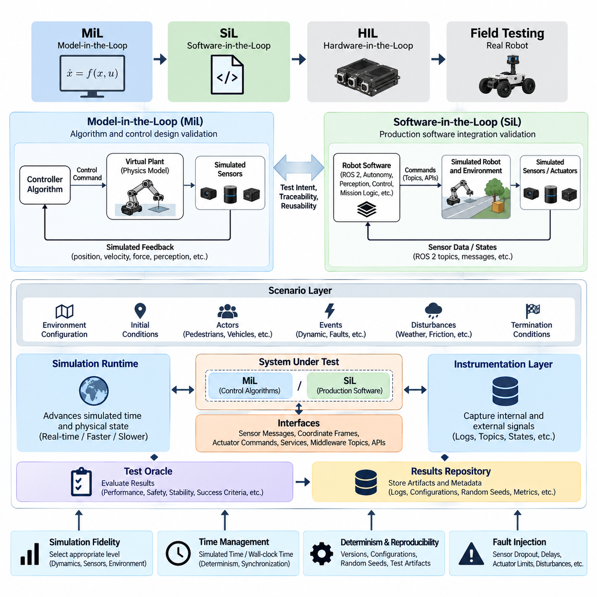
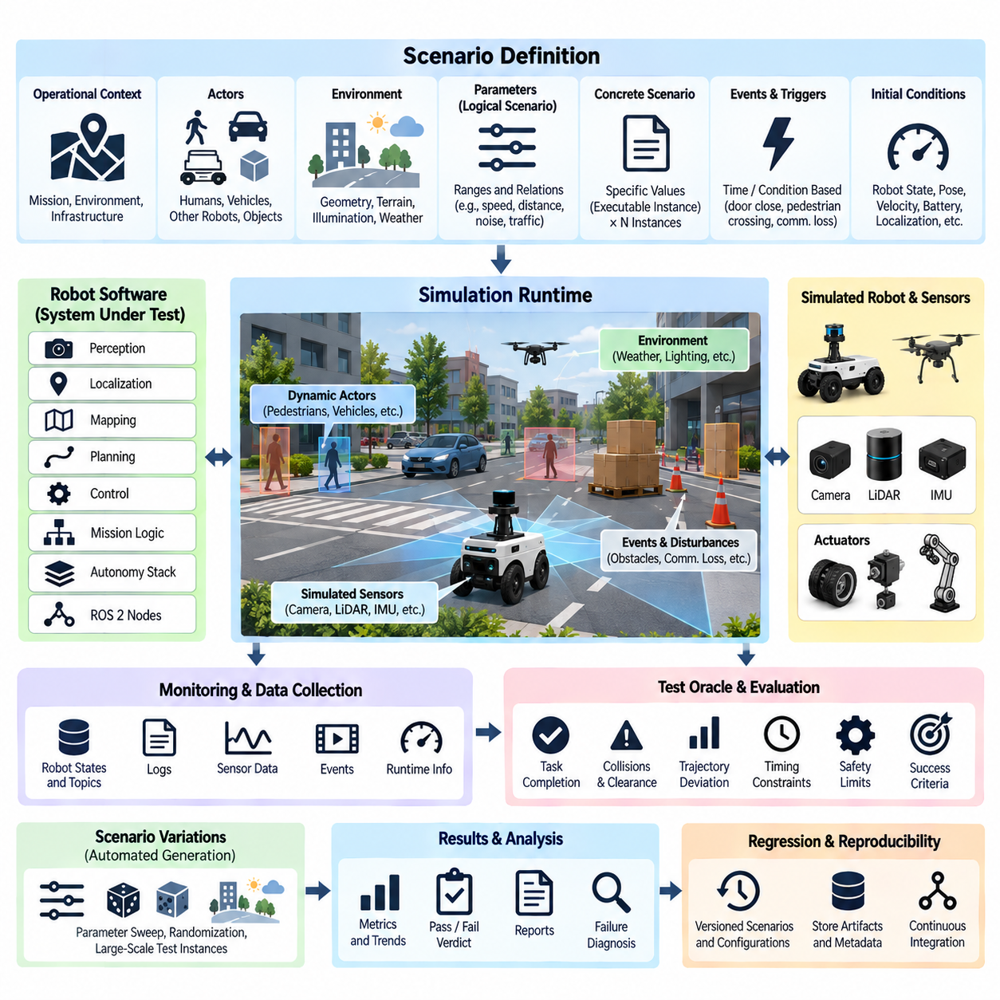
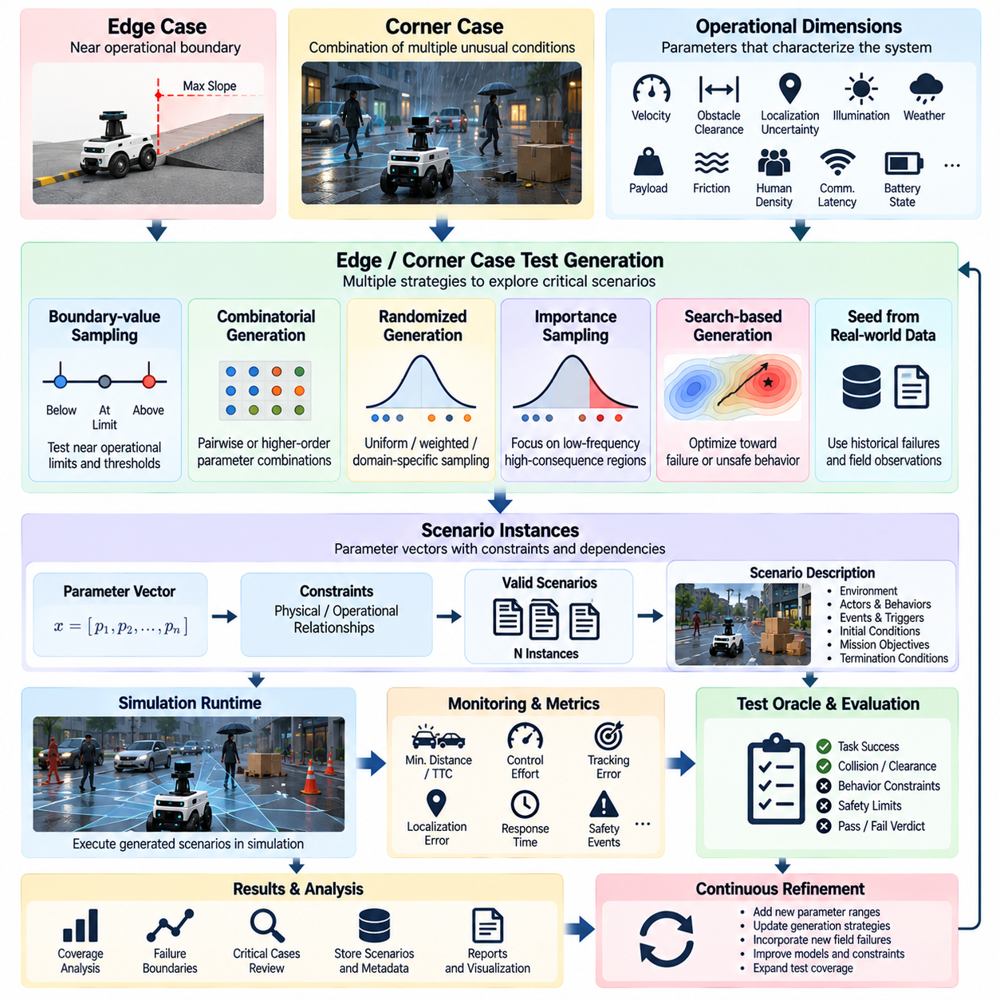
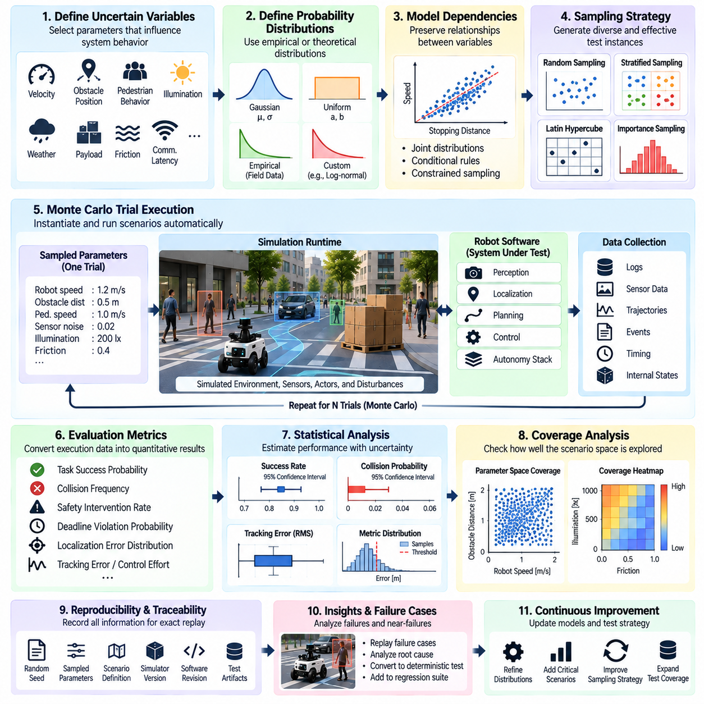
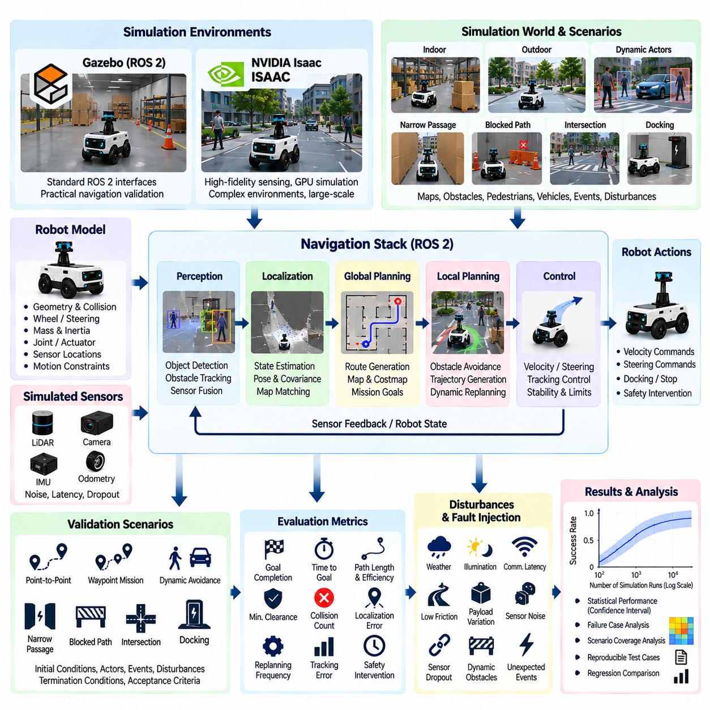
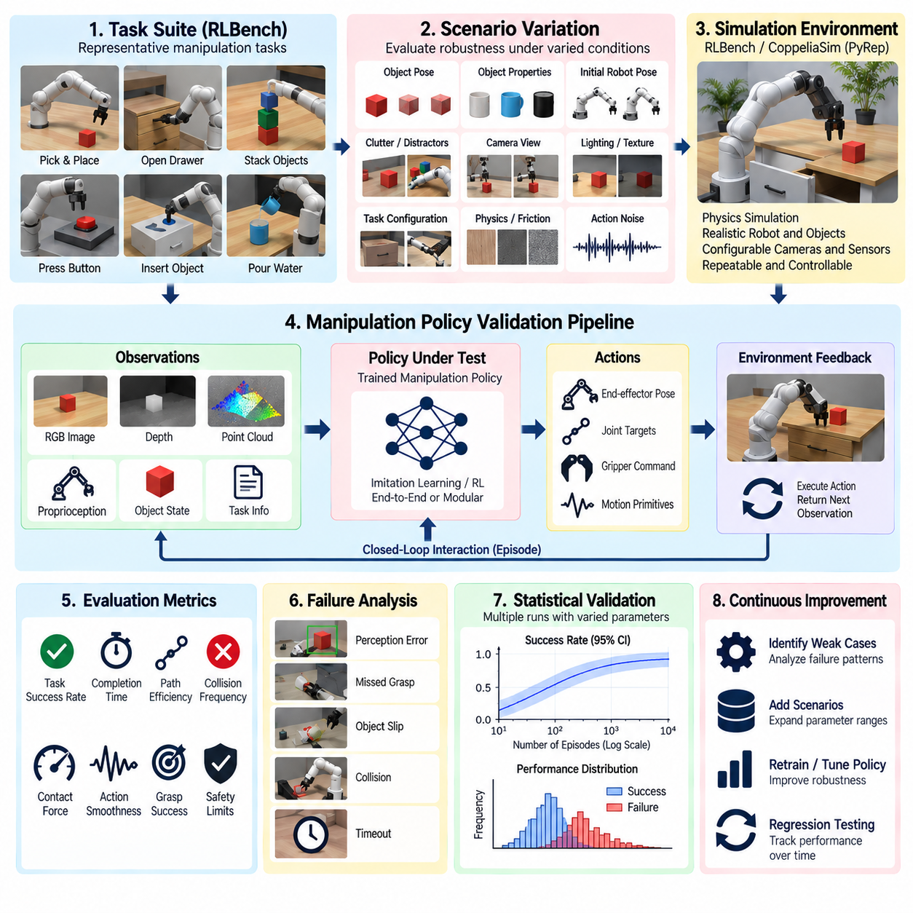
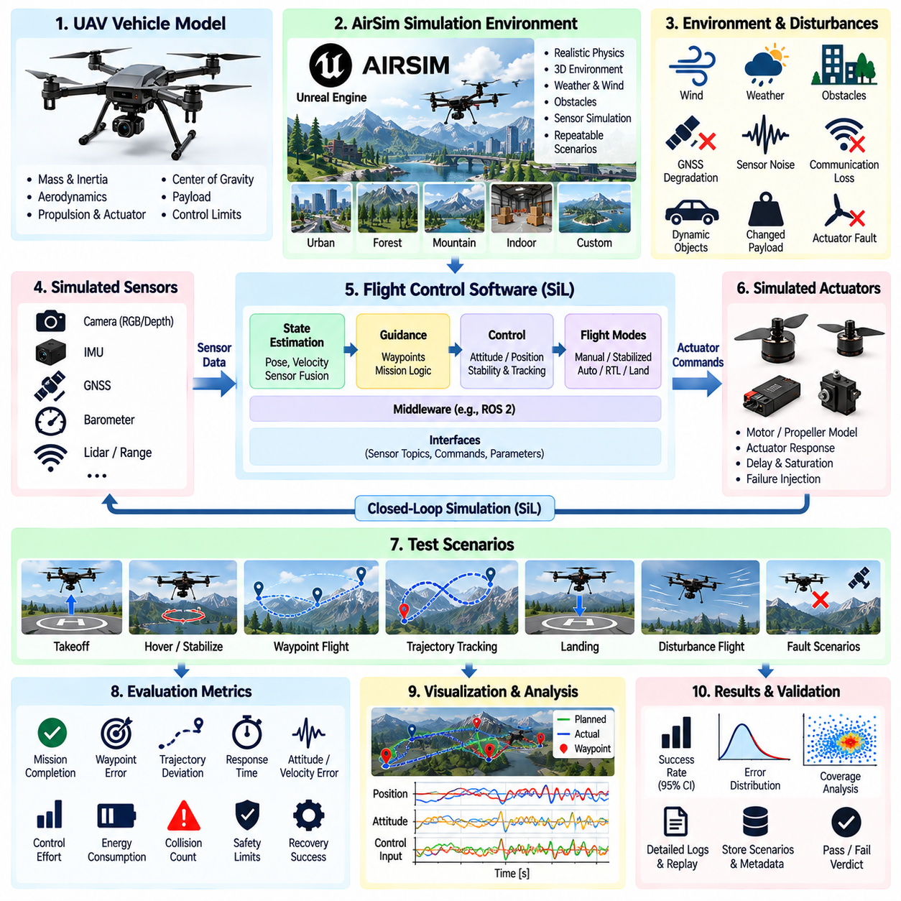
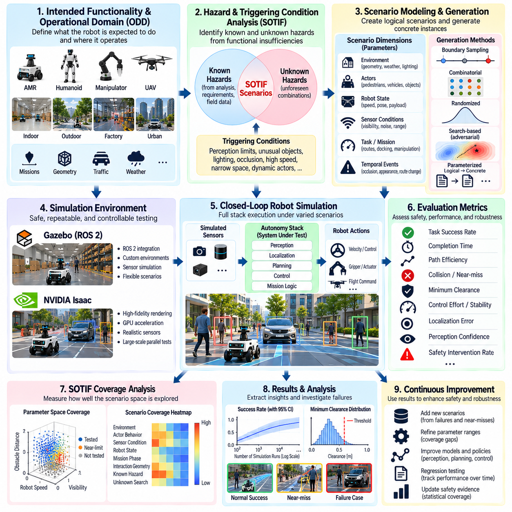
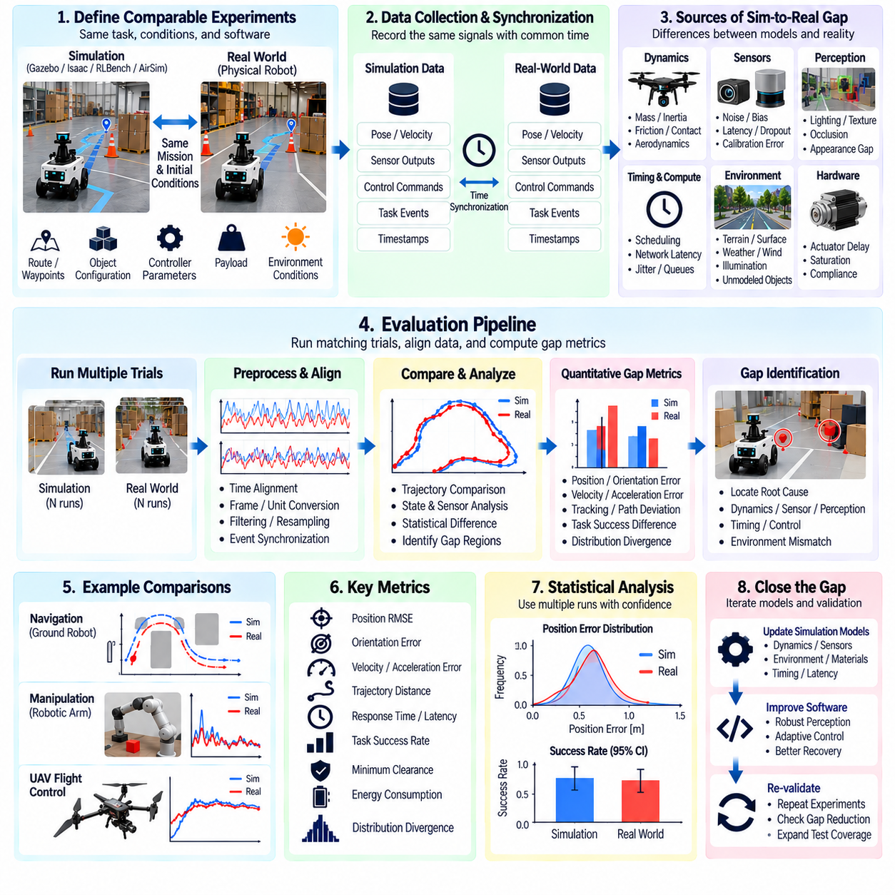
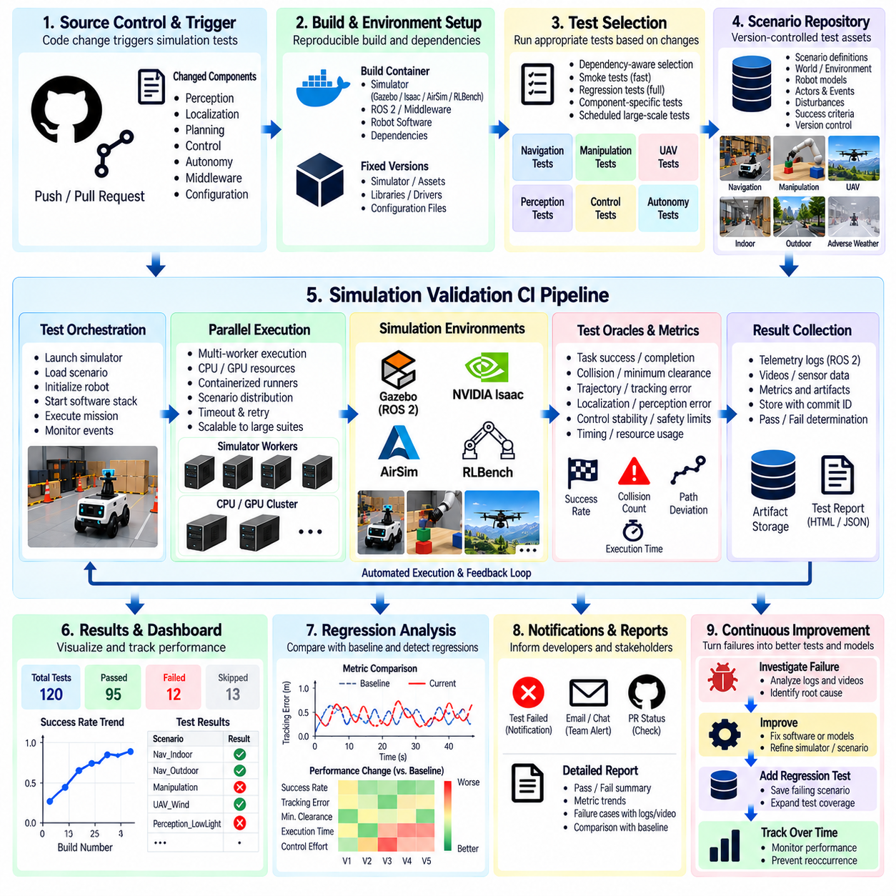

**Volume 25. Testing Validation and Benchmarking**


# Chapter 04. Simulation Based Validation

## 04.01. Simulation Based Validation Architecture SiL MiL

{width="7.268055555555556in" height="7.268055555555556in"}

Simulation-based validation provides a controlled engineering environment in which robot software, control logic, autonomy functions, and AI components can be evaluated before they interact with physical hardware. Within the broader testing architecture, Model-in-the-Loop (MiL) and Software-in-the-Loop (SiL) form early validation layers that complement later HIL and field testing. Volume_25_Testing_Validation_an...

MiL validation places mathematical or behavioral models of the robot and its environment at the center of the test process. Controllers, plant dynamics, actuator behavior, sensor responses, and environmental interactions can be represented at different levels of fidelity. The objective is to verify algorithms and system behavior rapidly while design parameters remain inexpensive to modify and physical implementation constraints have not yet dominated development.

A typical MiL architecture separates the system under development from models representing the physical world. A controller may receive simulated position, velocity, force, or perception signals and generate commands that are applied to a virtual plant. The resulting state is fed back through simulated sensors. This closed-loop structure allows engineers to examine stability, tracking accuracy, state transitions, safety limits, and responses to disturbances without operating a real robot.

MiL is particularly valuable during controller and algorithm development because simulation time does not necessarily need to match wall-clock time. Tests can execute faster than real time, slower for detailed inspection, or repeatedly with systematically varied parameters. Large parameter sweeps can expose regions in which control gains, estimation assumptions, trajectory constraints, or decision thresholds produce unstable or unacceptable behavior before software integration begins.

SiL moves validation closer to the implementation by executing production-oriented software against simulated robots, sensors, actuators, networks, or environments. Instead of validating only abstract algorithms, SiL can exercise actual control modules, ROS 2 nodes, navigation components, perception pipelines, state machines, mission logic, and autonomy software. This makes it possible to detect integration defects that may remain invisible in purely mathematical models.

The transition from MiL to SiL should preserve test intent and traceability. A requirement validated against a model should be mapped to corresponding software-level tests wherever practical. Inputs, expected behavior, tolerances, scenarios, and pass/fail criteria should therefore be represented in reusable test specifications. This enables engineers to determine whether discrepancies originate from algorithm design, numerical implementation, middleware behavior, configuration, or software integration.

A robust simulation validation architecture normally contains a scenario layer, simulation runtime, system under test, instrumentation layer, test oracle, and results repository. The scenario layer defines initial conditions, environment configuration, actors, events, disturbances, and termination conditions. The runtime advances simulated time and physical state, while instrumentation captures internal and external signals needed to reconstruct the execution and determine why a test passed or failed.

Simulation fidelity should be selected according to the validation objective rather than maximized indiscriminately. Controller validation may require accurate dynamics, contact, latency, and actuator characteristics, whereas mission-management testing may benefit more from large numbers of simplified scenarios. Perception validation may emphasize sensor geometry, noise, visibility, and environmental variation. Excessive fidelity can increase computational cost without improving confidence in the requirement being tested.

Time is a critical architectural consideration in SiL. Robot software often depends on timestamps, timers, message ordering, control periods, communication latency, and synchronization between sensors. A simulation environment should therefore define whether components use simulated time or host wall-clock time and ensure that time-dependent behavior remains deterministic where required. Otherwise, identical scenarios may produce inconsistent results that are difficult to reproduce or diagnose.

Interfaces between the simulator and software under test should approximate operational interfaces sufficiently to preserve behavioral validity. Sensor messages, coordinate frames, actuator commands, service calls, middleware topics, and API contracts should maintain expected semantics. This allows production software to execute with minimal simulation-specific modification and reduces the possibility that a separate testing implementation behaves differently from the deployed robot software.

Determinism and reproducibility are essential characteristics of the architecture. Simulator versions, robot models, maps, software commits, configuration files, random seeds, scenario definitions, and dependency versions should be captured as test artifacts. When a failure occurs, engineers must be able to reconstruct the same execution environment. Reproducibility also enables meaningful comparison between software revisions and supports automated regression analysis.

Fault injection expands simulation beyond nominal functional testing. Sensor dropout, delayed messages, corrupted measurements, actuator saturation, localization errors, communication interruption, dynamic obstacles, degraded traction, or unexpected environmental changes can be introduced in controlled conditions. Such experiments reveal how the system detects abnormalities, enters degraded modes, invokes fallback behavior, and recovers without exposing physical equipment or personnel to unnecessary risk.

The simulation architecture should also distinguish functional correctness from model validity. A software component can behave correctly relative to an inaccurate simulator while still failing in the physical world. Validation therefore requires explicit assumptions about dynamics, sensors, environmental models, timing, and uncertainty. These assumptions should be compared with measurements from hardware and field tests so that simulation models can be calibrated and their applicable operating domains understood.

MiL and SiL become especially powerful when integrated with automated scenario execution. A single baseline scenario can be transformed into many variants by changing robot velocity, payload, obstacle position, illumination, friction, sensor noise, communication delay, or environmental conditions. This prepares the foundation for the later chapter topics of scenario-based validation, corner-case generation, Monte Carlo testing, SOTIF coverage, and regression pipelines. Volume_25_Testing_Validation_an...

Pass/fail evaluation should rely on explicit test oracles rather than visual inspection alone. Oracles may evaluate trajectory error, collision occurrence, minimum clearance, control saturation, task completion, timing deadlines, safety-state transitions, localization accuracy, or constraint violations. Multiple metrics can be combined when a scenario has interacting objectives, enabling automated execution to generate objective evidence rather than subjective observations.

For AI-enabled robots, SiL can connect learned perception, planning, navigation, manipulation, or policy models to synthetic observations and simulated physical consequences. The architecture should record not only final task success but also confidence values, intermediate decisions, state estimates, actions, constraint violations, and failure modes. This supports diagnosis of whether a failure originated in perception, reasoning, planning, control, or interaction with the simulated environment.

Simulation results should flow into a structured evidence pipeline. Each execution can produce metadata, logs, traces, metrics, events, and verdicts associated with a specific requirement, scenario, software version, and simulator configuration. Aggregating these artifacts makes it possible to identify regressions, compare builds, measure coverage, and determine which operating conditions remain insufficiently tested before progressing toward HIL or physical testing.

MiL and SiL should therefore be treated as connected validation stages rather than isolated simulation activities. MiL provides rapid exploration of models and algorithms, while SiL determines whether implemented software preserves the intended behavior within representative system interfaces. HIL can subsequently introduce real controllers, processors, communication hardware, sensors, or actuators, progressively reducing the abstraction between the test environment and the deployed robot.

An effective validation strategy uses simulation to reduce---not eliminate---the amount of physical testing required. Simulation offers scalability, repeatability, controlled fault injection, and access to hazardous or statistically rare conditions, while hardware and field testing reveal modeling errors and real-world effects that simulation cannot completely represent. Confidence grows by combining evidence across these layers rather than assuming that success in any single environment proves system readiness.

Ultimately, simulation-based validation architecture provides the scalable foundation for continuous robot verification. When MiL models, SiL software, scenarios, metrics, configurations, and evidence are version controlled and automated, validation can accompany every significant software change. This supports a progression from rapid virtual experimentation toward HIL, field validation, safety assessment, benchmarking, and production testing within the broader testing lifecycle. 08_Robotics_Software_Tree

시뮬레이션 기반 검증(Simulation-Based Validation)은 로봇 소프트웨어(Robot Software), 제어 로직(Control Logic), 자율 기능(Autonomy Function), 인공지능 구성요소(AI Component)가 실제 하드웨어(Physical Hardware)와 상호작용하기 전에 평가할 수 있는 통제된 엔지니어링 환경(Engineering Environment)을 제공한다. 전체 시험 아키텍처(Testing Architecture)에서 모델 인 더 루프(Model-in-the-Loop, MiL)와 소프트웨어 인 더 루프(Software-in-the-Loop, SiL)는 이후의 하드웨어 인 더 루프(Hardware-in-the-Loop, HIL) 및 현장 시험(Field Testing)을 보완하는 초기 검증 계층(Validation Layer)을 구성한다.

MiL 검증(MiL Validation)은 로봇과 환경의 수학적 모델(Mathematical Model) 또는 행동 모델(Behavioral Model)을 시험 프로세스(Test Process)의 중심에 배치한다. 제어기(Controller), 플랜트 동역학(Plant Dynamics), 액추에이터 동작(Actuator Behavior), 센서 응답(Sensor Response), 환경 상호작용(Environmental Interaction)은 서로 다른 수준의 충실도(Fidelity)로 표현할 수 있다. 목적은 설계 매개변수(Design Parameter)를 저비용으로 수정할 수 있고 실제 구현 제약이 지배적이지 않은 단계에서 알고리즘과 시스템 동작을 신속하게 검증하는 것이다.

일반적인 MiL 아키텍처(MiL Architecture)는 개발 대상 시스템(System Under Development)과 물리 세계(Physical World)를 표현하는 모델을 분리한다. 제어기는 시뮬레이션된 위치(Position), 속도(Velocity), 힘(Force), 인지 신호(Perception Signal)를 입력받아 가상 플랜트(Virtual Plant)에 적용되는 명령을 생성할 수 있다. 그 결과 상태는 시뮬레이션 센서(Simulated Sensor)를 통해 다시 피드백된다. 이러한 폐루프 구조(Closed-Loop Structure)를 통해 실제 로봇을 작동하지 않고도 안정성, 추종 정확도, 상태 전이, 안전 한계 및 외란에 대한 응답을 평가할 수 있다.

MiL은 시뮬레이션 시간(Simulation Time)이 반드시 실제 시간(Wall-Clock Time)과 일치할 필요가 없기 때문에 제어기 및 알고리즘 개발에서 특히 유용하다. 시험은 실제 시간보다 빠르게 실행하거나, 세부 분석을 위해 느리게 실행하거나, 체계적으로 변경된 매개변수로 반복 실행할 수 있다. 대규모 매개변수 탐색(Parameter Sweep)을 통해 소프트웨어 통합 전에 제어 게인(Control Gain), 상태 추정 가정, 궤적 제약조건 또는 의사결정 임계값이 불안정하거나 허용할 수 없는 동작을 발생시키는 영역을 식별할 수 있다.

SiL은 실제 구현에 더욱 가까운 단계로 검증을 이동시키며, 생산 지향 소프트웨어(Production-Oriented Software)를 시뮬레이션된 로봇, 센서, 액추에이터, 네트워크 또는 환경과 함께 실행한다. 단순히 추상적인 알고리즘만 검증하는 대신 SiL에서는 실제 제어 모듈(Control Module), ROS 2 노드(Node), 내비게이션 구성요소(Navigation Component), 인지 파이프라인(Perception Pipeline), 상태 머신(State Machine), 임무 로직(Mission Logic), 자율 소프트웨어(Autonomy Software)를 시험할 수 있다. 이를 통해 순수한 수학적 모델에서는 발견하기 어려운 통합 결함(Integration Defect)을 식별할 수 있다.

MiL에서 SiL로의 전환은 시험 의도(Test Intent)와 추적성(Traceability)을 유지해야 한다. 모델을 대상으로 검증한 요구사항(Requirement)은 가능한 경우 대응하는 소프트웨어 수준 시험(Software-Level Test)에 매핑되어야 한다. 따라서 입력, 예상 동작, 허용오차(Tolerance), 시나리오(Scenario), 합격·불합격 기준(Pass/Fail Criteria)을 재사용 가능한 시험 명세(Test Specification)로 표현해야 한다. 이를 통해 불일치가 알고리즘 설계, 수치적 구현, 미들웨어 동작, 구성 설정 또는 소프트웨어 통합 중 어디에서 발생했는지 판단할 수 있다.

견고한 시뮬레이션 검증 아키텍처(Simulation Validation Architecture)는 일반적으로 시나리오 계층(Scenario Layer), 시뮬레이션 런타임(Simulation Runtime), 시험 대상 시스템(System Under Test), 계측 계층(Instrumentation Layer), 시험 오라클(Test Oracle), 결과 저장소(Results Repository)로 구성된다. 시나리오 계층은 초기 조건, 환경 구성, 행위자(Actor), 이벤트, 외란 및 종료 조건을 정의한다. 런타임은 시뮬레이션 시간과 물리 상태를 진행시키며, 계측 계층은 시험의 합격 여부와 실패 원인을 재구성하는 데 필요한 내부 및 외부 신호를 수집한다.

시뮬레이션 충실도(Simulation Fidelity)는 무조건 최대화하기보다 검증 목적에 따라 선택해야 한다. 제어기 검증에는 정확한 동역학, 접촉(Contact), 지연시간(Latency), 액추에이터 특성이 필요할 수 있지만, 임무 관리 시험(Mission Management Testing)에서는 단순화된 시나리오를 대량으로 실행하는 것이 더 효과적일 수 있다. 인지 검증은 센서 기하학, 노이즈, 가시성 및 환경 변화에 중점을 둘 수 있다. 과도한 충실도는 검증 대상 요구사항에 대한 신뢰도를 높이지 못하면서 계산 비용만 증가시킬 수 있다.

시간(Time)은 SiL에서 중요한 아키텍처 고려사항이다. 로봇 소프트웨어는 타임스탬프(Timestamp), 타이머(Timer), 메시지 순서(Message Ordering), 제어 주기(Control Period), 통신 지연시간(Communication Latency), 센서 간 동기화(Synchronization)에 의존하는 경우가 많다. 따라서 시뮬레이션 환경은 각 구성요소가 시뮬레이션 시간(Simulated Time)을 사용하는지 호스트 실제 시간(Host Wall-Clock Time)을 사용하는지 명확히 정의하고, 필요한 경우 시간 의존적 동작의 결정성(Determinism)을 보장해야 한다. 그렇지 않으면 동일한 시나리오에서도 서로 다른 결과가 발생하여 재현과 진단이 어려워질 수 있다.

시뮬레이터와 시험 대상 소프트웨어(Software Under Test) 사이의 인터페이스(Interface)는 동작 유효성(Behavioral Validity)을 유지할 수 있을 정도로 실제 운용 인터페이스를 반영해야 한다. 센서 메시지, 좌표 프레임(Coordinate Frame), 액추에이터 명령, 서비스 호출(Service Call), 미들웨어 토픽(Middleware Topic), API 계약(API Contract)은 예상되는 의미 체계(Semantics)를 유지해야 한다. 이를 통해 운영 소프트웨어(Production Software)를 시뮬레이션 전용 수정 없이 또는 최소한의 수정만으로 실행할 수 있으며, 별도의 시험 구현이 실제 배포 로봇과 다르게 동작할 가능성을 줄일 수 있다.

결정성(Determinism)과 재현성(Reproducibility)은 아키텍처의 핵심 특성이다. 시뮬레이터 버전, 로봇 모델, 지도(Map), 소프트웨어 커밋(Software Commit), 구성 파일(Configuration File), 난수 시드(Random Seed), 시나리오 정의 및 의존성 버전(Dependency Version)을 시험 산출물(Test Artifact)로 기록해야 한다. 실패가 발생하면 엔지니어는 동일한 실행 환경을 재구성할 수 있어야 한다. 재현성은 소프트웨어 개정판 사이의 의미 있는 비교를 가능하게 하며 자동화된 회귀 분석(Regression Analysis)을 지원한다.

결함 주입(Fault Injection)은 시뮬레이션을 정상 기능 시험(Nominal Functional Testing) 이상으로 확장한다. 센서 데이터 손실(Sensor Dropout), 메시지 지연, 손상된 측정값, 액추에이터 포화(Actuator Saturation), 위치추정 오류(Localization Error), 통신 중단, 동적 장애물(Dynamic Obstacle), 접지력 저하 또는 예상하지 못한 환경 변화를 통제된 조건에서 주입할 수 있다. 이러한 시험을 통해 시스템이 이상을 감지하고, 성능 저하 모드(Degraded Mode)로 전환하며, 대체 동작(Fallback Behavior)을 수행하고, 실제 장비나 인력을 불필요한 위험에 노출하지 않으면서 복구하는 방식을 평가할 수 있다.

시뮬레이션 아키텍처는 기능적 정확성(Functional Correctness)과 모델 유효성(Model Validity)을 구분해야 한다. 소프트웨어 구성요소가 부정확한 시뮬레이터를 기준으로 올바르게 동작하더라도 실제 세계에서는 실패할 수 있다. 따라서 검증에서는 동역학, 센서, 환경 모델, 시간 및 불확실성(Uncertainty)에 관한 가정을 명시해야 한다. 이러한 가정은 하드웨어 시험과 현장 시험에서 얻은 측정 결과와 비교되어야 하며, 이를 통해 시뮬레이션 모델을 보정(Calibration)하고 적용 가능한 운용 영역(Operating Domain)을 파악할 수 있다.

MiL과 SiL은 자동화된 시나리오 실행(Automated Scenario Execution)과 통합될 때 특히 강력해진다. 하나의 기준 시나리오(Baseline Scenario)는 로봇 속도, 적재량(Payload), 장애물 위치, 조명, 마찰, 센서 노이즈, 통신 지연 또는 환경 조건을 변경하여 다양한 변형 시나리오로 확장할 수 있다. 이는 이후 다루는 시나리오 기반 검증(Scenario-Based Validation), 코너 케이스 생성(Corner-Case Generation), 몬테카를로 시험(Monte Carlo Testing), SOTIF 커버리지(SOTIF Coverage), 회귀 파이프라인(Regression Pipeline)의 기반을 제공한다.

합격·불합격 평가(Pass/Fail Evaluation)는 단순한 시각적 검사에 의존하기보다 명시적인 시험 오라클(Test Oracle)을 사용해야 한다. 시험 오라클은 궤적 오차(Trajectory Error), 충돌 발생 여부, 최소 이격거리(Minimum Clearance), 제어 포화, 임무 완료 여부, 시간 제한, 안전 상태 전이, 위치추정 정확도 또는 제약조건 위반을 평가할 수 있다. 하나의 시나리오가 서로 영향을 주는 여러 목표를 포함하는 경우 복수의 지표(Metric)를 결합하여 자동화된 실행으로 주관적 관찰이 아닌 객관적인 검증 증거(Validation Evidence)를 생성할 수 있다.

AI 기반 로봇(AI-Enabled Robot)의 경우 SiL은 학습된 인지(Perception), 계획(Planning), 내비게이션(Navigation), 조작(Manipulation), 정책 모델(Policy Model)을 합성 관측값(Synthetic Observation) 및 시뮬레이션된 물리적 결과와 연결할 수 있다. 아키텍처는 최종 임무 성공 여부뿐 아니라 신뢰도(Confidence Value), 중간 의사결정, 상태 추정, 행동(Action), 제약조건 위반 및 실패 모드(Failure Mode)를 함께 기록해야 한다. 이를 통해 실패 원인이 인지, 추론(Reasoning), 계획, 제어 또는 시뮬레이션 환경과의 상호작용 중 어디에서 발생했는지 진단할 수 있다.

시뮬레이션 결과는 구조화된 증거 파이프라인(Evidence Pipeline)으로 전달되어야 한다. 각 실행에서는 특정 요구사항, 시나리오, 소프트웨어 버전 및 시뮬레이터 구성과 연결된 메타데이터(Metadata), 로그(Log), 추적 데이터(Trace), 지표, 이벤트 및 판정 결과(Verdict)를 생성할 수 있다. 이러한 산출물을 집계하면 회귀 문제를 식별하고, 빌드(Build)를 비교하며, 시험 커버리지(Test Coverage)를 측정하고, HIL 또는 실제 물리 시험으로 진행하기 전에 충분히 검증되지 않은 운용 조건을 파악할 수 있다.

따라서 MiL과 SiL은 서로 분리된 시뮬레이션 활동이 아니라 연결된 검증 단계(Validation Stage)로 다루어야 한다. MiL은 모델과 알고리즘을 신속하게 탐색할 수 있도록 지원하고, SiL은 구현된 소프트웨어가 대표적인 시스템 인터페이스 환경에서 의도한 동작을 유지하는지 검증한다. 이후 HIL에서는 실제 제어기, 프로세서, 통신 하드웨어, 센서 또는 액추에이터를 도입함으로써 시험 환경과 실제 배포 로봇 사이의 추상화 수준을 점진적으로 낮출 수 있다.

효과적인 검증 전략(Validation Strategy)은 시뮬레이션을 활용하여 필요한 물리적 시험의 양을 줄이지만 완전히 제거하지는 않는다. 시뮬레이션은 확장성(Scalability), 반복성(Repeatability), 통제된 결함 주입, 위험하거나 통계적으로 드문 조건에 대한 접근성을 제공한다. 반면 하드웨어 및 현장 시험은 시뮬레이션으로 완전히 표현할 수 없는 모델링 오류와 실제 세계의 영향을 발견한다. 따라서 시스템에 대한 신뢰도는 하나의 환경에서 성공했다고 판단하는 것이 아니라 여러 검증 계층에서 얻은 증거를 결합함으로써 향상된다.

궁극적으로 시뮬레이션 기반 검증 아키텍처(Simulation-Based Validation Architecture)는 지속적인 로봇 검증(Continuous Robot Verification)을 위한 확장 가능한 기반을 제공한다. MiL 모델, SiL 소프트웨어, 시나리오, 지표, 구성 및 검증 증거를 버전 관리(Version Control)하고 자동화하면 중요한 소프트웨어 변경마다 검증을 수행할 수 있다. 이러한 체계는 신속한 가상 실험에서 출발하여 HIL, 현장 검증, 안전성 평가(Safety Assessment), 벤치마킹(Benchmarking), 운영 환경 시험(Production Testing)으로 이어지는 전체 시험 수명주기(Testing Lifecycle)를 지원한다.

##  

## 04.02. Scenario Based Validation in Simulation [w/Code]

{width="7.268055555555556in" height="7.268055555555556in"}

Scenario-based validation in simulation evaluates robot behavior through explicitly defined operational situations rather than isolated software functions. Each scenario represents a meaningful interaction among the robot, environment, infrastructure, objects, humans, and disturbances. This approach allows validation to focus on observable system behavior under conditions that approximate real missions while remaining repeatable and controllable.

A scenario should describe more than a map and an initial robot pose. It defines the operational context, participating actors, their states and behaviors, environmental conditions, mission objectives, triggering events, expected responses, and termination criteria. For an autonomous mobile robot, for example, a scenario may combine a delivery mission with pedestrians, blocked passages, localization uncertainty, and changing obstacle configurations.

Scenario descriptions are commonly separated into logical and concrete representations. A logical scenario defines parameter ranges and relationships, such as pedestrian speed, obstacle distance, sensor noise, or robot velocity. A concrete scenario assigns specific values to those parameters and becomes directly executable. This separation allows a small number of scenario concepts to generate thousands of reproducible test instances without manually authoring every case.

The scenario validation architecture normally connects a scenario definition layer to a simulation runtime, robot software, monitoring functions, and automated test oracles. The simulator creates the specified world and advances its state, while the robot software perceives and reacts to simulated conditions. Monitors continuously observe relevant signals and events, and test oracles determine whether requirements and behavioral constraints were satisfied during execution.

Scenario parameters should be selected from the robot\'s intended operating domain. Relevant dimensions may include geometry, terrain, illumination, weather, object placement, traffic density, human behavior, payload, friction, communication quality, sensor degradation, and robot speed. Systematically varying these dimensions exposes interactions that conventional nominal testing can overlook and provides a structured basis for measuring validation coverage.

Initial conditions are particularly important because autonomous systems can be highly sensitive to small differences in state. Robot pose, velocity, localization covariance, battery condition, actuator state, object configuration, and internal mission state may all influence the resulting behavior. A reproducible validation framework therefore records these conditions explicitly instead of depending on unspecified simulator defaults that can change between executions.

Dynamic actors make scenario validation more representative of real robot operation. Pedestrians, vehicles, other robots, moving machinery, manipulated objects, or simulated agents can follow scripted trajectories or reactive behavior models. Their interactions with the system under test can create merging paths, occlusions, sudden crossings, congestion, or conflicting objectives that exercise perception, prediction, planning, and control simultaneously.

Events and triggers provide temporal structure to scenarios. A door may close after the robot enters a corridor, a pedestrian may cross when the robot reaches a defined region, or communication may degrade during a mission phase. Event-driven definitions make complex situations reproducible because disturbances occur according to observable conditions rather than arbitrary manual intervention, improving consistency across software versions.

A scenario should contain measurable acceptance criteria linked to its validation objective. Successful task completion alone is often insufficient. The robot may reach its goal while violating minimum clearance, exceeding velocity limits, producing excessive control oscillation, entering prohibited areas, or responding too slowly to hazards. Multiple behavioral metrics are therefore needed to distinguish safe and correct execution from superficial mission success.

Automated test oracles convert simulation traces into validation verdicts. They can monitor collisions, distances, trajectory deviation, timing constraints, state transitions, control limits, localization error, task completion, and safety responses. An oracle should specify tolerances explicitly because simulated signals contain numerical approximations and because many robot requirements define acceptable ranges rather than exact values.

Scenario-based testing is especially effective for navigation systems because complete autonomy stacks can be exercised under repeatable traffic and environmental conditions. Localization, mapping, obstacle detection, path planning, local planning, and motion control can be evaluated as an integrated behavior chain. Failures can then be associated with recorded observations and internal states instead of being treated simply as unsuccessful navigation runs.

Manipulation validation can use scenarios describing object pose, clutter, grasp approach, contact conditions, target placement, and disturbances. The same task can be repeated across object positions, orientations, physical properties, or workspace configurations. Scenario variation therefore tests whether a manipulation policy succeeds only under a narrow nominal configuration or maintains acceptable behavior across a meaningful operational envelope.

For UAV software, scenarios can represent mission routes, wind conditions, obstacles, sensor uncertainty, communication degradation, and flight-mode transitions. Because potentially hazardous situations can be exercised without risking an aircraft, simulation is valuable for validating abnormal and boundary conditions. Nevertheless, conclusions remain dependent on the fidelity and validity of the aerodynamic, sensor, environmental, and timing models used by the simulator.

Scenario generation should balance manually designed cases with systematic parameterization. Expert-designed scenarios capture known hazards, requirements, operational experience, and previously observed failures. Parameterized generation expands these cases across ranges that humans may not test individually. Together, they create a progression from deterministic requirement-based validation toward large-scale corner-case exploration and statistical simulation.

Coverage must be measured against scenario space rather than merely counting executed simulations. Running ten thousand nearly identical cases provides less evidence than systematically covering important combinations of operating conditions. Coverage models can classify scenarios by environment, actor behavior, mission phase, system state, hazard type, and parameter ranges, revealing which regions of the intended operating domain remain insufficiently exercised.

Combinatorial growth is one of the central challenges of scenario-based validation. Even a modest number of variables can produce an impractically large test space. Validation frameworks therefore prioritize combinations according to requirements, risk, boundary conditions, operational frequency, previous failures, and expected behavioral sensitivity. This makes computational resources concentrate on scenarios that provide meaningful additional evidence instead of redundant executions.

Randomization can increase diversity, but random scenarios must remain reproducible. Each execution should preserve its random seed together with scenario parameters, simulator version, robot software revision, model versions, and configuration. When a rare failure appears during a large simulation campaign, these artifacts allow the exact case to be replayed for debugging, root-cause analysis, and subsequent regression testing.

Failure scenarios should become persistent regression assets. When simulation reveals a collision, planning deadlock, unstable controller response, missed detection, incorrect state transition, or other defect, the corresponding scenario can be stored in the validation repository. After the defect is corrected, the same scenario is repeatedly executed against future builds to prevent previously solved problems from silently returning.

Simulation execution can be scaled horizontally because many scenarios are independent. Containerized or isolated workers can run different parameter combinations in parallel across CPUs, GPUs, workstations, or compute clusters. Results can then be aggregated into a common database containing scenario identifiers, software versions, metrics, verdicts, logs, and failure artifacts. This architecture turns simulation into a scalable validation service rather than an interactive engineering tool.

Scenario-based validation also provides a foundation for continuous integration. Selected smoke scenarios can execute for every software change, broader regression suites can run periodically, and computationally expensive campaigns can execute before major releases. Test selection can be adjusted according to the components that changed, allowing simulation resources to focus on scenarios most likely to expose regressions associated with a particular modification.

The credibility of scenario results ultimately depends on correlation with physical testing. Important scenarios should be replayed on real robots where practical, and discrepancies in trajectories, sensor behavior, timing, contacts, or failure responses should be analyzed. These observations can refine simulator parameters and uncertainty models, progressively improving the relationship between virtual validation evidence and expected real-world behavior.

Scenario-based simulation therefore transforms validation from ad hoc virtual experimentation into a structured evidence-generation process. Explicit scenario definitions, controlled variation, measurable criteria, reproducible execution, coverage tracking, and regression management provide the foundation for subsequent corner-case generation, Monte Carlo analysis, SOTIF evaluation, Sim-to-Real gap analysis, and automated simulation validation pipelines within the chapter structure.

시뮬레이션에서의 시나리오 기반 검증(Scenario-Based Validation in Simulation)은 개별 소프트웨어 기능을 독립적으로 시험하는 대신 명시적으로 정의된 운용 상황(Operational Situation)을 통해 로봇의 동작을 평가한다. 각 시나리오(Scenario)는 로봇, 환경, 인프라, 객체, 사람 및 외란(Disturbance) 사이의 의미 있는 상호작용을 표현한다. 이러한 접근법은 반복 가능하고 통제된 조건을 유지하면서 실제 임무와 유사한 상황에서 관찰 가능한 시스템 동작(Observable System Behavior)을 중심으로 검증할 수 있도록 한다.

시나리오는 단순히 지도(Map)와 로봇의 초기 자세(Initial Robot Pose)만을 정의해서는 안 된다. 운용 맥락(Operational Context), 참여 행위자(Actor), 이들의 상태와 행동, 환경 조건, 임무 목표, 트리거 이벤트(Triggering Event), 예상 응답 및 종료 기준(Termination Criteria)을 함께 정의해야 한다. 예를 들어 자율이동로봇(Autonomous Mobile Robot)의 시나리오는 배송 임무와 함께 보행자, 차단된 통로, 위치추정 불확실성(Localization Uncertainty), 변화하는 장애물 구성을 결합할 수 있다.

시나리오 기술(Scenario Description)은 일반적으로 논리적 표현(Logical Representation)과 구체적 표현(Concrete Representation)으로 구분할 수 있다. 논리적 시나리오(Logical Scenario)는 보행자 속도, 장애물 거리, 센서 노이즈 또는 로봇 속도와 같은 매개변수의 범위와 관계를 정의한다. 구체적 시나리오(Concrete Scenario)는 이러한 매개변수에 특정 값을 할당하여 직접 실행 가능한 형태로 만든다. 이러한 분리를 통해 모든 시험 사례를 수작업으로 작성하지 않고도 소수의 시나리오 개념으로 수천 개의 재현 가능한 시험 인스턴스(Test Instance)를 생성할 수 있다.

시나리오 검증 아키텍처(Scenario Validation Architecture)는 일반적으로 시나리오 정의 계층(Scenario Definition Layer)을 시뮬레이션 런타임(Simulation Runtime), 로봇 소프트웨어(Robot Software), 모니터링 기능(Monitoring Function), 자동화된 시험 오라클(Automated Test Oracle)과 연결한다. 시뮬레이터는 지정된 가상 세계를 생성하고 상태를 진행시키며, 로봇 소프트웨어는 시뮬레이션 조건을 인지하고 이에 반응한다. 모니터는 관련 신호와 이벤트를 지속적으로 관찰하고, 시험 오라클은 실행 과정에서 요구사항과 동작 제약조건(Behavioral Constraint)이 충족되었는지 판정한다.

시나리오 매개변수(Scenario Parameter)는 로봇의 의도된 운용 영역(Intended Operating Domain)에서 선정해야 한다. 관련 차원에는 기하 구조(Geometry), 지형, 조명, 날씨, 객체 배치, 교통 밀도, 사람의 행동, 적재량(Payload), 마찰, 통신 품질, 센서 성능 저하 및 로봇 속도 등이 포함될 수 있다. 이러한 차원을 체계적으로 변화시키면 일반적인 정상 조건 시험(Nominal Testing)에서 놓칠 수 있는 상호작용을 발견하고 검증 커버리지(Validation Coverage)를 측정할 수 있는 구조적인 기반을 확보할 수 있다.

초기 조건(Initial Condition)은 자율 시스템(Autonomous System)이 작은 상태 차이에도 매우 민감하게 반응할 수 있기 때문에 특히 중요하다. 로봇의 자세, 속도, 위치추정 공분산(Localization Covariance), 배터리 상태, 액추에이터 상태, 객체 구성 및 내부 임무 상태가 모두 최종 동작에 영향을 줄 수 있다. 따라서 재현 가능한 검증 프레임워크(Validation Framework)는 실행마다 변경될 수 있는 불명확한 시뮬레이터 기본값에 의존하지 않고 이러한 조건을 명시적으로 기록해야 한다.

동적 행위자(Dynamic Actor)는 시나리오 검증을 실제 로봇 운용에 더욱 가깝게 만든다. 보행자, 차량, 다른 로봇, 이동식 장비, 조작 대상 객체 또는 시뮬레이션 에이전트(Simulated Agent)는 사전에 정의된 궤적이나 반응형 행동 모델(Reactive Behavior Model)을 따를 수 있다. 시험 대상 시스템(System Under Test)과 이들의 상호작용은 경로 합류, 가림(Occlusion), 갑작스러운 횡단, 혼잡 또는 상충하는 목표를 생성하여 인지, 예측, 계획 및 제어 기능을 동시에 시험할 수 있다.

이벤트(Event)와 트리거(Trigger)는 시나리오에 시간적 구조(Temporal Structure)를 제공한다. 로봇이 복도에 진입한 후 문이 닫히거나, 로봇이 특정 영역에 도달했을 때 보행자가 횡단하거나, 임무의 특정 단계에서 통신 품질이 저하되도록 구성할 수 있다. 이벤트 기반 정의(Event-Driven Definition)는 임의의 수동 개입 대신 관찰 가능한 조건에 따라 외란을 발생시키므로 복잡한 상황을 재현할 수 있으며, 서로 다른 소프트웨어 버전 사이에서도 시험 일관성을 향상시킨다.

시나리오는 검증 목적(Validation Objective)과 연결된 측정 가능한 허용 기준(Acceptance Criteria)을 포함해야 한다. 단순한 임무 성공만으로는 충분하지 않은 경우가 많다. 로봇이 목표 지점에 도달하더라도 최소 이격거리(Minimum Clearance)를 위반하거나, 속도 제한을 초과하거나, 과도한 제어 진동(Control Oscillation)을 발생시키거나, 금지 영역에 진입하거나, 위험에 너무 늦게 대응할 수 있다. 따라서 안전하고 올바른 실행을 단순한 임무 성공과 구분하기 위해 복수의 동작 지표(Behavioral Metric)가 필요하다.

자동화된 시험 오라클(Automated Test Oracle)은 시뮬레이션 추적 데이터(Simulation Trace)를 검증 판정(Validation Verdict)으로 변환한다. 충돌, 거리, 궤적 편차(Trajectory Deviation), 시간 제약, 상태 전이, 제어 한계, 위치추정 오차, 임무 완료 및 안전 대응을 모니터링할 수 있다. 시뮬레이션 신호에는 수치적 근사(Numerical Approximation)가 포함되고 많은 로봇 요구사항이 정확한 단일 값이 아닌 허용 범위를 정의하므로 시험 오라클은 허용오차(Tolerance)를 명시적으로 규정해야 한다.

시나리오 기반 시험(Scenario-Based Testing)은 완전한 자율주행 스택(Autonomy Stack)을 반복 가능한 교통 및 환경 조건에서 시험할 수 있기 때문에 내비게이션 시스템(Navigation System)에 특히 효과적이다. 위치추정, 지도작성(Mapping), 장애물 감지, 경로 계획(Path Planning), 지역 계획(Local Planning), 모션 제어(Motion Control)를 하나의 통합된 동작 체인(Behavior Chain)으로 평가할 수 있다. 이후 실패를 단순한 내비게이션 실패로 처리하는 대신 기록된 관측 데이터와 내부 상태를 기반으로 원인을 분석할 수 있다.

조작 검증(Manipulation Validation)에서는 객체 자세(Object Pose), 주변 물체의 복잡도(Clutter), 파지 접근(Grasp Approach), 접촉 조건(Contact Condition), 목표 배치 및 외란을 기술하는 시나리오를 사용할 수 있다. 동일한 작업을 다양한 객체 위치, 방향, 물리적 특성 또는 작업공간 구성에서 반복할 수 있다. 이를 통해 조작 정책(Manipulation Policy)이 제한적인 정상 구성에서만 성공하는지 또는 의미 있는 운용 범위(Operational Envelope) 전체에서 허용 가능한 동작을 유지하는지 평가할 수 있다.

무인항공기(UAV) 소프트웨어의 경우 시나리오는 임무 경로, 바람 조건, 장애물, 센서 불확실성, 통신 성능 저하 및 비행 모드 전환(Flight-Mode Transition)을 표현할 수 있다. 항공기를 위험에 노출하지 않고 잠재적으로 위험한 상황과 경계 조건(Boundary Condition)을 시험할 수 있기 때문에 시뮬레이션은 비정상 상황 검증에 매우 유용하다. 그러나 검증 결과는 시뮬레이터에서 사용하는 공기역학(Aerodynamics), 센서, 환경 및 시간 모델의 충실도와 유효성에 영향을 받는다.

시나리오 생성(Scenario Generation)은 전문가가 수동으로 설계한 사례와 체계적인 매개변수화(Parameterization) 사이에서 균형을 유지해야 한다. 전문가가 설계한 시나리오는 알려진 위험, 요구사항, 운용 경험 및 이전에 관찰된 실패를 반영한다. 매개변수화된 생성은 사람이 개별적으로 시험하기 어려운 범위까지 이러한 사례를 확장한다. 두 접근법을 결합하면 결정론적 요구사항 기반 검증(Deterministic Requirement-Based Validation)에서 대규모 코너 케이스 탐색(Corner-Case Exploration)과 통계적 시뮬레이션으로 발전할 수 있다.

커버리지(Coverage)는 단순히 실행된 시뮬레이션의 개수를 계산하는 것이 아니라 시나리오 공간(Scenario Space)을 기준으로 측정해야 한다. 거의 동일한 사례를 1만 번 실행하는 것보다 중요한 운용 조건의 조합을 체계적으로 시험하는 것이 더 높은 검증 가치를 제공한다. 커버리지 모델(Coverage Model)은 환경, 행위자 행동, 임무 단계, 시스템 상태, 위험 유형 및 매개변수 범위를 기준으로 시나리오를 분류하여 의도된 운용 영역 중 충분히 시험되지 않은 부분을 식별할 수 있다.

조합 폭증(Combinatorial Growth)은 시나리오 기반 검증의 핵심적인 문제 중 하나이다. 비교적 적은 수의 변수만 존재하더라도 현실적으로 실행하기 어려울 정도로 큰 시험 공간이 만들어질 수 있다. 따라서 검증 프레임워크는 요구사항, 위험도, 경계 조건, 운용 빈도, 이전 실패 및 예상되는 동작 민감도(Behavioral Sensitivity)를 기준으로 조합의 우선순위를 결정한다. 이를 통해 중복 실행보다 의미 있는 추가 검증 증거를 제공하는 시나리오에 계산 자원을 집중할 수 있다.

무작위화(Randomization)는 시나리오의 다양성을 증가시킬 수 있지만 무작위 시나리오 역시 재현 가능해야 한다. 각 실행에서는 난수 시드(Random Seed)와 함께 시나리오 매개변수, 시뮬레이터 버전, 로봇 소프트웨어 개정판(Software Revision), 모델 버전 및 구성을 보존해야 한다. 대규모 시뮬레이션 캠페인에서 드문 실패가 발견되면 이러한 산출물을 사용하여 정확히 동일한 사례를 재실행하고 디버깅(Debugging), 근본 원인 분석(Root-Cause Analysis), 후속 회귀 시험(Regression Testing)을 수행할 수 있다.

실패 시나리오(Failure Scenario)는 지속적으로 사용되는 회귀 시험 자산(Regression Asset)이 되어야 한다. 시뮬레이션에서 충돌, 계획 교착상태(Planning Deadlock), 불안정한 제어기 응답, 감지 실패(Missed Detection), 잘못된 상태 전이 또는 기타 결함이 발견되면 해당 시나리오를 검증 저장소(Validation Repository)에 보존할 수 있다. 결함이 수정된 이후에도 동일한 시나리오를 향후 빌드에서 반복 실행함으로써 이전에 해결된 문제가 다시 발생하는 것을 방지할 수 있다.

많은 시나리오는 서로 독립적이므로 시뮬레이션 실행을 수평 확장(Horizontal Scaling)할 수 있다. 컨테이너화(Containerization)되거나 격리된 작업자(Worker)는 CPU, GPU, 워크스테이션 또는 컴퓨팅 클러스터에서 서로 다른 매개변수 조합을 병렬로 실행할 수 있다. 이후 결과를 시나리오 식별자, 소프트웨어 버전, 지표, 판정, 로그 및 실패 산출물을 포함하는 공통 데이터베이스로 집계할 수 있다. 이러한 아키텍처는 시뮬레이션을 단순한 대화형 엔지니어링 도구가 아니라 확장 가능한 검증 서비스(Validation Service)로 전환한다.

시나리오 기반 검증은 지속적 통합(Continuous Integration, CI)의 기반도 제공한다. 선택된 스모크 시나리오(Smoke Scenario)는 모든 소프트웨어 변경마다 실행하고, 보다 광범위한 회귀 시험 스위트(Regression Test Suite)는 주기적으로 실행하며, 계산 비용이 높은 대규모 시험은 주요 릴리스 전에 수행할 수 있다. 변경된 구성요소에 따라 시험 선택(Test Selection)을 조정하면 특정 수정과 관련된 회귀 문제를 발견할 가능성이 높은 시나리오에 시뮬레이션 자원을 집중할 수 있다.

시나리오 결과의 신뢰성(Credibility)은 궁극적으로 실제 물리 시험(Physical Testing)과의 상관관계에 의해 결정된다. 중요한 시나리오는 가능한 경우 실제 로봇에서 재실행해야 하며, 궤적, 센서 동작, 시간 특성, 접촉 또는 실패 대응의 차이를 분석해야 한다. 이러한 관측 결과를 이용하여 시뮬레이터 매개변수와 불확실성 모델(Uncertainty Model)을 개선하면 가상 검증 증거(Virtual Validation Evidence)와 예상되는 실제 세계 동작 사이의 관계를 점진적으로 향상시킬 수 있다.

따라서 시나리오 기반 시뮬레이션(Scenario-Based Simulation)은 검증을 임시적인 가상 실험(Ad Hoc Virtual Experimentation)에서 구조화된 증거 생성 프로세스(Structured Evidence-Generation Process)로 전환한다. 명시적인 시나리오 정의, 통제된 변화, 측정 가능한 기준, 재현 가능한 실행, 커버리지 추적(Coverage Tracking), 회귀 관리(Regression Management)는 이후 다루는 코너 케이스 생성(Corner-Case Generation), 몬테카를로 분석(Monte Carlo Analysis), SOTIF 평가(SOTIF Evaluation), 시뮬레이션-실세계(Sim-to-Real) 격차 분석 및 자동화된 시뮬레이션 검증 파이프라인의 기반을 제공한다.

##  

## 04.03. Edge Case and Corner Case Sim Test Generation [w/Code]

{width="7.268055555555556in" height="7.268055555555556in"}

Edge-case and corner-case simulation test generation extends scenario-based validation toward conditions that are uncommon, extreme, or located near important operational boundaries. An edge case typically occurs near the limit of a valid operating range, while a corner case combines several unusual conditions whose interaction creates behavior that conventional tests may not expose. These cases are particularly important for autonomous robots because failures often emerge from combinations rather than isolated variables.

The generation process begins by defining the operational and behavioral dimensions that characterize the system. For a mobile robot, these dimensions may include velocity, obstacle clearance, localization uncertainty, sensor range, illumination, floor friction, payload, communication latency, pedestrian density, and battery state. For manipulators or UAVs, corresponding dimensions can represent object pose, contact properties, wind, flight state, actuator limits, or environmental disturbances.

Operational boundaries provide natural sources of edge cases. If a robot is designed to operate within specified velocity, slope, temperature, payload, visibility, or communication limits, tests should exercise values close to those limits rather than concentrating only on nominal conditions. Boundary-oriented generation can evaluate values immediately below, at, and above important thresholds to reveal discontinuities, unstable transitions, saturation, or incorrect fallback behavior.

Corner cases arise when individually acceptable conditions interact in unexpected ways. Moderate sensor noise may be harmless under normal motion, and high velocity may be acceptable with accurate localization, yet their combination can cause unsafe planning behavior. Simulation makes such interactions practical to explore because multiple parameters can be varied systematically without exposing equipment or personnel to the risks associated with physical reproduction of unusual conditions.

A test generator can represent each scenario as a parameter vector constrained by valid relationships. Parameter ranges should not be sampled independently when physical or operational dependencies exist. Vehicle speed may constrain feasible curvature, payload may affect acceleration, object dimensions may restrict grasp configurations, and weather may influence sensor performance. Constraint-aware generation prevents computational resources from being consumed by impossible or meaningless scenarios.

Several generation strategies can coexist within the same framework. Boundary-value sampling targets known limits, combinatorial methods explore interactions among selected variables, random sampling increases diversity, and search-based methods actively seek scenarios associated with undesirable behavior. Historical failures and field observations can also seed new cases, allowing real operational experience to continuously enrich the simulated test space.

Systematic parameter sweeping is useful when the number of dimensions remains manageable. A simulator can vary obstacle distance, robot speed, reaction time, or sensor uncertainty across predefined intervals and record where behavior changes from acceptable to unacceptable. The resulting failure boundary is often more informative than a single failing example because it reveals the sensitivity of the system and the margin separating normal operation from failure.

Combinatorial generation addresses situations where exhaustive enumeration is impractical. Instead of testing every possible combination, selected combinations of parameter values can be constructed to provide meaningful interaction coverage. Pairwise or higher-order combinations can expose defects triggered by relationships among multiple conditions while keeping the number of simulations substantially smaller than the complete Cartesian product of all parameters.

Randomized generation provides broader exploration when the scenario space is too large for deterministic enumeration. Parameters can be sampled from uniform, weighted, or domain-specific distributions depending on the validation objective. Randomization should not imply irreproducibility: every generated scenario should preserve its random seed, parameter values, environment configuration, software version, simulator version, and model versions so that any discovered failure can be executed again exactly.

Importance sampling can focus simulation effort on low-frequency but high-consequence regions. Instead of reproducing the statistical frequency of ordinary operation, the test campaign intentionally increases the occurrence of hazardous interactions, narrow clearances, sensor degradation, difficult terrain, unusual object configurations, or adverse environmental conditions. Results must then be interpreted according to the sampling strategy rather than treating the generated population as ordinary operational statistics.

Search-based test generation treats scenario discovery as an optimization problem. A fitness or objective function can reward behaviors approaching collision, violating clearance margins, increasing tracking error, delaying hazard responses, producing unstable control, or reducing task success probability. Optimization algorithms then modify scenario parameters to move progressively toward stressful conditions, enabling automated discovery of failures that manual scenario authors may not anticipate.

Failure proximity is a useful search signal even when no explicit failure occurs. Minimum time-to-collision, smallest obstacle clearance, maximum control effort, localization divergence, near-limit actuator commands, or safety intervention frequency can indicate that a scenario lies close to a hazardous boundary. These continuous metrics provide richer optimization signals than binary pass/fail results and help identify vulnerable regions before actual violations occur.

For perception systems, corner-case generation may vary illumination, occlusion, viewing angle, object scale, texture, clutter, motion, sensor noise, or environmental effects. Multiple factors can be combined to determine when detection, segmentation, tracking, depth estimation, or localization begins to degrade. Synthetic simulation is particularly useful because conditions can be manipulated independently and ground-truth information remains available for quantitative comparison.

Navigation corner cases can include narrow passages, dynamic obstacles, crossing pedestrians, localization uncertainty, blocked routes, ambiguous free space, planner oscillation, and communication delays. Generated scenarios should evaluate the complete behavior chain rather than only planner output. A safe trajectory computed by the planner is insufficient if perception latency, controller dynamics, or localization error causes the physical trajectory to violate the intended safety margin.

Manipulation testing can generate difficult combinations of object orientation, clutter, grasp accessibility, friction, mass, compliance, contact uncertainty, and placement tolerance. These variations can expose policies that perform well on nominal benchmark configurations but fail when several small deviations occur simultaneously. Recording intermediate observations, grasp decisions, contact states, forces, and recovery attempts helps distinguish perception failures from planning or control failures.

UAV simulation can generate edge conditions involving wind, turbulence, payload, navigation uncertainty, actuator degradation, communication loss, obstacle proximity, or mode transitions. Extreme combinations can test whether flight software maintains stability and appropriate safety behavior when nominal assumptions deteriorate. Because simulator fidelity limits the conclusions that can be drawn, discovered cases should later be prioritized for suitable HIL or controlled physical validation.

Generated tests require filtering and validity checking. Automated exploration may create scenarios that violate geometry, physics, mission rules, or assumptions of the intended operating domain. A validity layer should reject impossible initial states, contradictory actor configurations, unreachable missions, or parameter combinations outside the test objective. Maintaining this distinction prevents invalid simulations from artificially inflating scenario coverage or failure counts.

Duplicate and near-duplicate scenarios should also be managed. Large generators may repeatedly discover essentially the same failure through slightly different parameter values. Clustering scenarios by configuration, behavioral trace, failure signature, or root-cause indicators can reduce redundant execution. Representative cases can then be retained while preserving information about the size and structure of the surrounding failure region.

When an important corner case is discovered, it should be converted into a deterministic regression scenario. The triggering parameter set, random seed, simulator configuration, software revision, logs, metrics, and expected verdict should be stored together. After the underlying defect is corrected, this scenario becomes part of the permanent regression suite so that subsequent software changes cannot easily reintroduce the same behavior.

Coverage analysis should identify not only how many generated scenarios were executed but which regions and interactions of the scenario space were exercised. Coverage can be organized around parameter ranges, boundary conditions, actor interactions, hazard categories, mission phases, system states, and known failure modes. Sparse regions can then guide the next generation cycle, creating feedback between test execution, coverage measurement, and scenario selection.

Large-scale corner-case discovery benefits from parallel simulation infrastructure. Thousands of generated cases can execute across isolated workers, with each worker returning metrics, verdicts, traces, and failure artifacts to a centralized validation repository. Lightweight cases can be screened rapidly, while suspicious or failing scenarios can be replayed with higher simulation fidelity and more extensive instrumentation for detailed diagnosis.

The resulting workflow forms an iterative validation loop: define the scenario space, generate candidates, execute simulations, evaluate behavior, identify boundaries or failures, preserve significant cases, and use coverage gaps to guide subsequent generation. This approach transforms rare-event testing from manual speculation into a systematic engineering process and prepares the validation framework for Monte Carlo simulation, statistical coverage analysis, SOTIF evaluation, Sim-to-Real gap analysis, and continuous simulation regression.

엣지 케이스 및 코너 케이스 시뮬레이션 시험 생성(Edge-Case and Corner-Case Simulation Test Generation)은 시나리오 기반 검증(Scenario-Based Validation)을 드물거나 극단적이거나 중요한 운용 경계에 가까운 조건까지 확장한다. 엣지 케이스(Edge Case)는 일반적으로 유효한 운용 범위의 한계 부근에서 발생하며, 코너 케이스(Corner Case)는 여러 비정상적 조건이 결합되어 일반적인 시험으로는 발견하기 어려운 동작을 발생시키는 경우를 의미한다. 자율 로봇에서는 개별 변수가 아니라 여러 조건의 조합으로 실패가 발생하는 경우가 많기 때문에 이러한 사례가 특히 중요하다.

생성 프로세스(Generation Process)는 시스템을 특징짓는 운용 및 동작 차원(Operational and Behavioral Dimension)을 정의하는 것에서 시작한다. 이동 로봇(Mobile Robot)의 경우 이러한 차원에는 속도, 장애물 이격거리, 위치추정 불확실성(Localization Uncertainty), 센서 범위, 조명, 바닥 마찰, 적재량(Payload), 통신 지연시간, 보행자 밀도 및 배터리 상태 등이 포함될 수 있다. 매니퓰레이터(Manipulator)나 무인항공기(UAV)의 경우에는 객체 자세, 접촉 특성, 바람, 비행 상태, 액추에이터 한계 또는 환경 외란과 같은 대응 차원을 정의할 수 있다.

운용 경계(Operational Boundary)는 엣지 케이스를 생성하는 자연스러운 출발점을 제공한다. 로봇이 지정된 속도, 경사도, 온도, 적재량, 가시성 또는 통신 한계 내에서 작동하도록 설계되었다면 시험은 정상 조건에만 집중하지 않고 이러한 한계에 가까운 값을 시험해야 한다. 경계 지향 생성(Boundary-Oriented Generation)은 중요한 임계값(Threshold)의 바로 아래, 임계값 자체, 그리고 바로 위의 값을 평가하여 불연속적인 동작, 불안정한 전환, 포화(Saturation) 또는 잘못된 대체 동작(Fallback Behavior)을 발견할 수 있다.

코너 케이스는 개별적으로는 허용 가능한 조건들이 예상하지 못한 방식으로 상호작용할 때 발생한다. 보통 수준의 센서 노이즈는 정상적인 움직임에서는 문제가 되지 않을 수 있고 높은 속도 역시 정확한 위치추정 환경에서는 허용될 수 있지만, 두 조건이 결합되면 안전하지 않은 계획 동작을 발생시킬 수 있다. 시뮬레이션을 이용하면 여러 매개변수를 체계적으로 변화시킬 수 있으므로 실제 환경에서 비정상 조건을 재현할 때 발생할 수 있는 장비와 인력의 위험 없이 이러한 상호작용을 탐색할 수 있다.

시험 생성기(Test Generator)는 각 시나리오를 유효한 관계로 제한된 매개변수 벡터(Parameter Vector)로 표현할 수 있다. 물리적 또는 운용상의 의존성이 존재한다면 매개변수 범위를 서로 독립적으로 샘플링해서는 안 된다. 차량 속도는 가능한 곡률을 제한할 수 있고, 적재량은 가속도에 영향을 줄 수 있으며, 객체 크기는 가능한 파지 구성을 제한할 수 있고, 날씨는 센서 성능에 영향을 줄 수 있다. 제약조건 인식 생성(Constraint-Aware Generation)은 불가능하거나 의미 없는 시나리오에 계산 자원이 소비되는 것을 방지한다.

동일한 프레임워크 내에서 여러 생성 전략(Generation Strategy)을 함께 사용할 수 있다. 경계값 샘플링(Boundary-Value Sampling)은 알려진 한계를 대상으로 하고, 조합적 방법(Combinatorial Method)은 선택된 변수 사이의 상호작용을 탐색하며, 무작위 샘플링(Random Sampling)은 다양성을 증가시킨다. 탐색 기반 방법(Search-Based Method)은 바람직하지 않은 동작과 관련된 시나리오를 적극적으로 탐색한다. 과거의 실패와 현장 관측(Field Observation)도 새로운 사례의 초기 조건으로 활용하여 실제 운용 경험을 시뮬레이션 시험 공간에 지속적으로 반영할 수 있다.

체계적인 매개변수 스위프(Parameter Sweep)는 차원의 수가 관리 가능한 수준일 때 유용하다. 시뮬레이터는 장애물 거리, 로봇 속도, 반응 시간 또는 센서 불확실성을 사전에 정의된 구간에 걸쳐 변화시키고 동작이 허용 가능한 상태에서 허용 불가능한 상태로 전환되는 지점을 기록할 수 있다. 이렇게 얻은 실패 경계(Failure Boundary)는 단일 실패 사례보다 더 많은 정보를 제공하는 경우가 많으며, 시스템의 민감도와 정상 동작에서 실패까지의 여유도(Margin)를 보여준다.

조합적 생성(Combinatorial Generation)은 모든 조합을 완전하게 열거하는 것이 현실적으로 어려운 상황을 처리한다. 모든 가능한 조합을 시험하는 대신 선택된 매개변수 값의 조합을 구성하여 의미 있는 상호작용 커버리지(Interaction Coverage)를 확보할 수 있다. 페어와이즈(Pairwise) 또는 더 높은 차수의 조합은 전체 매개변수의 데카르트 곱(Cartesian Product)을 실행하는 것보다 훨씬 적은 수의 시뮬레이션으로 여러 조건 사이의 관계에 의해 발생하는 결함을 발견할 수 있다.

무작위 생성(Randomized Generation)은 시나리오 공간이 결정론적 열거(Deterministic Enumeration)를 수행하기에 지나치게 클 때 더욱 광범위한 탐색을 제공한다. 검증 목적에 따라 매개변수를 균등 분포(Uniform Distribution), 가중 분포(Weighted Distribution) 또는 도메인 특화 분포(Domain-Specific Distribution)에서 샘플링할 수 있다. 그러나 무작위화가 재현 불가능성을 의미해서는 안 된다. 발견된 실패를 정확히 다시 실행할 수 있도록 모든 생성 시나리오에는 난수 시드(Random Seed), 매개변수 값, 환경 구성, 소프트웨어 버전, 시뮬레이터 버전 및 모델 버전을 보존해야 한다.

중요도 샘플링(Importance Sampling)은 발생 빈도는 낮지만 결과의 심각도가 높은 영역에 시뮬레이션 자원을 집중할 수 있다. 일반적인 운용의 통계적 발생 빈도를 그대로 재현하는 대신 위험한 상호작용, 좁은 이격거리, 센서 성능 저하, 어려운 지형, 비정상적인 객체 구성 또는 불리한 환경 조건의 발생 빈도를 의도적으로 증가시킨다. 이 경우 생성된 모집단을 일반적인 운용 통계로 간주해서는 안 되며 사용된 샘플링 전략(Sampling Strategy)을 고려하여 결과를 해석해야 한다.

탐색 기반 시험 생성(Search-Based Test Generation)은 시나리오 발견을 최적화 문제(Optimization Problem)로 취급한다. 적합도 함수(Fitness Function) 또는 목적 함수(Objective Function)는 충돌에 접근하는 동작, 이격거리 한계 위반, 추종 오차 증가, 위험 대응 지연, 불안정한 제어 발생 또는 임무 성공 확률 감소 등에 높은 값을 부여하도록 구성할 수 있다. 이후 최적화 알고리즘은 시나리오 매개변수를 수정하면서 점진적으로 더 가혹한 조건을 탐색하여 사람이 직접 시나리오를 작성할 때 예상하지 못한 실패를 자동으로 발견할 수 있다.

명시적인 실패가 발생하지 않더라도 실패 근접도(Failure Proximity)는 유용한 탐색 신호가 될 수 있다. 최소 충돌 예상 시간(Time-to-Collision), 최소 장애물 이격거리, 최대 제어 노력(Control Effort), 위치추정 발산(Localization Divergence), 한계에 가까운 액추에이터 명령 또는 안전 개입 빈도는 시나리오가 위험 경계에 얼마나 가까운지를 나타낼 수 있다. 이러한 연속형 지표(Continuous Metric)는 이진 합격·불합격 결과보다 풍부한 최적화 신호를 제공하며 실제 위반이 발생하기 전에 취약한 영역을 식별하는 데 도움을 준다.

인지 시스템(Perception System)의 경우 코너 케이스 생성은 조명, 가림(Occlusion), 관측 각도, 객체 크기, 텍스처(Texture), 주변 복잡도(Clutter), 움직임, 센서 노이즈 또는 환경 효과를 변화시킬 수 있다. 여러 요인을 결합하여 객체 검출, 분할(Segmentation), 추적, 깊이 추정 또는 위치추정 성능이 어느 조건에서 저하되기 시작하는지 파악할 수 있다. 합성 시뮬레이션(Synthetic Simulation)은 조건을 독립적으로 조작하면서도 정답 데이터(Ground Truth)를 유지하여 정량적 비교가 가능하다는 점에서 특히 유용하다.

내비게이션 코너 케이스(Navigation Corner Case)에는 좁은 통로, 동적 장애물, 횡단 보행자, 위치추정 불확실성, 차단된 경로, 모호한 자유 공간(Free Space), 플래너 진동(Planner Oscillation), 통신 지연 등이 포함될 수 있다. 생성된 시나리오는 단순히 플래너 출력만 평가하지 않고 전체 동작 체인(Behavior Chain)을 검증해야 한다. 플래너가 안전한 궤적을 계산하더라도 인지 지연, 제어기 동역학 또는 위치추정 오류로 인해 실제 궤적이 의도한 안전 여유를 위반한다면 충분한 검증이라고 할 수 없다.

조작 시험(Manipulation Testing)은 객체 방향, 주변 복잡도, 파지 접근성(Grasp Accessibility), 마찰, 질량, 순응성(Compliance), 접촉 불확실성 및 배치 허용오차의 어려운 조합을 생성할 수 있다. 이러한 변화는 정상적인 벤치마크 구성에서는 우수한 성능을 보이지만 여러 작은 편차가 동시에 발생할 때 실패하는 정책을 발견할 수 있다. 중간 관측값, 파지 결정, 접촉 상태, 힘 및 복구 시도(Recovery Attempt)를 기록하면 인지 실패와 계획 또는 제어 실패를 구분하는 데 도움이 된다.

무인항공기 시뮬레이션(UAV Simulation)은 바람, 난류(Turbulence), 적재량, 항법 불확실성(Navigation Uncertainty), 액추에이터 성능 저하, 통신 손실, 장애물 근접 또는 모드 전환과 관련된 엣지 조건을 생성할 수 있다. 극단적인 조합을 통해 정상적인 가정이 무너지는 상황에서도 비행 소프트웨어가 안정성과 적절한 안전 동작을 유지하는지 시험할 수 있다. 다만 시뮬레이터 충실도(Simulator Fidelity)가 검증 결론의 범위를 제한하므로 발견된 중요 사례는 이후 적절한 HIL 또는 통제된 실제 물리 검증 대상으로 우선순위를 부여해야 한다.

생성된 시험에는 필터링(Filtering)과 유효성 검사(Validity Checking)가 필요하다. 자동화된 탐색 과정에서는 기하학, 물리 법칙, 임무 규칙 또는 의도된 운용 영역의 가정을 위반하는 시나리오가 생성될 수 있다. 유효성 계층(Validity Layer)은 불가능한 초기 상태, 서로 모순되는 행위자 구성, 도달할 수 없는 임무 또는 시험 목적을 벗어난 매개변수 조합을 제거해야 한다. 이러한 구분을 유지하면 유효하지 않은 시뮬레이션으로 인해 시나리오 커버리지나 실패 횟수가 인위적으로 증가하는 것을 방지할 수 있다.

중복 및 유사 중복 시나리오(Near-Duplicate Scenario)도 관리해야 한다. 대규모 생성기는 조금씩 다른 매개변수를 통해 사실상 동일한 실패를 반복적으로 발견할 수 있다. 구성, 동작 추적 데이터, 실패 시그니처(Failure Signature) 또는 근본 원인 지표를 기준으로 시나리오를 군집화(Clustering)하면 중복 실행을 줄일 수 있다. 이후 주변 실패 영역의 크기와 구조에 관한 정보를 유지하면서 대표적인 사례만 선택하여 보존할 수 있다.

중요한 코너 케이스가 발견되면 이를 결정론적 회귀 시나리오(Deterministic Regression Scenario)로 변환해야 한다. 실패를 유발한 매개변수 집합, 난수 시드, 시뮬레이터 구성, 소프트웨어 개정판, 로그, 지표 및 예상 판정 결과를 함께 저장해야 한다. 근본적인 결함이 수정된 후에는 해당 시나리오를 영구적인 회귀 시험 스위트(Regression Test Suite)에 포함하여 이후의 소프트웨어 변경으로 동일한 문제가 다시 발생하지 않도록 한다.

커버리지 분석(Coverage Analysis)은 생성된 시나리오의 실행 횟수뿐만 아니라 시나리오 공간의 어떤 영역과 상호작용이 실제로 시험되었는지를 식별해야 한다. 커버리지는 매개변수 범위, 경계 조건, 행위자 상호작용, 위험 범주, 임무 단계, 시스템 상태 및 알려진 실패 모드를 중심으로 구성할 수 있다. 이후 커버리지가 희박한 영역(Sparse Region)을 다음 생성 주기의 입력으로 사용하여 시험 실행, 커버리지 측정 및 시나리오 선택 사이에 피드백 구조를 형성할 수 있다.

대규모 코너 케이스 발견(Large-Scale Corner-Case Discovery)은 병렬 시뮬레이션 인프라(Parallel Simulation Infrastructure)를 활용하면 효과적이다. 수천 개의 생성 사례를 격리된 작업자(Worker)에서 실행하고 각 작업자가 지표, 판정 결과, 추적 데이터 및 실패 산출물을 중앙 검증 저장소(Centralized Validation Repository)로 반환하도록 구성할 수 있다. 경량 사례는 빠르게 선별하고 의심스럽거나 실패한 시나리오는 더 높은 시뮬레이션 충실도와 광범위한 계측(Instrumentation)을 사용하여 재실행함으로써 상세한 진단을 수행할 수 있다.

결과적으로 전체 워크플로(Workflow)는 시나리오 공간을 정의하고, 후보를 생성하고, 시뮬레이션을 실행하고, 동작을 평가하고, 경계 또는 실패를 식별하고, 중요한 사례를 보존하며, 커버리지 격차(Coverage Gap)를 이용해 다음 생성 과정을 안내하는 반복적 검증 루프(Iterative Validation Loop)를 형성한다. 이러한 접근법은 희귀 사건 시험(Rare-Event Testing)을 수작업 추정에서 체계적인 엔지니어링 프로세스로 전환하며, 이후의 몬테카를로 시뮬레이션(Monte Carlo Simulation), 통계적 커버리지 분석(Statistical Coverage Analysis), SOTIF 평가, 시뮬레이션-실세계(Sim-to-Real) 격차 분석 및 지속적 시뮬레이션 회귀 시험(Continuous Simulation Regression)을 위한 기반을 제공한다.

##  

## 04.04. Monte Carlo Simulation for Statistical Coverage [w/Code]

{width="7.268055555555556in" height="7.268055555555556in"}

Monte Carlo simulation provides a statistical approach to robot validation by executing large numbers of scenarios whose parameters are sampled from defined probability distributions. Instead of demonstrating performance only at selected deterministic points, the method estimates how frequently acceptable, degraded, or unsafe behaviors occur across a broader operating space. It therefore complements scenario-based and corner-case testing with quantitative coverage evidence.

The first step is to define the uncertain variables that influence system behavior. These may include sensor noise, localization error, obstacle position, pedestrian speed, payload, friction, communication latency, actuator variation, illumination, weather, wind, or initial robot state. Each variable is represented by a probability distribution or bounded sampling model that reflects the intended validation objective and available operational knowledge.

Probability distributions should not be chosen merely for mathematical convenience. When field measurements are available, empirical distributions can represent realistic variability. Uniform distributions may be appropriate when all values within a bounded interval should receive equal exploration, while Gaussian or other distributions may model measurement uncertainty. The selected distributions become explicit assumptions of the validation campaign and should therefore be recorded with the results.

Dependencies between variables must also be represented. Sampling every parameter independently can generate unrealistic combinations and distort statistical conclusions. Robot velocity may correlate with stopping distance, weather may influence sensor noise, payload may affect acceleration, and terrain properties may affect wheel slip. Joint distributions, conditional rules, or constrained sampling mechanisms can preserve these relationships while maintaining controlled random variation.

Each Monte Carlo trial instantiates one concrete scenario from the statistical model. The simulator initializes the robot, environment, actors, disturbances, and software configuration according to the sampled parameters and then executes the scenario automatically. During execution, instrumentation records task outcomes, safety events, trajectories, timing, perception results, control signals, state transitions, and other metrics required by the validation objectives.

A fundamental requirement is reproducibility. Every trial should have a unique identifier and preserve its random seed, sampled parameters, scenario definition, simulator version, robot software revision, configuration, and model versions. A statistically generated failure must be replayable as a deterministic test case so engineers can inspect its behavior, identify the root cause, verify a correction, and retain the case for future regression testing.

Monte Carlo validation can estimate quantities such as task success probability, collision frequency, safety intervention rate, deadline violation probability, localization failure frequency, or distribution of tracking error. Results should normally include uncertainty around these estimates rather than reporting only a single percentage. Confidence intervals help distinguish genuine performance differences from variation caused by a limited number of simulation trials.

Sample size strongly affects the strength of statistical conclusions. Common behaviors can often be estimated with moderate numbers of trials, whereas very rare failures require substantially more execution. Observing zero failures does not prove that the true failure probability is zero. The campaign should therefore define the number of trials according to the probability level of interest, desired confidence, computational budget, and consequence of the event being evaluated.

Statistical coverage differs from simple execution count. Ten thousand simulations concentrated in a narrow nominal region may provide poor evidence about the complete operating domain. Coverage analysis should examine how sampled trials populate relevant parameter ranges, environmental conditions, mission phases, actor interactions, and system states. Sparse regions indicate where additional sampling or targeted scenario generation is necessary.

Stratified sampling can improve coverage by dividing the scenario space into meaningful regions and ensuring that each region receives sufficient trials. For example, obstacle density, visibility, robot speed, or localization uncertainty can be separated into operating bands. This prevents common nominal conditions from dominating the campaign and provides more balanced evidence about system behavior across important portions of the intended operating domain.

Latin hypercube and related space-filling methods can provide efficient exploration when many continuous variables must be varied. These methods distribute samples more evenly across parameter ranges than unconstrained random sampling. They are particularly useful during exploratory validation, where the objective is to characterize system sensitivity and discover vulnerable regions before concentrating computational resources on detailed statistical estimation.

Importance sampling is valuable when the events of greatest interest are too rare to observe efficiently under ordinary operational distributions. The sampling process deliberately increases the frequency of conditions associated with hazards or failures, such as short obstacle distances, severe sensor degradation, strong wind, or high localization uncertainty. Statistical weighting is then required if results are used to estimate probabilities under the original operating distribution.

Monte Carlo methods are especially useful for autonomous navigation because small variations can propagate through perception, localization, planning, and control. Repeated trials can vary obstacle geometry, pedestrian motion, sensor uncertainty, initial pose, and timing while measuring collision rate, minimum clearance, mission completion, path efficiency, or intervention frequency. This reveals performance distributions that a small set of deterministic scenarios cannot characterize.

Manipulation systems can similarly be evaluated by sampling object position, orientation, friction, mass, grasp uncertainty, perception error, and contact properties. The resulting distribution of grasp success, placement accuracy, task duration, contact force, or recovery behavior provides a more realistic picture of robustness than a single benchmark configuration. Failed trials can also reveal clusters of object states that systematically challenge the manipulation policy.

For UAV validation, Monte Carlo campaigns can vary wind, turbulence, payload, navigation error, actuator characteristics, communication conditions, and mission geometry. Repeated execution can estimate distributions of tracking error, energy consumption, stability margins, mission success, or safety-mode activation. High-consequence cases identified statistically can then be transferred to higher-fidelity simulation, HIL, or carefully controlled flight testing.

Sequential analysis can reduce unnecessary computation by evaluating results while a campaign is still running. If statistical confidence becomes sufficient, execution may stop without reaching a predetermined maximum number of trials. Conversely, if uncertainty remains large or failures appear near an important threshold, additional simulations can be scheduled. This makes validation resources responsive to the evidence being collected.

Adaptive sampling extends this idea by using previous simulation results to determine where new trials should be placed. Regions containing steep performance changes, high uncertainty, near-failures, or sparse coverage can receive more samples than stable nominal regions. Monte Carlo simulation can therefore operate together with edge-case search rather than functioning as a purely passive random experiment.

Large campaigns require scalable execution infrastructure. Independent trials can be distributed across CPU or GPU workers, containers, workstations, or simulation clusters. A central scheduler can assign scenario instances, monitor execution, retry infrastructure failures, and collect standardized artifacts. Parallelism allows thousands or millions of virtual operating episodes to be evaluated without changing the statistical definition of individual trials.

Results should be stored in a structured validation repository rather than reduced immediately to summary statistics. The repository can associate every trial with sampled parameters, metrics, verdicts, traces, logs, and software versions. Engineers can then query relationships between failures and scenario variables, compare software releases, identify sensitivity patterns, and reconstruct individual executions when aggregate statistics indicate unexpected behavior.

Statistical analysis should distinguish simulation failure from infrastructure failure. A robot collision, missed detection, unstable controller, or mission timeout may represent a valid system outcome, whereas a simulator crash, corrupted asset, worker timeout, or missing dependency represents invalid test execution. Mixing these categories can bias estimated probabilities and conceal problems in the simulation platform itself.

Monte Carlo evidence must also be interpreted within the validity limits of the simulator. A precise statistical estimate derived from an inaccurate sensor, dynamics, contact, or environment model does not guarantee equivalent real-world probability. Important distributions and failure mechanisms should therefore be compared with field and HIL observations, and model uncertainty should be incorporated when the available physical evidence indicates significant simulation-to-real differences.

The most valuable failures discovered during a Monte Carlo campaign should become permanent deterministic regression cases. Their seeds and complete configurations can be frozen so that future software versions encounter exactly the same conditions. Statistical exploration therefore feeds the regression suite, while regression results can identify changes that justify another statistical campaign around affected regions of the scenario space.

Monte Carlo simulation ultimately converts repeated virtual experiments into measurable evidence about robustness and uncertainty. Combined with scenario definitions, edge-case generation, coverage models, reproducible seeds, statistical confidence, and scalable execution, it enables simulation-based validation to move beyond isolated pass/fail demonstrations toward quantitative assessment of system behavior across diverse operating conditions.

몬테카를로 시뮬레이션(Monte Carlo Simulation)은 정의된 확률분포(Probability Distribution)에서 매개변수를 샘플링한 다수의 시나리오를 실행하여 로봇을 검증하는 통계적 접근법(Statistical Approach)을 제공한다. 선택된 결정론적 지점에서만 성능을 입증하는 대신, 더 넓은 운용 공간(Operating Space)에서 허용 가능한 동작, 성능이 저하된 동작 또는 안전하지 않은 동작이 얼마나 자주 발생하는지를 추정한다. 따라서 시나리오 기반 시험(Scenario-Based Testing)과 코너 케이스 시험(Corner-Case Testing)을 정량적 커버리지 증거(Quantitative Coverage Evidence)로 보완한다.

첫 번째 단계는 시스템 동작에 영향을 주는 불확실 변수(Uncertain Variable)를 정의하는 것이다. 여기에는 센서 노이즈, 위치추정 오차(Localization Error), 장애물 위치, 보행자 속도, 적재량(Payload), 마찰, 통신 지연시간, 액추에이터 편차, 조명, 날씨, 바람 또는 로봇의 초기 상태 등이 포함될 수 있다. 각 변수는 의도된 검증 목적(Validation Objective)과 이용 가능한 운용 지식을 반영하는 확률분포 또는 제한된 샘플링 모델(Bounded Sampling Model)로 표현한다.

확률분포는 단순히 수학적 편의성만을 기준으로 선택해서는 안 된다. 현장 측정값(Field Measurement)을 사용할 수 있다면 경험적 분포(Empirical Distribution)를 통해 실제 변동성을 표현할 수 있다. 제한된 구간 내의 모든 값을 동일하게 탐색해야 한다면 균등분포(Uniform Distribution)가 적절할 수 있으며, 가우시안 분포(Gaussian Distribution) 또는 다른 분포를 사용하여 측정 불확실성을 모델링할 수도 있다. 선택된 분포는 검증 캠페인(Validation Campaign)의 명시적인 가정이 되므로 결과와 함께 기록해야 한다.

변수 사이의 의존성(Dependency) 역시 표현해야 한다. 모든 매개변수를 독립적으로 샘플링하면 비현실적인 조합이 생성되어 통계적 결론이 왜곡될 수 있다. 로봇 속도는 정지거리와 상관관계를 가질 수 있고, 날씨는 센서 노이즈에 영향을 줄 수 있으며, 적재량은 가속도에 영향을 주고, 지형 특성은 휠 슬립(Wheel Slip)에 영향을 줄 수 있다. 결합분포(Joint Distribution), 조건부 규칙(Conditional Rule) 또는 제약조건 기반 샘플링(Constrained Sampling)을 사용하면 통제된 무작위 변화를 유지하면서 이러한 관계를 보존할 수 있다.

각 몬테카를로 시행(Monte Carlo Trial)은 통계 모델에서 하나의 구체적인 시나리오를 생성한다. 시뮬레이터는 샘플링된 매개변수에 따라 로봇, 환경, 행위자, 외란 및 소프트웨어 구성을 초기화한 후 시나리오를 자동으로 실행한다. 실행 중 계측 시스템(Instrumentation)은 임무 결과, 안전 이벤트, 궤적, 시간 특성, 인지 결과, 제어 신호, 상태 전이 및 검증 목적에 필요한 기타 지표를 기록한다.

기본적인 요구사항 중 하나는 재현성(Reproducibility)이다. 모든 시행에는 고유 식별자(Unique Identifier)가 있어야 하며 난수 시드(Random Seed), 샘플링된 매개변수, 시나리오 정의, 시뮬레이터 버전, 로봇 소프트웨어 개정판, 구성 및 모델 버전을 보존해야 한다. 통계적으로 생성된 실패 사례는 결정론적 시험 사례(Deterministic Test Case)로 재실행할 수 있어야 하며, 이를 통해 엔지니어는 동작을 분석하고 근본 원인을 식별하며 수정 결과를 검증하고 향후 회귀 시험(Regression Testing)을 위해 해당 사례를 유지할 수 있다.

몬테카를로 검증(Monte Carlo Validation)은 임무 성공 확률, 충돌 빈도, 안전 개입 비율(Safety Intervention Rate), 시간 제한 위반 확률, 위치추정 실패 빈도 또는 추종 오차 분포와 같은 값을 추정할 수 있다. 결과는 일반적으로 단일 백분율만 제시하기보다 이러한 추정값에 포함된 불확실성을 함께 표현해야 한다. 신뢰구간(Confidence Interval)을 사용하면 제한된 수의 시뮬레이션 시행으로 발생한 변동과 실제 성능 차이를 구분하는 데 도움이 된다.

표본 크기(Sample Size)는 통계적 결론의 강도에 큰 영향을 미친다. 일반적인 동작은 비교적 적당한 수의 시행으로 추정할 수 있지만 매우 드문 실패를 평가하려면 훨씬 많은 실행이 필요하다. 실패가 한 번도 관찰되지 않았다고 해서 실제 실패 확률이 0이라는 의미는 아니다. 따라서 검증 캠페인은 관심 대상 확률 수준, 요구되는 신뢰도, 계산 자원 예산 및 평가 대상 사건의 심각도를 고려하여 시행 횟수를 결정해야 한다.

통계적 커버리지(Statistical Coverage)는 단순한 실행 횟수와 다르다. 좁은 정상 영역(Nominal Region)에 집중된 1만 번의 시뮬레이션은 전체 운용 영역에 대해 충분한 증거를 제공하지 못할 수 있다. 커버리지 분석은 샘플링된 시행이 관련 매개변수 범위, 환경 조건, 임무 단계, 행위자 상호작용 및 시스템 상태에 어떻게 분포하는지를 평가해야 한다. 희박한 영역(Sparse Region)은 추가 샘플링 또는 표적 시나리오 생성(Targeted Scenario Generation)이 필요한 부분을 나타낸다.

층화 샘플링(Stratified Sampling)은 시나리오 공간을 의미 있는 영역으로 구분하고 각 영역에 충분한 시행을 배정하여 커버리지를 향상시킬 수 있다. 예를 들어 장애물 밀도, 가시성, 로봇 속도 또는 위치추정 불확실성을 여러 운용 구간으로 나눌 수 있다. 이러한 방법은 빈번한 정상 조건이 전체 검증 캠페인을 지배하는 것을 방지하고 의도된 운용 영역의 중요한 부분 전반에서 보다 균형 잡힌 검증 증거를 제공한다.

라틴 하이퍼큐브(Latin Hypercube) 및 이와 유사한 공간 충진 방법(Space-Filling Method)은 다수의 연속 변수를 변화시켜야 할 때 효율적인 탐색을 제공할 수 있다. 이러한 방법은 제약 없는 무작위 샘플링보다 매개변수 범위 전체에 표본을 더욱 균등하게 분포시킨다. 특히 시스템 민감도(System Sensitivity)를 파악하고 취약한 영역을 발견한 후 상세한 통계적 추정에 계산 자원을 집중하는 탐색적 검증(Exploratory Validation)에 유용하다.

중요도 샘플링(Importance Sampling)은 가장 관심 있는 사건이 일반적인 운용 분포에서 효율적으로 관찰하기 어려울 정도로 드문 경우에 유용하다. 샘플링 과정에서 짧은 장애물 거리, 심각한 센서 성능 저하, 강한 바람 또는 높은 위치추정 불확실성과 같이 위험이나 실패와 관련된 조건의 발생 빈도를 의도적으로 증가시킨다. 이후 원래의 운용 분포에서 확률을 추정하려면 통계적 가중치(Statistical Weighting)를 적용해야 한다.

몬테카를로 방법은 작은 변화가 인지, 위치추정, 계획 및 제어를 거쳐 연쇄적으로 전파될 수 있기 때문에 자율 내비게이션(Autonomous Navigation)에 특히 유용하다. 반복 시행을 통해 장애물 형상, 보행자 움직임, 센서 불확실성, 초기 자세 및 시간 조건을 변화시키면서 충돌률, 최소 이격거리, 임무 완료율, 경로 효율 또는 개입 빈도를 측정할 수 있다. 이를 통해 소수의 결정론적 시나리오만으로는 파악하기 어려운 성능 분포를 분석할 수 있다.

조작 시스템(Manipulation System)도 객체 위치, 방향, 마찰, 질량, 파지 불확실성, 인지 오차 및 접촉 특성을 샘플링하여 평가할 수 있다. 이를 통해 얻은 파지 성공률, 배치 정확도, 작업 시간, 접촉력 또는 복구 동작(Recovery Behavior)의 분포는 단일 벤치마크 구성보다 강건성(Robustness)을 현실적으로 보여준다. 실패한 시행을 분석하면 조작 정책(Manipulation Policy)이 반복적으로 어려움을 겪는 객체 상태의 군집을 발견할 수도 있다.

무인항공기(UAV) 검증에서 몬테카를로 캠페인은 바람, 난류(Turbulence), 적재량, 항법 오차, 액추에이터 특성, 통신 조건 및 임무 기하 구조를 변화시킬 수 있다. 반복 실행을 통해 추종 오차, 에너지 소비, 안정성 여유(Stability Margin), 임무 성공 또는 안전 모드 활성화의 분포를 추정할 수 있다. 통계적으로 식별된 고위험 사례는 이후 더 높은 충실도의 시뮬레이션, HIL 또는 신중하게 통제된 비행 시험으로 전달할 수 있다.

순차 분석(Sequential Analysis)은 검증 캠페인이 실행되는 동안 결과를 평가하여 불필요한 계산을 줄일 수 있다. 통계적 신뢰도가 충분해지면 사전에 정의된 최대 시행 횟수에 도달하기 전에 실행을 종료할 수 있다. 반대로 불확실성이 여전히 크거나 중요한 임계값 부근에서 실패가 나타난다면 추가 시뮬레이션을 실행할 수 있다. 이를 통해 수집되는 증거에 따라 검증 자원을 유동적으로 사용할 수 있다.

적응형 샘플링(Adaptive Sampling)은 이전 시뮬레이션 결과를 사용하여 새로운 시행을 어느 영역에 배치할지 결정함으로써 이러한 개념을 확장한다. 급격한 성능 변화, 높은 불확실성, 실패 근접 사례(Near-Failure) 또는 낮은 커버리지를 포함하는 영역에 안정적인 정상 영역보다 더 많은 표본을 배정할 수 있다. 따라서 몬테카를로 시뮬레이션은 단순한 수동적 무작위 실험에 머무르지 않고 엣지 케이스 탐색(Edge-Case Search)과 결합하여 운용할 수 있다.

대규모 캠페인에는 확장 가능한 실행 인프라(Scalable Execution Infrastructure)가 필요하다. 서로 독립적인 시행을 CPU 또는 GPU 작업자(Worker), 컨테이너(Container), 워크스테이션 또는 시뮬레이션 클러스터에 분산할 수 있다. 중앙 스케줄러(Central Scheduler)는 시나리오 인스턴스를 할당하고 실행 상태를 모니터링하며 인프라 오류가 발생한 작업을 재시도하고 표준화된 산출물을 수집할 수 있다. 병렬화를 통해 개별 시행의 통계적 정의를 변경하지 않으면서 수천 또는 수백만 개의 가상 운용 에피소드(Virtual Operating Episode)를 평가할 수 있다.

결과는 즉시 요약 통계로 축소하기보다 구조화된 검증 저장소(Validation Repository)에 저장해야 한다. 저장소는 각 시행을 샘플링된 매개변수, 지표, 판정 결과, 추적 데이터, 로그 및 소프트웨어 버전과 연결할 수 있다. 이를 통해 엔지니어는 실패와 시나리오 변수 사이의 관계를 검색하고, 소프트웨어 릴리스를 비교하고, 민감도 패턴(Sensitivity Pattern)을 식별하며, 집계 통계에서 예상하지 못한 동작이 발견될 경우 개별 실행을 재구성할 수 있다.

통계 분석에서는 시스템의 시뮬레이션 실패(Simulation Failure)와 인프라 실패(Infrastructure Failure)를 구분해야 한다. 로봇 충돌, 감지 실패, 불안정한 제어기 또는 임무 시간 초과는 유효한 시스템 결과일 수 있지만, 시뮬레이터 충돌, 손상된 자산, 작업자 시간 초과 또는 누락된 의존성은 유효하지 않은 시험 실행에 해당한다. 이러한 범주를 혼합하면 추정된 확률이 편향되고 시뮬레이션 플랫폼 자체의 문제를 은폐할 수 있다.

몬테카를로 검증 증거는 시뮬레이터의 유효성 한계(Validity Limit) 내에서 해석해야 한다. 부정확한 센서, 동역학, 접촉 또는 환경 모델에서 얻은 정밀한 통계적 추정값이 실제 세계에서도 동일한 확률을 보장하는 것은 아니다. 따라서 중요한 분포와 실패 메커니즘(Failure Mechanism)은 현장 및 HIL 관측 결과와 비교해야 하며, 이용 가능한 실제 물리적 증거에서 상당한 시뮬레이션-실세계 차이가 확인되면 모델 불확실성(Model Uncertainty)을 검증에 반영해야 한다.

몬테카를로 캠페인에서 발견된 가장 가치 있는 실패 사례는 영구적인 결정론적 회귀 시험(Deterministic Regression Test)으로 전환해야 한다. 해당 사례의 난수 시드와 전체 구성을 고정하여 향후 소프트웨어 버전에서도 정확히 동일한 조건을 재현할 수 있다. 따라서 통계적 탐색(Statistical Exploration)은 회귀 시험 스위트(Regression Test Suite)에 새로운 사례를 제공하며, 회귀 시험 결과는 시나리오 공간의 특정 영역을 대상으로 새로운 통계적 캠페인이 필요한 소프트웨어 변경을 식별하는 데 활용될 수 있다.

궁극적으로 몬테카를로 시뮬레이션은 반복적인 가상 실험(Virtual Experiment)을 강건성과 불확실성에 관한 측정 가능한 증거로 변환한다. 시나리오 정의, 엣지 케이스 생성, 커버리지 모델, 재현 가능한 난수 시드, 통계적 신뢰도(Statistical Confidence), 확장 가능한 실행 환경과 결합하면 시뮬레이션 기반 검증(Simulation-Based Validation)을 개별적인 합격·불합격 입증에서 다양한 운용 조건에 걸친 시스템 동작의 정량적 평가(Quantitative Assessment)로 발전시킬 수 있다.

##  

## 04.05. Navigation Stack Validation in Gazebo Isaac [w/Code]

{width="7.268055555555556in" height="7.268055555555556in"}

Navigation stack validation in Gazebo and Isaac simulation environments evaluates the complete autonomous navigation pipeline before deployment on physical robots. Rather than testing localization, planning, perception, and control independently, simulation allows these components to operate together under repeatable environmental conditions. This exposes integration failures that may only appear when sensing, estimation, decision making, and motion execution interact dynamically.

A representative validation environment begins with a sufficiently accurate robot model. Geometry, collision boundaries, wheel configuration, steering constraints, joint properties, sensor locations, mass distribution, and actuator characteristics should reflect the target platform at the fidelity required by the test objective. Incorrect robot dimensions or motion constraints can produce apparently successful navigation results that cannot be reproduced by the physical system.

Gazebo can provide a practical simulation environment for ROS 2 navigation testing by connecting virtual sensors and robot dynamics to the same middleware interfaces used by deployed software. Navigation components can consume simulated LiDAR, camera, IMU, odometry, and transform data while publishing velocity or steering commands through standard interfaces. This enables much of the production navigation stack to execute without simulation-specific control logic.

Isaac-based simulation can extend validation toward GPU-accelerated sensing, complex environments, synthetic perception, and large-scale parallel execution. High-detail scenes and configurable sensor models are useful when navigation behavior depends strongly on perception or environmental appearance. The appropriate simulator should therefore be selected according to validation objectives rather than assuming that higher visual fidelity automatically produces stronger navigation evidence.

The validation architecture should preserve the complete navigation data flow. Simulated sensors provide observations to localization and perception modules, localization estimates the robot state, global planning generates a route, local planning or trajectory generation responds to nearby conditions, and controllers convert the selected motion into executable commands. Monitoring each stage makes it possible to determine where a navigation failure originates rather than observing only final mission success.

Localization validation should measure both accuracy and behavioral consequences. Pose error, orientation error, covariance consistency, convergence time, and recovery after disturbance can be recorded while the robot moves through representative environments. Sensor noise, wheel slip, ambiguous geometry, temporary observation loss, or incorrect initial pose can be introduced to determine whether localization degradation remains bounded and whether downstream navigation reacts appropriately.

Global planning validation examines whether the navigation stack produces feasible routes that respect maps, cost representations, restricted regions, robot dimensions, and mission constraints. Tests should include ordinary routes as well as blocked corridors, alternative paths, narrow passages, disconnected regions, and dynamically changing accessibility. Route length alone is insufficient because a short path may provide poor clearance or create difficult conditions for local control.

Local planning and obstacle avoidance require dynamic scenarios because their behavior depends on continuously changing observations. Pedestrians, mobile robots, carts, vehicles, or other moving objects can cross or partially obstruct the robot\'s route. Validation should determine whether the robot maintains required clearance, avoids oscillatory behavior, selects reasonable detours, stops when necessary, and resumes progress when the obstruction disappears.

Controller validation connects planned motion to simulated physical response. Tracking error, velocity error, angular response, overshoot, oscillation, acceleration, jerk, and stopping distance can be monitored while terrain friction, payload, actuator response, and command latency are varied. This is important because a geometrically safe trajectory may still become unsafe when controller dynamics and physical motion deviate from the assumptions used by the planner.

Costmaps and environmental representations should be validated as intermediate products rather than treated as invisible implementation details. Incorrect inflation, stale obstacles, missing sensor observations, transform errors, or unsuitable update rates can cause navigation failures even when planning algorithms operate correctly. Recording costmap states alongside sensor and trajectory data provides valuable evidence for diagnosing unexpected route selection or obstacle avoidance behavior.

Scenario-based navigation validation should cover representative mission structures such as point-to-point travel, waypoint sequences, docking approaches, corridor traversal, intersection handling, recovery from blocked paths, and navigation through shared spaces. Each scenario should define initial conditions, goals, environmental configuration, dynamic actors, disturbances, termination conditions, and measurable acceptance criteria so that execution remains reproducible.

Pass and fail criteria should combine mission-level and safety-level metrics. Useful measurements include goal completion, time to goal, path length, path efficiency, collision count, minimum obstacle clearance, localization error, replanning frequency, recovery frequency, controller tracking error, and safety intervention. A robot that reaches its destination after repeated unsafe approaches or excessive recovery behavior should not automatically be classified as successful.

Fault injection can test navigation robustness beyond nominal scenarios. LiDAR dropout, camera degradation, delayed transforms, corrupted odometry, localization jumps, communication latency, map inconsistencies, or temporary planner failures can be introduced at controlled times. The resulting behavior reveals whether the stack detects degraded conditions, activates recovery mechanisms, transitions to a safe state, or continues operating with unacceptable assumptions.

Recovery behavior deserves explicit validation because autonomous navigation frequently encounters situations that cannot be solved by ordinary planning. Tests can intentionally create planner failure, local deadlock, temporary obstruction, localization degradation, or unreachable goals. The validation framework should observe whether recovery actions improve the situation, whether retries remain bounded, and whether the system eventually reports failure or enters a safe condition instead of looping indefinitely.

Navigation tests should also include boundary and corner cases. Narrow clearances, high obstacle density, low-friction surfaces, poor localization geometry, delayed sensor updates, fast-moving actors, and simultaneous disturbances can expose weaknesses that nominal warehouse or laboratory maps do not reveal. Parameterized simulation allows these factors to be varied systematically and helps identify transitions between robust navigation and unstable behavior.

Gazebo and Isaac scenarios should remain reproducible across software revisions. Robot descriptions, world assets, maps, sensor configurations, navigation parameters, simulator versions, random seeds, and software commits should be versioned or recorded with each execution. Without this information, a failed simulation may be difficult to reconstruct and comparisons between navigation-stack revisions may become unreliable.

Automated execution transforms simulator-based navigation testing from interactive debugging into regression validation. A test runner can launch the simulator, initialize the robot, configure navigation, send goals, inject scenario events, collect telemetry, evaluate metrics, and generate a verdict without manual intervention. Selected scenarios can then execute whenever localization, planning, perception, control, or middleware software changes.

Parallel simulation can substantially increase navigation coverage. Independent scenarios can execute across multiple CPU or GPU workers with variations in maps, initial poses, obstacle arrangements, sensor noise, and dynamic actors. Lightweight scenarios can provide rapid regression feedback, while computationally expensive high-fidelity cases can be reserved for scheduled validation campaigns or release qualification.

Comparison between Gazebo and Isaac results can also reveal simulator sensitivity. A navigation behavior that succeeds in one environment and fails in another may indicate differences in physics, sensor models, timing, contacts, or environmental representation. Cross-simulator agreement does not prove real-world validity, but disagreement provides useful evidence that assumptions or simulator-specific dependencies require investigation.

Simulation results should eventually be correlated with physical robot measurements. Representative trajectories can be repeated on hardware and compared for localization accuracy, controller response, stopping distance, obstacle clearance, sensor behavior, and mission completion. Differences should feed back into robot dynamics, sensor noise, latency, friction, and other simulation parameters so that virtual validation remains connected to measured physical behavior.

Navigation-stack simulation therefore serves as an intermediate validation layer between software integration testing and physical field testing. Gazebo and Isaac can provide repeatable environments for evaluating complete navigation behavior, while scenario generation, fault injection, quantitative metrics, reproducibility, and automated regression convert those environments into systematic validation infrastructure capable of supporting increasingly complex autonomous robot systems.

Gazebo 및 Isaac 시뮬레이션 환경에서의 내비게이션 스택 검증(Navigation Stack Validation)은 실제 로봇에 배포하기 전에 전체 자율 내비게이션 파이프라인(Autonomous Navigation Pipeline)을 평가한다. 위치추정(Localization), 계획(Planning), 인지(Perception), 제어(Control)를 각각 독립적으로 시험하는 대신, 시뮬레이션에서는 반복 가능한 환경 조건에서 이러한 구성요소를 함께 동작시킬 수 있다. 이를 통해 센싱, 상태 추정, 의사결정 및 모션 실행이 동적으로 상호작용할 때만 나타나는 통합 실패(Integration Failure)를 발견할 수 있다.

대표적인 검증 환경(Validation Environment)을 구축하려면 충분히 정확한 로봇 모델(Robot Model)이 필요하다. 형상(Geometry), 충돌 경계(Collision Boundary), 휠 구성, 조향 제약조건(Steering Constraint), 관절 특성, 센서 위치, 질량 분포 및 액추에이터 특성은 시험 목적에 필요한 충실도(Fidelity) 수준에서 실제 대상 플랫폼을 반영해야 한다. 부정확한 로봇 크기나 운동 제약조건은 시뮬레이션에서는 성공하지만 실제 시스템에서는 재현할 수 없는 내비게이션 결과를 만들 수 있다.

Gazebo는 가상 센서와 로봇 동역학(Robot Dynamics)을 실제 배포 소프트웨어에서 사용하는 것과 동일한 미들웨어 인터페이스(Middleware Interface)에 연결하여 ROS 2 내비게이션 시험을 위한 실용적인 시뮬레이션 환경을 제공할 수 있다. 내비게이션 구성요소는 시뮬레이션된 LiDAR, 카메라, IMU, 오도메트리(Odometry), 좌표 변환(Transform) 데이터를 사용하면서 표준 인터페이스를 통해 속도 또는 조향 명령을 출력할 수 있다. 이를 통해 대부분의 실제 운용용 내비게이션 스택(Production Navigation Stack)을 시뮬레이션 전용 제어 로직 없이 실행할 수 있다.

Isaac 기반 시뮬레이션(Isaac-Based Simulation)은 GPU 가속 센싱(GPU-Accelerated Sensing), 복잡한 환경, 합성 인지(Synthetic Perception), 대규모 병렬 실행(Large-Scale Parallel Execution)으로 검증 범위를 확장할 수 있다. 세밀한 장면과 구성 가능한 센서 모델은 내비게이션 동작이 인지 성능이나 환경의 시각적 특성에 크게 의존하는 경우 유용하다. 따라서 시각적 충실도가 높을수록 자동으로 더 강력한 내비게이션 검증 증거가 생성된다고 가정하기보다 검증 목적에 따라 적절한 시뮬레이터를 선택해야 한다.

검증 아키텍처(Validation Architecture)는 전체 내비게이션 데이터 흐름(Navigation Data Flow)을 유지해야 한다. 시뮬레이션 센서는 위치추정 및 인지 모듈에 관측 데이터를 제공하고, 위치추정 모듈은 로봇 상태를 추정하며, 전역 계획(Global Planning)은 이동 경로를 생성한다. 지역 계획(Local Planning) 또는 궤적 생성(Trajectory Generation)은 주변 조건에 대응하고, 제어기는 선택된 움직임을 실행 가능한 명령으로 변환한다. 각 단계를 모니터링하면 최종 임무 성공 여부만 관찰하는 대신 내비게이션 실패가 어느 단계에서 발생했는지 판단할 수 있다.

위치추정 검증(Localization Validation)은 정확도뿐 아니라 위치추정 오차가 실제 동작에 미치는 영향까지 측정해야 한다. 위치 오차, 방향 오차, 공분산 일관성(Covariance Consistency), 수렴 시간(Convergence Time), 외란 이후의 복구 성능을 대표적인 환경에서 로봇이 이동하는 동안 기록할 수 있다. 센서 노이즈, 휠 슬립(Wheel Slip), 모호한 기하 구조, 일시적인 관측 손실 또는 잘못된 초기 자세를 주입하여 위치추정 성능 저하가 제한된 범위에 유지되는지와 이후 내비게이션 기능이 적절하게 대응하는지를 평가할 수 있다.

전역 계획 검증(Global Planning Validation)은 내비게이션 스택이 지도, 비용 표현(Cost Representation), 제한 영역, 로봇 크기 및 임무 제약조건을 준수하는 실행 가능한 경로를 생성하는지 평가한다. 시험에는 일반적인 경로뿐 아니라 차단된 복도, 대체 경로, 좁은 통로, 연결되지 않은 영역 및 동적으로 변화하는 접근 가능성도 포함해야 한다. 짧은 경로가 충분한 이격거리를 제공하지 못하거나 지역 제어에 어려운 조건을 만들 수 있으므로 단순한 경로 길이만으로 성능을 평가해서는 안 된다.

지역 계획(Local Planning)과 장애물 회피(Obstacle Avoidance)는 지속적으로 변화하는 관측 데이터에 따라 동작하므로 동적 시나리오(Dynamic Scenario)가 필요하다. 보행자, 이동 로봇, 카트, 차량 또는 기타 이동 객체가 로봇의 경로를 횡단하거나 부분적으로 차단하도록 구성할 수 있다. 검증에서는 로봇이 요구되는 이격거리를 유지하고, 진동성 동작(Oscillatory Behavior)을 피하며, 적절한 우회 경로를 선택하고, 필요한 경우 정지하며, 장애물이 사라진 이후 다시 이동을 시작하는지를 평가해야 한다.

제어기 검증(Controller Validation)은 계획된 움직임을 시뮬레이션된 물리적 응답과 연결한다. 지형 마찰, 적재량, 액추에이터 응답 및 명령 지연시간을 변화시키면서 추종 오차(Tracking Error), 속도 오차, 각운동 응답, 오버슈트(Overshoot), 진동, 가속도, 저크(Jerk), 정지거리를 모니터링할 수 있다. 기하학적으로 안전한 궤적이라도 제어기 동역학과 실제 움직임이 플래너가 가정한 조건에서 벗어나면 안전하지 않은 궤적으로 변할 수 있기 때문에 이러한 검증은 중요하다.

비용 지도(Costmap)와 환경 표현(Environmental Representation)은 보이지 않는 내부 구현 요소로 취급하지 않고 중간 산출물(Intermediate Product)로서 검증해야 한다. 잘못된 팽창(Inflation), 갱신되지 않은 장애물, 누락된 센서 관측, 좌표 변환 오류 또는 부적절한 갱신 주기는 계획 알고리즘이 정상적으로 동작하더라도 내비게이션 실패를 발생시킬 수 있다. 센서 및 궤적 데이터와 함께 비용 지도 상태를 기록하면 예상하지 못한 경로 선택이나 장애물 회피 동작을 진단하는 데 중요한 증거를 확보할 수 있다.

시나리오 기반 내비게이션 검증(Scenario-Based Navigation Validation)은 지점 간 이동(Point-to-Point Travel), 웨이포인트 시퀀스(Waypoint Sequence), 도킹 접근(Docking Approach), 복도 통과, 교차로 처리, 차단된 경로에서의 복구 및 공유 공간 내 이동과 같은 대표적인 임무 구조를 포함해야 한다. 각 시나리오는 초기 조건, 목표, 환경 구성, 동적 행위자, 외란, 종료 조건 및 측정 가능한 허용 기준(Acceptance Criteria)을 정의하여 실행의 재현성을 유지해야 한다.

합격·불합격 기준(Pass/Fail Criteria)은 임무 수준 지표와 안전 수준 지표를 함께 고려해야 한다. 유용한 측정값에는 목표 도달 여부, 목표 도달 시간, 경로 길이, 경로 효율(Path Efficiency), 충돌 횟수, 최소 장애물 이격거리, 위치추정 오차, 재계획 빈도(Replanning Frequency), 복구 빈도, 제어기 추종 오차 및 안전 개입(Safety Intervention)이 포함된다. 반복적인 위험 접근이나 과도한 복구 동작 이후 목적지에 도달한 로봇을 자동으로 성공으로 분류해서는 안 된다.

결함 주입(Fault Injection)을 이용하면 정상 시나리오를 넘어 내비게이션의 강건성(Robustness)을 시험할 수 있다. LiDAR 데이터 손실, 카메라 성능 저하, 지연된 좌표 변환, 손상된 오도메트리, 위치추정 점프(Localization Jump), 통신 지연, 지도 불일치 또는 일시적인 플래너 실패를 통제된 시점에 주입할 수 있다. 이를 통해 스택이 성능 저하 상태를 감지하고, 복구 메커니즘을 활성화하며, 안전 상태로 전환하거나, 허용할 수 없는 가정 아래에서 계속 동작하는지를 확인할 수 있다.

복구 동작(Recovery Behavior)은 자율 내비게이션에서 일반적인 계획만으로 해결할 수 없는 상황이 자주 발생하기 때문에 명시적으로 검증해야 한다. 플래너 실패, 지역적 교착상태(Local Deadlock), 일시적인 장애물, 위치추정 성능 저하 또는 도달 불가능한 목표를 의도적으로 생성할 수 있다. 검증 프레임워크는 복구 동작이 상황을 개선하는지, 재시도 횟수가 제한되는지, 시스템이 무한 반복하지 않고 최종적으로 실패를 보고하거나 안전한 상태로 전환하는지를 관찰해야 한다.

내비게이션 시험에는 경계 사례(Boundary Case)와 코너 케이스(Corner Case)도 포함해야 한다. 좁은 이격거리, 높은 장애물 밀도, 낮은 마찰의 표면, 불리한 위치추정 기하 구조, 지연된 센서 갱신, 빠르게 움직이는 행위자 및 동시에 발생하는 외란은 정상적인 창고나 실험실 지도에서는 발견하기 어려운 취약점을 드러낼 수 있다. 매개변수화된 시뮬레이션(Parameterized Simulation)을 이용하면 이러한 요소를 체계적으로 변화시키고 안정적인 내비게이션과 불안정한 동작 사이의 전환 조건을 식별할 수 있다.

Gazebo 및 Isaac 시나리오는 소프트웨어 개정판(Software Revision)이 변경되어도 재현 가능해야 한다. 로봇 기술 파일(Robot Description), 월드 자산(World Asset), 지도, 센서 구성, 내비게이션 매개변수, 시뮬레이터 버전, 난수 시드(Random Seed), 소프트웨어 커밋(Software Commit)을 각 실행과 함께 버전 관리하거나 기록해야 한다. 이러한 정보가 없으면 실패한 시뮬레이션을 재구성하기 어렵고 서로 다른 내비게이션 스택 버전 사이의 비교도 신뢰하기 어려워질 수 있다.

자동화된 실행(Automated Execution)은 시뮬레이터 기반 내비게이션 시험을 대화형 디버깅(Interactive Debugging)에서 회귀 검증(Regression Validation)으로 전환한다. 시험 실행기(Test Runner)는 시뮬레이터를 시작하고, 로봇을 초기화하고, 내비게이션을 구성하고, 목표를 전달하고, 시나리오 이벤트를 주입하고, 텔레메트리(Telemetry)를 수집하고, 지표를 평가하여 수동 개입 없이 판정 결과를 생성할 수 있다. 이후 위치추정, 계획, 인지, 제어 또는 미들웨어 소프트웨어가 변경될 때마다 선택된 시나리오를 실행할 수 있다.

병렬 시뮬레이션(Parallel Simulation)은 내비게이션 커버리지(Navigation Coverage)를 크게 향상시킬 수 있다. 지도, 초기 자세, 장애물 배치, 센서 노이즈 및 동적 행위자를 변화시킨 독립적인 시나리오를 여러 CPU 또는 GPU 작업자(Worker)에서 실행할 수 있다. 경량 시나리오는 신속한 회귀 피드백(Regression Feedback)에 사용하고, 계산 비용이 높은 고충실도 사례(High-Fidelity Case)는 정기적인 검증 캠페인이나 릴리스 적격성 평가(Release Qualification)를 위해 사용할 수 있다.

Gazebo와 Isaac 결과를 비교하면 시뮬레이터 민감도(Simulator Sensitivity)를 파악하는 데에도 도움이 된다. 한 환경에서는 성공하지만 다른 환경에서는 실패하는 내비게이션 동작은 물리 모델, 센서 모델, 시간 처리, 접촉 또는 환경 표현의 차이를 나타낼 수 있다. 서로 다른 시뮬레이터에서 결과가 일치한다고 해서 실제 세계에서의 유효성이 입증되는 것은 아니지만, 결과의 불일치는 가정이나 시뮬레이터 종속성(Simulator-Specific Dependency)을 추가로 조사해야 한다는 중요한 증거를 제공한다.

시뮬레이션 결과는 궁극적으로 실제 로봇의 측정 결과와 상관관계(Correlation)를 확인해야 한다. 대표적인 궤적을 실제 하드웨어에서 반복 실행하고 위치추정 정확도, 제어기 응답, 정지거리, 장애물 이격거리, 센서 동작 및 임무 완료 결과를 비교할 수 있다. 확인된 차이는 로봇 동역학, 센서 노이즈, 지연시간, 마찰 및 기타 시뮬레이션 매개변수에 다시 반영하여 가상 검증(Virtual Validation)이 측정된 실제 물리 동작과 지속적으로 연결되도록 해야 한다.

따라서 내비게이션 스택 시뮬레이션(Navigation-Stack Simulation)은 소프트웨어 통합 시험(Software Integration Testing)과 실제 현장 시험(Physical Field Testing) 사이의 중간 검증 계층(Intermediate Validation Layer)으로 기능한다. Gazebo와 Isaac은 전체 내비게이션 동작을 평가하기 위한 반복 가능한 환경을 제공하며, 시나리오 생성, 결함 주입, 정량적 지표, 재현성 및 자동화된 회귀 시험을 결합하면 이러한 환경을 점점 더 복잡해지는 자율 로봇 시스템을 지원할 수 있는 체계적인 검증 인프라(Systematic Validation Infrastructure)로 발전시킬 수 있다.

##  

## 04.06. Manipulation Policy Validation RLBench [w/Code]

{width="7.268055555555556in" height="7.268055555555556in"}

Manipulation policy validation in RLBench evaluates whether a robot manipulation policy can execute tasks reliably across variations in objects, poses, observations, and interaction conditions before deployment on physical hardware. Within simulation-based validation, RLBench provides task-oriented environments in which perception, action generation, motion execution, grasping, and task completion can be assessed together rather than as isolated algorithmic components.

A manipulation validation architecture should connect the policy under test to simulated observations, robot state, action interfaces, task definitions, and quantitative evaluation logic. The policy receives visual, proprioceptive, or task-related information and generates actions such as end-effector poses, joint targets, trajectories, or gripper commands. The simulator executes these actions and returns updated observations, creating a closed-loop interaction suitable for repeatable policy evaluation.

Validation should begin with clearly defined task semantics and success conditions. A task such as opening a drawer, inserting an object, stacking items, pressing a button, or transferring an object requires more than reaching a target pose. Completion may depend on contact state, object configuration, spatial relationships, gripper state, or the final condition of the environment. Explicit success definitions prevent visually plausible but functionally incomplete executions from being counted as successful.

Task success rate is a fundamental metric, but it should not be the only measure of policy quality. Two policies may achieve similar success rates while differing significantly in execution time, path efficiency, collision frequency, grasp retries, contact force, action smoothness, or recovery behavior. Validation should therefore combine task-level outcomes with trajectory, interaction, safety, and efficiency metrics to characterize the behavior that produces the final result.

Initial-condition variation is essential for determining whether a manipulation policy has learned a robust task strategy or merely memorized narrow configurations. Object position, orientation, robot starting pose, distractor placement, container state, and workspace arrangement can be randomized within valid ranges. Repeated evaluation across these variations reveals whether performance remains stable when the scene differs from the configurations encountered during policy development.

Visual robustness can be evaluated by varying camera viewpoints, illumination, textures, backgrounds, object appearance, clutter, and occlusion when supported by the simulation setup. Such variation is especially important for vision-conditioned manipulation policies because small changes in observations can alter object localization or action predictions. Performance degradation should be measured systematically rather than inferred from a few successful demonstrations.

Object-level variation provides another important validation dimension. Policies can be evaluated across different object poses, geometries, sizes, or task-relevant configurations while preserving the intended manipulation objective. A policy that succeeds only for a small subset of object states may exhibit high nominal performance but poor generalization. Validation should therefore report performance distributions across object configurations rather than only an aggregate average.

Manipulation policies should also be evaluated over the complete temporal horizon of a task. Long-horizon tasks can fail even when individual actions appear reasonable because small errors accumulate through successive stages. Grasping slightly off-center may affect later placement, an incomplete drawer opening may prevent the next interaction, or an unnecessary collision may change object configuration. Episode-level evaluation captures these dependencies across the full task sequence.

Action representation influences validation results and should be recorded explicitly. A policy producing joint commands may exhibit different sensitivities from one predicting Cartesian end-effector targets or higher-level motion primitives. Action frequency, interpolation, controller behavior, gripper timing, and command limits can also affect task success. Consequently, policy performance should be interpreted together with the execution interface rather than attributed exclusively to the learned model.

Collision and contact behavior require explicit monitoring. A task may technically succeed while the robot collides with the table, pushes unintended objects, penetrates simulated geometry, or creates excessive contact. Validation should distinguish intended task contacts from undesirable collisions and record their frequency, location, and severity. This is particularly important when simulation success criteria do not automatically encode every operational or safety constraint.

Failure classification makes aggregate success statistics more useful. Failed episodes can be categorized according to perception error, unreachable action, missed grasp, object slip, collision, planning failure, incorrect task sequence, timeout, or unsuccessful recovery. These categories help identify whether additional training data, improved perception, different action representations, controller changes, or task-specific recovery strategies are most likely to improve policy robustness.

Parameterized scenario generation can systematically expose difficult manipulation conditions. Object pose, clutter density, target tolerance, initial robot configuration, visibility, friction, or action noise can be varied across controlled ranges. Instead of asking only whether the policy succeeds, validation can identify the boundary at which performance begins to deteriorate. These failure boundaries provide useful evidence about the practical operating envelope of the manipulation system.

Randomized trials support statistical characterization of manipulation performance. Each evaluation episode should preserve the random seed, task identifier, variation parameters, policy version, simulator configuration, robot model, and relevant environment state. When a rare failure occurs, the complete configuration can then be replayed deterministically for debugging and root-cause analysis rather than relying on an approximate manual reconstruction of the scene.

Demonstrations can provide useful reference behavior when interpreting policy execution. Policy trajectories may be compared with successful demonstrations in terms of task progression, end-effector motion, interaction sequence, or final state. The objective is not necessarily to reproduce the demonstrated trajectory exactly, because multiple valid strategies may exist, but demonstrations can help reveal inefficient, unstable, or semantically incorrect behavior that still approaches the goal.

Generalization testing should separate familiar conditions from deliberately modified conditions. Evaluation sets can vary task instances, object configurations, visual properties, initial states, or combinations that were not represented during policy development. Reporting these conditions separately avoids hiding poor generalization behind strong performance on familiar scenarios and provides a clearer picture of whether the learned policy can tolerate meaningful distribution shifts.

Noise and disturbance injection can evaluate robustness beyond nominal RLBench execution. Observation noise, pose perturbations, delayed actions, imperfect gripper timing, or small execution errors can be introduced to approximate uncertainties expected in physical deployment. The objective is not to claim exact real-world equivalence, but to determine whether modest deviations cause graceful performance degradation or sudden catastrophic failure.

Recovery behavior should be evaluated separately from first-attempt success. A robust manipulation policy may detect an unsuccessful grasp, reposition the end effector, reacquire an object, or retry a subtask. Validation should measure the number of retries, additional execution time, recovery success rate, and whether recovery creates new hazards. Policies that can recover from moderate disturbances may provide greater practical reliability than policies optimized only for nominal execution.

Large evaluation campaigns benefit from automated and parallel execution. Independent RLBench episodes can be distributed across simulation workers using different tasks, seeds, variations, and policy checkpoints. Standardized result records can capture success, duration, action count, collisions, failure categories, and relevant traces. Parallel execution makes it practical to evaluate thousands of episodes and compare multiple policy versions using consistent conditions.

Regression validation should preserve representative successful, difficult, and failing episodes. When a software or policy update is introduced, the same deterministic scenarios can be executed again to identify behavioral regressions. Newly discovered failures should be added to the regression set, allowing the evaluation suite to evolve alongside the manipulation system instead of repeatedly testing only the original benchmark conditions.

Policy comparisons require identical evaluation protocols. Candidate models should use the same task definitions, scenario distributions, random seeds where appropriate, observation configuration, action interface, termination rules, and metric calculations. Without controlled conditions, differences in reported success may reflect evaluation setup rather than genuine policy improvement. Reproducible protocols are therefore essential for meaningful benchmark and release decisions.

Simulation results should not be interpreted as direct proof of physical manipulation performance. Differences in contact dynamics, friction, sensing, calibration, latency, actuator behavior, object properties, and controller execution can produce a Sim-to-Real gap. Important RLBench scenarios and failure modes should therefore inform later physical validation, while real-robot observations can identify which simulation assumptions require refinement or additional uncertainty modeling.

Manipulation policy validation in RLBench ultimately provides a structured bridge between learned-policy development and physical robot evaluation. By combining task success, scenario variation, failure analysis, robustness testing, reproducible execution, statistical evaluation, and regression management, the framework can determine not merely whether a policy works in simulation, but where it works, how reliably it works, how it fails, and which cases require further Sim-to-Real validation.

RLBench에서의 조작 정책 검증(Manipulation Policy Validation)은 실제 하드웨어에 배포하기 전에 로봇 조작 정책(Robot Manipulation Policy)이 객체, 자세, 관측 및 상호작용 조건의 변화에서도 작업을 안정적으로 수행할 수 있는지를 평가한다. 시뮬레이션 기반 검증(Simulation-Based Validation)에서 RLBench는 인지(Perception), 행동 생성(Action Generation), 모션 실행(Motion Execution), 파지(Grasping), 작업 완료(Task Completion)를 개별 알고리즘으로 분리하지 않고 함께 평가할 수 있는 작업 중심 환경(Task-Oriented Environment)을 제공한다.

조작 검증 아키텍처(Manipulation Validation Architecture)는 시험 대상 정책(Policy Under Test)을 시뮬레이션 관측값(Simulated Observation), 로봇 상태(Robot State), 행동 인터페이스(Action Interface), 작업 정의(Task Definition), 정량적 평가 로직(Quantitative Evaluation Logic)과 연결해야 한다. 정책은 시각 정보, 고유수용성 정보(Proprioceptive Information) 또는 작업 관련 정보를 입력받고 엔드 이펙터 자세(End-Effector Pose), 관절 목표값(Joint Target), 궤적(Trajectory), 그리퍼 명령(Gripper Command) 등의 행동을 생성한다. 시뮬레이터는 이러한 행동을 실행하고 갱신된 관측값을 반환하여 반복 가능한 정책 평가를 위한 폐루프 상호작용(Closed-Loop Interaction)을 형성한다.

검증은 명확하게 정의된 작업 의미(Task Semantics)와 성공 조건(Success Condition)에서 시작해야 한다. 서랍 열기, 객체 삽입, 물체 쌓기, 버튼 누르기 또는 객체 이동과 같은 작업은 단순히 목표 자세에 도달하는 것만으로 완료되지 않는다. 완료 여부는 접촉 상태(Contact State), 객체 구성, 공간적 관계, 그리퍼 상태 또는 환경의 최종 상태에 따라 결정될 수 있다. 명시적인 성공 정의는 시각적으로는 그럴듯하지만 기능적으로 완료되지 않은 실행이 성공으로 판정되는 것을 방지한다.

작업 성공률(Task Success Rate)은 기본적인 평가 지표이지만 정책 품질을 판단하는 유일한 기준이 되어서는 안 된다. 두 정책이 유사한 성공률을 달성하더라도 실행 시간, 경로 효율(Path Efficiency), 충돌 빈도, 파지 재시도 횟수, 접촉력(Contact Force), 행동의 부드러움(Action Smoothness), 복구 동작(Recovery Behavior)에서 큰 차이를 보일 수 있다. 따라서 검증에서는 최종 결과뿐 아니라 궤적, 상호작용, 안전성 및 효율성 지표를 함께 평가하여 결과가 어떤 동작을 통해 만들어졌는지를 분석해야 한다.

초기 조건 변화(Initial-Condition Variation)는 조작 정책이 강건한 작업 전략(Robust Task Strategy)을 학습했는지 아니면 제한적인 구성만을 암기했는지를 판단하는 데 필수적이다. 객체 위치와 방향, 로봇의 초기 자세, 방해 객체(Distractor) 배치, 컨테이너 상태 및 작업공간 구성을 유효한 범위 내에서 무작위화할 수 있다. 이러한 변화를 반복적으로 평가하면 정책 개발 과정에서 경험한 구성과 장면이 달라졌을 때에도 성능이 안정적으로 유지되는지를 확인할 수 있다.

시뮬레이션 환경이 지원하는 경우 카메라 시점(Camera Viewpoint), 조명, 텍스처(Texture), 배경, 객체 외형, 주변 복잡도(Clutter), 가림(Occlusion)을 변화시켜 시각적 강건성(Visual Robustness)을 평가할 수 있다. 이러한 변화는 작은 관측 차이만으로도 객체 위치추정이나 행동 예측이 달라질 수 있는 비전 조건부 조작 정책(Vision-Conditioned Manipulation Policy)에서 특히 중요하다. 성능 저하는 소수의 성공 사례를 통해 추정하기보다 체계적으로 측정해야 한다.

객체 수준 변화(Object-Level Variation)는 또 다른 중요한 검증 차원을 제공한다. 의도된 조작 목표를 유지하면서 다양한 객체 자세, 형상, 크기 또는 작업 관련 구성을 대상으로 정책을 평가할 수 있다. 제한적인 객체 상태에서만 성공하는 정책은 정상 조건에서는 높은 성능을 보이더라도 일반화 성능(Generalization)이 부족할 수 있다. 따라서 검증에서는 단순한 전체 평균뿐 아니라 객체 구성에 따른 성능 분포(Performance Distribution)를 함께 보고해야 한다.

조작 정책은 작업의 전체 시간적 구간(Temporal Horizon)에 걸쳐 평가해야 한다. 장기 작업(Long-Horizon Task)은 개별 행동이 합리적으로 보이더라도 연속된 단계에서 작은 오차가 누적되어 실패할 수 있다. 중심에서 약간 벗어난 파지는 이후 배치에 영향을 줄 수 있고, 서랍을 충분히 열지 못하면 다음 상호작용이 불가능해질 수 있으며, 불필요한 충돌은 객체 구성을 변경할 수 있다. 에피소드 수준 평가(Episode-Level Evaluation)는 전체 작업 순서에서 발생하는 이러한 의존성을 포착한다.

행동 표현(Action Representation)은 검증 결과에 영향을 미치므로 명시적으로 기록해야 한다. 관절 명령(Joint Command)을 생성하는 정책은 데카르트 엔드 이펙터 목표(Cartesian End-Effector Target)나 고수준 모션 프리미티브(High-Level Motion Primitive)를 예측하는 정책과 서로 다른 민감도를 보일 수 있다. 행동 주파수, 보간(Interpolation), 제어기 동작, 그리퍼 타이밍 및 명령 한계도 작업 성공에 영향을 미칠 수 있다. 따라서 정책 성능은 학습 모델만의 결과로 해석하지 않고 실행 인터페이스(Execution Interface)와 함께 평가해야 한다.

충돌 및 접촉 동작(Collision and Contact Behavior)은 명시적으로 모니터링해야 한다. 작업이 기술적으로 성공하더라도 로봇이 테이블과 충돌하거나, 의도하지 않은 객체를 밀거나, 시뮬레이션 형상을 관통하거나, 과도한 접촉을 발생시킬 수 있다. 검증에서는 의도된 작업 접촉(Intended Task Contact)과 바람직하지 않은 충돌을 구분하고 발생 빈도, 위치 및 심각도를 기록해야 한다. 이는 시뮬레이션 성공 조건이 모든 운용 또는 안전 제약조건을 자동으로 포함하지 않는 경우 특히 중요하다.

실패 분류(Failure Classification)를 적용하면 전체 성공 통계를 더욱 유용하게 활용할 수 있다. 실패한 에피소드는 인지 오류(Perception Error), 도달 불가능한 행동, 파지 실패(Missed Grasp), 객체 미끄러짐(Object Slip), 충돌, 계획 실패, 잘못된 작업 순서, 시간 초과 또는 복구 실패 등으로 분류할 수 있다. 이러한 범주는 추가 학습 데이터, 개선된 인지, 다른 행동 표현, 제어기 변경 또는 작업별 복구 전략 중 무엇이 정책의 강건성을 향상시키는 데 필요한지 판단하는 데 도움을 준다.

매개변수화된 시나리오 생성(Parameterized Scenario Generation)을 이용하면 어려운 조작 조건을 체계적으로 노출할 수 있다. 객체 자세, 주변 복잡도, 목표 허용오차(Target Tolerance), 초기 로봇 구성, 가시성, 마찰 또는 행동 노이즈를 통제된 범위에서 변화시킬 수 있다. 정책이 단순히 성공하는지만 평가하는 대신 어느 경계에서부터 성능이 저하되기 시작하는지를 파악할 수 있다. 이러한 실패 경계(Failure Boundary)는 조작 시스템의 실질적인 운용 범위(Operating Envelope)를 판단하는 데 유용한 증거를 제공한다.

무작위 시행(Randomized Trial)은 조작 성능을 통계적으로 특성화하는 데 활용할 수 있다. 각 평가 에피소드에서는 난수 시드(Random Seed), 작업 식별자(Task Identifier), 변화 매개변수, 정책 버전, 시뮬레이터 구성, 로봇 모델 및 관련 환경 상태를 보존해야 한다. 드문 실패가 발생하면 전체 구성을 결정론적으로 재실행하여 장면을 수동으로 유사하게 재구성하는 대신 정확한 조건에서 디버깅(Debugging)과 근본 원인 분석(Root-Cause Analysis)을 수행할 수 있다.

데모(Demonstration)는 정책 실행을 해석할 때 유용한 기준 동작(Reference Behavior)을 제공할 수 있다. 정책 궤적을 성공적인 데모와 비교하여 작업 진행 과정, 엔드 이펙터 움직임, 상호작용 순서 또는 최종 상태를 분석할 수 있다. 여러 유효한 전략이 존재할 수 있으므로 데모 궤적을 정확히 복제하는 것이 목적은 아니지만, 데모는 목표에 근접하면서도 비효율적이거나 불안정하거나 의미적으로 잘못된 동작을 식별하는 데 도움을 줄 수 있다.

일반화 시험(Generalization Testing)은 익숙한 조건과 의도적으로 변경된 조건을 구분해야 한다. 평가 세트(Evaluation Set)는 정책 개발 과정에서 사용되지 않은 작업 인스턴스, 객체 구성, 시각적 특성, 초기 상태 또는 이들의 조합을 변화시킬 수 있다. 이러한 조건의 결과를 별도로 보고하면 익숙한 시나리오에서의 높은 성능이 낮은 일반화 성능을 가리는 것을 방지하고, 학습된 정책이 의미 있는 분포 변화(Distribution Shift)를 얼마나 견딜 수 있는지를 명확하게 평가할 수 있다.

노이즈 및 외란 주입(Noise and Disturbance Injection)을 이용하면 정상적인 RLBench 실행을 넘어 정책의 강건성을 평가할 수 있다. 관측 노이즈, 자세 섭동(Pose Perturbation), 지연된 행동, 불완전한 그리퍼 타이밍 또는 작은 실행 오차를 도입하여 실제 배포 환경에서 예상되는 불확실성을 근사할 수 있다. 목적은 실제 세계와 완전히 동일하다고 주장하는 것이 아니라 작은 편차에 대해 성능이 점진적으로 저하되는지 또는 갑작스러운 치명적 실패(Catastrophic Failure)가 발생하는지를 확인하는 것이다.

복구 동작(Recovery Behavior)은 첫 번째 시도의 성공과 별도로 평가해야 한다. 강건한 조작 정책은 실패한 파지를 감지하고 엔드 이펙터의 위치를 다시 조정하거나, 객체를 다시 획득하거나, 하위 작업(Subtask)을 재시도할 수 있다. 검증에서는 재시도 횟수, 추가 실행 시간, 복구 성공률(Recovery Success Rate), 복구 과정에서 새로운 위험이 발생하는지를 측정해야 한다. 정상 실행만을 최적화한 정책보다 중간 수준의 외란에서 복구할 수 있는 정책이 실제 운용에서는 더 높은 신뢰성을 제공할 수 있다.

대규모 평가 캠페인(Large Evaluation Campaign)은 자동화 및 병렬 실행(Parallel Execution)을 활용하면 효과적이다. 서로 독립적인 RLBench 에피소드를 다양한 작업, 난수 시드, 변화 조건 및 정책 체크포인트(Policy Checkpoint)를 사용하여 여러 시뮬레이션 작업자(Worker)에 분산할 수 있다. 표준화된 결과 레코드(Result Record)는 성공 여부, 실행 시간, 행동 횟수, 충돌, 실패 범주 및 관련 추적 데이터를 저장할 수 있다. 병렬 실행을 이용하면 수천 개의 에피소드를 평가하고 여러 정책 버전을 동일한 조건에서 비교할 수 있다.

회귀 검증(Regression Validation)은 대표적인 성공, 난이도 높은 사례 및 실패 에피소드를 보존해야 한다. 소프트웨어 또는 정책 업데이트가 적용되면 동일한 결정론적 시나리오를 다시 실행하여 동작 회귀(Behavioral Regression)를 식별할 수 있다. 새롭게 발견된 실패는 회귀 시험 세트(Regression Test Set)에 추가하여 평가 스위트(Evaluation Suite)가 원래의 벤치마크 조건만 반복하는 것이 아니라 조작 시스템과 함께 지속적으로 발전하도록 해야 한다.

정책 비교(Policy Comparison)를 수행하려면 동일한 평가 프로토콜(Evaluation Protocol)을 사용해야 한다. 후보 모델은 동일한 작업 정의, 시나리오 분포, 필요한 경우 동일한 난수 시드, 관측 구성, 행동 인터페이스, 종료 규칙 및 지표 계산 방법을 사용해야 한다. 조건이 통제되지 않으면 보고된 성공률 차이가 실제 정책 개선이 아니라 평가 설정의 차이에서 발생할 수 있다. 따라서 재현 가능한 프로토콜(Reproducible Protocol)은 의미 있는 벤치마크와 릴리스 의사결정을 위해 필수적이다.

시뮬레이션 결과를 실제 물리적 조작 성능에 대한 직접적인 증거로 해석해서는 안 된다. 접촉 동역학(Contact Dynamics), 마찰, 센싱, 캘리브레이션(Calibration), 지연시간, 액추에이터 동작, 객체 특성 및 제어기 실행의 차이는 시뮬레이션-실세계 격차(Sim-to-Real Gap)를 발생시킬 수 있다. 따라서 중요한 RLBench 시나리오와 실패 모드는 이후의 실제 물리 검증(Physical Validation)에 반영해야 하며, 실제 로봇에서 얻은 관측 결과를 통해 어떤 시뮬레이션 가정을 개선하거나 추가적인 불확실성 모델링(Uncertainty Modeling)을 적용해야 하는지 파악해야 한다.

궁극적으로 RLBench에서의 조작 정책 검증(Manipulation Policy Validation in RLBench)은 학습 기반 정책 개발(Learned-Policy Development)과 실제 로봇 평가(Physical Robot Evaluation)를 연결하는 구조화된 검증 단계(Structured Validation Stage)를 제공한다. 작업 성공률, 시나리오 변화, 실패 분석, 강건성 시험, 재현 가능한 실행, 통계적 평가 및 회귀 관리를 결합하면 정책이 단순히 시뮬레이션에서 동작하는지를 넘어 어디에서 동작하고, 얼마나 안정적으로 동작하며, 어떤 방식으로 실패하고, 어떤 사례에 추가적인 시뮬레이션-실세계 검증(Sim-to-Real Validation)이 필요한지를 체계적으로 판단할 수 있다.

##  

## 04.07. Flight Control SW SiL AirSim Validation [w/Code]

{width="7.268055555555556in" height="7.268055555555556in"}

Flight-control software validation in Software-in-the-Loop (SiL) simulation evaluates the implemented flight stack before it is connected to physical avionics or an aircraft. An AirSim-based environment can place production-oriented control, estimation, guidance, navigation, and mission software in a closed virtual flight loop, allowing developers to exercise normal and abnormal behavior repeatedly without exposing a real UAV to early-stage software risks.

The SiL architecture should preserve the essential interfaces of the target flight system. The simulator represents vehicle dynamics, environment, sensors, and physical disturbances, while the flight software processes simulated measurements and produces actuator or motion commands. Position, attitude, velocity, IMU, GNSS, barometric, camera, and other observations can therefore participate in the same logical feedback chain expected during real flight operation.

Vehicle modeling quality strongly affects the credibility of flight-control validation. Mass, inertia, center of gravity, propulsion characteristics, actuator response, aerodynamic behavior, payload, and control limits should be represented at a fidelity appropriate to the test objective. An unrealistic vehicle model may allow a controller to appear stable even though its commanded accelerations, angular rates, or actuator demands would be difficult to achieve on the physical platform.

Flight-control SiL testing should begin with fundamental stabilization behavior. Attitude hold, altitude hold, velocity regulation, position control, heading control, and trajectory tracking can be exercised under controlled initial conditions. Rise time, settling time, overshoot, steady-state error, oscillation, control effort, and tracking error provide quantitative evidence about whether the implemented controller behaves consistently with its intended design.

Guidance and navigation functions should then be evaluated as part of the complete flight stack. Waypoint following, route transitions, loitering, takeoff, approach, landing, and mission-phase changes can be executed repeatedly in simulation. Validation should determine not only whether the UAV reaches commanded locations but also whether trajectories remain dynamically feasible, geographically valid, sufficiently smooth, and compatible with configured flight constraints.

State-estimation validation is critical because flight control depends directly on estimated position, velocity, orientation, and motion. Simulated IMU noise, GNSS error, barometric variation, sensor bias, delayed measurements, and temporary signal loss can be introduced systematically. The resulting estimation error, convergence behavior, covariance, drift, and recovery can be measured together with their downstream effects on guidance and controller stability.

AirSim-based scenarios can introduce environmental disturbances that are difficult or risky to reproduce consistently in physical testing. Wind direction, wind speed, gusts, visibility, obstacle configuration, and mission geometry can be varied across repeated trials. The objective is to determine whether control performance degrades gradually within acceptable limits or whether particular environmental combinations produce unstable, unsafe, or unpredictable flight behavior.

Wind-response testing should examine more than simple position error. Crosswind can affect path tracking, heading, energy consumption, control effort, and landing accuracy, while gusts can excite transient controller behavior. Parameterized wind scenarios allow engineers to identify performance boundaries and determine whether controller margins remain sufficient as disturbances approach the intended operational limits of the aircraft.

Fault injection expands SiL validation beyond nominal flight. GNSS dropout, IMU bias, delayed sensor messages, actuator degradation, communication interruption, invalid commands, estimator divergence, or mission-data errors can be introduced at precisely controlled times. The flight stack can then be observed to determine whether faults are detected, whether fallback or degraded modes activate correctly, and whether the aircraft transitions toward an appropriate safe state.

Mode-transition behavior requires explicit testing because failures frequently occur at boundaries between otherwise stable operating modes. Transitions between manual assistance, stabilized flight, position control, autonomous mission execution, return-to-home, landing, or emergency behavior should be exercised under different vehicle states. Tests should verify transition conditions, command continuity, state consistency, and the absence of unexpected control discontinuities.

Takeoff and landing deserve dedicated scenarios because they combine flight-control behavior with proximity to the ground and limited recovery margin. Validation can vary initial attitude, payload, wind, target location, sensor uncertainty, and approach geometry while measuring altitude error, lateral deviation, descent behavior, touchdown accuracy, and control saturation. Aborted approaches or unsuccessful landing conditions should also produce predictable recovery behavior.

Mission-level validation should evaluate the interaction between flight control and higher-level autonomy. A route may contain multiple waypoints, altitude changes, obstacle constraints, mission events, and return conditions. The UAV should maintain acceptable flight behavior while mission logic changes objectives. This helps reveal integration defects that are invisible when individual controllers or mission-management functions are tested separately.

Acceptance criteria should combine mission, control, and safety metrics. Useful measurements include mission completion, waypoint error, trajectory deviation, altitude error, attitude error, velocity tracking, landing accuracy, control saturation, minimum obstacle clearance, safety-mode activation, and execution time. A completed mission should not be classified as fully successful if the aircraft repeatedly exceeds configured control or safety limits while reaching its destination.

Scenario-based validation can systematically vary initial position, heading, velocity, payload, route geometry, wind, sensor uncertainty, communication conditions, and environmental obstacles. Each scenario should preserve its initial state, event sequence, parameter values, expected behavior, and termination criteria. This makes failures reproducible and supports direct comparison between flight-software revisions under identical operating conditions.

Monte Carlo execution can extend deterministic flight scenarios into statistical validation. Sensor errors, wind, initial states, actuator variations, and other uncertain parameters can be sampled repeatedly to estimate distributions of tracking error, mission success, safety intervention, or landing performance. Rare failures discovered during these campaigns can then be frozen as deterministic scenarios for detailed diagnosis and permanent regression testing.

Timing behavior should be monitored because flight software depends on periodic control loops and correctly ordered sensor information. Simulation should expose excessive computation time, missed deadlines, delayed observations, irregular update rates, or synchronization problems where relevant. A controller that performs correctly under ideal timing may behave differently when estimator, guidance, and actuator command paths experience realistic delays.

Logging should capture enough information to reconstruct both the aircraft state and internal software decisions. Sensor measurements, estimator outputs, reference commands, controller outputs, actuator commands, flight modes, mission events, fault flags, and relevant timing information should be associated with each execution. This enables root-cause analysis when a visible trajectory failure is actually caused by an earlier estimation, mode-management, or command-processing error.

Automated SiL execution allows flight validation to become part of regression testing. A test framework can launch the simulation, initialize the vehicle, configure the flight stack, execute missions, inject disturbances, collect telemetry, calculate metrics, and assign verdicts without manual piloting. Selected smoke scenarios can run frequently, while larger flight campaigns can execute periodically or before important software releases.

Parallel simulation can increase coverage by running independent flight scenarios across multiple workers. Different routes, environmental conditions, fault combinations, initial states, and software configurations can be evaluated simultaneously. High-volume execution is especially valuable for detecting low-frequency interactions that would require excessive time, cost, and risk to reproduce through repeated physical flights.

Reproducibility requires each run to preserve the AirSim configuration, vehicle model, environment, flight-software revision, control parameters, mission definition, random seed, and relevant dependencies. When a failure is discovered, the exact virtual flight should be replayable. Once corrected, that scenario should remain in the regression suite so future changes cannot silently reintroduce the same failure mechanism.

SiL evidence must remain separated conceptually from proof of real-aircraft performance. Differences in aerodynamics, propulsion, vibration, sensor characteristics, latency, communication, actuator dynamics, and environmental conditions create a Sim-to-Real gap. Important behaviors discovered in AirSim should therefore guide subsequent HIL and controlled flight tests, while measurements from physical testing should be used to refine simulation assumptions and parameters.

Flight-control software SiL validation ultimately provides a scalable intermediate layer between software-level verification and physical flight testing. By combining closed-loop simulation, scenario variation, fault injection, quantitative metrics, statistical execution, reproducibility, and automated regression, AirSim-based validation can expose flight-software weaknesses early and provide structured evidence for deciding which behaviors are ready to progress toward HIL and real-world flight validation.

소프트웨어 인 더 루프(Software-in-the-Loop, SiL) 시뮬레이션에서의 비행 제어 소프트웨어 검증(Flight-Control Software Validation)은 구현된 비행 스택(Flight Stack)을 실제 항공전자장비(Avionics)나 항공기에 연결하기 전에 평가한다. AirSim 기반 환경은 실제 운용을 지향하는 제어, 상태 추정, 유도(Guidance), 항법(Navigation), 임무 소프트웨어를 폐루프 가상 비행 환경(Closed Virtual Flight Loop)에 배치하여 초기 단계의 소프트웨어 위험에 실제 무인항공기(UAV)를 노출하지 않고 정상 및 비정상 동작을 반복적으로 시험할 수 있도록 한다.

SiL 아키텍처(SiL Architecture)는 대상 비행 시스템의 핵심 인터페이스(Essential Interface)를 유지해야 한다. 시뮬레이터는 기체 동역학(Vehicle Dynamics), 환경, 센서 및 물리적 외란을 표현하고, 비행 소프트웨어는 시뮬레이션된 측정값을 처리하여 액추에이터 또는 모션 명령을 생성한다. 따라서 위치, 자세, 속도, IMU, 위성항법시스템(GNSS), 기압계(Barometric Sensor), 카메라 및 기타 관측값이 실제 비행 운용에서 예상되는 것과 동일한 논리적 피드백 체인(Logical Feedback Chain)에 참여할 수 있다.

기체 모델링 품질(Vehicle Modeling Quality)은 비행 제어 검증의 신뢰성에 큰 영향을 미친다. 질량, 관성(Inertia), 무게중심(Center of Gravity), 추진 특성(Propulsion Characteristics), 액추에이터 응답, 공기역학적 동작(Aerodynamic Behavior), 적재량(Payload), 제어 한계는 시험 목적에 적합한 충실도(Fidelity)로 표현해야 한다. 비현실적인 기체 모델은 실제 플랫폼에서 달성하기 어려운 가속도, 각속도 또는 액추에이터 요구량을 명령하면서도 제어기가 안정적인 것처럼 보이게 만들 수 있다.

비행 제어 SiL 시험(Flight-Control SiL Testing)은 기본적인 안정화 동작(Stabilization Behavior)의 검증에서 시작해야 한다. 자세 유지(Attitude Hold), 고도 유지(Altitude Hold), 속도 조절, 위치 제어, 방향 제어(Heading Control), 궤적 추종(Trajectory Tracking)을 통제된 초기 조건에서 시험할 수 있다. 상승 시간(Rise Time), 정착 시간(Settling Time), 오버슈트(Overshoot), 정상상태 오차(Steady-State Error), 진동, 제어 노력(Control Effort), 추종 오차를 통해 구현된 제어기가 의도한 설계와 일관되게 동작하는지 정량적으로 평가할 수 있다.

유도 및 항법 기능(Guidance and Navigation Function)은 전체 비행 스택의 일부로 평가해야 한다. 웨이포인트 추종(Waypoint Following), 경로 전환, 선회 대기(Loitering), 이륙, 접근, 착륙 및 임무 단계 전환(Mission-Phase Transition)을 시뮬레이션에서 반복적으로 실행할 수 있다. 검증에서는 무인항공기가 명령된 위치에 도달하는지만 확인하는 것이 아니라 궤적이 동역학적으로 실행 가능하고, 지리적으로 유효하며, 충분히 부드럽고, 설정된 비행 제약조건과 호환되는지를 평가해야 한다.

비행 제어는 추정된 위치, 속도, 방향 및 운동 상태에 직접 의존하므로 상태 추정 검증(State-Estimation Validation)이 중요하다. 시뮬레이션된 IMU 노이즈, GNSS 오차, 기압 변화, 센서 바이어스(Sensor Bias), 지연된 측정값 및 일시적인 신호 손실을 체계적으로 주입할 수 있다. 이에 따른 추정 오차, 수렴 동작, 공분산(Covariance), 드리프트(Drift), 복구 성능을 측정하고 유도 및 제어기 안정성에 미치는 후속 영향도 함께 평가할 수 있다.

AirSim 기반 시나리오(AirSim-Based Scenario)는 실제 시험에서 일관되게 재현하기 어렵거나 위험한 환경 외란(Environmental Disturbance)을 생성할 수 있다. 풍향, 풍속, 돌풍(Gust), 가시성, 장애물 구성 및 임무 기하 구조를 반복 시행에서 변화시킬 수 있다. 목적은 제어 성능이 허용 가능한 범위에서 점진적으로 저하되는지 또는 특정 환경 조건의 조합이 불안정하거나 안전하지 않거나 예측하기 어려운 비행 동작을 발생시키는지를 판단하는 것이다.

바람 응답 시험(Wind-Response Testing)은 단순한 위치 오차 이상을 평가해야 한다. 측풍(Crosswind)은 경로 추종, 기수 방향, 에너지 소비, 제어 노력 및 착륙 정확도에 영향을 줄 수 있으며, 돌풍은 제어기의 과도 응답(Transient Response)을 유발할 수 있다. 매개변수화된 바람 시나리오(Parameterized Wind Scenario)를 사용하면 성능 경계를 식별하고 외란이 항공기의 의도된 운용 한계에 접근할 때에도 제어기 여유도(Controller Margin)가 충분하게 유지되는지 평가할 수 있다.

결함 주입(Fault Injection)은 SiL 검증을 정상 비행 조건 이상으로 확장한다. GNSS 신호 손실, IMU 바이어스, 지연된 센서 메시지, 액추에이터 성능 저하, 통신 중단, 유효하지 않은 명령, 추정기 발산(Estimator Divergence) 또는 임무 데이터 오류를 정확하게 통제된 시점에 주입할 수 있다. 이후 비행 스택을 관찰하여 결함이 감지되는지, 대체 모드(Fallback Mode) 또는 성능 저하 모드(Degraded Mode)가 올바르게 활성화되는지, 항공기가 적절한 안전 상태(Safe State)로 전환되는지를 판단할 수 있다.

모드 전환 동작(Mode-Transition Behavior)은 안정적으로 동작하는 개별 운용 모드 사이의 경계에서 실패가 자주 발생할 수 있으므로 명시적으로 시험해야 한다. 수동 지원(Manual Assistance), 안정화 비행(Stabilized Flight), 위치 제어, 자율 임무 수행, 자동 복귀(Return-to-Home), 착륙 또는 비상 동작 사이의 전환을 다양한 기체 상태에서 시험해야 한다. 시험에서는 전환 조건, 명령의 연속성(Command Continuity), 상태 일관성 및 예상하지 못한 제어 불연속(Control Discontinuity)의 발생 여부를 검증해야 한다.

이륙과 착륙은 지면에 근접하고 복구 여유가 제한된 상태에서 비행 제어가 이루어지므로 전용 시나리오가 필요하다. 초기 자세, 적재량, 바람, 목표 위치, 센서 불확실성 및 접근 경로 형상(Approach Geometry)을 변화시키면서 고도 오차, 횡방향 편차, 하강 동작, 착지 정확도(Touchdown Accuracy), 제어 포화(Control Saturation)를 측정할 수 있다. 접근 중단(Aborted Approach) 또는 착륙 실패 조건에서도 예측 가능한 복구 동작이 수행되어야 한다.

임무 수준 검증(Mission-Level Validation)은 비행 제어와 상위 수준 자율 기능(Higher-Level Autonomy)의 상호작용을 평가해야 한다. 하나의 경로에는 여러 웨이포인트, 고도 변화, 장애물 제약조건, 임무 이벤트 및 복귀 조건이 포함될 수 있다. 임무 로직(Mission Logic)이 목표를 변경하는 동안에도 무인항공기는 허용 가능한 비행 동작을 유지해야 한다. 이를 통해 개별 제어기나 임무 관리 기능을 별도로 시험할 때는 발견하기 어려운 통합 결함(Integration Defect)을 확인할 수 있다.

허용 기준(Acceptance Criteria)은 임무, 제어 및 안전 지표를 함께 고려해야 한다. 유용한 측정값에는 임무 완료 여부, 웨이포인트 오차, 궤적 편차, 고도 오차, 자세 오차, 속도 추종, 착륙 정확도, 제어 포화, 최소 장애물 이격거리, 안전 모드 활성화 및 실행 시간이 포함된다. 항공기가 목적지에 도달했더라도 비행 중 설정된 제어 또는 안전 한계를 반복적으로 초과했다면 해당 임무를 완전한 성공으로 분류해서는 안 된다.

시나리오 기반 검증(Scenario-Based Validation)은 초기 위치, 방향, 속도, 적재량, 경로 형상, 바람, 센서 불확실성, 통신 조건 및 환경 장애물을 체계적으로 변화시킬 수 있다. 각 시나리오는 초기 상태, 이벤트 순서, 매개변수 값, 예상 동작 및 종료 기준(Termination Criteria)을 보존해야 한다. 이를 통해 실패를 재현할 수 있으며 동일한 운용 조건에서 서로 다른 비행 소프트웨어 개정판(Flight-Software Revision)을 직접 비교할 수 있다.

몬테카를로 실행(Monte Carlo Execution)을 이용하면 결정론적 비행 시나리오를 통계적 검증(Statistical Validation)으로 확장할 수 있다. 센서 오차, 바람, 초기 상태, 액추에이터 편차 및 기타 불확실한 매개변수를 반복적으로 샘플링하여 추종 오차, 임무 성공, 안전 개입 또는 착륙 성능의 분포를 추정할 수 있다. 이러한 캠페인에서 발견된 드문 실패는 결정론적 시나리오로 고정하여 상세 진단과 영구적인 회귀 시험(Regression Testing)에 활용할 수 있다.

비행 소프트웨어는 주기적인 제어 루프(Periodic Control Loop)와 올바른 순서로 전달되는 센서 정보에 의존하므로 시간 동작(Timing Behavior)을 모니터링해야 한다. 시뮬레이션에서는 과도한 계산 시간, 마감시간 누락(Missed Deadline), 지연된 관측값, 불규칙한 갱신 주기 또는 동기화 문제를 필요한 경우 노출시켜야 한다. 이상적인 시간 조건에서 정상적으로 동작하는 제어기도 추정기, 유도 및 액추에이터 명령 경로에 현실적인 지연이 발생하면 다른 동작을 보일 수 있다.

로깅(Logging)은 항공기의 상태와 내부 소프트웨어 의사결정을 모두 재구성할 수 있을 정도의 정보를 기록해야 한다. 센서 측정값, 추정기 출력, 기준 명령(Reference Command), 제어기 출력, 액추에이터 명령, 비행 모드, 임무 이벤트, 결함 플래그(Fault Flag) 및 관련 시간 정보를 각 실행과 연결하여 기록해야 한다. 이를 통해 눈에 보이는 궤적 실패가 실제로는 그 이전에 발생한 상태 추정, 모드 관리 또는 명령 처리 오류에서 시작된 경우에도 근본 원인 분석(Root-Cause Analysis)을 수행할 수 있다.

자동화된 SiL 실행(Automated SiL Execution)을 적용하면 비행 검증을 회귀 시험의 일부로 운영할 수 있다. 시험 프레임워크(Test Framework)는 시뮬레이션을 시작하고, 기체를 초기화하고, 비행 스택을 구성하고, 임무를 실행하고, 외란을 주입하고, 텔레메트리(Telemetry)를 수집하고, 지표를 계산하여 수동 조종 없이 판정 결과를 생성할 수 있다. 선택된 스모크 시나리오(Smoke Scenario)는 자주 실행하고 더 큰 규모의 비행 캠페인은 주기적으로 또는 주요 소프트웨어 릴리스 전에 실행할 수 있다.

병렬 시뮬레이션(Parallel Simulation)은 여러 작업자(Worker)에서 서로 독립적인 비행 시나리오를 실행하여 커버리지(Coverage)를 높일 수 있다. 서로 다른 경로, 환경 조건, 결함 조합, 초기 상태 및 소프트웨어 구성을 동시에 평가할 수 있다. 대규모 실행(High-Volume Execution)은 실제 비행 시험만으로 재현하려면 지나치게 많은 시간, 비용 및 위험이 필요한 낮은 빈도의 상호작용을 발견하는 데 특히 유용하다.

재현성(Reproducibility)을 확보하려면 각 실행에서 AirSim 구성, 기체 모델, 환경, 비행 소프트웨어 개정판, 제어 매개변수, 임무 정의, 난수 시드(Random Seed) 및 관련 의존성을 보존해야 한다. 실패가 발견되면 정확히 동일한 가상 비행(Virtual Flight)을 다시 실행할 수 있어야 한다. 결함이 수정된 이후에도 해당 시나리오는 회귀 시험 스위트(Regression Test Suite)에 유지하여 향후 변경으로 동일한 실패 메커니즘(Failure Mechanism)이 다시 발생하는 것을 방지해야 한다.

SiL 검증 증거(SiL Evidence)는 실제 항공기 성능에 대한 입증과 개념적으로 구분해야 한다. 공기역학, 추진 시스템, 진동, 센서 특성, 지연시간, 통신, 액추에이터 동역학 및 환경 조건의 차이로 인해 시뮬레이션-실세계 격차(Sim-to-Real Gap)가 발생한다. 따라서 AirSim에서 발견된 중요한 동작은 이후의 HIL 및 통제된 실제 비행 시험을 설계하는 데 활용해야 하며, 실제 시험에서 얻은 측정값을 이용하여 시뮬레이션의 가정과 매개변수를 개선해야 한다.

궁극적으로 비행 제어 소프트웨어 SiL 검증(Flight-Control Software SiL Validation)은 소프트웨어 수준 검증과 실제 비행 시험 사이에서 확장 가능한 중간 검증 계층(Intermediate Validation Layer)을 제공한다. 폐루프 시뮬레이션(Closed-Loop Simulation), 시나리오 변화, 결함 주입, 정량적 지표, 통계적 실행, 재현성 및 자동화된 회귀 시험을 결합하면 AirSim 기반 검증을 통해 비행 소프트웨어의 취약점을 조기에 발견하고 어떤 동작을 HIL 및 실제 비행 검증 단계로 진행할 수 있는지를 판단하기 위한 구조화된 검증 증거(Structured Validation Evidence)를 확보할 수 있다.

##  

## 04.08. SOTIF Scenario Coverage in Simulation [w/Code]

{width="7.268055555555556in" height="7.268055555555556in"}

Safety of the Intended Functionality (SOTIF) scenario coverage in simulation evaluates whether an autonomous robot remains acceptably safe when its hardware and software are functioning as designed but limitations of perception, prediction, planning, control, or environmental understanding create hazardous behavior. Unlike validation focused primarily on component faults, SOTIF-oriented testing investigates hazards arising from functional insufficiencies and foreseeable operating conditions.

Simulation is particularly valuable for SOTIF because potentially hazardous situations can be reproduced without exposing people, robots, vehicles, or infrastructure to unnecessary risk. Large numbers of environmental and behavioral variations can be executed repeatedly while preserving exact initial conditions. This makes simulation suitable for exploring rare combinations of circumstances that may be difficult, expensive, or ethically unacceptable to reproduce directly in physical testing.

A SOTIF validation process begins by defining the intended functionality and the conditions under which it is expected to operate. For an autonomous mobile robot, these conditions may include facility geometry, pedestrian behavior, obstacle characteristics, illumination, surface conditions, sensor visibility, robot velocity, payload, and traffic density. The resulting scenario space should reflect the intended operational domain rather than arbitrary simulator capabilities.

Scenario analysis should distinguish conditions that are known or unknown and safe or potentially hazardous. Known hazardous scenarios can be derived from requirements, hazard analysis, previous failures, field observations, and engineering knowledge. Unknown hazardous scenarios are more difficult because their triggering conditions have not yet been identified. Simulation supports systematic exploration intended to discover these previously unrecognized combinations before deployment exposes them in real operation.

Triggering conditions are central to SOTIF scenario generation. A perception system may function correctly in ordinary scenes but become insufficient when an object is partially occluded, poorly illuminated, unusually shaped, or positioned near the sensor\'s effective range. Similarly, planning may become unsafe when uncertain perception combines with high speed or restricted clearance. Validation should therefore examine combinations that activate functional limitations rather than considering each variable independently.

The scenario model should represent relevant actors, environmental conditions, system states, mission context, and temporal events. Pedestrians may cross unexpectedly, objects may emerge from occlusion, lighting may change, routes may narrow, or localization confidence may degrade during a maneuver. Temporal sequencing matters because an individually manageable condition can become hazardous when it occurs during a critical phase such as turning, docking, overtaking, landing, or object transfer.

SOTIF coverage cannot be demonstrated simply by counting executed simulations. Coverage should describe which meaningful regions of the scenario space have been exercised and how those regions relate to identified hazards and triggering conditions. Dimensions can include environmental classes, actor behaviors, sensor conditions, robot states, mission phases, interaction geometries, and functional limitations. This provides stronger evidence than reporting only a large number of simulation runs.

Logical scenarios are useful for representing SOTIF coverage because they define parameter ranges rather than single configurations. A pedestrian-crossing scenario, for example, may contain ranges for pedestrian velocity, crossing angle, initial distance, robot speed, visibility, and sensor uncertainty. Concrete scenarios can then be generated from this logical definition to explore how different combinations influence safety margins and system responses.

Boundary conditions deserve particular attention because functional insufficiencies often become visible near performance limits. Simulation can vary visibility, obstacle distance, relative velocity, localization uncertainty, sensor noise, or available stopping distance around critical thresholds. Observing where behavior changes from safe to unsafe helps identify operational margins and reveals whether safety performance degrades gradually or fails abruptly.

Corner-case generation complements predefined SOTIF scenarios by searching combinations that engineers may not anticipate manually. Parameter sweeps, combinatorial generation, randomized testing, optimization-based search, and adversarial scenario generation can all contribute. Search objectives may minimize obstacle clearance, time-to-collision, perception confidence, or available reaction time while maximizing trajectory error, intervention frequency, or another indicator associated with hazardous behavior.

Near-miss metrics are valuable because SOTIF analysis should not depend only on actual collisions or mission failures. Minimum clearance, time-to-collision, braking margin, perception confidence, localization uncertainty, control saturation, or emergency intervention can reveal scenarios approaching unsafe boundaries. Continuous safety indicators also provide useful signals for automated search algorithms seeking vulnerable regions of the scenario space.

Perception-related SOTIF scenarios can vary object appearance, scale, orientation, occlusion, contrast, illumination, clutter, weather, sensor range, and observation angle. The objective is not merely to calculate detection accuracy but to determine how perception limitations propagate into robot behavior. A missed or delayed detection becomes safety-relevant when it causes insufficient braking, inappropriate planning, unsafe manipulation, or another hazardous system response.

Prediction and planning should likewise be evaluated under uncertainty. Human or vehicle motion may deviate from expected trajectories, multiple actors may interact simultaneously, or a previously valid path may become constrained. Simulation can determine whether prediction uncertainty is represented appropriately and whether planning maintains adequate safety margins when future behavior cannot be estimated confidently rather than assuming deterministic actor motion.

Control-related SOTIF scenarios should examine situations in which planned actions are theoretically valid but available physical margins become small. High speed, low friction, increased payload, tight curvature, short stopping distance, or delayed commands may reduce the ability to execute a safe trajectory. These cases demonstrate why SOTIF coverage should extend across the complete perception-to-action chain instead of stopping at algorithm-level performance metrics.

Human interaction scenarios require particular attention because human behavior is variable and difficult to enumerate. Simulation can model pedestrians who hesitate, reverse direction, stop unexpectedly, enter restricted areas, or approach the robot from occluded locations. Multiple behavior models should be considered because validating only predictable scripted motion can create an unrealistic impression of coverage in environments shared with people.

Monte Carlo simulation can quantify behavior across uncertain SOTIF scenario parameters. Repeated sampling of actor behavior, environmental conditions, sensor uncertainty, and system state produces distributions of safety metrics rather than isolated outcomes. Stratified or importance sampling can increase representation of rare but safety-relevant conditions, while preserving the statistical assumptions needed to interpret the resulting evidence appropriately.

Coverage gaps should actively guide subsequent test generation. If analysis shows limited sampling of particular interaction geometries, environmental conditions, mission phases, or functional limitations, new scenarios can be generated specifically for those regions. This creates a closed validation loop in which execution produces coverage information, coverage information identifies weaknesses, and those weaknesses determine the next simulation campaign.

Every significant hazardous or near-hazardous scenario should be reproducible. The scenario definition, random seed, actor behavior, environment configuration, robot state, software revision, model versions, and simulator configuration should be preserved. Reproducibility allows engineers to investigate the triggering condition, evaluate mitigation strategies, compare software revisions, and determine whether the hazardous behavior has actually been eliminated.

Mitigation validation is an essential part of the SOTIF process. When a hazardous scenario reveals a functional insufficiency, the response may involve improved perception, modified planning, reduced operational speed, increased safety distance, additional monitoring, or restriction of the operational domain. The same scenario and neighboring parameter combinations should then be rerun to verify that the mitigation removes or sufficiently reduces the identified risk without creating new hazardous behavior.

Discovered scenarios should become part of the regression suite. A case originally found through randomized or search-based exploration can be converted into a deterministic test with explicit acceptance criteria. Future software releases can then be checked against the same triggering conditions. This prevents accumulated SOTIF knowledge from being lost and gradually transforms field experience and simulation discoveries into reusable validation assets.

Simulation fidelity remains a limitation of SOTIF evidence. Sensor models, human behavior models, dynamics, friction, latency, environmental effects, and interaction physics may differ from reality. A simulation campaign can therefore provide strong evidence about the modeled scenario space without proving that every relevant real-world triggering condition has been represented. Important findings should be correlated with HIL, controlled physical testing, and field observations where appropriate.

SOTIF scenario coverage should consequently be treated as an iterative argument rather than a claim that every possible situation has been tested. The objective is to demonstrate systematic identification of relevant functional limitations, structured exploration of triggering conditions, measurement of safety margins, discovery of previously unknown hazardous scenarios, and verification that identified risks are reduced through technical or operational measures.

Simulation-based SOTIF validation ultimately connects scenario engineering, safety analysis, statistical exploration, corner-case discovery, and regression testing into a unified process. By continuously expanding scenario coverage and converting discovered hazards into reproducible tests, the validation framework provides structured evidence that intended autonomous functionality remains acceptably safe across increasingly diverse and challenging operating conditions.

의도된 기능의 안전성(Safety of the Intended Functionality, SOTIF) 시나리오 커버리지(Scenario Coverage)는 자율 로봇의 하드웨어와 소프트웨어가 설계된 대로 정상적으로 동작하더라도 인지(Perception), 예측(Prediction), 계획(Planning), 제어(Control) 또는 환경 이해(Environmental Understanding)의 한계로 인해 위험한 동작이 발생할 수 있는 상황에서 시스템이 허용 가능한 수준의 안전성을 유지하는지를 평가한다. 주로 구성요소 결함에 초점을 맞추는 검증과 달리 SOTIF 지향 시험(SOTIF-Oriented Testing)은 기능적 불충분성(Functional Insufficiency)과 예측 가능한 운용 조건에서 발생하는 위험을 조사한다.

시뮬레이션(Simulation)은 잠재적으로 위험한 상황을 사람, 로봇, 차량 또는 인프라에 불필요한 위험을 발생시키지 않고 재현할 수 있기 때문에 SOTIF 검증에 특히 유용하다. 정확한 초기 조건을 유지하면서 많은 환경 및 동작 변화를 반복적으로 실행할 수 있다. 따라서 시뮬레이션은 실제 물리 시험에서 직접 재현하기 어렵거나 비용이 많이 들거나 윤리적으로 허용하기 어려운 드문 조건의 조합을 탐색하는 데 적합하다.

SOTIF 검증 프로세스(SOTIF Validation Process)는 의도된 기능(Intended Functionality)과 해당 기능이 동작할 것으로 예상되는 조건을 정의하는 것에서 시작한다. 자율이동로봇(Autonomous Mobile Robot)의 경우 이러한 조건에는 시설의 기하 구조, 보행자 행동, 장애물 특성, 조명, 표면 상태, 센서 가시성, 로봇 속도, 적재량(Payload), 교통 밀도 등이 포함될 수 있다. 이렇게 구성된 시나리오 공간(Scenario Space)은 임의적인 시뮬레이터 기능이 아니라 의도된 운용 영역(Intended Operational Domain)을 반영해야 한다.

시나리오 분석(Scenario Analysis)에서는 조건이 알려져 있는지 또는 알려져 있지 않은지, 그리고 안전한지 또는 잠재적으로 위험한지를 구분해야 한다. 알려진 위험 시나리오(Known Hazardous Scenario)는 요구사항, 위험 분석(Hazard Analysis), 이전 실패, 현장 관측(Field Observation), 엔지니어링 지식을 통해 도출할 수 있다. 알려지지 않은 위험 시나리오(Unknown Hazardous Scenario)는 발생 조건 자체가 아직 식별되지 않았기 때문에 더욱 어렵다. 시뮬레이션은 실제 운용 환경에 배포하기 전에 이전까지 인식하지 못했던 이러한 조건 조합을 발견하기 위한 체계적인 탐색을 지원한다.

트리거 조건(Triggering Condition)은 SOTIF 시나리오 생성의 핵심 요소이다. 인지 시스템은 일반적인 장면에서는 정상적으로 동작하지만 객체가 부분적으로 가려지거나, 조명이 부족하거나, 비정상적인 형상을 가지거나, 센서의 유효 범위 한계에 위치하면 성능이 불충분해질 수 있다. 마찬가지로 불확실한 인지 결과가 높은 속도 또는 제한된 이격거리와 결합하면 계획 기능이 안전하지 않게 동작할 수 있다. 따라서 검증에서는 각각의 변수를 독립적으로 평가하는 것보다 기능적 한계를 활성화하는 조건의 조합을 조사해야 한다.

시나리오 모델(Scenario Model)은 관련 행위자(Actor), 환경 조건, 시스템 상태, 임무 맥락(Mission Context), 시간적 이벤트(Temporal Event)를 표현해야 한다. 보행자가 갑자기 횡단하거나, 객체가 가림 영역(Occlusion)에서 나타나거나, 조명이 변화하거나, 경로가 좁아지거나, 기동 중 위치추정 신뢰도(Localization Confidence)가 저하될 수 있다. 개별적으로는 관리 가능한 조건이라도 회전, 도킹(Docking), 추월, 착륙 또는 객체 전달과 같은 중요한 단계에서 발생하면 위험해질 수 있기 때문에 시간적 순서(Temporal Sequencing)가 중요하다.

SOTIF 커버리지(SOTIF Coverage)는 단순히 실행된 시뮬레이션 횟수를 계산하는 것으로 입증할 수 없다. 커버리지는 시나리오 공간에서 의미 있는 어떤 영역이 실제로 시험되었으며 해당 영역이 식별된 위험과 트리거 조건에 어떻게 연관되는지를 나타내야 한다. 커버리지 차원에는 환경 유형, 행위자 행동, 센서 조건, 로봇 상태, 임무 단계, 상호작용 기하 구조(Interaction Geometry), 기능적 한계가 포함될 수 있다. 이는 단순히 많은 수의 시뮬레이션 실행 횟수를 보고하는 것보다 강력한 검증 증거를 제공한다.

논리적 시나리오(Logical Scenario)는 단일 구성 대신 매개변수 범위를 정의하기 때문에 SOTIF 커버리지를 표현하는 데 유용하다. 예를 들어 보행자 횡단 시나리오는 보행자 속도, 횡단 각도, 초기 거리, 로봇 속도, 가시성 및 센서 불확실성의 범위를 포함할 수 있다. 이후 이러한 논리적 정의를 기반으로 구체적 시나리오(Concrete Scenario)를 생성하여 서로 다른 조건의 조합이 안전 여유(Safety Margin)와 시스템 응답에 어떤 영향을 주는지 탐색할 수 있다.

기능적 불충분성은 성능 한계 부근에서 나타나는 경우가 많으므로 경계 조건(Boundary Condition)에 특별한 주의를 기울여야 한다. 시뮬레이션에서는 가시성, 장애물 거리, 상대 속도, 위치추정 불확실성, 센서 노이즈 또는 가용 정지거리(Available Stopping Distance)를 중요한 임계값 주변에서 변화시킬 수 있다. 동작이 안전한 상태에서 안전하지 않은 상태로 전환되는 지점을 관찰하면 운용 여유도(Operational Margin)를 식별하고 안전 성능이 점진적으로 저하되는지 또는 갑작스럽게 실패하는지를 확인할 수 있다.

코너 케이스 생성(Corner-Case Generation)은 엔지니어가 수동으로 예상하지 못할 수 있는 조건의 조합을 탐색하여 사전에 정의된 SOTIF 시나리오를 보완한다. 매개변수 스위프(Parameter Sweep), 조합적 생성(Combinatorial Generation), 무작위 시험(Randomized Testing), 최적화 기반 탐색(Optimization-Based Search), 적대적 시나리오 생성(Adversarial Scenario Generation)을 활용할 수 있다. 탐색 목적은 장애물 이격거리, 충돌 예상 시간(Time-to-Collision), 인지 신뢰도 또는 가용 반응 시간을 최소화하는 동시에 궤적 오차, 개입 빈도 또는 위험 동작과 관련된 다른 지표를 최대화하도록 설정할 수 있다.

근접 사고 지표(Near-Miss Metric)는 SOTIF 분석이 실제 충돌이나 임무 실패에만 의존해서는 안 되기 때문에 중요하다. 최소 이격거리, 충돌 예상 시간, 제동 여유(Braking Margin), 인지 신뢰도, 위치추정 불확실성, 제어 포화(Control Saturation), 비상 개입(Emergency Intervention) 등은 시나리오가 안전하지 않은 경계에 얼마나 접근했는지를 보여줄 수 있다. 연속적인 안전 지표(Continuous Safety Indicator)는 취약한 시나리오 영역을 탐색하는 자동화 알고리즘에도 유용한 신호를 제공한다.

인지 관련 SOTIF 시나리오(Perception-Related SOTIF Scenario)는 객체 외형, 크기, 방향, 가림, 대비(Contrast), 조명, 주변 복잡도(Clutter), 날씨, 센서 범위 및 관측 각도를 변화시킬 수 있다. 목적은 단순히 객체 검출 정확도를 계산하는 것이 아니라 인지 기능의 한계가 로봇 동작으로 어떻게 전파되는지를 확인하는 것이다. 검출 누락(Missed Detection)이나 검출 지연은 불충분한 제동, 부적절한 계획, 안전하지 않은 조작 또는 다른 위험한 시스템 응답으로 이어질 때 안전과 직접적으로 관련된다.

예측 및 계획(Prediction and Planning) 역시 불확실성이 존재하는 조건에서 평가해야 한다. 사람이나 차량의 움직임이 예상 궤적에서 벗어날 수 있고, 여러 행위자가 동시에 상호작용하거나, 이전에는 유효했던 경로가 제한될 수 있다. 시뮬레이션을 통해 행위자의 움직임을 결정론적으로 가정하는 대신 미래 동작을 신뢰성 있게 예측할 수 없는 상황에서 예측 불확실성이 적절하게 표현되고 계획 기능이 충분한 안전 여유를 유지하는지를 평가할 수 있다.

제어 관련 SOTIF 시나리오(Control-Related SOTIF Scenario)는 계획된 행동이 이론적으로는 유효하지만 실제 사용 가능한 물리적 여유가 감소하는 상황을 평가해야 한다. 높은 속도, 낮은 마찰, 증가된 적재량, 급격한 곡률, 짧은 정지거리 또는 지연된 명령은 안전한 궤적을 실행할 수 있는 능력을 감소시킬 수 있다. 이러한 사례는 SOTIF 커버리지가 알고리즘 수준의 성능 지표에서 끝나는 것이 아니라 인지부터 행동까지의 전체 체인(Perception-to-Action Chain)으로 확장되어야 하는 이유를 보여준다.

사람과의 상호작용 시나리오(Human Interaction Scenario)는 사람의 행동이 다양하고 완전하게 열거하기 어렵기 때문에 특별한 주의가 필요하다. 시뮬레이션에서는 망설이거나, 방향을 반대로 전환하거나, 갑자기 멈추거나, 제한 영역에 진입하거나, 가려진 위치에서 로봇에 접근하는 보행자를 모델링할 수 있다. 예측 가능한 스크립트 기반 움직임만 검증하면 사람과 공유하는 환경에서 비현실적인 커버리지 수준을 제공할 수 있으므로 여러 행동 모델(Behavior Model)을 고려해야 한다.

몬테카를로 시뮬레이션(Monte Carlo Simulation)은 불확실한 SOTIF 시나리오 매개변수에 걸친 시스템 동작을 정량화할 수 있다. 행위자 행동, 환경 조건, 센서 불확실성 및 시스템 상태를 반복적으로 샘플링하면 개별 결과가 아니라 안전 지표의 분포를 얻을 수 있다. 층화 샘플링(Stratified Sampling)이나 중요도 샘플링(Importance Sampling)을 이용하면 드물지만 안전과 관련성이 높은 조건의 비중을 높일 수 있으며, 결과를 올바르게 해석하기 위해 사용된 통계적 가정은 유지해야 한다.

커버리지 격차(Coverage Gap)는 이후의 시험 생성을 적극적으로 유도해야 한다. 특정 상호작용 기하 구조, 환경 조건, 임무 단계 또는 기능적 한계에 대한 샘플링이 부족하다는 분석 결과가 나타나면 해당 영역을 대상으로 새로운 시나리오를 생성할 수 있다. 이를 통해 시험 실행이 커버리지 정보를 생성하고, 커버리지 정보가 취약한 영역을 식별하며, 해당 취약점이 다음 시뮬레이션 캠페인(Simulation Campaign)을 결정하는 폐루프 검증 과정(Closed Validation Loop)을 구성할 수 있다.

중요한 위험 또는 위험 근접 시나리오(Near-Hazardous Scenario)는 모두 재현 가능해야 한다. 시나리오 정의, 난수 시드(Random Seed), 행위자 행동, 환경 구성, 로봇 상태, 소프트웨어 개정판, 모델 버전 및 시뮬레이터 구성을 보존해야 한다. 재현성을 확보하면 엔지니어가 트리거 조건을 조사하고, 위험 완화 전략(Mitigation Strategy)을 평가하고, 소프트웨어 개정판을 비교하며, 위험한 동작이 실제로 제거되었는지를 확인할 수 있다.

위험 완화 검증(Mitigation Validation)은 SOTIF 프로세스의 필수적인 부분이다. 위험 시나리오에서 기능적 불충분성이 발견되면 인지 기능 개선, 계획 방식 수정, 운용 속도 감소, 안전거리 증가, 추가적인 모니터링 또는 운용 영역 제한(Operational Domain Restriction) 등의 대응을 적용할 수 있다. 이후 동일한 시나리오와 인접한 매개변수 조합을 다시 실행하여 위험 완화 조치가 식별된 위험을 제거하거나 충분히 감소시키면서 새로운 위험 동작을 발생시키지 않는지를 검증해야 한다.

발견된 시나리오는 회귀 시험 스위트(Regression Test Suite)의 일부가 되어야 한다. 처음에는 무작위 탐색이나 탐색 기반 방법을 통해 발견된 사례라도 명시적인 허용 기준(Acceptance Criteria)을 가진 결정론적 시험(Deterministic Test)으로 변환할 수 있다. 이후의 소프트웨어 릴리스에서는 동일한 트리거 조건을 반복적으로 검증할 수 있다. 이를 통해 축적된 SOTIF 지식이 손실되는 것을 방지하고 현장 경험과 시뮬레이션에서 발견된 사례를 점진적으로 재사용 가능한 검증 자산(Validation Asset)으로 전환할 수 있다.

시뮬레이션 충실도(Simulation Fidelity)는 SOTIF 검증 증거의 한계로 남는다. 센서 모델, 사람 행동 모델, 동역학, 마찰, 지연시간, 환경 효과 및 상호작용 물리는 실제 환경과 차이가 있을 수 있다. 따라서 시뮬레이션 캠페인은 모델링된 시나리오 공간에 대해서는 강력한 증거를 제공할 수 있지만 실제 환경에서 발생할 수 있는 모든 관련 트리거 조건이 표현되었다는 것을 입증하지는 못한다. 중요한 결과는 필요한 경우 HIL, 통제된 실제 물리 시험(Controlled Physical Testing) 및 현장 관측과 연계하여 검증해야 한다.

따라서 SOTIF 시나리오 커버리지는 가능한 모든 상황이 시험되었다는 주장이라기보다 반복적으로 강화되는 안전성 논증(Iterative Safety Argument)으로 다루어야 한다. 목적은 관련 기능적 한계를 체계적으로 식별하고, 트리거 조건을 구조적으로 탐색하며, 안전 여유를 측정하고, 이전에 알려지지 않았던 위험 시나리오를 발견하며, 식별된 위험이 기술적 또는 운용적 조치(Operational Measure)를 통해 감소되었음을 검증하는 것이다.

궁극적으로 시뮬레이션 기반 SOTIF 검증(Simulation-Based SOTIF Validation)은 시나리오 엔지니어링(Scenario Engineering), 안전 분석(Safety Analysis), 통계적 탐색(Statistical Exploration), 코너 케이스 발견(Corner-Case Discovery), 회귀 시험을 하나의 통합된 프로세스로 연결한다. 시나리오 커버리지를 지속적으로 확장하고 발견된 위험을 재현 가능한 시험으로 변환함으로써 검증 프레임워크는 점점 더 다양하고 어려운 운용 조건에서도 의도된 자율 기능(Intended Autonomous Functionality)이 허용 가능한 수준의 안전성을 유지한다는 구조화된 검증 증거(Structured Validation Evidence)를 제공한다.

##  

## 04.09. Sim to Real Validation Gap Analysis [w/Code]

{width="7.268055555555556in" height="7.268055555555556in"}

Sim-to-Real validation gap analysis examines the differences between behavior observed in simulation and behavior measured on a physical robot. Simulation can provide repeatability, scalability, and controlled variation, but its results remain dependent on models of dynamics, sensors, environments, timing, and interactions. Gap analysis determines which differences materially affect validation conclusions and where simulation evidence requires physical confirmation.

The analysis begins by establishing comparable simulation and real-world experiments. The same mission objective, initial conditions, route, object configuration, controller parameters, payload, and environmental conditions should be reproduced as closely as practical. Exact equivalence is rarely possible, so differences in experimental setup must be documented explicitly rather than assuming that similarly named scenarios represent identical operating conditions.

A useful comparison requires synchronized and compatible measurements. Robot pose, velocity, acceleration, joint states, actuator commands, sensor outputs, controller references, perception results, task events, and timestamps should be recorded in both environments. Common coordinate frames, units, sampling conventions, and event definitions simplify comparison and prevent data-processing differences from being mistaken for genuine Sim-to-Real discrepancies.

Dynamics are a major source of validation gaps. Simulated mass, inertia, friction, compliance, backlash, wheel slip, aerodynamic effects, actuator delay, motor saturation, and contact behavior may differ from the physical system. These differences can alter trajectory tracking, stopping distance, manipulation contact, energy consumption, or flight stability even when exactly the same control software and command sequence are used.

Sensor modeling introduces another important gap. Real sensors contain noise, bias, drift, quantization, latency, dropped measurements, calibration error, motion artifacts, and environment-dependent failure modes. A simulated LiDAR or camera may produce cleaner and more consistent observations than physical hardware. Validation should therefore compare not only nominal sensor accuracy but also distributions, timing characteristics, missing data, and degradation patterns.

Perception systems can experience substantial gaps because simulated appearance rarely captures every property of real scenes. Lighting, reflections, shadows, texture, transparency, weather, motion blur, occlusion, lens characteristics, and unexpected objects can change perception performance. A model that performs reliably on synthetic images may therefore exhibit detection, segmentation, depth, pose-estimation, or tracking errors when exposed to physical observations.

Timing differences should be treated as first-class validation variables. Simulation may execute with idealized synchronization, deterministic scheduling, or simplified communication delays, whereas a physical robot experiences operating-system scheduling, network jitter, sensor transport delays, GPU inference time, middleware queues, and actuator communication latency. Small timing differences can propagate through closed-loop autonomy and produce significant behavioral divergence.

Environmental models also contribute to the gap. Floor friction, terrain deformation, wind, illumination, temperature, surface reflectivity, acoustic conditions, and electromagnetic interference may be simplified or omitted in simulation. Gap analysis should identify which environmental properties strongly influence the function under test and determine whether their modeled ranges sufficiently represent conditions measured during physical operation.

Navigation gap analysis can compare localization error, path geometry, velocity profile, minimum obstacle clearance, replanning events, controller tracking error, stopping distance, and mission completion. A simulated robot may follow a smooth trajectory while the real robot experiences wheel slip, sensor occlusion, delayed costmap updates, or localization fluctuations. Comparing intermediate navigation states helps locate the origin of the final trajectory difference.

Manipulation gap analysis should examine end-effector trajectories, grasp pose, contact timing, force, object motion, slip, collision, and placement accuracy. Contact-rich tasks are particularly sensitive because small errors in friction, compliance, object geometry, or calibration can change the outcome. A successful simulated grasp therefore requires physical confirmation when task success depends strongly on contact dynamics or tight geometric tolerances.

For UAV systems, relevant comparisons include attitude response, altitude tracking, position error, wind response, actuator demand, energy consumption, and landing accuracy. Simplified aerodynamic or propulsion models can produce optimistic controller performance. Flight measurements should therefore be used to identify where simulated disturbance response, vehicle dynamics, or actuator behavior diverges from the physical aircraft.

Gap metrics should be defined before drawing conclusions from visual comparison. Position root-mean-square error, orientation error, velocity difference, trajectory distance, latency difference, perception accuracy difference, stopping-distance error, task-success difference, or distribution divergence can provide quantitative evidence. Metrics should correspond to the validation objective because a visually noticeable difference may be irrelevant while a small timing discrepancy may be safety-critical.

Repeated physical and simulated trials are necessary when stochastic variation is significant. Comparing one simulation run with one real run can confuse natural variability with systematic model error. Multiple trials allow distributions of trajectories, sensor measurements, task outcomes, and safety metrics to be compared. Confidence intervals and variance estimates can help determine whether observed differences are persistent or consistent with normal experimental variation.

Gap decomposition helps identify where discrepancies originate. Differences can be classified into dynamics, sensing, perception, timing, environment, controller execution, software configuration, or experimental setup. A final mission-level discrepancy may result from several interacting sources, so intermediate signals should be analyzed rather than tuning a single simulator parameter until the final trajectory appears similar.

Sensitivity analysis can prioritize model improvements. Simulator parameters such as friction, actuator delay, sensor noise, mass, latency, or wind can be varied to determine how strongly they influence validation metrics. Parameters with little effect may not justify expensive calibration, while highly sensitive parameters should receive more accurate measurement and modeling. This prevents unnecessary pursuit of uniform simulator fidelity across every subsystem.

System identification and calibration can reduce important gaps. Physical measurements may be used to estimate inertial parameters, actuator response, friction coefficients, sensor noise, communication delays, or controller execution characteristics. Updated parameters are then introduced into the simulator and the comparison is repeated. Calibration should target measurable physical properties rather than arbitrary tuning performed only to reproduce one recorded trajectory.

Domain randomization can address residual uncertainty that cannot be modeled precisely. Instead of assuming a single exact value for friction, latency, lighting, object properties, or sensor noise, simulation can sample plausible ranges. Validation can then determine whether the robot remains robust across uncertainty surrounding the measured real system. The randomized ranges should be justified by physical observations whenever practical.

Model uncertainty should remain visible in validation conclusions. Improving correlation does not mean that the simulator has become an exact digital copy of reality. Some phenomena remain unmodeled, poorly measured, or computationally impractical to reproduce. Validation reports should therefore state which aspects have demonstrated acceptable correlation, which retain uncertainty, and which require direct hardware or field testing.

A gap threshold can determine when simulation evidence is sufficiently representative for a specific validation purpose. The acceptable difference depends on the function and risk. A small geometric discrepancy may be acceptable for high-level route planning but unacceptable for precision insertion or safety-critical stopping distance. Simulator validity should therefore be defined relative to particular requirements and use cases rather than through one universal fidelity score.

Regression monitoring is important because the Sim-to-Real relationship can change over time. Robot hardware revisions, sensor replacements, firmware updates, controller tuning, simulator upgrades, and software changes may invalidate earlier correlation results. Representative correlation scenarios should be rerun periodically so that previously validated simulation assumptions do not silently become outdated.

Gap analysis can also guide the allocation of physical testing resources. Scenarios showing strong simulation-to-real agreement may be explored extensively in simulation, while poorly correlated or safety-critical conditions should receive more HIL and physical testing. This risk-based allocation uses simulation where it provides credible evidence without allowing computational convenience to replace necessary real-world validation.

Traceability should connect each important simulation claim to supporting correlation evidence. The simulator configuration, robot configuration, physical test conditions, datasets, metrics, calibration parameters, software versions, and analysis results should be preserved. This makes it possible to determine which simulation campaigns remain valid after system changes and which conclusions require renewed physical evidence.

The Sim-to-Real gap should therefore be treated as a measurable engineering property rather than a vague limitation of simulation. Structured experiments, synchronized data, quantitative metrics, sensitivity analysis, calibration, uncertainty modeling, and repeated correlation testing transform discrepancies into actionable information about simulator validity and the confidence that can be assigned to virtual validation results.

Sim-to-Real validation gap analysis ultimately establishes the boundary between what simulation can credibly demonstrate and what must still be proven on physical hardware. By continuously comparing virtual and real behavior, refining influential models, preserving uncertainty, and directing high-risk scenarios toward HIL or field testing, the validation process creates a defensible transition from simulation-based evidence to real-world robot assurance.

시뮬레이션-실세계 검증 격차 분석(Sim-to-Real Validation Gap Analysis)은 시뮬레이션에서 관찰된 동작과 실제 물리 로봇에서 측정된 동작 사이의 차이를 분석한다. 시뮬레이션은 반복성(Reproducibility), 확장성(Scalability), 통제된 변화(Controlled Variation)를 제공할 수 있지만 그 결과는 동역학, 센서, 환경, 시간 특성 및 상호작용 모델에 의존한다. 격차 분석(Gap Analysis)은 이러한 차이 중 어떤 요소가 검증 결론에 실질적인 영향을 미치는지와 어떤 시뮬레이션 증거에 실제 물리적 확인이 필요한지를 판단한다.

분석은 서로 비교할 수 있는 시뮬레이션 시험과 실제 환경 시험을 구성하는 것에서 시작한다. 동일한 임무 목표, 초기 조건, 경로, 객체 구성, 제어기 매개변수, 적재량(Payload), 환경 조건을 가능한 한 유사하게 재현해야 한다. 완전히 동일한 조건을 구성하는 것은 현실적으로 어려운 경우가 많으므로 비슷한 이름의 시나리오가 동일한 운용 조건을 의미한다고 가정하지 않고 시험 설정의 차이를 명시적으로 기록해야 한다.

유용한 비교를 수행하려면 동기화되고 호환 가능한 측정값(Synchronized and Compatible Measurements)이 필요하다. 로봇 자세, 속도, 가속도, 관절 상태, 액추에이터 명령, 센서 출력, 제어기 기준값, 인지 결과, 작업 이벤트 및 타임스탬프(Timestamp)를 두 환경에서 모두 기록해야 한다. 공통 좌표계(Common Coordinate Frame), 단위, 샘플링 규칙 및 이벤트 정의를 사용하면 데이터 처리 방식의 차이를 실제 시뮬레이션-실세계 불일치로 잘못 해석하는 것을 방지할 수 있다.

동역학(Dynamics)은 검증 격차의 주요 원인 중 하나이다. 시뮬레이션된 질량, 관성(Inertia), 마찰, 순응성(Compliance), 백래시(Backlash), 휠 슬립(Wheel Slip), 공기역학적 효과, 액추에이터 지연, 모터 포화(Motor Saturation), 접촉 동작은 실제 물리 시스템과 다를 수 있다. 동일한 제어 소프트웨어와 명령 시퀀스를 사용하더라도 이러한 차이는 궤적 추종, 정지거리, 조작 접촉, 에너지 소비 또는 비행 안정성에 영향을 줄 수 있다.

센서 모델링(Sensor Modeling)은 또 다른 중요한 격차를 발생시킨다. 실제 센서에는 노이즈, 바이어스(Bias), 드리프트(Drift), 양자화(Quantization), 지연시간, 측정값 손실, 캘리브레이션 오류, 움직임에 따른 아티팩트(Motion Artifact), 환경에 의존하는 실패 모드가 존재한다. 시뮬레이션된 LiDAR나 카메라는 실제 하드웨어보다 더 깨끗하고 일관된 관측값을 생성할 수 있다. 따라서 검증에서는 정상적인 센서 정확도뿐 아니라 분포, 시간 특성, 누락 데이터 및 성능 저하 패턴(Degradation Pattern)까지 비교해야 한다.

인지 시스템(Perception System)은 시뮬레이션된 외관이 실제 장면의 모든 특성을 재현하기 어렵기 때문에 상당한 격차를 경험할 수 있다. 조명, 반사, 그림자, 텍스처(Texture), 투명성, 날씨, 모션 블러(Motion Blur), 가림(Occlusion), 렌즈 특성 및 예상하지 못한 객체가 인지 성능을 변화시킬 수 있다. 따라서 합성 이미지에서 안정적으로 동작하는 모델도 실제 물리 환경에서는 객체 검출, 분할(Segmentation), 깊이 추정, 자세 추정 또는 추적 오류를 나타낼 수 있다.

시간 특성의 차이(Timing Difference)는 핵심 검증 변수로 다루어야 한다. 시뮬레이션에서는 이상적인 동기화, 결정론적 스케줄링(Deterministic Scheduling), 단순화된 통신 지연을 사용할 수 있지만 실제 로봇에서는 운영체제 스케줄링, 네트워크 지터(Network Jitter), 센서 전송 지연, GPU 추론 시간, 미들웨어 큐(Middleware Queue), 액추에이터 통신 지연이 발생한다. 작은 시간 차이도 폐루프 자율 시스템(Closed-Loop Autonomous System)을 통해 전파되면서 상당한 동작 차이를 발생시킬 수 있다.

환경 모델(Environmental Model)도 격차를 발생시키는 요인이다. 바닥 마찰, 지형 변형, 바람, 조명, 온도, 표면 반사율, 음향 조건 및 전자기 간섭(Electromagnetic Interference)은 시뮬레이션에서 단순화되거나 생략될 수 있다. 격차 분석에서는 어떤 환경적 특성이 시험 대상 기능에 큰 영향을 미치는지를 식별하고 모델링된 범위가 실제 물리 운용에서 측정된 조건을 충분히 표현하는지를 판단해야 한다.

내비게이션 격차 분석(Navigation Gap Analysis)은 위치추정 오차, 경로 형상, 속도 프로파일(Velocity Profile), 최소 장애물 이격거리, 재계획 이벤트(Replanning Event), 제어기 추종 오차, 정지거리 및 임무 완료 여부를 비교할 수 있다. 시뮬레이션 로봇은 부드러운 궤적을 따라갈 수 있지만 실제 로봇에서는 휠 슬립, 센서 가림, 지연된 비용 지도(Costmap) 갱신 또는 위치추정 변동이 발생할 수 있다. 중간 내비게이션 상태를 비교하면 최종 궤적 차이가 어디에서 시작되었는지를 식별하는 데 도움이 된다.

조작 격차 분석(Manipulation Gap Analysis)은 엔드 이펙터 궤적, 파지 자세, 접촉 시점, 힘, 객체 움직임, 미끄러짐, 충돌 및 배치 정확도를 평가해야 한다. 접촉 중심 작업(Contact-Rich Task)은 마찰, 순응성, 객체 형상 또는 캘리브레이션의 작은 오차만으로도 결과가 달라질 수 있기 때문에 특히 민감하다. 따라서 작업 성공 여부가 접촉 동역학(Contact Dynamics)이나 엄격한 기하학적 허용오차에 크게 의존한다면 시뮬레이션에서 성공한 파지도 실제 물리 환경에서 확인해야 한다.

무인항공기(UAV) 시스템에서는 자세 응답, 고도 추종, 위치 오차, 바람 응답, 액추에이터 요구량, 에너지 소비 및 착륙 정확도 등을 비교할 수 있다. 단순화된 공기역학 또는 추진 모델은 실제보다 낙관적인 제어기 성능을 나타낼 수 있다. 따라서 실제 비행 측정값을 이용하여 시뮬레이션된 외란 응답, 기체 동역학 또는 액추에이터 동작이 실제 항공기와 어느 부분에서 차이를 보이는지 식별해야 한다.

격차 지표(Gap Metric)는 시각적 비교를 통해 결론을 내리기 전에 정의해야 한다. 위치 평균제곱근 오차(Position Root-Mean-Square Error), 방향 오차, 속도 차이, 궤적 거리, 지연시간 차이, 인지 정확도 차이, 정지거리 오차, 작업 성공률 차이 또는 분포 차이(Distribution Divergence)를 정량적 증거로 사용할 수 있다. 지표는 검증 목적과 연계되어야 한다. 시각적으로 큰 차이가 중요하지 않을 수도 있는 반면 작은 시간 오차가 안전 측면에서는 매우 중요할 수 있기 때문이다.

확률적 변동(Stochastic Variation)이 큰 경우에는 실제 시험과 시뮬레이션 시험을 반복적으로 수행해야 한다. 한 번의 시뮬레이션 실행과 한 번의 실제 실행만 비교하면 자연적인 변동성을 체계적인 모델 오차(Systematic Model Error)로 잘못 해석할 수 있다. 여러 차례의 시험을 통해 궤적, 센서 측정값, 작업 결과 및 안전 지표의 분포를 비교할 수 있다. 신뢰구간(Confidence Interval)과 분산 추정(Variance Estimate)은 관찰된 차이가 지속적으로 발생하는지 또는 정상적인 실험 변동 범위에 포함되는지를 판단하는 데 도움을 준다.

격차 분해(Gap Decomposition)는 불일치가 어디에서 발생하는지를 식별하는 데 도움이 된다. 차이는 동역학, 센싱, 인지, 시간 특성, 환경, 제어기 실행, 소프트웨어 구성 또는 시험 설정으로 분류할 수 있다. 최종 임무 수준의 차이는 여러 원인이 상호작용하여 발생할 수 있으므로 최종 궤적이 유사해질 때까지 하나의 시뮬레이터 매개변수만 조정하기보다 중간 신호(Intermediate Signal)를 분석해야 한다.

민감도 분석(Sensitivity Analysis)은 개선해야 할 모델의 우선순위를 결정할 수 있다. 마찰, 액추에이터 지연, 센서 노이즈, 질량, 지연시간 또는 바람과 같은 시뮬레이터 매개변수를 변화시켜 검증 지표에 얼마나 큰 영향을 미치는지를 분석할 수 있다. 영향이 작은 매개변수에는 높은 비용의 정밀 캘리브레이션이 필요하지 않을 수 있지만 민감도가 높은 매개변수는 보다 정확하게 측정하고 모델링해야 한다. 이를 통해 모든 하위 시스템에 동일한 수준의 시뮬레이터 충실도(Simulator Fidelity)를 불필요하게 요구하는 것을 방지할 수 있다.

시스템 식별 및 캘리브레이션(System Identification and Calibration)을 이용하면 중요한 격차를 줄일 수 있다. 실제 물리 측정값을 이용하여 관성 매개변수, 액추에이터 응답, 마찰계수, 센서 노이즈, 통신 지연 또는 제어기 실행 특성을 추정할 수 있다. 이후 갱신된 매개변수를 시뮬레이터에 적용하고 다시 비교한다. 캘리브레이션은 하나의 기록된 궤적만 재현하기 위한 임의적인 튜닝이 아니라 측정 가능한 물리적 특성을 대상으로 수행해야 한다.

도메인 무작위화(Domain Randomization)는 정확하게 모델링하기 어려운 잔여 불확실성(Residual Uncertainty)을 처리할 수 있다. 마찰, 지연시간, 조명, 객체 특성 또는 센서 노이즈에 하나의 정확한 값을 가정하는 대신 시뮬레이션에서 현실적으로 가능한 범위를 샘플링할 수 있다. 이후 측정된 실제 시스템을 둘러싼 불확실성 범위에서 로봇이 강건성(Robustness)을 유지하는지를 평가할 수 있다. 무작위화 범위는 가능한 경우 실제 물리 관측 결과를 근거로 설정해야 한다.

모델 불확실성(Model Uncertainty)은 검증 결론에서 명확하게 드러나야 한다. 상관관계(Correlation)가 개선되었다고 해서 시뮬레이터가 실제 세계의 완벽한 디지털 복제본이 되었다는 의미는 아니다. 일부 현상은 모델링되지 않거나 정확하게 측정하기 어렵거나 계산 비용 때문에 현실적으로 재현하기 어려울 수 있다. 따라서 검증 보고서에서는 어떤 요소가 허용 가능한 상관관계를 입증했는지, 어떤 요소에 불확실성이 남아 있는지, 어떤 부분에 직접적인 하드웨어 또는 현장 시험이 필요한지를 명시해야 한다.

격차 임계값(Gap Threshold)은 특정 검증 목적에 대해 시뮬레이션 증거가 충분한 대표성을 가지는지를 판단하는 기준으로 사용할 수 있다. 허용 가능한 차이는 기능과 위험 수준에 따라 달라진다. 작은 기하학적 차이는 상위 수준 경로 계획에는 허용될 수 있지만 정밀 삽입(Precision Insertion)이나 안전 필수 정지거리(Safety-Critical Stopping Distance)에는 허용되지 않을 수 있다. 따라서 시뮬레이터 유효성(Simulator Validity)은 하나의 보편적인 충실도 점수가 아니라 특정 요구사항과 사용 사례에 상대적으로 정의해야 한다.

시뮬레이션-실세계 관계는 시간이 지나면서 변할 수 있으므로 회귀 모니터링(Regression Monitoring)이 중요하다. 로봇 하드웨어 개정, 센서 교체, 펌웨어 업데이트, 제어기 튜닝, 시뮬레이터 업그레이드 및 소프트웨어 변경은 이전의 상관관계 결과를 무효화할 수 있다. 따라서 대표적인 상관관계 시나리오(Correlation Scenario)를 주기적으로 다시 실행하여 이전에 검증된 시뮬레이션 가정이 인지되지 않은 상태에서 오래된 정보가 되지 않도록 해야 한다.

격차 분석은 실제 물리 시험 자원(Physical Testing Resource)의 배분에도 활용할 수 있다. 시뮬레이션과 실제 환경 사이에서 높은 일치도를 보이는 시나리오는 시뮬레이션을 통해 광범위하게 탐색할 수 있으며, 상관관계가 낮거나 안전에 중요한 조건은 더 많은 HIL 및 실제 물리 시험을 수행해야 한다. 이러한 위험 기반 배분(Risk-Based Allocation)은 시뮬레이션이 신뢰할 수 있는 증거를 제공하는 영역에서는 적극적으로 활용하면서 계산상의 편의성이 필수적인 실제 검증을 대체하지 않도록 한다.

추적성(Traceability)은 중요한 각 시뮬레이션 주장과 이를 뒷받침하는 상관관계 증거(Correlation Evidence)를 연결해야 한다. 시뮬레이터 구성, 로봇 구성, 실제 시험 조건, 데이터셋, 지표, 캘리브레이션 매개변수, 소프트웨어 버전 및 분석 결과를 보존해야 한다. 이를 통해 시스템 변경 이후에도 어떤 시뮬레이션 캠페인이 여전히 유효한지와 어떤 검증 결론에 새로운 실제 물리적 증거가 필요한지를 판단할 수 있다.

따라서 시뮬레이션-실세계 격차(Sim-to-Real Gap)는 단순히 시뮬레이션이 가진 막연한 한계가 아니라 측정 가능한 엔지니어링 특성(Measurable Engineering Property)으로 다루어야 한다. 구조화된 시험, 동기화된 데이터, 정량적 지표, 민감도 분석, 캘리브레이션, 불확실성 모델링(Uncertainty Modeling), 반복적인 상관관계 시험을 활용하면 불일치를 시뮬레이터의 유효성과 가상 검증 결과에 부여할 수 있는 신뢰 수준을 판단하기 위한 실질적인 정보로 전환할 수 있다.

궁극적으로 시뮬레이션-실세계 검증 격차 분석(Sim-to-Real Validation Gap Analysis)은 시뮬레이션을 통해 신뢰성 있게 입증할 수 있는 영역과 실제 하드웨어에서 추가로 입증해야 하는 영역 사이의 경계를 설정한다. 가상 환경과 실제 환경의 동작을 지속적으로 비교하고, 영향력이 높은 모델을 개선하며, 남아 있는 불확실성을 명확하게 유지하고, 고위험 시나리오를 HIL 또는 현장 시험(Field Testing)으로 전달함으로써 검증 프로세스는 시뮬레이션 기반 증거에서 실제 로봇 보증(Real-World Robot Assurance)으로 이어지는 방어 가능한 전환 과정을 구축할 수 있다.

##  

## 04.10. Simulation Validation CI Pipeline Regression [w/Code]

{width="7.268055555555556in" height="7.268055555555556in"}

A simulation validation continuous integration pipeline transforms virtual robot testing from an occasional engineering activity into an automated regression process executed throughout software development. Every relevant change to perception, localization, planning, control, autonomy, or middleware can trigger selected simulation tests. The objective is to detect behavioral regressions before changed software reaches HIL, physical robots, or field environments where failures become more expensive and risky.

The pipeline should connect source control, build automation, simulation environments, scenario repositories, test orchestration, metric evaluation, and result storage. A software commit initiates a reproducible build, after which appropriate simulation scenarios are selected and executed. Telemetry and test artifacts are collected automatically, acceptance criteria are evaluated, and the resulting verdict is associated with the exact software revision that produced the behavior.

Not every commit requires the complete simulation validation suite. Fast smoke scenarios can verify that essential robot behaviors still operate after routine changes, while larger regression suites can run periodically or before integration milestones. Computationally expensive Monte Carlo, high-fidelity perception, or large scenario campaigns can execute on scheduled infrastructure, allowing validation depth to increase without making ordinary development feedback excessively slow.

Test selection can be based on the software components affected by a change. Modifications to localization may prioritize pose-estimation and navigation scenarios, while controller changes can trigger trajectory tracking, stopping, and dynamic-response tests. Changes to perception models may require sensor-rich scenarios and visual variations. Dependency-aware selection reduces unnecessary computation while maintaining strong coverage around software regions most likely to be affected.

Simulation scenarios should be treated as version-controlled validation assets. Each scenario should define initial conditions, robot configuration, environment, actors, events, disturbances, goals, termination conditions, and expected metrics. Scenario changes require review because modifying a test environment can alter regression results as significantly as changing robot software. Versioning allows historical results to be interpreted against the exact test definition used at that time.

The execution environment must also be reproducible. Simulator versions, robot models, world assets, middleware dependencies, configuration files, container images, GPU libraries, and test tools should be controlled or recorded. Otherwise, a regression may appear because the simulation infrastructure changed rather than because robot software changed. Reproducible environments make it possible to separate behavioral regressions from changes in the validation platform.

A CI simulation runner should automate the complete test lifecycle. It launches the required simulator, loads the scenario, initializes the robot, starts the software stack, waits for readiness, issues mission commands, injects scheduled events, records telemetry, monitors termination conditions, and shuts down resources after completion. Automation eliminates manual differences between runs and enables the same validation procedure to scale across many workers.

Test oracles convert simulation behavior into objective regression verdicts. They can evaluate mission completion, collision, minimum clearance, localization error, trajectory deviation, task success, controller stability, safety intervention, timing, or resource limits. Acceptance thresholds should be explicit and version controlled so that a test does not silently change from passing to failing because an analyst applied different criteria after execution.

Regression evaluation should compare more than binary pass or fail results. A software revision may continue passing while path length, localization error, execution time, control effort, perception confidence, or safety margin gradually deteriorates. Trend monitoring can identify these slow regressions before they cross formal failure thresholds. Baseline distributions are especially useful for metrics that naturally vary across randomized simulation runs.

Deterministic regression scenarios provide rapid and repeatable evidence for previously identified failures. When a collision, deadlock, missed grasp, unsafe trajectory, estimator divergence, or other defect is discovered, the triggering configuration and random seed should be preserved. After correction, the scenario becomes a permanent regression test that future software versions must pass, converting historical failures into reusable validation knowledge.

Randomized regression complements deterministic testing by exploring variations that fixed scenarios cannot cover. Seeds, object poses, pedestrian behavior, sensor noise, friction, wind, or initial robot states can be sampled across repeated executions. The pipeline should preserve every generated configuration so that a newly discovered failure can immediately be converted from a random event into a deterministic and reproducible diagnostic case.

Parallel execution is essential when regression suites become large. Independent scenarios can run simultaneously across CPU or GPU workers, containers, workstations, or compute clusters. A scheduler should distribute workloads according to resource requirements, enforce execution timeouts, retry infrastructure failures where appropriate, and aggregate standardized results. Parallelism allows validation coverage to grow without proportionally increasing release time.

Infrastructure failures must be distinguished from robot-system failures. A simulator crash, unavailable GPU, missing asset, container startup error, or network failure should not automatically be classified as a failed autonomy test. The pipeline should identify invalid executions separately and retry or escalate them according to policy. This prevents unstable validation infrastructure from contaminating statistics about actual robot software quality.

Artifacts from failed tests should support immediate diagnosis. Relevant logs, ROS 2 topics, trajectories, sensor streams, screenshots when required, simulator state, configuration files, random seeds, and metric summaries can be preserved automatically. Engineers should be able to reproduce a failure locally or on dedicated infrastructure without reconstructing its conditions manually from incomplete CI output.

Flaky simulation tests require active management because nondeterministic failures can reduce confidence in the entire validation pipeline. Timing races, uncontrolled randomization, asynchronous startup, resource contention, or simulator nondeterminism may cause inconsistent verdicts. Repeated execution and seed preservation can help distinguish genuine stochastic system behavior from unreliable test infrastructure, but persistent flaky tests should be investigated rather than simply ignored.

Performance baselines should be defined for important robot behaviors. A navigation scenario may establish reference distributions for completion time, minimum clearance, path efficiency, and localization error, while manipulation tests may track success rate, action count, collisions, and task duration. New software revisions can be compared against these baselines to identify statistically or operationally significant degradation even when functional requirements remain satisfied.

Safety-related regression scenarios should receive higher priority than ordinary performance tests. Cases involving emergency stopping, restricted-area entry, collision avoidance, actuator limits, degraded sensing, or safety-mode transitions can be configured as release gates. A failure in such a scenario may block progression regardless of improvements in less critical metrics, reflecting the risk-based priorities of the overall validation strategy.

Large statistical campaigns can be integrated as asynchronous validation stages. Monte Carlo or SOTIF-oriented simulations may require thousands of trials and therefore need not block every developer commit. Instead, they can run nightly, periodically, or against release candidates. Significant failures or changes in statistical safety metrics can then create investigation tasks and prevent promotion to higher validation stages until reviewed.

Sim-to-Real correlation tests should also be represented in the pipeline where practical. Selected simulation scenarios with corresponding physical measurements can monitor whether simulator assumptions remain valid after software, robot model, sensor, or simulator changes. If correlation metrics exceed defined limits, simulation results depending on those assumptions may require review before they continue to be accepted as reliable validation evidence.

Result storage should support traceability across the complete validation history. Each execution should link software commit, scenario version, simulator configuration, robot model, random seed, environment, metrics, verdict, and artifacts. This information allows teams to determine when a regression first appeared, compare releases, reproduce historical failures, and establish which evidence supported a particular release decision.

Dashboards and automated reports can summarize validation status without replacing detailed artifacts. Useful views include pass rates, failing scenarios, metric trends, coverage changes, flaky tests, execution duration, and infrastructure health. Release-oriented reports can distinguish newly introduced failures from known issues and show whether safety-critical, functional, performance, and statistical validation gates have been satisfied.

Pipeline maintenance is itself part of validation engineering. Obsolete scenarios should be reviewed, duplicated tests consolidated, new field failures incorporated, acceptance thresholds updated through controlled processes, and simulator dependencies maintained. A CI suite that never evolves may continue producing green results while becoming progressively less representative of the robot\'s actual software, hardware, and operating domain.

The pipeline should ultimately implement staged evidence generation. Fast deterministic tests provide immediate feedback, broader scenario suites provide integration confidence, randomized campaigns explore variation, SOTIF and Monte Carlo stages investigate uncertainty, and Sim-to-Real correlation determines how much confidence can be transferred toward physical operation. Each stage contributes a different form of evidence rather than attempting to replace all other validation methods.

A simulation validation CI regression pipeline therefore creates a continuously operating safety and quality feedback loop around robot software development. By combining reproducible environments, versioned scenarios, automated execution, quantitative oracles, parallel scaling, failure artifacts, statistical monitoring, and traceability, simulation becomes an engineering gate that continuously detects regressions and prepares validated software for HIL and physical testing.

시뮬레이션 검증 지속적 통합 파이프라인(Simulation Validation Continuous Integration Pipeline)은 가상 로봇 시험을 간헐적으로 수행하는 엔지니어링 활동에서 소프트웨어 개발 전 과정에 걸쳐 실행되는 자동화된 회귀 프로세스(Automated Regression Process)로 전환한다. 인지(Perception), 위치추정(Localization), 계획(Planning), 제어(Control), 자율 기능(Autonomy), 미들웨어(Middleware)와 관련된 변경이 발생할 때마다 선택된 시뮬레이션 시험을 실행할 수 있다. 목적은 변경된 소프트웨어가 HIL, 실제 로봇 또는 현장 환경에 적용되어 실패 비용과 위험이 증가하기 전에 동작 회귀(Behavioral Regression)를 발견하는 것이다.

파이프라인(Pipeline)은 소스 제어(Source Control), 빌드 자동화(Build Automation), 시뮬레이션 환경, 시나리오 저장소(Scenario Repository), 시험 오케스트레이션(Test Orchestration), 지표 평가(Metric Evaluation), 결과 저장소를 연결해야 한다. 소프트웨어 커밋(Software Commit)이 재현 가능한 빌드를 시작하고, 이후 적절한 시뮬레이션 시나리오가 선택되어 실행된다. 텔레메트리(Telemetry)와 시험 산출물(Test Artifact)은 자동으로 수집되고 허용 기준(Acceptance Criteria)이 평가되며, 최종 판정 결과는 해당 동작을 생성한 정확한 소프트웨어 개정판과 연결된다.

모든 커밋마다 전체 시뮬레이션 검증 스위트(Simulation Validation Suite)를 실행할 필요는 없다. 빠른 스모크 시나리오(Smoke Scenario)를 통해 일상적인 변경 이후에도 핵심 로봇 기능이 정상적으로 동작하는지를 확인할 수 있으며, 더 큰 규모의 회귀 시험 스위트(Regression Test Suite)는 주기적으로 또는 통합 마일스톤 이전에 실행할 수 있다. 계산 비용이 높은 몬테카를로(Monte Carlo), 고충실도 인지(High-Fidelity Perception), 대규모 시나리오 캠페인은 예약된 인프라에서 실행하여 일반적인 개발 피드백 속도를 과도하게 저하시키지 않으면서 검증 수준을 높일 수 있다.

시험 선택(Test Selection)은 변경의 영향을 받는 소프트웨어 구성요소를 기반으로 수행할 수 있다. 위치추정 기능의 변경은 자세 추정(Pose Estimation) 및 내비게이션 시나리오를 우선적으로 실행할 수 있으며, 제어기 변경은 궤적 추종, 정지 및 동적 응답 시험을 실행하도록 구성할 수 있다. 인지 모델 변경에는 센서가 풍부한 시나리오와 시각적 변화 시험이 필요할 수 있다. 의존성 인식 선택(Dependency-Aware Selection)을 사용하면 불필요한 계산을 줄이면서 변경의 영향을 받을 가능성이 높은 소프트웨어 영역에 대한 충분한 커버리지(Coverage)를 유지할 수 있다.

시뮬레이션 시나리오(Simulation Scenario)는 버전 관리되는 검증 자산(Version-Controlled Validation Asset)으로 취급해야 한다. 각 시나리오는 초기 조건, 로봇 구성, 환경, 행위자(Actor), 이벤트, 외란, 목표, 종료 조건 및 예상 지표를 정의해야 한다. 시험 환경의 변경도 로봇 소프트웨어 변경만큼 회귀 결과에 큰 영향을 미칠 수 있으므로 시나리오 변경 역시 검토 과정이 필요하다. 버전 관리를 적용하면 과거의 결과를 당시 사용된 정확한 시험 정의와 연결하여 해석할 수 있다.

실행 환경(Execution Environment) 역시 재현 가능해야 한다. 시뮬레이터 버전, 로봇 모델, 월드 자산(World Asset), 미들웨어 의존성, 구성 파일, 컨테이너 이미지(Container Image), GPU 라이브러리 및 시험 도구를 통제하거나 기록해야 한다. 그렇지 않으면 로봇 소프트웨어가 아닌 시뮬레이션 인프라의 변경으로 인해 회귀가 발생한 것처럼 보일 수 있다. 재현 가능한 환경(Reproducible Environment)은 동작 회귀와 검증 플랫폼 자체의 변경을 구분할 수 있도록 한다.

CI 시뮬레이션 실행기(CI Simulation Runner)는 전체 시험 수명주기(Test Lifecycle)를 자동화해야 한다. 필요한 시뮬레이터를 시작하고, 시나리오를 로드하고, 로봇을 초기화하고, 소프트웨어 스택을 시작하고, 준비 상태를 기다린 후 임무 명령을 전달하고, 예정된 이벤트를 주입하고, 텔레메트리를 기록하며, 종료 조건을 모니터링하고, 완료 후 자원을 종료한다. 자동화는 실행 간의 수동 작업 차이를 제거하고 동일한 검증 절차를 여러 작업자(Worker)로 확장할 수 있도록 한다.

시험 오라클(Test Oracle)은 시뮬레이션 동작을 객관적인 회귀 판정(Regression Verdict)으로 변환한다. 임무 완료 여부, 충돌, 최소 이격거리, 위치추정 오차, 궤적 편차, 작업 성공, 제어기 안정성, 안전 개입(Safety Intervention), 시간 특성 또는 자원 한계를 평가할 수 있다. 허용 임계값(Acceptance Threshold)은 명시적으로 정의하고 버전 관리하여 실행 이후 분석자가 서로 다른 기준을 적용함으로써 동일한 시험 결과가 임의적으로 합격 또는 불합격으로 변경되지 않도록 해야 한다.

회귀 평가(Regression Evaluation)는 단순한 이진 합격·불합격 결과 이상의 정보를 비교해야 한다. 소프트웨어 개정판이 계속 시험을 통과하더라도 경로 길이, 위치추정 오차, 실행 시간, 제어 노력(Control Effort), 인지 신뢰도 또는 안전 여유(Safety Margin)가 점진적으로 악화될 수 있다. 추세 모니터링(Trend Monitoring)을 이용하면 이러한 느린 회귀가 공식적인 실패 임계값을 초과하기 전에 발견할 수 있다. 기준 분포(Baseline Distribution)는 무작위 시뮬레이션 실행에 따라 자연스럽게 변화하는 지표를 평가할 때 특히 유용하다.

결정론적 회귀 시나리오(Deterministic Regression Scenario)는 이전에 식별된 실패에 대해 빠르고 반복 가능한 검증 증거를 제공한다. 충돌, 교착상태(Deadlock), 파지 실패(Missed Grasp), 안전하지 않은 궤적, 추정기 발산(Estimator Divergence) 또는 기타 결함이 발견되면 해당 문제를 발생시킨 구성과 난수 시드(Random Seed)를 보존해야 한다. 결함이 수정된 이후에는 해당 시나리오를 영구적인 회귀 시험으로 전환하여 향후 소프트웨어 버전이 반드시 통과하도록 함으로써 과거의 실패를 재사용 가능한 검증 지식(Validation Knowledge)으로 전환할 수 있다.

무작위 회귀 시험(Randomized Regression)은 고정된 시나리오가 탐색할 수 없는 변화를 평가하여 결정론적 시험을 보완한다. 난수 시드, 객체 자세, 보행자 행동, 센서 노이즈, 마찰, 바람 또는 로봇의 초기 상태를 반복 실행 과정에서 샘플링할 수 있다. 파이프라인은 생성된 모든 구성을 보존해야 하며, 이를 통해 새롭게 발견된 실패를 무작위 이벤트에서 즉시 결정론적이고 재현 가능한 진단 사례(Deterministic and Reproducible Diagnostic Case)로 변환할 수 있다.

회귀 시험 스위트가 커질수록 병렬 실행(Parallel Execution)이 필수적이다. 서로 독립적인 시나리오는 CPU 또는 GPU 작업자, 컨테이너, 워크스테이션 또는 컴퓨팅 클러스터(Compute Cluster)에서 동시에 실행할 수 있다. 스케줄러(Scheduler)는 자원 요구사항에 따라 작업을 분배하고, 실행 시간 제한(Timeout)을 적용하며, 필요한 경우 인프라 실패를 재시도하고, 표준화된 결과를 통합해야 한다. 병렬화를 통해 릴리스 시간을 비례적으로 증가시키지 않으면서 검증 커버리지를 확장할 수 있다.

인프라 실패(Infrastructure Failure)는 로봇 시스템 실패(Robot-System Failure)와 구분해야 한다. 시뮬레이터 충돌, 사용할 수 없는 GPU, 누락된 자산, 컨테이너 시작 오류 또는 네트워크 실패를 자율 시스템 시험 실패로 자동 분류해서는 안 된다. 파이프라인은 유효하지 않은 실행(Invalid Execution)을 별도로 식별하고 정책에 따라 재시도하거나 상위 단계로 보고해야 한다. 이를 통해 불안정한 검증 인프라가 실제 로봇 소프트웨어 품질에 관한 통계를 오염시키는 것을 방지할 수 있다.

실패한 시험에서 생성된 산출물(Failure Artifact)은 즉각적인 진단을 지원해야 한다. 관련 로그, ROS 2 토픽(ROS 2 Topic), 궤적, 센서 스트림, 필요한 경우 스크린샷, 시뮬레이터 상태, 구성 파일, 난수 시드 및 지표 요약을 자동으로 보존할 수 있다. 엔지니어는 불완전한 CI 출력만을 이용하여 실패 조건을 수동으로 다시 구성하지 않고 로컬 환경 또는 전용 인프라에서 동일한 실패를 재현할 수 있어야 한다.

불안정한 시뮬레이션 시험(Flaky Simulation Test)은 비결정적 실패가 전체 검증 파이프라인의 신뢰도를 낮출 수 있으므로 적극적으로 관리해야 한다. 타이밍 경쟁 조건(Timing Race), 통제되지 않은 무작위화, 비동기 시작(Asynchronous Startup), 자원 경합(Resource Contention) 또는 시뮬레이터의 비결정성으로 인해 판정 결과가 일관되지 않을 수 있다. 반복 실행과 난수 시드 보존을 이용하면 실제 확률적 시스템 동작과 신뢰할 수 없는 시험 인프라를 구분하는 데 도움이 되지만 지속적으로 불안정한 시험은 단순히 무시하지 않고 원인을 조사해야 한다.

중요한 로봇 동작에는 성능 기준선(Performance Baseline)을 정의해야 한다. 내비게이션 시나리오는 완료 시간, 최소 이격거리, 경로 효율(Path Efficiency), 위치추정 오차에 대한 기준 분포를 설정할 수 있으며, 조작 시험은 성공률, 행동 횟수, 충돌 및 작업 시간을 추적할 수 있다. 새로운 소프트웨어 개정판을 이러한 기준선과 비교하면 기능적 요구사항을 여전히 충족하더라도 통계적 또는 운용적으로 의미 있는 성능 저하를 발견할 수 있다.

안전 관련 회귀 시나리오(Safety-Related Regression Scenario)는 일반적인 성능 시험보다 높은 우선순위를 가져야 한다. 비상 정지(Emergency Stopping), 제한 구역 진입, 충돌 회피, 액추에이터 한계, 센서 성능 저하 또는 안전 모드 전환과 관련된 사례는 릴리스 게이트(Release Gate)로 구성할 수 있다. 이러한 시나리오의 실패는 중요도가 낮은 다른 지표가 개선되었더라도 다음 단계 진행을 차단할 수 있으며, 이는 전체 검증 전략의 위험 기반 우선순위(Risk-Based Priority)를 반영한다.

대규모 통계적 캠페인(Large Statistical Campaign)은 비동기 검증 단계(Asynchronous Validation Stage)로 통합할 수 있다. 몬테카를로 또는 SOTIF 지향 시뮬레이션(SOTIF-Oriented Simulation)은 수천 번의 실행이 필요할 수 있으므로 모든 개발자 커밋을 차단할 필요는 없다. 대신 야간, 주기적 일정 또는 릴리스 후보(Release Candidate)를 대상으로 실행할 수 있다. 중요한 실패나 통계적 안전 지표의 변화가 발견되면 조사 작업을 생성하고 검토가 완료될 때까지 상위 검증 단계로의 승격을 제한할 수 있다.

시뮬레이션-실세계 상관관계 시험(Sim-to-Real Correlation Test)도 가능한 경우 파이프라인에 포함해야 한다. 실제 물리 측정값과 대응되는 선택된 시뮬레이션 시나리오를 사용하여 소프트웨어, 로봇 모델, 센서 또는 시뮬레이터 변경 이후에도 시뮬레이터 가정이 유효한지를 모니터링할 수 있다. 상관관계 지표(Correlation Metric)가 정의된 한계를 초과하면 해당 가정에 의존하는 시뮬레이션 결과를 신뢰할 수 있는 검증 증거로 계속 인정하기 전에 재검토해야 할 수 있다.

결과 저장소(Result Storage)는 전체 검증 이력에 걸친 추적성(Traceability)을 지원해야 한다. 각 실행은 소프트웨어 커밋, 시나리오 버전, 시뮬레이터 구성, 로봇 모델, 난수 시드, 환경, 지표, 판정 결과 및 산출물과 연결되어야 한다. 이러한 정보를 통해 회귀가 처음 발생한 시점을 확인하고, 릴리스를 비교하고, 과거의 실패를 재현하며, 특정 릴리스 의사결정(Release Decision)을 어떤 검증 증거가 지원했는지를 확인할 수 있다.

대시보드(Dashboard)와 자동화된 보고서(Automated Report)는 상세한 시험 산출물을 대체하지 않으면서 전체 검증 상태를 요약할 수 있다. 유용한 화면에는 합격률, 실패 시나리오, 지표 추세, 커버리지 변화, 불안정한 시험, 실행 시간 및 인프라 상태가 포함될 수 있다. 릴리스 중심 보고서는 새롭게 발생한 실패와 기존에 알려진 문제를 구분하고 안전 필수, 기능, 성능 및 통계적 검증 게이트(Validation Gate)가 충족되었는지를 보여줄 수 있다.

파이프라인 유지관리(Pipeline Maintenance) 자체도 검증 엔지니어링(Validation Engineering)의 일부이다. 오래되어 더 이상 유효하지 않은 시나리오는 검토하고, 중복된 시험은 통합하며, 새롭게 발견된 현장 실패는 시험에 포함하고, 허용 임계값은 통제된 절차를 통해 갱신하며, 시뮬레이터 의존성도 지속적으로 관리해야 한다. 변화하지 않는 CI 스위트는 계속 정상 결과를 생성하더라도 실제 로봇의 소프트웨어, 하드웨어 및 운용 영역(Operating Domain)을 점점 제대로 반영하지 못할 수 있다.

파이프라인은 궁극적으로 단계적 증거 생성(Staged Evidence Generation)을 구현해야 한다. 빠른 결정론적 시험은 즉각적인 피드백을 제공하고, 광범위한 시나리오 스위트는 통합 신뢰도를 제공하며, 무작위 캠페인은 다양한 변화를 탐색한다. SOTIF 및 몬테카를로 단계는 불확실성을 조사하고, 시뮬레이션-실세계 상관관계는 실제 운용으로 어느 정도의 신뢰를 전달할 수 있는지를 판단한다. 각 단계는 다른 모든 검증 방법을 대체하는 것이 아니라 서로 다른 형태의 검증 증거를 제공한다.

따라서 시뮬레이션 검증 CI 회귀 파이프라인(Simulation Validation CI Regression Pipeline)은 로봇 소프트웨어 개발을 중심으로 지속적으로 작동하는 안전 및 품질 피드백 루프(Safety and Quality Feedback Loop)를 구축한다. 재현 가능한 환경, 버전 관리된 시나리오, 자동화된 실행, 정량적 시험 오라클, 병렬 확장, 실패 산출물, 통계적 모니터링 및 추적성을 결합함으로써 시뮬레이션은 회귀를 지속적으로 탐지하고 검증된 소프트웨어를 HIL 및 실제 물리 시험 단계로 전달하기 위한 엔지니어링 게이트(Engineering Gate)로 기능할 수 있다.
