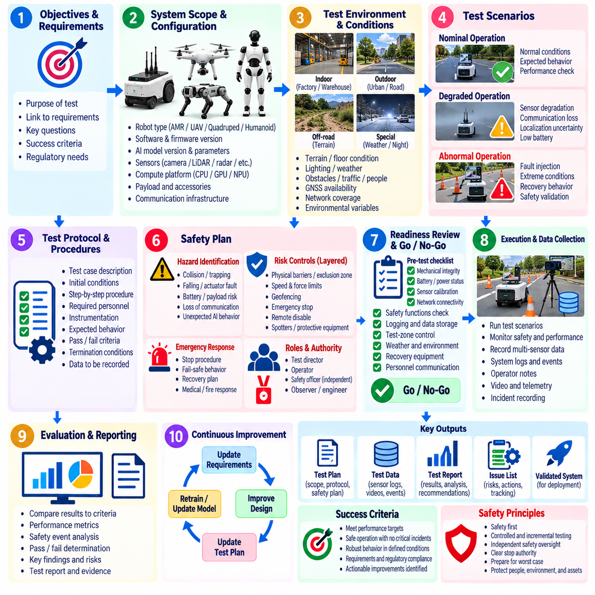
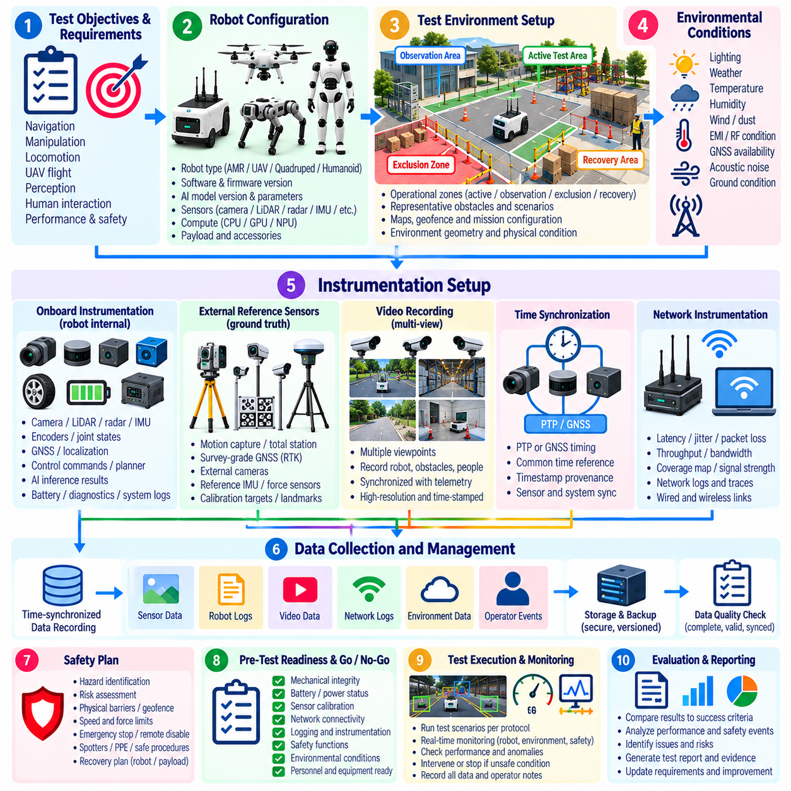
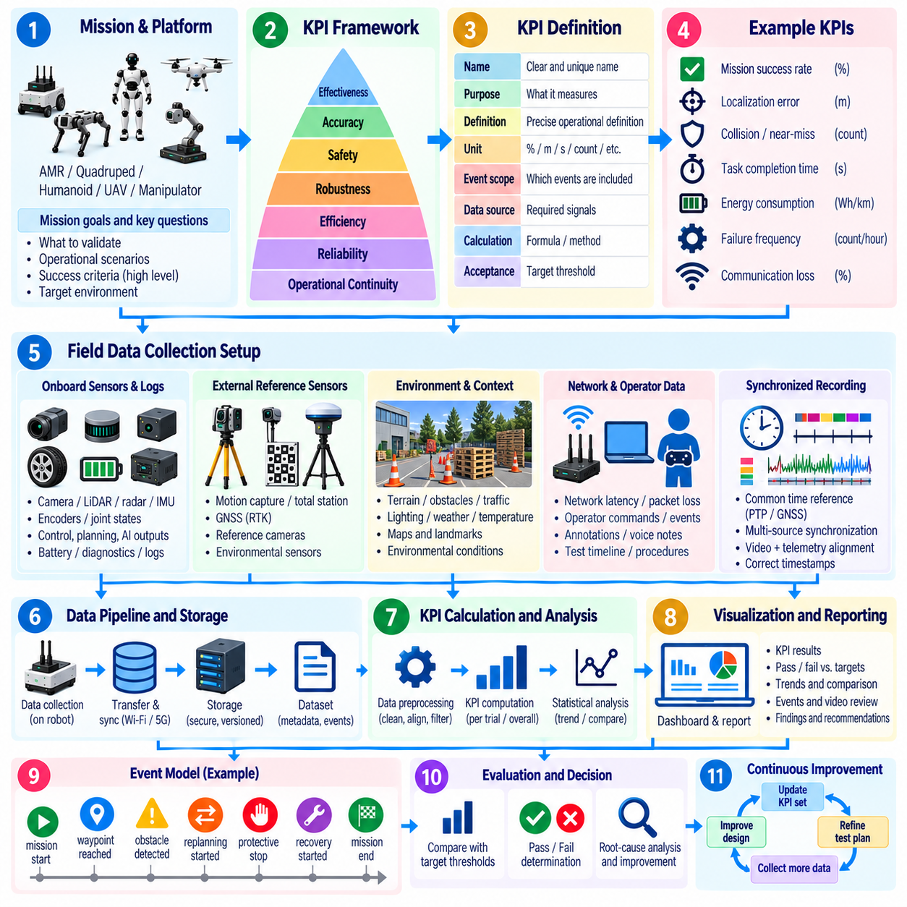
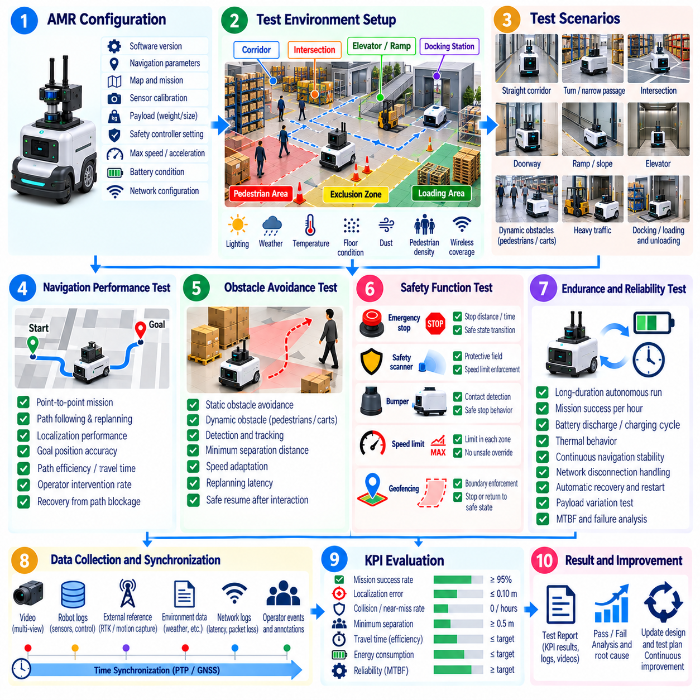
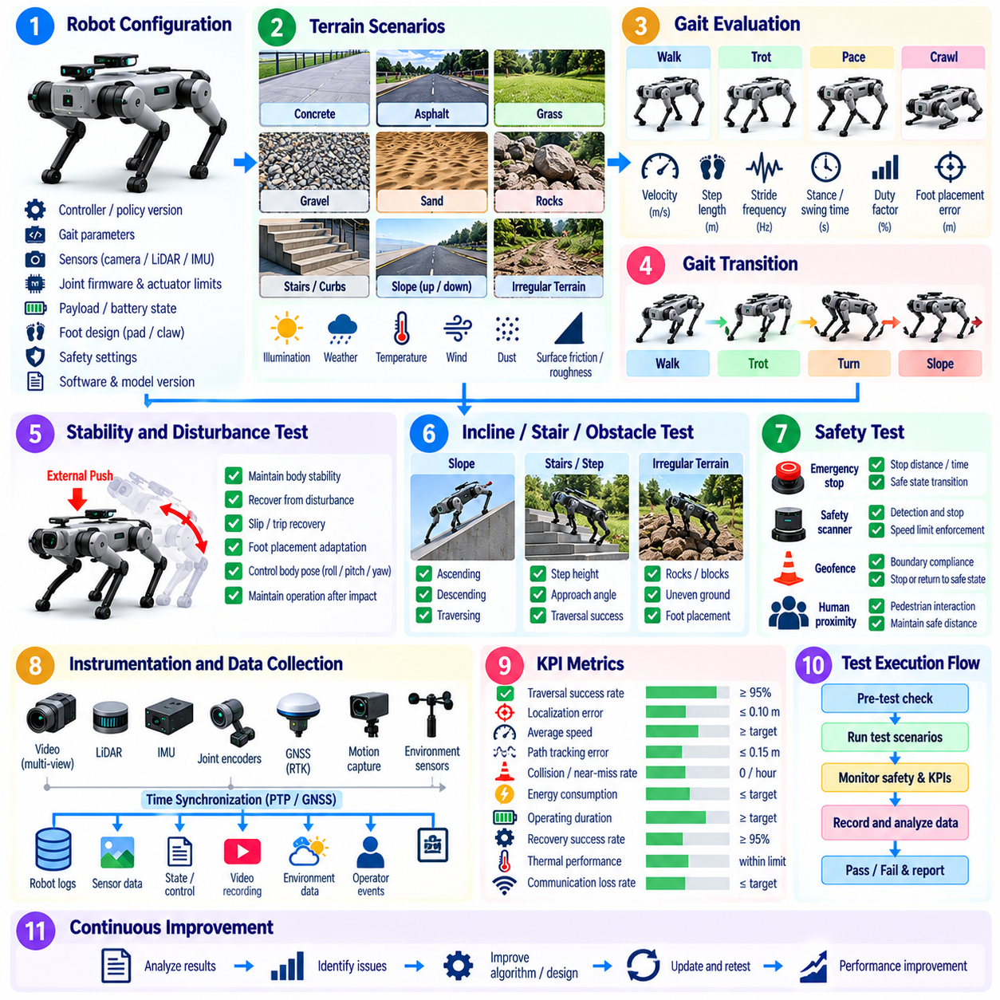
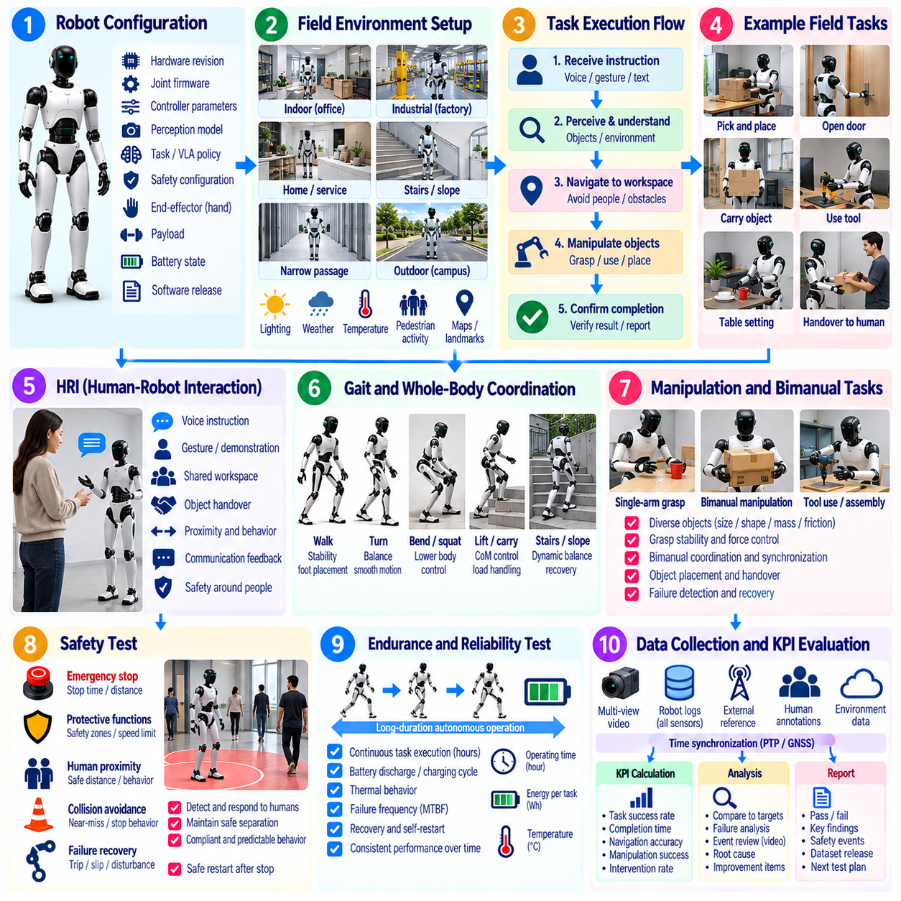
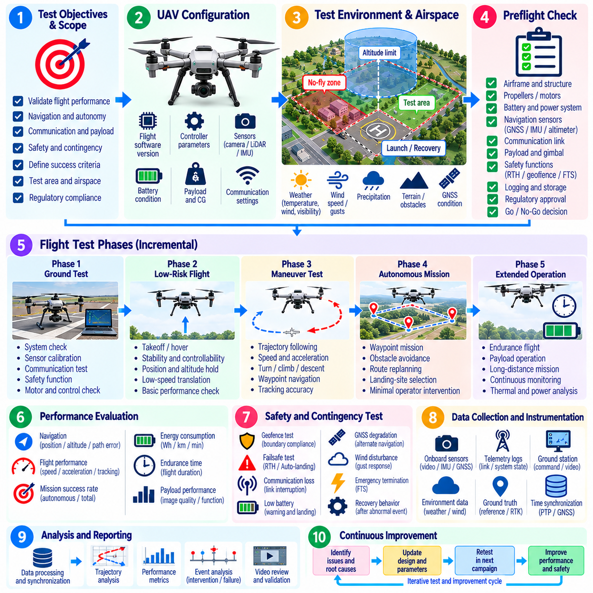
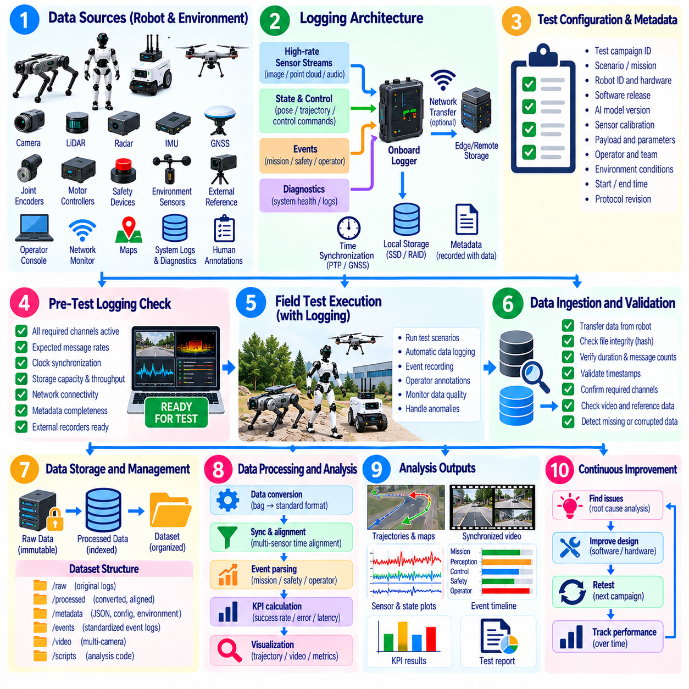
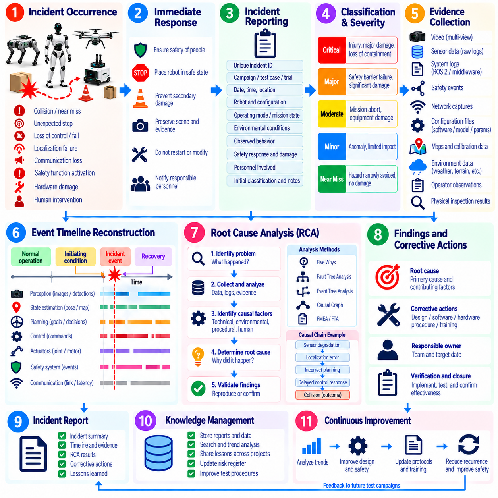
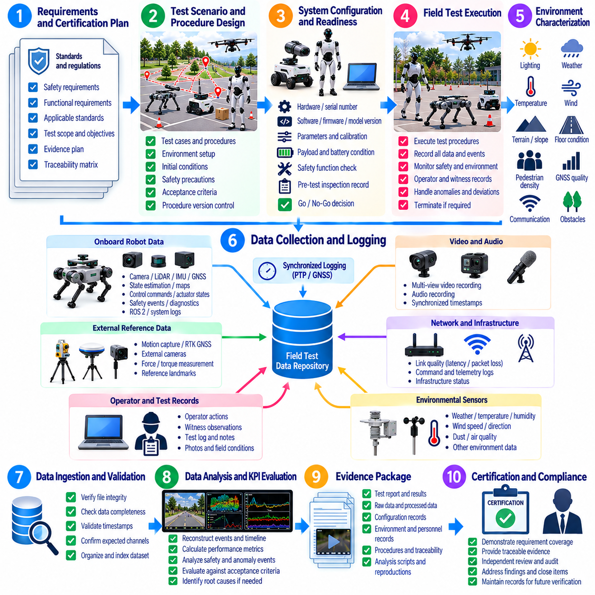

**Volume 25. Testing Validation and Benchmarking**

# Chapter 05. Field Testing Methodology

## 05.01. Field Test Planning Scope Protocol Safety Plan

{width="7.268055555555556in" height="7.268055555555556in"}

Field testing converts laboratory confidence into evidence that a robotic system can operate safely and predictably under real environmental conditions. A field test plan should define why the campaign is being conducted, which system capabilities are being evaluated, what operational conditions are permitted, and what evidence must be collected. The planning process establishes a controlled bridge between simulation, HIL, integration testing, and deployment-oriented validation. Volume_25_Testing_Validation_an...

The scope should identify the robot configuration, software and firmware versions, sensor suite, compute platform, payload, communication infrastructure, test environment, operators, and supporting equipment. It should also state which functions are inside or outside the campaign boundary. Navigation, manipulation, locomotion, perception, communication, autonomy, safety functions, and human interaction may require different test conditions and acceptance criteria.

A useful scope separates nominal operation from degraded and abnormal operation. Nominal tests demonstrate expected behavior within the intended operational design domain, while degraded tests introduce controlled limitations such as reduced visibility, communication loss, localization uncertainty, sensor degradation, low battery state, or restricted maneuvering space. Abnormal conditions should only be exercised when appropriate containment and recovery mechanisms are available.

Every field campaign should be driven by explicit objectives that can be traced to system requirements, identified hazards, previous verification results, or unresolved engineering risks. Statements such as "test navigation performance" are too broad. A stronger objective specifies the capability, operating condition, measurable result, and acceptance boundary, allowing each test execution to produce evidence that can later support validation, regression analysis, or certification activities.

The test protocol translates these objectives into repeatable operational procedures. Each test case should describe initial conditions, environment configuration, robot state, required personnel, instrumentation, execution sequence, expected behavior, termination conditions, and data to be recorded. The protocol should minimize uncontrolled variation while preserving the environmental realism that distinguishes field testing from simulation and laboratory verification.

Configuration control is essential because field results are meaningful only when the tested system can be reconstructed. The test record should therefore capture software commit or release identifiers, AI model versions, calibration files, parameter sets, firmware revisions, maps, mission definitions, hardware configuration, and relevant infrastructure settings. Any modification during the campaign should be logged and assessed before results from different configurations are combined.

The environment itself must be treated as part of the test configuration. Terrain geometry, floor condition, slope, illumination, weather, temperature, obstacles, pedestrian activity, electromagnetic conditions, GNSS availability, network coverage, and operational traffic can influence robot behavior. Relevant environmental variables should therefore be measured or documented so that failures can be distinguished from uncontrolled changes in test conditions.

A field safety plan begins with hazard identification before robot motion is authorized. Potential hazards include collision, crushing, trapping, falling, uncontrolled acceleration, actuator malfunction, battery incidents, dropped payloads, loss of communication, unstable locomotion, unexpected AI decisions, and interaction with people or vehicles. The plan should connect each credible hazard to preventive controls, monitoring requirements, intervention mechanisms, and emergency responses.

Risk controls should follow a layered philosophy rather than depending on operator reaction alone. Physical barriers, exclusion zones, speed and force limits, geofencing, safety-rated functions, emergency stops, remote disable mechanisms, protective equipment, spotters, and procedural controls may be combined according to the platform and environment. Higher-risk tests should begin with conservative limits and expand only after predefined readiness conditions have been demonstrated.

Roles and authority must be established before execution. A test director normally controls the campaign, while operators command the robot and safety personnel monitor hazards independently of performance objectives. Instrumentation engineers, observers, maintenance personnel, and data engineers may support execution. Most importantly, personnel must know who has unconditional authority to stop a test when an unsafe, unexpected, or insufficiently understood condition occurs.

A pre-test readiness review should confirm that prerequisite verification has been completed and that the field configuration is suitable for operation. This includes checking mechanical integrity, battery condition, sensor calibration, actuator health, localization readiness, network connectivity, logging capacity, safety devices, emergency-stop operation, test-zone control, weather constraints, personnel communications, and recovery equipment. Failed readiness items should prevent execution until formally resolved.

Go/no-go criteria provide an objective boundary between preparation and execution. A test should not begin merely because personnel and equipment are available. Required safety functions must be operational, environmental conditions must remain inside authorized limits, the intended software and model configuration must be verified, data acquisition must be functioning, and emergency response resources must be ready. The test director should record the authorization decision.

Execution should follow the approved protocol while allowing controlled responses to real-world uncertainty. Operators should not silently improvise around unexpected behavior because such changes can invalidate evidence or introduce new hazards. Deviations should be recorded with their time, reason, authorization, and impact on the test. Significant deviations should trigger termination, reconfiguration, or creation of a revised test case rather than informal continuation.

Clear abort criteria are especially important for autonomous and AI-enabled robots. Examples include unexpected entry into an exclusion zone, excessive tracking error, unstable motion, repeated perception failure, abnormal actuator temperature, loss of localization, communication timeout, safety-monitor faults, unexpected human proximity, or behavior outside the validated envelope. Abort thresholds should be defined before testing so that safety decisions are not delayed by performance pressure.

Emergency procedures must address what happens after an abort command as well as how the command is issued. The plan should define methods for controlled stopping, emergency stopping, power isolation, securing unstable hardware, recovering disabled robots, handling battery or fire events, notifying responsible personnel, and preserving evidence. Personnel should rehearse critical responses before high-energy, high-speed, aerial, or human-proximate tests are attempted.

Field testing also requires disciplined data planning. The campaign should identify which telemetry, sensor streams, control commands, system states, safety events, operator actions, timestamps, environmental measurements, and external observations are necessary to evaluate each objective. Synchronization between data sources is critical because many field failures can only be reconstructed by correlating perception, planning, control, hardware, network, and human events.

Pass/fail criteria should be defined before examining final results. Criteria may combine quantitative thresholds, behavioral requirements, safety constraints, and completion conditions. A robot may complete a mission yet fail because it violated a minimum separation distance, exceeded a control limit, required unauthorized intervention, or generated an unsafe recovery behavior. Conversely, a controlled safety stop may represent correct system behavior rather than a failed test.

Repeated trials are necessary when performance is affected by stochastic AI behavior, perception uncertainty, environmental variability, or human interaction. The protocol should define sufficient repetition and variation to characterize consistency rather than selecting a single successful demonstration. Conditions and outcomes should be recorded for unsuccessful trials with the same rigor as successful ones, since failure distributions frequently reveal limitations that average performance metrics conceal.

Field campaigns should progress incrementally from low-risk controlled conditions toward increasingly representative operation. A mobile robot might advance from an isolated test area to structured obstacles and then mixed traffic; a legged robot from level terrain to irregular surfaces; a humanoid from constrained tasks to human interaction; and a UAV from restricted flight envelopes to representative missions. The chapter structure explicitly extends field methodology across these platform classes. Volume_25_Testing_Validation_an...

Completion of a field test does not automatically constitute acceptance. After execution, engineers should verify data integrity, classify anomalies, compare measurements against acceptance criteria, identify protocol deviations, and determine whether additional trials are necessary. Safety events and unexpected behaviors should be preserved for incident investigation and root-cause analysis rather than excluded from the dataset simply because they invalidate an individual run.

A well-designed field test plan ultimately creates traceability from requirement and risk to protocol, configuration, execution record, measured evidence, and engineering decision. This discipline makes field testing more than a demonstration of robot capability. It becomes a reproducible validation process that supports subsequent KPI analysis, incident investigation, regression testing, certification evidence collection, and defensible decisions about whether the system is ready for broader deployment. Volume_25_Testing_Validation_an...

## 05.02. Field Test Environment Setup and Instrumentation

{width="7.268055555555556in" height="7.268055555555556in"}

Field test environment setup transforms a selected physical location into a controlled and measurable validation space. The objective is not to eliminate real-world variability, but to document and manage it so robot behavior can be interpreted correctly. The environment should reproduce relevant operational conditions while providing sufficient containment, observation, instrumentation, and recovery capability for safe and repeatable testing.

The setup process begins by mapping the intended test objectives to physical requirements. Navigation testing may require representative corridors, intersections, ramps, loading zones, or outdoor paths, while manipulation testing requires controlled workspaces, objects, fixtures, and human interaction zones. Legged robots may require variable terrain, and UAV testing requires defined airspace, launch areas, landing zones, and appropriate safety boundaries.

A field test site should be divided into clearly understood operational zones. These can include the active robot operating area, personnel observation areas, exclusion zones, equipment stations, emergency access paths, and recovery areas. Boundaries should be physically marked where practical and reflected in the robot\'s maps, geofences, or mission configuration so physical and software-defined constraints remain consistent throughout testing.

Before testing, the geometry and physical condition of the environment should be characterized. Relevant properties include dimensions, corridor width, obstacle position, floor friction, surface discontinuities, slopes, stairs, curbs, terrain roughness, ceiling clearance, and available maneuvering space. Accurate characterization allows engineers to determine whether an observed behavior represents a system limitation or simply a change in environmental conditions.

Environmental variables should also be monitored because they can directly affect sensing, computation, communication, and mechanical performance. Illumination, temperature, humidity, precipitation, wind, dust, vibration, acoustic noise, electromagnetic interference, and direct sunlight may alter robot behavior. Outdoor tests may additionally require records of GNSS conditions, weather changes, ground condition, and visibility throughout each test period.

Representative obstacles and interaction elements should be positioned according to the test protocol rather than introduced informally. Static structures, pallets, shelving, vehicles, doors, furniture, vegetation, pedestrians, or movable objects can be used to reproduce operational scenarios. Their initial positions and relevant dimensions should be recorded so repeated trials can distinguish algorithmic variation from unintended changes in the test environment.

Instrumentation converts physical field activity into measurable engineering evidence. The instrumentation architecture should be derived from the questions the test must answer rather than from whichever sensors are easiest to record. Robot telemetry, external reference sensors, environmental measurements, video observations, network traces, operator events, and safety-system states should collectively provide enough information to reconstruct system behavior after the test.

Onboard instrumentation normally captures the robot\'s internal view of the experiment. Typical data includes camera images, LiDAR point clouds, radar observations, IMU measurements, wheel or joint encoders, GNSS data, localization estimates, actuator states, battery measurements, control commands, planner outputs, AI inference results, safety states, diagnostic messages, and system resource utilization. Logging should preserve both inputs and critical derived outputs whenever feasible.

External instrumentation provides an independent reference against which onboard estimates can be evaluated. Depending on the platform and required accuracy, this may include motion-capture systems, survey-grade GNSS, total stations, external cameras, laser trackers, reference IMUs, force measurement equipment, or precisely measured landmarks. Independent ground truth is particularly valuable when testing localization, trajectory accuracy, perception, locomotion, or manipulation performance.

Video recording is a fundamental component of field instrumentation because numerical telemetry alone may not explain physical interactions. Cameras should capture relevant robot motion, surrounding obstacles, people, safety boundaries, and environmental changes. Multiple viewpoints can reduce occlusion and help investigators reconstruct incidents. Video timestamps should be synchronized with robot telemetry so observed physical events can be correlated with internal software decisions.

Time synchronization is one of the most important requirements in a distributed instrumentation system. Cameras, LiDARs, IMUs, robot computers, external measurement systems, network loggers, and operator consoles may otherwise produce timestamps from independent clocks. PTP, GNSS-derived timing, hardware synchronization, or another validated timing method should establish a common temporal reference with accuracy appropriate to the dynamics being measured.

Timestamp provenance should remain understandable throughout the data path. Engineers should know whether a timestamp represents sensor exposure, hardware acquisition, driver reception, middleware publication, application processing, or storage time. Preserving acquisition-time information is especially important when analyzing latency-sensitive failures, because software timestamps generated downstream can hide transport delay, scheduling jitter, buffering, or synchronization errors.

Network instrumentation should characterize communication behavior whenever robot operation depends on wireless or wired connectivity. Relevant measurements can include latency, jitter, packet loss, throughput, signal strength, handover events, connection interruptions, and message timing. For fleet, cloud-connected, teleoperated, or remotely supervised robots, network conditions should be treated as measurable test variables rather than invisible infrastructure assumptions.

Power and thermal instrumentation is important during endurance and high-load testing. Battery voltage, current, state of charge, power consumption, motor temperature, compute temperature, thermal throttling, cooling-system status, and subsystem energy usage can reveal degradation that is not immediately visible in task performance. These measurements are particularly useful when evaluating sustained autonomy, heavy payload operation, high-speed motion, or intensive AI inference.

Instrumentation must not significantly alter the system being evaluated. Additional computers, cameras, storage devices, cables, network traffic, or power loads can change mass distribution, thermal behavior, processor utilization, communication performance, and battery endurance. The test team should therefore evaluate instrumentation intrusiveness and document any measurement equipment that could influence the behavior or performance of the robot.

Data acquisition capacity should be calculated before field execution. High-resolution cameras and LiDARs can generate large data volumes, while AI systems may additionally log intermediate predictions, embeddings, maps, trajectories, and diagnostic information. Storage bandwidth, available capacity, file rotation, compression, transfer procedures, and backup strategy should be verified under representative logging loads before the actual campaign begins.

A structured naming and metadata scheme improves traceability across repeated trials. Each dataset should identify the test campaign, test case, trial number, date and time, robot identifier, hardware and software configuration, AI model version, operator, environment configuration, and relevant conditions. This metadata allows field results to be connected with later data analysis, regression testing, incident investigation, and certification evidence collection.

Instrumentation should undergo its own calibration and verification before it is trusted as evidence. Sensor alignment, camera calibration, measurement scale, coordinate frames, timing accuracy, reference positions, and data channels should be checked using known conditions. Calibration records should be associated with the test campaign because inaccurate reference equipment can create apparently precise but fundamentally incorrect performance conclusions.

Coordinate systems must be defined consistently when measurements originate from multiple devices. Robot base frames, sensor frames, map coordinates, motion-capture coordinates, geographic coordinates, and external camera frames should have documented transformations. Incorrect frame relationships can produce misleading trajectory or localization errors even when every individual sensor is functioning correctly, making coordinate-frame verification a mandatory setup activity.

A dry run should be performed after the environment and instrumentation have been assembled. The robot can execute a low-risk representative sequence while engineers verify sensor visibility, communication coverage, clock synchronization, recording status, safety monitoring, storage throughput, environmental measurements, and external reference systems. A successful dry run demonstrates that the facility can capture the evidence required by the protocol before higher-risk trials begin.

Pre-test checks should confirm that environmental configuration and instrumentation still match the approved setup at the beginning of each session. Obstacles may have moved, wireless conditions may have changed, cameras may have shifted, storage may be nearly full, calibration may have expired, or weather may have moved outside permitted limits. Detecting these changes before execution prevents invalid trials and reduces ambiguity during later analysis.

During testing, operators should monitor both robot behavior and measurement-system health. Loss of a ground-truth sensor, failed logging process, timestamp discontinuity, saturated storage device, disconnected camera, or synchronization fault may invalidate an otherwise successful trial. Instrumentation health should therefore be included in real-time test monitoring and, where evidence is essential, incorporated into predefined abort or repeat criteria.

After each trial, data completeness should be checked before the environment is reconfigured. Engineers should verify that expected logs exist, timestamps cover the full execution period, video files are readable, external reference data was recorded, configuration metadata is preserved, and unusual events have been annotated. Immediate verification is valuable because missing evidence may still be recoverable through a repeated trial while the original conditions remain available.

A well-engineered field environment combines realism with control, while a well-engineered instrumentation system combines comprehensive observation with reliable traceability. Together they provide the foundation for subsequent KPI definition, platform-specific field trials, data analysis, incident investigation, and certification evidence. This relationship is reflected in the chapter sequence, where environment setup and instrumentation precede KPI collection and specialized AMR, quadruped, humanoid, and UAV field testing. Volume_25_Testing_Validation_an...

## 05.03. KPI Definition and Data Collection in Field [w/Code]

{width="7.268055555555556in" height="7.268055555555556in"}

Key Performance Indicators should translate field-test objectives into measurable evidence of whether a robot performs its intended mission safely, reliably, and efficiently. A useful KPI is tied to a requirement or engineering question, has a precise definition and unit, identifies the population of events being measured, and specifies an acceptance threshold. Field KPIs should describe operational performance rather than merely report raw sensor values.

KPI selection should begin with the mission and platform rather than with available telemetry. An AMR may emphasize mission success, localization accuracy, obstacle avoidance, travel time, intervention frequency, and energy consumption. A quadruped may require stability and terrain metrics, while humanoid, manipulation, and UAV systems need task-specific measures. Common system-level KPIs can still provide a basis for comparing releases and configurations.

Each KPI should have an operational definition that removes ambiguity from later analysis. A mission success rate, for example, requires explicit definitions of mission start, successful completion, timeout, abort, operator intervention, and invalid trial. Localization error must specify the reference system, coordinate frame, sampling interval, and error statistic. Without such definitions, different teams can calculate apparently identical KPIs and obtain incompatible results.

KPIs should be organized around dimensions such as effectiveness, accuracy, safety, robustness, efficiency, reliability, and operational continuity. Effectiveness measures whether the robot accomplishes its task, while accuracy measures how closely behavior follows the desired state. Safety KPIs capture hazardous proximity or protective interventions, and efficiency metrics describe time, distance, computation, energy, or other resources consumed during execution.

Field evaluation should distinguish outcome KPIs from diagnostic metrics. Task completion rate and collision rate describe externally meaningful outcomes, whereas CPU utilization, perception latency, localization covariance, motor current, or packet loss help explain why those outcomes occurred. Both categories are necessary. Outcome metrics support acceptance decisions, while diagnostic measurements provide engineering context for root-cause analysis and performance improvement.

Safety KPIs should measure more than the absence of accidents. Useful indicators may include minimum separation distance, emergency-stop activation frequency, protective-stop events, speed-limit violations, geofence violations, near-miss events, human interventions, and time required to reach a safe state. A test campaign should preserve these events even when the mission itself is completed successfully because task success does not override safety requirements.

Reliability KPIs characterize whether performance remains consistent over repeated operation. Relevant measures can include successful missions per operating hour, failure frequency, recovery success rate, mean time between operational failures, software restart frequency, sensor dropout events, and autonomous operation duration. Long-duration field trials are especially important because thermal, battery, communication, mechanical, and software-state problems may not appear during short demonstrations.

Efficiency KPIs quantify the resources required to achieve useful behavior. Travel distance relative to a reference route, mission completion time, energy consumed per mission, battery discharge per kilometer, compute utilization, communication bandwidth, idle time, and charging requirements can reveal performance differences that success rate alone cannot show. Efficiency metrics become particularly important when evaluating deployment economics or fleet-scale operation.

Data collection should be designed directly from the KPI definitions. For every KPI, engineers should identify the source signals, sampling requirements, units, timestamps, reference measurements, environmental metadata, and processing method required to calculate it. This approach prevents a common field-testing failure in which large volumes of telemetry are collected but the specific information required to answer the validation question is missing.

Field data normally combines multiple sources rather than relying on a single robot log. Onboard sensor streams, localization and planning outputs, actuator telemetry, safety-controller states, diagnostic messages, external ground-truth systems, environmental sensors, network measurements, operator annotations, and synchronized video may all contribute to KPI calculation. Their relationships should be defined before execution so the analysis pipeline can reconstruct each trial consistently.

A standardized event model makes field datasets easier to analyze. Events such as mission_start, goal_reached, obstacle_detected, replanning_started, localization_lost, operator_intervention, protective_stop, emergency_stop, recovery_started, and mission_end can be recorded with timestamps and contextual attributes. Consistent event semantics enable automatic calculation of durations, frequencies, transition sequences, and failure categories across large collections of field trials.

Time synchronization is critical when KPI calculation combines distributed data sources. A braking-response metric may require correlation among obstacle detection, perception output, planner decision, controller command, actuator response, and external motion measurement. Even small clock offsets can distort latency or stopping-distance analysis. Data pipelines should therefore preserve synchronized acquisition timestamps and document the timing source and expected synchronization accuracy.

Sampling frequency should match the dynamics of the quantity being evaluated. Environmental temperature may require relatively slow sampling, whereas vibration, control response, impact events, or fast vehicle motion may require much higher rates. Excessive downsampling can hide short-duration failures, while unnecessarily high sampling increases storage and processing cost. Sampling policies should therefore follow the temporal resolution required by each KPI.

Data quality should itself be monitored during collection. Missing samples, corrupted messages, timestamp reversals, duplicate records, sensor saturation, dropped frames, invalid coordinate transformations, and synchronization loss can bias KPI calculations. Automated quality checks should flag incomplete intervals and distinguish valid system failures from failures of the measurement infrastructure. Invalid data should never be silently converted into apparently normal performance statistics.

Context metadata is essential because field performance depends strongly on operating conditions. Each trial should preserve robot configuration, software release, AI model version, map, payload, battery state, operator, environment identifier, weather, lighting, terrain, traffic density, network condition, and other relevant factors. This metadata enables engineers to stratify KPI results and determine whether degradation is associated with a particular configuration or operating condition.

Repeated trials should capture both central performance and variability. Reporting only an average can hide unstable behavior, rare failures, or long-tail latency. Depending on the KPI, analysis may include median values, percentiles, standard deviation, confidence intervals, minimum and maximum values, failure distributions, or success proportions. The selected statistics should reflect the operational consequence of variation rather than being chosen solely for convenience.

KPIs should also be analyzed by scenario instead of being aggregated indiscriminately. A navigation system with a high overall success rate may perform poorly at narrow intersections, reflective surfaces, crowded areas, ramps, or low-light locations. Scenario labels allow engineers to identify these weaknesses. Environmental and operational dimensions therefore become part of KPI interpretation and help connect field observations with simulation and regression scenarios.

Thresholds should be defined before final analysis whenever the KPI supports an acceptance decision. A threshold may originate from a system requirement, safety constraint, customer objective, benchmark, or engineering baseline. Some metrics use a single pass/fail boundary, while others require warning and critical ranges. Predefined thresholds reduce the risk of changing evaluation criteria after observing results and make comparisons between releases more defensible.

Operator intervention requires explicit treatment because it can artificially improve apparent robot performance. The dataset should distinguish autonomous success, assisted success, recovery after intervention, and unsuccessful completion. Intervention reason, duration, and type should be recorded. A robot that completes every mission but frequently requires human correction represents a substantially different autonomy level from one achieving the same completion rate without assistance.

Failures and near misses are particularly valuable data rather than records to discard. They should be tagged with reproducible categories describing perception, localization, planning, control, hardware, communication, safety, human interaction, environment, or unknown causes. Such classification supports later root-cause analysis and helps transform field observations into new simulation scenarios, regression tests, fault-injection cases, and engineering requirements.

The field-data pipeline should preserve raw evidence while also producing analysis-ready datasets. Raw sensor and event records provide the basis for later reprocessing when algorithms or hypotheses change, whereas normalized tables and derived metrics support efficient comparison. Processing steps, filtering rules, coordinate transformations, excluded intervals, and KPI formulas should be version-controlled so results can be reproduced after the campaign.

Automated KPI computation reduces manual inconsistency and supports repeated campaigns. Analysis software can ingest trial metadata and synchronized logs, detect standardized events, calculate metrics, evaluate thresholds, and generate per-trial and aggregate results. The same calculation logic should be applied across software versions whenever possible so performance trends reflect changes in the robot rather than changes in the evaluation procedure.

A complete KPI dataset should maintain traceability from the original field trial to the reported result. Engineers should be able to identify which robot configuration, log files, environmental conditions, processing version, reference data, and calculation method produced a particular value. This traceability becomes important when a metric is used for release approval, safety review, regression assessment, incident investigation, or certification evidence.

Effective KPI definition and field data collection therefore form a closed measurement discipline rather than two independent activities. The KPI determines what evidence must be captured, instrumentation supplies that evidence, and the data pipeline converts it into reproducible engineering conclusions. Within the field-testing methodology, this provides the quantitative foundation for subsequent AMR, quadruped, humanoid, and UAV field evaluations and later logging and analysis activities.

## 05.04. AMR Field Test Navigation Safety Endurance

{width="7.268055555555556in" height="7.268055555555556in"}

An AMR field test should determine whether the robot can navigate safely, consistently, and for sustained periods under conditions representative of its intended deployment. The campaign extends laboratory and simulation validation into real traffic environments containing changing obstacles, people, intersections, narrow passages, variable floor conditions, and communication disturbances. Navigation, safety, and endurance should be evaluated together because failures in one area can directly affect the others.

The test environment should represent the AMR operational design domain as closely as practical. Routes may include straight corridors, sharp turns, intersections, doorways, ramps, docking stations, elevators, loading areas, reflective surfaces, and regions with limited clearance. Environmental conditions such as illumination, floor friction, dust, pedestrian density, wireless coverage, and temporary obstacles should be documented so results can be associated with specific operating conditions.

Before dynamic testing begins, the AMR configuration should be recorded and verified. Software release, navigation stack parameters, localization map, safety-controller configuration, sensor calibration, payload, battery condition, maximum speed, acceleration limits, and network settings should be preserved with the trial metadata. Changes during the campaign must be tracked because even small parameter modifications can significantly alter navigation behavior or stopping performance.

Navigation testing should begin with repeatable point-to-point missions under controlled conditions. The robot can be commanded between predefined start and goal poses while position estimates, planned paths, executed trajectories, velocities, replanning events, and completion times are recorded. Core measures include mission success rate, path deviation, localization error, travel time, path efficiency, goal-position accuracy, and the frequency of operator intervention or autonomous recovery.

Localization performance should be evaluated across conditions that challenge the sensing and mapping system. Repetitive corridors, glass surfaces, sparse geometric features, moving crowds, temporary layout changes, low illumination, and wheel slip can degrade localization. External reference measurements or surveyed landmarks should be used where appropriate to distinguish true pose error from uncertainty reported internally by the localization algorithm.

Obstacle avoidance testing should include both static and dynamic objects. Static obstacles can verify detection, path replanning, clearance, and deadlock recovery, while moving pedestrians, carts, forklifts, or controlled robotic targets can evaluate prediction and responsive avoidance. The test should measure minimum separation distance, speed adaptation, avoidance trajectory quality, stop behavior, replanning latency, and whether the robot resumes its mission safely after the interaction.

Intersection and blind-corner scenarios are important because the AMR may encounter objects that become visible only shortly before crossing its path. Trials should vary approach speed, crossing direction, obstacle velocity, and visibility where safe to do so. Evaluation should focus on detection timing, deceleration behavior, protective responses, clearance, and recovery rather than simply determining whether a collision occurred.

Navigation robustness should also be tested under controlled degradation. Examples include temporary path blockage, localization uncertainty, intermittent sensor observations, reduced wireless quality, unavailable route segments, or delayed mission updates. The objective is to determine whether the robot can replan, stop safely, request assistance, or transition into an appropriate degraded state instead of continuing with invalid assumptions.

Safety testing should verify the protective functions that constrain AMR motion independently of normal navigation behavior. Safety scanners, bumpers, emergency stops, protective fields, speed limits, direction-dependent safety zones, and safety-controller interfaces should be exercised according to the approved protocol. The test should confirm that protective actions occur predictably and that normal autonomous software cannot bypass required safety constraints.

Stopping performance should be evaluated at representative speeds, payloads, floor conditions, and approach geometries. Engineers should measure the sequence from hazard detection through safety logic activation and commanded deceleration to the final stationary state. Stopping time and distance should be analyzed with synchronized timestamps because sensor latency, communication delay, controller response, actuator dynamics, tire behavior, and payload mass can all influence the result.

Human-proximity testing requires particularly conservative procedures. Controlled scenarios can evaluate how the AMR responds to pedestrians approaching from the front, side, rear, intersections, or occluded regions. The purpose is to verify detection, speed reduction, protective stopping, separation maintenance, and safe restart behavior. Personnel should never be used as uncontrolled collision targets; test procedures must preserve independent protective measures and clear abort authority.

Emergency-stop testing should confirm both the physical response and the system-state transition. Activation should bring the AMR into the defined safe state, inhibit unintended motion, generate the expected diagnostic or safety event, and require the prescribed reset procedure before operation resumes. Tests should also confirm that releasing the emergency-stop device alone does not cause unexpected automatic motion when an explicit restart authorization is required.

Payload variation can significantly affect AMR behavior and should therefore be included in representative field trials. Empty, nominal, and maximum authorized payload conditions may change acceleration, braking distance, traction, energy consumption, suspension behavior, and localization performance. Payload position and center-of-mass changes should also be considered when they are relevant to the mechanical configuration or intended logistics application.

Endurance testing evaluates whether acceptable navigation and safety performance can be sustained over extended operation rather than demonstrated for a few successful missions. The AMR should execute repeated representative routes and tasks for a defined duration, mission count, distance, or battery cycle while telemetry is collected continuously. The workload should approximate real deployment patterns, including motion, waiting, docking, charging, communication, and task transitions.

Long-duration testing should monitor gradual degradation as well as explicit failures. Battery state of charge, voltage, current, motor temperature, compute temperature, CPU and GPU utilization, memory consumption, storage usage, network quality, localization confidence, sensor health, and software process status can reveal developing problems. Trends are important because memory leaks, thermal throttling, calibration drift, and communication instability may emerge only after many hours.

Charging and docking behavior should be included when autonomous charging is part of normal AMR operation. Testing should evaluate docking success rate, alignment accuracy, retry behavior, charging initiation, communication with charging infrastructure, departure after charging, and recovery from unsuccessful docking attempts. Repeated charge-and-resume cycles can expose integration problems that are not visible when endurance testing is performed with manual battery management.

Traffic interaction should be tested when multiple robots or industrial vehicles share the operating environment. Relevant scenarios include corridor contention, intersection conflicts, blocked goals, queue formation, overtaking restrictions, and fleet-management rerouting. Measurements should capture mission delay, deadlock frequency, waiting time, traffic recovery, communication events, and whether safety behavior remains correct when multiple moving agents influence local planning simultaneously.

Failure recovery is a major component of endurance evaluation. The campaign should record localization loss, navigation deadlock, planner failure, sensor dropout, communication interruption, software restart, charging failure, and other operational anomalies. Each event should be classified according to whether the AMR recovered autonomously, required remote assistance, required physical intervention, or could not continue the mission.

Operator intervention should be treated as a measurable outcome rather than hidden from the success statistics. Every intervention should record its reason, duration, type, and resulting robot state. Mission results should distinguish fully autonomous completion from assisted completion. Metrics such as interventions per kilometer, per mission, or per operating hour provide a useful indication of whether nominal navigation performance can translate into practical autonomous deployment.

Field data should combine navigation logs, safety-controller events, sensor data, actuator telemetry, synchronized video, external observations, network measurements, and environmental metadata. Standardized event timestamps make it possible to reconstruct sequences involving detection, planning, control, safety intervention, and physical motion. Data completeness should be verified after important trials so that unusual behavior can be analyzed rather than remaining an unexplained observation.

Results should be analyzed by scenario and operating condition rather than only as global averages. A high overall mission success rate may conceal repeated failures at narrow doors, reflective corridors, crowded intersections, docking stations, or low-friction surfaces. Percentiles, failure distributions, intervention rates, safety events, and condition-specific results provide a more realistic characterization of deployment readiness than a single aggregate score.

Completion criteria for an AMR field campaign should combine navigation performance, safety compliance, endurance, and recoverability. Successful deployment readiness requires more than reaching goals without collision; the robot must maintain acceptable localization, respond correctly to hazards, preserve safety constraints, tolerate representative disturbances, operate for sustained periods, and recover predictably from foreseeable failures without excessive human assistance.

The resulting field evidence should remain traceable to the tested configuration, environment, trial protocol, raw logs, KPI calculations, anomalies, and acceptance decisions. This creates a reproducible basis for regression testing, reliability improvement, incident investigation, and subsequent certification activities. Within the field-testing methodology, AMR testing therefore demonstrates how environment setup, instrumentation, and KPI definition are integrated into platform-specific validation.

## 05.05. Quadruped Field Test Terrain Gait Stability

{width="7.268055555555556in" height="7.268055555555556in"}

Quadruped field testing evaluates whether a legged robot can maintain reliable locomotion across terrain conditions that represent its intended operational environment. Unlike wheeled platforms, a quadruped must continuously coordinate foothold selection, body motion, contact forces, balance, and terrain perception. Field validation therefore focuses on the interaction among terrain difficulty, gait behavior, stability, recovery capability, and sustained mechanical performance.

The test campaign should begin with a precisely documented robot configuration. Controller version, locomotion policy, gait parameters, perception model, state estimator, joint firmware, actuator limits, payload, battery state, foot design, and safety settings should be recorded for every trial. Configuration traceability is especially important for learning-based locomotion because relatively small policy or parameter changes can produce substantial differences in dynamic behavior.

Terrain should be treated as a controlled test variable rather than as an informal property of the field site. Representative conditions can include flat concrete, asphalt, grass, gravel, soil, sand, wet surfaces, slopes, stairs, curbs, rocks, loose material, and irregular natural terrain. Surface friction, compliance, roughness, inclination, obstacle dimensions, and terrain transitions should be characterized whenever they materially affect locomotion performance.

Testing should progress from predictable surfaces toward increasingly difficult terrain. Initial trials can establish baseline walking performance on level ground before introducing slopes, steps, discontinuities, low-friction regions, deformable surfaces, or irregular footholds. This progression allows engineers to identify the point at which locomotion quality begins to degrade while limiting unnecessary exposure of the robot and personnel to high-energy falls or uncontrolled motion.

Gait evaluation should examine how effectively the quadruped coordinates leg motion under different speeds and terrain conditions. Walking, trotting, crawling, pacing, or platform-specific locomotion modes may require separate evaluation. Relevant measurements include commanded and achieved velocity, stride frequency, step length, stance and swing duration, duty factor, foot placement error, contact timing, and the consistency of gait cycles across repeated trials.

Gait-transition testing is important when the robot changes speed, terrain, direction, or locomotion mode during operation. Transitions should be evaluated for discontinuities in body velocity, excessive joint motion, foot slip, unexpected contact, or temporary instability. A successful transition should preserve controllability and body stability rather than merely complete the switch between gait states without triggering a fall.

Stability evaluation should characterize the robot\'s ability to control body pose and momentum while maintaining suitable ground contacts. Roll, pitch, yaw, body height, angular velocity, acceleration, joint states, foot contact patterns, and estimated contact forces can be monitored throughout each trial. Large oscillations, repeated corrective stepping, excessive body attitude error, or unstable contact switching may indicate deteriorating stability before an actual fall occurs.

Foot-ground interaction provides critical evidence about locomotion quality. Instrumentation should identify expected and unexpected contacts, foot slip, impact intensity, contact duration, and loss of support. External video and terrain references can supplement onboard estimates because contact state estimation may itself become unreliable on loose, deformable, wet, or highly irregular surfaces where accurate foothold information is most important.

Slope testing should include ascending, descending, and traversing across inclines where these conditions belong to the intended operating domain. Tests can gradually increase inclination while monitoring tracking error, body attitude, foot slip, actuator loading, and recovery behavior. Descending slopes may require separate attention because braking, impact, and forward momentum can create different stability limitations from those observed during ascent.

Stair and step testing should characterize both perception and physical locomotion capability. Step height, depth, edge geometry, approach angle, speed, and visibility influence successful traversal. The robot should demonstrate appropriate foothold placement, body clearance, contact sequencing, and recovery when a planned foothold is unavailable. Testing should include approach and departure behavior because failures frequently occur during terrain transitions rather than at the center of the obstacle.

Irregular terrain testing should evaluate adaptation to surfaces where footholds cannot be assumed to lie on a common plane. Rocks, blocks, uneven ground, or controlled stepping structures can expose limitations in terrain perception, local planning, state estimation, and whole-body control. Performance should be assessed using traversal success, speed, foot-placement accuracy, slip frequency, body-motion variation, intervention rate, and terrain-specific failure modes.

External disturbances can be introduced under carefully controlled safety conditions to evaluate recovery capability. Moderate pushes, unexpected compliant surfaces, small foothold displacement, or controlled contact disturbances can test whether the robot can redistribute support, modify foot placement, or execute recovery steps. Disturbance magnitude should be measurable and increased progressively so recovery boundaries can be characterized without turning the trial into an uncontrolled destructive test.

Slip and trip recovery deserve separate evaluation because they represent common real-world disturbances. A slipping stance foot can rapidly alter support forces, while an unexpected swing-foot collision can disrupt the planned gait cycle. Engineers should examine detection latency, corrective joint response, compensatory stepping, body attitude recovery, and whether the robot returns to nominal locomotion without operator assistance.

Fall behavior must be considered even when the primary objective is preventing falls. The test plan should define conditions requiring an immediate abort, safe shutdown behavior, operator exclusion zones, fall containment, and post-fall inspection procedures. A robot that detects unrecoverable instability should transition toward the safest achievable state rather than continuing aggressive control actions that increase risk to hardware or nearby personnel.

Terrain perception should be evaluated together with locomotion when the robot uses cameras, LiDAR, depth sensors, or learned perception to select footholds and trajectories. Lighting variation, vegetation, reflective surfaces, shadows, dust, water, and visually ambiguous terrain can affect estimated geometry. Field tests should correlate perception errors with downstream foothold decisions so failures are not incorrectly attributed only to the locomotion controller.

State-estimation robustness is equally important because dynamic legged locomotion depends on accurate estimates of body motion and contact state. IMU drift, joint measurement error, foot slip, vibration, visual degradation, or temporary loss of external localization can affect control. Trials should determine whether estimation uncertainty remains bounded and whether the robot responds safely when confidence in its state or terrain representation decreases.

Payload testing should examine how additional mass and changes in center of gravity affect locomotion. Representative payload configurations can influence joint torque, body attitude, foot loading, energy consumption, gait timing, and recovery margins. Tests should include payload placement as well as mass because asymmetric or elevated loads can introduce stability challenges that are not represented by a centrally mounted test weight.

Endurance trials should repeat representative terrain and gait sequences for sufficient duration to reveal degradation that short demonstrations cannot expose. Joint temperature, motor current, battery state, compute utilization, actuator faults, foot wear, structural loosening, localization quality, and gait metrics should be monitored over time. Performance trends can reveal thermal limits, mechanical wear, calibration drift, or policy degradation before a complete locomotion failure occurs.

Energy efficiency should be evaluated alongside locomotion performance because terrain and gait selection can significantly alter power consumption. Energy per unit distance, energy per mission, battery discharge rate, actuator power, and locomotion speed can be compared across surfaces and gait modes. A gait that achieves high speed but produces excessive thermal loading or energy consumption may be unsuitable for sustained field deployment.

Operator intervention should be recorded as a formal performance outcome. Manual stabilization, remote command correction, gait-mode override, emergency stopping, physical recovery, or robot repositioning should be timestamped and classified. Trials completed with assistance should not be reported as equivalent to fully autonomous traversal, because intervention frequency provides an important measure of practical deployment readiness.

Field data should synchronize joint states, actuator commands, IMU measurements, contact estimates, perception outputs, terrain maps, localization, battery and thermal telemetry, safety events, and external video. Where available, external motion tracking or surveyed terrain geometry can provide independent references. Accurate synchronization allows engineers to reconstruct the chain from terrain perception through control decisions to physical contact and body response.

Results should be stratified by terrain class, slope, gait, speed, payload, environmental condition, and disturbance level rather than reduced to a single success rate. Percentile body-motion errors, slip frequency, fall rate, recovery success, intervention frequency, energy consumption, and traversal time can expose different operational limits. Failure cases should be preserved because they define the practical boundary of the validated locomotion envelope.

A quadruped should be considered field-ready only when it demonstrates repeatable traversal, stable gait behavior, controlled terrain adaptation, predictable disturbance recovery, and acceptable endurance throughout the intended operating domain. Field validation therefore connects terrain, gait, stability, perception, state estimation, energy, and recovery into a unified assessment of locomotion capability, consistent with the platform-specific field-testing structure of the testing methodology.

## 05.06. Humanoid Field Test Task Execution HRI

{width="7.268055555555556in" height="7.268055555555556in"}

Humanoid field testing evaluates whether a robot can execute complete physical tasks safely and reliably while interacting with people and human-designed environments. Unlike isolated locomotion or manipulation tests, field evaluation combines perception, balance, navigation, whole-body control, manipulation, task reasoning, communication, and safety. The objective is to determine whether these capabilities remain coordinated during realistic, extended task execution.

The campaign should begin with a controlled configuration baseline. Hardware revision, joint firmware, controller parameters, perception models, task policy, VLA or generalist policy version, safety configuration, payload, end-effector setup, battery state, and software release should be recorded. Humanoid behavior can change significantly when one subsystem is updated, so every field result must remain traceable to the exact integrated system configuration.

Field environments should represent spaces designed primarily for humans rather than simplified robot test cells. Relevant conditions may include doors, tables, shelves, chairs, stairs, narrow passages, workstations, tools, containers, uneven floors, and moving people. Object locations, workspace geometry, illumination, surface properties, pedestrian activity, and environmental changes should be documented because they influence both task execution and human-robot interaction.

Task execution should be evaluated as an end-to-end process rather than as a collection of independently successful motions. A representative task may require receiving an instruction, identifying relevant objects, navigating to a workspace, positioning the body, grasping an object, manipulating it, transporting it, placing it correctly, and confirming completion. Failure at any stage can prevent successful completion even when individual capabilities perform well in isolation.

Task success criteria should distinguish complete autonomous execution from partial or assisted completion. The test protocol should define the initial state, goal state, permitted actions, timeout, acceptable object placement, safety constraints, and conditions requiring intervention. Metrics can include task success rate, completion time, number of retries, planning failures, manipulation errors, operator interventions, recovery success, and the fraction of subtasks completed without assistance.

Long-horizon tasks deserve special attention because errors can accumulate across sequential actions. Small localization errors, imperfect grasps, object displacement, misunderstood instructions, or state-estimation drift may become significant after many task steps. Field trials should therefore include multi-stage activities that require the humanoid to preserve task context, update its understanding of the environment, and recover when intermediate results differ from the expected state.

Whole-body coordination should be evaluated whenever manipulation and locomotion occur within the same task. Reaching toward distant objects, carrying loads, opening doors, pushing carts, bending, turning, or transferring objects can alter balance and support requirements. Measurements should capture body posture, joint states, center-of-mass behavior, contact conditions, hand forces, task progress, and recovery actions so manipulation success is not evaluated independently of physical stability.

Manipulation trials should represent realistic object diversity. Objects can vary in size, shape, mass, compliance, surface friction, handle geometry, visual appearance, and placement. The robot should be evaluated not only on successful grasp acquisition but also on maintaining grasp stability, avoiding excessive force, detecting failed grasps, repositioning when necessary, and placing or handing over objects without creating unsafe conditions.

Bimanual tasks can expose integration problems that are less visible in single-arm manipulation. Carrying large objects, opening containers, stabilizing an item while manipulating it, or transferring an object between hands requires coordinated force, pose, and timing control. Field testing should examine synchronization between arms, whole-body compensation, object stability, collision avoidance, and recovery when one hand loses or fails to establish the expected contact.

Human-robot interaction should be evaluated as an integral part of humanoid operation rather than as a separate user-interface feature. Humans may provide spoken instructions, gestures, objects, corrections, or confirmation while sharing the robot\'s workspace. Tests should determine whether the humanoid correctly perceives relevant human actions, interprets commands, maintains appropriate spatial behavior, and communicates its intentions or limitations sufficiently for predictable collaboration.

Instruction-following tests should include variation in wording, order, context, and task complexity when language-driven control is part of the system. The robot should connect an instruction to the physical environment, identify the intended entities, select appropriate actions, and recognize when the instruction cannot be executed safely or unambiguously. Incorrect confident execution can be more hazardous than requesting clarification or refusing an unsupported action.

Object handover provides a useful combined test of perception, manipulation, timing, and human interaction. The humanoid must identify the recipient, approach an appropriate transfer pose, present the object safely, detect when the person has established control, and release at the correct time. Evaluation can consider handover success, interaction time, excessive force, dropped objects, premature release, failed transfer detection, and the need for human adaptation.

Human proximity introduces safety requirements beyond task completion. Tests should examine behavior when a person enters the workspace, crosses the robot\'s path, approaches during manipulation, or unexpectedly changes position. The humanoid should respond through appropriate speed reduction, motion modification, protective stopping, or task suspension. Safety evaluation should consider the robot\'s entire body because arms, hands, torso, legs, carried objects, and loss of balance can all create hazards.

Contact-rich interaction requires careful force monitoring. Tasks involving handovers, collaborative carrying, guided motion, or incidental contact should verify that force and torque remain within defined operational limits and that unexpected contact is detected promptly. The robot should transition to an appropriate response when contact differs from the expected interaction instead of continuing a high-force trajectory based on an outdated task assumption.

Social and behavioral predictability can influence operational safety even when formal safety functions remain intact. Sudden arm motion, unexplained pauses, unexpected approach trajectories, or ambiguous task transitions can cause nearby people to react unpredictably. Field observations should therefore capture whether robot motion and communication provide sufficient cues for people to understand what the humanoid is doing and what action is expected from them.

Recovery behavior should be evaluated intentionally because realistic humanoid tasks rarely proceed exactly as planned. Test scenarios can include displaced objects, unavailable targets, failed grasps, blocked paths, dropped items, misunderstood instructions, temporary perception loss, or interrupted human interaction. The robot should detect the changed state, reassess the task, retry within permitted limits, request assistance, or terminate safely rather than repeatedly executing an invalid plan.

Balance and fall risk must remain monitored throughout task execution. Manipulation, payload changes, external contact, stepping, reaching, and unexpected human interaction can shift the robot toward its stability limits. Field testing should record balance-related events, corrective stepping, support changes, excessive body attitude, instability detection, and protective responses. Fall zones and emergency procedures should remain active whenever a full-size humanoid is operating near personnel.

Operator intervention should be explicitly recorded and classified. Remote corrections, task replanning assistance, manual object repositioning, locomotion overrides, emergency stops, physical stabilization, and recovery after falls represent different levels of assistance. A task completed after substantial intervention should not be counted as equivalent to autonomous success. Intervention frequency and duration are important indicators of practical humanoid autonomy.

Repeated trials should include controlled variations rather than reproducing only one favorable arrangement. Object positions, human positions, instruction phrasing, approach direction, lighting, clutter, and task sequence can be varied within the intended operating domain. This helps determine whether successful behavior represents robust task competence or memorization of a narrow configuration and provides evidence about generalization across realistic field conditions.

Endurance evaluation should extend beyond locomotion to repeated whole-body task cycles. Continuous reaching, walking, grasping, carrying, interaction, and computation can expose actuator heating, battery depletion, mechanical wear, perception degradation, memory growth, thermal throttling, or policy instability. Task success, intervention rate, cycle time, joint temperature, energy consumption, and system health should be monitored for trends over prolonged operation.

Field instrumentation should synchronize perception outputs, language or task commands, policy decisions, navigation states, joint trajectories, force and torque measurements, safety events, operator actions, and external video. This allows investigators to reconstruct the relationship between what the humanoid perceived, what it inferred, what action it selected, and what physically occurred. Such traceability is essential for diagnosing complex failures spanning multiple subsystems.

Results should be analyzed by task type, environment, object class, interaction mode, human proximity, autonomy level, and operating duration. A single overall success rate can conceal important weaknesses, such as reliable navigation but poor handover behavior or strong manipulation with frequent human assistance. Failure distributions, recovery success, intervention frequency, safety events, completion time, and task-specific success provide a more meaningful assessment.

A humanoid should be considered ready for broader field operation only when it demonstrates repeatable end-to-end task execution, stable whole-body behavior, reliable human interaction, predictable recovery, and acceptable safety over representative conditions. Within the field-testing methodology, humanoid evaluation therefore integrates task execution and HRI with perception, locomotion, manipulation, safety, instrumentation, and measurable operational evidence.

## 05.07. UAV Flight Test Campaign Protocol

{width="7.268055555555556in" height="7.268055555555556in"}

A UAV flight test campaign is a structured progression of ground and airborne evaluations used to demonstrate that the aircraft, flight software, autonomy functions, payload, communication links, and safety mechanisms operate correctly within a defined flight envelope. Unlike routine demonstrations, each flight should be treated as a controlled engineering experiment with explicit objectives, configuration records, measurable acceptance criteria, and predefined termination conditions.

Campaign planning should define the aircraft configuration, mission profile, test airspace, altitude and speed limits, payload condition, environmental constraints, personnel responsibilities, and required instrumentation. The protocol should also identify which capabilities are being evaluated during each flight. Navigation, flight control, perception, communication, autonomous mission execution, emergency functions, endurance, and payload operations should be separated when independent evidence is required.

Flight testing should follow an incremental build-up strategy. Ground checks and restrained tests should precede low-risk hover or short-flight evaluations, followed by progressively wider speed, altitude, maneuver, payload, and autonomy conditions. Each expansion should occur only after the preceding configuration has satisfied its acceptance criteria. This approach limits exposure to unknown behavior and creates evidence for controlled expansion of the validated flight envelope.

Configuration control is essential because flight behavior can change after modifications to software, firmware, controller gains, propulsion hardware, payload, sensors, or vehicle mass properties. Every test record should identify the flight software release, autonomy stack, parameter set, AI model version where applicable, airframe configuration, propulsion system, battery, payload mass, center of gravity, sensor calibration, communication settings, and relevant ground infrastructure.

A formal preflight procedure should verify aircraft readiness before propulsion is enabled. Structural condition, propellers or rotors, motors, batteries, power distribution, flight computer, navigation sensors, GNSS, IMU, altimeter, communication links, telemetry, payload interfaces, logging systems, and emergency functions should be checked. Any discrepancy affecting flightworthiness, safety, or required evidence should result in a no-go decision until the issue is resolved.

Environmental conditions should be treated as measurable test variables rather than background information. Wind speed and direction, gusts, temperature, precipitation, visibility, lighting, atmospheric conditions, and GNSS quality can influence flight behavior and perception. The protocol should establish permitted environmental limits for each test phase and record actual conditions so performance changes can be correlated with the environment during post-flight analysis.

The flight area should have clearly defined operational and containment boundaries. Launch and recovery zones, expected trajectories, altitude limits, exclusion areas, emergency landing locations, and personnel positions should be established before the test. Geofencing can provide an additional software boundary, but it should not replace procedural and physical risk controls. Flight termination criteria should address unintended boundary excursions or loss of containment confidence.

Initial airborne testing should establish basic controllability and state-estimation performance. Hover stability, altitude holding, attitude control, heading control, position holding, and low-speed translation can be evaluated before more demanding maneuvers are attempted. Relevant measurements include position error, attitude error, velocity tracking, oscillation, control effort, actuator saturation, vibration, and the frequency of unexpected mode transitions or operator intervention.

Trajectory-following tests should evaluate whether the UAV can accurately execute commanded paths across representative speeds and maneuver geometries. Straight segments, turns, climbs, descents, waypoint transitions, and approach trajectories can expose different controller and estimator limitations. Cross-track error, altitude error, speed error, waypoint accuracy, overshoot, settling behavior, and mission completion time provide quantitative measures of flight performance.

Autonomous navigation testing should examine the complete chain from sensing and localization through planning, guidance, and control. Where applicable, scenarios can include waypoint missions, obstacle avoidance, route replanning, landing-site selection, or operation with degraded positioning. Autonomous success should be distinguished from missions requiring pilot correction because intervention frequency is a critical indicator of practical autonomy.

Communication testing should evaluate both command-and-control and telemetry links throughout the intended operating region. Signal strength, latency, packet loss, link interruption, handover behavior, command acknowledgement, and recovery after temporary disconnection should be recorded. The aircraft should demonstrate predictable behavior when communication quality deteriorates, including continuation, holding, return, landing, or another predefined contingency response.

GNSS and navigation degradation should be evaluated only within carefully controlled test conditions. Temporary positioning degradation, reduced satellite visibility, inconsistent measurements, or transition to alternative localization can reveal dependencies that are hidden during ideal GNSS operation. The objective is to verify that navigation uncertainty is detected and that the aircraft enters an appropriate degraded or contingency state instead of continuing with unreliable position assumptions.

Safety-function testing should verify behaviors associated with communication loss, low battery, navigation failure, propulsion anomalies, geofence violation, excessive attitude, or other monitored hazards. Depending on the system design, responses may include hover, return-to-home, controlled descent, emergency landing, mission abort, or flight termination. The expected response and trigger threshold should be defined before the test rather than interpreted after an event occurs.

Return-to-home and emergency landing functions require dedicated evaluation because they may become the final protective layer after other failures. Tests should verify activation logic, route generation, altitude management, obstacle considerations, landing-zone approach, and final touchdown behavior. Recovery functions should also be tested from different positions and mission phases because a response that is safe near the launch site may not be appropriate throughout the entire operating area.

Payload testing should consider the influence of mass, center of gravity, aerodynamic effects, power consumption, and payload activity on flight performance. Representative empty, nominal, and maximum authorized configurations may require separate trials. For cargo UAVs, payload restraint, load distribution, release or transfer mechanisms, and changes in handling characteristics should be evaluated because payload configuration can alter stability, endurance, and emergency behavior.

Endurance testing should determine whether flight performance remains acceptable throughout realistic mission duration rather than only during short maneuvers. Battery voltage, current, state of charge, propulsion temperature, flight-computer temperature, compute utilization, navigation quality, communication status, and controller behavior should be monitored continuously. Reserve-energy requirements should be incorporated into termination criteria so endurance testing does not consume the safety margin required for recovery.

Repeated mission cycles can reveal degradation that a single long flight may not expose. Charging, battery replacement, payload loading, startup, navigation initialization, takeoff, mission execution, landing, shutdown, and data transfer can be repeated as an operational sequence. This allows engineers to evaluate dispatch reliability and identify intermittent faults, calibration problems, connector wear, initialization failures, or procedural weaknesses between flights.

Human roles must remain explicit throughout the campaign even when the aircraft operates autonomously. The test director, remote pilot, safety observer, payload operator, instrumentation personnel, and ground crew should understand their responsibilities and communication procedures. Authority to abort the flight must be unambiguous, and safety personnel should be able to prioritize containment and personnel protection over completion of the planned test objective.

Flight instrumentation should synchronize flight-controller states, IMU data, GNSS measurements, actuator commands, motor telemetry, battery data, navigation estimates, mission events, communication statistics, payload states, safety events, and ground observations. External tracking, surveyed references, radar, or synchronized video may provide independent evidence where required. Accurate timing enables reconstruction of fast event sequences that cannot be understood from isolated logs.

Post-flight inspection should occur before the aircraft is returned to service or reconfigured. Engineers should examine structural components, propulsion hardware, batteries, connectors, landing gear, payload attachments, and other critical elements for damage, loosening, overheating, or abnormal wear. Software logs and health reports should also be reviewed for faults that may not have been visible to the flight crew during operation.

Post-flight data review should determine whether the test produced valid evidence before the campaign proceeds to the next envelope point. Missing logs, synchronization failures, unexpected configuration changes, environmental excursions, or instrumentation faults can invalidate an otherwise successful flight. Anomalies should be classified and reviewed, and significant unexplained behavior should prevent further envelope expansion until the associated risk is understood.

Results should be analyzed by flight phase, maneuver, payload, environmental condition, autonomy mode, and vehicle configuration rather than reduced to a single mission success rate. Tracking error, intervention frequency, safety events, energy consumption, communication performance, recovery success, and anomaly distributions provide complementary evidence. Failed and aborted flights are particularly important because they identify boundaries of the validated operating envelope.

A UAV flight campaign is complete only when the required operating envelope has been covered with sufficient repeatability and the aircraft has demonstrated predictable nominal, degraded, and contingency behavior. The resulting evidence should remain traceable from objectives and configuration through flight records, telemetry, anomalies, KPI calculations, and acceptance decisions, providing a reproducible foundation for subsequent analysis, safety assessment, and certification-oriented field evidence.

## 05.08. Field Test Data Logging and Analysis Pipeline [w/Code]

{width="7.268055555555556in" height="7.268055555555556in"}

Field-test data logging should transform physical robot operation into a complete and reproducible digital record. The pipeline must capture not only whether a mission succeeded, but also the sequence of perception, estimation, planning, control, safety, communication, and physical events that produced the result. Logging should therefore be designed from validation objectives and KPI requirements rather than added after field testing has already begun.

A field-data pipeline typically begins at heterogeneous data sources distributed across the robot and test environment. These may include cameras, LiDAR, radar, IMU, GNSS, joint encoders, motor controllers, safety devices, network monitors, environmental sensors, external ground-truth systems, operator consoles, and synchronized video. Software outputs such as localization, maps, trajectories, detections, policy actions, diagnostics, and mission states should be captured with relevant raw measurements.

Logging architecture should distinguish high-bandwidth sensor streams from lower-rate state, event, and diagnostic information. Raw images and point clouds may require dedicated storage paths, while control commands, poses, safety events, and system-health metrics can use structured message logs. The architecture should preserve relationships among these sources so engineers can reconstruct system behavior without relying on manually aligned files or incomplete operator notes.

Time synchronization is fundamental to meaningful analysis. Sensor acquisition, perception output, planner decisions, controller commands, actuator responses, safety events, and external observations may occur within milliseconds of one another. A common clock based on PTP, GNSS timing, hardware triggers, or another validated synchronization mechanism should therefore be used where required, and the expected timing accuracy should be documented with each test configuration.

Timestamp semantics must also be preserved because identical-looking timestamps can represent different stages of a data path. A camera frame may contain exposure time, driver reception time, middleware publication time, processing time, and storage time. Latency analysis should use the timestamp corresponding to the actual event being measured. Otherwise buffering, scheduling jitter, network delay, or processing queues can produce misleading conclusions about system response.

Before each field run, the logging system should verify that required channels are active and storage resources are sufficient. Checks can include sensor stream availability, expected message rates, clock synchronization, disk capacity, write throughput, network connectivity, metadata completeness, and external recorder status. A robot should not begin a critical validation trial when essential evidence cannot be captured reliably, even if the robot itself appears operational.

Data-rate planning is especially important for sensor-rich robotic systems. Multiple high-resolution cameras, dense LiDAR, radar, audio, diagnostic traces, and AI outputs can generate sustained data rates that exceed storage or network capability. Engineers should estimate nominal and peak throughput, reserve capacity for long trials, and test the recording system under representative load so dropped frames or blocked processes do not invalidate the campaign.

Logging must be designed to avoid significantly altering the behavior being measured. Compression, serialization, disk writes, network transfer, and diagnostic tracing consume compute, memory, bandwidth, and power. Excessive instrumentation can introduce latency or thermal loading that would not exist during normal deployment. Logging overhead should therefore be measured, bounded, and included in configuration records when it can influence performance.

Every trial should receive a unique identifier linking raw data to its experimental context. Metadata should include test campaign, scenario, robot identifier, hardware configuration, software release, AI model version, map, payload, operator, environmental conditions, start and end times, and protocol revision. Consistent metadata prevents datasets from becoming anonymous collections of files whose engineering meaning can no longer be reconstructed.

Event logging provides a compact semantic layer above continuous telemetry. Events such as mission start, goal reached, localization loss, obstacle detection, replanning, operator intervention, protective stop, emergency stop, recovery, task failure, and mission completion should use standardized definitions. These markers allow automated analysis tools to segment long recordings and calculate durations, frequencies, transitions, and outcome statistics consistently.

Operator observations should be integrated into the data pipeline rather than maintained only in separate informal notes. Test personnel may observe wheel slip, unusual vibration, unexpected human behavior, environmental changes, visual obstruction, abnormal sound, or physical contact that onboard diagnostics cannot identify. Timestamped annotations make these observations searchable and allow them to be correlated with robot telemetry and synchronized video during analysis.

Immediately after a test, an ingestion stage should verify that expected files and streams were recorded successfully. File integrity, duration, message counts, timestamps, metadata, video readability, and external reference data can be checked automatically. Detecting missing evidence while the test configuration remains available allows the trial to be repeated before equipment, weather, terrain, or software conditions change.

Raw data should normally be preserved as immutable evidence. Analysis scripts should operate on copies, indexed representations, or derived datasets rather than modifying original logs. This separation supports reproducibility and permits future reprocessing when algorithms, calibration parameters, or investigation questions change. Checksums, access controls, and controlled retention policies can further protect the integrity of important validation records.

The preprocessing stage converts heterogeneous logs into synchronized and interpretable data. Typical operations include message decoding, unit normalization, timestamp alignment, coordinate transformation, calibration application, event extraction, and sensor-quality checks. Preprocessing should be deterministic and version-controlled so the same raw dataset and pipeline version produce the same analysis-ready output whenever the evaluation is repeated.

Coordinate-frame consistency is critical when trajectories, maps, detections, and external references are combined. Transformations among sensor frames, robot base, odometry, local map, global map, GNSS coordinates, motion-capture coordinates, and external cameras should be validated before calculating spatial error. A transformation error can appear as poor localization or control performance even when the underlying robot behavior was correct.

Data-quality analysis should identify missing samples, irregular sampling, duplicate messages, timestamp discontinuities, sensor saturation, dropped video frames, corrupted files, invalid transforms, and periods of synchronization loss. These conditions should be explicitly marked rather than silently interpolated away. The analysis must distinguish robot failures from measurement failures because both can produce similar patterns in downstream KPI results.

Once preprocessing is complete, feature extraction converts low-level telemetry into quantities useful for validation. Trajectory error, stopping distance, minimum obstacle clearance, intervention duration, foot-slip events, actuator loading, task cycle time, energy consumption, communication outages, or recovery latency can be derived from synchronized signals. Derived quantities should retain references to the source intervals and processing algorithms that produced them.

KPI computation should use formally defined equations and event semantics shared across the campaign. Mission success, localization accuracy, path efficiency, fall rate, recovery success, task completion time, energy per mission, communication reliability, or safety-event frequency should be calculated consistently across trials. Changes to KPI definitions should be versioned because modifying a formula can alter apparent performance even when the underlying robot has not changed.

Automated analysis should be supplemented by targeted visualization and event replay. Time-series plots, trajectory overlays, synchronized sensor playback, video review, state-transition inspection, and three-dimensional reconstruction can reveal relationships that aggregate metrics cannot show. Visualization is particularly useful around anomalies, where a short sequence of perception, planning, control, and physical events may explain an otherwise unexplained KPI deviation.

Anomaly detection should identify trials or time intervals that differ significantly from expected operation. Threshold rules can detect excessive temperature, localization error, packet loss, vibration, control saturation, or latency, while statistical methods can identify unusual multivariate patterns. Automated anomaly detection should prioritize investigation rather than automatically assign root cause, because abnormal measurements can originate from the robot, environment, instrumentation, or data pipeline.

Failure analysis should reconstruct causal sequences from synchronized evidence. Investigators may trace an event from sensor degradation through incorrect perception, state-estimation uncertainty, planning behavior, control response, and eventual safety intervention or mission failure. Maintaining causal ordering is essential because the final visible failure may occur considerably later than the initiating condition and may involve several interacting subsystems.

Comparative analysis should support evaluation across software releases, hardware revisions, AI models, environments, and operating conditions. A common schema allows engineers to compare KPI distributions rather than isolated averages and determine whether a new configuration improves one capability while degrading another. Regression analysis should highlight statistically or operationally meaningful changes and link them back to representative field trials.

Large field campaigns require scalable indexing and retrieval. Engineers should be able to query trials by platform, scenario, date, configuration, environment, event type, failure category, or KPI range. Searchable metadata and standardized schemas reduce the time required to locate relevant evidence and enable rare failures to be studied across many hours of operation instead of remaining isolated incidents in individual log directories.

The analysis pipeline should generate traceable outputs suitable for engineering review. Reports should identify the source dataset, preprocessing version, KPI implementation, excluded intervals, anomaly classifications, and acceptance criteria associated with each conclusion. When a result supports release approval, safety assessment, or certification evidence, reviewers should be able to navigate from the reported metric back to the original trial and raw evidence.

Field data should also feed subsequent development activities. Difficult scenarios can become simulation cases, failed behaviors can become regression tests, unusual sensor conditions can become fault-injection experiments, and representative recordings can support perception or policy improvement. In this way, field testing becomes a feedback mechanism connecting real-world operation with software development, simulation, HIL testing, and future validation campaigns.

A mature logging and analysis pipeline therefore forms the evidence backbone of field testing. It preserves synchronized raw observations, experimental context, processing provenance, derived metrics, anomalies, and engineering conclusions in a reproducible chain. For AMRs, quadrupeds, humanoids, and UAVs alike, this pipeline converts complex real-world behavior into measurable evidence that can support debugging, benchmarking, safety evaluation, regression analysis, and deployment decisions.

## 05.09. Field Test Incident Reporting and RCA

{width="7.268055555555556in" height="7.268055555555556in"}

Field-test incident reporting provides a disciplined mechanism for capturing abnormal events that occur during real-world robot validation. An incident may include collision, near miss, unexpected stop, loss of control, localization failure, fall, communication loss, safety-function activation, hardware damage, or human intervention. Reporting should preserve evidence and operational context rather than merely assign a short failure description.

The definition of an incident should be established before a test campaign begins. Teams should distinguish normal test failures, anomalies, safety-relevant events, near misses, equipment damage, and events requiring immediate escalation. A predefined classification scheme prevents serious observations from being dismissed as ordinary test noise and enables consistent comparison of incidents across AMR, quadruped, humanoid, UAV, and other robotic platforms.

Personnel should report incidents as soon as practical after the test environment has been made safe. Immediate priorities are protecting people, placing the robot in a safe state, preventing secondary damage, and preserving the scene when useful. Troubleshooting or restarting equipment should not destroy volatile evidence before essential logs, configuration states, photographs, video, operator observations, and physical conditions have been captured.

Each incident should receive a unique identifier linked to the associated campaign, test case, trial, robot, and configuration. The initial record should document time, location within the test environment, operating mode, mission state, software and hardware versions, environmental conditions, payload, personnel involved, observed behavior, safety responses, damage, and immediate actions. Facts should be separated from assumptions so early interpretations do not become accepted as evidence.

Incident severity should reflect actual and potential consequences rather than only visible damage. An event without injury or equipment damage may still be significant if a safety barrier failed or a hazardous condition was narrowly avoided. Severity assessment can consider personnel exposure, collision energy, loss of containment, safety-function performance, mission impact, hardware damage, recurrence potential, and the amount of intervention required to regain a safe condition.

Near misses should be recorded with the same discipline as visible failures because they provide evidence about weak safety margins before an accident occurs. Examples include unexpectedly small separation from a person, unstable recovery that narrowly prevents a fall, delayed emergency response, unintended UAV boundary approach, or AMR braking that stops just before contact. Repeated near misses can reveal systematic weaknesses that mission-success statistics conceal.

Evidence preservation should begin immediately after classification. Relevant artifacts may include raw sensor data, ROS 2 or middleware logs, controller traces, safety-controller events, network captures, synchronized video, external tracking, operator commands, diagnostic reports, battery data, environmental measurements, and physical inspection results. Copies used for investigation should be separated from protected original evidence so later processing does not alter the primary record.

Configuration evidence is essential because an incident can rarely be understood from telemetry alone. Investigators should preserve parameter files, maps, calibration data, AI model versions, container or package versions, firmware, safety settings, mission definitions, and recent configuration changes. The objective is to reconstruct the exact system that produced the event rather than analyze a nominal configuration that only appears similar.

A preliminary timeline should reconstruct the event from normal operation through the initiating condition, system response, incident, and recovery. Synchronized timestamps allow investigators to correlate perception outputs, state estimates, planner decisions, controller commands, actuator behavior, safety events, network conditions, and external observations. The timeline should begin sufficiently before the visible failure because the initiating condition may have occurred much earlier.

Root Cause Analysis should distinguish the initiating cause from contributing conditions and final consequences. A collision, fall, or mission abort is normally an outcome rather than a root cause. The investigation may reveal a chain involving degraded sensing, incorrect state estimation, an unsuitable planning decision, delayed control response, and inadequate recovery. Breaking this chain into causal stages prevents corrective action from targeting only the final symptom.

RCA should examine technical, environmental, procedural, and human factors without assuming in advance that one category contains the answer. Technical factors can include software defects, model limitations, hardware faults, timing errors, calibration problems, or interface failures. Environmental factors may include lighting, terrain, weather, interference, or unexpected obstacles, while procedural factors can involve incomplete checks, ambiguous protocols, or inadequate test boundaries.

Human actions should be analyzed as part of the system context rather than automatically labeled as operator error. An incorrect command may have resulted from confusing interface feedback, unclear authority, excessive workload, incomplete training, or an unexpected robot state. Effective RCA asks why the action was reasonable or possible under the circumstances and whether system design or procedures should have prevented a single human action from producing a hazardous outcome.

Causal analysis can use techniques such as Five Whys, fault trees, event trees, causal graphs, or failure-mode reasoning, depending on incident complexity. The selected method should help investigators move from observations toward evidence-supported causal relationships. Formal tools should not replace engineering judgment, and a root cause should not be accepted simply because a diagram terminates at that point; supporting evidence must remain available.

Software incidents often require replay of the recorded execution path. Engineers may reconstruct sensor inputs, localization states, perception outputs, planning decisions, and controller commands to determine where behavior diverged from expectation. Deterministic replay is ideal when available, but differences caused by asynchronous execution, nondeterministic AI inference, network timing, or hardware state should be documented when exact reproduction cannot be achieved.

AI-related incidents require particular attention to the distinction between model behavior and surrounding system behavior. A perception model may produce an incorrect detection, but RCA should also examine confidence handling, temporal filtering, redundancy, planner assumptions, safety supervision, and fallback behavior. A single model error should not automatically produce a hazardous system outcome when the architecture is designed with appropriate defensive layers.

Safety-function performance should be examined independently from the initiating operational failure. If normal navigation or manipulation fails, investigators should determine whether protective stopping, speed limitation, emergency stop, geofencing, fall mitigation, return-to-home, or another safety mechanism responded as designed. An incident in which the primary function fails but the safety layer operates correctly differs fundamentally from one involving failure of both layers.

Reproduction testing should be performed only after the event is sufficiently understood to define safe conditions. Investigators may reproduce the incident in simulation, software-in-the-loop, HIL, a controlled laboratory environment, or eventually the field. Lower-risk environments should be preferred when they can answer the causal question. Reproduction should vary suspected factors systematically rather than repeatedly recreate the original hazardous event without a clear hypothesis.

Corrective actions should address verified causes and contributing factors. Actions may include software fixes, controller changes, improved perception models, revised safety thresholds, hardware modifications, calibration procedures, additional diagnostics, test-protocol changes, operator-interface improvements, or new training requirements. Each action should have an owner, verification method, and closure criterion so the RCA produces measurable engineering change rather than only documentation.

Corrective and preventive action should extend beyond the single observed scenario when the underlying weakness can occur elsewhere. A timing defect discovered during AMR obstacle avoidance may affect docking, while a humanoid contact-detection weakness may influence several manipulation tasks. Engineers should therefore evaluate the scope of impact across related functions, platforms, configurations, and operating conditions before declaring an incident isolated.

Every significant incident should generate appropriate regression coverage. Recorded field data can become a replay dataset, simulation scenario, HIL case, unit or integration test, fault-injection condition, or controlled field test. The purpose is to ensure that the identified failure can be detected automatically if it reappears. Regression evidence also verifies that a corrective change resolves the problem without introducing unacceptable behavior elsewhere.

Incident closure should require more than implementation of a proposed fix. The team should verify the corrective action under representative conditions, confirm that associated regression tests pass, reassess relevant safety risks, and determine whether affected field trials must be repeated. Closure documentation should link the original event, causal evidence, corrective actions, verification results, residual risks, and approval decision in one traceable chain.

Incident trends should be analyzed across the entire test campaign rather than treating every report independently. Recurring localization losses, communication interruptions, falls, protective stops, interventions, or thermal faults may indicate a systemic problem even when individual events have low severity. Trend analysis can use frequency, operating hours, distance, mission count, terrain exposure, or task cycles to normalize occurrence rates.

Lessons learned should feed back into requirements, design, simulation, testing, operational procedures, and future campaign planning. Incidents reveal where assumptions made during development differ from physical reality and therefore provide unusually valuable validation evidence. A mature organization treats reporting as a learning mechanism that strengthens engineering controls rather than as a process intended primarily to attribute blame.

A complete incident-management process therefore connects immediate response, evidence preservation, event reconstruction, RCA, corrective action, regression testing, and verified closure. Maintaining this chain allows field failures and near misses to become reusable engineering knowledge. Within robotics field testing, disciplined incident reporting and RCA are essential for improving safety, reliability, autonomy, and confidence before deployment into broader operational environments.

## 05.10. Certification Field Test Evidence Collection

{width="7.268055555555556in" height="7.268055555555556in"}

Certification-oriented field testing must produce evidence that demonstrates not only that a robotic system performed successfully, but also that the result was obtained under defined, controlled, and traceable conditions. Evidence collection therefore connects field execution with requirements, safety arguments, verification records, and compliance activities. The objective is to create records that an independent reviewer can understand, reproduce, and evaluate.

Evidence planning should begin before the field campaign rather than after testing has been completed. Each applicable requirement should be mapped to one or more verification methods, test scenarios, measurements, acceptance criteria, and required artifacts. This traceability allows engineers to determine which requirements have sufficient evidence, which remain partially covered, and which require additional laboratory, simulation, HIL, or field validation.

The certification evidence plan should define the intended operational configuration and operating domain. Robot hardware, software, firmware, AI models, sensors, payloads, communication systems, safety functions, maps, infrastructure, and environmental assumptions should be identified. Evidence collected from a substantially different configuration may not support the intended certification claim unless equivalence or the impact of the differences can be justified.

Test procedures should be controlled documents with identifiable revisions and approval status. A procedure should define objectives, prerequisites, equipment, test environment, initial conditions, execution steps, required measurements, safety precautions, termination conditions, and acceptance criteria. Changes introduced during execution should be documented because an undocumented deviation can weaken the relationship between the approved procedure and the resulting evidence.

Field-test environments should be characterized sufficiently to demonstrate that they represent the conditions associated with the requirement being verified. Relevant properties may include terrain, slope, floor condition, lighting, weather, temperature, visibility, pedestrian density, obstacle geometry, communication coverage, GNSS quality, or airspace boundaries. Environmental measurements should accompany results whenever performance or safety depends materially on those conditions.

Instrumentation used to generate certification evidence should have known accuracy, range, resolution, sampling rate, synchronization quality, and calibration status. Measurement uncertainty should be considered when acceptance thresholds are close to observed values. External reference systems may be required for position, speed, stopping distance, force, trajectory, timing, or environmental measurements when onboard estimates cannot provide sufficiently independent evidence.

Time synchronization is particularly important when certification claims depend on event sequence or response time. Sensor detection, safety logic activation, control commands, actuator response, physical motion, and final stopping state may occur within short intervals. A documented timing architecture using validated clocks, PTP, GNSS timing, hardware triggers, or equivalent mechanisms enables reviewers to verify latency and response-time claims from synchronized records.

Before each test, configuration evidence should establish exactly what system is being evaluated. Records should identify serial numbers where relevant, hardware revisions, software commits or releases, parameter sets, firmware versions, AI model versions, calibration files, safety settings, payload condition, battery configuration, and mission definition. Automated configuration snapshots can reduce transcription errors and strengthen repeatability across multiple field trials.

Test readiness records should demonstrate that prerequisites were satisfied before execution. These records may include preflight or pre-operation inspections, calibration checks, communication checks, safety-function checks, battery status, sensor health, environmental limits, exclusion-zone confirmation, and personnel authorization. A successful test has limited certification value if there is no evidence that the required initial conditions were actually established.

During execution, raw measurements should be preserved together with higher-level events and observations. Sensor streams, state estimates, controller outputs, safety events, actuator telemetry, communication statistics, mission states, operator actions, external measurements, photographs, and synchronized video may all contribute to the evidence package. Raw data enables later verification of derived metrics and protects against dependence on a single interpretation of the trial.

Operator and witness records should identify who performed, supervised, and observed the test. Roles, qualifications where required, timestamps, deviations, interventions, and significant observations should be documented. For higher-assurance activities, independent witnessing or review may strengthen confidence that the procedure was followed correctly and that the reported outcome reflects what occurred during the test.

Acceptance criteria should be defined before the result is known. Criteria may address success rate, positioning accuracy, stopping distance, minimum separation, response latency, communication availability, task completion, endurance, stability, recovery, or safety-function behavior. Predefined criteria reduce the risk of selecting favorable interpretations after testing and allow pass, fail, conditional pass, or invalid outcomes to be assigned consistently.

A test result should include the calculated metric and sufficient information to reproduce that calculation. The source signals, time interval, filtering, coordinate frames, equations, software tool version, excluded samples, and uncertainty assumptions should be documented when relevant. Derived values without processing provenance provide weak evidence because reviewers cannot determine whether the reported KPI accurately represents the underlying physical event.

Evidence validity should be assessed independently from whether the robot appeared to perform successfully. Missing logs, synchronization loss, incorrect calibration, uncontrolled configuration changes, environmental excursions, instrumentation saturation, or procedural deviations may invalidate a trial. An invalid test should not be converted into a pass merely because the visible behavior appeared acceptable; it should be repeated or supported through an approved alternative method.

Failures and anomalies must remain part of the certification evidence record. Removing unsuccessful trials can create a misleading representation of reliability and operating limits. Each relevant anomaly should be linked to incident reporting, Root Cause Analysis, corrective action, and retest evidence where applicable. This creates a traceable history showing how identified weaknesses were understood and resolved before the final compliance claim.

Repeated trials should demonstrate that required performance is reproducible rather than the result of a favorable single run. The number of repetitions should reflect the requirement, variability, risk, and statistical confidence needed for the claim. Results should preserve distributions, worst cases, percentiles, and failure occurrences when these provide more meaningful evidence than averages alone, particularly for safety-related or autonomy-dependent behavior.

Boundary testing should provide evidence near the limits of the intended operating domain where appropriate and safe. Examples include maximum payload, representative speed limits, environmental extremes, difficult terrain, communication boundaries, low-energy conditions, or challenging human-interaction scenarios. The purpose is not to exceed approved safety constraints but to establish that the system remains compliant near declared operational boundaries.

Evidence from degraded and contingency conditions may be required in addition to nominal operation. Communication loss, sensor degradation, localization uncertainty, blocked routes, low battery, actuator faults, or unavailable task resources can trigger fallback behavior. Certification-oriented testing should demonstrate that these conditions are detected and that the robot transitions to a defined safe, degraded, recovery, or termination state consistent with its safety concept.

Safety-function evidence should remain distinguishable from normal functional-performance evidence. A navigation system may fail while an independent protective function correctly prevents collision. The evidence package should therefore demonstrate both the performance of the primary function and the effectiveness of relevant safety layers. Trigger conditions, response times, resulting states, reset requirements, and diagnostic events should be documented for safety-related functions.

Human intervention should be visible in certification records. Remote corrections, manual mode changes, physical assistance, emergency stops, object repositioning, or mission restarts can materially change the interpretation of a successful result. Evidence should distinguish autonomous completion from assisted completion and identify whether intervention was part of the approved procedure, an expected safety action, or an unplanned response to abnormal behavior.

Data integrity controls should protect certification evidence from accidental or unauthorized modification. Original logs can be retained as read-only records with checksums, controlled access, backup, and retention policies. Derived datasets and reports should reference their source records and processing versions. When evidence is transferred between systems or organizations, integrity verification should ensure that the reviewed material is identical to the approved source.

Evidence management should maintain bidirectional traceability between requirements and results. A reviewer should be able to start from a requirement and identify the procedure, configuration, trial, raw data, KPI calculation, anomaly status, and approval decision that support it. Conversely, every major field-test artifact should identify the requirement or verification objective it addresses so that large evidence repositories remain structured and auditable.

Changes after evidence collection require impact analysis. A software update, sensor replacement, mechanical modification, AI model retraining, parameter change, or safety-setting revision may invalidate some previously accepted results. Change-control processes should identify which requirements are affected and determine whether existing evidence remains applicable, requires analytical justification, or must be regenerated through regression or field testing.

Certification evidence should be assembled into reviewable packages rather than delivered as unstructured log archives. A package can contain the requirement reference, approved procedure, configuration record, environmental conditions, instrumentation information, execution record, raw-data references, analysis results, anomalies, corrective actions, and final disposition. Concise summaries should remain linked to detailed evidence so reviewers can inspect deeper levels when necessary.

Final evidence review should assess completeness, consistency, traceability, validity, and unresolved risk. Missing requirements, unexplained anomalies, inconsistent configurations, unsupported calculations, or open corrective actions should be identified before formal submission or approval. The objective is not merely to accumulate large quantities of data, but to establish a coherent argument supported by trustworthy and reproducible field observations.

A mature certification field-test process therefore creates an auditable chain from requirement to test method, system configuration, physical execution, raw measurement, analysis, acceptance decision, and retained evidence. For AMRs, quadrupeds, humanoids, and UAVs, this disciplined evidence collection transforms field testing from demonstration into objective verification and provides a defensible foundation for compliance assessment, safety assurance, certification, and deployment approval.
