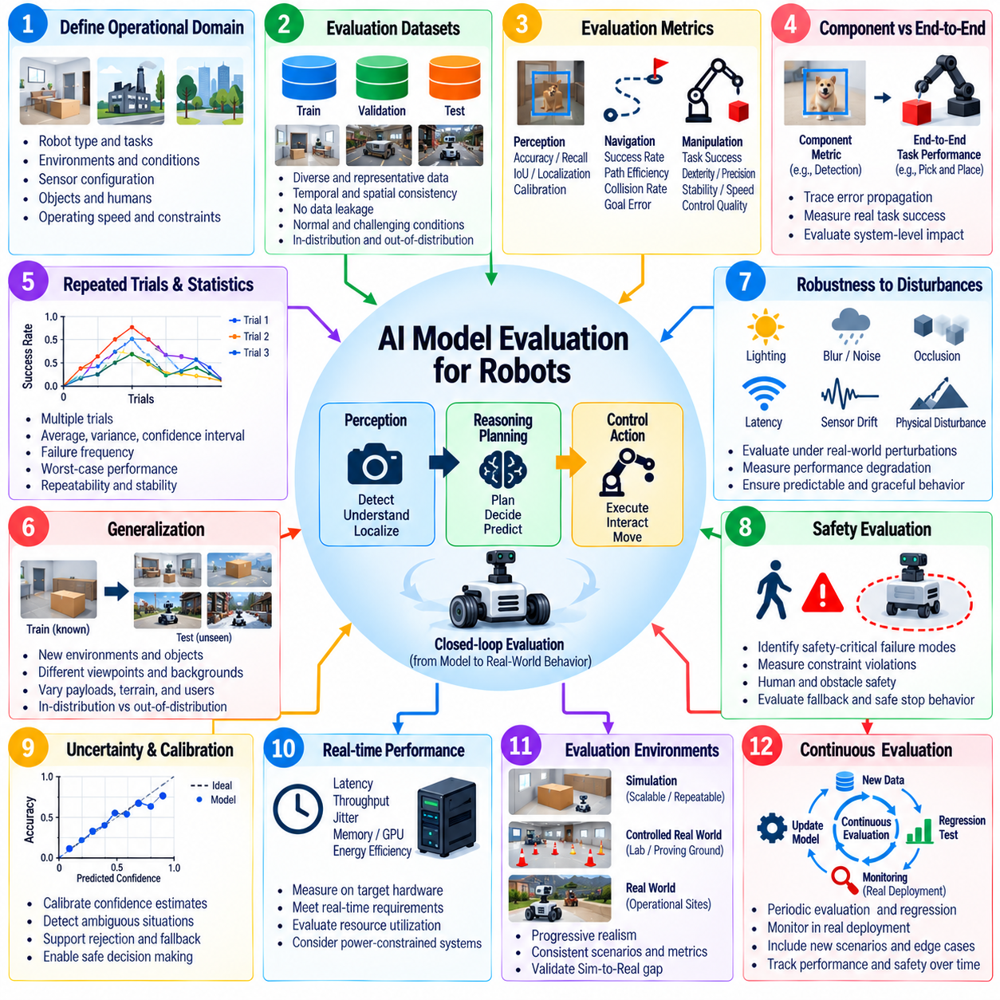
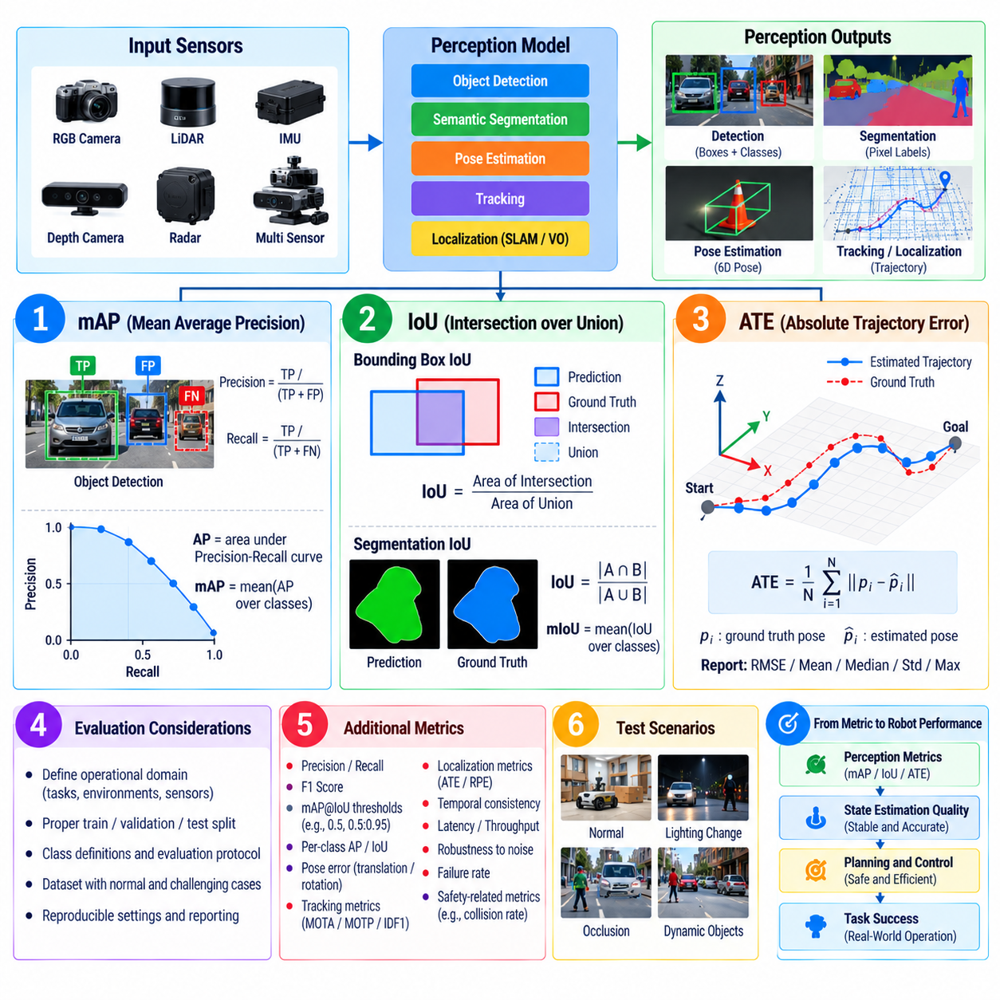
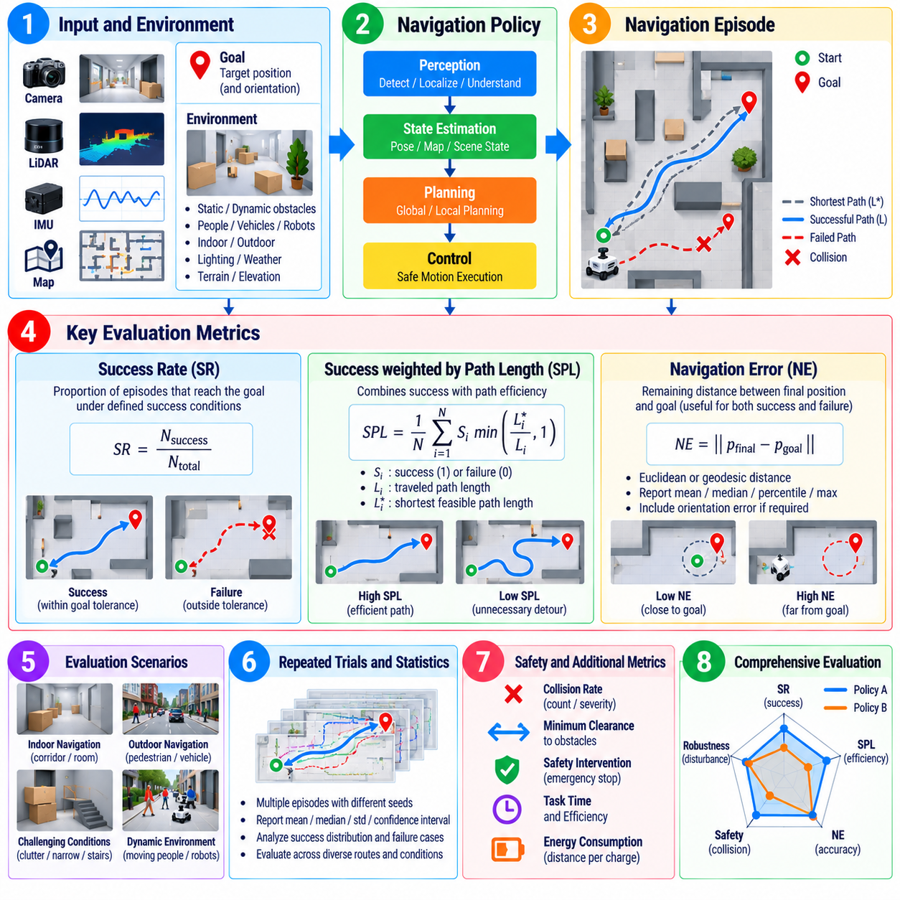
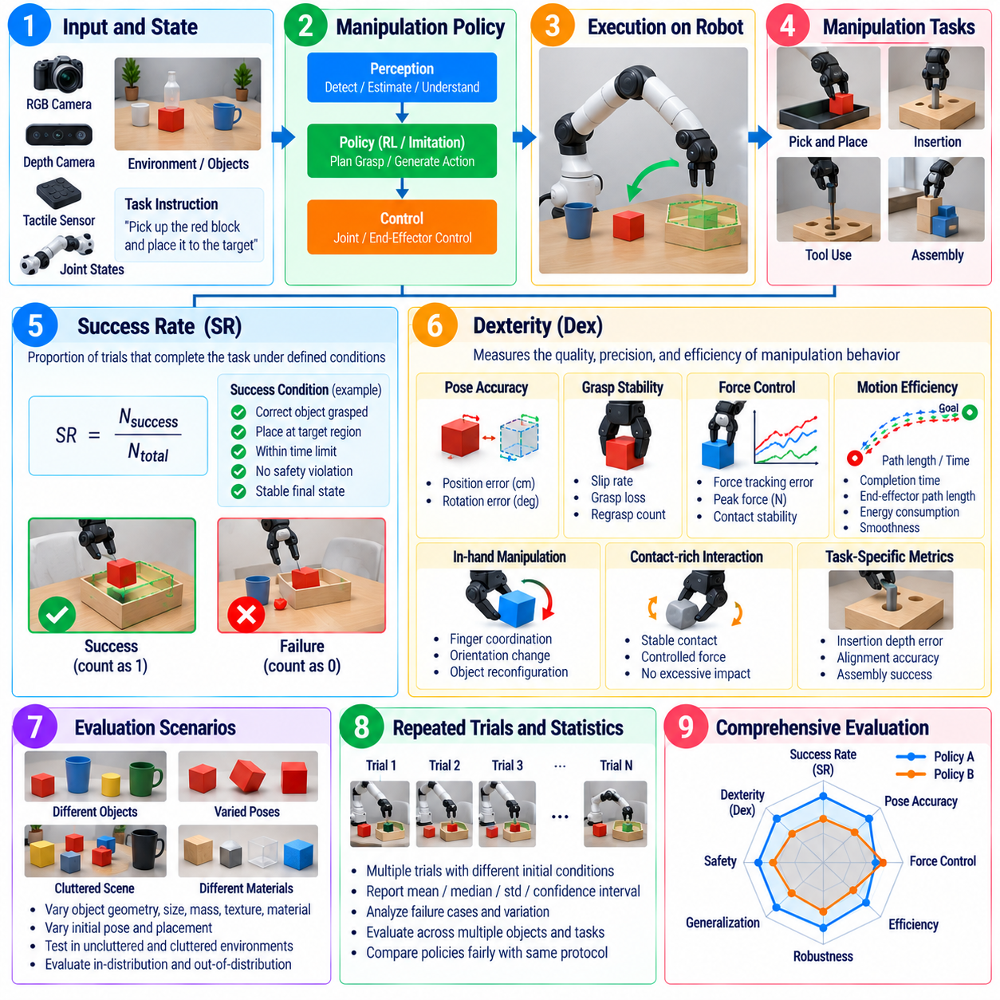
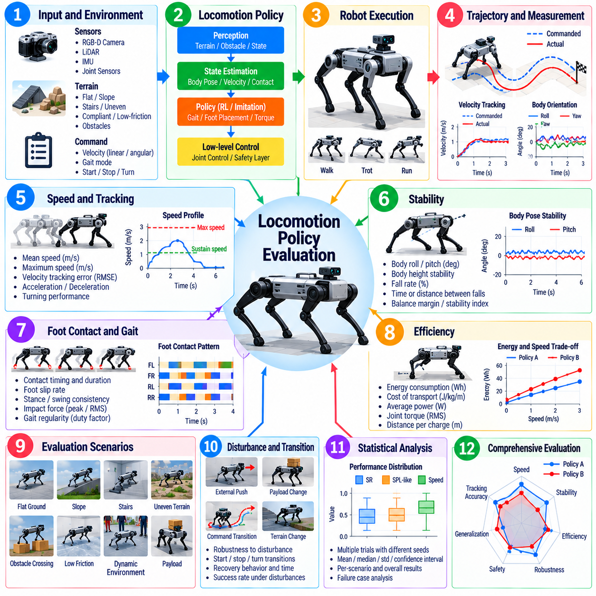
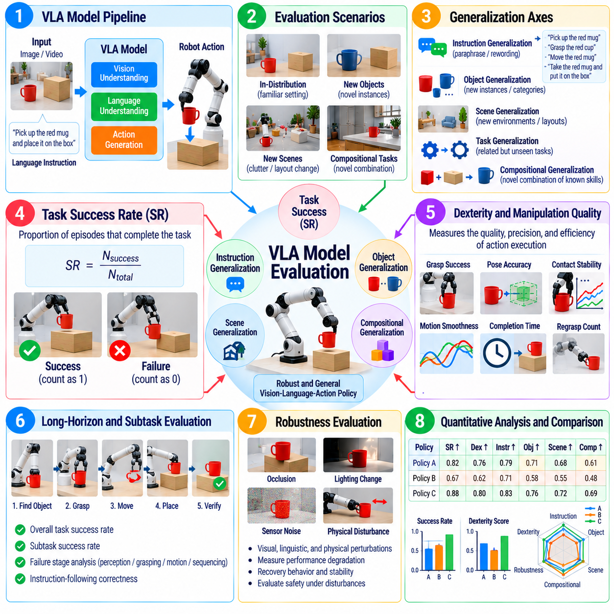
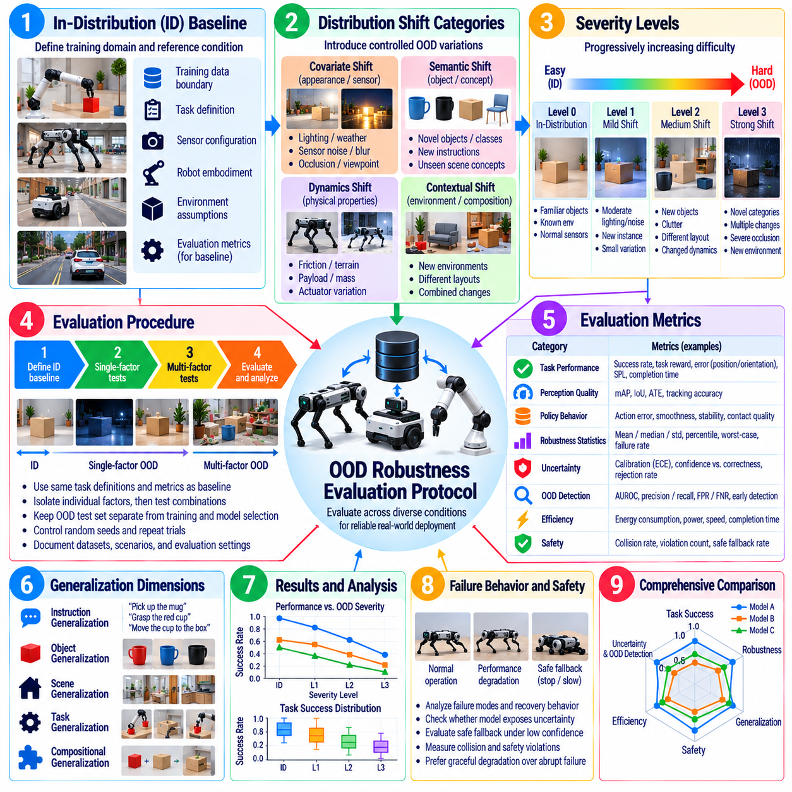
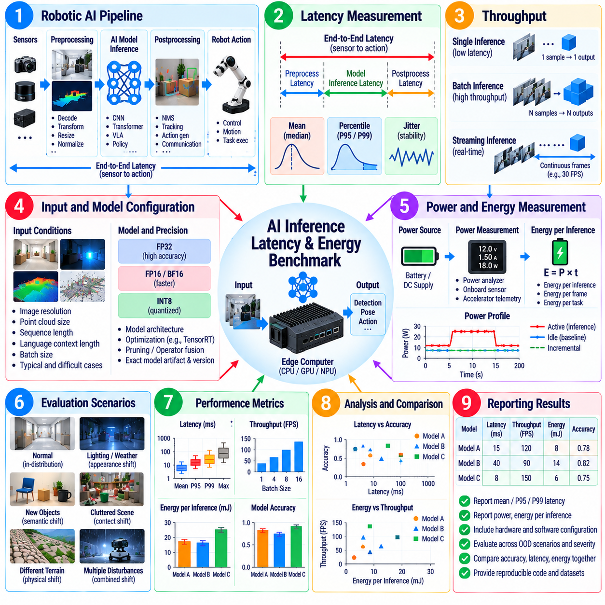
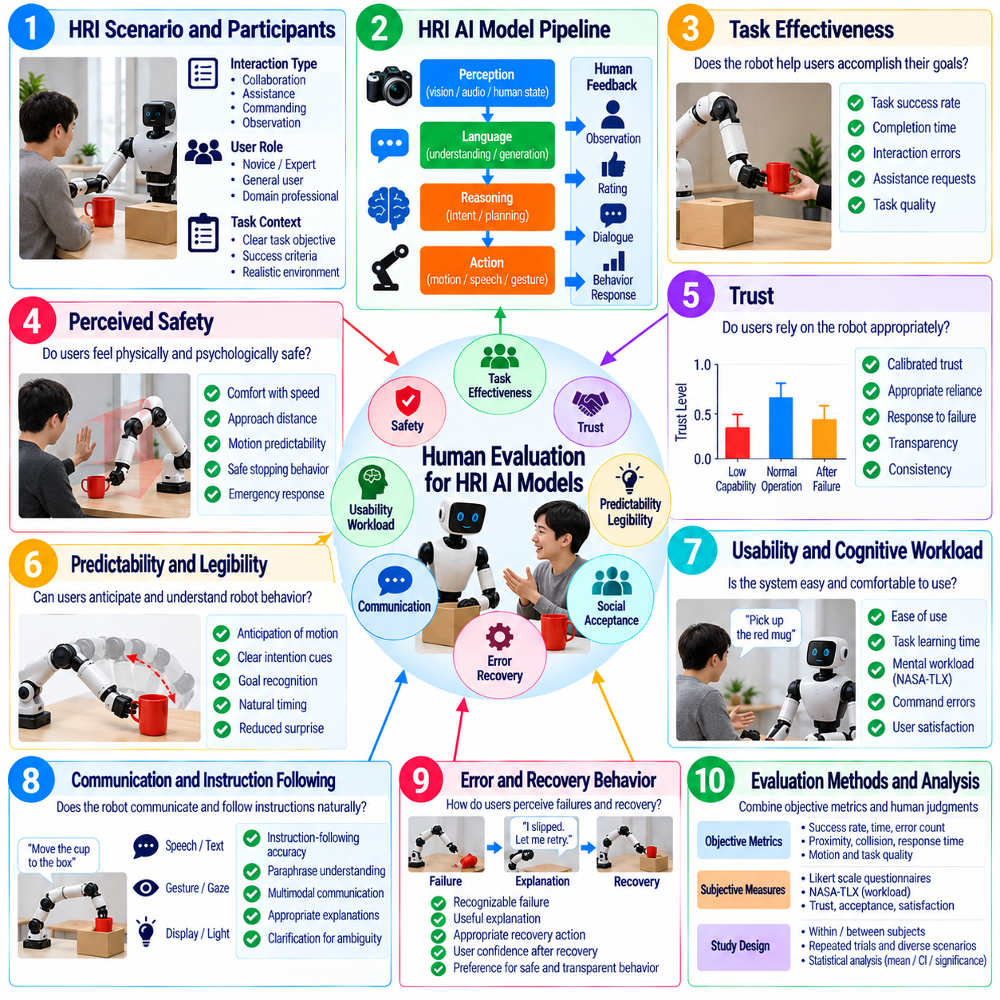
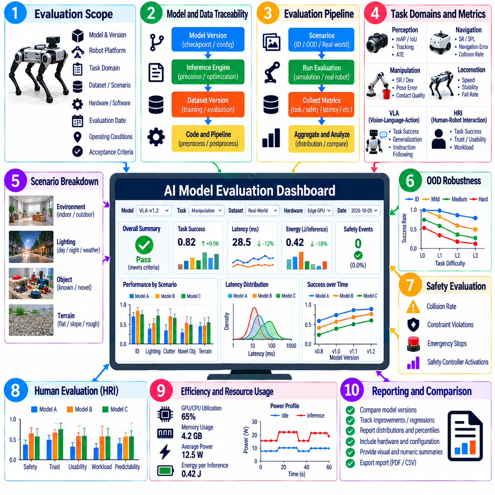

**Volume 25. Testing Validation and Benchmarking**

# Chapter 06. AI Model Evaluation

## 06.01. AI Model Evaluation Principles for Robots

{width="7.268055555555556in" height="7.268055555555556in"}

AI model evaluation for robots must determine whether a learned model can support reliable physical behavior rather than merely achieve high accuracy on an offline dataset. A robot closes the loop between perception, reasoning, planning, and action, so model errors can propagate into motion and interaction with the environment. Evaluation must therefore connect model-level performance with task success, operational constraints, and system-level consequences. Volume_25_Testing_Validation_an...

A fundamental principle is to define the intended operational domain before selecting metrics. The evaluation specification should describe robot type, tasks, environments, sensor configurations, object classes, human interactions, operating speeds, and expected disturbances. A model that performs well in a controlled laboratory may fail under illumination changes, clutter, vibration, sensor noise, terrain variation, or unfamiliar objects encountered during deployment.

Evaluation datasets should represent both normal operating conditions and difficult conditions near the boundaries of the operational domain. Training, validation, and test data must be separated carefully to prevent information leakage, while test sets should include meaningful variations in scenes, viewpoints, objects, trajectories, users, and environmental states. Robot evaluation should also preserve temporal and spatial relationships that may be lost when individual samples are evaluated independently.

No single metric adequately characterizes a robotic AI model. Perception systems may require accuracy, precision, recall, IoU, localization error, calibration, and temporal consistency, while navigation policies require measures related to success, path efficiency, collisions, and goal error. Manipulation and locomotion introduce additional measures of task completion, stability, dexterity, speed, and control quality, reflecting the broader chapter structure for model-specific evaluation. Volume_25_Testing_Validation_an...

Model evaluation should distinguish component quality from end-to-end task performance. A perception model can improve an image-level metric without producing a measurable improvement in navigation or manipulation, while a statistically modest perception error may trigger a severe downstream failure. For this reason, evaluation should trace how prediction errors influence state estimation, planning decisions, control commands, physical contacts, and ultimately the success or failure of the robot mission.

Robotic AI must also be evaluated across repeated trials because physical experiments contain substantial variability. Initial robot pose, object placement, friction, sensor noise, network conditions, human behavior, and actuator response can change the result even when the software is identical. Reporting only average performance can conceal unstable behavior, so distributions, variance, confidence intervals, failure frequency, worst-case outcomes, and repeatability should accompany aggregate scores whenever practical.

Generalization is especially important because robots inevitably encounter situations that differ from their training distribution. Evaluation should vary objects, environments, backgrounds, instructions, viewpoints, payloads, terrain, and interaction patterns without retraining the model for every test. Separate reporting for in-distribution and out-of-distribution conditions helps reveal whether performance reflects genuine transferable capability or narrow adaptation to benchmark-specific patterns. Volume_25_Testing_Validation_an...

Robustness evaluation deliberately introduces perturbations that a deployed robot may experience. Images can be affected by blur, glare, darkness, occlusion, contamination, or dropped frames; localization inputs may contain drift or missing measurements; communication may suffer latency or packet loss; and physical systems experience disturbances and changing dynamics. The objective is not only to determine when performance declines, but also to characterize how gradually and predictably degradation occurs.

Safety must be evaluated independently from nominal task performance. Two models with similar success rates may have very different risk profiles if one occasionally generates unsafe motion, ignores humans, approaches obstacles too closely, or produces uncontrolled actions under uncertainty. Evaluation should therefore identify safety-critical failure modes, establish measurable constraints, record violations, and examine whether confidence estimates or fallback mechanisms allow the robot to enter a safe state before hazardous behavior develops.

Uncertainty and calibration provide another important dimension of model quality. A robot should ideally distinguish confident predictions from ambiguous situations instead of treating every output as equally trustworthy. Calibration analysis compares predicted confidence with observed correctness and can support rejection thresholds, redundant sensing, human intervention, or conservative planning. This becomes particularly valuable when unfamiliar conditions make conventional accuracy measurements insufficient for operational decision making.

Real-time performance is part of model correctness in robotics. A highly accurate model that produces results too slowly may generate stale observations or delayed actions, reducing closed-loop stability and safety. Evaluation should measure end-to-end latency, jitter, throughput, memory consumption, accelerator utilization, startup behavior, and computational load on the actual deployment hardware rather than relying exclusively on workstation measurements. Energy efficiency should also be considered for power-constrained mobile systems. Volume_25_Testing_Validation_an...

Evaluation must progress through environments with increasing physical realism. Offline dataset tests provide fast and reproducible comparisons, simulation enables large-scale scenario variation, hardware-in-the-loop testing exposes timing and interface behavior, and controlled physical tests reveal effects that models may omit. Field evaluation then determines whether the model remains effective under real operational variability, complementing the volume\'s simulation, HIL, and field-testing methodology. Volume_25_Testing_Validation_an...

Comparisons between model versions require controlled experimental conditions. Dataset versions, random seeds, preprocessing, sensor calibration, hardware configuration, inference precision, software dependencies, thresholds, and evaluation scripts should be recorded. Baselines must be executed under equivalent conditions, and acceptance criteria should be established before examining final results whenever possible. These practices reduce benchmark manipulation and make regression analysis meaningful across successive model releases.

Failure analysis is as important as aggregate scoring. Evaluation records should preserve sensor streams, model inputs and outputs, timestamps, robot states, commands, environmental conditions, and relevant system events so that failures can be reconstructed. Errors can then be grouped into categories such as perception ambiguity, distribution shift, planning mistakes, latency, sensor degradation, or interaction failures. Such taxonomy transforms evaluation from simple ranking into an engineering process for improving the complete robotic system.

Human evaluation becomes necessary when model quality depends on interaction characteristics that cannot be represented fully by automated metrics. Human-robot interaction may require assessment of instruction understanding, predictability, appropriateness, perceived responsiveness, workload, and intervention frequency. Human judgments should use predefined protocols and consistent rating criteria so that subjective observations can complement quantitative measurements without replacing objective system evidence. Volume_25_Testing_Validation_an...

A mature evaluation process treats testing as a lifecycle rather than a one-time benchmark. New field failures, difficult scenarios, newly discovered distribution shifts, and representative production data should continuously enrich regression suites. Model updates must be compared against established baselines to detect improvements and regressions across capability, robustness, safety, latency, and efficiency. This connects pre-deployment model evaluation with continuous testing and monitoring after deployment. Volume_25_Testing_Validation_an...

Ultimately, AI model evaluation for robots should answer whether the model is sufficiently capable, robust, efficient, predictable, and safe for its intended physical role. The strongest evaluation framework combines component metrics with task-level outcomes, controlled benchmarks with realistic trials, nominal performance with edge cases, and average results with failure analysis. This evidence-centered approach establishes a defensible basis for model selection, deployment decisions, regression control, and continuous improvement.

## 06.02. Perception Model Evaluation mAP IoU ATE [w/Code]

{width="7.268055555555556in" height="7.268055555555556in"}

Perception model evaluation determines how accurately a robot converts raw sensor observations into representations that downstream localization, planning, manipulation, and control modules can trust. Because perception includes object detection, segmentation, pose estimation, tracking, and localization, evaluation requires metrics matched to each output type. Common measures such as mAP, IoU, and ATE quantify different aspects of prediction quality and should not be interpreted as interchangeable indicators of overall perception performance.

Mean Average Precision, or mAP, is widely used to evaluate object detection models operating on camera images, LiDAR point clouds, or multimodal sensor data. The metric summarizes detection performance across object classes by combining precision and recall behavior under defined matching criteria. A predicted object is normally considered correct when its class and spatial correspondence with the ground-truth annotation satisfy the evaluation threshold, while unmatched predictions and missed objects contribute to false positives and false negatives.

Precision measures how many predicted detections are correct, whereas recall measures how many relevant ground-truth objects are successfully detected. Increasing a model\'s confidence threshold may improve precision by rejecting uncertain predictions but can simultaneously reduce recall by removing valid detections. A precision-recall curve therefore provides more information than a single operating point, and Average Precision integrates performance across confidence thresholds to characterize the detector\'s ability to rank correct detections ahead of incorrect ones.

Mean Average Precision aggregates Average Precision values across multiple classes and, depending on the benchmark protocol, across multiple overlap thresholds. The exact mAP definition must always accompany reported results because different evaluation conventions can produce substantially different scores for the same model. Robot developers should record class definitions, confidence thresholds, overlap criteria, ignored regions, minimum object size, and dataset version so that comparisons between models remain reproducible and technically meaningful.

Intersection over Union, or IoU, evaluates spatial agreement between a prediction and its ground truth. For bounding boxes or segmentation regions, IoU is calculated from the area of intersection divided by the area of union. A value near one indicates strong spatial correspondence, while a value near zero indicates little overlap. IoU can therefore serve directly as a segmentation metric or as the matching criterion used to determine whether an object detection counts as a true positive.

IoU should be interpreted carefully in robotic applications because identical IoU values may have different operational consequences. A small localization error on a large object can preserve a high overlap score, while the same absolute error on a small object may sharply reduce IoU. Thin structures, partially occluded objects, distant obstacles, grasp targets, and safety-critical regions may consequently require class-specific analysis rather than reliance on a single dataset-wide mean IoU value.

Semantic segmentation evaluation commonly reports IoU for each class and then calculates mean IoU across the evaluated classes. This prevents large background regions from dominating pixel-level accuracy and provides clearer information about whether important semantic categories are represented correctly. For robotics, separate reporting for floor, obstacle, person, vehicle, manipulable object, unknown region, or other task-specific classes can expose weaknesses hidden by an apparently strong aggregate segmentation score.

Localization and trajectory-estimation systems require different metrics because their outputs evolve continuously over time. Absolute Trajectory Error, or ATE, measures the discrepancy between an estimated trajectory and a ground-truth reference trajectory after applying the alignment required by the evaluation protocol. It is commonly used for visual odometry, SLAM, visual-inertial estimation, and related robot localization systems where accumulated position and orientation errors affect navigation performance.

ATE is usually computed from pose differences along synchronized estimated and reference trajectories and summarized using statistics such as root mean square error, mean, median, standard deviation, or maximum error. Before calculating ATE, evaluators must define timestamp association, coordinate frames, trajectory alignment, scale handling, and treatment of missing poses. Without these conventions, ATE values from different systems or experiments cannot be compared reliably even when they use the same recorded sequence.

A low ATE does not guarantee good behavior at every moment because trajectory alignment and aggregate statistics may conceal local failures. A localization system can achieve acceptable global error while experiencing temporary jumps, drift, tracking loss, or delayed recovery that destabilizes robot control. Evaluation should therefore examine trajectory plots numerically, segment-level errors, tracking availability, recovery behavior, and error distributions in addition to reporting a single ATE summary value.

Perception evaluation should also account for temporal consistency. A detector that alternates rapidly between correct and incorrect classifications may achieve reasonable frame-level mAP but create unstable tracks and planning decisions. Similarly, segmentation boundaries that fluctuate between frames can affect obstacle maps, while intermittent localization errors can trigger abrupt trajectory corrections. Sequence-based testing should therefore measure persistence, track continuity, prediction stability, and failure duration where these properties influence robot behavior.

Evaluation datasets must represent the conditions expected during robot operation. Detection and segmentation tests should include variations in illumination, distance, viewpoint, motion blur, clutter, occlusion, object scale, weather, and sensor contamination when relevant. Localization datasets should include diverse trajectories, motion dynamics, textures, geometric structures, and degraded sensing conditions. Reporting performance by condition reveals whether aggregate mAP, IoU, or ATE results are dominated by easy scenarios.

Out-of-distribution evaluation is particularly important for perception because deployment environments continuously introduce objects and visual configurations that were absent from training data. Models should be tested with unfamiliar object instances, novel backgrounds, changed lighting, altered sensor characteristics, and unusual combinations of otherwise familiar elements. Confidence calibration and unknown-object behavior should also be examined because highly confident incorrect predictions can be more dangerous than explicit uncertainty in a physical robot.

Perception metrics should ultimately be connected to downstream task outcomes. A change in mAP matters when it alters obstacle detection, human awareness, manipulation target selection, or another robot capability. Improvements in IoU should be examined for their effect on free-space estimation or grasp geometry, while reductions in ATE should be related to navigation accuracy and map consistency. This system-level interpretation prevents optimization of benchmark numbers that provide little practical improvement to robot behavior.

Runtime characteristics form another part of perception evaluation. Detection, segmentation, and localization models frequently operate inside real-time control pipelines, making inference latency, throughput, jitter, memory consumption, and accelerator utilization important alongside prediction accuracy. Metrics should be collected on representative deployment hardware and at realistic sensor rates. An accurate perception model that cannot maintain the required processing frequency may deliver stale information and degrade closed-loop robot performance.

A robust evaluation report should preserve the complete experimental context together with the resulting metrics. Model version, dataset version, sensor configuration, preprocessing, input resolution, confidence settings, matching thresholds, hardware platform, numerical precision, and evaluation software should be recorded. mAP, IoU, and ATE can then serve as reproducible engineering evidence rather than isolated benchmark numbers, supporting model comparison, regression detection, deployment decisions, and continuous improvement of robotic perception systems.

## 06.03. Navigation Policy Evaluation SR SPL NE [w/Code]

{width="7.268055555555556in" height="7.268055555555556in"}

Navigation policy evaluation determines whether a robot can transform perception, localization, map information, and task objectives into reliable motion toward a destination. Unlike evaluating an isolated prediction model, navigation assessment must consider the complete sequence of decisions made during an episode. Success Rate, Success weighted by Path Length, and Navigation Error provide complementary measures of task completion, path efficiency, and final goal accuracy.

Success Rate, or SR, measures the proportion of navigation episodes in which the robot satisfies a predefined success condition. For point-goal navigation, success commonly requires the robot to terminate within a specified distance of the target without violating critical constraints. In practical systems, the definition may additionally require collision-free operation, valid localization, completion within a time limit, or correct execution of a stopping decision.

The success condition must be defined before experiments begin because seemingly minor differences can substantially change reported SR. Goal tolerance, maximum episode duration, collision limits, recovery allowances, and termination rules should remain consistent across compared policies. A robot that reaches the target region but fails to recognize arrival may need to be classified differently from one that never approaches the goal, even though both episodes can appear as failures in a simple aggregate score.

Success Rate is intuitive but does not measure how efficiently a successful policy reaches its destination. Two policies may obtain identical SR while one follows short, direct trajectories and the other repeatedly detours, oscillates, or performs unnecessary recovery maneuvers. Such differences affect mission time, energy consumption, traffic interaction, and fleet productivity, motivating the use of path-efficiency metrics in addition to binary success.

Success weighted by Path Length, commonly abbreviated SPL, combines navigation success with trajectory efficiency. A successful episode receives a higher score when the traveled path approaches the shortest feasible reference path and a lower score when unnecessary distance is accumulated. Failed episodes normally contribute no successful-path credit. SPL therefore distinguishes policies that merely reach destinations from those that consistently reach them using efficient trajectories.

The reference path used for SPL requires careful definition. Depending on the evaluation environment, the reference may be based on geodesic distance, a shortest collision-free route, or a path generated from a known map. Robot dimensions, obstacle inflation, kinematic constraints, traversability, and one-way regions can make a theoretically shortest geometric path physically infeasible. Reference paths should therefore represent the motion capabilities and operational constraints of the evaluated platform.

Navigation Error, or NE, measures the remaining distance between the robot\'s final position and the intended goal. It provides useful information even when an episode is unsuccessful because it distinguishes a robot that stops slightly outside the success tolerance from one that becomes lost far from the destination. NE can be reported as mean, median, percentile, maximum, or distributional statistics to expose failure severity that would otherwise be hidden by SR.

Navigation Error should use a distance definition appropriate to the task. Euclidean distance may be sufficient in open environments, while geodesic distance can better represent buildings, corridors, multiple floors, barriers, or constrained terrain. Orientation error may also be required when the robot must arrive with a specific heading for docking, manipulation, charging, inspection, or human interaction. Goal achievement can therefore involve both positional and rotational tolerances.

SR, SPL, and NE should be interpreted together rather than independently. High SR with low SPL can indicate reliable but inefficient navigation, while moderate SR with low NE may indicate that many failures occur close to the acceptance boundary. High SPL combined with large errors on a small subset of episodes may reveal rare but severe failures. Joint analysis provides a more complete picture of navigation behavior than optimization of any single metric.

Evaluation scenarios should span the conditions represented by the intended operational domain. Tests may vary route length, corridor width, obstacle density, intersection complexity, terrain, illumination, localization quality, sensor visibility, and goal placement. Dynamic environments should include moving people, vehicles, or robots where appropriate. Reporting metrics by scenario category helps identify conditions in which apparently strong aggregate navigation performance deteriorates.

Repeated trials are necessary because navigation policies can be sensitive to initial pose, localization uncertainty, moving obstacles, planner timing, and stochastic policy outputs. Evaluation should control random seeds where reproducibility is required while also testing sufficient variation to characterize operational behavior. Confidence intervals and distributions across episodes provide stronger evidence than a single average SR, SPL, or NE obtained from a limited set of favorable routes.

Collision behavior must be measured alongside goal-oriented metrics. A policy should not receive an operationally favorable interpretation simply because it achieves high SR by moving aggressively through narrow clearances or frequently contacting obstacles. Evaluators can record collision count, collision severity, minimum obstacle clearance, emergency-stop activation, safety-layer intervention, and near-miss events to determine whether navigation efficiency is achieved without unacceptable physical risk.

Recovery performance is another important dimension that SR and SPL alone may not explain. Robots can encounter localization degradation, blocked paths, temporary sensor loss, planner failure, or unexpected obstacles. Evaluation should observe whether the navigation system detects the problem, initiates an appropriate recovery behavior, replans successfully, and resumes progress. Recovery frequency, recovery duration, repeated failure cycles, and eventual task completion provide useful diagnostic evidence.

Navigation policies should also be tested for generalization and out-of-distribution robustness. Novel maps, changed furniture layouts, unfamiliar obstacle configurations, altered sensor noise, different floor conditions, and previously unseen traffic patterns can reveal dependence on training environments. Separating in-distribution and out-of-distribution SR, SPL, and NE allows evaluators to determine whether a policy has learned transferable navigation behavior or primarily memorized familiar environmental structures.

Simulation provides an efficient environment for evaluating thousands of navigation episodes and systematically varying maps, obstacles, sensors, and disturbances. However, strong simulation results do not guarantee equivalent physical performance. Real robots introduce wheel slip, actuator delay, calibration error, imperfect sensing, communication jitter, and human behavior that may be absent from simulation. Navigation evaluation should therefore progress from repeatable simulation tests toward controlled and field-based validation.

Runtime performance should accompany behavioral metrics because navigation decisions must satisfy real-time constraints. Policy inference latency, planning frequency, control update rate, CPU and accelerator utilization, memory consumption, and timing jitter can affect physical trajectories even when the underlying policy is unchanged. Measurements should be collected on representative robot hardware so that SR, SPL, and NE reflect realistic deployment conditions rather than unconstrained computing resources.

A complete navigation evaluation record should preserve policy version, map and scenario identifiers, robot configuration, sensor settings, localization method, success tolerance, reference-path definition, random seeds, software versions, and episode logs. Trajectories, collisions, recovery events, timing information, and termination causes should remain available for failure analysis. This makes SR, SPL, and NE reproducible engineering evidence for regression testing, policy comparison, and deployment decisions.

Ultimately, navigation policy evaluation should establish not only whether a robot reaches its goal, but whether it reaches that goal accurately, efficiently, safely, and consistently across representative operating conditions. SR captures completion, SPL introduces path efficiency, and NE characterizes residual goal error. Combined with safety, robustness, recovery, timing, and scenario-level analysis, these metrics form a practical foundation for evaluating autonomous navigation policies throughout simulation, validation, and field deployment.

## 06.04. Manipulation Policy Evaluation SR Dex [w/Code]

{width="7.268055555555556in" height="7.268055555555556in"}

Manipulation policy evaluation determines whether a robot can convert perception, task instructions, object states, and proprioceptive feedback into reliable physical interactions. Unlike static prediction tasks, manipulation requires continuous coordination among reaching, grasping, contact control, object motion, and task termination. Success Rate, or SR, provides a primary measure of task completion, while dexterity-oriented measures characterize how effectively the policy handles complex contact and object-control requirements.

Success Rate measures the proportion of manipulation trials that satisfy a predefined task objective. A pick-and-place task may require the correct object to be grasped and deposited inside a target region, while insertion, pouring, tool use, or assembly requires different completion conditions. The success definition must specify acceptable final object pose, grasp state, task sequence, time limit, safety constraints, and any conditions that immediately invalidate a trial.

Binary success is useful because it directly reflects whether the requested physical task was completed, but it can conceal important differences between policies. Two policies may achieve the same SR even though one completes tasks smoothly on the first attempt while another relies on repeated grasps, excessive contact, or long recovery sequences. Evaluation should therefore preserve intermediate outcomes and execution characteristics rather than treating every successful episode as equivalent.

Partial success metrics can provide additional information for long-horizon manipulation. A multi-stage task may include approaching an object, establishing a stable grasp, lifting, transporting, aligning, and releasing it at a destination. Recording completion of these stages reveals where failures occur and helps distinguish perception, grasping, motion generation, and contact-control problems. Such decomposition is especially valuable when complete task success remains relatively rare.

Dexterity, abbreviated here as Dex, represents the policy\'s ability to perform precise, coordinated, and adaptable manipulation rather than simply completing a task through any feasible motion. Dexterity can involve accurate end-effector placement, stable grasp transitions, controlled force application, finger coordination, bimanual synchronization, in-hand object motion, and adaptation to changing contact states. Its exact definition must therefore be matched to the robot embodiment and target manipulation capability.

Because dexterity is multidimensional, a single universal Dex score is usually insufficient without a clearly defined evaluation protocol. A practical evaluation can combine pose accuracy, grasp stability, contact quality, force regulation, trajectory smoothness, regrasp frequency, manipulation time, and successful execution of dexterous primitives. The weighting and normalization of these components should be documented so that a reported dexterity score remains interpretable and reproducible across model versions.

Object pose accuracy is particularly important when manipulation requires precise placement or alignment. Evaluation can measure translational and rotational error between the achieved object pose and the target pose after task execution. Tight tolerances may be required for peg insertion, connector mating, stacking, or assembly, whereas broader tolerances may be appropriate for bin placement. Pose errors should therefore be interpreted according to the physical requirements of the task.

Grasp quality should be evaluated beyond the initial closing of the gripper. A successful grasp must remain stable during lifting, acceleration, transport, orientation changes, and interaction with the environment. Evaluators can observe object slip, unintended rotation, grasp loss, excessive grip force, and the need for regrasping. For dexterous hands, finger contact distribution and the ability to transition between grasp configurations can provide additional evidence of manipulation capability.

Contact-rich tasks require explicit evaluation of force and interaction behavior. Excessive force may damage objects, destabilize the robot, or create safety hazards, while insufficient force can cause slipping or incomplete insertion. Force and torque profiles, peak contact loads, impulse, force-tracking error, and contact duration can therefore complement SR. These measures are especially relevant for assembly, surface interaction, tool operation, deformable-object handling, and human-facing manipulation.

Efficiency should also be considered because successful manipulation can still be operationally poor. Completion time, end-effector path length, joint motion, number of grasp attempts, number of corrective actions, and energy consumption can reveal unnecessary behavior. A policy that completes a task rapidly but produces unsafe impacts should not automatically be preferred, so efficiency metrics must be interpreted together with task quality, contact stability, and safety constraints.

Manipulation evaluation requires repeated trials because small changes in object pose, friction, mass distribution, gripper contact, sensor noise, and robot calibration can alter outcomes. Initial conditions should be systematically varied while remaining reproducible when controlled comparison is required. Reporting confidence intervals, distributions, and per-condition success rates provides stronger evidence than presenting a single aggregate SR obtained from a small number of favorable demonstrations.

Generalization testing should vary object instances, geometry, texture, material, size, mass, orientation, placement, and surrounding clutter. Policies intended for general-purpose manipulation should also encounter objects and configurations that were not present during training. Comparing in-distribution and out-of-distribution performance reveals whether the policy has acquired transferable manipulation skills or depends strongly on familiar objects, fixed poses, or memorized visual patterns.

Disturbance testing evaluates whether the policy can maintain or recover manipulation progress when execution deviates from the expected trajectory. Objects may shift during approach, grasps may be imperfect, external contacts may perturb the arm, or perception may temporarily become unreliable. A robust policy should detect these changes, adapt its motion or force strategy, and recover when feasible rather than continuing an invalid action sequence until catastrophic failure.

Safety evaluation must accompany manipulation performance because robot arms and hands directly exchange forces with objects, equipment, and potentially people. Evaluation should record joint-limit violations, excessive velocity or torque, unexpected collisions, unsafe contact forces, dropped objects, workspace violations, and safety-system interventions. High SR cannot compensate for a manipulation strategy that achieves success through behavior that is physically hazardous or damaging.

Simulation can provide large-scale manipulation evaluation across object poses, physical parameters, and randomized environments, but simulated contact dynamics rarely reproduce every real-world interaction. Friction, compliance, backlash, tactile response, deformable materials, and contact transitions can create significant simulation-to-reality differences. Manipulation policies should therefore progress from simulation benchmarks to controlled hardware experiments and representative physical task trials.

Runtime performance is another component of manipulation policy evaluation. Vision-based or multimodal policies may require substantial computation for perception, reasoning, and action generation, while contact-sensitive tasks demand timely responses. Policy inference latency, control frequency, timing jitter, memory use, and accelerator utilization should be measured on representative robot hardware because delayed actions can reduce grasp stability and contact-control quality even when nominal policy predictions are correct.

A complete evaluation record should preserve policy and model versions, robot embodiment, gripper or hand configuration, object identifiers, initial poses, sensor settings, task tolerances, randomization parameters, and termination criteria. Robot trajectories, joint states, object poses, force signals, policy outputs, failure causes, and timing data should also be retained. These records enable regression testing and detailed diagnosis when SR or dexterity changes between policy releases.

Ultimately, manipulation policy evaluation should determine whether a robot can complete physical tasks reliably while demonstrating the precision, adaptability, efficiency, and contact control required by the application. SR provides a clear measure of task completion, while dexterity-oriented evaluation explains the quality of the physical interaction used to achieve that success. Together with robustness, safety, generalization, and runtime analysis, these measures provide a practical basis for validating manipulation policies before deployment.

## 06.05. Locomotion Policy Evaluation Speed Stability [w/Code]

{width="7.268055555555556in" height="7.268055555555556in"}

Locomotion policy evaluation determines whether a legged robot can generate reliable body motion while maintaining balance, tracking commanded velocity, and adapting to environmental conditions. Unlike static AI evaluation, locomotion must be assessed as a continuous closed-loop interaction among perception, state estimation, policy inference, joint control, contact dynamics, and terrain. Speed and stability are therefore central metrics, but they must be interpreted together with safety, efficiency, robustness, and task completion.

Speed evaluation begins by measuring the robot\'s realized translational and rotational velocity relative to commanded motion. Mean forward speed provides a simple indicator of mobility, while lateral speed, turning rate, acceleration, and deceleration characterize broader locomotion capability. Tests should distinguish maximum achievable speed from sustainable operational speed because a robot may briefly reach a high velocity without maintaining stable, energy-efficient, or safe locomotion over an extended trajectory.

Velocity tracking error measures how accurately the locomotion policy follows commanded linear and angular velocities. Evaluation should include constant commands, ramps, step changes, and dynamically varying references because a policy that performs well at one fixed speed may respond poorly during transitions. Root mean square error, steady-state error, overshoot, settling time, and response delay can reveal whether commanded motion is translated into predictable physical behavior.

Stability evaluation determines whether the robot maintains controlled body motion without falling, slipping excessively, or entering unrecoverable configurations. For quadrupeds and humanoids, useful observations include base orientation, roll and pitch variation, body-height deviation, angular velocity, foot contact consistency, and support behavior. Stability should be evaluated dynamically because a robot can remain upright while still exhibiting oscillations or contact patterns that indicate marginal control.

Fall rate provides a direct system-level measure of severe locomotion failure. It should be reported across repeated trials and across terrain, velocity, and disturbance conditions rather than as a single demonstration result. The definition of a fall must be explicit and may include body contact with the ground, violation of orientation thresholds, unrecoverable support loss, or activation of a protective shutdown. Time or distance traveled between falls can provide additional reliability information.

Foot contact behavior provides important evidence about locomotion quality. Evaluation can examine unintended foot slip, premature contact, missed contact, stance duration, swing clearance, contact timing, and impact velocity. Excessive slip reduces trajectory accuracy and can destabilize state estimation, while hard impacts increase mechanical stress. Contact metrics therefore connect policy behavior with both dynamic stability and long-term hardware reliability.

For humanoid locomotion, balance-related measurements may include center-of-mass behavior, support polygon relationships, capture-point behavior, momentum regulation, and foot-placement consistency. For quadrupeds, stability can additionally be characterized through gait regularity, support transitions, duty factor, and coordination among legs. The selected metrics should correspond to the robot morphology and controller architecture rather than forcing every platform into a single universal stability score.

Speed and stability should always be analyzed jointly because increasing velocity changes the difficulty of balance control. A policy may achieve impressive maximum speed while experiencing larger body oscillations, increased slip, higher impact loads, or more frequent falls. Evaluation should therefore generate performance profiles across a range of commanded speeds and identify regions where locomotion remains stable, controllable, and repeatable instead of reporting only the fastest successful trial.

Terrain diversity is essential for meaningful locomotion evaluation. Tests should include flat surfaces as a baseline and progressively introduce slopes, stairs, uneven terrain, stepping surfaces, compliant ground, low-friction regions, or obstacles according to the intended application. Terrain properties should be documented because identical speed and stability values can represent very different levels of policy capability when obtained on a laboratory floor versus irregular outdoor terrain.

Disturbance robustness evaluates whether the policy can preserve or recover locomotion after unexpected physical events. External pushes, payload changes, temporary foot slip, terrain-height errors, sensor disturbances, or actuator variations can be introduced under controlled conditions. Evaluation should measure whether the robot maintains balance, how far its state deviates from nominal motion, how rapidly it recovers, and whether recovery introduces unsafe contacts or excessive joint loads.

Command-transition testing is important for policies expected to perform practical mobility tasks. Robots should be evaluated while starting, stopping, accelerating, turning, reversing direction, and switching among walking or other supported gait modes. Transitions can expose instability that is not visible during steady locomotion because contact schedules and momentum must change rapidly. Successful transition rate and stabilization time provide useful measures of policy responsiveness.

Energy efficiency should accompany speed measurements because faster locomotion can require disproportionately greater actuator effort. Electrical power, mechanical work, joint torque, battery consumption, and cost of transport can be recorded over standardized routes. A policy that achieves slightly higher speed at substantially greater energy cost may be undesirable for mobile deployment. Efficiency analysis also helps identify unnecessary joint motion and mechanically stressful gait patterns.

Repeated trials are required to characterize locomotion reliably. Initial posture, terrain contact, sensor noise, actuator temperature, battery state, and stochastic policy outputs can change the result of otherwise identical experiments. Evaluation should therefore report distributions, variance, confidence intervals, and worst-case behavior in addition to mean speed or stability values. Repeatability is particularly important when determining whether apparent improvements between policy versions are statistically meaningful.

Generalization evaluation should test conditions that differ from those represented during training. Unseen terrain geometry, different friction coefficients, changed payloads, altered mass distribution, new footwear or foot-contact properties, and sensor degradation can reveal policy dependence on training assumptions. Comparing in-distribution and out-of-distribution performance shows whether locomotion capability transfers to realistic environmental variation rather than remaining specialized to familiar simulation conditions.

Simulation enables large-scale locomotion testing with controlled terrain randomization, disturbances, dynamics variations, and repeated trials. However, physical robots introduce actuator bandwidth limits, backlash, structural compliance, imperfect friction models, sensor latency, thermal effects, and unmodeled contact dynamics. Evaluation should therefore compare simulation results with hardware measurements and quantify performance degradation during simulation-to-reality transfer rather than assuming equivalent behavior.

Safety constraints must remain active during performance evaluation. Joint position, velocity, torque, motor temperature, contact force, body orientation, and workspace limits should be monitored so that a policy cannot obtain favorable speed results by operating beyond acceptable hardware or safety margins. Emergency-stop events, protective controller interventions, torque saturation, and thermal limiting should be recorded because they reveal operating regions where nominal locomotion metrics are misleading.

Runtime performance also affects locomotion quality because policy inference and control must operate within strict timing requirements. Evaluation should measure inference latency, control frequency, timing jitter, missed deadlines, processor utilization, accelerator load, and memory consumption on representative hardware. Delayed policy outputs can produce phase errors in contact timing or destabilize fast motion even when the same policy appears effective under ideal computational conditions.

A complete evaluation record should preserve policy version, robot configuration, terrain description, command profile, control frequency, sensor configuration, payload, randomization settings, environmental conditions, and termination criteria. Joint states, base motion, foot contacts, actuator commands, power measurements, safety events, and failure causes should be logged. These records support regression analysis and allow speed or stability changes to be traced to specific policy or system modifications.

Ultimately, locomotion policy evaluation should establish the operating envelope within which a robot can move quickly while remaining stable, controllable, efficient, and safe. Speed characterizes mobility and command-following capability, while stability reveals whether that motion can be sustained under realistic contacts and disturbances. Combined with terrain, robustness, energy, safety, generalization, and runtime measurements, these metrics provide a practical foundation for validating locomotion policies before field deployment.

## 06.06. VLA Model Evaluation Task Generalization [w/Code]

{width="7.268055555555556in" height="7.268055555555556in"}

Vision-Language-Action model evaluation determines whether a robot can transform visual observations and language instructions into actions that accomplish physical tasks across diverse conditions. Unlike a policy trained for one fixed behavior, a VLA model is expected to connect semantic understanding with embodied execution. Evaluation must therefore measure not only task success but also whether capabilities generalize across instructions, objects, scenes, task variations, and interaction histories.

Task Success Rate provides a fundamental measure of VLA performance by recording the proportion of episodes that satisfy predefined completion criteria. The criteria should describe the required object state, robot state, spatial relationship, action sequence, and termination condition. Because language instructions may permit multiple valid strategies, evaluation should focus on whether the requested physical outcome is achieved rather than requiring the robot to reproduce one reference trajectory.

Task generalization measures whether capabilities learned from training tasks transfer to related but previously unseen tasks. A robot trained to place objects into containers, for example, should be tested with new object-container combinations, altered spatial relationships, and variations in the requested operation. Evaluation should separate memorized task execution from compositional behavior in which familiar concepts and motor skills are recombined to satisfy a novel instruction.

Instruction generalization evaluates whether the model can understand different linguistic expressions that refer to equivalent or related goals. Tests may vary vocabulary, sentence structure, referring expressions, instruction length, and level of abstraction while preserving the intended task. A robust VLA model should not depend on one canonical command template. Performance across paraphrases helps reveal whether language representations capture task meaning rather than superficial wording patterns.

Object generalization evaluates manipulation or interaction with object instances that were absent from the training distribution. Novel objects can vary in geometry, texture, color, size, material, orientation, or functional characteristics. Evaluation should determine whether the model uses transferable visual and semantic features to select appropriate actions. Results should distinguish unfamiliar instances of known categories from completely novel categories because these represent different levels of generalization difficulty.

Scene generalization measures whether a VLA model maintains task performance when environmental layouts differ from those encountered during training. Furniture positions, backgrounds, lighting, clutter, camera viewpoints, workspace geometry, and distractor objects can be changed systematically. Strong scene generalization indicates that the policy associates instructions with relevant entities and spatial relationships instead of relying on fixed visual configurations or memorized workspace locations.

Compositional generalization is especially important for generalist robot policies. A model may have observed individual concepts such as open, drawer, red object, and place during training without observing the exact combination required by a new task. Evaluation should construct novel combinations of known concepts and skills to determine whether the model can compose perception, language understanding, and action knowledge into behaviors that were not explicitly demonstrated during training.

Generalization difficulty should be organized into clearly defined evaluation levels. In-distribution tests establish baseline capability using familiar task structures and environmental conditions. Mild distribution shifts may introduce new object instances or instruction paraphrases, while stronger shifts can combine novel scenes, objects, goals, and linguistic formulations. Reporting results separately for each level prevents aggregate success rates from hiding rapid degradation as tasks move farther from the training distribution.

Long-horizon tasks require additional evaluation because individual actions that appear correct may accumulate into task failure. A VLA model may need to locate an object, approach it, grasp it, open a container, place the object, and verify completion. Evaluators should record both complete task success and subtask completion. This reveals whether failures originate from semantic misunderstanding, perception, action execution, sequencing, recovery, or loss of task context.

Instruction-following accuracy should evaluate whether the robot performs the requested task rather than merely producing a physically successful action. Picking up a nearby cup when instructed to move a bottle is a manipulation success but an instruction-following failure. Evaluation must therefore compare executed behavior with semantic constraints in the command, including object identity, attributes, spatial relations, destination, ordering requirements, and prohibited actions when these are specified.

Ambiguous instructions provide another important test of VLA behavior. Real users may provide incomplete references, underspecified goals, or commands with multiple plausible interpretations. Evaluation should determine whether the model acts conservatively, requests clarification when supported, or selects an appropriate interpretation based on available context. Confident execution of an unsupported interpretation can be more problematic than explicitly recognizing uncertainty in human-facing robot systems.

Robustness testing should introduce visual, linguistic, and physical perturbations simultaneously. Occlusion, illumination changes, sensor noise, object displacement, imperfect grasps, paraphrased instructions, and unexpected environmental changes can occur during one task. A capable VLA model should continue to ground language in the current physical state and revise actions when conditions change rather than blindly executing an action sequence derived from an outdated observation.

Recovery capability is critical because general-purpose physical tasks rarely proceed exactly as expected. Objects may slip, drawers may fail to open, grasp attempts may miss, or another agent may alter the scene. Evaluation should measure whether the VLA model detects failed action outcomes, updates its understanding of the environment, and selects corrective actions. Recovery success, number of retries, additional execution time, and repeated failure loops provide useful evidence of policy adaptability.

Safety evaluation must remain separate from task success. A VLA model should not receive a favorable assessment when it completes instructions through unsafe motion, excessive contact, collisions, unstable grasps, or actions that violate workspace constraints. Tests should include instructions that become unsafe because of the current scene and situations where semantic objectives conflict with physical limitations. Safe refusal, replanning, or termination can represent correct behavior even when the requested task is not completed.

Human evaluation can complement automated metrics when instruction interpretation or behavioral appropriateness is difficult to encode numerically. Evaluators may assess whether robot actions correspond to the apparent intent of an instruction, whether behavior is predictable, and whether task execution appears appropriately cautious. Human judgments should use predefined criteria and multiple evaluators where practical so that subjective impressions do not replace reproducible quantitative evidence.

Simulation and recorded datasets allow broad VLA evaluation across many task combinations, but physical validation remains necessary because action predictions interact with contact dynamics, sensing errors, and real objects. A useful evaluation progression moves from offline action or trajectory assessment to interactive simulation and then to controlled robot experiments. Differences between these stages help identify where apparently strong semantic capability fails to produce reliable embodied behavior.

Runtime performance is particularly important for large VLA models because multimodal inference can introduce substantial latency. Evaluation should measure observation-to-action delay, action generation frequency, memory consumption, accelerator utilization, and timing variability on representative deployment hardware. Long reasoning or inference delays can cause the world state to change before an action is executed, reducing the value of otherwise correct predictions in dynamic physical environments.

A complete VLA evaluation record should preserve model version, training-data boundary, task definition, instruction text, object and scene identifiers, robot embodiment, initial conditions, success criteria, and randomization settings. Sensor observations, generated actions, trajectories, task-state transitions, interventions, failures, and timing data should also be retained. Such records make task-generalization results reproducible and support regression analysis across successive model releases.

Ultimately, VLA evaluation should determine whether a model possesses transferable embodied capability rather than benchmark-specific competence. Task success establishes whether objectives are completed, while instruction, object, scene, and compositional generalization reveal how far capability extends beyond familiar conditions. Combined with long-horizon execution, recovery, safety, robustness, human assessment, and runtime measurements, these evaluations provide a practical basis for judging generalist robot policies before real-world deployment.

## 06.07. OOD Robustness Evaluation Protocol [w/Code]

{width="7.268055555555556in" height="7.268055555555556in"}

Out-of-distribution robustness evaluation determines whether a robotic AI model continues to behave reliably when deployment conditions differ from those represented during training. Such differences may arise from new objects, environments, sensor characteristics, weather, lighting, robot dynamics, or human behavior. Because real robots cannot assume that future observations follow the training distribution, OOD evaluation is a fundamental part of model validation rather than an optional stress test.

An OOD evaluation protocol should begin by defining the in-distribution reference condition. The training-data boundary, validation domain, sensor configuration, task definition, environmental assumptions, and robot embodiment must be documented before distribution shifts are introduced. Without this baseline, it becomes difficult to determine whether a difficult test represents genuine distribution shift, ordinary task complexity, or a condition that was already represented during model development.

Distribution shifts should be organized into interpretable categories. Covariate shifts can alter visual appearance or sensor statistics while preserving the underlying task, whereas semantic shifts introduce unfamiliar objects, classes, instructions, or scene concepts. Dynamics shifts change friction, payload, actuator behavior, or contact properties, and contextual shifts modify relationships among otherwise familiar elements. Separating these categories helps identify which assumptions a model depends on most strongly.

OOD severity should be varied progressively rather than represented by a single extreme test. Mild shifts may include moderate illumination changes, small sensor noise, or unfamiliar instances of known objects. Stronger shifts can introduce novel environments, severe occlusion, changed dynamics, unfamiliar semantic categories, or combinations of multiple disturbances. A severity ladder reveals how gradually performance degrades as operating conditions move farther from the training distribution.

The baseline evaluation should first establish performance under representative in-distribution conditions using exactly the same task definitions and metrics that will be applied to OOD tests. Depending on the model, these metrics may include detection accuracy, task success, navigation efficiency, manipulation success, locomotion stability, or instruction-following accuracy. OOD robustness can then be expressed as absolute performance and as degradation relative to the established baseline.

Single-factor testing isolates one distribution shift while holding other conditions approximately constant. A perception model may be evaluated across illumination levels while scene geometry remains fixed, or a manipulation policy may encounter different object masses while shape and pose remain unchanged. This approach provides diagnostic clarity because observed degradation can be associated with a specific factor rather than an uncontrolled combination of environmental changes.

Multi-factor testing is necessary because real deployments rarely present distribution shifts independently. Darkness may occur together with rain, sensor contamination, unfamiliar obstacles, and reduced traction, while manipulation tasks may combine novel objects with clutter and changed camera viewpoints. Evaluation should therefore include controlled combinations of shifts after individual factors have been characterized, allowing interaction effects and compounded failures to become visible.

OOD datasets and scenarios must remain separated from training and model-selection procedures. Repeatedly tuning a model against a supposedly unseen evaluation set gradually converts that set into part of the development distribution. The protocol should maintain hidden or frozen test scenarios where practical, track dataset versions, and document whether any evaluation data influenced model selection, threshold tuning, prompt design, fine-tuning, or policy development.

Robustness evaluation should measure more than average task performance. Mean results can hide rare catastrophic failures that are especially important in physical systems. Reports should include distributions, percentiles, variance, worst-case outcomes, failure rates, and performance by OOD category and severity. Repeated trials are necessary when policy stochasticity, sensor noise, contact dynamics, or environmental variation can produce different outcomes under nominally identical conditions.

Uncertainty behavior should be evaluated alongside task performance. A model encountering unfamiliar inputs should ideally reduce confidence or otherwise expose uncertainty rather than producing highly confident incorrect predictions. Evaluation can compare confidence with observed correctness across increasing OOD severity and examine whether uncertainty estimates provide useful signals for rejection, fallback control, redundant sensing, human intervention, or conservative planning.

OOD detection capability can be evaluated separately from robustness. A model may recognize that an input is unfamiliar even if it cannot complete the associated task, while another model may perform reasonably under moderate shifts without explicitly detecting them. Detection tests should therefore examine discrimination between in-distribution and OOD samples, threshold sensitivity, false alarms, missed OOD events, and whether detection occurs early enough to influence robot behavior.

Failure behavior is particularly important when the model operates beyond its competence. The protocol should evaluate whether degradation is graceful or abrupt and whether the robot transitions toward a safe state when confidence or task performance becomes unreliable. For a physical system, controlled slowing, stopping, requesting assistance, or switching to a conservative fallback policy may be preferable to continuing an uncertain action that increases collision or manipulation risk.

Temporal OOD conditions should also be included because distribution shifts can emerge gradually during operation. Lighting may change over hours, sensor contamination can accumulate, localization drift can increase, and actuator temperature can alter system dynamics. Sequence-based evaluation should determine whether the model detects progressive degradation, adapts appropriately, and avoids unstable transitions that might be missed when isolated frames or short episodes are evaluated independently.

Cross-sensor robustness is relevant for models that depend on cameras, LiDAR, depth sensors, IMUs, tactile sensors, or multimodal fusion. Tests can introduce calibration errors, noise changes, dropped measurements, partial sensor failure, or disagreement between modalities. Evaluation should determine whether the model remains functional through redundant information, recognizes inconsistent inputs, or fails silently when one sensing channel moves outside its expected distribution.

Simulation is valuable for generating systematic OOD variations that would be expensive, dangerous, or difficult to reproduce physically. Domain randomization can vary lighting, textures, object geometry, terrain, friction, sensor noise, and dynamics across thousands of trials. However, simulation-generated OOD conditions must not be assumed to represent all real shifts. Physical experiments are required to determine whether robustness observed in simulation transfers to actual sensors, contacts, and environmental disturbances.

Field-derived OOD scenarios provide particularly valuable evidence because they expose assumptions that designers may not anticipate. Unexpected objects, unusual human behavior, weather effects, reflective surfaces, construction changes, sensor contamination, and operational misuse can reveal previously unknown failure modes. Such events should be categorized and converted into reproducible regression scenarios so that field experience progressively strengthens the evaluation suite.

Safety-critical OOD testing should prioritize shifts whose failure consequences are severe, even when their occurrence probability is low. Examples include missed human detection, unstable locomotion on unfamiliar terrain, incorrect manipulation near people, or navigation failure in constrained spaces. Risk-based prioritization can combine exposure likelihood, model sensitivity, and consequence severity to determine which OOD scenarios require the strongest evidence before deployment.

Runtime behavior should remain part of OOD evaluation because unfamiliar inputs can alter computational demand. More detections, longer sequences, complex scenes, or additional recovery reasoning may increase inference latency, memory consumption, and accelerator utilization. The protocol should measure timing and resource behavior across distribution shifts to ensure that a model does not remain statistically accurate while violating real-time constraints under difficult conditions.

A complete OOD evaluation record should preserve model version, training-data boundary, scenario definition, shift category, severity level, random seed, sensor configuration, robot state, environmental parameters, evaluation metrics, and termination criteria. Raw observations, model outputs, confidence values, actions, safety interventions, and failure causes should be retained where practical. These records enable reproducible regression testing as models and deployment environments evolve.

Ultimately, an OOD robustness evaluation protocol should establish how far a robotic AI model can move beyond its familiar operating distribution before performance becomes unreliable, and how safely it behaves when that boundary is reached. By combining controlled distribution shifts, severity levels, uncertainty analysis, failure characterization, simulation, physical testing, and field-derived regression cases, the protocol provides evidence for defining a defensible deployment envelope and fallback strategy.

## 06.08. AI Inference Latency and Energy Benchmark [w/Code]

{width="7.268055555555556in" height="7.268055555555556in"}

AI inference latency and energy benchmarking determines whether a robotic AI model can execute within the timing and power constraints of its target platform. Model accuracy alone is insufficient when perception, navigation, manipulation, locomotion, or VLA inference must participate in a physical control loop. Benchmarking must therefore characterize response time, throughput, timing variability, computational utilization, power consumption, and energy per inference under representative deployment conditions.

Inference latency should be defined using clear measurement boundaries. Depending on the application, latency may represent model execution only, preprocessing-to-output time, sensor-to-prediction delay, or the complete observation-to-action interval. These quantities can differ substantially because image decoding, tensor conversion, memory transfer, postprocessing, middleware communication, and action generation may consume significant time outside the neural-network forward pass. The benchmark must state exactly where timing begins and ends.

Latency distributions are more informative than average latency alone. Real-time robot behavior can be affected by occasional long inference delays even when mean performance appears acceptable. Benchmarks should therefore report median latency together with higher percentiles such as P95 or P99, maximum observed latency, and timing jitter where appropriate. Tail latency is especially important for safety-critical or high-frequency control loops because rare deadline violations can destabilize otherwise reliable behavior.

Warm-up behavior must be separated from steady-state inference. Initial executions may include model loading, memory allocation, graph compilation, kernel initialization, cache population, or accelerator frequency changes that do not occur during subsequent inference cycles. Benchmarks should document the number of warm-up iterations and separately report startup latency when it matters operationally. This distinction is important for robots that activate models dynamically rather than keeping them continuously resident in memory.

Throughput measures how many samples, frames, tokens, trajectories, or action predictions can be processed per unit time. Although throughput and latency are related, they describe different operational properties. Batching can substantially increase throughput while increasing the delay experienced by an individual observation. Real-time robotics often favors low single-sample latency, whereas offline mapping, fleet analytics, or batch perception may benefit more from maximum throughput.

Benchmark input conditions must represent the deployed workload. Image resolution, point-cloud size, sequence length, language context length, number of detected objects, action horizon, and batch size can all influence execution time. Reporting latency without these parameters can make comparisons misleading. Dynamic workloads should include both typical and difficult inputs because complex scenes or longer multimodal contexts may increase processing time and expose resource bottlenecks.

Hardware configuration should be treated as part of the benchmark definition. CPU model, GPU or accelerator type, memory capacity, memory bandwidth, power mode, clock configuration, thermal state, and software stack can materially change results. Measurements intended for deployment decisions should be performed on representative edge hardware rather than inferred from desktop or data-center accelerators. The same model may exhibit very different latency and efficiency characteristics across platforms.

Numerical precision and model optimization also require explicit documentation. FP32, FP16, BF16, INT8, or other quantized execution modes can change latency, memory usage, power consumption, and prediction quality. Compiler optimization, operator fusion, TensorRT-style engines, graph optimization, pruning, and architecture-specific kernels may further alter performance. Benchmark reports should therefore associate every result with the exact model artifact and inference configuration used during measurement.

Power measurement characterizes the instantaneous electrical demand generated during inference. Depending on available instrumentation, measurements may be collected from accelerator telemetry, system power sensors, battery interfaces, external power analyzers, or dedicated measurement hardware. The measurement boundary must be stated clearly because GPU-only power, compute-module power, and complete robot-system power represent different quantities and should not be compared directly.

Energy per inference provides a useful efficiency metric by integrating power over the time required to produce an inference result. A model with high instantaneous power can still be energy efficient if it finishes rapidly, while a low-power model may consume more total energy when inference takes much longer. For continuous perception systems, energy can also be reported per frame, per second of processed sensor data, or per completed task depending on the operational objective.

Idle power should be distinguished from incremental inference power. Edge computers, sensors, networking devices, and accelerators consume energy even when the AI model is not actively processing data. Measuring only total system power can obscure the additional cost attributable to inference. Benchmarks can therefore report idle baseline power, active power, and incremental energy above baseline, while complete-system measurements remain valuable for estimating battery endurance and thermal requirements.

Energy benchmarking should reflect realistic duty cycles. Some perception models run continuously at camera frequency, while planners or VLA models may execute only when a new decision is required. A benchmark based solely on continuous maximum utilization can overestimate operational consumption for intermittent workloads, whereas short isolated measurements can underestimate sustained thermal effects. Representative execution schedules should therefore reproduce expected inference frequency, idle intervals, and workload bursts.

Thermal behavior is closely connected to latency and energy. Sustained AI workloads can increase accelerator and processor temperature, causing clock reduction or thermal throttling that gradually changes inference performance. Benchmarks should run long enough to observe steady thermal conditions when continuous operation is expected. Temperature, clock frequency, power state, and latency over time can reveal degradation that would remain invisible in short-duration performance tests.

Robot-level timing should include interactions with the surrounding software pipeline. Sensor acquisition, ROS 2 or middleware transport, preprocessing, model execution, postprocessing, planning, and actuator command publication can each contribute to end-to-end delay. A model-level benchmark is useful for optimization, but system validation should also measure sensor-to-action latency because that quantity determines how old the environmental information is when the robot physically responds.

Concurrency can significantly alter benchmark results. A deployed robot may execute perception, localization, mapping, planning, logging, communication, and multiple AI models on the same compute platform. Resource contention can increase latency and energy consumption even when each model performs well in isolation. Benchmarks should therefore include both isolated-model measurements and representative concurrent workloads to determine whether shared CPU, GPU, memory, or I/O resources create timing violations.

Latency and energy should be evaluated together with model quality. Quantization, reduced resolution, smaller networks, shorter context windows, or lower inference frequency may improve efficiency while degrading perception accuracy or task success. Benchmarking should expose this tradeoff rather than optimize computational metrics independently. Pareto-style comparisons can identify configurations that provide useful accuracy, latency, and energy combinations for the robot\'s operational requirements.

Real-time acceptance criteria should originate from system requirements. A locomotion controller may tolerate only a small observation-to-action delay, while semantic perception or high-level task planning can operate at a slower rate. The benchmark should therefore compare measured latency, jitter, and deadline-miss frequency against the timing budget assigned to each AI component. Passing a generic performance target is less meaningful than demonstrating compliance with the robot\'s actual control architecture.

Reproducibility requires controlled benchmark procedures. Model version, input dataset, batch size, precision, hardware, operating-system configuration, driver versions, inference runtime, power mode, warm-up procedure, measurement duration, and background workloads should be recorded. Multiple runs should be performed to characterize variability, and automated scripts should preserve raw timing and power samples so that performance regressions can be detected across software and model releases.

A complete benchmark should produce more than a single latency or power number. Useful results include latency distributions, throughput, deadline violations, memory usage, processor and accelerator utilization, average and peak power, energy per inference, temperature, and sustained-performance behavior. These measurements can be correlated with model accuracy or task-success metrics to determine whether an optimization actually improves the deployable robotic system rather than merely one isolated computational indicator.

Ultimately, AI inference latency and energy benchmarking establishes whether a model can deliver useful intelligence within the computational, electrical, thermal, and timing envelope of a robot. Reliable evaluation combines precisely defined timing boundaries, realistic workloads, representative hardware, sustained measurements, and model-quality metrics. This evidence supports model selection, edge-compute sizing, battery planning, thermal design, regression testing, and safe real-time deployment of robotic AI systems.

## 06.09. Human Evaluation for HRI AI Models

{width="7.268055555555556in" height="7.268055555555556in"}

Human evaluation for Human-Robot Interaction AI models determines whether robot behavior is understandable, appropriate, trustworthy, comfortable, and effective from the perspective of people who interact with the system. Automated metrics can quantify detection accuracy, task success, latency, or collision rates, but they cannot fully represent human interpretations of robot intent. HRI evaluation therefore combines objective behavioral measurements with structured observations and subjective judgments.

Human evaluation should begin with a clearly defined interaction objective and user role. A participant may collaborate with a robot, receive assistance, issue commands, share physical space, or observe autonomous behavior. The evaluation protocol should specify what successful interaction means for that context. Measures should correspond to the intended relationship between human and robot rather than applying generic satisfaction questions without connection to the actual task.

Task effectiveness provides an important foundation for HRI evaluation. Researchers can measure whether participants successfully complete collaborative tasks, how long completion requires, how often assistance is needed, and how many interaction errors occur. These objective results help distinguish a robot that merely appears socially acceptable from one that genuinely supports human goals. Human ratings should therefore be interpreted together with observable task outcomes.

Perceived safety measures whether users feel physically secure while interacting with the robot. This perception can differ from engineering safety because a technically safe trajectory may still appear sudden, close, or unpredictable to a person. Evaluation can examine comfort with robot speed, approach direction, separation distance, arm motion, stopping behavior, and recovery actions. Perceived safety should complement rather than replace quantitative physical safety validation.

Trust is a central HRI property because people must decide when to rely on autonomous robot behavior. Excessive distrust can cause unnecessary supervision and reduce productivity, while excessive trust can encourage inappropriate reliance on an imperfect system. Human evaluation should therefore examine calibrated trust: whether participants\' confidence changes appropriately with demonstrated robot capability, uncertainty, failures, and recovery performance rather than simply maximizing reported trust.

Predictability concerns whether users can anticipate what the robot is likely to do next. A robot may complete tasks successfully while still producing motions or decisions that surprise nearby people. Participants can evaluate whether navigation paths, manipulation actions, pauses, gaze behavior, or verbal responses provide sufficient cues about upcoming behavior. Predictable interaction is particularly important when humans and robots coordinate movement in shared workspaces.

Legibility is related to predictability but focuses on whether robot behavior clearly communicates its underlying goal or intention. For example, a reaching trajectory can be physically efficient yet ambiguous about which object the robot intends to grasp. Human evaluation can test whether observers correctly infer destinations, target objects, intended handovers, or navigation goals from partial robot behavior. Higher legibility can reduce uncertainty and improve human coordination.

Usability evaluation examines how easily people can operate, command, supervise, or collaborate with the HRI system. Relevant observations include task-learning time, command errors, repeated instructions, interface navigation difficulties, and requests for assistance. Subjective ratings can address ease of use, mental effort, and satisfaction. Evaluation should include representative users because developers familiar with system limitations may unconsciously compensate for interface weaknesses.

Cognitive workload is important when humans must monitor or coordinate with AI-driven robots. A system that completes tasks successfully but requires continuous attention may provide limited practical benefit. Workload can be assessed through structured questionnaires, secondary-task performance, response time, error patterns, or other validated methods. The evaluation should determine whether automation reduces human effort or simply transfers effort from physical execution to supervision and interpretation.

Communication quality should be evaluated for robots using speech, text, gesture, gaze, displays, lights, or multimodal signals. Measures can examine whether instructions are understood, whether robot responses are relevant, and whether users can recognize uncertainty or requests for clarification. For language-enabled AI models, semantic correctness alone is insufficient; communication must also occur at an appropriate time and remain grounded in the current physical interaction.

Instruction-following evaluation should include human judgments when commands permit multiple reasonable interpretations. Participants can assess whether the robot\'s behavior matches the apparent intent of the instruction rather than only a predefined reference action. Tests should include paraphrases, incomplete references, corrections, and follow-up commands where appropriate. This reveals whether the AI model supports natural interaction rather than requiring users to learn rigid machine-oriented command patterns.

Error and recovery behavior strongly influences user perception. Robots will occasionally misunderstand instructions, fail to grasp objects, encounter blocked paths, or lose track of interaction state. Human evaluation should examine whether failures are recognizable, whether explanations are useful, and whether recovery actions appear appropriate. Participants may prefer a robot that transparently identifies uncertainty and recovers predictably over one that behaves confidently but fails without explanation.

Repeated interaction is necessary for evaluating properties that change with experience. First impressions can differ substantially from judgments formed after users observe both successful and unsuccessful robot behavior. Longitudinal or repeated-session studies can reveal whether trust becomes calibrated, whether users learn robot limitations, and whether annoyance or workload increases over time. Short demonstrations should not be treated as sufficient evidence for long-term acceptance.

Participant selection must reflect the intended deployment population. Experience with robots, technical background, age range, professional role, and familiarity with the target task can influence interaction behavior and ratings. Evaluation reports should describe participant characteristics relevant to interpretation while protecting personal information. When a robot targets a specialized workplace, testing only robotics researchers may provide limited evidence about usability for actual operators.

Experimental design should reduce bias and confounding factors. When comparing AI models or interaction strategies, participants should experience equivalent task conditions wherever practical. Model identities can be concealed when knowledge of the system might influence ratings, and condition order can be counterbalanced to reduce learning or fatigue effects. Standardized instructions and consistent experimenter behavior improve the reproducibility of subjective comparisons.

Questionnaires should use clearly defined constructs rather than combining unrelated impressions into one general preference score. Trust, perceived safety, usability, workload, social acceptance, predictability, and comfort represent different dimensions of interaction. Validated questionnaires should be used where suitable, while custom questions should be documented precisely. Rating scales, anchors, administration timing, and scoring procedures must remain consistent across compared conditions.

Qualitative feedback can reveal failure modes that numerical scores do not explain. Interviews, open-ended comments, think-aloud observations, and post-task discussions may identify confusing behaviors, uncomfortable movements, missing feedback, or unexpected user strategies. Qualitative findings should be coded systematically rather than selected only as illustrative anecdotes. They are especially useful for generating hypotheses and improving subsequent quantitative evaluation protocols.

Statistical analysis should reflect the structure of human-subject data. Individual differences can be large, repeated observations from the same participant are not independent, and subjective rating scales may have limited resolution. Reports should therefore include sample size, variability, confidence intervals, and appropriate comparisons rather than relying only on mean scores. Effect size can be valuable when determining whether a statistically observed difference is meaningful for actual interaction quality.

Ethical and privacy considerations are integral to HRI evaluation. Participants should understand the nature of the interaction, the data being collected, and relevant experimental risks according to applicable study procedures. Audio, video, physiological signals, speech, and behavioral logs can contain sensitive information and should be handled according to the evaluation\'s privacy requirements. Safety procedures must also protect participants during unexpected robot behavior or system failure.

A complete human-evaluation record should preserve the AI model version, robot configuration, task scenario, interaction interface, participant criteria, experimental procedure, questionnaires, behavioral metrics, and analysis method. Robot actions, task outcomes, interventions, failures, and timing information should be synchronized with human ratings where appropriate. This allows changes in subjective experience to be connected with specific system behaviors rather than treated as isolated opinions.

Ultimately, human evaluation for HRI AI models should determine whether technically capable robot intelligence translates into effective and acceptable interaction with people. Task performance establishes functional value, while perceived safety, calibrated trust, predictability, legibility, usability, workload, and communication quality characterize the human experience. Combining controlled experiments, behavioral evidence, subjective measures, and qualitative feedback provides a practical basis for validating HRI systems before deployment.

## 06.10. AI Model Evaluation Dashboard and Reporting [w/Code]

{width="7.268055555555556in" height="7.268055555555556in"}

An AI model evaluation dashboard provides a unified view of the evidence required to judge whether robotic AI models are ready for integration, validation, and deployment. Instead of presenting accuracy, task success, latency, safety, and robustness as disconnected results, the dashboard organizes them around model versions and operational requirements. Effective reporting allows engineers to identify improvements, regressions, tradeoffs, and unresolved risks without reducing complex model behavior to one aggregate score.

The dashboard should begin with a clearly defined evaluation scope. Each report should identify the model, robot platform, task domain, dataset or scenario set, hardware configuration, software version, and evaluation date. The intended operating conditions and acceptance criteria should also be visible. This context prevents metrics generated under different assumptions from being compared as though they represented equivalent experiments and makes historical results interpretable after the system evolves.

Model identification and traceability are fundamental requirements. Every result should be connected to an immutable model version, checkpoint, configuration, inference engine, numerical precision, and relevant preprocessing pipeline. Training-data or evaluation-data versions should also be recorded where applicable. Traceability enables teams to reproduce results, associate regressions with specific changes, and prevent benchmark numbers from becoming detached from the exact artifact that generated them.

The primary dashboard layer should summarize key performance indicators that correspond to the model\'s function. Perception models may report mAP, IoU, trajectory error, or tracking quality, while navigation policies can report Success Rate, SPL, and Navigation Error. Manipulation, locomotion, VLA, HRI, and other models require their own task-relevant measures. A common dashboard should preserve these differences rather than forcing heterogeneous AI capabilities into an artificial universal metric.

Task success should be presented with sufficient context to explain what success means. A percentage alone is ambiguous unless the task definition, tolerance, termination condition, and number of trials are known. Dashboards should therefore associate success metrics with scenario counts and evaluation conditions. Where tasks contain multiple stages, subtask completion can help reveal whether a stable overall score hides recurring failures in perception, planning, grasping, recovery, or task termination.

Distributional reporting is more informative than displaying only averages. Evaluation dashboards should expose median values, percentiles, variability, confidence intervals, and worst-case behavior where appropriate. A model with strong mean performance but severe tail failures can be unsuitable for physical deployment. Histories of distributions across model releases also help determine whether an apparent improvement represents broad progress or merely better performance on a limited subset of evaluation cases.

Scenario-level breakdowns should make model strengths and weaknesses visible. Results can be grouped by object type, environment, terrain, lighting, task difficulty, user condition, distribution-shift category, or other operational variables. Such slicing prevents easy cases from dominating aggregate metrics. It also allows engineering teams to connect a regression with a particular operating condition and decide whether additional training, sensor changes, fallback behavior, or deployment restrictions are necessary.

Out-of-distribution robustness should have a dedicated reporting view because aggregate in-distribution performance does not establish deployment reliability. The dashboard can compare baseline and OOD results across shift categories and severity levels while displaying relative degradation. Uncertainty behavior, OOD detection, recovery performance, and fallback activation should be reported where available. This view helps define the boundary beyond which model behavior should no longer be trusted without additional safeguards.

Safety-related results should remain clearly distinguishable from ordinary performance metrics. Collision events, unsafe contacts, fall events, safety-controller interventions, constraint violations, emergency stops, or other model-specific hazards should not disappear inside a composite score. A model that improves task success while increasing severe safety events represents a regression from a deployment perspective. Safety acceptance criteria should therefore support explicit pass, fail, or review states.

Latency, computational load, and energy results should be connected directly to the model-quality metrics they support. Dashboards can report median and tail inference latency, throughput, deadline violations, memory usage, processor utilization, average and peak power, and energy per inference. These results should reference the exact deployment hardware and runtime configuration. Linking efficiency and quality makes tradeoffs from quantization, model compression, reduced resolution, or lower inference frequency visible.

For human-robot interaction models, reporting should combine objective task outcomes with structured human-evaluation results. Task completion, interaction errors, intervention frequency, and response time can be presented alongside perceived safety, trust, usability, workload, predictability, or communication-quality measures. Human ratings should include participant counts and uncertainty information where appropriate. Qualitative findings can be summarized separately so that important usability problems are not hidden by numerical averages.

Trend reporting is essential for continuous model development. The dashboard should display comparable metrics across model versions, software releases, datasets, and hardware configurations while preventing invalid comparisons when evaluation conditions change. Regression thresholds can identify statistically or operationally meaningful deterioration. Historical baselines and release candidates should remain accessible so that teams can determine whether improvements in one capability were obtained by sacrificing another.

Automated regression reporting can connect model evaluation with continuous integration and validation workflows. When a new model artifact is produced, standardized evaluation suites can generate metrics and compare them against an approved baseline. The report can flag exceeded thresholds, missing tests, new failures, or significant distribution changes. Automation reduces manual interpretation errors, but final deployment decisions should still consider scenario context and safety significance rather than relying only on automated gates.

Failure reporting should connect summary metrics with inspectable evidence. Engineers should be able to move from a degraded score to the corresponding scenario, sensor observations, model outputs, robot trajectory, task state, timing information, and termination cause. Failure categories can include perception errors, incorrect actions, localization loss, unstable control, timeout, safety intervention, or recovery failure. This linkage transforms the dashboard from a score display into an engineering diagnostic system.

Comparative reporting should make model selection transparent. Candidate models can be evaluated against a common baseline using identical scenarios and hardware, with differences shown for task quality, robustness, latency, energy, memory, and safety. Comparisons should highlight tradeoffs instead of declaring a winner from one metric. A slightly less accurate model may be preferable when it provides substantially lower latency, stronger OOD behavior, lower energy use, or more predictable failure characteristics.

Acceptance criteria should be derived from system and deployment requirements rather than selected after results are observed. Each important metric can have a target, warning range, and unacceptable region where appropriate. Some criteria may apply globally, while others depend on scenario severity or safety classification. Explicit thresholds make release decisions more consistent and allow the dashboard to communicate whether a model is ready, conditionally acceptable, or requires additional validation.

Reporting should also communicate data coverage and evaluation completeness. A high score has limited meaning if only a narrow subset of the intended operating domain has been tested. Dashboards can show the number of scenarios, repeated trials, environmental conditions, object categories, OOD levels, hardware configurations, and unresolved test gaps represented in the evaluation. Coverage information helps distinguish strong evidence of capability from high performance supported by insufficient testing.

Reproducibility requires the dashboard to preserve evaluation metadata together with results. Model identifiers, dataset versions, scenario definitions, random seeds, sensor configurations, hardware, inference settings, software dependencies, evaluation scripts, and metric definitions should be recorded. Where possible, raw logs and derived reports should remain linked. This allows later audits to reconstruct how a reported value was produced and supports reliable comparison when evaluation pipelines change.

Different audiences require different reporting depth. Researchers may need detailed distributions and failure examples, robotics engineers may focus on system integration and runtime constraints, safety teams may require hazard-related evidence, and managers may need release status and major risks. A layered dashboard can serve these audiences without maintaining conflicting reports. Summary views should always remain traceable to the detailed technical evidence from which their conclusions were derived.

Ultimately, an AI model evaluation dashboard should function as an evidence-management layer for robotic AI development rather than as a collection of attractive charts. It should connect model identity, task performance, robustness, safety, human evaluation, latency, energy, coverage, and failure evidence within a reproducible reporting structure. When integrated with regression testing and release criteria, the dashboard supports defensible model selection, engineering diagnosis, validation, and deployment decisions.
