**Volume 25. Testing Validation and Benchmarking**

# Chapter 07. Safety and Reliability Testing

## 07.01. Safety Testing Strategy IEC 61508 ISO 26262

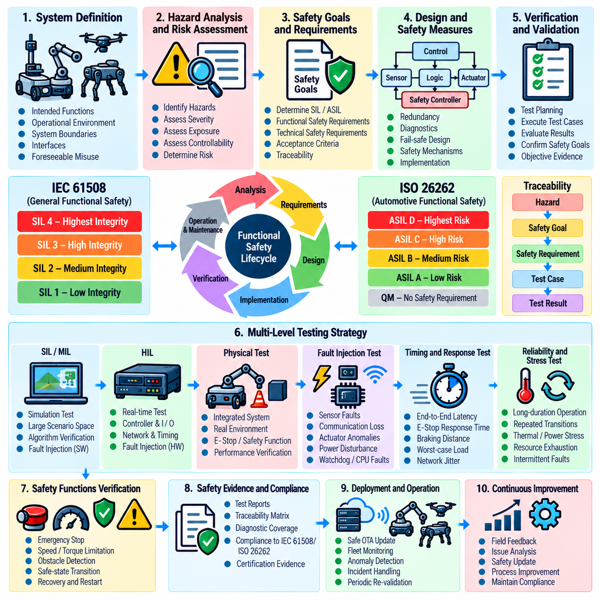{width="7.268055555555556in" height="7.268055555555556in"}

로봇 시스템의 안전 시험 전략(Safety Testing Strategy)은 기능 안전(Functional Safety)을 최종 단계의 검사로 취급하는 것이 아니라 전체 수명주기(Lifecycle)에 걸친 활동으로 다루는 것에서 시작한다. IEC 61508은 안전 관련 전기·전자·프로그램 가능 전자 시스템(Safety-related Electrical, Electronic and Programmable Electronic Systems)을 위한 일반적인 프레임워크를 제공하며, ISO 26262는 이와 유사한 수명주기 원칙을 도로 차량(Road Vehicles)에 적용한다. 로봇 분야에서 이러한 프레임워크는 위험원(Hazard), 안전 요구사항(Safety Requirements), 구현 제어(Implementation Controls), 검증 활동(Verification Activities), 객관적 증거(Objective Evidence)를 개발 전 과정에서 연결하는 체계적인 방법을 제공한다.

안전 전략은 시스템 경계(System Boundaries), 의도된 기능(Intended Functions), 운영 환경(Operating Environments), 합리적으로 예측 가능한 오용(Foreseeable Misuse), 인터페이스(Interfaces), 안전 관련 가정(Safety-related Assumptions)을 정의하는 것에서 시작해야 한다. 위험원 분석(Hazard Analysis)은 고장이 부상, 장비 손상 또는 제어된 운전 상태의 상실을 초래할 수 있는 상황을 식별한다. 이후 위험 평가(Risk Assessment)를 통해 필요한 위험 감소 수준을 결정한다. 안전 목표(Safety Goals)는 측정 가능한 요구사항으로 변환되어야 하며, 이를 통해 각각의 보호 기능을 분석, 시뮬레이션(Simulation), 하드웨어 시험(Hardware Testing), 시스템 수준 시험(System-level Testing)을 통해 검증할 수 있다.

IEC 61508은 일반적으로 SIL 1부터 SIL 4까지 표현되는 안전 무결성 수준(Safety Integrity Level, SIL)을 중심으로 기능 안전을 구성한다. 요구되는 무결성 수준은 아키텍처 제약(Architectural Constraints), 체계적 개발 방법(Systematic Development Practices), 진단 커버리지(Diagnostic Coverage), 검증 엄격성(Verification Rigor), 증거 요구사항(Evidence Expectations)에 영향을 준다. 따라서 로봇 안전 프로그램은 SIL을 단순한 수치적 신뢰성 목표로 취급해서는 안 된다. 시험에서는 무작위 하드웨어 고장(Random Hardware Failures)에 대한 내성과 요구사항, 설계, 소프트웨어, 통합 또는 유지보수 과정에서 발생하는 체계적 결함(Systematic Faults)에 대한 충분한 통제가 모두 입증되어야 한다.

ISO 26262는 위험 사건(Hazardous Events)을 심각도(Severity), 노출도(Exposure), 제어 가능성(Controllability) 등의 요소에 따라 분석하고 자동차 안전 무결성 수준(Automotive Safety Integrity Level, ASIL)을 결정하는 위험 기반 자동차 프레임워크(Risk-oriented Automotive Framework)를 사용한다. ASIL 분류를 IEC 61508의 SIL 분류로 직접 대체해서는 안 되지만, 그 기반이 되는 엔지니어링 원칙은 이동형 및 자율 로봇 플랫폼(Mobile and Autonomous Robotic Platforms)에 유용하다. 안전 목표, 기능 안전 요구사항(Functional Safety Requirements), 기술 안전 요구사항(Technical Safety Requirements), 검증 조치(Verification Measures), 확인 활동(Confirmation Activities)은 전체 개발 수명주기에서 추적 가능성을 유지해야 한다.

실용적인 로봇 안전 시험 아키텍처(Robot Safety Test Architecture)는 위험원에서 안전 요구사항으로, 다시 요구사항에서 실행 가능한 시험 사례(Executable Test Cases)로 이어지는 양방향 추적성(Bidirectional Traceability)을 유지해야 한다. 각 안전 요구사항에는 검증 방법(Verification Method), 예상 응답(Expected Response), 합격 기준(Acceptance Criteria), 필요한 계측 장비(Instrumentation), 환경 조건(Environmental Conditions), 증거 형식(Evidence Format)이 정의되어야 한다. 따라서 비상 정지(Emergency Stop), 토크 제한(Torque Limitation), 속도 제한(Speed Limitation), 장애물 감지(Obstacle Detection), 통신 감시(Communication Supervision), 액추에이터 정지(Actuator Shutdown), 성능 저하 운전(Degraded Operation)과 관련된 요구사항은 비공식적인 시연이 아니라 명확하고 반복 가능한 검증 대상으로 전환된다.

모든 관련 안전 고장을 하나의 환경에서 노출할 수 없기 때문에 시험은 여러 추상화 수준(Abstraction Levels)에 걸쳐 분산되어야 한다. 모델 인 더 루프(Model-in-the-Loop, MiL)와 소프트웨어 인 더 루프(Software-in-the-Loop, SiL) 시험은 대규모 시나리오 공간을 효율적으로 탐색할 수 있으며, 하드웨어 인 더 루프(Hardware-in-the-Loop, HIL) 시험은 현실적인 조건에서 타이밍(Timing), 통신(Communication), 제어기 동작(Controller Behavior), 하드웨어 인터페이스(Hardware Interfaces)를 검증한다. 이후 실제 시스템 시험(Physical System Tests)을 통해 통합된 센서, 컴퓨터, 네트워크, 드라이브, 브레이크, 액추에이터 및 기계 구조가 대표적인 운전 조건에서 요구되는 안전 응답을 생성하는지 확인한다.

결함 주입(Fault Injection)은 많은 안전 메커니즘(Safety Mechanisms)이 정상 운전 중에는 활성화되지 않기 때문에 특히 중요하다. 시험에서는 센서 손실(Sensor Loss), 손상된 측정값(Corrupted Measurements), 통신 지연(Communication Delays), 네트워크 단절(Network Interruption), 프로세서 고장(Processor Faults), 액추에이터 이상(Actuator Anomalies), 전원 교란(Power Disturbances), 감시 타이머 만료(Watchdog Expiration), 불일치 상태 정보(Inconsistent State Information)를 의도적으로 발생시켜야 한다. 목적은 단순히 로봇이 오류를 보고하는지 확인하는 것이 아니라 결함 감지 지연(Fault Detection Latency), 진단 커버리지, 전이 동작(Transition Behavior), 결함 격리(Containment), 안전 상태 도달(Safe-state Achievement), 복구 로직(Recovery Logic), 위험한 비의도적 움직임 방지 여부를 검증하는 것이다.

보호 기능이 신속한 반응에 의존하는 경우 타이밍(Timing)은 안전 속성(Safety Property)으로 다루어야 한다. 예를 들어 비상 정지 체인(Emergency-stop Chain)은 안전 사건의 시작부터 감지, 통신, 제어기 응답, 드라이브 반응, 토크 제거(Torque Removal), 최종 기계적 정지(Mechanical Stopping)에 이르는 전체 과정에 대해 평가해야 한다. 소프트웨어 콜백 지연시간(Software Callback Latency)만 측정하는 것으로는 충분하지 않다. 합격 기준은 전체 종단 간 응답(End-to-end Response)을 다루어야 하며, 최악 조건의 계산 부하, 네트워크 지터(Network Jitter), 액추에이터 동역학(Actuator Dynamics), 적재 하중(Payload), 속도, 노면 조건, 제동 성능(Braking Performance)을 고려해야 한다.

안전 시험에서는 예방(Prevention), 감지(Detection), 완화(Mitigation), 복구(Recovery) 메커니즘을 구분해야 한다. 중복 센싱(Redundant Sensing)은 단일 센서 고장이 위험한 동작으로 이어지는 것을 방지할 수 있으며, 타당성 검사(Plausibility Checking)는 채널 간 불일치를 감지할 수 있다. 안전 제어기(Safety Controller)는 속도를 제한하거나 토크를 비활성화하여 위험을 완화할 수 있고, 이후 제어된 복구 절차(Controlled Recovery Procedures)를 통해 운전을 복원할 수 있다. 시험 사례는 이러한 계층을 독립적으로 검증하는 동시에 여러 보호 메커니즘이 상호작용하거나 순차적으로 실패하는 상황까지 검증해야 한다.

신뢰성 증거(Reliability Evidence)는 구성요소와 하위 시스템이 의도된 임무 프로파일(Mission Profile)에서 일관되게 동작하는지를 확인함으로써 기능 안전을 지원한다. 고장률 가정(Failure-rate Assumptions), 진단 메커니즘, 중복 아키텍처(Redundancy Architectures), 감시 타이머(Watchdogs), 통신 감시, 메모리 보호(Memory Protection), 전원 모니터링(Power Monitoring), 열 보호(Thermal Protection)는 대표적인 작업 부하에서 시험되어야 한다. 장시간 운전(Long-duration Operation)과 반복적인 상태 전이 시험은 짧은 정상 시험에서는 발견하기 어려운 간헐적 고장, 자원 고갈(Resource Exhaustion), 열적 열화(Thermal Degradation), 타이밍 드리프트(Timing Drift), 커넥터 문제, 비정상적인 소프트웨어 상태를 발견하는 데 도움이 된다.

소프트웨어 안전 검증(Software Safety Verification)은 단순한 기능적 정확성(Functional Correctness) 이상의 범위를 다루어야 한다. 시험 전략은 요구사항 커버리지(Requirements Coverage), 인터페이스 동작, 방어적 프로그래밍(Defensive Programming), 수치적 한계(Numerical Limits), 동시성(Concurrency), 스케줄링(Scheduling), 메모리 처리, 상태 머신 전이(State-machine Transitions), 초기화(Initialization), 종료(Shutdown), 재시작(Restart), 결함 복구(Fault Recovery)를 포함해야 한다. 정적 분석(Static Analysis), 단위 시험(Unit Testing), 통합 시험(Integration Testing), 구조적 커버리지(Structural Coverage), 강건성 시험(Robustness Testing), 시스템 시험은 상호 보완적인 증거를 제공한다. 안전 중요도(Safety Criticality)가 높아질수록 일반적으로 더 강력한 독립성, 추적성, 검토 규율 및 검증 엄격성이 요구된다.

자율 및 인공지능 기반 로봇(Autonomous and AI-enabled Robots)은 인지(Perception)와 학습 정책(Learned Policies)이 훈련 분포(Training Distribution)를 벗어난 상황에서 다르게 동작할 수 있기 때문에 추가적인 불확실성을 발생시킨다. 따라서 가능한 경우 기존 기능 안전 메커니즘은 확률적 구성요소(Probabilistic Components)를 둘러싸는 결정론적 안전 경계(Deterministic Safety Envelopes)를 설정해야 한다. 시험에서는 낮은 신뢰도의 인지 결과, 상충하는 센서 정보, 예상하지 못한 객체, 저하된 가시성, 비정상적인 형상, 위치 추정 불확실성(Localization Uncertainty), 안전하지 않은 AI 명령을 검토해야 한다. 독립적인 감시 장치(Independent Monitors)는 AI 동작이 기존의 움직임, 작업 공간, 힘, 속도 또는 정지 제약조건을 우회할 수 없도록 검증해야 한다.

형상 관리(Configuration Control)는 안전 증거가 특정 시스템 구성과 연결되어 있을 때에만 의미가 있기 때문에 필수적이다. 모든 안전 시험 결과는 소프트웨어 버전, 모델 버전, 펌웨어(Firmware), 보정 데이터(Calibration Data), 하드웨어 개정판(Hardware Revisions), 안전 파라미터(Safety Parameters), 시험 장비, 환경 조건, 요구사항 기준선(Requirement Baselines)과 연결되어야 한다. 안전 관련 구성요소가 변경되면 영향 분석(Impact Analysis)을 수행하여 영향을 받는 시험을 회귀 시험(Regression Testing) 대상으로 선정해야 하며, 변경 이후에도 기존에 수집된 증거가 자동으로 유효하다고 가정해서는 안 된다.

최종적인 전략은 서로 분리된 시험 보고서의 집합이 아니라 감사 가능한 안전 사례(Auditable Safety Case)를 생성해야 한다. 위험원 기록(Hazard Records), 안전 요구사항, 아키텍처 결정(Architecture Decisions), 검증 결과, 결함 주입 증거, 커버리지 측정값(Coverage Measurements), 이상 보고서(Anomaly Reports), 시정 조치(Corrective Actions), 잔여 위험 평가(Residual-risk Assessments)는 추적 가능한 증거 사슬(Traceable Evidence Chain)을 형성해야 한다. 이러한 기반은 이후의 안전 기능 시험 절차, 결함 주입, 신뢰성 평가, 기능 안전 체크리스트, 안전 무결성 수준 달성 증거 및 자동화된 안전 회귀 시험(Automated Safety Regression Testing)으로 확장될 수 있다.

## 07.02. Safety Function Test Procedure STO SLS SS1 [w/Code]

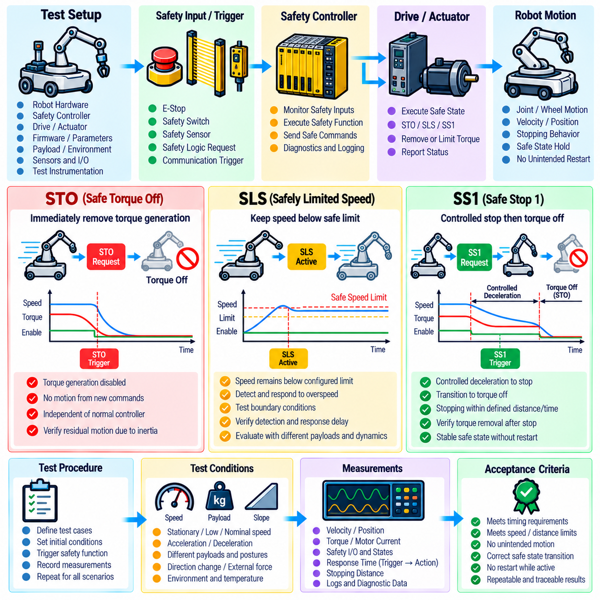{width="7.268055555555556in" height="7.268055555555556in"}

안전 토크 차단(Safe Torque Off, STO), 안전 제한 속도(Safely Limited Speed, SLS), 안전 정지 1(Safe Stop 1, SS1)에 대한 안전 기능 시험 절차(Safety Function Test Procedure)는 로봇이 사전에 정의된 안전 요구사항(Safety Requirements)에 따라 위험한 움직임을 방지하거나 종료할 수 있는지를 검증한다. 이러한 기능은 센서, 안전 제어기(Safety Controller), 통신 인터페이스, 서보 드라이브(Servo Drive), 액추에이터, 브레이크, 기계적 운동부를 포함하는 통합 안전 체인(Integrated Safety Chain)의 일부로 시험해야 한다. 각 시험에서는 초기 조건, 작동 조건, 예상 상태 전이, 시간 제한, 합격 기준, 기록해야 할 증거를 정의해야 한다.

기능 시험을 시작하기 전에 시험 구성(Test Configuration)을 통제하고 문서화해야 한다. 로봇 하드웨어 개정판, 안전 제어기 펌웨어(Safety Controller Firmware), 드라이브 펌웨어, 안전 파라미터(Safety Parameters), 소프트웨어 버전, 적재 하중(Payload), 배터리 또는 전원 상태, 통신 구성, 보정 상태(Calibration State)를 기록해야 한다. 안전 입력과 출력은 물리적·논리적 채널에 매핑하여 측정된 응답을 평가 대상인 정확한 안전 경로(Safety Path)와 연결할 수 있어야 한다. 시험 계측 장비(Test Instrumentation)는 응답 시간 분석에 충분한 샘플링 속도와 타임스탬프 정확도를 갖추어야 한다.

안전 토크 차단(STO) 시험은 안전 기능이 요구될 때 위험한 토크를 발생시키는 에너지가 모터에 전달되지 않도록 차단되는지를 검증한다. 로봇은 먼저 정지 활성 상태, 저속 이동, 정상 속도 이동, 가속, 감속, 부하 운전 등 대표적인 운전 상태에 배치해야 한다. 이후 STO 요청을 활성화하면서 모터 명령, 드라이브 상태, 휠 또는 관절 속도, 전류, 토크 관련 신호, 안전 제어기 상태를 기록한다. 기대되는 결과는 의도하지 않은 재시작 없이 토크 생성 능력이 제거되는 것이다.

STO 시험에서는 명령에 의한 제로 토크(Commanded Zero Torque)와 실제 안전 관련 토크 차단(Safety-related Torque Inhibition)을 구분해야 한다. 속도 명령이 0이 되는 것을 관찰하는 것만으로는 STO 동작을 입증할 수 없다. 정상 모션 제어기(Normal Motion Controller)가 여전히 드라이브 제어 권한을 유지할 수 있기 때문이다. 안전 경로가 일반적인 모션 명령과 독립적으로 드라이브를 정의된 토크 차단 상태로 강제한다는 증거를 확보해야 한다. STO가 활성화된 동안 새로운 속도, 위치 또는 토크 명령을 입력하더라도 액추에이터 토크가 복구되거나 위험한 움직임이 시작되어서는 안 된다.

STO 응답 시험은 토크 제거에 따른 물리적 결과도 평가해야 한다. STO 자체가 반드시 제어된 감속(Controlled Deceleration)을 제공하는 것은 아니므로 이동 로봇, 매니퓰레이터, 휴머노이드 관절 또는 기타 기구는 관성, 중력, 외력 또는 저장된 기계적 에너지로 인해 계속 움직일 수 있다. 따라서 시험에서는 대표적인 속도, 적재 하중, 경사, 자세, 부하 조건에서 잔류 운동(Residual Motion)과 정지 거동(Stopping Behavior)을 측정해야 한다. 기계식 브레이크 또는 추가적인 정지 기능이 필요한 경우 STO와의 상호작용도 별도로 검증해야 한다.

안전 제한 속도(SLS) 시험은 해당 기능이 활성화된 동안 로봇의 움직임이 지정된 안전 관련 속도 제한(Safety-related Speed Limit) 이하로 유지되는지를 검증한다. 절차에서는 설정된 안전 속도 임계값(Safe-speed Threshold)을 확립하고 실제 속도를 독립적으로 측정하는 방법을 결정해야 한다. 시험은 제한값 이하의 운전, 임계값 접근, 임계값을 초과하는 의도적 명령, 급가속, 방향 전환, 다양한 적재 하중, 현실적인 제어 교란(Control Disturbances)을 포함해야 한다. 감시되는 속도와 안전 시스템 응답은 동기화된 측정값을 사용하여 함께 기록해야 한다.

SLS의 핵심 판정 기준은 정상 제어기가 단순히 속도 제한을 준수하려고 하는지가 아니라 안전 메커니즘(Safety Mechanism)이 규정된 안전 동작에 따라 과속을 감지하고 대응하는지 여부이다. 시험에서는 허용된 임계값을 초과하는 움직임을 의도적으로 명령하고 위반이 감지되는지를 검증해야 한다. 측정을 통해 최대 관측 속도(Maximum Observed Speed), 감지 지연(Detection Delay), 응답 지연(Response Delay), 과속 상태 지속 시간, 제한된 움직임 또는 다른 정의된 안전 상태(Safe State)로의 전이를 확인해야 한다.

경계 시험(Boundary Testing)은 필터링, 양자화(Quantization), 엔코더 해상도, 샘플링 간격, 통신 지연, 속도 추정 알고리즘이 임계값 감지에 영향을 줄 수 있기 때문에 SLS에서 특히 중요하다. 반복 시험에서는 설정된 제한값보다 약간 낮은 값, 제한값과 동일한 값, 제한값보다 약간 높은 값을 시험해야 한다. 또한 경계를 통과하는 가속도를 변화시켜 느린 임계값 통과와 급격한 과속 상황을 모두 평가해야 한다. 합격 기준은 로봇 속도를 육안으로 관찰하는 방식이 아니라 명확하게 정의된 허용오차(Tolerance)를 기준으로 설정해야 한다.

안전 정지 1(SS1) 시험은 제어된 정지 시퀀스(Controlled Stopping Sequence)를 수행한 후 안전 토크 차단 상태가 활성화되는지를 검증한다. 즉각적으로 STO를 활성화하는 것과 달리 SS1은 토크 생성 능력을 제거하기 전에 드라이브 또는 모션 제어기가 제어된 감속을 수행할 수 있도록 한다. 따라서 시험에서는 최초 안전 요청부터 감속, 정지, 토크 차단으로의 전이, 최종 정지 상태까지 전체 시퀀스를 평가해야 한다. 위치, 속도, 가속도, 드라이브 상태, 안전 상태, 브레이크 상태, 관련 명령 신호를 전체 과정에서 기록해야 한다.

SS1 절차는 대표적인 속도, 적재 하중, 이동 방향, 경사, 매니퓰레이터 구성, 운전 모드의 조합에서 수행해야 한다. 로봇이 움직이는 동안 안전 요청을 발생시키고 측정된 궤적(Measured Trajectory)을 예상 감속 동작과 비교한다. 시험에서는 정지가 제어된 상태로 유지되는지, 로봇이 허용된 운동 경계(Motion Boundaries)를 초과하는지, 정확한 단계에서 토크가 제거되는지, 정지 시퀀스가 완료된 이후에도 최종 안전 상태가 안정적으로 유지되는지를 확인해야 한다.

시간 검증(Timing Verification)은 세 가지 안전 기능 모두에서 필수적이다. 측정에서는 안전 입력 활성화부터 안전 제어기의 인식까지 걸리는 시간, 드라이브까지의 통신 지연, 드라이브 반응 시간, 감속 또는 토크 차단이 시작되는 시점, 최종 안전 상태에 도달하는 데 필요한 시간을 식별해야 한다. SS1의 경우 제어된 정지 구간(Controlled-stop Interval)과 이후의 STO 전이를 별도로 평가해야 한다. 단 한 번의 성공적인 응답을 합격으로 인정하기보다는 반복 측정을 통해 최악 조건 동작(Worst-case Behavior)을 식별해야 한다.

정상 상태 시험만으로는 안전 체인의 구성요소가 고장났을 때의 동작을 입증할 수 없기 때문에 결함 주입(Fault Injection)을 STO, SLS, SS1 시험에 포함해야 한다. 대표적인 시험 사례에는 중복 안전 채널(Redundant Safety Channel) 중 하나의 손실, 엔코더 불일치, 통신 단절, 오래된 속도 정보(Stale Velocity Information), 안전 제어기 재시작, 드라이브 통신 고장, 명령된 움직임과 측정된 움직임 사이의 불일치가 포함된다. 시험 전에 예상되는 반응을 정의하여 각각의 주입된 결함을 결정론적인 합격·불합격 기준(Deterministic Pass/Fail Criterion)에 따라 평가할 수 있어야 한다.

리셋 및 재시작 동작(Reset and Restart Behavior)은 안전 기능의 활성화와 동일한 수준으로 중요하게 다루어야 한다. STO 또는 SS1에서 STO로 전환된 상태 이후에 안전 기능을 발생시킨 조건을 제거하더라도 예기치 않은 움직임이 자동으로 발생해서는 안 된다. 시험에서는 필요한 리셋 시퀀스, 승인 로직(Acknowledgement Logic), 드라이브 재활성화, 브레이크 해제, 명령 검증(Command Validation), 정상 운전 제어로의 복귀를 검증해야 한다. SLS에서도 마찬가지로 시스템이 속도 제한 운전에서 어떻게 해제되는지, 그리고 지정된 모든 안전 조건이 충족된 경우에만 제한 없는 움직임을 재개할 수 있는지를 확인해야 한다.

회귀 시험(Regression Testing)은 안전 관련 소프트웨어, 펌웨어, 드라이브 파라미터, 제어기 구성, 하드웨어 인터페이스 또는 모션 제어 로직이 변경될 때마다 핵심 STO, SLS, SS1 시나리오를 반복해야 한다. 자동화된 데이터 수집(Automated Acquisition)을 통해 응답 시간, 정지 거리, 최대 속도, 안전 상태 전이, 결함 반응을 승인된 기준선(Approved Baselines)과 비교할 수 있다. 이를 통해 개별적인 안전 시연을 재현 가능한 검증 절차(Reproducible Verification Procedures)로 전환하고, 이후의 결함 주입, 기능 안전 검증, 무결성 수준 증거(Integrity-level Evidence), 자동화된 안전 회귀 시험(Automated Safety Regression Testing)으로 확장할 수 있다.

## 07.03. E Stop Response Time Test Automation [w/Code]

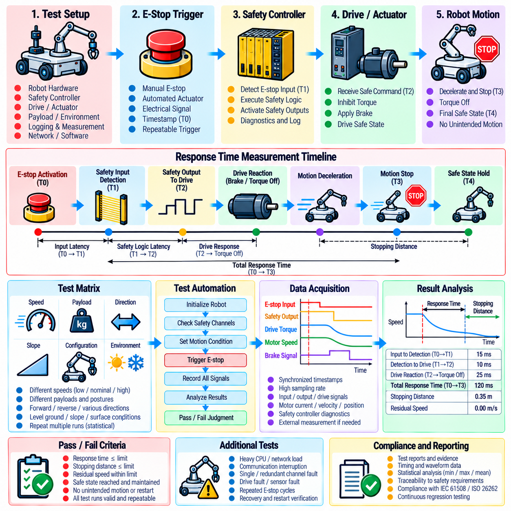{width="7.268055555555556in" height="7.268055555555556in"}

비상 정지 응답 시간 시험 자동화(Emergency-stop Response-time Test Automation)는 로봇이 비상 정지 요청(Emergency-stop Request)을 받은 시점부터 요구되는 안전 상태(Safe Condition)에 도달할 때까지 얼마나 신속하게 전이하는지를 반복 가능한 방식으로 측정하는 방법을 확립한다. 시험에서는 소프트웨어 실행 시간만이 아니라 전체 안전 체인(Safety Chain)을 평가해야 한다. 주요 단계에는 물리적 비상 정지(E-stop) 작동, 안전 입력 감지, 안전 제어기(Safety Controller) 처리, 드라이브 통신, 제동 또는 토크 제거, 최종적인 위험 운동의 정지가 포함된다.

자동화된 절차는 통제된 시험 구성(Test Configuration)에서 시작한다. 로봇 하드웨어, 안전 제어기 펌웨어(Safety-controller Firmware), 드라이브 펌웨어, 모션 소프트웨어(Motion Software), 안전 파라미터(Safety Parameters), 적재 하중(Payload), 배터리 또는 전원 상태, 브레이크 구성, 네트워크 설정을 시험 실행 전에 기록해야 한다. 측정 장치는 동기화된 타임스탬프(Synchronized Timestamps)를 사용하여 안전 체인의 서로 다른 지점에서 관측된 사건을 정확하게 재구성하고 반복 시험 간에 비교할 수 있도록 해야 한다.

응답 시간 측정(Response-time Measurement)에서는 공통 사건 타임라인(Common Event Timeline)을 정의해야 한다. 최초 기준 사건은 비상 정지 입력이 정상 상태에서 요구 상태로 전환되는 시점이다. 이후 타임스탬프를 통해 안전 제어기의 인식, 안전 출력 전환, 드라이브 반응, 감속 시작, 토크 차단(Torque Inhibition), 필요한 경우 브레이크 작동, 최종 운동 정지 시점을 식별한다. 이러한 타임스탬프를 이용하면 구성요소 수준의 지연시간(Component-level Latency)과 전체 종단 간 응답 시간(End-to-end Response Time)을 자동으로 계산할 수 있다.

계측 시스템(Instrumentation)은 요구되는 시간 해상도(Timing Resolution)에 적합한 샘플링 속도로 신호를 수집해야 한다. 안전 입력 및 출력 상태, 드라이브 상태 워드(Drive Status Words), 모터 전류, 토크 관련 값, 휠 또는 관절 속도, 명령 속도, 엔코더 데이터, 브레이크 신호, 안전 제어기 진단 정보를 동시에 기록할 수 있다. 소프트웨어 로그만으로 독립적인 시간 측정 증거를 제공할 수 없는 경우 외부 측정 장비를 사용하여 물리적 입력 작동과 실제 기계적 운동에 대한 객관적인 기준(Objective Reference)을 확립해야 한다.

자동화 시스템은 통제된 초기 조건에서 동일한 비상 정지 시나리오(E-stop Scenario)를 반복 실행해야 한다. 각 실행에서는 로봇을 초기화하고, 필요한 안전 채널이 정상인지 확인하고, 선택된 운동 조건을 명령하며, 사전에 정의된 정상 상태 기준(Steady-state Criteria)이 충족될 때까지 대기한 후 비상 정지 사건을 발생시키거나 감지한다. 이후 응답을 기록하고 최종 안전 상태에 도달했는지를 판정한다. 불완전한 초기화나 계측 실패로 발생한 무효 실행(Invalid Runs)은 성공한 시험으로 계산하지 않고 별도로 식별해야 한다.

시험 매트릭스(Test Matrix)는 정지 성능에 영향을 줄 수 있는 운전 조건을 대표해야 한다. 측정에는 서로 다른 명령 속도, 적재 하중, 이동 방향, 액추에이터 구성, 배터리 또는 전원 조건과 필요한 경우 대표적인 노면 조건이 포함되어야 한다. 매니퓰레이터 또는 휴머노이드 시스템에서는 관절 구성(Joint Configuration)과 중력 부하(Gravitational Loading)가 정지 동작에 상당한 영향을 미칠 수 있다. 이동 로봇에서는 차량 질량, 휠 접지력(Wheel Traction), 경사, 이동 방향도 정지 거리에 영향을 줄 수 있으므로 추가적으로 고려해야 한다.

응답 시간(Response Time)과 정지 거리(Stopping Distance)는 서로 연관되어 있지만 구분되는 안전 지표(Safety Metrics)로 다루어야 한다. 짧은 전자적 반응 시간(Electronic Reaction Time)이 반드시 짧은 물리적 정지 거리를 보장하는 것은 아니다. 기계적 감속은 속도, 질량, 제동 능력, 접지력, 액추에이터 동역학(Actuator Dynamics), 환경 조건에 따라 달라지기 때문이다. 따라서 자동화된 분석에서는 비상 정지 작동부터 안전 동작 시작까지의 시간, 운동이 완전히 정지할 때까지의 총시간, 정지 과정에서 이동한 거리 또는 각 변위(Angular Displacement)를 각각 계산해야 한다.

합격 및 불합격 기준(Pass and Fail Criteria)은 일반적인 시험 결과와의 비교가 아니라 정의된 안전 요구사항(Safety Requirements)에서 도출되어야 한다. 자동화 프레임워크(Automation Framework)는 측정값을 최대 허용 응답 시간, 정지 시간, 정지 거리, 잔류 속도(Residual Velocity), 적용 가능한 상태 전이 요구사항과 비교해야 한다. 안전 제한값을 하나라도 초과하거나 요구되는 안전 상태에 도달하지 못하거나 기록된 증거가 불충분하여 준수 여부를 객관적으로 입증할 수 없는 경우 해당 실행은 불합격으로 판정해야 한다.

응답 시간은 스케줄링(Scheduling), 통신 지터(Communication Jitter), 제어기 부하, 네트워크 트래픽, 센서 샘플링, 드라이브 주기 타이밍(Drive-cycle Timing), 기타 비동기 프로세스에 따라 달라질 수 있으므로 통계적 반복(Statistical Repetition)이 필요하다. 자동화된 시험은 평균값 하나만 보고하는 것이 아니라 변동성을 확인할 수 있을 정도로 충분히 반복되어야 한다. 최소값, 최대값, 평균값, 백분위수(Percentile), 분산 관련 통계(Dispersion Statistics)를 통해 관측된 동작을 특성화할 수 있으며, 안전 시간 제한 준수 여부를 평가할 때에는 측정된 최악 결과(Worst Measured Result)를 특히 중요하게 검토해야 한다.

로봇이 계산적으로 또는 운용적으로 높은 부하를 받는 상황에서도 비상 정지 성능이 허용 범위 내에 유지되는지를 확인하기 위해 스트레스 조건(Stress Conditions)을 적용해야 한다. 인지 파이프라인(Perception Pipelines), 로깅, 네트워킹, 내비게이션, AI 추론(AI Inference) 또는 기타 비안전 작업 부하가 활성화된 상태에서 시스템을 시험할 수 있다. 애플리케이션 작업 부하 증가로 인해 감지, 통신, 드라이브 반응 또는 물리적 정지에 허용할 수 없는 지연이 발생하지 않도록 안전 관련 실행은 충분히 격리되고 결정론적(Deterministic)이어야 한다.

결함 지향 시험(Fault-oriented Testing)은 자동화 범위를 정상적인 비상 정지 작동 이상으로 확장한다. 시험에서는 비상 정지 요청 이전에 통신 단절, 메시지 지연, 중복 채널(Redundant Channel) 중 하나의 손실, 드라이브 고장, 안전 제어기 진단 이벤트, 엔코더 불일치 또는 비정상적인 애플리케이션 동작을 발생시킬 수 있다. 목적은 시스템의 다른 영역에서 발생한 고장이 비상 정지 경로(Emergency-stop Path)가 요구되는 응답 범위(Response Envelope) 내에서 지정된 안전 상태에 도달하는 것을 방해하지 않는지 검증하는 것이다.

절차에서는 운동이 정지한 이후의 동작도 검증해야 한다. 비상 정지 상태가 유지되는 동안에는 정상적인 모션 명령이 계속 전송되더라도 의도하지 않은 재시작(Unintended Restart)이 발생하지 않아야 한다. 물리적 비상 정지 장치를 해제하는 것만으로 움직임이 시작되어서도 안 된다. 수동 리셋(Manual Reset) 또는 승인(Acknowledgement)이 필요한 경우 자동화 시스템은 규정된 리셋 시퀀스가 완료될 때까지 로봇이 비활성 상태를 유지하고 모든 안전 조건이 정상 상태로 복귀한 이후에만 다시 활성화되는지를 확인해야 한다.

자동화된 분석(Automated Analysis)은 모든 시험 실행에 대해 추적 가능한 증거(Traceable Evidence)를 생성해야 한다. 각 결과에는 시험 사례 식별자(Test-case Identifier), 요구사항 참조, 시스템 구성, 타임스탬프가 포함된 신호 데이터, 계산된 응답 시간 구간, 정지 거리, 허용 기준, 합격·불합격 결과, 감지된 이상 사항을 보존해야 한다. 실패 결과를 재구성하고 독립적으로 검토할 수 있도록 요약된 시험 보고서뿐만 아니라 원시 데이터(Raw Data)도 유지해야 한다.

지속적 통합(Continuous Integration, CI) 및 하드웨어 인 더 루프(Hardware-in-the-Loop, HIL) 환경과의 통합을 통해 비상 정지 시험을 일회성 적격성 평가(Qualification Activity)가 아니라 안전 회귀 시험(Safety Regression Testing)의 일부로 전환할 수 있다. 안전 소프트웨어, 드라이브 펌웨어, 통신 구성, 제동 파라미터, 모션 제어 로직 또는 관련 하드웨어가 변경되면 선택된 응답 시간 시험을 자동으로 실행할 수 있다. 이후 결과를 승인된 기준선(Approved Baselines)과 비교하여 변경된 구성이 현장 운용에 배포되기 전에 시간 성능 저하(Timing Degradation)를 탐지할 수 있다.

성숙한 비상 정지 자동화 프레임워크(E-stop Automation Framework)는 궁극적으로 비상 정지가 결정론적이고 반복 가능하며 측정 가능하고 시스템 변동(System Variation)에 견고하다는 증거를 제공한다. 목적은 단순히 비상 정지 장치를 누르면 로봇이 결국 멈춘다는 것을 보여주는 것이 아니라, 전체 물리 시스템이 관련된 운전 상태 전반에서 지정된 제한 시간 내에 정의된 안전 상태에 도달한다는 것을 입증하는 것이다. 이러한 증거는 안전 토크 차단(STO), 안전 제한 속도(SLS), 안전 정지 1(SS1), 결함 주입(Fault Injection), 신뢰성(Reliability), 기능 안전 검증(Functional-safety Verification) 활동을 보완한다.

## 07.04. Fault Injection Test HW SW Sensor Actuator [w/Code]

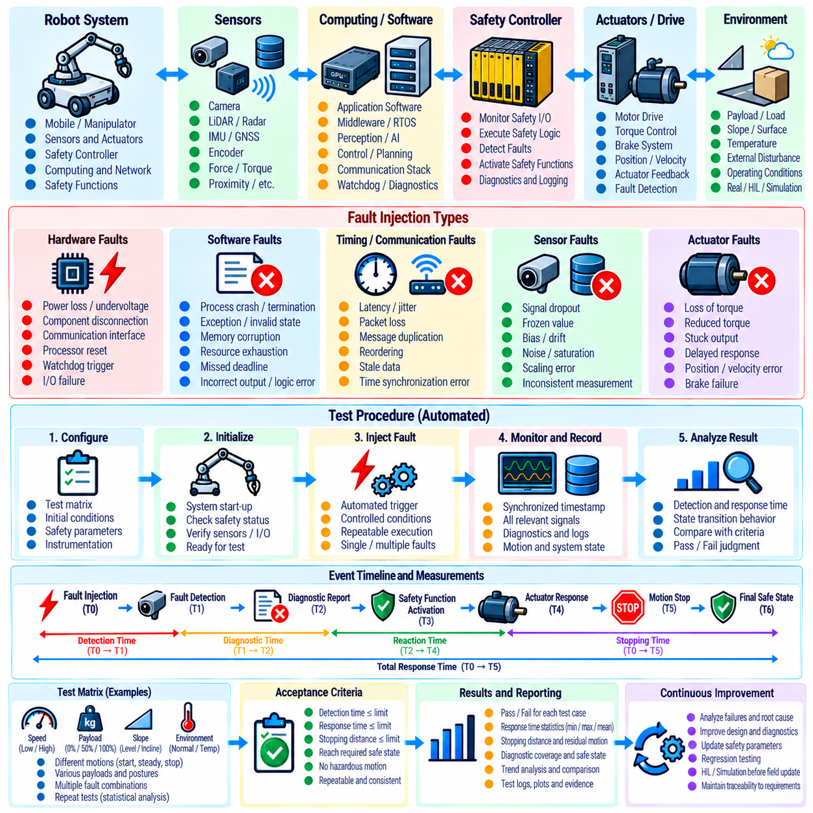{width="7.268055555555556in" height="7.268055555555556in"}

결함 주입 시험(Fault Injection Testing)은 하드웨어, 소프트웨어, 센서, 액추에이터 및 통신 경로에서 발생할 수 있는 고장을 로봇 시스템이 감지하고 격리하며 안전하게 대응할 수 있는지를 평가한다. 정상 기능 시험(Nominal Functional Testing)과 달리 비정상 조건을 의도적으로 발생시키고 안전 메커니즘(Safety Mechanisms)이 규정된 방식으로 동작하는지를 관찰하는 것이 목적이다. 절차에서는 각각의 주입된 결함을 정의된 고장 가설(Failure Hypothesis), 예상 진단 응답, 요구되는 안전 상태(Safe State), 시간 제약, 객관적인 합격·불합격 기준과 연결해야 한다.

결함 주입 시험 캠페인(Fault Injection Campaign)은 시스템 아키텍처, 위험원 분석(Hazard Analysis), 고장 형태 및 영향 분석(Failure Mode and Effects Analysis, FMEA), 안전 요구사항, 알려진 구성요소 고장 형태에서 도출된 구조화된 결함 모델(Fault Model)로 시작해야 한다. 결함은 발생 원인, 지속 시간, 관측 가능성, 잠재적 안전 영향에 따라 분류해야 한다. 영구적, 일시적, 간헐적, 단일 지점 및 복합 결함은 서로 다른 시험 방법을 요구할 수 있다. 선정된 결함은 시스템 위험과 관련이 없는 임의의 교란이 아니라 실제 발생 가능한 신뢰성 있는 고장을 대표해야 한다.

하드웨어 결함 주입(Hardware Fault Injection)은 컴퓨팅 모듈, 전원 시스템, 통신 인터페이스, 안전 제어기(Safety Controller), 드라이브, 배선 및 지원 전자장치에서 발생하는 고장을 검사한다. 대표적인 시험에서는 전원 차단, 저전압, 통신 손실, 채널 단절, 인터페이스 손상, 프로세서 재설정, 감시 타이머 이벤트(Watchdog Events), 주변장치 사용 불가 상태 등을 발생시킬 수 있다. 결함 주입 장비는 통제되지 않은 물리적 위험을 발생시키지 않아야 하며, 측정을 통해 시스템이 결함을 감지하고 요구되는 성능 저하 상태(Degraded State) 또는 안전 상태로 전이하는지를 확인해야 한다.

소프트웨어 결함 주입(Software Fault Injection)은 물리적인 하드웨어 조작으로 재현하기 어려운 비정상적인 내부 상태를 대상으로 한다. 시험에서는 프로세스 종료, 실행 지연, 마감시간 누락(Missed Deadlines), 잘못된 상태 전이, 손상된 메시지, 자원 고갈(Resource Exhaustion), 서비스 사용 불가, 예상하지 못한 반환값 등을 모사할 수 있다. 목적은 감시 메커니즘(Supervision Mechanisms), 예외 처리(Exception Handling), 감시 타이머(Watchdogs), 수명주기 관리(Lifecycle Management), 복구 로직이 국부적인 소프트웨어 고장이 위험한 로봇 동작으로 확산되는 것을 방지하는지 검증하는 것이다.

분산 로봇 소프트웨어(Distributed Robot Software)에서는 타이밍 결함(Timing Faults)을 특히 중요하게 다루어야 한다. 메시지는 구문적으로 유효한 상태를 유지하면서도 너무 늦게 도착하여 현재의 물리적 상태를 더 이상 나타내지 못할 수 있다. 따라서 결함 주입에서는 선택된 통신 경로에 지연시간, 지터(Jitter), 패킷 손실, 중복, 순서 변경, 오래된 데이터(Stale Data)를 발생시켜야 한다. 시스템은 허용된 데이터 수명이나 타이밍 가정을 초과한 정보를 식별하고, 오래된 상태 추정값이나 명령이 위험한 움직임을 발생시킬 수 있는 경우 이를 사용하지 않아야 한다.

센서 결함 주입(Sensor Fault Injection)은 부정확하거나 사용할 수 없는 관측 정보에 대한 강건성(Robustness)을 검증한다. 카메라, 라이다(LiDAR), 레이더(Radar), 관성 측정 장치(Inertial Measurement Unit, IMU), 위성항법시스템(Global Navigation Satellite System, GNSS), 엔코더, 힘, 토크, 근접 센서 및 기타 센서 채널에 데이터 손실, 고정값, 바이어스(Bias), 드리프트(Drift), 노이즈, 포화(Saturation), 스케일링 오류, 타임스탬프 오류 또는 물리적으로 일관되지 않은 측정값을 적용할 수 있다. 시험에서는 타당성 검사(Plausibility Checks), 중복성, 신뢰도 감시, 센서 융합(Sensor Fusion), 진단 로직이 비정상 상태를 정확히 식별하거나 허용할 수 있는지를 확인해야 한다.

센서 시험에서는 완전한 고장과 그럴듯하지만 잘못된 정보(Plausible but Misleading Information)를 구분해야 한다. 연결이 끊어진 센서는 정상적인 통신 형식을 유지하면서 바이어스가 서서히 증가하는 센서보다 일반적으로 탐지하기 쉽다. 따라서 시험에는 정상적인 통신 형식을 유지하지만 물리적 일관성을 위반하는 미묘한 결함(Subtle Faults)도 포함해야 한다. 이를 통해 센서 간 비교(Cross-sensor Comparison), 시간적 일관성 검사(Temporal Consistency Checks), 운동학적 제약(Kinematic Constraints), 환경 모델을 잠재적 또는 기만적인 센서 고장을 감지하기 위한 메커니즘으로 평가할 수 있다.

액추에이터 결함 주입(Actuator Fault Injection)은 명령된 움직임과 실제 물리적 응답이 안전하게 감시되는지를 평가한다. 대표적인 결함에는 토크 손실, 토크 감소, 응답 지연, 출력 고착(Stuck Output), 예상하지 못한 움직임, 브레이크 고장, 위치 추종 오류(Position Tracking Error), 속도 편차, 명령값과 피드백 사이의 불일치가 포함된다. 이동 로봇과 매니퓰레이터의 경우 제어기가 액추에이터 성능 저하를 인식하는지, 그리고 나머지 시스템이 정지하거나 움직임을 제한하고 고장난 액추에이터를 격리하거나 다른 정의된 안전 상태로 전환할 수 있는지를 확인해야 한다.

안전 관련 액추에이터(Safety-related Actuators)에 대한 결함 주입은 브레이크, 드라이브 또는 토크 발생 장치를 의도적으로 교란하면 실제 위험한 움직임이 발생할 수 있기 때문에 엄격하게 통제해야 한다. 가능한 경우 시뮬레이션(Simulation)이나 하드웨어 인 더 루프(Hardware-in-the-Loop, HIL)에서 시험을 시작하고 적절한 안전 대책이 확립된 이후에만 실제 하드웨어로 진행해야 한다. 물리적 시험에서는 결함 주입 전에 제한된 운전 영역, 감소된 초기 에너지, 적절한 적재 조건, 독립적인 비상 정지, 계측 장비, 명확한 시험 중단 기준(Abort Criteria)을 정의해야 한다.

안전 아키텍처(Safety Architecture)가 중복성이나 진단 가정에 의존하는 경우 복합 결함(Combined Faults)이 중요하다. 단일 센서 고장은 허용될 수 있지만 중복 센서와 해당 통신 경로가 동시에 손실되면 즉각적인 정지가 필요할 수 있다. 따라서 안전 분석에 의해 정당화되는 경우 선택된 종속 결함(Dependent Faults)과 다중 결함 조합(Multiple-fault Combinations)을 시험해야 한다. 목적은 가능한 모든 결함 조합을 완전하게 열거하는 것이 아니라 독립성, 중복성, 진단 커버리지(Diagnostic Coverage), 결함 격리(Fault Containment)에 관한 설계 가정을 검증하는 것이다.

각각의 주입된 결함에 대해서는 결함 활성화부터 최종 시스템 응답까지의 사건 시퀀스(Event Sequence)를 기록해야 한다. 주요 측정 항목에는 결함 주입 시점, 감지 시점, 진단 보고 시점, 안전 기능 활성화, 운동 응답, 격리 시간, 최종 안전 상태 또는 성능 저하 상태 도달 시점이 포함된다. 이러한 타임스탬프를 이용하면 결함 감지 지연(Fault Detection Latency)과 결함 대응 시간(Fault Reaction Time)을 계산할 수 있으며, 진단 메커니즘이 규정된 안전 시간 요구사항 내에서 동작하는지를 확인할 수 있다.

합격·불합격 평가(Pass/Fail Evaluation)는 단순히 오류 메시지가 표시되는지 여부만으로 판단해서는 안 된다. 성공적인 시험에서는 올바른 결함이 요구된 시간 내에 감지되고, 지정된 진단 상태로 전환되며, 필요한 경우 위험한 명령이 차단되고, 요구되는 안전 상태 또는 성능 저하 동작이 달성되어야 한다. 감지되지 않은 결함, 잘못된 분류, 과도한 감지 지연, 안전하지 않은 대체 동작(Unsafe Fallback Behavior), 통제되지 않은 재시작, 필요한 진단 증거의 손실은 조사가 필요한 시험 실패로 처리해야 한다.

결함 상태에서 복귀하는 과정 자체가 위험을 발생시킬 수 있으므로 결함 감지 이후에는 복구 시험(Recovery Testing)을 수행해야 한다. 주입된 결함 조건이 제거된 이후에도 안전 설계에서 자동 복구를 명시적으로 허용하지 않는 한 로봇이 위험한 움직임을 자동으로 재개해서는 안 된다. 정상 운전을 복원하기 전에 리셋 요구사항, 상태 재초기화(State Reinitialization), 센서 유효성 검증, 액추에이터 준비 상태, 위치 추정 일관성(Localization Consistency), 명령 최신성(Command Freshness), 필요한 경우 운영자 승인(Operator Acknowledgement)을 검증해야 한다.

자동화(Automation)는 결함 주입을 재현 가능하게 만들고 회귀 시험(Regression Testing)에 적용할 수 있도록 한다. 시험 프레임워크는 로봇을 초기화하고 정상 조건을 확립한 후 제어된 시점에 사전 정의된 결함을 활성화하고, 동기화된 텔레메트리(Synchronized Telemetry)를 수집하며, 진단 및 안전 응답을 평가하고, 시험 환경을 복원한 뒤 결과를 자동으로 생성할 수 있다. 각 실행에서는 주입된 결함 정의, 소프트웨어 및 하드웨어 구성, 원시 신호, 계산된 시간 지표, 예상 응답, 실제 응답, 최종 합격·불합격 판정을 보존해야 한다.

성숙한 결함 주입 프로그램(Fault Injection Program)은 결함 허용성(Fault Tolerance)에 관한 설계 가정을 측정 가능한 증거로 전환한다. 하드웨어, 소프트웨어, 센서 및 액추에이터 고장을 의도적으로 발생시켜 진단 커버리지, 중복성, 성능 저하 전략(Degradation Strategies), 정지 기능, 복구 메커니즘을 실제 현장에서 유사한 고장이 발생하기 전에 검증할 수 있다. 안전 및 신뢰성 시험(Safety and Reliability Testing) 구조에서 이러한 결과는 신뢰성 평가, 기능 안전 검증(Functional-safety Verification), 안전 무결성 증거(Safety-integrity Evidence), 자동화된 회귀 시험 활동에 직접적인 입력을 제공한다.

## 07.05. Reliability Test MTBF MTTF Estimation [w/Code]

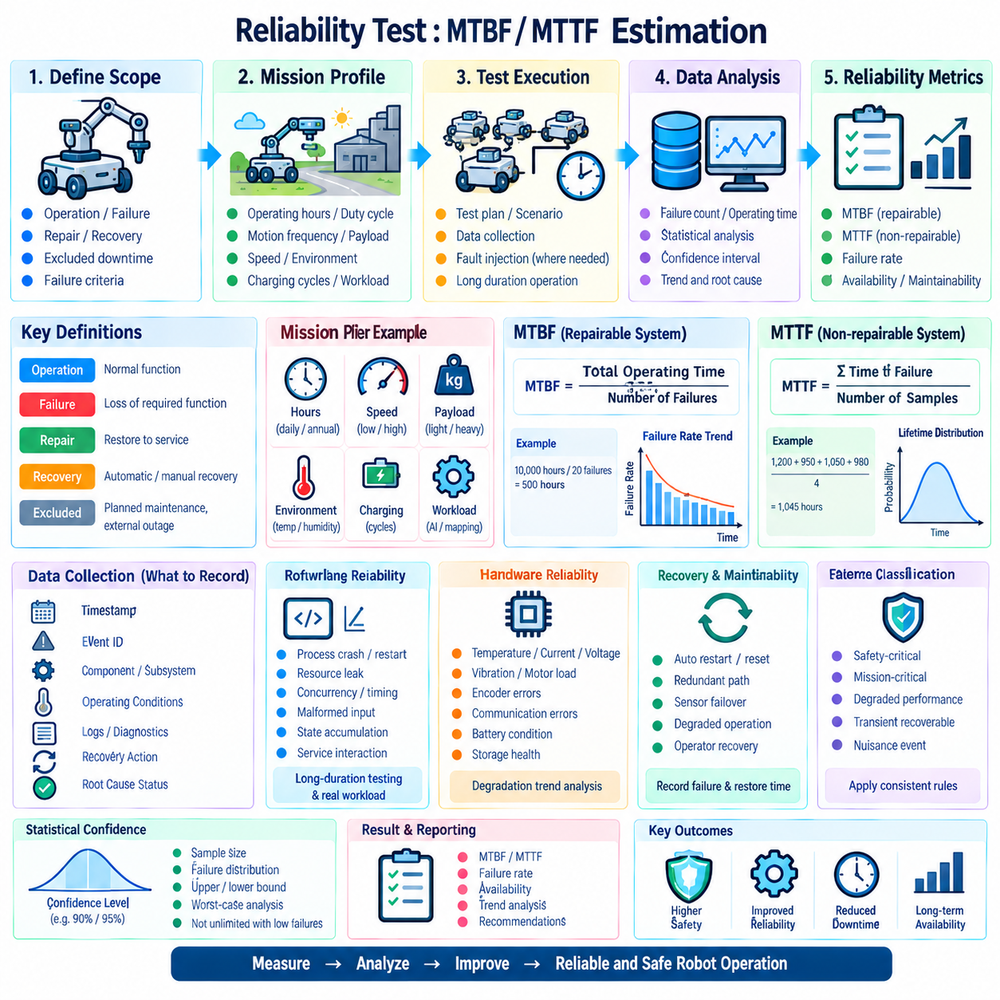{width="7.268055555555556in" height="7.268055555555556in"}

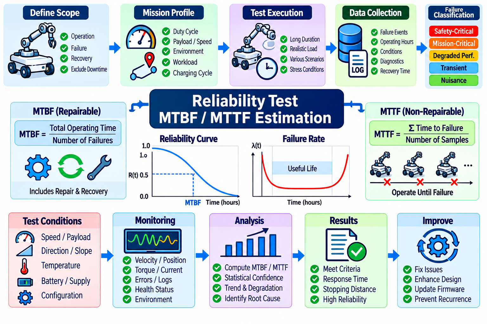{width="7.268055555555556in" height="4.845138888888889in"}

신뢰성 시험(Reliability Testing)은 로봇 시스템이 의도된 운용 기간과 임무 프로파일(Mission Profile) 동안 요구되는 기능을 일관되게 수행할 수 있는지를 평가한다. 안전 및 신뢰성 시험(Safety and Reliability Testing)에서 평균 고장 간격(Mean Time Between Failures, MTBF)과 평균 고장 시간(Mean Time To Failure, MTTF)은 고장 특성을 정량적으로 나타내는 지표를 제공한다. MTBF는 일반적으로 수리 가능한 시스템(Repairable Systems)에 적용하며, MTTF는 수리가 불가능하거나 고장 발생 시 유효 운용 수명이 종료되는 구성요소에 주로 사용한다.

신뢰성 시험은 운용(Operation), 고장(Failure), 수리(Repair), 복구(Recovery), 제외되는 가동 중단 시간(Excluded Downtime)의 의미를 정의하는 것에서 시작해야 한다. 이러한 정의가 일관되지 않으면 누적 운용 시간과 고장 횟수를 이용하여 의미 있는 신뢰성 추정값을 산출할 수 없다. 로봇의 고장에는 임무 수행 능력의 완전한 상실, 안전 정지, 액추에이터 오작동, 지속적인 위치 추정 상실, 복구 불가능한 소프트웨어 고장 또는 시스템 요구사항에서 정의된 다른 상태가 포함될 수 있다. 계획된 유지보수와 외부 인프라 장애는 필요한 경우 별도로 분류해야 한다.

임무 프로파일(Mission Profile)은 신뢰성 증거(Reliability Evidence)가 유효한 조건을 정의한다. 여기에는 운용 시간, 듀티 사이클(Duty Cycle), 운동 빈도, 적재 하중(Payload), 속도, 환경 조건, 충전 주기, 계산 작업 부하, 통신 사용량, 액추에이터 사용률, 예상 대기 시간이 포함되어야 한다. 가벼운 실험실 운용에서 측정한 신뢰성을 연속적인 산업 현장 운용에 자동으로 적용할 수는 없다. 따라서 시험 조건은 실제 서비스에서 예상되는 스트레스와 사용 패턴을 가능한 한 현실적으로 재현해야 한다.

수리 가능한 시스템의 평균 고장 간격(MTBF)은 관찰 기간 동안 누적된 운용 시간을 관련 고장 횟수로 나누어 추정할 수 있다. 여러 대의 동일하거나 동등한 로봇이 시험에 참여하는 경우 구성과 운용 조건이 충분히 비교 가능하다면 각각의 유효 운용 시간을 합산할 수 있다. 산출된 값은 고장 사이의 보장된 시간 간격이 아니라 추정값을 나타내며, 해석할 때에는 누적 운용량(Exposure), 고장 분포, 신뢰 수준(Confidence Level), 시험 대상 구성의 성숙도를 함께 고려해야 한다.

평균 고장 시간(MTTF) 추정은 수리가 불가능한 구성요소 또는 고장 시점까지 평가되는 항목에 유사한 관찰 원칙을 적용한다. 여러 샘플을 통제된 조건에서 운용하고 각각의 고장 발생 시간(Time-to-Failure)을 기록해야 한다. 구성요소와 고장 메커니즘에 따라 산술적 추정 방법이나 적절한 수명 분포(Lifetime Distribution)를 사용할 수 있다. 모터, 베어링, 배터리, 전자 모듈, 센서, 커넥터 및 기타 로봇 구성요소는 서로 다른 노화 메커니즘(Aging Mechanisms)을 나타낼 수 있으므로 하나의 통계 모델을 모든 구성요소에 자동으로 적용해서는 안 된다.

신뢰성 데이터 수집(Reliability Data Collection)에서는 고장 사건(Failure Events)과 증상(Symptoms)을 명확하게 구분해야 한다. 예를 들어 내비게이션 프로세스 충돌은 메모리 고갈, 손상된 입력 데이터, 통신 손실 또는 하드웨어 문제로 인해 나타난 가시적인 증상일 수 있다. 따라서 각 사건에는 고유 식별자를 부여하고 타임스탬프, 시스템 구성, 운용 조건, 진단 로그, 영향을 받은 하위 시스템, 관찰된 결과, 복구 조치, 근본 원인 분석 상태(Root-cause Status)를 보존해야 한다. 이를 통해 하나의 근본적인 문제가 반복적으로 나타나는 현상을 서로 다른 고장으로 잘못 해석하는 것을 방지할 수 있다.

소프트웨어 신뢰성(Software Reliability)은 소프트웨어가 기계적 구성요소와 동일한 방식으로 물리적으로 마모되지 않기 때문에 별도로 다루어야 한다. 고장은 희귀 실행 경로(Rare Execution Paths), 자원 누수(Resource Leakage), 동시성(Concurrency), 타이밍, 잘못된 입력, 상태 누적 또는 서비스 간 상호작용에 의해 발생할 수 있다. 따라서 장시간 시험(Long-duration Testing)에서는 현실적인 작업 부하, 반복적인 수명주기 전이, 통신 교란, 로깅, AI 추론(AI Inference), 지도 업데이트, 임무 변경, 복구 시퀀스를 실행하여 짧은 기능 시험에서는 발견하기 어려운 결함을 노출해야 한다.

하드웨어 신뢰성 시험(Hardware Reliability Testing)에서는 완전한 고장이 발생하기 전에 점진적인 성능 저하를 나타낼 수 있는 파라미터를 감시해야 한다. 온도, 전류, 전압, 진동, 모터 부하, 엔코더 오류, 통신 오류 횟수, 배터리 상태, 저장장치 상태, 열 스로틀링(Thermal Throttling)은 유용한 고장 전조 정보를 제공할 수 있다. 이러한 측정값을 운용 시간 및 고장 사건과 연계하면 무작위 고장(Random Failures)과 마모 관련 고장 메커니즘을 구분할 수 있으며 예방 정비(Preventive Maintenance) 또는 상태 기반 정비(Condition-based Maintenance) 전략을 지원할 수 있다.

수리 가능한 로봇은 물리적인 하드웨어 교체 없이도 고장에서 복구될 수 있으므로 신뢰성 시험에서는 시스템 복구(System Recovery)도 평가해야 한다. 자동 프로세스 재시작, 제어기 재설정, 중복 통신 경로(Redundant Communication Paths), 센서 장애 전환(Sensor Failover), 성능 저하 운전(Degraded Operation), 운영자 지원 복구(Operator-assisted Recovery)는 서비스 중단 시간을 감소시킬 수 있다. 시험 프로그램에서는 고장 발생뿐만 아니라 복구 시간도 기록하여 운영 가용성(Operational Availability)을 평가할 때 신뢰성 결과와 유지보수성( maintainability) 측정값을 함께 활용할 수 있도록 해야 한다.

고장 분류(Failure Classification)는 정의된 프로젝트 규칙에 따라 안전 중요 고장(Safety-critical Failures), 임무 중요 고장(Mission-critical Failures), 성능 저하 사건, 일시적으로 복구 가능한 결함, 경미한 장애(Nuisance Events)를 구분해야 한다. 반복적으로 발생하는 성능 저하 상태를 제외하고 계산한 높은 MTBF는 실제 현장 성능을 왜곡할 수 있다. 반대로 모든 진단 경고를 시스템 고장으로 간주하면 신뢰성을 과소평가할 수 있다. 따라서 데이터 분석 전에 분류 규칙을 확립하고 모든 시험 캠페인(Test Campaigns)에 일관되게 적용해야 한다.

관측된 고장 횟수가 적을 경우 통계적 신뢰도(Statistical Confidence)가 중요해진다. 고장이 없거나 한 번만 발생한 장시간 시험이 무한한 신뢰성을 입증하는 것은 아니며, 누적된 시험 노출량과 선택된 통계적 가정 내에서만 증거를 제공한다. 따라서 신뢰성 보고서에는 MTBF 또는 MTTF와 함께 운용 시간, 샘플 수, 고장의 수와 유형, 추정 방법, 신뢰도 가정(Confidence Assumptions)을 명시해야 한다. 기반이 되는 시험 노출량 없이 단일 추정값만 제시하면 시스템 성숙도에 대해 정당화되지 않은 신뢰를 형성할 수 있다.

신뢰성 성장 시험(Reliability Growth Testing)은 연속적인 개발 반복 과정에서 시정 엔지니어링 조치(Corrective Engineering Actions)가 시스템 성능을 개선하는지를 추적할 수 있다. 내구 시험(Endurance Testing)에서 발견된 고장을 분석하고 근본 원인을 수정한 후 변경된 구성을 다시 시험한다. 이후 고장 빈도, 누적 운용 시간, 반복되는 고장 형태, 하위 시스템별 고장 기여도의 추세를 분석하여 신뢰성이 실제로 향상되고 있는지 또는 단순히 고장이 다른 구성요소로 이동하고 있는지를 확인할 수 있다.

자동화된 신뢰성 시험(Automated Reliability Testing)은 텔레메트리(Telemetry)를 지속적으로 수집하고 고장 상태를 탐지하면서 임무를 연속적으로 실행할 수 있다. 시험 제어기는 내비게이션, 조작, 충전, 시작, 종료, 통신 또는 기타 대표적인 운용 사이클을 스케줄링하고, 감시 시스템은 상태 지표(Health Indicators)와 운용 상태를 기록할 수 있다. 자동화된 사건 감지(Automated Event Detection)는 원시 증거를 보존하고 사람의 검토를 허용해야 한다. 고장을 잘못 자동 분류하면 MTBF와 MTTF 추정값이 크게 왜곡될 수 있기 때문이다.

실질적으로 다른 시스템 버전의 신뢰성 통계를 정당한 근거 없이 결합해서는 안 되므로 형상 관리(Configuration Management)가 필수적이다. 하드웨어 개정판, 펌웨어, 운영체제 버전, 로봇 소프트웨어, AI 모델, 보정 파라미터(Calibration Parameters), 안전 설정, 기계적 변경은 고장 특성을 변화시킬 수 있다. 따라서 신뢰성 증거는 정확한 시험 대상 구성을 식별해야 하며, 주요 변경이 발생하면 새로운 기준선(Baseline)을 설정하거나 과거 데이터가 여전히 적용 가능한 이유를 설명하는 문서화된 분석을 수행해야 한다.

평균 고장 간격(MTBF)과 평균 고장 시간(MTTF)은 궁극적으로 독립적인 성능 수치가 아니라 엔지니어링 의사결정을 위한 증거로 활용된다. 그 가치는 운용 노출량, 고장 메커니즘, 통계적 불확실성(Statistical Uncertainty), 시정 조치, 현장 요구사항을 추적 가능한 신뢰성 평가(Traceable Reliability Assessment)로 연결하는 데 있다. 이러한 결과는 이후 수행되는 가속 수명 시험(Accelerated Life Testing), 환경 스트레스 스크리닝(Environmental Stress Screening), 기능 안전 검증(Functional-safety Verification), 안전 무결성 증거(Safety-integrity Evidence), 회귀 시험(Regression Testing)을 위한 정량적 기반을 제공한다.

## 07.06. Accelerated Life Test ALT for Robot HW SW

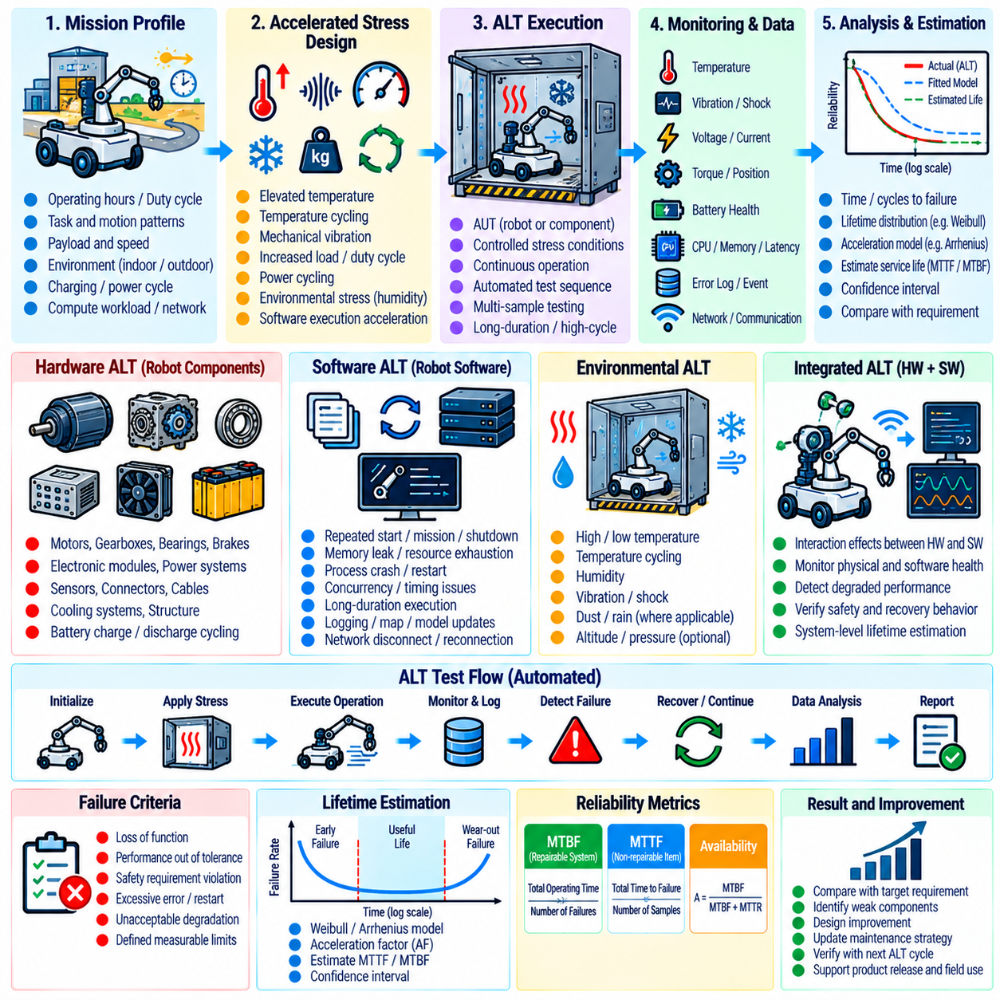{width="7.268055555555556in" height="7.268055555555556in"}

가속 수명 시험(Accelerated Life Testing, ALT)은 로봇 하드웨어와 소프트웨어에 관련 열화 또는 고장 메커니즘을 가속하는 통제된 스트레스(Controlled Stress)를 가함으로써 의도된 사용 수명 동안 요구 성능을 유지할 수 있는지를 평가한다. 목적은 단순히 구성요소를 빠르게 고장 내는 것이 아니라 실제 발생 가능한 노화 과정(Aging Process)을 짧은 기간에 재현하고, 그 결과를 활용하여 내구성을 추정하며 취약 지점을 식별하고 신뢰성 개선(Reliability Improvement)을 지원하는 것이다.

가속 수명 시험 프로그램(ALT Program)은 의도된 로봇 임무 프로파일(Mission Profile)과 정상 운용에서 예상되는 고장 메커니즘을 정의하는 것에서 시작해야 한다. 듀티 사이클(Duty Cycle), 운용 시간, 적재 하중(Payload), 액추에이터 사용률, 충전 빈도, 열적 조건, 진동, 습도, 계산 작업 부하, 통신 활동, 반복적인 시작 및 종료 주기를 특성화해야 한다. 이후 실제 운용에서는 발생하지 않을 비현실적인 고장 메커니즘을 유발하지 않으면서 열화 속도를 증가시키도록 가속 조건을 선정해야 한다.

하드웨어 가속 수명 시험(Hardware ALT)에서는 일반적으로 상승된 온도, 증가된 기계적 반복 주기, 높은 듀티 사이클, 진동, 반복적인 전원 사이클링(Power Cycling), 강화된 액추에이터 부하 또는 가속된 배터리 충·방전 패턴을 적용한다. 모터, 베어링, 기어박스, 브레이크, 커넥터, 전자 모듈, 냉각 시스템, 센서, 전력 구성요소는 각각의 스트레스에 서로 다르게 반응할 수 있다. 따라서 적용하는 스트레스는 단순히 시험 기간을 단축하기 위해 선택하는 것이 아니라 조사 대상 고장 메커니즘과 물리적인 연관성을 가져야 한다.

스트레스 수준(Stress Level)은 발생하는 고장이 실제 현장의 노화를 대표할 수 있는 범위 내에서 유지되어야 한다. 과도한 온도는 실제 운용에서는 도달하지 않는 조건에서 재료를 용융시킬 수 있으며, 지나친 기계적 부하는 정상적인 피로(Fatigue)와 관련이 없는 파손을 발생시킬 수 있다. 이러한 고장은 구조적 한계를 확인하는 데에는 유용할 수 있지만 수명 예측(Life Prediction)에 자동으로 사용해서는 안 된다. ALT 계획에서는 가속 노화(Accelerated Aging)와 파괴적 과응력 시험(Destructive Overstress Testing)을 구분하고 각각의 적용 조건에 대한 공학적 근거를 문서화해야 한다.

열 가속(Thermal Acceleration)은 로봇 전자장치, 배터리, 컴퓨팅 모듈, 전력 변환기(Power Converter), 임베디드 제어기(Embedded Controller)에 특히 중요하다. 상승된 온도는 화학적 노화, 절연 열화, 일부 전자 부품의 고장 과정을 가속할 수 있다. 온도 사이클링(Temperature Cycling)은 열팽창 차이, 솔더 피로(Solder Fatigue), 커넥터 문제, 간헐적 접촉 불량을 추가적으로 노출할 수 있다. 내부 자체 발열(Self-heating)이 실제 스트레스를 크게 변화시킬 수 있으므로 챔버 온도만 사용하는 것이 아니라 구성요소 자체의 온도도 측정해야 한다.

기계적 수명 시험(Mechanical Life Testing)은 실제 로봇 운용을 대표하는 반복적인 움직임과 부하 사이클을 재현해야 한다. 구동 휠, 조향 장치, 관절, 기어박스, 매니퓰레이터, 그리퍼, 서스펜션 구성요소, 브레이크, 케이블 체인은 수천 회에서 수백만 회에 이르는 반복 사이클 시험이 필요할 수 있다. 자동화된 시험 장치 또는 로봇 프로그램을 이용하여 정의된 궤적을 반복 수행하면서 토크, 전류, 진동, 백래시(Backlash), 위치 오차, 온도, 사이클 횟수를 감시하여 완전한 기능 고장이 발생하기 전에 점진적인 열화를 식별할 수 있다.

소프트웨어는 물리적으로 마모되지 않지만 로봇 소프트웨어에도 가속 수명 개념(Accelerated Life Concepts)을 적용할 수 있다. 장시간 실행 시험을 통해 수개월에 걸쳐 발생할 수 있는 운용 상태 전이를 짧은 연속 시험 기간으로 압축하여 메모리 누수(Memory Leak), 자원 고갈(Resource Exhaustion), 카운터 오버플로(Counter Overflow), 로그 증가, 타이밍 드리프트(Timing Drift), 오래된 상태 정보, 동기화 문제, 희귀한 동시성 고장(Concurrency Failure)을 발견할 수 있다. 이 경우 가속 메커니즘은 물리적 노화가 아니라 실행 빈도와 운용 사이클의 증가이므로 소프트웨어 결과는 하드웨어 수명 모델과 별도로 해석해야 한다.

소프트웨어 가속 수명 시험 캠페인(Software ALT Campaign)은 시작, 임무 로딩, 내비게이션, 조작, 충전, 통신 손실, 재연결, 프로세스 재시작, 지도 전환, 모델 로딩, 종료, 복구 시퀀스를 반복적으로 실행할 수 있다. AI 기반 시스템에서는 반복적인 추론, 데이터 버퍼링(Data Buffering), 로깅, 모델 전환, 센서 스트림 중단도 시험해야 한다. 전체 시험 기간 동안 메모리, 저장장치, 프로세서 및 가속기 사용률, 지연시간, 큐 깊이(Queue Depth), 스레드 상태, 오류 횟수, 서비스 가용성을 지속적으로 감시해야 한다.

하드웨어와 소프트웨어의 통합 가속 수명 시험(Combined Hardware and Software ALT)은 많은 로봇 고장이 물리적 열화와 제어 동작 사이의 상호작용을 통해서만 나타나기 때문에 중요하다. 기어박스 마찰이 증가하면 모터 전류와 온도가 상승하여 제어기 제한을 활성화하거나 모션 추종 성능을 변화시킬 수 있다. 열화된 배터리는 최대 부하에서 전압 안정성과 컴퓨팅 동작에 영향을 줄 수 있다. 따라서 통합 시험에서는 물리적 상태 지표와 소프트웨어 응답을 함께 감시하여 열화가 시스템 수준의 제어에 의해 감지되고 허용되는지 또는 오히려 증폭되는지를 확인해야 한다.

가속 수명 시험에서는 시험 시작 전에 명확한 고장 기준(Failure Criteria)을 정의해야 한다. 고장은 완전한 기능 상실, 안전 요구사항 충족 실패, 허용오차를 벗어난 성능, 과도한 백래시, 허용할 수 없는 위치 추정 오류, 액추에이터 추종 성능 저하, 반복적인 소프트웨어 재시작, 열 차단(Thermal Shutdown) 또는 기타 측정 가능한 한계로 정의할 수 있다. 이러한 기준을 사전에 정의하면 결과를 확인한 이후 시험 기간이나 고장 분류를 임의로 변경하는 것을 방지하고 샘플과 시스템 버전 사이의 일관된 비교를 지원할 수 있다.

고장 발생 시간(Time-to-Failure) 또는 고장 발생 사이클(Cycles-to-Failure)은 적용된 스트레스 이력(Stress History)과 함께 기록해야 한다. 여러 샘플을 시험하는 경우 가속 모델과 통계적 가정이 관측된 고장 메커니즘에 적절하다면 결과 분포를 이용하여 수명을 추정할 수 있다. 서로 다른 스트레스는 서로 다른 가속 관계(Acceleration Relationship)를 가질 수 있으므로 가속 조건에서 정상 운용 조건으로의 외삽(Extrapolation)은 신중하게 수행해야 한다. 따라서 선택한 모델은 자동으로 적용하는 것이 아니라 공학적 증거를 기반으로 정당화해야 한다.

구성요소는 공식적인 고장 임계값에 도달하기 훨씬 전부터 점진적으로 열화될 수 있으므로 중간 검사(Intermediate Inspection)가 중요하다. 예정된 점검 시점마다 백래시, 베어링 상태, 브레이크 성능, 배터리 용량, 센서 정확도, 절연 상태, 커넥터 저항, 열적 거동 및 기타 상태 지표(Health Indicators)를 측정할 수 있다. 이러한 측정값의 추세를 분석하면 열화 경로(Degradation Trajectory)를 식별할 수 있으며 시험 종료 시 완전한 고장이 발생할 때까지 기다리는 것보다 조기에 유용한 공학적 정보를 확보할 수 있다.

고장이 발생하면 근본 원인 분석(Root-cause Analysis)을 통해 해당 고장이 의도한 가속 고장 메커니즘을 나타내는지, 관련 없는 시험 장치 문제인지, 제조 편차인지, 소프트웨어 결함인지 또는 비현실적인 과응력 조건에 의한 것인지 확인해야 한다. 고장난 구성요소의 구성 정보, 운용 이력, 로그, 환경 기록은 분석을 위해 보존해야 한다. 이후 설계 시정 조치(Corrective Design Changes)를 적용하고 다시 시험함으로써 ALT를 단순한 적격성 평가(Qualification Gate)가 아니라 신뢰성 성장(Reliability Growth)을 지원하는 과정으로 활용할 수 있다.

장시간 가속 시험을 지속적으로 수동 감독하는 것은 현실적으로 어렵기 때문에 자동화(Automation)가 필수적이다. 시험 제어기는 스트레스 사이클을 스케줄링하고, 로봇 움직임을 명령하고, 동기화된 텔레메트리(Synchronized Telemetry)를 수집하며, 임계값 위반을 감지하고, 시스템을 안전 상태(Safe State)로 전환하며, 복구 이후 허용된 시퀀스를 다시 수행할 수 있다. 자동 감시 시스템은 원시 데이터를 보존하고 비정상적인 추세에 대한 경고를 생성하는 동시에 시험으로 유발된 고장이 통제되지 않은 위험한 움직임으로 이어지지 않도록 안전장치를 유지해야 한다.

ALT 결과는 하드웨어 개정판, 소프트웨어 및 펌웨어 버전, AI 모델, 안전 파라미터(Safety Parameters), 시험 장치(Test Fixtures), 환경 조건, 적용된 스트레스, 샘플 식별 정보, 보정 기록(Calibration Records)과 추적 가능하게 연결되어야 한다. 작은 설계 변경도 주요 고장 메커니즘을 변화시킬 수 있기 때문에 이러한 형상 관리(Configuration Control)가 필요하다. 전체 안전 및 신뢰성 프로그램에서 가속 수명 증거(Accelerated Life Evidence)는 평균 고장 간격(MTBF)과 평균 고장 시간(MTTF) 추정을 보완하며, 환경 스트레스 스크리닝(Environmental Stress Screening), 기능 안전 검증(Functional-safety Verification), 신뢰성 중심 회귀 시험(Reliability-focused Regression Testing)을 위한 기반을 제공한다.

## 07.07. Environmental Stress Screening ESS Protocol

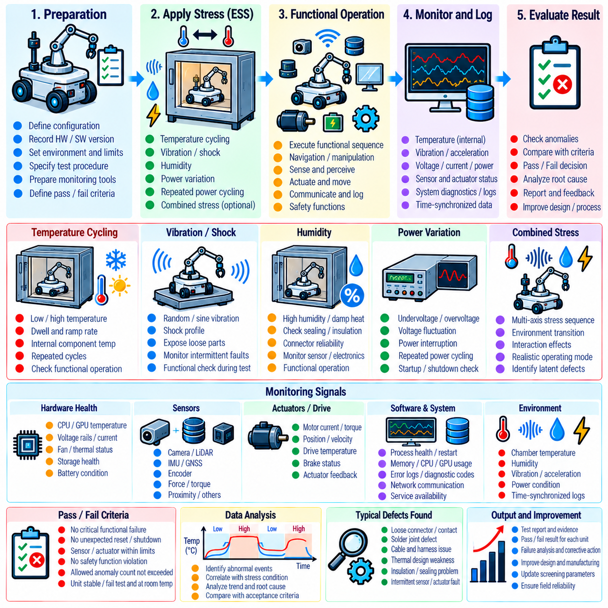{width="7.268055555555556in" height="7.268055555555556in"}

환경 스트레스 스크리닝(Environmental Stress Screening, ESS)은 로봇이 장기간 검증 또는 현장 배포에 들어가기 전에 잠재적인 제조, 조립, 통합 및 작업 품질 결함(Workmanship Defects)을 발견하기 위해 사용하는 통제된 과정이다. 가속 수명 시험(Accelerated Life Testing, ALT)과 달리 ESS는 주로 사용 수명을 추정하는 것이 아니라 이미 존재하는 취약점을 발견하는 것을 목적으로 한다. 이 프로토콜은 환경 스트레스를 적용하면서 하드웨어, 임베디드 소프트웨어, 통신, 센싱, 액추에이션 및 안전 기능이 정상적으로 유지되는지를 지속적 또는 주기적으로 확인한다.

ESS 프로토콜은 로봇 구성, 의도된 운용 환경, 구성요소의 한계, 알려진 고장 민감도(Failure Sensitivities)를 정의하는 것에서 시작해야 한다. 스크리닝 조건은 제품의 유효 수명(Useful Product Life)을 상당 부분 소모하지 않으면서 불안정한 연결, 조립 결함, 열적 취약점 또는 간헐적 고장을 노출할 수 있을 정도로 설정해야 한다. 하드웨어 개정판, 펌웨어, 소프트웨어, 보정 정보, 안전 파라미터, 시험 장비, 환경 한계 및 합격 기준을 스크리닝 시작 전에 확정하고 기록해야 한다.

온도 사이클링(Temperature Cycling)은 반복적인 팽창과 수축을 통해 취약한 솔더 접합부, 커넥터, 케이블 종단부, 인쇄 회로 조립체(Printed Circuit Assemblies), 씰(Seals), 기계적 인터페이스의 문제를 노출할 수 있기 때문에 가장 효과적인 ESS 방법 중 하나이다. 로봇 또는 하위 시스템을 정의된 저온과 고온 사이에서 반복적으로 전환하면서 핵심 기능을 감시한다. 온도 변화율, 유지 시간(Dwell Duration), 사이클 횟수, 안정화 기준 및 구성요소 온도를 명확하게 규정하여 장치 간에 반복 가능한 스크리닝이 이루어지도록 해야 한다.

열 감시(Thermal Monitoring)는 환경 챔버(Environmental Chamber)의 측정값에만 의존하지 않고 내부 구성요소까지 포함해야 한다. 엣지 컴퓨터(Edge Computer), GPU, 모터 드라이브, 배터리, 전력 변환기, 안전 제어기 및 밀폐형 전자장치는 자체 발열과 공기 흐름 제한으로 인해 주변 환경과 크게 다른 온도를 경험할 수 있다. 대표적인 열적 위치에 센서를 배치하면 기능 이상이 실제 구성요소 온도, 온도 구배(Thermal Gradient), 가열 및 냉각 단계 사이의 전이와 관련되는지를 확인할 수 있다.

진동 스크리닝(Vibration Screening)은 느슨한 체결부, 불안정한 커넥터, 균열된 접합부, 케이블 문제, 장착부 취약성 및 간헐적인 전기 접촉 문제를 발견하는 데 사용한다. 진동 프로파일(Vibration Profile)은 로봇 플랫폼과 의도된 운송 또는 운용 환경을 반영해야 한다. 이동 로봇, 사족 보행 로봇, 매니퓰레이터 및 무인항공기(UAV)는 상당히 다른 진동 스펙트럼을 경험할 수 있다. 간헐적인 고장은 기계적 가진(Mechanical Excitation)이 중단되는 즉시 사라질 수 있으므로 진동이 적용되는 동안 기능을 감시하는 것이 중요하다.

필요한 경우 ESS에는 습도, 전원 변동, 반복적인 전원 사이클링(Power Cycling) 또는 복합 환경 스트레스(Combined Environmental Stresses)를 포함할 수 있다. 습도는 절연, 밀봉, 오염 또는 커넥터 취약성을 드러낼 수 있으며, 통제된 전원 변동은 전력 분배의 한계와 재설정 동작을 확인하는 데 활용할 수 있다. 반복적인 전원 사이클은 시작 시퀀스 문제와 간헐적인 초기화 실패를 발견할 수 있다. 복합 스트레스는 해석하기 어렵거나 실제 운용을 대표하지 않는 고장 메커니즘을 발생시킬 수 있으므로 신중하게 적용해야 한다.

스크리닝 과정에서는 로봇을 기능 수준과 진단 수준(Functional and Diagnostic Levels)에서 모두 감시해야 한다. 주요 관측 항목에는 프로세서 상태, 통신 오류 횟수, 센서 가용성, 액추에이터 피드백, 모터 전류, 전압 레일(Voltage Rails), 온도, 저장장치 상태, 네트워크 연결성, 안전 제어기 상태, 엔코더 일관성, 애플리케이션 서비스 상태가 포함될 수 있다. 환경 스트레스가 활성화된 상태에서 주기적인 기능 시퀀스를 실행하여 내비게이션, 액추에이션, 센싱, 제동, 통신 및 안전 기능을 점검할 수 있다.

ESS에서는 정상적인 실험실 조건에서 재현하기 어려운 고장을 자주 발견할 수 있으므로 간헐적 고장(Intermittent Faults)에 특히 주의해야 한다. 커넥터가 진동 중에만 단선되거나, 솔더 접합부가 특정 온도 전이 구간에서만 고장나거나, 높은 계산 부하와 고온 조건이 동시에 발생할 때만 프로세서가 재설정될 수 있다. 따라서 고해상도 타임스탬프 로그(High-resolution Timestamped Logging)를 사용하여 환경 조건과 시스템 사건을 공통 타임라인에 기록하고 짧은 시간 동안 발생하는 이상 현상을 적용된 스트레스와 연계하여 분석할 수 있도록 해야 한다.

ESS 프로토콜에서는 스크리닝 한계(Screening Limits)와 제품 한계(Product Limits)를 명확하게 구분하여 정의해야 한다. 스크리닝 한계는 ESS 과정에서 의도적으로 적용하는 통제된 스트레스를 의미하며, 제품 한계는 로봇이 정상적으로 운용되거나 견뎌야 하는 조건을 정의한다. 스크리닝 조건은 통제되지 않은 과응력 시험(Overstress Testing)이 되지 않으면서 작업 품질 결함을 발견할 수 있도록 정당화되어야 한다. 공학적 근거 없이 구성요소 정격을 초과하면 정상적인 장치까지 손상시키고 생산 품질에 관한 시험 결론을 무효화할 수 있다.

합격 및 불합격 기준(Pass and Fail Criteria)은 영구적인 이상뿐만 아니라 일시적인 이상도 포함해야 한다. 장치가 실온으로 복귀한 후 정상적으로 동작한다는 이유만으로 자동으로 합격 처리해서는 안 된다. 스크리닝 과정에서 발생한 재설정, 통신 단절, 센서 오류, 안전 결함, 예상하지 못한 상태 전이, 액추에이터 편차, 데이터 손상 또는 열 보호 이벤트(Thermal Protection Events)는 잠재적 결함을 나타낼 수 있다. 합격 기준에서는 금지되는 사건, 추가 조사가 필요한 사건, 정의된 조건에서 허용할 수 있는 사건을 명확하게 규정해야 한다.

고장이 감지되면 시스템을 재설정하거나 수리하기 전에 가능한 범위에서 고장 상태(Failure State)를 보존해야 한다. 로그, 환경 측정값, 진단 상태, 오류 코드, 물리적 구성 및 정확한 스트레스 단계를 기록해야 한다. 이후 근본 원인 분석(Root-cause Analysis)을 통해 해당 사건이 제조 편차, 조립 작업 품질, 구성요소 취약성, 설계 마진(Design Margin), 소프트웨어 동작, 시험 장비 또는 부적절한 스크리닝 프로파일에서 발생했는지를 판단할 수 있다.

시정 조치(Corrective Actions)를 수행한 후에는 동일하거나 적절하게 수정된 ESS 조건에서 확인 시험(Confirmation Testing)을 수행해야 한다. 여러 장치에서 반복적인 고장이 발생하는 경우 단일 불량 구성요소가 아니라 체계적인 설계 또는 생산 문제를 나타낼 수 있다. 따라서 충분한 데이터가 확보된 경우 하위 시스템, 하드웨어 개정판, 공급업체 로트(Supplier Lot), 제조 공정, 환경 조건 및 고장 형태별로 추세를 분석해야 한다. 이를 통해 ESS는 제품 검증뿐만 아니라 제조 품질 개선(Manufacturing Quality Improvement)도 지원할 수 있다.

환경 챔버, 진동 장비, 전원 제어기, 로봇 소프트웨어 및 데이터 수집 시스템을 사전에 정의된 시험 시퀀스를 통해 연동할 수 있으므로 자동화(Automation)는 ESS의 반복성을 향상시킨다. 자동화 프레임워크(Automation Framework)는 스트레스 프로파일을 적용하고, 기능 점검을 실행하며, 상태 임계값을 감시하고, 이상 현상을 기록하며, 필요한 경우 시스템을 안전 상태(Safe State)로 전환할 수 있다. 자동화된 실행은 장시간 스크리닝 캠페인에서 수동 조작으로 인해 발생하는 편차도 줄일 수 있다.

환경 스트레스가 적용되는 동안 센싱, 통신, 액추에이션 또는 컴퓨팅 성능이 저하될 수 있으므로 안전 제어(Safety Controls)는 필수적이다. 물리적 움직임은 적절하게 제한해야 하며 독립적인 비상 정지 또는 전원 차단 기능을 사용할 수 있어야 한다. 액추에이터가 동작하는 시험에서는 제한된 작업 공간, 가능한 경우 감소된 에너지 조건, 열적 한계, 시험 중단 임계값(Abort Thresholds), 스크리닝 중 발생할 수 있는 배터리·전기·기계적 이상 상황의 처리 절차를 정의해야 한다.

ESS 결과는 개별 장치, 하드웨어 및 소프트웨어 구성, 보정 기록(Calibration Records), 환경 프로파일, 계측 장비, 시험 날짜, 관찰된 이상 현상, 수리 이력 및 최종 판정과 추적 가능하게 연결되어야 한다. 이러한 증거는 환경 강건성(Environmental Robustness)이 비공식적인 노출 시험이 아니라 체계적인 절차를 통해 평가되었음을 입증한다. 전체 구조에서 ESS는 평균 고장 간격(MTBF), 평균 고장 시간(MTTF), 가속 수명 시험(ALT)을 보완하며 기능 안전 검증(Functional-safety Verification), 안전 무결성 평가(Safety-integrity Assessment), 자동화된 안전 회귀 시험(Automated Safety Regression Testing)을 위한 추가적인 증거를 제공한다.

## 07.08. Functional Safety Verification Checklist [w/Code]

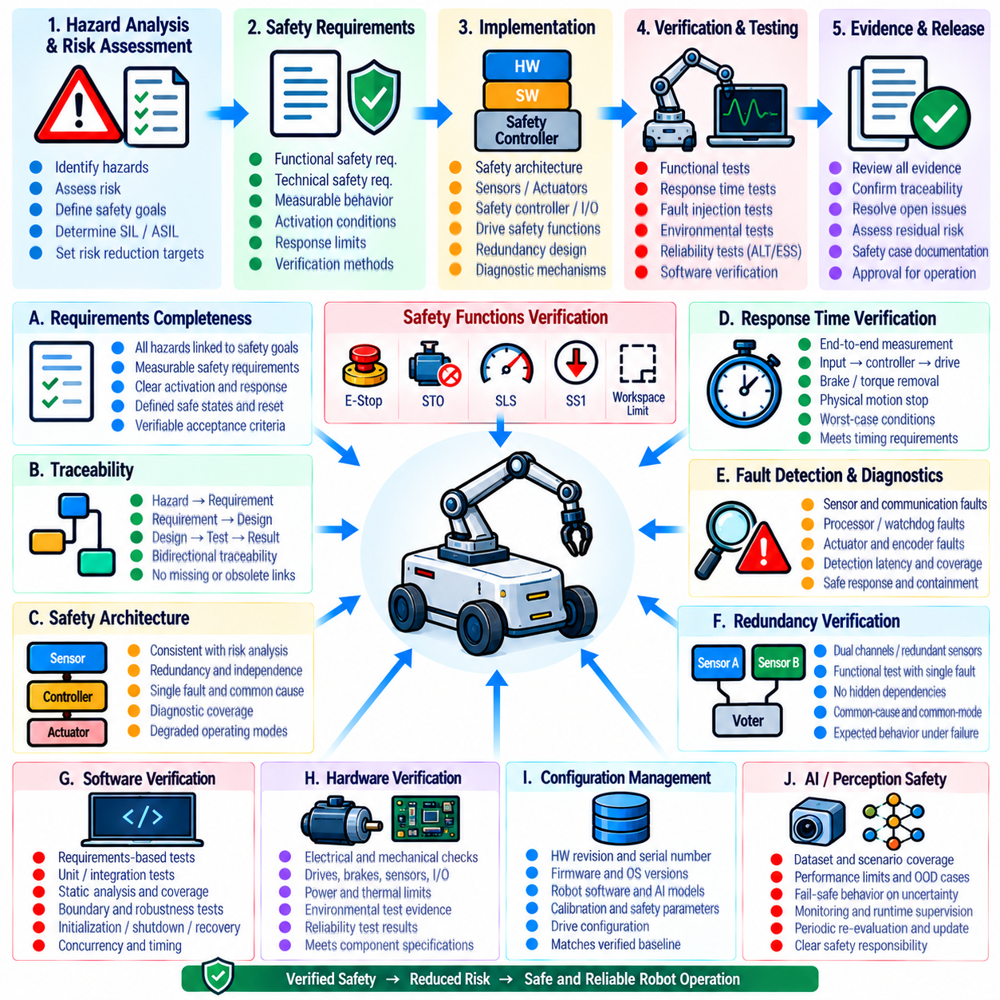{width="7.268055555555556in" height="7.268055555555556in"}

기능 안전 검증(Functional Safety Verification)은 구조화된 체크리스트를 사용하여 로봇의 운용이 승인되기 전에 안전 요구사항(Safety Requirements)이 구현되고 시험되었으며 추적 가능하고 충분한 증거로 뒷받침되는지를 확인한다. 체크리스트는 단순한 행정적 승인 절차로 기능해서는 안 된다. 위험원 분석(Hazard Analysis), 안전 요구사항, 아키텍처, 구현, 검증 결과, 형상 기록(Configuration Records), 이상 사항, 잔여 위험(Residual Risks)을 안전 수명주기(Safety Lifecycle) 전반에서 검토 가능한 증거 사슬(Chain of Evidence)로 연결해야 한다.

첫 번째 검증 영역은 안전 요구사항의 완전성(Completeness)에 관한 것이다. 식별된 모든 위험 상태는 하나 이상의 안전 목표(Safety Goals) 및 이에 대응하는 기능 또는 기술 안전 요구사항과 연결되어야 한다. 요구사항에는 측정 가능한 동작, 활성화 조건, 응답 한계, 안전 상태(Safe States), 결함 대응, 리셋 조건, 검증 방법이 정의되어야 한다. "안전하게 정지한다"와 같이 모호한 요구사항은 시험 과정에서 객관적으로 측정할 수 있는 기준으로 대체해야 한다.

추적성(Traceability)은 양방향으로 검증해야 한다. 검토자는 위험원에서 안전 요구사항, 구현 요소, 검증 방법, 시험 사례(Test Case), 결과, 최종 증거 기록까지 추적할 수 있어야 한다. 또한 모든 안전 메커니즘(Safety Mechanism)이 식별된 요구사항이나 위험 통제 목표(Risk-control Objective)에 의해 정당화될 수 있도록 반대 방향의 추적 경로도 제공해야 한다. 누락되거나 중복되거나 폐기되었거나 검증되지 않은 연결은 단순한 문서상의 불편함이 아니라 검증 발견 사항(Verification Findings)으로 처리해야 한다.

안전 아키텍처(Safety Architecture)는 위험원 및 위험 분석 과정에서 확립된 가정과 비교하여 점검해야 한다. 안전 제어기(Safety Controller), 비상 정지 회로, 드라이브 안전 기능, 브레이크, 중복 센서, 감시 타이머(Watchdogs), 통신 감시, 전원 차단, 독립적인 감시 메커니즘을 식별해야 한다. 체크리스트에서는 요구되는 안전 무결성(Safety Integrity)과 관련된 경우 단일 고장, 공통 원인 취약성(Common-cause Vulnerabilities), 종속성, 진단 메커니즘, 성능 저하 운전 모드(Degraded Operating Modes)가 고려되었는지를 검증해야 한다.

안전 토크 차단(Safe Torque Off, STO), 안전 제한 속도(Safely Limited Speed, SLS), 안전 정지 1(Safe Stop 1, SS1), 비상 정지, 보호 정지(Protective Stopping), 속도 감시, 작업 공간 제한, 토크 또는 힘 제한과 같은 안전 기능에는 적용 가능한 경우 명확한 검증 증거가 있어야 한다. 각 기능은 정의된 초기 조건과 대표적인 운전 상태에서 시험해야 한다. 활성화 동작, 응답 시간, 최종 안전 상태, 리셋 로직, 재시작 방지(Restart Prevention), 다른 안전 기능과의 상호작용을 검증 기록에 포함해야 한다.

응답 시간 검증(Response-time Verification)에서는 전체 물리적 안전 체인(Physical Safety Chain)이 할당된 시간 요구사항을 충족하는지를 확인해야 한다. 측정은 안전 사건이 시작되는 시점부터 입력 감지, 안전 제어기 처리, 통신, 드라이브 반응, 제동 또는 토크 제거, 필요한 경우 실제 물리적 움직임의 종료까지 포함해야 한다. 안전 요구사항이 로봇의 실제 움직임과 관련되는 경우 소프트웨어 콜백 시간만으로는 충분하지 않다. 최악 조건의 운전 상태(Worst-case Operating Conditions)와 반복 측정 결과도 고려해야 한다.

결함 감지(Fault Detection)와 진단 커버리지(Diagnostic Coverage)는 결함 주입 시험(Fault Injection Testing)에서 확보한 증거를 사용하여 검토해야 한다. 센서 데이터 손실, 손상된 측정값, 통신 단절, 프로세서 재시작, 감시 타이머 활성화, 액추에이터 편차, 엔코더 불일치, 전원 이상 및 기타 관련 결함은 지정된 진단 및 안전 응답을 발생시켜야 한다. 검증에서는 결함이 요구된 시간 한계 내에서 감지되는지, 그리고 위험한 시스템 동작으로 발전하기 전에 결함의 전파가 차단되는지를 확인해야 한다.

중복성(Redundancy)은 아키텍처 다이어그램만을 근거로 인정하는 것이 아니라 기능적으로 검증해야 한다. 안전 메커니즘이 이중 채널(Dual Channels), 중복 센서, 독립적인 프로세서, 복제된 통신 경로 또는 다중 전원 도메인에 의존하는 경우 하나의 요소가 고장났을 때 의도된 동작이 수행되는지를 시험을 통해 입증해야 한다. 또한 체크리스트에서는 외관상 독립적인 중복 요소들이 공통 원인 고장(Common-cause Failure) 또는 공통 모드 고장(Common-mode Failure)을 발생시킬 수 있는 숨겨진 종속성을 공유하는지도 검토해야 한다.

소프트웨어 검증 증거(Software Verification Evidence)는 안전 관련 소프트웨어가 할당된 중요도(Criticality)에 따라 검토되고 시험되었음을 입증해야 한다. 적용 가능한 경우 요구사항 기반 시험(Requirements-based Testing), 단위 시험(Unit Testing), 통합 시험(Integration Testing), 정적 분석(Static Analysis), 인터페이스 검증, 경계 시험(Boundary Testing), 강건성 시험(Robustness Testing), 관련 구조적 커버리지(Structural Coverage)를 검토해야 한다. 초기화, 종료, 재시작, 타이밍, 동시성(Concurrency), 메모리 처리, 잘못된 입력, 예외 처리, 상태 머신 전이는 안전 동작에 영향을 줄 수 있는 경우 명시적으로 검증해야 한다.

하드웨어 검증(Hardware Verification)에서는 안전 관련 전기 및 기계 구성요소가 지정된 한계 내에서 동작하는지를 확인해야 한다. 적용 가능한 경우 전력 분배, 드라이브, 브레이크, 접촉기(Contactors), 센서, 엔코더, 안전 입출력(Safety I/O), 배선, 커넥터, 열 보호(Thermal Protection), 기계적 정지 메커니즘을 점검해야 한다. 내구 시험(Endurance Testing), 가속 수명 시험(Accelerated Life Testing), 환경 스트레스 스크리닝(Environmental Stress Screening)에서 확보한 증거를 통해 관련 운용 및 환경 조건에서도 안전 기능이 유지된다는 신뢰성을 보완할 수 있다.

검증 증거는 알려진 시스템 기준선(System Baseline)에만 적용되므로 형상 관리(Configuration Management)는 핵심 체크리스트 항목이다. 하드웨어 개정판, 펌웨어, 운영체제 버전, 로봇 소프트웨어, AI 모델, 보정 파일(Calibration Files), 안전 파라미터, 드라이브 구성, 기계적 변경 사항을 식별해야 한다. 검증된 구성은 실제 릴리스 대상으로 계획된 구성과 일치해야 하며, 해결되지 않은 차이가 존재하는 경우 영향 분석(Impact Analysis)과 적절한 회귀 시험(Regression Testing)을 수행해야 한다.

AI 또는 확률적 인지(Probabilistic Perception)를 포함하는 로봇에서는 학습된 구성요소가 결정론적 안전 제약(Deterministic Safety Constraints)을 우회할 수 없는지를 체크리스트를 통해 검증해야 한다. 관련되는 경우 낮은 신뢰도의 인지 결과, 센서 불일치, 위치 추정 불확실성(Localization Uncertainty), 예상하지 못한 객체, 잘못된 AI 명령, 분포 외 조건(Out-of-distribution Conditions)을 고려해야 한다. AI 구성요소가 부정확하거나 불확실한 결과를 생성하는 경우에도 독립적인 안전 감시기, 운동 제한, 힘 제한, 보호 영역 또는 대체 안전 상태(Fallback States)는 계속 유효해야 한다.

이상 관리(Anomaly Management)에서는 검증 과정에서 발견된 고장이 공식적으로 기록되고 분류되며 조사되고 해결되거나 명시적으로 수용되는지를 확인해야 한다. 대부분의 시험 사례가 통과했다는 이유만으로 시험 캠페인을 완료된 것으로 간주해서는 안 된다. 미해결 이상 사항(Open Anomalies)은 안전 영향, 영향을 받는 요구사항, 재발 위험, 임시 조치의 유효성, 회귀 시험 영향을 기준으로 평가해야 한다. 시정 조치(Corrective Actions)는 최초 문제가 적절하게 해결되었음을 입증하는 재시험 증거와 연결되어야 한다.

체크리스트에서는 리셋, 복구 및 재시작 동작(Reset, Recovery, and Restart Behavior)이 새로운 위험 상태를 발생시키지 않는지도 검증해야 한다. 비상 정지 해제, 통신 복원, 제어기 재시작, 센서 재연결 또는 성능 저하 운전에서의 복구가 안전 개념(Safety Concept)에서 명시적으로 허용되지 않는 한 자동으로 위험한 움직임을 시작해서는 안 된다. 정상 운전을 재개하기 전에 필요한 운영자 승인(Operator Acknowledgement), 상태 유효성 검증, 명령 최신성(Command Freshness), 액추에이터 준비 상태 및 안전 조건 점검을 확인해야 한다.

최종 검증(Final Verification)에서는 전체 증거 패키지(Evidence Package)가 주장하는 안전 성능을 충분히 뒷받침하는지를 검토해야 한다. 요구사항, 시험 절차, 원시 측정값, 합격·불합격 기록, 결함 주입 결과, 응답 시간 측정값, 신뢰성 증거, 환경 시험, 이상 사항 해결 기록, 형상 기록, 잔여 위험 평가(Residual-risk Assessments)는 내부적으로 일관되고 추적 가능해야 한다. 누락된 증거는 충족된 것으로 암묵적으로 가정해서는 안 되며 미해결 검증 항목(Open Verification Item)으로 명확하게 유지해야 한다.

완료된 기능 안전 검증 체크리스트(Functional Safety Verification Checklist)는 구현된 로봇 구성이 충분한 객관적 증거(Objective Evidence)를 바탕으로 정의된 안전 요구사항을 충족한다는 통제된 공학적 판단을 의미한다. 전체 구조에서 이 체크리스트는 안전 기능 시험, 비상 정지 측정, 결함 주입, 신뢰성 시험, 가속 수명 시험, 환경 스트레스 스크리닝 결과를 통합하며, 이후 안전 무결성 수준 달성(Safety Integrity Level Achievement)과 자동화된 안전 회귀 시험(Automated Safety Regression Testing)에 필요한 증거 기반을 형성한다.

## 07.09. Safety Integrity Level Achievement Evidence

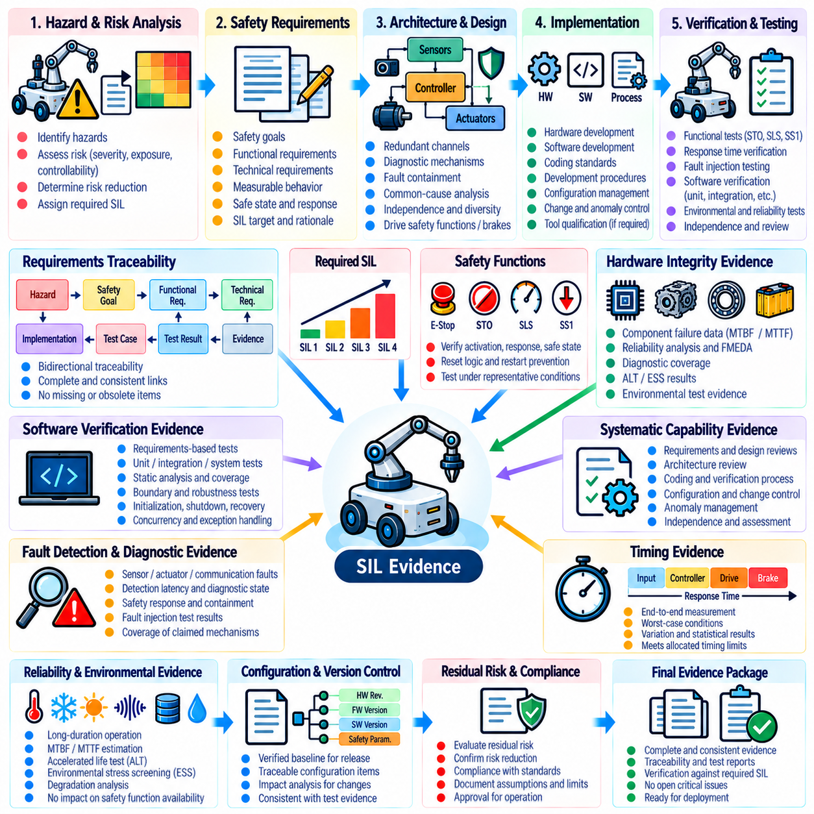{width="7.268055555555556in" height="7.268055555555556in"}

안전 무결성 수준 달성 증거(Safety Integrity Level Achievement Evidence)는 안전 관련 시스템(Safety-related System)이 위험원 및 위험 분석(Hazard and Risk Analysis)을 통해 할당된 무결성 요구사항(Integrity Requirements)을 충족한다는 것을 입증한다. 로봇 시스템에서는 개별 안전 기능이 성공적으로 동작한다는 사실만으로 충분하지 않다. 위험원, 안전 요구사항, 아키텍처, 하드웨어 신뢰성, 체계적 개발 조치(Systematic Development Measures), 검증 결과, 결함 대응, 형상 관리(Configuration Control), 미해결 잔여 위험(Residual Risk) 사이에 추적 가능한 관계가 확립되어야 한다.

요구되는 안전 무결성 수준(Safety Integrity Level, SIL)은 원하는 제품 특성으로 임의 선정하는 것이 아니라 문서화된 위험 평가(Risk Assessment)에서 도출되어야 한다. 각 안전 기능에는 명확하게 정의된 안전 목표(Safety Objective), 운전 모드, 요구 조건(Demand Condition), 안전 상태(Safe State), 응답 요구사항, 무결성 목표(Integrity Target)가 있어야 한다. 목표를 할당하는 데 사용된 판단 근거를 증거로 보존하여 검토자가 위험 감소 요구사항(Risk Reduction Requirements)이 어떻게 엔지니어링 및 검증 의무로 전환되었는지를 이해할 수 있도록 해야 한다.

요구사항 추적성(Requirements Traceability)은 SIL 증거의 핵심 기반을 형성한다. 안전 목표는 기능 안전 요구사항(Functional Safety Requirements)과 기술 안전 요구사항(Technical Safety Requirements)으로 분해하고 특정 하드웨어, 소프트웨어, 통신, 센싱, 액추에이션 또는 기계적 요소에 할당해야 한다. 모든 요구사항에는 해당 구현 및 검증 증거가 식별되어야 한다. 양방향 추적성(Bidirectional Traceability)을 통해 최초 위험원에서 최종 시험 결과까지, 그리고 모든 안전 메커니즘에서 그 존재를 정당화하는 요구사항까지 추적할 수 있어야 한다.

하드웨어 무결성 증거(Hardware Integrity Evidence)는 안전 기능에 참여하는 구성요소의 고장 동작을 다루어야 한다. 고장률 가정(Failure-rate Assumptions), 구성요소 신뢰성 데이터, 아키텍처 중복성, 진단 메커니즘, 결함 격리(Fault Containment), 관련 고장 형태 분석을 문서화해야 한다. 정량적 계산이 요구되는 경우 가정과 원천 데이터를 확인할 수 있어야 한다. 신뢰성 주장은 적용 가능한 경우 운용 이력, 평균 고장 간격(MTBF) 또는 평균 고장 시간(MTTF) 분석, 가속 수명 시험(Accelerated Life Testing), 환경 스트레스 스크리닝(Environmental Stress Screening) 등의 증거로 뒷받침되어야 한다.

아키텍처 증거(Architectural Evidence)는 안전 관련 설계가 무결성 요구사항에 따라 결함을 허용하거나 감지할 수 있음을 입증해야 한다. 중복 채널, 안전 제어기(Safety Controller), 감시되는 통신, 드라이브 안전 기능, 브레이크, 감시 타이머(Watchdogs), 전원 차단, 독립적인 센싱을 완전한 안전 경로(Safety Path)로 평가해야 한다. 검토에서는 단일 지점 고장(Single-point Failures), 종속 고장(Dependent Failures), 공통 원인 고장(Common-cause Failures), 진단 커버리지(Diagnostic Coverage), 숨겨진 공유 자원이 독립성에 대한 가정을 무효화할 가능성을 고려해야 한다.

체계적 역량(Systematic Capability)도 동일하게 중요하다. 높은 하드웨어 신뢰성만으로는 사양 정의, 설계, 구현 또는 변경 과정에서 유입되는 통제되지 않은 오류를 보상할 수 없기 때문이다. 따라서 증거에는 개발 절차, 요구사항 검토, 아키텍처 검토, 코딩 관행(Coding Practices), 검증 독립성(Verification Independence), 형상 관리, 변경 관리, 이상 관리(Anomaly Management), 적절한 도구 통제가 포함되어야 한다. 이러한 활동의 엄격성은 안전 관련 기능에 할당된 중요도와 무결성 목표에 상응해야 한다.

소프트웨어 증거(Software Evidence)는 안전 관련 로직이 해당 요구사항을 기준으로 검증되었음을 입증해야 한다. 적용 가능한 경우 단위 시험(Unit Testing), 통합 시험(Integration Testing), 시스템 시험, 강건성 시험(Robustness Testing), 경계 시험(Boundary Testing), 타이밍 시험, 결함 대응 시험을 정적 분석(Static Analysis) 및 관련 커버리지 증거와 함께 포함해야 한다. 초기화, 종료, 재시작, 상태 전이, 동시성(Concurrency), 잘못된 입력, 메모리 동작, 감시 타이머 처리, 통신 손실, 예외 경로는 체계적 소프트웨어 결함이 정상 운전 중에는 숨겨질 수 있으므로 특히 중요하게 검증해야 한다.

안전 기능 증거(Safety-function Evidence)에는 안전 토크 차단(Safe Torque Off, STO), 안전 제한 속도(Safely Limited Speed, SLS), 안전 정지 1(Safe Stop 1, SS1), 비상 정지, 보호 정지(Protective Stopping), 속도 감시, 작업 공간 제한 및 기타 적용 가능한 보호 기능에 대한 직접적인 검증 결과가 포함되어야 한다. 기록에는 초기 조건, 작동 사건, 측정된 응답, 최종 안전 상태, 허용 한계, 리셋 동작, 재시작 방지(Restart Prevention)를 식별해야 한다. 성능에 영향을 미치는 경우 대표적인 적재 하중, 속도, 운전 모드, 환경 조건도 포함해야 한다.

타이밍 증거(Timing Evidence)는 안전 기능이 대표 조건 및 최악 조건(Worst-case Conditions)에서 할당된 응답 시간 한계 내에 반응함을 입증해야 한다. 적용 가능한 경우 안전 사건 발생부터 센싱, 안전 제어기 처리, 통신, 드라이브 반응, 제동 또는 토크 제거, 실제 물리적 운동 종료까지의 전체 경로를 측정해야 한다. 반복 시험을 통해 변동성을 특성화하고 계산 부하, 통신 지터(Communication Jitter), 비동기 실행(Asynchronous Execution)이 요구되는 타이밍 마진(Timing Margin)을 무효화하지 않는지 확인해야 한다.

결함 주입 증거(Fault-injection Evidence)는 진단 및 결함 대응에 관한 설계 가정이 의도대로 동작한다는 것을 직접적으로 확인한다. 시험에서는 관련 하드웨어, 소프트웨어, 센서, 액추에이터, 전원, 통신 고장을 발생시키고 감지 지연(Detection Latency), 진단 상태, 결함 격리 동작, 안전 기능 활성화, 최종 시스템 상태를 기록해야 한다. 정량적 안전 논증(Quantitative Safety Arguments)에 사용되는 결함에는 특히 주의해야 하며, 주장된 진단 커버리지는 객관적으로 입증된 메커니즘과 일치해야 한다.

신뢰성 및 환경 증거(Reliability and Environmental Evidence)는 안전 관련 기능이 정상적인 실험실 상태에서만 동작하는 것이 아니라 관련 운용 조건 전반에서 지속적으로 사용 가능함을 보여주어야 한다. 장시간 운용, MTBF 및 MTTF 평가, 가속 수명 시험, 온도 사이클링(Temperature Cycling), 진동 스크리닝(Vibration Screening), 기타 정당화된 환경 시험을 통해 안전 무결성을 위협하는 열화 메커니즘을 발견할 수 있다. 이러한 시험에서 발견된 고장은 근본 원인 분석(Root-cause Analysis), 시정 조치(Corrective Action), 확인 시험(Confirmation Testing)과 연결되어야 한다.

검증 독립성(Verification Independence)과 검토 기록은 안전에 관한 결론이 구현팀의 판단에만 의존하지 않았다는 증거를 제공한다. 요구되는 무결성 수준과 프로젝트 프레임워크에 따라 선택된 요구사항, 아키텍처 결정, 시험 절차, 시험 결과, 이상 사항, 안전 논증(Safety Arguments)에 독립적인 검토 또는 확인이 필요할 수 있다. 검토 기록에는 평가된 기준선(Baseline), 발견 사항, 처리 결과, 책임 역할, 주요 문제의 종결을 뒷받침하는 증거를 식별해야 한다.

형상 증거(Configuration Evidence)는 모든 안전 주장이 실제 릴리스 대상으로 계획된 정확한 로봇 구성에 적용된다는 것을 입증해야 한다. 하드웨어 개정판, 안전 제어기 펌웨어, 드라이브 펌웨어, 운영체제, 로봇 소프트웨어, AI 모델, 보정 파일(Calibration Files), 안전 파라미터, 배선, 센서, 액추에이터, 기계적 변경 사항을 통제해야 한다. 시험된 기준선과 릴리스 기준선 사이에 차이가 있는 경우 영향 분석(Impact Analysis)을 수행하고 영향을 받는 안전 증거를 다시 확보하거나 승인 전에 그 적용 가능성을 별도로 정당화해야 한다.

이상 사항 및 잔여 위험 기록(Anomaly and Residual-risk Records)은 SIL 증거 패키지에서 명확하게 유지되어야 한다. 미해결 결함, 시험 편차(Test Deviations), 면제된 요구사항, 설명되지 않은 간헐적 사건, 완료되지 않은 검증 활동이 요약 보고 과정에서 사라져서는 안 된다. 각 항목은 안전 영향을 기준으로 평가하고 객관적 증거를 통해 해결하거나 적용 가능한 안전 프로세스에 따라 공식적으로 처리해야 한다. 잔여 위험은 관련 가정, 운용 제약(Operational Constraints), 필요한 완화 조치와 함께 명시적으로 문서화해야 한다.

최종 SIL 달성 패키지(Final SIL Achievement Package)는 안전 계획(Safety Plan), 위험원 분석, 안전 요구사항, 아키텍처 증거, 정량적 신뢰성 분석, 소프트웨어 및 하드웨어 검증, 안전 기능 시험, 결함 주입 결과, 환경 및 수명 시험 증거, 형상 기록, 이상 사항 종결, 독립적 검토 결과를 통합해야 한다. 내부적 일관성(Internal Consistency)이 필수적이며, 하나의 안전 논증에서 사용된 가정은 다른 영역에서 사용된 구성, 측정값 및 검증 증거와 일치해야 한다.

따라서 안전 무결성 수준 달성(SIL Achievement)은 인증서, 계산 결과, 시험 결과 또는 체크리스트 하나만으로 확립되는 것이 아니다. 요구되는 위험 감소가 체계적으로 설계되고 구현되며 검증되고 유지되었고, 통제된 로봇 구성까지 추적된다는 것을 보여주는 일관된 객관적 증거(Objective Evidence)의 집합을 통해 확립된다. 전체 구조에서 이러한 증거는 앞선 안전 및 신뢰성 활동을 통합하며, 이후 자동화된 안전 시험(Automated Safety Testing)과 회귀 관리(Regression Control)를 수행하기 위한 기반을 확립한다.

## 07.10. Safety Testing Automation Regression Suite [w/Code]

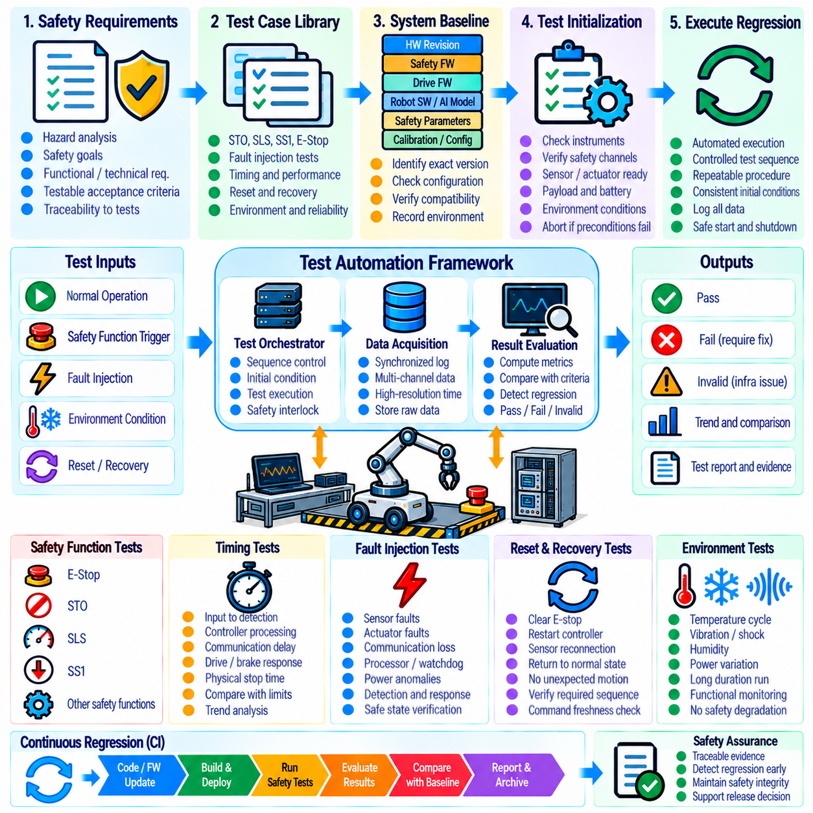{width="7.268055555555556in" height="7.268055555555556in"}

안전 시험 자동화 회귀 스위트(Safety Testing Automation Regression Suite)는 소프트웨어, 펌웨어, 하드웨어, 구성 및 AI 관련 변경으로 인해 이전에 검증된 로봇의 안전 동작이 저하되지 않는지를 반복적으로 검증하는 체계를 제공한다. 이 스위트는 핵심 안전 시험을 개발 전 과정에서 반복 실행할 수 있는 통제된 실행 절차로 전환한다. 목적은 변경된 시스템이 현장 운용에 투입되기 전에 안전 기능, 타이밍, 결함 처리, 정지 동작, 진단 및 복구 과정에서 발생하는 의도하지 않은 변화를 탐지하는 것이다.

회귀 스위트(Regression Suite)는 승인된 안전 요구사항(Safety Requirements), 위험원 분석(Hazard Analysis), 기능 안전 검증(Functional Safety Verification), 이전에 검증된 시험 절차에서 직접 도출되어야 한다. 각각의 자동화 시험은 해당 시험의 실행을 정당화하는 안전 요구사항 또는 위험 통제 목표(Risk-control Objective)와의 추적성을 유지해야 한다. 안전 토크 차단(Safe Torque Off, STO), 안전 제한 속도(Safely Limited Speed, SLS), 안전 정지 1(Safe Stop 1, SS1), 비상 정지, 결함 감지, 재시작 방지 및 기타 적용 가능한 안전 메커니즘에 대한 시험은 정의된 합격 기준을 유지해야 한다.

자동화 아키텍처(Automation Architecture)는 시험 오케스트레이션(Test Orchestration)과 평가 대상인 안전 기능을 분리해야 한다. 시험 제어기(Test Controller)는 초기 조건을 구성하고, 대표적인 로봇 동작을 명령하고, 시험 자극(Test Stimuli)을 활성화하고, 동기화된 측정값을 수집하고, 결과를 평가하고, 실행 후 시스템을 복원할 수 있다. 자동화 프레임워크 자체가 시험의 유효성을 훼손하는 방식으로 안전 경로(Safety Path)를 변경하거나 우회해서는 안 된다. 안전 주장이 물리적 움직임이나 하드웨어 응답에 의존하는 경우 독립적인 관측 수단을 유지해야 한다.

모든 회귀 시험 실행은 정확한 시스템 기준선(System Baseline)을 식별하는 것에서 시작해야 한다. 하드웨어 개정판, 안전 제어기 펌웨어, 드라이브 펌웨어, 운영체제, 로봇 소프트웨어, AI 모델, 안전 파라미터, 보정 데이터(Calibration Data), 네트워크 구성 및 관련 기계적 구성을 가능한 경우 자동으로 수집해야 한다. 통제되지 않은 기준선에서 얻은 결과는 신뢰할 수 있는 안전 증거를 제공할 수 없으므로, 알 수 없거나 일관되지 않은 구성에서 실행된 시험은 스위트에서 거부하거나 명확하게 표시해야 한다.

시험 초기화(Test Initialization)에서는 위험한 움직임을 허용하기 전에 계측 장비, 안전 채널, 센서, 액추에이터, 통신 링크, 클록 및 데이터 수집 시스템이 준비되었는지를 확인해야 한다. 필요한 경우 적재 하중(Payload), 배터리 상태, 운전 모드, 위치 추정 유효성(Localization Validity), 브레이크 상태 및 환경적 가정과 같은 사전 조건도 확인해야 한다. 필수 사전 조건이 충족되지 않은 경우 시험은 합격 또는 안전 실패로 잘못 판정하지 않고 무효 시험(Invalid Test)으로 종료해야 한다.

안전 기능 회귀 시험(Safety-function Regression Tests)은 STO, SLS, SS1, 비상 정지, 보호 정지(Protective Stopping) 및 기타 구현된 기능에 대해 이전에 검증된 활성화 및 응답 시퀀스를 재현해야 한다. 자동화 시스템은 작동 조건 인식, 상태 전이, 토크 차단(Torque Inhibition), 속도 제한, 제어된 감속(Controlled Deceleration), 최종 안전 상태(Safe State), 리셋 로직 및 의도하지 않은 재시작 방지를 검증해야 한다. 안전 응답에 실질적인 영향을 미치는 경우 대표적인 속도, 적재 하중, 이동 방향, 운전 모드 및 액추에이터 조건을 포함해야 한다.

기능 동작이 논리적으로 올바르게 유지되더라도 응답이 느려져 안전 요구사항을 충족하지 못할 수 있으므로 타이밍 회귀(Timing Regression)는 필수적이다. 자동화된 측정에서는 적용 가능한 경우 안전 입력 감지, 제어기 처리, 통신 지연, 드라이브 응답, 제동 또는 토크 제거, 실제 물리적 운동 종료까지 기록해야 한다. 결과는 절대적인 합격 한계(Absolute Acceptance Limits)와 승인된 과거 기준선(Historical Baselines) 모두와 비교하여 공식적인 안전 한계를 초과하기 전에 점진적인 타이밍 성능 저하(Timing Degradation)를 탐지할 수 있어야 한다.

결함 주입 회귀 시험(Fault-injection Regression)은 선택된 하드웨어, 소프트웨어, 센서, 액추에이터, 전원 및 통신 고장을 자동으로 발생시켜야 한다. 대표적인 사례에는 센서 데이터 손실, 측정값 고정, 통신 단절, 오래된 데이터(Stale Data), 감시 타이머 활성화(Watchdog Activation), 프로세서 재시작, 엔코더 불일치, 액추에이터 추종 편차, 중복 채널 손실이 포함된다. 각 시험에서는 감지 지연(Detection Latency), 진단 분류, 결함 격리 동작, 요구되는 안전 응답의 활성화, 지정된 안전 상태 또는 성능 저하 상태(Degraded State)의 달성을 확인해야 한다.

초기화 또는 상태 관리 로직(State-management Logic)의 변경은 결함 감지가 정상적으로 유지되는 경우에도 새로운 위험을 발생시킬 수 있으므로 회귀 시험에서는 리셋 및 복구 경로도 검증해야 한다. 비상 정지 해제, 통신 복원, 제어기 재시작, 센서 재연결 또는 성능 저하 운전에서의 복구가 예상하지 못한 움직임을 발생시켜서는 안 된다. 자동화 시스템은 정상 운전으로 복귀하기 전에 필요한 승인(Acknowledgement), 명령 최신성(Command Freshness), 액추에이터 준비 상태, 안전 조건 검증 및 올바른 복귀 시퀀스를 확인해야 한다.

스위트는 시험 실패(Test Failure)와 시험 인프라 실패(Test Infrastructure Failure)를 구분해야 한다. 안전 요구사항 위반, 과도한 정지 시간, 잘못된 상태 전이 또는 결함 대응 실패는 제품 실패(Product Failure)에 해당한다. 반면 텔레메트리 누락, 계측 장비 사용 불가, 시험 설정 실패, 동기화 손실 또는 자동화 제어기 오작동은 무효 실행이나 인프라 관련 실패로 분류해야 한다. 이러한 구분을 유지하면 신뢰할 수 없는 시험 장비가 제품의 적합성 또는 제품 실패에 대한 증거로 잘못 해석되는 것을 방지할 수 있다.

데이터 수집(Data Acquisition)은 모든 주요 결과를 재구성할 수 있을 정도로 충분한 정보를 보존해야 한다. 적용 가능한 경우 타임스탬프가 포함된 안전 입력, 제어기 상태, 드라이브 상태, 명령, 속도, 위치, 전류, 브레이크 신호, 진단 이벤트, 주입된 결함 및 환경 조건을 기록해야 한다. 원시 데이터(Raw Data)는 응답 시간, 정지 시간, 정지 거리, 최대 과속(Maximum Overspeed), 감지 지연, 결함 대응 시간과 같은 파생 지표(Derived Metrics)와 함께 보존하여 자동화된 판정을 독립적으로 검토할 수 있도록 해야 한다.

회귀 시험 결과는 버전 관리되는 합격 기준(Version-controlled Acceptance Criteria)에 따라 평가해야 한다. 시스템 동작이 업데이트 이후 변경되었다는 이유만으로 시험에서 새로운 임계값을 자동으로 적용해서는 안 된다. 안전 한계, 허용오차, 타이밍 예산(Timing Budgets), 예상 상태 전이를 변경하려면 문서화된 공학적 승인과 개정된 안전 요구사항에 대한 추적성이 필요하다. 이를 통해 회귀 자동화가 저하된 동작을 정상적인 것으로 받아들이는 것을 방지하고 기존 안전 논증(Safety Argument)의 연속성을 유지할 수 있다.

지속적 통합(Continuous Integration, CI)은 관련 소프트웨어, 펌웨어, 구성 또는 모델이 변경될 때 선택된 안전 시험을 자동으로 실행할 수 있다. 시뮬레이션 또는 하드웨어 인 더 루프(Hardware-in-the-Loop, HIL)만 필요한 시험은 자주 실행할 수 있으며, 실제 로봇 시험은 위험도, 장비 가용성 및 변경 영향에 따라 계획할 수 있다. 계층형 전략(Layered Strategy)을 적용하면 빠른 시험으로 명백한 회귀를 조기에 탐지하고, 움직임, 드라이브, 센서, 제동, 안전 제어기 또는 하드웨어 인터페이스에 영향을 미치는 변경에 대해서는 보다 장시간의 물리적 안전 시험을 수행할 수 있다.

모든 변경 사항에 대해 전체 안전 스위트를 실행할 필요는 없다. 변경 영향 분석(Change-impact Analysis)을 통해 영향을 받는 안전 요구사항, 구성요소, 인터페이스 및 위험원을 식별하고 이에 대응하는 회귀 시험 하위 집합(Regression Subset)을 선택할 수 있다. 그러나 하위 시스템 사이의 예상하지 못한 상호작용을 탐지하기 위해 승인된 전체 스위트를 주기적으로 실행하는 것도 중요하다. 시험 시간을 최적화하는 과정에서 필요한 안전 커버리지(Safety Coverage)가 점진적으로 제거되지 않도록 시험 선택 로직 자체도 통제해야 한다.

실패한 회귀 시험은 시스템 기준선, 시험 식별자, 요구사항 참조, 측정값, 예상 동작, 실제 동작 및 관련 로그를 포함하는 추적 가능한 조사 기록(Traceable Investigation Record)을 자동으로 생성해야 한다. 시정 변경(Corrective Changes) 이후에는 대상 재시험(Targeted Retesting)을 수행하고, 필요한 경우 보다 광범위한 회귀 시험을 수행해야 한다. 국부적인 수정이 다른 안전 기능에 영향을 줄 수 있기 때문이다. 객관적인 증거를 통해 영향을 받은 요구사항이 다시 충족되었음이 입증되기 전까지 해당 실패를 종결된 것으로 간주해서는 안 된다.

성숙한 안전 회귀 스위트(Safety Regression Suite)는 단순한 개발 편의 도구가 아니라 로봇의 지속적인 안전 증거(Continuing Safety Evidence)의 일부가 된다. 안전 기능, 응답 타이밍, 결함 허용성(Fault Tolerance), 진단, 복구, 구성 및 물리적 정지 동작을 반복적으로 검증함으로써 이전에 확립된 안전 무결성(Safety Integrity)을 통제되지 않은 변경으로부터 보호한다. 전체 구조에서 이 스위트는 안전 기능 시험, 결함 주입, 신뢰성 평가, 기능 안전 검증 및 안전 무결성 수준 달성(Safety Integrity Level Achievement) 과정에서 생성된 증거를 지속적으로 실행 가능한 검증 프로세스(Continuously Executable Verification Process)로 통합한다.
