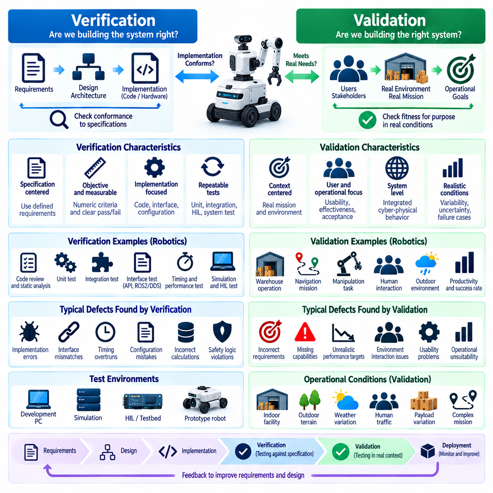
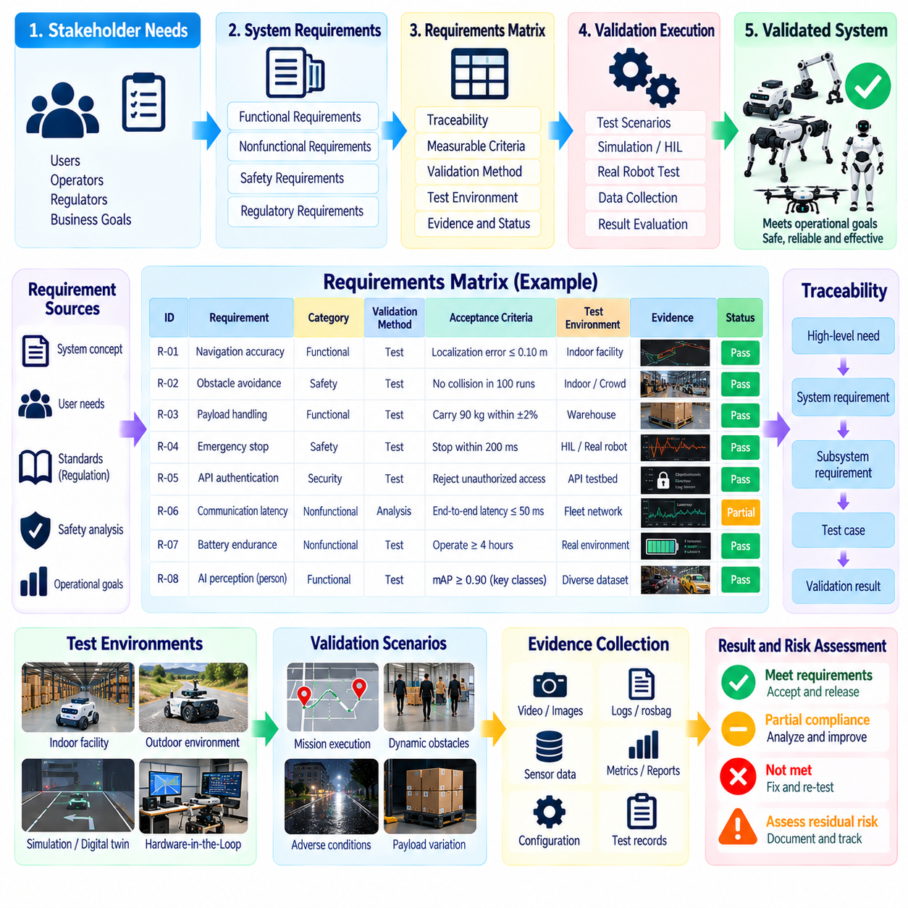
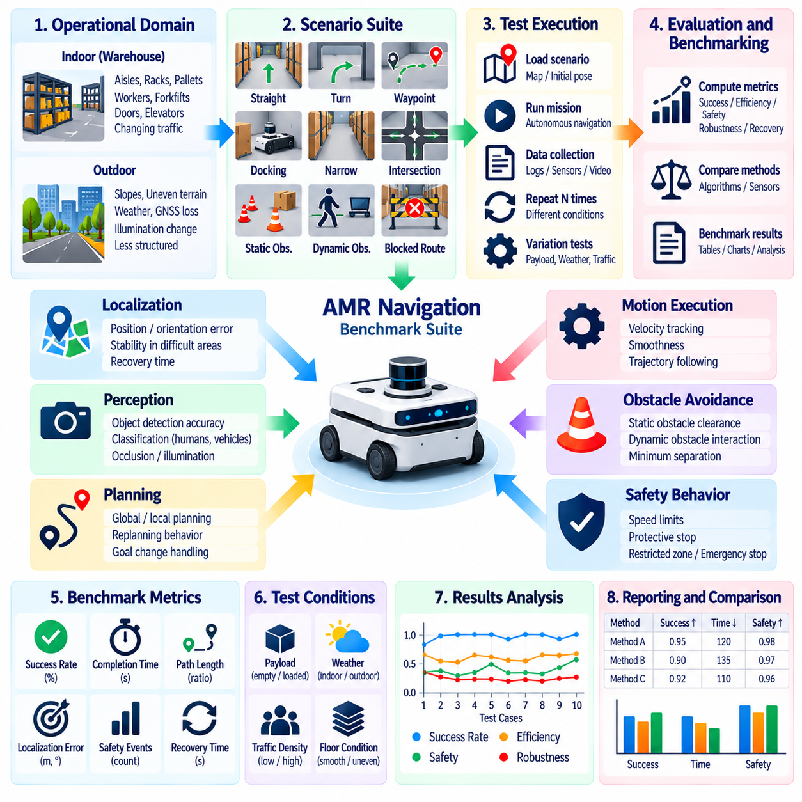
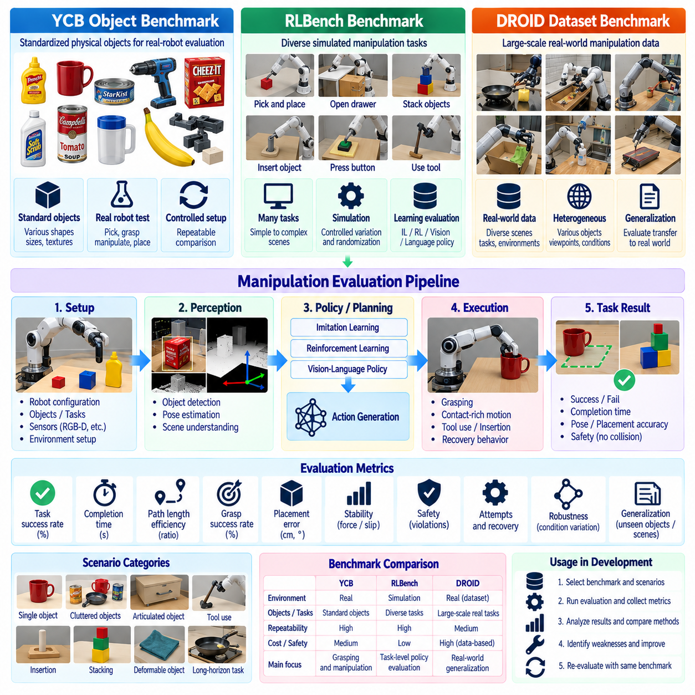
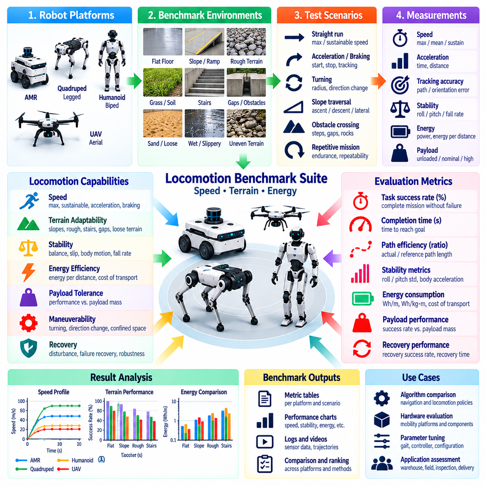
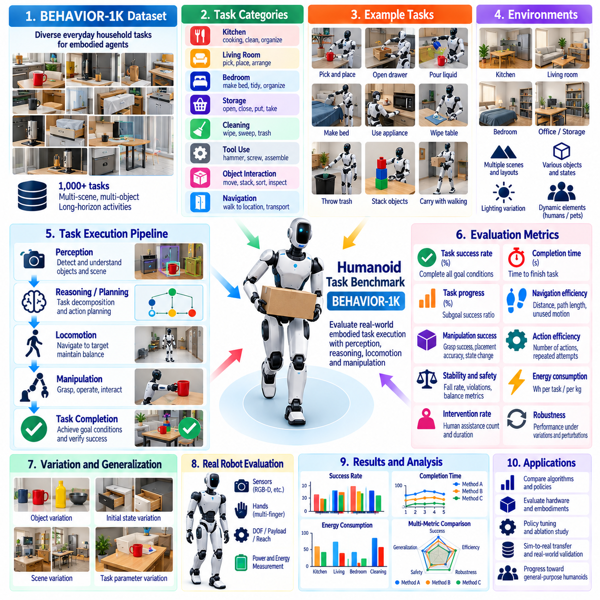
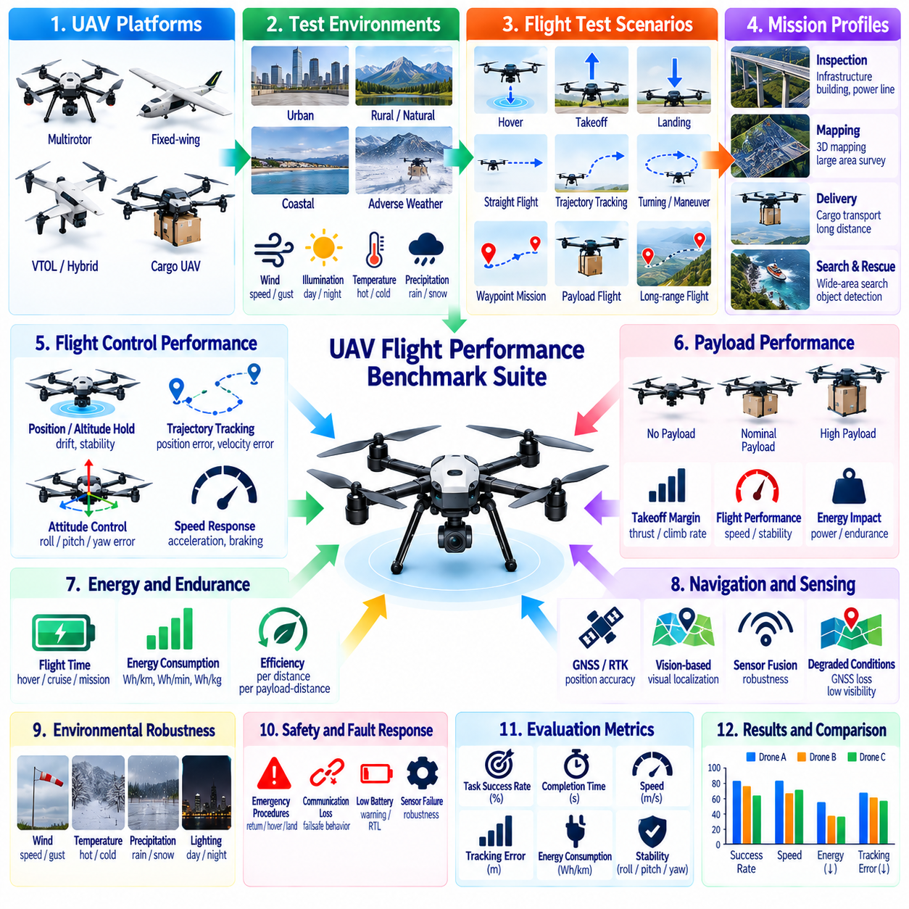
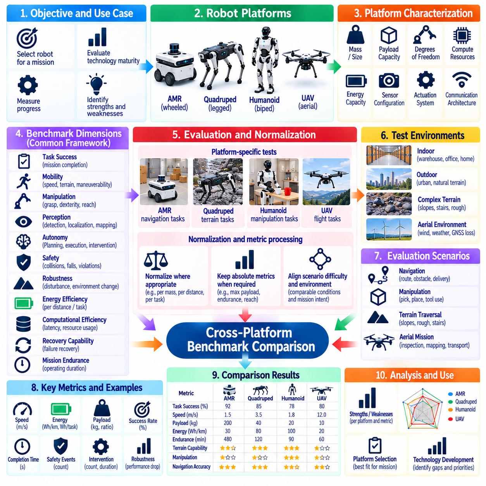
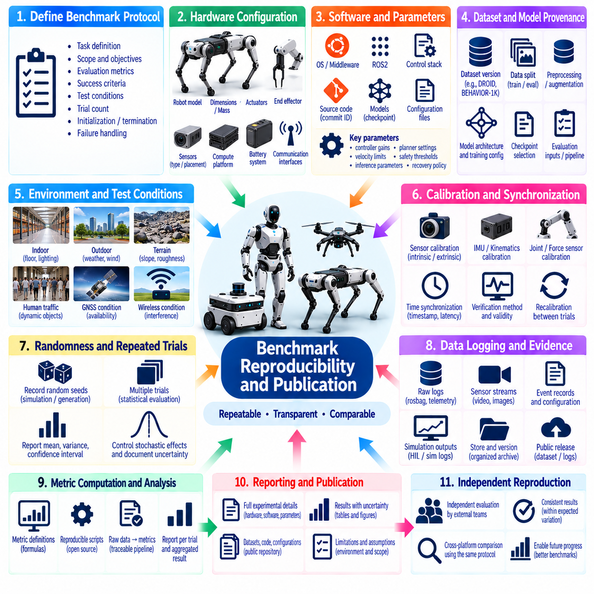
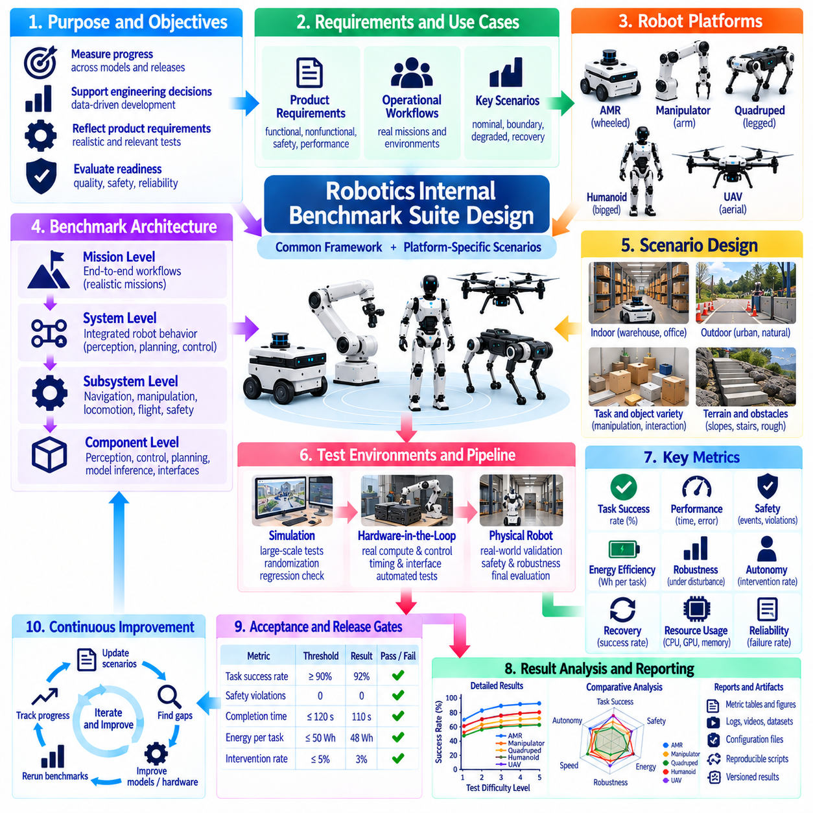

**Volume 25. Testing Validation and Benchmarking**


# Chapter 08. Validation and Benchmarking

##  

## 08.01. Validation vs Verification Conceptual Distinction

{width="7.268055555555556in" height="7.268055555555556in"}

Verification and validation are closely related quality assurance activities, but they answer fundamentally different questions about a robotic system. Verification determines whether the system has been implemented according to its specified requirements, architecture, interfaces, and design constraints. Validation determines whether the resulting system actually satisfies the intended operational need when used in representative conditions. This distinction is especially important in robotics because correct software implementation does not automatically imply correct physical behavior.

A common conceptual formulation describes verification as asking, "Are we building the system right?" while validation asks, "Are we building the right system?" Verification therefore focuses primarily on conformance between implementation artifacts and defined specifications. Validation focuses on fitness for purpose and the relationship between the completed system and its real mission, users, environment, and operational expectations. Both activities are necessary because a robot may pass every implementation-level test yet remain unsuitable for deployment.

Verification begins with explicit requirements that can be traced into architecture, software components, hardware interfaces, algorithms, and test cases. A requirement specifying a maximum emergency-stop response time, for example, can be verified by instrumenting the control chain and measuring the actual response. Software interfaces can similarly be checked against API definitions, message schemas, timing constraints, state-machine specifications, or safety logic. The objective is to produce repeatable evidence showing that implemented behavior conforms to what was formally specified.

Verification can occur at many levels of the robotics development hierarchy. Static analysis, code review, unit testing, integration testing, interface testing, simulation, Hardware-in-the-Loop testing, and system testing can all provide verification evidence. The important property is not the particular test environment but the reference against which results are judged. When observed behavior is compared directly with an engineering requirement or design specification, the activity is primarily verification, even when physical robot hardware participates in the test.

Validation instead evaluates the relationship between the engineered robot and its intended application. An autonomous mobile robot may correctly implement localization, planning, obstacle avoidance, and motion-control requirements while still failing to deliver acceptable warehouse productivity. Validation therefore examines realistic missions, workflows, environmental variability, human interaction, operational constraints, and failure conditions. Evidence must demonstrate that the integrated system performs useful work safely and effectively within its intended operational domain.

The distinction becomes clearer when considering navigation performance. Verification may establish that localization error remains below a specified threshold, commanded velocity is tracked within tolerance, planner interfaces operate correctly, and obstacle detection meets required latency. Validation asks whether these capabilities collectively allow the robot to transport material through actual facilities without unacceptable delays, unsafe interactions, frequent interventions, or mission failures. Component correctness is therefore necessary evidence, but system usefulness must be established separately.

Verification is typically specification-centered, whereas validation is context-centered. Verification requires precise acceptance criteria such as numerical tolerances, interface definitions, timing budgets, state transitions, and expected outputs. Validation requires a sufficiently representative description of the operational domain, including surfaces, lighting, traffic, obstacles, payloads, weather, human behavior, communication conditions, and mission complexity. Poorly defined requirements weaken verification, while an unrealistic operational environment weakens validation regardless of the amount of collected test data.

The two activities also differ in the types of defects they expose. Verification frequently identifies implementation defects such as incorrect calculations, violated interfaces, timing overruns, integration errors, configuration mistakes, or deviations from safety requirements. Validation more often reveals requirement defects, incorrect assumptions, missing capabilities, inappropriate performance targets, and unexpected interactions with the operating environment. A successfully verified system can therefore fail validation when the original requirements did not adequately represent the real problem.

Robotics makes validation unusually difficult because software outputs are converted into physical actions through sensors, actuators, mechanisms, communication networks, and control loops. Environmental uncertainty can affect every stage of this chain. Sensor noise, wheel slip, changing friction, actuator saturation, occlusion, illumination, terrain geometry, payload variation, and human movement may create behavior that was not apparent during software-level verification. Validation must consequently consider the complete cyber-physical system rather than evaluating isolated computational outputs alone.

For AI-enabled robots, the boundary becomes even more significant. Verification can confirm model packaging, tensor interfaces, preprocessing, inference execution, latency limits, memory usage, deployment configuration, and deterministic software surrounding an AI component. However, learned models cannot generally be characterized only through conventional functional requirements. Validation must evaluate whether perception or policy behavior remains acceptable across representative distributions, difficult scenarios, novel conditions, and operationally meaningful variations.

Validation should therefore use scenario coverage in addition to individual pass-or-fail requirements. Scenarios can represent nominal operation, boundary conditions, degraded sensing, unusual object configurations, dynamic obstacles, communication loss, environmental changes, or combinations of disturbances. Simulation enables large numbers of scenarios to be explored efficiently, while field testing provides evidence under physical conditions that simulation cannot perfectly reproduce. The broader volume structure accordingly places simulation-based validation and field testing before system benchmarking and validation. Volume_25_Testing_Validation_an...

Verification and validation should not be treated as sequential activities performed only at the end of development. Verification can begin with requirements and architecture reviews and continue through unit, integration, HIL, and system testing. Validation can also begin early through prototypes, simulation, user scenarios, operational demonstrations, and iterative field experiments. Early validation is particularly valuable because discovering that a technically correct system solves the wrong operational problem late in development can require expensive redesign.

Traceability provides the connection between these activities. Requirements should be associated with verification methods and objective evidence, while higher-level stakeholder needs and operational objectives should be associated with validation scenarios and measurable outcomes. A requirements matrix may show that every engineering requirement has been verified, but validation evidence must additionally demonstrate that those requirements collectively produce acceptable mission behavior. The chapter structure explicitly follows this conceptual distinction with system validation against a requirements matrix. Volume_25_Testing_Validation_an...

Benchmarking complements validation but should not be confused with it. A benchmark provides a standardized procedure, dataset, scenario set, metric definition, or test environment that allows performance to be measured consistently. Validation asks whether measured performance is sufficient for a particular intended use. A robot may achieve a strong benchmark score yet fail application-specific validation because the benchmark does not represent its deployment environment, payload, safety constraints, mission duration, or interaction patterns.

Conversely, successful validation within one operational domain does not automatically establish broad superiority. A warehouse AMR validated in structured indoor aisles may not be suitable for outdoor navigation, and a manipulation policy validated for a defined object set may not generalize to unfamiliar objects. Benchmarking helps expose these boundaries by providing common reference conditions across systems. The surrounding framework therefore separates navigation, manipulation, locomotion, humanoid, UAV, and cross-platform benchmark methodologies rather than assuming a universal metric. Volume_25_Testing_Validation_an...

A mature robotics quality process ultimately treats verification and validation as complementary evidence chains. Verification builds confidence that requirements have been implemented correctly and that subsystems behave according to specification. Validation builds confidence that those verified capabilities form a robot that performs its intended mission under representative real-world conditions. Benchmarking then supplies standardized measurements that support comparison, regression analysis, and engineering decisions across versions or platforms.

The practical goal is not merely to label individual tests as verification or validation, but to ensure that neither form of evidence is missing. Verification without validation can produce a precisely implemented system that is operationally inadequate. Validation without disciplined verification can produce encouraging demonstrations without sufficient evidence of correctness, repeatability, or safety. Effective robot engineering integrates both perspectives into a traceable process extending from requirements and software tests through simulation, HIL, field operation, benchmarking, and eventual certification evidence.

검증(Verification)과 유효성 확인(Validation)은 서로 밀접하게 연관된 품질 보증(Quality Assurance) 활동이지만, 로봇 시스템(Robotic System)에 대해 근본적으로 서로 다른 질문에 답한다. 검증(Verification)은 시스템이 명시된 요구사항(Requirements), 아키텍처(Architecture), 인터페이스(Interfaces), 설계 제약조건(Design Constraints)에 따라 구현되었는지를 판단한다. 반면 유효성 확인(Validation)은 완성된 시스템이 대표적인 운용 조건에서 사용될 때 실제 의도된 운용 요구(Operational Need)를 충족하는지를 판단한다. 이러한 구분은 올바른 소프트웨어 구현이 반드시 올바른 물리적 행동(Physical Behavior)을 의미하지 않는 로보틱스(Robotics)에서 특히 중요하다.

일반적인 개념적 표현에서 검증(Verification)은 "시스템을 올바르게 만들고 있는가?"라는 질문에 답하고, 유효성 확인(Validation)은 "올바른 시스템을 만들고 있는가?"라는 질문에 답한다. 따라서 검증은 구현 결과물(Implementation Artifacts)과 정의된 사양(Specifications) 사이의 적합성(Conformance)에 주로 초점을 맞춘다. 유효성 확인은 목적 적합성(Fitness for Purpose)과 완성된 시스템이 실제 임무(Mission), 사용자(Users), 환경(Environment), 운용 기대사항(Operational Expectations)에 부합하는지를 평가한다. 로봇이 모든 구현 수준 시험을 통과하더라도 실제 배치에 부적합할 수 있으므로 두 활동 모두 필요하다.

검증(Verification)은 아키텍처(Architecture), 소프트웨어 구성요소(Software Components), 하드웨어 인터페이스(Hardware Interfaces), 알고리즘(Algorithms), 시험 사례(Test Cases)까지 추적할 수 있는 명확한 요구사항에서 시작한다. 예를 들어 최대 비상 정지 응답 시간(Emergency-Stop Response Time)을 규정하는 요구사항은 제어 체인(Control Chain)을 계측하고 실제 응답을 측정함으로써 검증할 수 있다. 소프트웨어 인터페이스도 API 정의(API Definitions), 메시지 스키마(Message Schemas), 타이밍 제약조건(Timing Constraints), 상태 기계 사양(State-Machine Specifications), 안전 로직(Safety Logic)을 기준으로 확인할 수 있다. 목표는 구현된 동작이 공식적으로 정의된 요구사항과 일치한다는 반복 가능한 증거를 생성하는 것이다.

검증(Verification)은 로보틱스 개발 계층의 다양한 수준에서 수행될 수 있다. 정적 분석(Static Analysis), 코드 리뷰(Code Review), 단위 시험(Unit Testing), 통합 시험(Integration Testing), 인터페이스 시험(Interface Testing), 시뮬레이션(Simulation), 하드웨어 인 더 루프 시험(Hardware-in-the-Loop Testing), 시스템 시험(System Testing)은 모두 검증 증거(Verification Evidence)를 제공할 수 있다. 중요한 것은 특정 시험 환경 자체가 아니라 시험 결과를 어떤 기준과 비교하는가이다. 관찰된 동작을 엔지니어링 요구사항(Engineering Requirement)이나 설계 사양(Design Specification)과 직접 비교한다면 실제 로봇 하드웨어가 시험에 사용되더라도 해당 활동은 기본적으로 검증에 해당한다.

유효성 확인(Validation)은 설계된 로봇과 의도된 응용(Application) 사이의 관계를 평가한다. 자율이동로봇(Autonomous Mobile Robot)은 위치추정(Localization), 경로 계획(Planning), 장애물 회피(Obstacle Avoidance), 모션 제어(Motion Control) 요구사항을 정확하게 구현하면서도 실제 창고 생산성(Warehouse Productivity)을 만족시키지 못할 수 있다. 따라서 유효성 확인은 현실적인 임무(Missions), 작업 흐름(Workflows), 환경 변화(Environmental Variability), 인간 상호작용(Human Interaction), 운용 제약조건(Operational Constraints), 고장 조건(Failure Conditions)을 평가한다. 통합 시스템이 의도된 운용 영역(Operational Domain)에서 안전하고 효과적으로 유용한 작업을 수행한다는 증거가 필요하다.

내비게이션 성능(Navigation Performance)을 고려하면 두 개념의 차이가 더욱 명확해진다. 검증(Verification)은 위치추정 오차(Localization Error)가 지정된 임계값 이하인지, 명령 속도(Commanded Velocity)가 허용 오차 내에서 추종되는지, 플래너 인터페이스(Planner Interfaces)가 올바르게 동작하는지, 장애물 감지(Obstacle Detection)가 요구 지연시간(Latency)을 만족하는지를 확인할 수 있다. 반면 유효성 확인(Validation)은 이러한 기능들이 결합되어 실제 시설에서 과도한 지연, 위험한 상호작용, 빈번한 인간 개입 또는 임무 실패 없이 자재를 운송할 수 있는지를 평가한다. 따라서 구성요소의 정확성은 필수적인 증거이지만 시스템의 실질적인 유용성은 별도로 입증되어야 한다.

검증(Verification)은 일반적으로 사양 중심(Specification-Centered)인 반면, 유효성 확인(Validation)은 맥락 중심(Context-Centered)이다. 검증에는 수치 허용오차(Numerical Tolerances), 인터페이스 정의(Interface Definitions), 타이밍 예산(Timing Budgets), 상태 전이(State Transitions), 예상 출력(Expected Outputs)과 같은 명확한 합격 기준(Acceptance Criteria)이 필요하다. 유효성 확인에는 노면(Surfaces), 조명(Lighting), 교통(Traffic), 장애물(Obstacles), 탑재물(Payloads), 날씨(Weather), 인간 행동(Human Behavior), 통신 조건(Communication Conditions), 임무 복잡도(Mission Complexity)를 포함하는 충분히 대표적인 운용 영역 설명이 필요하다. 부실한 요구사항은 검증을 약화시키며, 비현실적인 운용 환경은 수집된 시험 데이터의 양과 관계없이 유효성 확인의 신뢰성을 약화시킨다.

두 활동은 발견하는 결함(Defects)의 유형에서도 차이가 있다. 검증(Verification)은 잘못된 계산, 인터페이스 위반, 타이밍 초과(Timing Overruns), 통합 오류(Integration Errors), 구성 오류(Configuration Mistakes), 안전 요구사항(Safety Requirements)으로부터의 이탈과 같은 구현 결함을 주로 발견한다. 유효성 확인(Validation)은 요구사항 자체의 결함, 잘못된 가정(Incorrect Assumptions), 누락된 기능(Missing Capabilities), 부적절한 성능 목표(Inappropriate Performance Targets), 운용 환경과의 예상하지 못한 상호작용을 발견하는 경우가 많다. 따라서 성공적으로 검증된 시스템이라도 최초 요구사항이 실제 문제를 충분히 반영하지 못했다면 유효성 확인에 실패할 수 있다.

로보틱스(Robotics)에서는 소프트웨어 출력이 센서(Sensors), 액추에이터(Actuators), 기계 구조(Mechanisms), 통신 네트워크(Communication Networks), 제어 루프(Control Loops)를 통해 물리적 행동으로 변환되기 때문에 유효성 확인(Validation)이 특히 어렵다. 환경의 불확실성(Environmental Uncertainty)은 이 전체 과정의 모든 단계에 영향을 줄 수 있다. 센서 노이즈(Sensor Noise), 휠 슬립(Wheel Slip), 마찰 변화(Changing Friction), 액추에이터 포화(Actuator Saturation), 가림(Occlusion), 조도(Illumination), 지형 형상(Terrain Geometry), 탑재물 변화(Payload Variation), 인간의 움직임(Human Movement)은 소프트웨어 수준의 검증에서는 나타나지 않았던 행동을 발생시킬 수 있다. 따라서 유효성 확인은 개별 계산 결과가 아니라 전체 사이버 물리 시스템(Cyber-Physical System)을 고려해야 한다.

AI 기반 로봇(AI-Enabled Robots)에서는 이러한 경계가 더욱 중요해진다. 검증(Verification)은 모델 패키징(Model Packaging), 텐서 인터페이스(Tensor Interfaces), 전처리(Preprocessing), 추론 실행(Inference Execution), 지연시간 제한(Latency Limits), 메모리 사용량(Memory Usage), 배포 구성(Deployment Configuration), AI 구성요소 주변의 결정론적 소프트웨어(Deterministic Software)를 확인할 수 있다. 그러나 학습 모델(Learned Models)은 일반적으로 기존의 기능 요구사항만으로 완전히 특성화하기 어렵다. 유효성 확인(Validation)은 대표적인 데이터 분포, 어려운 시나리오, 새로운 조건(Novel Conditions), 운용상 의미 있는 변화에서 인지(Perception) 또는 정책(Policy)의 동작이 허용 가능한 수준으로 유지되는지를 평가해야 한다.

따라서 유효성 확인(Validation)은 개별적인 합격·불합격 요구사항뿐 아니라 시나리오 커버리지(Scenario Coverage)를 활용해야 한다. 시나리오는 정상 운용(Nominal Operation), 경계 조건(Boundary Conditions), 센싱 성능 저하(Degraded Sensing), 비정상적인 객체 배치, 동적 장애물(Dynamic Obstacles), 통신 손실(Communication Loss), 환경 변화(Environmental Changes), 여러 교란의 조합을 표현할 수 있다. 시뮬레이션(Simulation)은 많은 시나리오를 효율적으로 탐색할 수 있게 하고, 필드 시험(Field Testing)은 시뮬레이션으로 완벽하게 재현할 수 없는 물리적 조건에서 증거를 제공한다. 따라서 전체 구성에서는 시뮬레이션 기반 유효성 확인(Simulation-Based Validation)과 필드 시험 방법론(Field Testing Methodology)을 시스템 벤치마킹(System Benchmarking)과 유효성 확인에 앞서 배치한다.

검증(Verification)과 유효성 확인(Validation)은 개발 마지막 단계에서만 순차적으로 수행되는 활동으로 간주해서는 안 된다. 검증은 요구사항 및 아키텍처 검토(Architecture Review)에서 시작하여 단위 시험, 통합 시험, HIL(Hardware-in-the-Loop), 시스템 시험까지 지속될 수 있다. 유효성 확인 역시 프로토타입(Prototypes), 시뮬레이션, 사용자 시나리오(User Scenarios), 운용 시연(Operational Demonstrations), 반복적인 필드 실험(Field Experiments)을 통해 초기 단계부터 수행할 수 있다. 기술적으로 올바른 시스템이 잘못된 운용 문제를 해결하고 있다는 사실을 개발 후반에 발견하면 막대한 재설계 비용이 발생할 수 있으므로 조기 유효성 확인(Early Validation)이 특히 중요하다.

추적성(Traceability)은 두 활동을 연결하는 핵심 요소이다. 요구사항은 검증 방법(Verification Methods) 및 객관적인 증거(Objective Evidence)와 연결되어야 하며, 상위 수준의 이해관계자 요구(Stakeholder Needs)와 운용 목표(Operational Objectives)는 유효성 확인 시나리오와 측정 가능한 결과에 연결되어야 한다. 요구사항 매트릭스(Requirements Matrix)를 통해 모든 엔지니어링 요구사항이 검증되었음을 보여줄 수 있지만, 유효성 확인 증거는 이러한 요구사항이 종합적으로 허용 가능한 임무 행동(Mission Behavior)을 만들어낸다는 사실까지 입증해야 한다.

벤치마킹(Benchmarking)은 유효성 확인(Validation)을 보완하지만 두 개념을 동일하게 취급해서는 안 된다. 벤치마크(Benchmark)는 성능을 일관되게 측정할 수 있도록 표준화된 절차(Standardized Procedure), 데이터셋(Dataset), 시나리오 집합(Scenario Set), 메트릭 정의(Metric Definition), 시험 환경(Test Environment)을 제공한다. 유효성 확인은 이렇게 측정된 성능이 특정한 의도된 사용 목적에 충분한지를 판단한다. 로봇이 높은 벤치마크 점수를 얻더라도 해당 벤치마크가 실제 배치 환경, 탑재물, 안전 제약조건, 임무 지속시간, 상호작용 패턴을 대표하지 않는다면 응용별 유효성 확인(Application-Specific Validation)에서는 실패할 수 있다.

반대로 하나의 운용 영역(Operational Domain)에서 성공적으로 유효성이 확인되었다고 해서 광범위한 우수성이 자동으로 입증되는 것은 아니다. 구조화된 실내 통로에서 유효성이 확인된 창고 자율이동로봇(AMR)은 실외 내비게이션에 적합하지 않을 수 있으며, 특정 객체 집합에서 검증된 조작 정책(Manipulation Policy)은 새로운 객체에 일반화되지 않을 수 있다. 벤치마킹(Benchmarking)은 시스템에 공통된 기준 조건을 적용함으로써 이러한 경계를 드러내는 데 도움을 준다. 따라서 내비게이션(Navigation), 조작(Manipulation), 이동운동(Locomotion), 휴머노이드(Humanoid), 무인항공기(UAV), 크로스 플랫폼(Cross-Platform) 벤치마크 방법론을 구분하고 단일한 범용 메트릭(Universal Metric)을 가정하지 않는 것이 중요하다.

성숙한 로보틱스 품질 프로세스(Robotics Quality Process)는 궁극적으로 검증(Verification)과 유효성 확인(Validation)을 상호 보완적인 증거 체계(Evidence Chains)로 다룬다. 검증은 요구사항이 올바르게 구현되었으며 하위 시스템(Subsystems)이 사양에 따라 동작한다는 신뢰를 구축한다. 유효성 확인은 이렇게 검증된 기능들이 결합되어 대표적인 실제 환경 조건에서 의도된 임무를 수행하는 로봇을 구성한다는 신뢰를 구축한다. 벤치마킹(Benchmarking)은 버전 또는 플랫폼 간 비교, 회귀 분석(Regression Analysis), 엔지니어링 의사결정(Engineering Decisions)을 지원하는 표준화된 측정값을 제공한다.

실질적인 목표는 개별 시험을 단순히 검증(Verification) 또는 유효성 확인(Validation)으로 분류하는 것이 아니라 어느 한쪽의 증거도 누락되지 않도록 하는 것이다. 유효성 확인 없는 검증은 정확하게 구현되었지만 운용상 부적합한 시스템을 만들 수 있다. 체계적인 검증이 없는 유효성 확인은 정확성(Correctness), 반복 가능성(Repeatability), 안전성(Safety)에 대한 충분한 증거 없이 인상적인 시연만 만들어낼 수 있다. 효과적인 로봇 엔지니어링(Robot Engineering)은 요구사항과 소프트웨어 시험에서 시작하여 시뮬레이션, HIL, 필드 운용(Field Operation), 벤치마킹, 최종 인증 증거(Certification Evidence)에 이르는 추적 가능한 프로세스에 두 관점을 통합한다.

##  

## 08.02. System Validation Against Requirements Matrix [w/Code]

{width="7.268055555555556in" height="7.268055555555556in"}

System validation against a requirements matrix provides a disciplined method for determining whether an integrated robot satisfies the capabilities, performance expectations, safety constraints, and operational objectives defined for its intended use. The matrix converts requirements into traceable validation obligations by connecting each requirement with its source, validation method, measurable acceptance criteria, test environment, evidence, and final status.

A requirements matrix should represent more than a checklist of completed tests. Each entry should describe a requirement in a form that can be objectively evaluated and connected to observable robot behavior. Functional requirements may address navigation, perception, manipulation, communication, charging, mission execution, or human interaction, while nonfunctional requirements may define latency, accuracy, reliability, availability, energy consumption, environmental tolerance, maintainability, or safety performance.

Requirement quality directly determines the quality of validation. Statements such as "the robot shall navigate accurately" are difficult to validate because they provide no measurable boundary. A stronger requirement specifies the operational conditions, performance metric, threshold, and relevant constraints. For example, localization accuracy may be defined for particular environments and operating speeds, allowing validation engineers to construct representative scenarios and determine objectively whether observed performance satisfies the intended requirement.

Traceability connects stakeholder needs to system requirements and then to validation evidence. A high-level requirement for safe autonomous material transport may decompose into requirements for obstacle detection, localization, path planning, braking, emergency stopping, payload handling, and fault response. The matrix preserves these relationships so that engineers can determine whether all necessary capabilities have been evaluated and whether failures at subsystem level affect satisfaction of higher-level operational objectives.

Every requirement should be assigned an appropriate validation method. Inspection can establish configuration or physical characteristics, analysis can evaluate calculated performance or accumulated statistical evidence, demonstration can confirm observable functionality, and testing can measure behavior under controlled conditions. Complex robotic requirements frequently require combinations of these methods because system behavior emerges from interactions among software, sensors, actuators, mechanical structures, networks, AI models, and environmental conditions.

Acceptance criteria translate requirements into explicit pass, fail, or conditional evaluation rules. Numerical thresholds should identify units, tolerances, sampling conditions, observation intervals, and statistical treatment when relevant. A navigation success requirement, for example, may require a defined percentage of missions to complete without collision or operator intervention while maintaining localization and timing limits. Such criteria prevent subjective judgments from being introduced after test results are already known.

The validation environment must also be represented in the matrix because performance without environmental context can be misleading. Indoor AMR validation may specify aisle width, floor condition, pedestrian density, obstacle types, lighting, payload, wireless coverage, and traffic patterns. Outdoor robots may additionally require slope, surface irregularity, weather, GNSS availability, and illumination ranges. UAV, quadruped, humanoid, and manipulation systems require similarly platform-specific descriptions of their operational conditions.

Validation scenarios transform matrix entries into executable system-level evaluations. A single scenario may validate several requirements simultaneously when the robot performs an integrated mission involving perception, planning, control, communication, and safety behavior. However, scenario reuse should not obscure traceability. The matrix should explicitly identify which observations and measurements provide evidence for each requirement so that one successful mission is not incorrectly interpreted as proof that every associated requirement has been satisfied.

System validation should include nominal conditions, boundary conditions, and reasonably foreseeable degraded conditions. Nominal tests demonstrate expected operation, while boundary tests examine behavior near specified performance limits. Degraded scenarios may introduce sensor deterioration, communication interruptions, localization uncertainty, dynamic obstacles, reduced battery state, or actuator limitations. The requirements matrix provides a systematic way to determine which conditions have been covered and where important validation gaps remain.

For AI-enabled robotic functions, matrix-based validation requires additional care because behavior may vary across data distributions and environmental conditions. A perception requirement cannot be validated adequately from a single aggregate accuracy value if critical object classes or difficult operating conditions are hidden within that average. Matrix entries can therefore associate AI requirements with datasets, scenario categories, operating domains, confidence measures, robustness criteria, and representative real-world trials.

Evidence management is an essential function of the requirements matrix. Validation results should reference test reports, logs, rosbag recordings, sensor streams, videos, measurement files, simulation records, software versions, calibration data, configuration files, and analysis outputs where appropriate. Evidence should be sufficiently complete to reconstruct the conditions under which a requirement was evaluated and to explain why the resulting status was classified as passed, failed, blocked, or requiring further investigation.

Configuration traceability is particularly important because robot behavior can change when software, firmware, AI models, parameters, hardware revisions, maps, or calibration values change. Validation evidence should therefore be associated with an identifiable system configuration. A requirement validated using one navigation-stack version or perception model cannot automatically be considered validated after a significant change unless impact analysis demonstrates that the previous evidence remains applicable or appropriate regression validation is performed.

The matrix also supports coverage analysis. Requirement coverage measures whether every applicable requirement has an assigned validation method and corresponding evidence, while scenario coverage evaluates whether representative operating conditions have been exercised. These perspectives should be considered together. Complete requirement coverage with narrow scenarios may overlook environmental weaknesses, whereas extensive scenario testing without traceability may generate large quantities of data without proving that contractual or engineering requirements were actually satisfied.

Failed requirements should remain visible rather than being hidden by aggregate success metrics. Each failure should be linked to observed evidence, probable cause, corrective action, responsible component, and planned revalidation activity. When a defect is corrected, the affected requirement should be evaluated again together with related requirements that could experience regression. This transforms the matrix from a static documentation artifact into an active control mechanism for validation and engineering change management.

The requirements matrix can also coordinate validation across simulation, Hardware-in-the-Loop testing, laboratory testing, and field testing. Some requirements can be evaluated efficiently through repeatable simulation, while timing and hardware interaction may require HIL. Physical safety behavior, environmental robustness, and mission-level suitability often require representative field conditions. Evidence from these environments should be complementary rather than treated as interchangeable when their realism and coverage differ.

Automation improves matrix maintenance when requirements, test cases, execution results, and evidence repositories are digitally connected. Continuous integration pipelines can automatically update execution status, attach logs, detect regression failures, and identify requirements affected by software changes. Nevertheless, automated test success should not automatically imply system validation success. Engineers must still determine whether the test configuration and scenarios adequately represent the intended operational conditions and acceptance rationale.

A validation review uses the completed matrix to assess readiness at system level. Reviewers should be able to move from an operational objective to its derived requirements, associated validation scenarios, acceptance criteria, execution records, and objective evidence without losing traceability. Open failures, waived requirements, assumptions, environmental limitations, and residual risks should remain explicit so that deployment decisions are based on known evidence rather than a simplified overall pass percentage.

Ultimately, system validation against a requirements matrix establishes an evidence-based argument that the integrated robot is suitable for its defined purpose. The matrix connects requirements engineering with simulation, HIL, field testing, AI evaluation, safety testing, and benchmarking, creating continuity across the broader validation process. When maintained throughout development, it becomes a living representation of what the robot must achieve, how achievement is demonstrated, what evidence exists, and which uncertainties remain before deployment.

요구사항 매트릭스(Requirements Matrix)를 기반으로 한 시스템 유효성 확인(System Validation)은 통합된 로봇이 의도된 사용 목적에 대해 정의된 기능(Capabilities), 성능 기대사항(Performance Expectations), 안전 제약조건(Safety Constraints), 운용 목표(Operational Objectives)를 충족하는지를 판단하기 위한 체계적인 방법을 제공한다. 매트릭스는 각 요구사항을 출처(Source), 유효성 확인 방법(Validation Method), 측정 가능한 합격 기준(Acceptance Criteria), 시험 환경(Test Environment), 증거(Evidence), 최종 상태(Final Status)와 연결하여 추적 가능한 유효성 확인 의무로 변환한다.

요구사항 매트릭스(Requirements Matrix)는 단순히 완료된 시험의 체크리스트(Checklist)만을 나타내서는 안 된다. 각 항목은 객관적으로 평가할 수 있고 관찰 가능한 로봇 동작과 연결할 수 있는 형태로 요구사항을 기술해야 한다. 기능 요구사항(Functional Requirements)은 내비게이션(Navigation), 인지(Perception), 조작(Manipulation), 통신(Communication), 충전(Charging), 임무 수행(Mission Execution), 인간 상호작용(Human Interaction)을 포함할 수 있으며, 비기능 요구사항(Nonfunctional Requirements)은 지연시간(Latency), 정확도(Accuracy), 신뢰성(Reliability), 가용성(Availability), 에너지 소비(Energy Consumption), 환경 내성(Environmental Tolerance), 유지보수성(Maintainability), 안전 성능(Safety Performance)을 정의할 수 있다.

요구사항 품질(Requirement Quality)은 유효성 확인(Validation)의 품질을 직접 결정한다. "로봇은 정확하게 주행해야 한다"와 같은 문장은 측정 가능한 경계가 없기 때문에 유효성을 확인하기 어렵다. 보다 강력한 요구사항은 운용 조건(Operational Conditions), 성능 메트릭(Performance Metric), 임계값(Threshold), 관련 제약조건(Constraints)을 명시한다. 예를 들어 위치추정 정확도(Localization Accuracy)를 특정 환경과 운용 속도에 대해 정의하면, 유효성 확인 엔지니어가 대표적인 시나리오를 구성하고 관찰된 성능이 의도된 요구사항을 충족하는지 객관적으로 판단할 수 있다.

추적성(Traceability)은 이해관계자 요구(Stakeholder Needs)를 시스템 요구사항(System Requirements)에 연결하고 다시 유효성 확인 증거(Validation Evidence)로 연결한다. 안전한 자율 자재 운송(Safe Autonomous Material Transport)이라는 상위 수준 요구사항은 장애물 감지(Obstacle Detection), 위치추정(Localization), 경로 계획(Path Planning), 제동(Braking), 비상 정지(Emergency Stopping), 탑재물 처리(Payload Handling), 고장 대응(Fault Response) 요구사항으로 분해될 수 있다. 매트릭스는 이러한 관계를 유지하여 모든 필수 기능이 평가되었는지, 하위 시스템 수준의 실패가 상위 운용 목표 충족에 영향을 미치는지를 판단할 수 있게 한다.

각 요구사항에는 적절한 유효성 확인 방법(Validation Method)이 지정되어야 한다. 검사(Inspection)는 구성 또는 물리적 특성을 확인할 수 있고, 분석(Analysis)은 계산된 성능이나 축적된 통계적 증거를 평가할 수 있으며, 시연(Demonstration)은 관찰 가능한 기능을 확인하고, 시험(Testing)은 통제된 조건에서 동작을 측정할 수 있다. 복잡한 로봇 요구사항은 소프트웨어, 센서(Sensors), 액추에이터(Actuators), 기계 구조(Mechanical Structures), 네트워크(Networks), AI 모델(AI Models), 환경 조건(Environmental Conditions)의 상호작용에서 시스템 동작이 나타나므로 이러한 방법을 조합하여 사용하는 경우가 많다.

합격 기준(Acceptance Criteria)은 요구사항을 명시적인 합격(Pass), 불합격(Fail), 조건부 평가(Conditional Evaluation) 규칙으로 변환한다. 수치 임계값(Numerical Thresholds)은 필요한 경우 단위(Units), 허용오차(Tolerances), 샘플링 조건(Sampling Conditions), 관찰 구간(Observation Intervals), 통계 처리(Statistical Treatment)를 명시해야 한다. 예를 들어 내비게이션 성공 요구사항은 충돌이나 운영자 개입 없이 일정 비율 이상의 임무를 완료하면서 위치추정 및 시간 제한을 유지하도록 정의할 수 있다. 이러한 기준은 시험 결과가 이미 알려진 이후 주관적인 판단이 도입되는 것을 방지한다.

유효성 확인 환경(Validation Environment) 역시 매트릭스에 표현되어야 한다. 환경적 맥락 없이 제시된 성능은 오해를 일으킬 수 있기 때문이다. 실내 자율이동로봇(AMR) 유효성 확인에서는 통로 폭(Aisle Width), 바닥 상태(Floor Condition), 보행자 밀도(Pedestrian Density), 장애물 유형(Obstacle Types), 조명(Lighting), 탑재물(Payload), 무선 통신 범위(Wireless Coverage), 교통 패턴(Traffic Patterns)을 지정할 수 있다. 실외 로봇은 추가적으로 경사(Slope), 노면 불규칙성(Surface Irregularity), 날씨(Weather), GNSS 가용성(GNSS Availability), 조도 범위(Illumination Ranges)가 필요할 수 있다. 무인항공기(UAV), 4족 로봇(Quadruped), 휴머노이드(Humanoid), 조작 시스템(Manipulation Systems) 역시 플랫폼별 운용 조건에 대한 설명이 필요하다.

유효성 확인 시나리오(Validation Scenarios)는 매트릭스 항목을 실행 가능한 시스템 수준 평가로 변환한다. 로봇이 인지(Perception), 계획(Planning), 제어(Control), 통신(Communication), 안전 동작(Safety Behavior)을 포함하는 통합 임무를 수행하는 경우 하나의 시나리오가 여러 요구사항을 동시에 확인할 수 있다. 그러나 시나리오의 재사용이 추적성(Traceability)을 불명확하게 만들어서는 안 된다. 하나의 성공적인 임무 수행이 관련된 모든 요구사항 충족의 증거로 잘못 해석되지 않도록, 각 요구사항에 어떤 관찰과 측정이 증거를 제공하는지 매트릭스에 명확히 기록해야 한다.

시스템 유효성 확인(System Validation)은 정상 조건(Nominal Conditions), 경계 조건(Boundary Conditions), 합리적으로 예측 가능한 성능 저하 조건(Degraded Conditions)을 포함해야 한다. 정상 시험(Nominal Tests)은 예상된 동작을 입증하며, 경계 시험(Boundary Tests)은 지정된 성능 한계 근처에서의 동작을 평가한다. 성능 저하 시나리오(Degraded Scenarios)는 센서 성능 저하, 통신 중단(Communication Interruptions), 위치추정 불확실성(Localization Uncertainty), 동적 장애물(Dynamic Obstacles), 낮은 배터리 상태(Reduced Battery State), 액추에이터 제한(Actuator Limitations)을 포함할 수 있다. 요구사항 매트릭스는 어떤 조건이 검토되었으며 중요한 유효성 확인 공백(Validation Gaps)이 어디에 남아 있는지를 체계적으로 판단할 수 있게 한다.

AI 기반 로봇 기능(AI-Enabled Robotic Functions)의 경우 동작이 데이터 분포(Data Distributions)와 환경 조건에 따라 달라질 수 있기 때문에 매트릭스 기반 유효성 확인(Matrix-Based Validation)에 추가적인 주의가 필요하다. 중요한 객체 클래스(Object Classes)나 어려운 운용 조건이 평균값 내부에 가려져 있다면 단일 종합 정확도(Aggregate Accuracy) 값만으로 인지 요구사항을 충분히 확인할 수 없다. 따라서 매트릭스 항목은 AI 요구사항을 데이터셋(Datasets), 시나리오 범주(Scenario Categories), 운용 영역(Operating Domains), 신뢰도 척도(Confidence Measures), 강건성 기준(Robustness Criteria), 대표적인 실제 환경 시험(Real-World Trials)과 연결할 수 있다.

증거 관리(Evidence Management)는 요구사항 매트릭스의 핵심 기능이다. 유효성 확인 결과는 필요한 경우 시험 보고서(Test Reports), 로그(Logs), 로스백 기록(rosbag Recordings), 센서 스트림(Sensor Streams), 비디오(Videos), 측정 파일(Measurement Files), 시뮬레이션 기록(Simulation Records), 소프트웨어 버전(Software Versions), 캘리브레이션 데이터(Calibration Data), 구성 파일(Configuration Files), 분석 결과(Analysis Outputs)를 참조해야 한다. 증거는 요구사항이 어떤 조건에서 평가되었는지를 재구성하고 결과가 합격, 불합격, 차단(Blocked), 추가 조사 필요로 분류된 이유를 설명할 수 있을 정도로 충분해야 한다.

구성 추적성(Configuration Traceability)은 소프트웨어, 펌웨어(Firmware), AI 모델, 파라미터(Parameters), 하드웨어 리비전(Hardware Revisions), 지도(Maps), 캘리브레이션 값(Calibration Values)이 변경될 때 로봇 동작도 변할 수 있기 때문에 특히 중요하다. 따라서 유효성 확인 증거는 식별 가능한 시스템 구성(System Configuration)과 연결되어야 한다. 특정 내비게이션 스택(Navigation Stack) 버전이나 인지 모델(Perception Model)을 사용해 확인된 요구사항은 중대한 변경 이후 이전 증거가 여전히 유효하다는 영향 분석(Impact Analysis)이 수행되거나 적절한 회귀 유효성 확인(Regression Validation)이 수행되지 않는 한 자동으로 유효한 것으로 간주할 수 없다.

매트릭스는 커버리지 분석(Coverage Analysis)도 지원한다. 요구사항 커버리지(Requirement Coverage)는 적용 가능한 모든 요구사항에 유효성 확인 방법과 해당 증거가 할당되어 있는지를 측정하며, 시나리오 커버리지(Scenario Coverage)는 대표적인 운용 조건이 실제로 평가되었는지를 판단한다. 이 두 관점은 함께 고려되어야 한다. 요구사항 커버리지가 완전하더라도 시나리오가 제한적이면 환경적 취약점을 놓칠 수 있으며, 추적성 없이 광범위한 시나리오 시험만 수행하면 계약 또는 엔지니어링 요구사항의 실제 충족 여부를 입증하지 못한 채 대량의 데이터만 생성할 수 있다.

실패한 요구사항(Failed Requirements)은 종합 성공 메트릭(Aggregate Success Metrics)에 가려지지 않고 명확하게 유지되어야 한다. 각 실패는 관찰된 증거, 추정 원인(Probable Cause), 시정 조치(Corrective Action), 담당 구성요소(Responsible Component), 계획된 재유효성 확인(Revalidation Activity)과 연결되어야 한다. 결함이 수정되면 해당 요구사항뿐만 아니라 회귀(Regression)가 발생할 가능성이 있는 관련 요구사항도 다시 평가해야 한다. 이를 통해 매트릭스는 정적인 문서가 아니라 유효성 확인과 엔지니어링 변경 관리(Engineering Change Management)를 위한 능동적인 제어 메커니즘으로 기능한다.

요구사항 매트릭스(Requirements Matrix)는 시뮬레이션(Simulation), 하드웨어 인 더 루프 시험(Hardware-in-the-Loop Testing), 실험실 시험(Laboratory Testing), 필드 시험(Field Testing) 전반의 유효성 확인을 조정하는 데에도 활용할 수 있다. 일부 요구사항은 반복 가능한 시뮬레이션을 통해 효율적으로 평가할 수 있지만, 타이밍(Timing)과 하드웨어 상호작용(Hardware Interaction)은 HIL이 필요할 수 있다. 물리적 안전 동작, 환경 강건성(Environmental Robustness), 임무 수준 적합성(Mission-Level Suitability)은 대표적인 필드 조건을 요구하는 경우가 많다. 이러한 환경에서 생성된 증거는 현실성과 커버리지가 서로 다를 수 있으므로 상호 교환 가능한 것으로 간주하기보다는 상호 보완적으로 사용해야 한다.

요구사항, 시험 사례(Test Cases), 실행 결과(Execution Results), 증거 저장소(Evidence Repositories)가 디지털 방식으로 연결되면 자동화(Automation)를 통해 매트릭스 유지관리를 개선할 수 있다. 지속적 통합 파이프라인(Continuous Integration Pipeline)은 실행 상태를 자동으로 갱신하고, 로그를 첨부하며, 회귀 실패(Regression Failures)를 감지하고, 소프트웨어 변경으로 영향을 받는 요구사항을 식별할 수 있다. 그러나 자동화된 시험의 성공이 자동으로 시스템 유효성 확인의 성공을 의미해서는 안 된다. 시험 구성과 시나리오가 의도된 운용 조건과 합격 근거(Acceptance Rationale)를 충분히 대표하는지는 여전히 엔지니어가 판단해야 한다.

유효성 확인 검토(Validation Review)는 완성된 매트릭스를 사용하여 시스템 수준의 준비도(Readiness)를 평가한다. 검토자는 추적성을 잃지 않고 하나의 운용 목표에서 파생된 요구사항(Derived Requirements), 관련 유효성 확인 시나리오, 합격 기준, 실행 기록(Execution Records), 객관적 증거(Objective Evidence)까지 추적할 수 있어야 한다. 미해결 실패(Open Failures), 면제된 요구사항(Waived Requirements), 가정(Assumptions), 환경적 제한(Environmental Limitations), 잔여 위험(Residual Risks)은 명확하게 유지되어야 하며, 이를 통해 배포 의사결정(Deployment Decisions)이 단순화된 전체 합격률이 아니라 알려진 증거를 기반으로 이루어질 수 있다.

궁극적으로 요구사항 매트릭스 기반 시스템 유효성 확인(System Validation Against a Requirements Matrix)은 통합된 로봇이 정의된 목적에 적합하다는 증거 기반 논증(Evidence-Based Argument)을 확립한다. 매트릭스는 요구사항 엔지니어링(Requirements Engineering)을 시뮬레이션, HIL, 필드 시험, AI 평가(AI Evaluation), 안전 시험(Safety Testing), 벤치마킹(Benchmarking)과 연결하여 전체 유효성 확인 프로세스에 연속성을 형성한다. 개발 전 과정에서 지속적으로 유지될 경우, 매트릭스는 로봇이 무엇을 달성해야 하는지, 그 달성을 어떻게 입증하는지, 어떤 증거가 존재하는지, 그리고 배포 전에 어떤 불확실성이 남아 있는지를 보여주는 살아 있는 표현(Living Representation)이 된다.

##  

## 08.03. AMR Navigation Benchmark Suite Design [w/Code]

{width="7.268055555555556in" height="7.268055555555556in"}

An AMR navigation benchmark suite should provide a repeatable framework for measuring how reliably and efficiently an autonomous mobile robot moves through representative operating environments. Rather than reducing navigation quality to a single success metric, the suite should evaluate localization, planning, obstacle avoidance, motion execution, safety behavior, efficiency, robustness, and recovery as interacting capabilities that collectively determine mission-level navigation performance.

Benchmark design begins by defining the operational domain that the results are intended to represent. Indoor warehouse AMRs may encounter narrow aisles, intersections, racks, pallets, workers, forklifts, doors, elevators, reflective surfaces, and changing traffic density. Outdoor platforms introduce slopes, uneven terrain, weather, GNSS degradation, illumination changes, and less structured boundaries. Benchmark conclusions should therefore remain explicitly bounded by the environments and conditions actually evaluated.

A useful suite organizes navigation tests into scenario families rather than relying on a single route. Basic scenarios can evaluate straight travel, turns, waypoint following, docking, and static obstacle avoidance. More demanding scenarios introduce narrow passages, intersections, dead ends, dense clutter, dynamic pedestrians, crossing traffic, blocked routes, temporary obstacles, and goal changes. This progression makes it possible to distinguish fundamental navigation limitations from failures that emerge only under complex interactions.

Mission success rate is a primary benchmark metric, but its definition must be precise. A successful trial may require reaching the assigned goal within a specified time without collision, safety violation, prohibited-area entry, or human intervention. Partial completion should not automatically be counted as success. Recording the cause of unsuccessful trials, such as localization loss, planning failure, collision risk, timeout, deadlock, or recovery failure, provides substantially more engineering value than a binary score alone.

Navigation efficiency should be evaluated together with success. Path length can be compared with a reference or feasible shortest path, while completion time measures operational efficiency under realistic motion constraints. Excessive replanning, oscillation, unnecessary stopping, and repeated recovery actions may indicate poor navigation quality even when the robot eventually reaches its goal. Benchmark metrics should therefore distinguish successful but inefficient behavior from consistently smooth and direct navigation.

Localization performance is another essential dimension because planning and control depend on an accurate estimate of robot state. Position and orientation error can be evaluated against suitable reference measurements, while benchmark scenarios should examine localization stability during turns, repetitive geometry, partial occlusion, feature-poor corridors, and environmental changes. Recovery time after temporary localization degradation is also important because practical AMRs must tolerate disturbances without immediately requiring operator assistance.

Obstacle avoidance benchmarks should include both static and dynamic objects. Static scenarios can measure clearance, path feasibility, stopping distance, and successful traversal around fixed obstacles. Dynamic scenarios should evaluate interactions with pedestrians, moving carts, other robots, or crossing vehicles at controlled speeds and trajectories. The benchmark should capture minimum separation distance, unnecessary stops, collision events, evasive behavior, and successful continuation after the interaction has ended.

Safety-related navigation measurements should remain distinct from pure productivity metrics. A fast robot that reaches goals efficiently but repeatedly violates required separation distances is not a high-performing navigation system. Tests should therefore monitor speed limits, protective stopping behavior, restricted zones, emergency responses, and interactions near humans where applicable. Safety events should be retained as explicit benchmark outcomes rather than being hidden inside an averaged navigation score.

Robustness testing examines whether navigation performance remains stable when operating conditions change. Scenario variations can modify payload, velocity, obstacle density, map accuracy, sensor visibility, floor characteristics, network quality, lighting, or localization conditions. Repeating equivalent missions under controlled perturbations reveals performance degradation that nominal tests may conceal. Robustness should be characterized by both absolute performance and the change relative to a defined baseline condition.

Recovery behavior deserves dedicated evaluation because real AMRs inevitably encounter situations that cannot be solved by nominal planning alone. Benchmark scenarios may deliberately create blocked paths, temporary localization uncertainty, planner infeasibility, controller oscillation, or communication interruptions. Measurements can include recovery success rate, recovery duration, number of attempts, distance traveled during recovery, and whether human intervention was ultimately required before mission execution could continue.

Repeatability is necessary for statistically meaningful comparison. Each benchmark scenario should be executed multiple times using controlled initial conditions and documented environmental configurations. Randomized scenarios may also be valuable, but random seeds and generation parameters should be preserved so that equivalent experiments can be reproduced. Reporting distributions, percentiles, variance, and failure frequencies provides a more reliable picture than reporting only the best run or arithmetic mean.

Benchmark infrastructure should capture synchronized evidence from the complete navigation stack. Robot pose, localization confidence, global and local plans, commanded and measured velocity, obstacle representations, safety states, controller outputs, CPU and GPU utilization, network conditions, battery state, and relevant sensor streams can be logged with consistent timestamps. These records allow benchmark scores to be connected to internal system behavior when regression analysis or root-cause investigation is required.

Simulation can provide large-scale scenario execution before physical testing. Identical navigation software can be exercised across many maps, obstacle configurations, pedestrian trajectories, sensor disturbances, and randomized initial states at relatively low cost. Simulation is particularly useful for regression benchmarking and rare situations, but simulated scores should not automatically be treated as equivalent to real-world performance because sensing, dynamics, friction, timing, and human behavior may differ from physical deployment.

Physical benchmark environments should complement simulation by measuring the integrated AMR under realistic sensing and motion conditions. Courses can reproduce corridors, intersections, narrow passages, loading areas, docking stations, dynamic traffic, and representative obstacles. Instrumentation should provide independent reference measurements where practical. Maintaining consistent layouts, route definitions, payloads, software versions, calibration states, and environmental conditions improves comparability across repeated benchmark campaigns.

A benchmark suite should support comparison across software releases without allowing configuration differences to invalidate conclusions. Every result should identify the robot platform, sensor configuration, navigation stack version, map, parameter set, firmware, payload, speed limits, and relevant compute configuration. When an algorithm or AI component changes, equivalent benchmark scenarios should be rerun so that improvements in one metric can be checked against regressions in safety, robustness, energy use, or mission completion.

Cross-platform comparison requires additional normalization because AMRs may differ substantially in dimensions, mass, maximum velocity, sensor coverage, drive configuration, and intended application. Raw completion time alone may unfairly favor faster platforms, while clearance or turning performance may depend strongly on robot geometry. Comparisons should therefore combine absolute operational measurements with normalized metrics and clearly state platform constraints rather than compressing fundamentally different robots into one universal ranking.

The final benchmark report should preserve individual metrics alongside any composite score. Aggregated scores are convenient for tracking releases or comparing configurations, but they can conceal critical weaknesses. Mission success, navigation efficiency, localization stability, dynamic obstacle handling, safety events, recovery performance, robustness, computational load, and energy consumption should remain independently visible so engineers can understand why one system performs differently from another.

An effective AMR navigation benchmark suite ultimately functions as both an evaluation framework and a regression control mechanism. By combining representative scenarios, measurable acceptance rules, synchronized evidence, repeated trials, simulation, and physical testing, it establishes a stable reference for navigation quality. Its greatest value comes not from producing a single ranking, but from revealing where navigation succeeds, where it degrades, how reliably results repeat, and whether each software or hardware change improves the robot as an operational system.

자율이동로봇(AMR) 내비게이션 벤치마크 스위트(Navigation Benchmark Suite)는 자율이동로봇이 대표적인 운용 환경에서 얼마나 신뢰성 있고 효율적으로 이동하는지를 측정하기 위한 반복 가능한 프레임워크(Framework)를 제공해야 한다. 내비게이션 품질을 하나의 성공 메트릭(Success Metric)으로 축소하기보다는 위치추정(Localization), 계획(Planning), 장애물 회피(Obstacle Avoidance), 모션 실행(Motion Execution), 안전 동작(Safety Behavior), 효율성(Efficiency), 강건성(Robustness), 복구(Recovery)를 상호작용하는 기능으로 평가해야 하며, 이들은 종합적으로 임무 수준 내비게이션 성능(Mission-Level Navigation Performance)을 결정한다.

벤치마크 설계(Benchmark Design)는 평가 결과가 대표하려는 운용 영역(Operational Domain)을 정의하는 것에서 시작한다. 실내 창고 자율이동로봇(AMR)은 좁은 통로, 교차로, 랙(Racks), 팔레트(Pallets), 작업자, 지게차, 문, 엘리베이터, 반사 표면, 변화하는 교통 밀도(Traffic Density)를 마주할 수 있다. 실외 플랫폼은 경사, 불규칙한 지형, 날씨, GNSS 성능 저하, 조도 변화, 덜 구조화된 경계를 추가로 고려해야 한다. 따라서 벤치마크 결과의 결론은 실제로 평가된 환경과 조건의 범위 내에서 명확하게 한정되어야 한다.

유용한 벤치마크 스위트(Benchmark Suite)는 하나의 경로에 의존하지 않고 내비게이션 시험을 시나리오 계열(Scenario Families)로 구성한다. 기본 시나리오는 직선 주행, 회전, 웨이포인트 추종(Waypoint Following), 도킹(Docking), 정적 장애물 회피를 평가할 수 있다. 보다 어려운 시나리오에서는 좁은 통로, 교차로, 막다른 길, 고밀도 장애물, 동적 보행자, 교차 교통, 차단된 경로, 임시 장애물, 목표 변경을 도입한다. 이러한 단계적 구성은 기본적인 내비게이션 한계와 복잡한 상호작용에서만 발생하는 실패를 구분할 수 있게 한다.

임무 성공률(Mission Success Rate)은 핵심 벤치마크 메트릭이지만 그 정의가 명확해야 한다. 성공적인 시험은 지정된 시간 안에 충돌(Collision), 안전 위반(Safety Violation), 금지 영역 진입(Prohibited-Area Entry), 인간 개입(Human Intervention) 없이 지정된 목표에 도달하는 것을 요구할 수 있다. 부분적인 임무 완료를 자동으로 성공으로 처리해서는 안 된다. 위치추정 손실(Localization Loss), 계획 실패(Planning Failure), 충돌 위험, 시간 초과(Timeout), 교착상태(Deadlock), 복구 실패(Recovery Failure)와 같은 실패 원인을 기록하면 단순한 이진 점수(Binary Score)보다 훨씬 높은 엔지니어링 가치를 제공한다.

내비게이션 효율성(Navigation Efficiency)은 성공 여부와 함께 평가되어야 한다. 경로 길이(Path Length)는 기준 경로나 실행 가능한 최단 경로와 비교할 수 있으며, 완료 시간(Completion Time)은 현실적인 모션 제약조건에서 운용 효율성을 측정한다. 과도한 재계획(Replanning), 진동(Oscillation), 불필요한 정지, 반복적인 복구 동작은 로봇이 최종적으로 목표에 도달하더라도 낮은 내비게이션 품질을 나타낼 수 있다. 따라서 벤치마크 메트릭은 성공했지만 비효율적인 동작과 일관되게 부드럽고 직접적인 내비게이션을 구분해야 한다.

위치추정 성능(Localization Performance) 역시 계획과 제어가 정확한 로봇 상태 추정(Robot State Estimation)에 의존하기 때문에 필수적인 평가 항목이다. 위치 및 방향 오차(Position and Orientation Error)는 적절한 기준 측정값(Reference Measurements)과 비교하여 평가할 수 있으며, 벤치마크 시나리오는 회전, 반복적인 기하 구조(Repetitive Geometry), 부분 가림(Partial Occlusion), 특징이 부족한 복도, 환경 변화에서 위치추정 안정성을 평가해야 한다. 일시적인 위치추정 성능 저하 이후의 복구 시간(Recovery Time)도 중요하며, 실제 AMR은 운영자의 즉각적인 지원 없이 이러한 교란을 견딜 수 있어야 한다.

장애물 회피 벤치마크(Obstacle Avoidance Benchmark)는 정적 객체와 동적 객체를 모두 포함해야 한다. 정적 시나리오에서는 여유 거리(Clearance), 경로 실행 가능성(Path Feasibility), 정지 거리(Stopping Distance), 고정 장애물 주변의 성공적인 통과를 측정할 수 있다. 동적 시나리오는 제어된 속도와 궤적을 갖는 보행자, 이동 카트, 다른 로봇, 교차 차량과의 상호작용을 평가해야 한다. 벤치마크는 최소 분리 거리(Minimum Separation Distance), 불필요한 정지, 충돌 이벤트(Collision Events), 회피 동작(Evasive Behavior), 상호작용 종료 후 성공적인 임무 지속 여부를 기록해야 한다.

안전 관련 내비게이션 측정(Safety-Related Navigation Measurements)은 순수한 생산성 메트릭(Productivity Metrics)과 구분되어야 한다. 목표에 빠르고 효율적으로 도달하더라도 요구된 분리 거리를 반복적으로 위반하는 로봇은 고성능 내비게이션 시스템으로 평가할 수 없다. 따라서 시험에서는 적용 가능한 속도 제한(Speed Limits), 보호 정지 동작(Protective Stopping Behavior), 제한 구역(Restricted Zones), 비상 대응(Emergency Responses), 인간 주변의 상호작용을 모니터링해야 한다. 안전 이벤트(Safety Events)는 평균화된 내비게이션 점수에 숨기지 않고 명시적인 벤치마크 결과로 유지해야 한다.

강건성 시험(Robustness Testing)은 운용 조건이 변화할 때 내비게이션 성능이 안정적으로 유지되는지를 평가한다. 시나리오 변형은 탑재물(Payload), 속도(Velocity), 장애물 밀도(Obstacle Density), 지도 정확도(Map Accuracy), 센서 가시성(Sensor Visibility), 바닥 특성(Floor Characteristics), 네트워크 품질(Network Quality), 조명(Lighting), 위치추정 조건을 변경할 수 있다. 제어된 교란 조건에서 동일한 임무를 반복하면 정상 시험에서 드러나지 않는 성능 저하를 확인할 수 있다. 강건성은 절대 성능과 정의된 기준 조건(Baseline Condition) 대비 성능 변화 모두를 통해 특성화해야 한다.

실제 AMR은 정상적인 계획만으로 해결할 수 없는 상황을 필연적으로 경험하므로 복구 동작(Recovery Behavior)은 별도로 평가할 필요가 있다. 벤치마크 시나리오는 의도적으로 차단된 경로, 일시적인 위치추정 불확실성(Localization Uncertainty), 플래너 실행 불가능 상태(Planner Infeasibility), 컨트롤러 진동(Controller Oscillation), 통신 중단(Communication Interruptions)을 생성할 수 있다. 측정 항목에는 복구 성공률(Recovery Success Rate), 복구 시간, 시도 횟수, 복구 중 이동 거리, 임무를 계속하기 전에 최종적으로 인간 개입이 필요했는지 여부를 포함할 수 있다.

통계적으로 의미 있는 비교를 위해서는 반복성(Repeatability)이 필요하다. 각 벤치마크 시나리오는 통제된 초기 조건(Initial Conditions)과 문서화된 환경 구성(Environmental Configurations)을 사용하여 여러 차례 실행해야 한다. 무작위 시나리오(Randomized Scenarios)도 유용할 수 있지만 동일한 실험을 재현할 수 있도록 난수 시드(Random Seeds)와 생성 파라미터(Generation Parameters)를 보존해야 한다. 최상의 실행 결과나 산술 평균(Arithmetic Mean)만 보고하는 것보다 분포(Distributions), 백분위수(Percentiles), 분산(Variance), 실패 빈도(Failure Frequencies)를 함께 보고하는 것이 더 신뢰할 수 있는 성능 정보를 제공한다.

벤치마크 인프라(Benchmark Infrastructure)는 전체 내비게이션 스택(Navigation Stack)에서 동기화된 증거를 수집해야 한다. 로봇 자세(Robot Pose), 위치추정 신뢰도(Localization Confidence), 전역 및 지역 경로(Global and Local Plans), 명령 및 측정 속도, 장애물 표현(Obstacle Representations), 안전 상태(Safety States), 컨트롤러 출력(Controller Outputs), CPU 및 GPU 사용률, 네트워크 상태, 배터리 상태, 관련 센서 스트림을 일관된 타임스탬프(Timestamps)로 기록할 수 있다. 이러한 기록은 회귀 분석(Regression Analysis)이나 근본 원인 분석(Root-Cause Investigation)이 필요한 경우 벤치마크 점수를 내부 시스템 동작과 연결할 수 있게 한다.

시뮬레이션(Simulation)은 물리적 시험 전에 대규모 시나리오 실행을 제공할 수 있다. 동일한 내비게이션 소프트웨어를 비교적 낮은 비용으로 다양한 지도, 장애물 구성, 보행자 궤적, 센서 교란(Sensor Disturbances), 무작위 초기 상태에서 실행할 수 있다. 시뮬레이션은 특히 회귀 벤치마킹(Regression Benchmarking)과 희귀 상황 평가에 유용하지만, 센싱(Sensing), 동역학(Dynamics), 마찰(Friction), 타이밍(Timing), 인간 행동이 실제 배포 환경과 다를 수 있으므로 시뮬레이션 점수를 실제 환경 성능과 자동으로 동일하게 취급해서는 안 된다.

물리적 벤치마크 환경(Physical Benchmark Environment)은 현실적인 센싱 및 모션 조건에서 통합된 AMR을 측정함으로써 시뮬레이션을 보완해야 한다. 시험 코스는 복도, 교차로, 좁은 통로, 적재 구역, 도킹 스테이션(Docking Stations), 동적 교통, 대표적인 장애물을 재현할 수 있다. 가능한 경우 계측 시스템(Instrumentation)은 독립적인 기준 측정값을 제공해야 한다. 일관된 레이아웃(Layout), 경로 정의(Route Definitions), 탑재물, 소프트웨어 버전, 캘리브레이션 상태(Calibration States), 환경 조건을 유지하면 반복되는 벤치마크 캠페인(Benchmark Campaigns) 사이의 비교 가능성을 향상시킬 수 있다.

벤치마크 스위트는 구성 차이(Configuration Differences)로 인해 결론의 유효성이 훼손되지 않도록 하면서 소프트웨어 릴리스(Software Releases) 간 비교를 지원해야 한다. 모든 결과에는 로봇 플랫폼, 센서 구성, 내비게이션 스택 버전, 지도, 파라미터 세트(Parameter Set), 펌웨어(Firmware), 탑재물, 속도 제한, 관련 컴퓨팅 구성(Compute Configuration)을 명시해야 한다. 알고리즘이나 AI 구성요소가 변경되면 동일한 벤치마크 시나리오를 다시 실행하여 하나의 메트릭 개선이 안전성, 강건성, 에너지 사용량, 임무 완료 성능의 회귀를 초래하지 않았는지 확인해야 한다.

크로스 플랫폼 비교(Cross-Platform Comparison)에는 AMR의 크기, 질량, 최대 속도, 센서 커버리지(Sensor Coverage), 구동 구성(Drive Configuration), 의도된 응용 분야가 크게 다를 수 있으므로 추가적인 정규화(Normalization)가 필요하다. 원시 완료 시간(Raw Completion Time)만 사용하면 빠른 플랫폼에 부당하게 유리할 수 있으며, 여유 거리나 회전 성능은 로봇 형상(Robot Geometry)에 크게 의존할 수 있다. 따라서 비교에서는 절대적인 운용 측정값과 정규화된 메트릭(Normalized Metrics)을 함께 사용하고, 근본적으로 다른 로봇을 하나의 범용 순위(Universal Ranking)로 압축하기보다는 플랫폼 제약조건을 명확히 제시해야 한다.

최종 벤치마크 보고서(Final Benchmark Report)는 종합 점수(Composite Score)와 함께 개별 메트릭을 유지해야 한다. 집계된 점수(Aggregated Scores)는 릴리스를 추적하거나 구성을 비교하는 데 편리하지만 중요한 취약점을 숨길 수 있다. 임무 성공률, 내비게이션 효율성, 위치추정 안정성, 동적 장애물 대응, 안전 이벤트, 복구 성능, 강건성, 계산 부하(Computational Load), 에너지 소비(Energy Consumption)는 각각 독립적으로 확인할 수 있어야 하며, 이를 통해 엔지니어는 한 시스템이 다른 시스템과 다른 성능을 보이는 이유를 이해할 수 있다.

효과적인 AMR 내비게이션 벤치마크 스위트(AMR Navigation Benchmark Suite)는 궁극적으로 평가 프레임워크(Evaluation Framework)이자 회귀 제어 메커니즘(Regression Control Mechanism)으로 기능한다. 대표적인 시나리오, 측정 가능한 합격 규칙(Acceptance Rules), 동기화된 증거(Synchronized Evidence), 반복 시험, 시뮬레이션, 물리적 시험을 결합함으로써 내비게이션 품질을 평가하는 안정적인 기준을 확립한다. 가장 큰 가치는 하나의 순위를 만드는 것이 아니라 내비게이션이 어디에서 성공하고 어디에서 성능이 저하되는지, 결과가 얼마나 신뢰성 있게 반복되는지, 그리고 각각의 소프트웨어 또는 하드웨어 변경이 운용 시스템으로서 로봇을 실제로 개선하는지를 밝혀내는 데 있다.

##  

## 08.04. Manipulation Benchmark YCB RLBench DROID [w/Code]

{width="7.268055555555556in" height="7.268055555555556in"}

Manipulation benchmarking evaluates whether a robot can perceive objects, generate suitable actions, execute contact-rich motion, and complete tasks reliably across variations in objects, scenes, and initial conditions. Unlike isolated perception or controller evaluation, manipulation benchmarks measure the integrated behavior of sensing, pose estimation, planning, grasping, force interaction, policy execution, and recovery. YCB, RLBench, and DROID provide complementary foundations for evaluating these different dimensions.

The YCB object set provides standardized physical objects that support repeatable manipulation experiments across laboratories and robot platforms. Objects span different shapes, dimensions, textures, masses, materials, and grasping characteristics, allowing researchers to evaluate grasping and manipulation under controlled diversity. Because identical or comparable objects can be used repeatedly, YCB-based tests are useful for establishing reproducible physical benchmarks rather than relying on arbitrary laboratory objects.

A YCB-based benchmark should define the object subset, initial pose distribution, workspace geometry, robot configuration, sensing arrangement, gripper type, and task objective. Pick-and-place experiments can measure whether the robot detects an object, approaches it safely, establishes a stable grasp, transports it, and releases it at the intended destination. More demanding tests can introduce clutter, occlusion, pose variation, restricted approach directions, or objects with difficult grasp geometry.

Task success rate is a fundamental manipulation metric, but success must be defined at the complete task level. A grasp should not automatically count as successful if the object is subsequently dropped, incorrectly oriented, or placed outside the target region. Benchmark definitions should specify terminal conditions such as stable acquisition, transport completion, placement accuracy, object integrity, and absence of prohibited collisions. Failure categories should remain available for diagnostic analysis.

Grasp performance can additionally be characterized through grasp success rate, number of attempts, grasp stability, object displacement before acquisition, and recovery after an unsuccessful attempt. For precision manipulation, pose error and placement error may be required. Contact-sensitive tasks can include peak force, force stability, slip events, and unintended contacts. Execution time and trajectory length provide efficiency measures, while repeated trials reveal whether apparently successful behavior is consistently reproducible.

RLBench extends manipulation evaluation from individual objects toward diverse task-level behavior in simulation. It provides structured robotic manipulation tasks in which policies can be evaluated across demonstrations, initial conditions, object arrangements, and task variations. This makes it suitable for benchmarking imitation learning, reinforcement learning, vision-based policies, and language-conditioned manipulation while reducing the cost and risk associated with executing every experimental variation on physical hardware.

An RLBench benchmark should control task definitions, observation modalities, camera configuration, action representation, training and evaluation splits, randomization ranges, and success conditions. Comparisons become unreliable when one policy receives privileged state information while another operates only from visual observations. The benchmark protocol must therefore document what information is available to each policy and preserve equivalent evaluation conditions when comparing algorithms or model versions.

Task diversity is central to RLBench evaluation. Simple reaching or pick-and-place behavior may expose basic policy competence, while opening containers, manipulating tools, inserting objects, pressing controls, stacking items, or executing multi-stage tasks evaluates more complex reasoning and control. Performance should be reported across individual task categories because a single averaged success rate can conceal severe weaknesses in particular manipulation skills or interaction patterns.

Generalization can be measured by separating training conditions from evaluation conditions. Object positions, orientations, visual appearances, scene arrangements, or task parameters can be varied beyond combinations encountered during training. The resulting performance difference provides evidence about whether a policy has learned transferable manipulation behavior or primarily memorized familiar configurations. Generalization results should therefore identify precisely which dimensions were held out or changed.

DROID contributes a different perspective by providing large-scale real-world robot manipulation data collected across diverse scenes, tasks, and physical conditions. Its value for benchmarking lies in exposing learning systems to the variability and imperfections that characterize real robot operation. Compared with tightly controlled simulation, real-world datasets capture changes in viewpoints, backgrounds, object arrangements, demonstrations, execution styles, and environmental conditions that are difficult to model completely.

A DROID-based evaluation can examine how manipulation models learn from heterogeneous demonstrations and how effectively they transfer across tasks or environments. Dataset partitions should prevent unintended leakage between training and evaluation conditions, particularly when assessing generalization. Evaluation protocols should document the demonstrations, observation streams, action representations, preprocessing, model checkpoints, and selection criteria used so that performance differences can be attributed to the method rather than hidden data differences.

YCB, RLBench, and DROID should not be interpreted as interchangeable benchmarks. YCB emphasizes standardized physical objects and supports controlled real-world manipulation experiments. RLBench provides repeatable simulated tasks with configurable variations suitable for large-scale policy evaluation. DROID provides diverse real-world manipulation experience for data-driven robot learning. Their combination can therefore cover standardized objects, scalable task variation, and realistic data diversity within a broader manipulation evaluation strategy.

A layered benchmark can use simulation for rapid policy screening, standardized physical objects for controlled hardware validation, and diverse real-world data or environments for broader generalization assessment. A policy that performs strongly in RLBench can first be examined for task competence and robustness, then evaluated with YCB objects on physical hardware, and finally challenged under less controlled real-world conditions. This progression helps expose the gap between simulated competence and operational manipulation capability.

Sim-to-real differences should be measured rather than treated as incidental implementation problems. Policies may degrade because of camera calibration errors, depth noise, lighting, actuator dynamics, gripper compliance, friction, latency, object mass, or contact uncertainty. Equivalent task definitions across simulated and physical tests allow engineers to quantify performance loss and identify which assumptions fail during transfer. Such evidence is essential when simulation is used as a major development environment.

Benchmark reproducibility requires configuration traceability. Results should identify the robot arm, end effector, sensors, camera placement, control frequency, compute platform, software revision, model checkpoint, dataset version, random seeds, and task configuration. Physical experiments should additionally record calibration state and relevant environmental conditions. Without this information, apparently small configuration changes may produce performance differences that are incorrectly attributed to the manipulation algorithm.

Statistical reporting should reflect the stochastic nature of manipulation. Each task should be repeated across sufficient initial conditions and trials, and results should include success distributions rather than only selected demonstrations. Confidence intervals, failure frequencies, completion-time distributions, and performance across task categories can reveal instability hidden by a single average. For learned policies, evaluation across multiple seeds or checkpoints can further distinguish systematic capability from favorable training outcomes.

Failure taxonomy is particularly valuable for manipulation benchmarking. Failures may originate from perception, target selection, grasp planning, approach motion, collision avoidance, contact establishment, grasp stability, transport, placement, policy sequencing, or recovery. Assigning failures to consistent categories allows benchmark results to guide engineering improvement. It also prevents two systems with identical success rates but fundamentally different failure mechanisms from being treated as equivalent.

The benchmark should preserve separate measures for capability, robustness, efficiency, and safety rather than collapsing all behavior into one score. A policy may achieve high task success while requiring excessive retries, producing large contact forces, or depending on narrowly controlled scenes. Another may operate more slowly but generalize reliably across objects and environments. Maintaining multiple metrics makes these engineering tradeoffs visible and supports deployment decisions based on the intended manipulation application.

An effective manipulation benchmark combining YCB, RLBench, and DROID ultimately creates a progression from standardized physical interaction through scalable simulated tasks to diverse real-world learning conditions. The objective is not to declare one universal manipulation score, but to establish repeatable evidence about task success, grasp quality, generalization, robustness, efficiency, and transfer. Together, these benchmarks help determine whether manipulation intelligence remains reliable beyond demonstrations and can support practical robotic operation.

조작 벤치마킹(Manipulation Benchmarking)은 로봇이 객체를 인지하고, 적절한 행동을 생성하며, 접촉이 수반되는 동작(Contact-Rich Motion)을 실행하고, 객체·장면·초기 조건의 변화 속에서도 작업을 신뢰성 있게 완료할 수 있는지를 평가한다. 개별적인 인지 또는 제어기 평가와 달리 조작 벤치마크는 센싱(Sensing), 자세 추정(Pose Estimation), 계획(Planning), 파지(Grasping), 힘 상호작용(Force Interaction), 정책 실행(Policy Execution), 복구(Recovery)가 통합된 동작을 측정한다. YCB, RLBench, DROID는 이러한 서로 다른 평가 차원을 위한 상호 보완적인 기반을 제공한다.

YCB 객체 세트(YCB Object Set)는 여러 연구실과 로봇 플랫폼에서 반복 가능한 조작 실험을 지원하는 표준화된 물리 객체를 제공한다. 객체는 다양한 형상, 크기, 질감, 질량, 재질, 파지 특성(Grasping Characteristics)을 포함하므로 연구자는 통제된 다양성 아래에서 파지와 조작 성능을 평가할 수 있다. 동일하거나 비교 가능한 객체를 반복적으로 사용할 수 있기 때문에 YCB 기반 시험은 임의의 실험실 객체에 의존하지 않고 재현 가능한 물리적 벤치마크(Physical Benchmark)를 구축하는 데 유용하다.

YCB 기반 벤치마크는 객체 하위 집합(Object Subset), 초기 자세 분포(Initial Pose Distribution), 작업공간 형상(Workspace Geometry), 로봇 구성(Robot Configuration), 센싱 구성(Sensing Arrangement), 그리퍼 유형(Gripper Type), 작업 목표(Task Objective)를 정의해야 한다. 픽앤플레이스(Pick-and-Place) 실험에서는 로봇이 객체를 감지하고, 안전하게 접근하며, 안정적인 파지를 형성하고, 객체를 운반하여 의도된 목적지에 놓을 수 있는지를 측정할 수 있다. 더 어려운 시험에서는 클러터(Clutter), 가림(Occlusion), 자세 변화, 제한된 접근 방향, 파지가 어려운 형상의 객체를 도입할 수 있다.

작업 성공률(Task Success Rate)은 기본적인 조작 메트릭이지만 성공 여부는 전체 작업 수준에서 정의되어야 한다. 객체를 파지한 이후 떨어뜨리거나, 잘못된 방향으로 놓거나, 목표 영역 밖에 배치했다면 파지만으로 성공으로 간주해서는 안 된다. 벤치마크 정의에는 안정적인 획득(Stable Acquisition), 운반 완료(Transport Completion), 배치 정확도(Placement Accuracy), 객체 무결성(Object Integrity), 금지된 충돌의 부재와 같은 종료 조건(Terminal Conditions)을 명시해야 한다. 실패 범주(Failure Categories)도 진단 분석을 위해 유지해야 한다.

파지 성능(Grasp Performance)은 파지 성공률, 시도 횟수, 파지 안정성(Grasp Stability), 획득 전 객체 변위(Object Displacement), 실패한 시도 이후의 복구 성능을 통해 추가로 특성화할 수 있다. 정밀 조작(Precision Manipulation)에서는 자세 오차(Pose Error)와 배치 오차(Placement Error)가 필요할 수 있다. 접촉에 민감한 작업은 최대 힘(Peak Force), 힘 안정성(Force Stability), 미끄러짐 이벤트(Slip Events), 의도하지 않은 접촉을 포함할 수 있다. 실행 시간과 궤적 길이(Trajectory Length)는 효율성을 나타내며, 반복 시험은 성공적으로 보이는 동작이 일관되게 재현되는지를 보여준다.

RLBench는 개별 객체 중심의 평가를 넘어 시뮬레이션(Simulation)에서 다양한 작업 수준 동작(Task-Level Behavior)을 평가하도록 조작 벤치마킹을 확장한다. RLBench는 시연(Demonstrations), 초기 조건, 객체 배치, 작업 변화에 따라 정책(Policy)을 평가할 수 있는 구조화된 로봇 조작 작업을 제공한다. 따라서 모든 실험 변형을 물리적 하드웨어에서 수행할 때 발생하는 비용과 위험을 줄이면서 모방학습(Imitation Learning), 강화학습(Reinforcement Learning), 비전 기반 정책(Vision-Based Policies), 언어 조건부 조작(Language-Conditioned Manipulation)을 벤치마킹하는 데 적합하다.

RLBench 벤치마크는 작업 정의(Task Definitions), 관측 모달리티(Observation Modalities), 카메라 구성(Camera Configuration), 행동 표현(Action Representation), 학습 및 평가 분할(Training and Evaluation Splits), 무작위화 범위(Randomization Ranges), 성공 조건(Success Conditions)을 통제해야 한다. 하나의 정책이 특권 상태 정보(Privileged State Information)를 제공받고 다른 정책은 시각 관측만으로 동작한다면 비교의 신뢰성이 저하된다. 따라서 벤치마크 프로토콜은 각 정책이 사용할 수 있는 정보를 문서화하고 알고리즘이나 모델 버전을 비교할 때 동등한 평가 조건을 유지해야 한다.

작업 다양성(Task Diversity)은 RLBench 평가의 핵심이다. 단순한 도달(Reaching)이나 픽앤플레이스 동작은 기본적인 정책 능력을 평가할 수 있지만, 용기 열기, 도구 조작, 객체 삽입, 제어 장치 누르기, 물체 쌓기, 다단계 작업(Multi-Stage Tasks)의 실행은 더욱 복잡한 추론과 제어 능력을 평가한다. 하나의 평균 성공률이 특정 조작 기술이나 상호작용 패턴의 심각한 취약성을 숨길 수 있으므로 성능은 개별 작업 범주(Task Categories)에 따라 보고되어야 한다.

일반화(Generalization)는 학습 조건과 평가 조건을 분리함으로써 측정할 수 있다. 객체 위치, 방향, 시각적 외형, 장면 구성, 작업 파라미터(Task Parameters)를 학습 과정에서 경험한 조합을 넘어 변화시킬 수 있다. 그에 따른 성능 차이는 정책이 전이 가능한 조작 동작(Transferable Manipulation Behavior)을 학습했는지, 아니면 익숙한 구성만을 주로 기억했는지를 판단하는 증거가 된다. 따라서 일반화 결과에서는 어떤 차원이 학습에서 제외되었거나 변경되었는지를 명확하게 식별해야 한다.

DROID는 다양한 장면, 작업, 물리적 조건에서 수집된 대규모 실제 로봇 조작 데이터(Large-Scale Real-World Robot Manipulation Data)를 제공함으로써 다른 관점을 제시한다. 벤치마킹에서 DROID의 가치는 실제 로봇 운용을 특징짓는 다양성과 불완전성에 학습 시스템을 노출시키는 데 있다. 엄격하게 통제된 시뮬레이션과 비교하면 실제 환경 데이터셋은 시점(Viewpoints), 배경(Backgrounds), 객체 배치, 시연, 실행 방식(Execution Styles), 환경 조건의 변화를 포함하며, 이러한 요소는 완전하게 모델링하기 어렵다.

DROID 기반 평가는 조작 모델이 이질적인 시연(Heterogeneous Demonstrations)으로부터 어떻게 학습하는지와 작업 또는 환경 사이에서 얼마나 효과적으로 전이되는지를 평가할 수 있다. 특히 일반화를 평가할 때 데이터셋 분할(Dataset Partitions)은 학습 조건과 평가 조건 사이의 의도하지 않은 데이터 누출(Data Leakage)을 방지해야 한다. 평가 프로토콜은 사용된 시연, 관측 스트림(Observation Streams), 행동 표현, 전처리(Preprocessing), 모델 체크포인트(Model Checkpoints), 선택 기준(Selection Criteria)을 문서화하여 성능 차이가 숨겨진 데이터 차이가 아니라 평가 대상 방법에서 발생했음을 확인할 수 있어야 한다.

YCB, RLBench, DROID를 서로 대체 가능한 벤치마크로 해석해서는 안 된다. YCB는 표준화된 물리 객체를 강조하며 통제된 실제 환경 조작 실험을 지원한다. RLBench는 대규모 정책 평가에 적합한 구성 가능한 변형과 반복 가능한 시뮬레이션 작업을 제공한다. DROID는 데이터 기반 로봇 학습(Data-Driven Robot Learning)을 위한 다양한 실제 조작 경험을 제공한다. 따라서 이들을 결합하면 보다 광범위한 조작 평가 전략 안에서 표준화된 객체, 확장 가능한 작업 변화, 실제 데이터 다양성을 함께 다룰 수 있다.

계층화된 벤치마크(Layered Benchmark)는 빠른 정책 선별(Policy Screening)을 위해 시뮬레이션을 사용하고, 통제된 하드웨어 유효성 확인(Hardware Validation)을 위해 표준화된 물리 객체를 사용하며, 보다 폭넓은 일반화 평가를 위해 다양한 실제 데이터 또는 환경을 활용할 수 있다. RLBench에서 우수한 성능을 보이는 정책을 먼저 작업 능력과 강건성 측면에서 평가한 후 YCB 객체를 이용해 실제 하드웨어에서 평가하고, 마지막으로 통제 수준이 낮은 실제 환경 조건에서 시험할 수 있다. 이러한 과정은 시뮬레이션에서의 능력과 실제 운용 조작 능력 사이의 차이를 드러내는 데 도움이 된다.

시뮬레이션에서 실제 환경으로의 차이(Sim-to-Real Differences)는 부수적인 구현 문제로 취급하지 말고 측정해야 한다. 정책 성능은 카메라 캘리브레이션 오류(Camera Calibration Errors), 깊이 노이즈(Depth Noise), 조명, 액추에이터 동역학(Actuator Dynamics), 그리퍼 컴플라이언스(Gripper Compliance), 마찰(Friction), 지연시간(Latency), 객체 질량, 접촉 불확실성(Contact Uncertainty) 때문에 저하될 수 있다. 시뮬레이션과 물리적 시험에서 동일한 작업 정의를 사용하면 엔지니어는 성능 손실을 정량화하고 실제 환경 전이 과정에서 어떤 가정이 실패하는지 식별할 수 있다. 이러한 증거는 시뮬레이션을 주요 개발 환경으로 사용할 때 필수적이다.

벤치마크 재현성(Benchmark Reproducibility)을 위해서는 구성 추적성(Configuration Traceability)이 필요하다. 결과에는 로봇 팔(Robot Arm), 엔드 이펙터(End Effector), 센서, 카메라 위치, 제어 주기(Control Frequency), 컴퓨팅 플랫폼(Compute Platform), 소프트웨어 리비전(Software Revision), 모델 체크포인트, 데이터셋 버전(Dataset Version), 난수 시드(Random Seeds), 작업 구성을 명시해야 한다. 물리적 실험에서는 추가로 캘리브레이션 상태(Calibration State)와 관련 환경 조건을 기록해야 한다. 이러한 정보가 없으면 작은 구성 변경으로 발생한 성능 차이가 조작 알고리즘의 차이로 잘못 해석될 수 있다.

통계적 보고(Statistical Reporting)는 조작 작업의 확률적 특성(Stochastic Nature)을 반영해야 한다. 각 작업은 충분한 초기 조건과 시험 횟수에 걸쳐 반복되어야 하며, 선택된 시연만이 아니라 성공 결과의 분포를 보고해야 한다. 신뢰구간(Confidence Intervals), 실패 빈도(Failure Frequencies), 완료 시간 분포(Completion-Time Distributions), 작업 범주별 성능은 하나의 평균값에 가려진 불안정성을 드러낼 수 있다. 학습된 정책의 경우 여러 시드 또는 체크포인트에 걸친 평가를 통해 체계적인 능력과 우연히 유리했던 학습 결과를 추가로 구분할 수 있다.

실패 분류 체계(Failure Taxonomy)는 조작 벤치마킹에서 특히 높은 가치를 갖는다. 실패는 인지(Perception), 목표 선택(Target Selection), 파지 계획(Grasp Planning), 접근 동작(Approach Motion), 충돌 회피(Collision Avoidance), 접촉 형성(Contact Establishment), 파지 안정성, 운반(Transport), 배치(Placement), 정책 시퀀싱(Policy Sequencing), 복구에서 발생할 수 있다. 실패를 일관된 범주로 분류하면 벤치마크 결과를 엔지니어링 개선으로 연결할 수 있으며, 동일한 성공률을 보이지만 근본적으로 다른 실패 메커니즘(Failure Mechanisms)을 가진 두 시스템이 동등한 것으로 평가되는 것을 방지할 수 있다.

벤치마크는 모든 동작을 하나의 점수로 축소하기보다 능력(Capability), 강건성(Robustness), 효율성(Efficiency), 안전성(Safety)에 대한 측정값을 각각 유지해야 한다. 하나의 정책이 높은 작업 성공률을 달성하더라도 과도한 재시도, 큰 접촉력, 엄격하게 통제된 장면에 의존할 수 있다. 다른 정책은 더 느리게 동작하더라도 다양한 객체와 환경에서 안정적으로 일반화될 수 있다. 여러 메트릭을 독립적으로 유지하면 이러한 엔지니어링 절충관계(Engineering Tradeoffs)를 명확하게 확인하고 의도된 조작 응용 분야에 적합한 배포 결정을 지원할 수 있다.

YCB, RLBench, DROID를 결합한 효과적인 조작 벤치마크(Manipulation Benchmark)는 궁극적으로 표준화된 물리적 상호작용에서 확장 가능한 시뮬레이션 작업을 거쳐 다양한 실제 환경 학습 조건으로 이어지는 평가 흐름을 형성한다. 목표는 하나의 범용 조작 점수(Universal Manipulation Score)를 선언하는 것이 아니라 작업 성공, 파지 품질(Grasp Quality), 일반화, 강건성, 효율성, 전이(Transfer)에 대한 반복 가능한 증거를 확립하는 것이다. 이러한 벤치마크를 함께 활용하면 조작 지능(Manipulation Intelligence)이 제한된 시연을 넘어 신뢰성을 유지하고 실제 로봇 운용을 지원할 수 있는지를 판단하는 데 도움이 된다.

##  

## 08.05. Locomotion Benchmark Speed Terrain Energy [w/Code]

{width="7.268055555555556in" height="7.268055555555556in"}

Locomotion benchmarking evaluates how effectively a mobile or legged robot converts mechanical and computational capability into stable movement across representative operating conditions. A complete benchmark should measure more than maximum velocity because useful locomotion depends on speed, stability, terrain adaptability, energy efficiency, payload tolerance, maneuverability, and recovery. These dimensions must be evaluated together to characterize practical mobility rather than isolated peak performance.

Speed benchmarking should distinguish commanded speed, achieved speed, sustainable speed, and short-duration maximum speed. A robot may briefly reach a high velocity but be unable to maintain it because of actuator heating, instability, power limits, or perception constraints. Tests should therefore define course length, acceleration and deceleration regions, payload, surface condition, controller configuration, and measurement interval so that reported velocities represent comparable operating conditions.

Straight-line velocity provides a useful baseline, but locomotion performance also depends on acceleration, braking, turning, and transitions between motion states. Benchmark courses can include starts, stops, constant-radius turns, direction changes, and repeated speed transitions. Measurements such as acceleration time, stopping distance, path deviation, yaw error, and velocity tracking error reveal whether higher speed is achieved without sacrificing controllability or trajectory accuracy.

For legged robots, gait behavior should be considered explicitly because walking, trotting, running, crawling, and other locomotion modes may exhibit different speed, stability, and energy characteristics. Benchmark protocols should identify the gait or controller mode used during each trial and document transitions between modes. A high maximum speed obtained through a specialized gait should not be interpreted as representative of the robot\'s performance across all mission conditions.

Terrain benchmarking examines whether locomotion remains stable as surface geometry and physical properties change. Representative courses may include flat floors, slopes, ramps, rough surfaces, gravel, grass, soil, steps, gaps, curbs, or irregular obstacles depending on the intended platform. Terrain parameters should be measurable wherever possible so that difficulty can be reproduced and performance degradation can be compared systematically rather than described only through subjective labels.

Slope capability should distinguish ascent, descent, and lateral traversal because each imposes different stability and traction constraints. Tests can progressively increase inclination until the robot reaches a defined failure or safety boundary. Measurements should include traversal success, velocity reduction, slip, body orientation, actuator effort, and energy consumption. Reporting only the maximum climbable slope can conceal severe performance degradation that occurs before the absolute limit is reached.

Rough-terrain evaluation should characterize both successful traversal and the quality of motion during traversal. A robot may technically complete a course while experiencing excessive body oscillation, repeated foot slip, wheel spin, impacts, or controller saturation. Body acceleration, attitude variation, contact events, tracking error, and traversal time can therefore supplement success rate. These measurements help distinguish controlled terrain adaptation from marginal completion.

Stability metrics are especially important for legged and high-center-of-mass platforms. Benchmark instrumentation can monitor roll, pitch, angular velocity, body acceleration, contact consistency, and deviations from desired body posture. Fall rate or loss-of-balance events should remain explicit outcomes rather than being absorbed into an average performance score. For wheeled robots, analogous measures can include wheel slip, rollover margin, suspension behavior, and loss of traction.

Payload should be treated as a benchmark variable because additional mass changes acceleration, braking, energy consumption, actuator loading, and stability. Trials can be repeated at unloaded, nominal, and high-payload conditions while preserving the same route and speed targets. The relationship between payload and locomotion performance is often more useful than a single maximum-payload claim because it shows how mobility degrades as the robot approaches its operational capacity.

Energy benchmarking connects mobility performance with mission endurance. Electrical energy consumed during a defined route can be measured from battery or power-distribution telemetry and normalized by distance, time, payload, or completed task. Average power alone is insufficient because a fast robot may consume high instantaneous power yet complete a route efficiently. Energy per unit distance and energy per payload-distance can provide more meaningful measures for transport-oriented platforms.

For legged locomotion, cost of transport provides a useful normalized measure relating energy expenditure to robot weight and traveled distance. However, the benchmark should clearly specify whether electrical, mechanical, or estimated actuator energy is being used because these values are not interchangeable. Compute, sensing, cooling, and communication loads may also represent a meaningful fraction of total platform power and should be included when system-level energy efficiency is the evaluation objective.

Terrain and energy measurements should be combined because locomotion efficiency changes significantly with surface conditions. The same robot may exhibit low energy consumption on a smooth floor but require substantially more power on slopes, loose terrain, or repeated obstacles. Running identical distance-based trials across terrain categories allows an energy-terrain profile to be constructed, revealing where mobility remains efficient and where environmental difficulty produces disproportionate energy cost.

Endurance testing extends short locomotion benchmarks by examining whether performance remains stable over time. Repeated laps or long-duration missions can expose battery voltage effects, thermal limitations, actuator heating, mechanical wear, controller drift, or progressive energy inefficiency. Speed, tracking error, power consumption, temperature, and stability should be monitored throughout the test so that degradation can be associated with operating duration rather than hidden in final completion statistics.

Recovery capability should also be incorporated into locomotion benchmarking. Legged robots may encounter slips, unexpected contacts, or temporary loss of balance, while wheeled platforms may experience wheel spin, local entrapment, or insufficient traction. Controlled disturbances can measure whether the robot restores stable locomotion without external assistance. Recovery success rate, recovery time, distance lost, energy cost, and number of corrective actions provide useful measures of resilience.

Benchmark scenarios should use repeated trials because terrain interaction is inherently variable. Foot placement, wheel contact, soil deformation, friction, and controller state can produce different outcomes even under apparently identical conditions. Reporting mean values together with variance, percentiles, confidence intervals, and failure frequencies provides a more representative characterization than selecting the fastest or most successful run from a small number of attempts.

Instrumentation and synchronization are critical for explaining benchmark results. Robot pose, velocity, joint state, wheel speed, actuator torque, current, voltage, battery state, body orientation, contact state, controller mode, compute utilization, and environmental measurements should share a consistent time reference. Synchronized records allow engineers to determine whether performance limitations originate from mechanics, control, perception, power delivery, thermal constraints, or interactions among these subsystems.

Simulation can support large-scale locomotion evaluation by varying friction, terrain geometry, payload, disturbance forces, actuator properties, and controller parameters. It is useful for regression testing and exploring conditions that would be expensive or unsafe to reproduce physically. However, simulated contact and terrain behavior may differ substantially from reality, so physical tests remain necessary for confirming traction, impact, compliance, energy consumption, and hardware durability.

Cross-platform comparison requires careful normalization because wheeled AMRs, quadrupeds, humanoids, and other mobile robots have fundamentally different locomotion mechanisms and mission objectives. Maximum speed alone cannot represent overall mobility. Benchmark reports should preserve absolute measures while also using normalized quantities where appropriate and clearly describing robot mass, payload, dimensions, locomotion mode, terrain class, and power boundary used for each comparison.

An effective locomotion benchmark ultimately produces a multidimensional performance profile rather than a single mobility score. Speed describes how rapidly the robot can move, terrain tests reveal where it can operate, stability indicates how reliably it maintains controlled motion, and energy metrics show the cost of that capability. Evaluated together across repeated and traceable conditions, these measures provide defensible evidence of whether locomotion performance is suitable for the robot\'s intended operational domain.

이동운동 벤치마킹(Locomotion Benchmarking)은 이동형 또는 다족 로봇(Mobile or Legged Robot)이 기계적 및 계산적 능력을 대표적인 운용 조건에서 얼마나 효과적으로 안정적인 이동으로 전환하는지를 평가한다. 완전한 벤치마크는 최대 속도만 측정해서는 안 된다. 실용적인 이동운동(Locomotion)은 속도(Speed), 안정성(Stability), 지형 적응성(Terrain Adaptability), 에너지 효율(Energy Efficiency), 탑재물 허용 능력(Payload Tolerance), 기동성(Maneuverability), 복구 능력(Recovery)에 의존한다. 따라서 이러한 요소를 함께 평가하여 단순한 최대 성능이 아니라 실제적인 이동 능력을 특성화해야 한다.

속도 벤치마킹(Speed Benchmarking)은 명령 속도(Commanded Speed), 실제 달성 속도(Achieved Speed), 지속 가능 속도(Sustainable Speed), 단시간 최대 속도(Short-Duration Maximum Speed)를 구분해야 한다. 로봇은 순간적으로 높은 속도에 도달할 수 있지만 액추에이터 발열(Actuator Heating), 불안정성(Instability), 전력 제한(Power Limits), 인지 제약(Perception Constraints)으로 인해 이를 지속하지 못할 수 있다. 따라서 보고된 속도가 비교 가능한 운용 조건을 나타내도록 시험에서는 코스 길이, 가속 및 감속 구간, 탑재물(Payload), 노면 상태, 제어기 구성(Controller Configuration), 측정 구간을 정의해야 한다.

직선 속도(Straight-Line Velocity)는 유용한 기준 성능(Baseline)을 제공하지만 이동운동 성능은 가속, 제동, 회전, 동작 상태 간 전환에도 의존한다. 벤치마크 코스에는 출발, 정지, 일정 반경 회전(Constant-Radius Turns), 방향 변경, 반복적인 속도 전환을 포함할 수 있다. 가속 시간(Acceleration Time), 정지 거리(Stopping Distance), 경로 편차(Path Deviation), 요 오차(Yaw Error), 속도 추종 오차(Velocity Tracking Error)와 같은 측정값은 제어 가능성이나 궤적 정확도를 희생하지 않고 더 높은 속도를 달성하는지를 보여준다.

다족 로봇(Legged Robots)의 경우 보행(Walking), 트로팅(Trotting), 달리기(Running), 크롤링(Crawling) 및 기타 이동 모드가 서로 다른 속도, 안정성, 에너지 특성을 나타낼 수 있으므로 보행 패턴(Gait Behavior)을 명시적으로 고려해야 한다. 벤치마크 프로토콜은 각 시험에서 사용된 보행 패턴 또는 제어기 모드(Controller Mode)를 식별하고 모드 간 전환을 기록해야 한다. 특수한 보행 패턴을 통해 달성한 높은 최대 속도를 모든 임무 조건에서의 대표적인 로봇 성능으로 해석해서는 안 된다.

지형 벤치마킹(Terrain Benchmarking)은 노면의 형상과 물리적 특성이 변화할 때 이동운동이 안정적으로 유지되는지를 평가한다. 대표적인 코스에는 대상 플랫폼에 따라 평탄한 바닥, 경사면, 램프(Ramps), 거친 노면, 자갈(Gravel), 잔디, 흙, 계단, 틈(Gaps), 연석(Curbs), 불규칙한 장애물을 포함할 수 있다. 지형 난이도를 주관적인 표현만으로 설명하지 않고 재현하며 성능 저하를 체계적으로 비교할 수 있도록 가능한 경우 지형 파라미터(Terrain Parameters)를 측정 가능하게 정의해야 한다.

경사 주행 능력(Slope Capability)은 오르막(Ascent), 내리막(Descent), 측면 횡단(Lateral Traversal)을 구분해야 한다. 각각 서로 다른 안정성 및 접지력 제약(Stability and Traction Constraints)을 발생시키기 때문이다. 시험에서는 로봇이 정의된 실패 또는 안전 한계에 도달할 때까지 경사도를 점진적으로 증가시킬 수 있다. 측정값에는 통과 성공 여부, 속도 감소, 미끄러짐(Slip), 본체 자세(Body Orientation), 액추에이터 부하(Actuator Effort), 에너지 소비(Energy Consumption)를 포함해야 한다. 단순히 최대 등판 가능 경사만 보고하면 절대적인 한계에 도달하기 이전부터 발생하는 심각한 성능 저하를 숨길 수 있다.

험지 평가(Rough-Terrain Evaluation)는 성공적인 통과 여부뿐 아니라 통과 과정에서의 동작 품질(Quality of Motion)도 특성화해야 한다. 로봇이 코스를 기술적으로 완료하더라도 과도한 본체 진동(Body Oscillation), 반복적인 발 미끄러짐(Foot Slip), 휠 스핀(Wheel Spin), 충격(Impacts), 제어기 포화(Controller Saturation)가 발생할 수 있다. 따라서 본체 가속도(Body Acceleration), 자세 변화(Attitude Variation), 접촉 이벤트(Contact Events), 추종 오차(Tracking Error), 통과 시간을 성공률과 함께 측정할 수 있다. 이러한 측정은 제어된 지형 적응과 한계에 가까운 단순 통과를 구분하는 데 도움이 된다.

안정성 메트릭(Stability Metrics)은 특히 다족 로봇과 무게중심이 높은 플랫폼(High-Center-of-Mass Platforms)에서 중요하다. 벤치마크 계측 시스템은 롤(Roll), 피치(Pitch), 각속도(Angular Velocity), 본체 가속도, 접촉 일관성(Contact Consistency), 목표 본체 자세에서의 편차를 모니터링할 수 있다. 낙상률(Fall Rate)이나 균형 상실(Loss-of-Balance) 이벤트는 평균 성능 점수에 포함시켜 숨기지 않고 명시적인 결과로 유지해야 한다. 바퀴형 로봇에서는 이에 대응하는 측정값으로 휠 슬립(Wheel Slip), 전복 여유도(Rollover Margin), 서스펜션 동작(Suspension Behavior), 접지력 상실(Loss of Traction)을 사용할 수 있다.

추가 질량은 가속, 제동, 에너지 소비, 액추에이터 부하, 안정성을 변화시키므로 탑재물(Payload)은 벤치마크 변수로 취급해야 한다. 동일한 경로와 목표 속도를 유지하면서 무부하(Unloaded), 정격 탑재물(Nominal Payload), 고하중(High-Payload) 조건에서 시험을 반복할 수 있다. 탑재물과 이동운동 성능 사이의 관계는 하나의 최대 탑재량 수치보다 더 유용한 경우가 많다. 로봇이 운용 용량(Operational Capacity)의 한계에 접근할수록 이동 성능이 어떻게 저하되는지를 보여주기 때문이다.

에너지 벤치마킹(Energy Benchmarking)은 이동 성능과 임무 지속시간(Mission Endurance)을 연결한다. 정의된 경로를 주행하는 동안 소비된 전기 에너지(Electrical Energy)는 배터리 또는 전력 분배 텔레메트리(Power-Distribution Telemetry)를 통해 측정하고 거리, 시간, 탑재물 또는 완료된 작업을 기준으로 정규화(Normalization)할 수 있다. 빠른 로봇은 순간적으로 높은 전력을 소비하면서도 경로를 효율적으로 완료할 수 있으므로 평균 전력(Average Power)만으로는 충분하지 않다. 단위 거리당 에너지(Energy per Unit Distance)와 탑재물-거리당 에너지(Energy per Payload-Distance)는 운송 중심 플랫폼에 더욱 의미 있는 측정값을 제공할 수 있다.

다족 이동운동(Legged Locomotion)에서는 운송 비용(Cost of Transport)이 에너지 소비를 로봇 중량과 이동 거리에 연관시키는 유용한 정규화 지표를 제공한다. 그러나 전기 에너지(Electrical Energy), 기계적 에너지(Mechanical Energy), 추정 액추에이터 에너지(Estimated Actuator Energy)는 서로 동일하지 않으므로 벤치마크에서는 어떤 값을 사용하는지 명확하게 정의해야 한다. 시스템 수준의 에너지 효율이 평가 목표라면 컴퓨팅(Compute), 센싱(Sensing), 냉각(Cooling), 통신(Communication) 부하도 전체 플랫폼 전력에서 의미 있는 비중을 차지할 수 있으므로 포함해야 한다.

지형과 에너지 측정은 노면 조건에 따라 이동 효율이 크게 달라지므로 함께 평가해야 한다. 동일한 로봇이라도 매끄러운 바닥에서는 낮은 에너지 소비를 보이지만 경사면, 느슨한 지형(Loose Terrain), 반복적인 장애물에서는 훨씬 많은 전력이 필요할 수 있다. 지형 범주별로 동일한 거리 기반 시험(Distance-Based Trials)을 수행하면 에너지-지형 프로파일(Energy-Terrain Profile)을 구성할 수 있으며, 이를 통해 이동이 효율적으로 유지되는 영역과 환경 난이도로 인해 에너지 비용이 급격하게 증가하는 영역을 확인할 수 있다.

내구 주행 시험(Endurance Testing)은 시간 경과에 따라 성능이 안정적으로 유지되는지를 평가함으로써 단시간 이동운동 벤치마크를 확장한다. 반복 랩(Repeated Laps)이나 장시간 임무는 배터리 전압 변화, 열적 제한(Thermal Limitations), 액추에이터 발열, 기계적 마모(Mechanical Wear), 제어기 드리프트(Controller Drift), 점진적인 에너지 효율 저하를 드러낼 수 있다. 시험 전체에서 속도, 추종 오차, 전력 소비, 온도, 안정성을 모니터링하여 성능 저하를 최종 완료 통계에 숨기지 않고 운용 지속시간과 연계할 수 있어야 한다.

복구 능력(Recovery Capability) 역시 이동운동 벤치마킹에 포함되어야 한다. 다족 로봇은 미끄러짐, 예상하지 못한 접촉, 일시적인 균형 상실을 경험할 수 있으며, 바퀴형 플랫폼은 휠 스핀, 국부적인 고립(Local Entrapment), 접지력 부족을 경험할 수 있다. 통제된 교란(Controlled Disturbances)을 통해 외부 지원 없이 로봇이 안정적인 이동 상태를 회복하는지를 측정할 수 있다. 복구 성공률(Recovery Success Rate), 복구 시간, 손실된 이동 거리, 에너지 비용, 수정 동작(Corrective Actions)의 횟수는 회복탄력성(Resilience)을 평가하는 유용한 지표가 된다.

지형과의 상호작용은 본질적으로 가변적이므로 벤치마크 시나리오는 반복 시험(Repeated Trials)을 사용해야 한다. 발 위치(Foot Placement), 바퀴 접촉, 토양 변형(Soil Deformation), 마찰, 제어기 상태는 겉보기에 동일한 조건에서도 서로 다른 결과를 만들어낼 수 있다. 가장 빠르거나 성공적인 시험 결과만 선택하기보다는 평균값과 함께 분산(Variance), 백분위수(Percentiles), 신뢰구간(Confidence Intervals), 실패 빈도(Failure Frequencies)를 보고하는 것이 더욱 대표적인 성능 특성을 제공한다.

계측(Instrumentation)과 동기화(Synchronization)는 벤치마크 결과를 설명하는 데 매우 중요하다. 로봇 자세(Robot Pose), 속도, 관절 상태(Joint State), 휠 속도(Wheel Speed), 액추에이터 토크(Actuator Torque), 전류, 전압, 배터리 상태, 본체 자세, 접촉 상태(Contact State), 제어기 모드, 컴퓨팅 사용률(Compute Utilization), 환경 측정값은 일관된 시간 기준(Time Reference)을 공유해야 한다. 동기화된 기록을 통해 성능 한계가 기계 구조, 제어, 인지, 전력 공급, 열적 제약 또는 이러한 하위 시스템 간 상호작용 중 어디에서 발생하는지를 판단할 수 있다.

시뮬레이션(Simulation)은 마찰, 지형 형상, 탑재물, 교란력(Disturbance Forces), 액추에이터 특성, 제어기 파라미터를 변화시켜 대규모 이동운동 평가를 지원할 수 있다. 시뮬레이션은 회귀 시험(Regression Testing)과 물리적으로 재현하기에 비용이 높거나 위험한 조건을 탐색하는 데 유용하다. 그러나 시뮬레이션의 접촉 및 지형 동작은 실제 환경과 상당한 차이가 있을 수 있으므로 접지력, 충격, 컴플라이언스(Compliance), 에너지 소비, 하드웨어 내구성(Hardware Durability)을 확인하기 위한 물리적 시험은 여전히 필요하다.

크로스 플랫폼 비교(Cross-Platform Comparison)는 바퀴형 자율이동로봇(AMR), 4족 로봇(Quadrupeds), 휴머노이드(Humanoids), 기타 이동 로봇이 근본적으로 서로 다른 이동 메커니즘과 임무 목표를 가지므로 신중한 정규화가 필요하다. 최대 속도만으로 전체 이동 능력을 표현할 수 없다. 벤치마크 보고서는 절대 측정값(Absolute Measures)을 유지하면서 필요한 경우 정규화된 지표(Normalized Quantities)를 함께 사용하고, 각 비교에 적용된 로봇 질량, 탑재물, 크기, 이동 모드, 지형 등급(Terrain Class), 전력 한계(Power Boundary)를 명확하게 기술해야 한다.

효과적인 이동운동 벤치마크(Locomotion Benchmark)는 궁극적으로 하나의 이동성 점수(Mobility Score)가 아니라 다차원 성능 프로파일(Multidimensional Performance Profile)을 생성한다. 속도는 로봇이 얼마나 빠르게 이동할 수 있는지를 나타내고, 지형 시험은 어디에서 운용할 수 있는지를 보여주며, 안정성은 제어된 이동을 얼마나 신뢰성 있게 유지하는지를 나타내고, 에너지 메트릭은 이러한 능력을 확보하는 데 필요한 비용을 보여준다. 반복 가능하고 추적 가능한 조건에서 이러한 요소를 함께 평가함으로써 이동운동 성능이 로봇의 의도된 운용 영역(Intended Operational Domain)에 적합한지를 뒷받침하는 신뢰성 있는 증거를 제공할 수 있다.

##  

## 08.06. Humanoid Task Benchmark BEHAVIOR 1K [w/Code]

{width="7.268055555555556in" height="7.268055555555556in"}

Humanoid task benchmarking evaluates whether a robot can combine perception, reasoning, locomotion, manipulation, and interaction into reliable completion of meaningful activities. Unlike isolated benchmarks for walking or grasping, task-level evaluation measures the complete embodied execution chain. BEHAVIOR-1K is particularly relevant because it emphasizes diverse household activities involving objects, spatial relationships, state changes, and extended sequences of actions.

A humanoid benchmark should begin by defining the task domain and embodiment assumptions. Human environments contain furniture, containers, appliances, tools, deformable objects, narrow spaces, and objects positioned at different heights. A humanoid may need to walk toward a workspace, reach across surfaces, manipulate objects with one or both hands, change posture, and maintain balance while performing the task. Evaluation should therefore preserve the coupling between mobility and manipulation.

BEHAVIOR-1K provides a broad task-oriented foundation for studying embodied agents across many everyday activities rather than optimizing performance for a small set of repetitive skills. This breadth is useful for humanoid evaluation because general-purpose robots are expected to operate across heterogeneous tasks. Benchmark design should nevertheless select and document task subsets explicitly, since computational resources, robot capabilities, available objects, and physical test infrastructure may prevent evaluation of every task.

Task success should be defined through observable goal conditions rather than subjective judgments about whether the robot appeared to perform the activity correctly. A benchmark may require specified objects to reach target locations, containers to become open or closed, surfaces to reach a required state, or combinations of predicates to become satisfied. Explicit terminal conditions allow automated or independently reviewed scoring and reduce ambiguity when comparing policies, software versions, or robot platforms.

Long-horizon activities are especially valuable because they reveal failures that short manipulation tests cannot expose. A task may require navigation to several locations, locating relevant objects, opening storage, grasping and transporting items, using an appliance or tool, and restoring the environment. Errors can accumulate across these stages, so high performance on individual subtasks does not guarantee successful completion of the complete activity. Task-level success should therefore remain a primary metric.

Progress metrics can complement binary success for complex activities. When a robot completes most required state transitions but fails near the final stage, a simple failure label discards useful information about its capability. Benchmarking can track satisfied goal conditions, completed subgoals, action-stage completion, or normalized task progress. These measures should supplement rather than replace full success because partial execution may still be operationally unacceptable for autonomous deployment.

Efficiency should be evaluated after capability has been established. Completion time, distance traveled, manipulation trajectory length, number of actions, unnecessary interactions, and repeated attempts can reveal inefficient behavior. A humanoid that eventually completes a task after extensive searching or repeated grasp failures differs substantially from one that performs the same task directly. Efficiency metrics should therefore be reported alongside success rather than incorporated invisibly into a single composite score.

Humanoid benchmarks should explicitly measure intervention dependence. Human assistance may be required after localization loss, failed grasping, falls, planning deadlocks, object drops, or unexpected scene changes. Intervention count, intervention duration, reset frequency, and the stage at which assistance occurs provide important evidence about autonomy. A system that achieves high success only through frequent resets should not be considered equivalent to one that completes tasks continuously without external assistance.

Generalization is a central objective for task-oriented humanoid intelligence. Evaluation conditions can vary object instances, object locations, room layouts, initial states, visual appearances, task parameters, and combinations of previously learned skills. Performance on held-out configurations provides evidence about whether a policy understands transferable task structure or depends on memorized scenes. Benchmark reports should state which variations were present during training and which were reserved for evaluation.

Scene diversity should also be separated from task diversity. A robot may perform many nominal tasks in one familiar environment while failing when the same tasks are moved to another layout. Conversely, it may navigate diverse scenes while possessing only a narrow manipulation repertoire. Evaluating both axes helps determine whether performance reflects genuine embodied generalization. Repeated tasks across different scenes are therefore valuable even when the semantic objective remains unchanged.

Physical feasibility must be considered when transferring benchmark activities to real humanoids. Tasks designed for simulated agents may assume reachability, grasp configurations, object properties, or interaction capabilities that differ from a specific robot. Before comparing results, the benchmark should document robot height, reach envelope, degrees of freedom, hand or gripper capability, payload, sensing coverage, and locomotion constraints. Infeasible tasks should be distinguished from policy failures rather than scored identically.

Safety must remain independent of task completion. A humanoid should not receive a high evaluation simply because it completes an activity while colliding with furniture, applying excessive forces, losing balance, entering unsafe configurations, or creating hazards for nearby humans. Benchmark instrumentation should therefore capture collisions, falls, contact forces where available, unstable postures, restricted interactions, and safety-system activations. Successful completion with a serious safety violation should remain explicitly identifiable.

Failure taxonomy is essential for understanding task-level performance. Failures may originate from perception, semantic interpretation, navigation, object localization, reach planning, grasping, bimanual coordination, force control, locomotion, balance, action sequencing, or recovery. Long-horizon tasks may also fail because an early action leaves the environment in an unrecoverable state. Consistent failure categories allow benchmark results to guide subsystem improvement rather than merely ranking complete systems.

Recovery capability should be evaluated because household-style environments rarely remain perfectly controlled. Objects can move unexpectedly, grasps can fail, doors may not open as predicted, and navigation routes may become blocked. A capable humanoid should detect unsuccessful actions, reassess state, and attempt an appropriate alternative when safe. Recovery success rate, additional actions, recovery time, and eventual need for intervention provide useful measures of autonomous resilience.

Simulation enables BEHAVIOR-1K-style activities to be executed repeatedly across many initial conditions and task variations. It supports policy development, regression testing, ablation studies, and large-scale evaluation without the cost of physically resetting complex scenes. However, simulation may simplify contact, deformable objects, friction, perception noise, and human environments. Simulated task success should therefore be treated as one layer of evidence rather than a direct substitute for physical humanoid performance.

Real-world validation should reproduce representative benchmark semantics while acknowledging physical constraints. Equivalent tasks can be constructed using available furniture, containers, tools, and household objects, with initial conditions documented for repeated trials. Differences between simulated and physical task success can then reveal sim-to-real limitations in perception, dynamics, grasping, balance, or execution timing. Such comparison is more informative than reporting simulation and real-world results as unrelated experiments.

Reproducibility requires precise configuration records. Benchmark results should identify the task subset, environment version, object configuration, observation modalities, policy checkpoint, robot model, controller version, random seeds, success predicates, and evaluation protocol. Physical trials should additionally record calibration and hardware configuration. Without this traceability, changes in benchmark setup can be mistaken for improvements or regressions in humanoid intelligence.

Statistical evaluation should reflect the variability of long-horizon embodied tasks. Each activity should be repeated across multiple initial states and relevant environmental variations rather than demonstrated through a single successful episode. Success rate, progress distribution, completion time, intervention frequency, recovery rate, and failure categories can be aggregated across tasks while remaining available individually. This prevents high performance on easy activities from masking systematic failures on difficult ones.

An effective BEHAVIOR-1K-oriented humanoid benchmark ultimately evaluates integrated embodied competence rather than isolated algorithm quality. Its value lies in testing whether perception, mobility, manipulation, reasoning, and recovery remain coordinated over meaningful activities and changing environments. By combining task success, progress, efficiency, generalization, safety, intervention, and failure analysis, the benchmark provides evidence of how close a humanoid system is to reliable general-purpose operation.

휴머노이드 작업 벤치마킹(Humanoid Task Benchmarking)은 로봇이 인지(Perception), 추론(Reasoning), 이동운동(Locomotion), 조작(Manipulation), 상호작용(Interaction)을 결합하여 의미 있는 활동을 신뢰성 있게 완료할 수 있는지를 평가한다. 보행이나 파지와 같은 개별 벤치마크와 달리 작업 수준 평가(Task-Level Evaluation)는 전체 체화 실행 체인(Embodied Execution Chain)을 측정한다. BEHAVIOR-1K는 객체, 공간적 관계(Spatial Relationships), 상태 변화(State Changes), 장시간 행동 시퀀스(Extended Sequences of Actions)를 포함하는 다양한 일상 활동을 강조한다는 점에서 특히 중요하다.

휴머노이드 벤치마크(Humanoid Benchmark)는 작업 영역(Task Domain)과 신체 구현 가정(Embodiment Assumptions)을 정의하는 것에서 시작해야 한다. 인간 환경에는 가구, 용기, 가전제품, 도구, 변형 가능한 객체(Deformable Objects), 좁은 공간, 서로 다른 높이에 배치된 객체가 존재한다. 휴머노이드는 작업공간까지 이동하고, 표면 너머로 팔을 뻗으며, 한 손 또는 양손으로 객체를 조작하고, 자세를 변경하며, 작업을 수행하는 동안 균형을 유지해야 할 수 있다. 따라서 평가에서는 이동성과 조작 사이의 결합 관계를 유지해야 한다.

BEHAVIOR-1K는 소수의 반복적인 기술에 대한 성능을 최적화하기보다는 다양한 일상 활동에 걸쳐 체화 에이전트(Embodied Agents)를 연구하기 위한 광범위한 작업 중심 기반을 제공한다. 이러한 폭넓은 범위는 범용 로봇(General-Purpose Robots)이 이질적인 작업 전반에서 동작해야 한다는 점에서 휴머노이드 평가에 유용하다. 그러나 계산 자원, 로봇 기능, 사용 가능한 객체, 물리적 시험 인프라의 제약으로 모든 작업을 평가하지 못할 수 있으므로 벤치마크 설계에서는 작업 하위 집합(Task Subsets)을 명시적으로 선택하고 문서화해야 한다.

작업 성공(Task Success)은 로봇이 작업을 올바르게 수행한 것처럼 보였는지에 대한 주관적 판단이 아니라 관찰 가능한 목표 조건(Observable Goal Conditions)을 통해 정의되어야 한다. 벤치마크에서는 특정 객체가 목표 위치에 도달하거나, 용기가 열림 또는 닫힘 상태가 되거나, 표면이 요구된 상태에 도달하거나, 여러 술어(Predicates)의 조합이 만족되도록 요구할 수 있다. 명시적인 종료 조건(Terminal Conditions)은 자동화되거나 독립적으로 검토 가능한 채점(Scoring)을 가능하게 하며 정책, 소프트웨어 버전 또는 로봇 플랫폼을 비교할 때 발생할 수 있는 모호성을 줄인다.

장기 지평 활동(Long-Horizon Activities)은 짧은 조작 시험에서 드러나지 않는 실패를 발견할 수 있기 때문에 특히 중요하다. 하나의 작업에는 여러 위치로 이동하고, 관련 객체를 찾고, 수납공간을 열고, 물체를 파지하여 운반하고, 가전제품이나 도구를 사용하며, 환경을 원래 상태로 복원하는 과정이 포함될 수 있다. 이러한 단계가 진행되면서 오류가 누적될 수 있으므로 개별 하위 작업(Subtasks)의 높은 성능이 전체 활동의 성공적인 완료를 보장하지 않는다. 따라서 작업 수준 성공률(Task-Level Success)은 핵심 메트릭으로 유지되어야 한다.

진행도 메트릭(Progress Metrics)은 복잡한 활동에 대한 이진 성공(Binary Success)을 보완할 수 있다. 로봇이 요구된 상태 전환(State Transitions)의 대부분을 완료했지만 마지막 단계 부근에서 실패한 경우 단순한 실패 판정은 로봇의 능력에 관한 유용한 정보를 제거한다. 벤치마킹에서는 충족된 목표 조건, 완료된 하위 목표(Subgoals), 행동 단계 완료(Action-Stage Completion), 정규화된 작업 진행도(Normalized Task Progress)를 추적할 수 있다. 그러나 부분적인 수행이 실제 자율 배포에서 허용되지 않을 수 있으므로 이러한 측정값은 전체 성공을 대체하지 않고 보완해야 한다.

효율성(Efficiency)은 기본적인 작업 수행 능력이 확보된 이후 평가해야 한다. 완료 시간(Completion Time), 이동 거리(Distance Traveled), 조작 궤적 길이(Manipulation Trajectory Length), 행동 횟수, 불필요한 상호작용, 반복 시도는 비효율적인 동작을 드러낼 수 있다. 광범위한 탐색이나 반복적인 파지 실패를 거친 후에야 작업을 완료하는 휴머노이드는 동일한 작업을 직접적으로 수행하는 휴머노이드와 상당한 차이가 있다. 따라서 효율성 메트릭은 하나의 종합 점수(Composite Score)에 보이지 않게 포함하기보다는 성공률과 함께 보고해야 한다.

휴머노이드 벤치마크는 인간 개입 의존성(Intervention Dependence)을 명시적으로 측정해야 한다. 위치추정 손실(Localization Loss), 파지 실패, 낙상(Falls), 계획 교착상태(Planning Deadlocks), 객체 낙하(Object Drops), 예상하지 못한 장면 변화 이후 인간의 지원이 필요할 수 있다. 개입 횟수(Intervention Count), 개입 시간, 리셋 빈도(Reset Frequency), 지원이 발생한 작업 단계를 기록하면 자율성(Autonomy)에 관한 중요한 증거를 얻을 수 있다. 빈번한 리셋을 통해서만 높은 성공률을 달성하는 시스템을 외부 지원 없이 연속적으로 작업을 완료하는 시스템과 동등하게 평가해서는 안 된다.

일반화(Generalization)는 작업 중심 휴머노이드 지능(Task-Oriented Humanoid Intelligence)의 핵심 목표이다. 평가 조건에서는 객체 인스턴스(Object Instances), 객체 위치, 방 배치(Room Layouts), 초기 상태, 시각적 외형, 작업 파라미터(Task Parameters), 기존에 학습된 기술의 조합을 변경할 수 있다. 학습에서 제외된 구성(Held-Out Configurations)에 대한 성능은 정책이 전이 가능한 작업 구조(Transferable Task Structure)를 이해하는지 아니면 기억된 장면에 의존하는지를 판단하는 증거를 제공한다. 따라서 벤치마크 보고서에서는 어떤 변화가 학습 과정에 포함되었고 어떤 변화가 평가를 위해 별도로 유지되었는지를 명시해야 한다.

장면 다양성(Scene Diversity)은 작업 다양성(Task Diversity)과 구분하여 평가해야 한다. 로봇은 하나의 익숙한 환경에서 다양한 명목상의 작업을 수행하면서도 동일한 작업이 다른 배치로 이동하면 실패할 수 있다. 반대로 다양한 장면을 이동할 수 있으면서도 매우 제한된 조작 능력만 보유할 수 있다. 두 축을 모두 평가하면 성능이 진정한 체화 일반화(Embodied Generalization)를 반영하는지를 판단하는 데 도움이 된다. 따라서 의미적 목표(Semantic Objective)가 동일하더라도 서로 다른 장면에서 동일한 작업을 반복하는 것은 높은 평가 가치를 갖는다.

벤치마크 활동을 실제 휴머노이드(Real Humanoids)로 전이할 때는 물리적 실행 가능성(Physical Feasibility)을 고려해야 한다. 시뮬레이션 에이전트를 위해 설계된 작업은 특정 로봇과 다른 도달 가능 범위(Reachability), 파지 구성, 객체 특성, 상호작용 능력을 가정할 수 있다. 결과를 비교하기 전에 벤치마크는 로봇 높이, 도달 영역(Reach Envelope), 자유도(Degrees of Freedom), 손 또는 그리퍼 기능, 탑재 능력(Payload), 센싱 범위(Sensing Coverage), 이동운동 제약조건(Locomotion Constraints)을 문서화해야 한다. 물리적으로 실행 불가능한 작업은 정책 실패와 구분해야 하며 동일하게 점수화해서는 안 된다.

안전성(Safety)은 작업 완료 여부와 독립적으로 유지되어야 한다. 휴머노이드가 활동을 완료하더라도 가구와 충돌하거나, 과도한 힘을 가하거나, 균형을 잃거나, 불안전한 자세에 진입하거나, 주변 인간에게 위험을 발생시킨다면 높은 평가를 받아서는 안 된다. 따라서 벤치마크 계측 시스템은 충돌(Collisions), 낙상, 가능한 경우 접촉력(Contact Forces), 불안정 자세(Unstable Postures), 제한된 상호작용(Restricted Interactions), 안전 시스템 작동(Safety-System Activations)을 기록해야 한다. 심각한 안전 위반과 함께 이루어진 성공적인 작업 완료는 명확하게 식별되어야 한다.

실패 분류 체계(Failure Taxonomy)는 작업 수준 성능을 이해하는 데 필수적이다. 실패는 인지(Perception), 의미 해석(Semantic Interpretation), 내비게이션(Navigation), 객체 위치추정(Object Localization), 도달 계획(Reach Planning), 파지(Grasping), 양손 협응(Bimanual Coordination), 힘 제어(Force Control), 이동운동, 균형(Balance), 행동 시퀀싱(Action Sequencing), 복구(Recovery)에서 발생할 수 있다. 장기 지평 작업은 초기 행동이 환경을 복구 불가능한 상태로 만들기 때문에 실패할 수도 있다. 일관된 실패 범주는 벤치마크 결과를 단순한 전체 시스템 순위가 아니라 하위 시스템 개선으로 연결할 수 있게 한다.

가정이나 일상 환경은 완벽하게 통제된 상태를 유지하기 어렵기 때문에 복구 능력(Recovery Capability)을 평가해야 한다. 객체가 예상하지 못하게 움직이거나, 파지가 실패하거나, 문이 예상대로 열리지 않거나, 내비게이션 경로가 차단될 수 있다. 능력 있는 휴머노이드는 실패한 행동을 감지하고 상태를 다시 평가하며 안전한 경우 적절한 대안을 시도할 수 있어야 한다. 복구 성공률(Recovery Success Rate), 추가 행동 횟수, 복구 시간, 최종적인 인간 개입 필요 여부는 자율 회복탄력성(Autonomous Resilience)을 평가하는 유용한 지표를 제공한다.

시뮬레이션(Simulation)을 사용하면 BEHAVIOR-1K 유형의 활동을 다양한 초기 조건과 작업 변화에서 반복적으로 실행할 수 있다. 복잡한 장면을 물리적으로 반복 초기화하는 비용 없이 정책 개발(Policy Development), 회귀 시험(Regression Testing), 절제 연구(Ablation Studies), 대규모 평가(Large-Scale Evaluation)를 지원한다. 그러나 시뮬레이션은 접촉(Contact), 변형 가능한 객체, 마찰(Friction), 인지 노이즈(Perception Noise), 인간 환경을 단순화할 수 있다. 따라서 시뮬레이션 작업 성공은 실제 휴머노이드 성능을 직접 대체하는 것이 아니라 하나의 증거 계층(Evidence Layer)으로 다루어야 한다.

실제 환경 유효성 확인(Real-World Validation)은 물리적 제약을 인정하면서 대표적인 벤치마크 의미 구조(Benchmark Semantics)를 재현해야 한다. 사용 가능한 가구, 용기, 도구, 생활 객체를 이용하여 동등한 작업을 구성하고 반복 시험을 위해 초기 조건을 문서화할 수 있다. 이후 시뮬레이션과 실제 환경의 작업 성공률 차이를 통해 인지, 동역학(Dynamics), 파지, 균형, 실행 타이밍(Execution Timing)에서 발생하는 시뮬레이션-실환경 전이(Sim-to-Real) 한계를 확인할 수 있다. 이러한 비교는 시뮬레이션과 실제 환경 결과를 서로 관련 없는 실험으로 보고하는 것보다 더 유용하다.

재현성(Reproducibility)을 확보하려면 정확한 구성 기록(Configuration Records)이 필요하다. 벤치마크 결과에는 작업 하위 집합, 환경 버전(Environment Version), 객체 구성, 관측 모달리티(Observation Modalities), 정책 체크포인트(Policy Checkpoint), 로봇 모델, 제어기 버전(Controller Version), 난수 시드(Random Seeds), 성공 술어(Success Predicates), 평가 프로토콜(Evaluation Protocol)을 명시해야 한다. 물리적 시험에서는 캘리브레이션(Calibration)과 하드웨어 구성도 추가로 기록해야 한다. 이러한 추적성이 없으면 벤치마크 설정의 변화가 휴머노이드 지능의 개선이나 회귀로 잘못 해석될 수 있다.

통계적 평가(Statistical Evaluation)는 장기 지평 체화 작업(Long-Horizon Embodied Tasks)의 변동성을 반영해야 한다. 각 활동은 단 한 번의 성공적인 에피소드(Episode)를 시연하는 것이 아니라 여러 초기 상태와 관련 환경 변화에 걸쳐 반복되어야 한다. 성공률, 진행도 분포(Progress Distribution), 완료 시간, 개입 빈도(Intervention Frequency), 복구율(Recovery Rate), 실패 범주를 작업 전체에 걸쳐 집계하되 개별 결과도 확인할 수 있어야 한다. 이를 통해 쉬운 활동에서의 높은 성능이 어려운 작업에서 반복적으로 발생하는 실패를 가리는 것을 방지할 수 있다.

효과적인 BEHAVIOR-1K 중심 휴머노이드 벤치마크(BEHAVIOR-1K-Oriented Humanoid Benchmark)는 궁극적으로 개별 알고리즘 품질이 아니라 통합된 체화 능력(Integrated Embodied Competence)을 평가한다. 그 핵심 가치는 의미 있는 활동과 변화하는 환경 전반에서 인지, 이동성(Mobility), 조작, 추론, 복구가 지속적으로 협력하는지를 시험하는 데 있다. 작업 성공, 진행도, 효율성, 일반화, 안전성, 인간 개입, 실패 분석을 결합함으로써 휴머노이드 시스템이 신뢰성 있는 범용 운용(General-Purpose Operation)에 얼마나 가까워졌는지를 판단할 수 있는 증거를 제공한다.

##  

## 08.07. UAV Flight Performance Benchmark Suite [w/Code]

{width="7.268055555555556in" height="7.268055555555556in"}

A UAV flight performance benchmark suite should provide a repeatable framework for evaluating whether an unmanned aerial vehicle can execute its intended missions with sufficient control accuracy, stability, efficiency, autonomy, and safety. Flight performance cannot be represented by maximum speed or endurance alone. The benchmark should combine trajectory tracking, maneuverability, payload capability, energy use, environmental robustness, navigation accuracy, fault response, and mission completion.

Benchmark design begins by defining the UAV configuration and intended operational domain. Multirotor, fixed-wing, hybrid VTOL, and cargo UAV platforms exhibit fundamentally different flight characteristics and constraints. Test conditions should therefore document vehicle mass, dimensions, propulsion architecture, battery or energy system, payload, flight-control configuration, sensor suite, navigation method, altitude range, speed envelope, and environmental boundaries relevant to the evaluated mission.

Basic flight-control performance should be established before complex autonomous missions are evaluated. Hover, takeoff, landing, altitude holding, heading control, straight flight, turns, acceleration, and deceleration provide fundamental reference cases. Position error, altitude error, attitude deviation, velocity tracking error, overshoot, settling time, and control oscillation can reveal whether the flight-control system maintains commanded states with sufficient accuracy and stability.

Hover performance is particularly important for multirotor and VTOL platforms because many inspection, cargo handling, sensing, and precision landing operations depend on stable stationary flight. Tests should measure horizontal position drift, altitude variation, roll and pitch stability, yaw error, and power consumption over a defined interval. Hover results should be reported under controlled environmental conditions and repeated with representative payloads and disturbances.

Trajectory tracking benchmarks evaluate how accurately the UAV follows planned three-dimensional paths. Courses may include straight segments, curves, altitude changes, waypoint sequences, and combinations of horizontal and vertical maneuvers. Cross-track error, along-track error, altitude error, waypoint accuracy, completion time, and velocity consistency provide quantitative measures. More demanding courses can progressively increase curvature, speed, or maneuver frequency to expose control limits.

Takeoff and landing require dedicated evaluation because they combine control precision with strong safety requirements. Benchmarks can measure takeoff stabilization time, landing position error, descent-rate control, touchdown velocity, attitude at contact, and aborted-landing behavior. Precision landing scenarios may incorporate visual markers, GNSS, RTK, or other localization sources. Repeated trials are necessary because landing reliability is often more operationally significant than a single highly accurate demonstration.

Speed benchmarks should distinguish maximum speed from sustainable mission speed. High velocity may increase aerodynamic load, power consumption, control error, sensing difficulty, and stopping or diversion distance. Tests should therefore evaluate performance across multiple commanded speeds rather than reporting only the highest achieved value. The resulting speed-performance profile can show where tracking accuracy, stability, energy efficiency, or perception capability begins to degrade.

Payload benchmarking is essential for cargo UAVs because added mass directly affects thrust margin, endurance, maneuverability, thermal load, and emergency capability. Equivalent routes should be repeated across unloaded, nominal, and high-payload configurations. Measurements can include takeoff margin, climb rate, cruise speed, energy consumption, trajectory error, motor or propulsion loading, and remaining reserve capability. Payload should always be reported with the associated flight conditions.

Endurance and range should be measured using clearly defined mission profiles. Hover endurance, cruise endurance, and route-based endurance are not interchangeable because they impose different power requirements. Benchmark protocols should identify payload, velocity, altitude, wind conditions, battery state, reserve policy, and termination criteria. Energy consumed per distance or payload-distance can complement total flight time when evaluating transport-oriented UAV efficiency.

Energy benchmarking should capture the complete vehicle rather than propulsion power alone when system-level efficiency is important. Flight computers, perception accelerators, communication equipment, navigation sensors, cooling systems, and payload electronics may contribute materially to total energy consumption. Synchronized voltage, current, battery state, propulsion demand, and compute utilization enable engineers to determine how autonomy and sensing workloads affect achievable endurance.

Environmental robustness should be evaluated under representative disturbances. Wind is particularly important because gusts and sustained crosswinds can degrade position holding, trajectory tracking, energy efficiency, and landing accuracy. Where safe and practical, benchmark conditions should characterize wind speed, direction, gust intensity, temperature, precipitation, visibility, and illumination. Performance degradation relative to calm baseline conditions provides a useful measure of environmental resilience.

Navigation performance should be evaluated independently from low-level flight control. Tests can compare estimated position and orientation against suitable reference measurements while varying GNSS quality, visual conditions, altitude, or environmental structure. Scenarios involving partial GNSS degradation or transitions between navigation sources can reveal whether localization remains sufficiently stable for autonomous flight. Recovery after temporary navigation uncertainty should also be measured.

Obstacle avoidance and autonomous replanning can be included when the UAV mission requires operation near structures, terrain, or other obstacles. Benchmark scenarios may introduce static obstacles, restricted regions, moving objects, or blocked planned routes. Measurements should include minimum separation distance, replanning latency, path efficiency, mission delay, intervention requirement, and successful continuation. Safety constraints should take precedence over shortest-path performance when evaluating avoidance behavior.

Mission-level benchmarking combines individual flight capabilities into representative operational scenarios. A cargo mission, for example, may include autonomous takeoff, route following, altitude transitions, waypoint arrival, precision approach, payload delivery, return flight, and landing. Mission success should require completion of all required phases without unacceptable safety events or external intervention. This prevents strong isolated flight metrics from masking weaknesses in integrated autonomous operation.

Fault and degraded-mode behavior should form part of the suite because practical UAVs must respond safely when nominal assumptions fail. Controlled tests or simulation can introduce sensor loss, communication degradation, navigation uncertainty, propulsion anomalies, battery warnings, or mission-planning failures. The benchmark should measure detection latency, transition to the appropriate contingency mode, stability during response, mission outcome, and whether the vehicle reaches a defined safe state.

Simulation and Software-in-the-Loop or Hardware-in-the-Loop environments can provide extensive regression coverage before physical flight. Wind fields, sensor faults, navigation disturbances, payload changes, and rare emergency conditions can be reproduced repeatedly without exposing hardware or personnel to unnecessary risk. Nevertheless, simulated aerodynamic behavior, propulsion dynamics, communication, and weather cannot fully replace physical flight evidence, so simulation and field results should remain distinguishable.

Physical flight benchmarking requires disciplined configuration and evidence management. Each result should identify aircraft hardware revision, propulsion configuration, firmware, flight-control software, autonomy stack, parameter set, payload, battery condition, sensor calibration, navigation configuration, and environmental conditions. Flight logs, telemetry, reference measurements, and event records should share synchronized timing so that unexpected behavior can be reconstructed during analysis.

Statistical reporting is necessary because flight performance varies with battery state, wind, temperature, control state, and environmental uncertainty. Benchmark scenarios should be repeated sufficiently to report distributions rather than isolated best cases. Mean values, percentiles, variance, confidence intervals, failure frequencies, and safety events provide a more defensible characterization of performance. Outliers should be investigated rather than automatically removed from the reported results.

Cross-platform comparison should respect differences among UAV architectures and mission classes. Maximum speed, endurance, payload, and energy efficiency cannot be compared meaningfully without considering aircraft mass, propulsion type, operating altitude, payload fraction, and mission profile. Benchmark reports should preserve absolute values while introducing normalized metrics where appropriate, avoiding a universal ranking that obscures the engineering tradeoffs among different UAV designs.

An effective UAV flight performance benchmark suite ultimately creates a multidimensional evidence base for operational readiness. Control accuracy establishes basic flight quality, trajectory and navigation tests evaluate autonomous precision, payload and energy metrics characterize useful mission capacity, and environmental and fault scenarios reveal robustness. When these measurements are repeated under traceable conditions, they provide a defensible basis for comparing configurations, detecting regressions, and validating UAV mission performance.

UAV 비행 성능 벤치마크 스위트(UAV Flight Performance Benchmark Suite)는 무인항공기(Unmanned Aerial Vehicle)가 충분한 제어 정확도(Control Accuracy), 안정성(Stability), 효율성(Efficiency), 자율성(Autonomy), 안전성(Safety)을 갖추고 의도된 임무를 수행할 수 있는지를 평가하기 위한 반복 가능한 프레임워크(Framework)를 제공해야 한다. 비행 성능은 최대 속도나 체공시간(Endurance)만으로 표현할 수 없다. 벤치마크는 궤적 추종(Trajectory Tracking), 기동성(Maneuverability), 탑재 능력(Payload Capability), 에너지 사용량(Energy Use), 환경 강건성(Environmental Robustness), 항법 정확도(Navigation Accuracy), 고장 대응(Fault Response), 임무 완료(Mission Completion)를 종합적으로 평가해야 한다.

벤치마크 설계(Benchmark Design)는 UAV 구성과 의도된 운용 영역(Intended Operational Domain)을 정의하는 것에서 시작한다. 멀티로터(Multirotor), 고정익(Fixed-Wing), 하이브리드 수직이착륙기(Hybrid VTOL), 화물 UAV(Cargo UAV)는 근본적으로 서로 다른 비행 특성과 제약조건을 가진다. 따라서 시험 조건에는 기체 질량, 크기, 추진 아키텍처(Propulsion Architecture), 배터리 또는 에너지 시스템, 탑재물(Payload), 비행 제어 구성(Flight-Control Configuration), 센서 스위트(Sensor Suite), 항법 방식(Navigation Method), 고도 범위(Altitude Range), 속도 운용 범위(Speed Envelope), 평가 대상 임무와 관련된 환경 경계를 기록해야 한다.

복잡한 자율 임무(Autonomous Missions)를 평가하기 전에 기본적인 비행 제어 성능(Flight-Control Performance)을 확립해야 한다. 호버링(Hover), 이륙(Takeoff), 착륙(Landing), 고도 유지(Altitude Holding), 방향 제어(Heading Control), 직선 비행, 선회, 가속, 감속은 기본적인 기준 시험 사례를 제공한다. 위치 오차(Position Error), 고도 오차(Altitude Error), 자세 편차(Attitude Deviation), 속도 추종 오차(Velocity Tracking Error), 오버슈트(Overshoot), 정착 시간(Settling Time), 제어 진동(Control Oscillation)을 통해 비행 제어 시스템이 명령 상태를 충분한 정확도와 안정성으로 유지하는지를 평가할 수 있다.

호버링 성능(Hover Performance)은 많은 검사, 화물 취급, 센싱, 정밀 착륙 작업이 안정적인 정지 비행에 의존하기 때문에 멀티로터 및 수직이착륙(VTOL) 플랫폼에서 특히 중요하다. 시험에서는 정의된 시간 동안 수평 위치 드리프트(Horizontal Position Drift), 고도 변화, 롤(Roll) 및 피치(Pitch) 안정성, 요 오차(Yaw Error), 전력 소비(Power Consumption)를 측정해야 한다. 호버링 결과는 통제된 환경 조건에서 보고하고 대표적인 탑재물과 교란(Disturbances)을 적용하여 반복적으로 평가해야 한다.

궤적 추종 벤치마크(Trajectory Tracking Benchmark)는 UAV가 계획된 3차원 경로를 얼마나 정확하게 추종하는지를 평가한다. 시험 코스에는 직선 구간, 곡선, 고도 변화, 웨이포인트 시퀀스(Waypoint Sequences), 수평 및 수직 기동의 조합을 포함할 수 있다. 횡방향 오차(Cross-Track Error), 진행방향 오차(Along-Track Error), 고도 오차, 웨이포인트 정확도(Waypoint Accuracy), 완료 시간, 속도 일관성(Velocity Consistency)은 정량적인 평가 지표를 제공한다. 보다 어려운 코스에서는 곡률, 속도 또는 기동 빈도를 점진적으로 증가시켜 제어 한계를 확인할 수 있다.

이륙과 착륙은 제어 정밀성과 높은 수준의 안전 요구사항이 결합되므로 별도의 평가가 필요하다. 벤치마크에서는 이륙 안정화 시간(Takeoff Stabilization Time), 착륙 위치 오차(Landing Position Error), 하강률 제어(Descent-Rate Control), 접지 속도(Touchdown Velocity), 접촉 시 자세, 착륙 중단 동작(Aborted-Landing Behavior)을 측정할 수 있다. 정밀 착륙(Precision Landing) 시나리오에서는 시각 마커(Visual Markers), GNSS, RTK 또는 기타 위치추정 수단을 사용할 수 있다. 착륙 신뢰성은 단 한 번의 매우 정확한 시연보다 운용상 더 중요할 수 있으므로 반복 시험이 필요하다.

속도 벤치마크(Speed Benchmark)는 최대 속도(Maximum Speed)와 지속 가능한 임무 속도(Sustainable Mission Speed)를 구분해야 한다. 높은 속도는 공기역학적 부하(Aerodynamic Load), 전력 소비, 제어 오차, 센싱 난이도, 정지 또는 우회에 필요한 거리를 증가시킬 수 있다. 따라서 시험에서는 달성된 최고 속도만 보고하지 않고 여러 명령 속도에서 성능을 평가해야 한다. 이를 통해 생성되는 속도-성능 프로파일(Speed-Performance Profile)은 추종 정확도, 안정성, 에너지 효율 또는 인지 능력이 어느 구간부터 저하되기 시작하는지를 보여줄 수 있다.

탑재물 벤치마킹(Payload Benchmarking)은 추가 질량이 추력 여유(Thrust Margin), 체공시간, 기동성, 열적 부하(Thermal Load), 비상 대응 능력에 직접적인 영향을 미치므로 화물 UAV에서 필수적이다. 동일한 경로를 무부하(Unloaded), 정격 탑재물(Nominal Payload), 고하중(High-Payload) 조건에서 반복해야 한다. 측정 항목에는 이륙 여유도(Takeoff Margin), 상승률(Climb Rate), 순항 속도(Cruise Speed), 에너지 소비, 궤적 오차, 모터 또는 추진 시스템 부하, 잔여 예비 능력(Remaining Reserve Capability)을 포함할 수 있다. 탑재량은 항상 관련 비행 조건과 함께 보고해야 한다.

체공시간(Endurance)과 항속거리(Range)는 명확하게 정의된 임무 프로파일(Mission Profiles)을 사용하여 측정해야 한다. 호버링 체공시간(Hover Endurance), 순항 체공시간(Cruise Endurance), 경로 기반 체공시간(Route-Based Endurance)은 서로 다른 전력 요구조건을 가지므로 동일하게 취급할 수 없다. 벤치마크 프로토콜은 탑재물, 속도, 고도, 풍속 조건, 배터리 상태(Battery State), 예비 전력 정책(Reserve Policy), 종료 기준(Termination Criteria)을 명시해야 한다. 운송 중심 UAV의 효율성을 평가할 때는 전체 비행시간과 함께 단위 거리당 에너지(Energy per Distance) 또는 탑재물-거리당 에너지(Energy per Payload-Distance)를 활용할 수 있다.

시스템 수준의 효율성이 중요할 경우 에너지 벤치마킹(Energy Benchmarking)은 추진 전력만이 아니라 전체 기체의 에너지 소비를 측정해야 한다. 비행 컴퓨터(Flight Computers), 인지 가속기(Perception Accelerators), 통신 장비, 항법 센서, 냉각 시스템(Cooling Systems), 탑재 전자장비(Payload Electronics)는 전체 에너지 소비에서 상당한 비중을 차지할 수 있다. 동기화된 전압, 전류, 배터리 상태, 추진 요구량(Propulsion Demand), 컴퓨팅 사용률(Compute Utilization)을 통해 자율 기능과 센싱 워크로드가 실제 체공시간에 어떤 영향을 미치는지를 분석할 수 있다.

환경 강건성(Environmental Robustness)은 대표적인 외란(Disturbances) 조건에서 평가해야 한다. 특히 바람은 돌풍(Gusts)과 지속적인 측풍(Crosswinds)을 통해 위치 유지, 궤적 추종, 에너지 효율, 착륙 정확도를 저하시킬 수 있기 때문에 중요하다. 안전하고 현실적으로 시험할 수 있는 경우 벤치마크 조건에는 풍속, 풍향, 돌풍 강도(Gust Intensity), 온도, 강수(Precipitation), 가시성(Visibility), 조도(Illumination)를 특성화해야 한다. 무풍 기준 조건(Calm Baseline Conditions) 대비 성능 저하는 환경 회복탄력성(Environmental Resilience)을 평가하는 유용한 지표가 된다.

항법 성능(Navigation Performance)은 저수준 비행 제어(Low-Level Flight Control)와 독립적으로 평가해야 한다. 시험에서는 GNSS 품질, 시각 조건, 고도 또는 환경 구조를 변화시키면서 추정된 위치와 자세를 적절한 기준 측정값(Reference Measurements)과 비교할 수 있다. 부분적인 GNSS 성능 저하 또는 항법 소스(Navigation Sources) 사이의 전환을 포함하는 시나리오는 위치추정이 자율 비행에 필요한 수준으로 안정적으로 유지되는지를 보여줄 수 있다. 일시적인 항법 불확실성(Navigation Uncertainty) 이후의 복구 성능도 측정해야 한다.

UAV 임무가 구조물, 지형 또는 기타 장애물 주변의 운용을 요구한다면 장애물 회피(Obstacle Avoidance)와 자율 재계획(Autonomous Replanning)을 포함할 수 있다. 벤치마크 시나리오에서는 정적 장애물, 제한 구역(Restricted Regions), 이동 객체, 차단된 계획 경로를 도입할 수 있다. 측정 항목에는 최소 분리 거리(Minimum Separation Distance), 재계획 지연시간(Replanning Latency), 경로 효율(Path Efficiency), 임무 지연(Mission Delay), 인간 개입 필요 여부, 성공적인 임무 지속 여부를 포함해야 한다. 회피 동작 평가에서는 최단 경로 성능보다 안전 제약조건이 우선되어야 한다.

임무 수준 벤치마킹(Mission-Level Benchmarking)은 개별적인 비행 기능을 대표적인 운용 시나리오로 통합한다. 예를 들어 화물 임무는 자율 이륙, 경로 추종, 고도 전환, 웨이포인트 도착, 정밀 접근(Precision Approach), 화물 전달(Payload Delivery), 복귀 비행, 착륙을 포함할 수 있다. 임무 성공(Mission Success)은 허용할 수 없는 안전 이벤트나 외부 개입 없이 요구되는 모든 단계를 완료하는 것을 조건으로 해야 한다. 이를 통해 개별 비행 메트릭의 높은 성능이 통합 자율 운용의 취약성을 가리는 것을 방지할 수 있다.

실제 UAV는 정상적인 가정이 무너질 때에도 안전하게 대응해야 하므로 고장 및 성능 저하 모드(Fault and Degraded-Mode Behavior)를 벤치마크 스위트에 포함해야 한다. 통제된 시험이나 시뮬레이션에서는 센서 손실, 통신 성능 저하, 항법 불확실성, 추진 계통 이상(Propulsion Anomalies), 배터리 경고, 임무 계획 실패(Mission-Planning Failures)를 도입할 수 있다. 벤치마크는 고장 감지 지연시간(Detection Latency), 적절한 비상 모드(Contingency Mode)로의 전환, 대응 중 안정성, 최종 임무 결과, 기체가 정의된 안전 상태(Safe State)에 도달했는지를 측정해야 한다.

시뮬레이션(Simulation), 소프트웨어 인 더 루프(Software-in-the-Loop), 하드웨어 인 더 루프(Hardware-in-the-Loop) 환경은 실제 비행 전에 광범위한 회귀 커버리지(Regression Coverage)를 제공할 수 있다. 바람장(Wind Fields), 센서 고장, 항법 교란, 탑재물 변화, 희귀 비상 조건을 반복적으로 재현하여 하드웨어나 인력을 불필요한 위험에 노출시키지 않고 시험할 수 있다. 그러나 시뮬레이션된 공기역학, 추진 동역학, 통신, 기상 조건은 실제 비행 증거를 완전히 대체할 수 없으므로 시뮬레이션과 필드 시험 결과는 구분하여 관리해야 한다.

물리적 비행 벤치마킹(Physical Flight Benchmarking)에는 체계적인 구성 관리(Configuration Management)와 증거 관리(Evidence Management)가 필요하다. 각 결과에는 항공기 하드웨어 리비전(Hardware Revision), 추진 구성, 펌웨어(Firmware), 비행 제어 소프트웨어, 자율주행 스택(Autonomy Stack), 파라미터 세트(Parameter Set), 탑재물, 배터리 상태, 센서 캘리브레이션(Sensor Calibration), 항법 구성, 환경 조건을 명시해야 한다. 비행 로그(Flight Logs), 텔레메트리(Telemetry), 기준 측정값, 이벤트 기록은 동기화된 시간 기준을 공유하여 예상하지 못한 동작을 분석 과정에서 재구성할 수 있어야 한다.

비행 성능은 배터리 상태, 바람, 온도, 제어 상태, 환경 불확실성에 따라 달라지므로 통계적 보고(Statistical Reporting)가 필요하다. 벤치마크 시나리오는 개별적인 최고 성능이 아니라 성능 분포를 보고할 수 있을 정도로 충분히 반복해야 한다. 평균값, 백분위수(Percentiles), 분산(Variance), 신뢰구간(Confidence Intervals), 실패 빈도(Failure Frequencies), 안전 이벤트(Safety Events)는 더욱 신뢰성 있는 성능 특성을 제공한다. 이상치(Outliers)는 결과에서 자동으로 제거하기보다 원인을 조사해야 한다.

크로스 플랫폼 비교(Cross-Platform Comparison)에서는 UAV 아키텍처와 임무 등급(Mission Classes)의 차이를 고려해야 한다. 최대 속도, 체공시간, 탑재량, 에너지 효율은 기체 질량, 추진 방식, 운용 고도, 탑재 비율(Payload Fraction), 임무 프로파일을 고려하지 않으면 의미 있게 비교하기 어렵다. 벤치마크 보고서는 절대 측정값(Absolute Values)을 유지하면서 필요한 경우 정규화된 메트릭(Normalized Metrics)을 도입하고, 서로 다른 UAV 설계의 엔지니어링 절충관계(Engineering Tradeoffs)를 가리는 하나의 범용 순위(Universal Ranking)를 사용하지 않아야 한다.

효과적인 UAV 비행 성능 벤치마크 스위트(UAV Flight Performance Benchmark Suite)는 궁극적으로 운용 준비도(Operational Readiness)를 판단하기 위한 다차원 증거 기반(Multidimensional Evidence Base)을 구축한다. 제어 정확도는 기본적인 비행 품질을 확립하고, 궤적 및 항법 시험은 자율 비행 정밀도를 평가하며, 탑재물과 에너지 메트릭은 실질적인 임무 수행 능력을 특성화하고, 환경 및 고장 시나리오는 강건성을 평가한다. 이러한 측정을 추적 가능한 조건에서 반복하면 구성 간 비교, 회귀 탐지(Regression Detection), UAV 임무 성능의 유효성 확인(Validation)을 위한 신뢰성 있는 근거를 제공할 수 있다.

##  

## 08.08. Cross Platform Benchmark Comparison Method

{width="7.268055555555556in" height="7.268055555555556in"}

Cross-platform benchmark comparison provides a systematic method for evaluating robotic systems that differ in embodiment, mobility, manipulation capability, sensing, compute architecture, and intended mission. Direct comparison of raw performance values can be misleading because an AMR, quadruped, humanoid, and UAV operate under fundamentally different physical constraints. A meaningful method must preserve platform-specific performance while establishing common dimensions for higher-level comparison.

The comparison framework should begin by defining the purpose of the benchmark. Engineering teams may compare platforms to select a robot for a mission, evaluate technology maturity, measure progress between generations, or identify architectural strengths and weaknesses. The benchmark objective determines which metrics should be normalized and which should remain platform-specific. Without a defined comparison purpose, composite rankings can combine unrelated capabilities and produce conclusions with little operational meaning.

Platform characterization establishes the context required to interpret benchmark results. Each robot should be described by mass, dimensions, payload capacity, locomotion mechanism, degrees of freedom, actuator capability, sensing configuration, compute resources, energy capacity, communication architecture, and operational constraints. Mission characteristics such as indoor or outdoor use, terrain class, required autonomy, interaction type, and expected operating duration should also be recorded before performance values are compared.

Common comparison dimensions can provide a shared structure without forcing identical tests across fundamentally different robots. Useful dimensions include task success, mobility, manipulation capability, perception quality, autonomy, safety, robustness, energy efficiency, computational efficiency, recovery capability, and mission endurance. Each platform can be evaluated using appropriate platform-specific tests while results are mapped to these common dimensions at the comparison layer.

Task success should remain the primary mission-oriented metric whenever equivalent operational objectives can be defined. An AMR may deliver material between stations, a humanoid may retrieve and place objects, a quadruped may inspect a difficult terrain route, and a UAV may transport or observe from the air. Although their physical actions differ, comparison can examine whether each system completes its intended mission reliably under specified conditions and without unacceptable intervention or safety events.

Normalization is required when raw metrics depend strongly on platform scale or physical architecture. Energy consumption can be expressed per distance, payload-distance, task, or mission duration. Payload capability can be considered relative to robot mass, while speed may be interpreted relative to mission requirements rather than simply ranked by maximum velocity. Normalization should make physical differences interpretable without removing important absolute values that determine whether a platform is operationally useful.

Not every metric should be normalized. Absolute stopping distance, maximum payload, flight endurance, reachable height, minimum passage width, or maximum slope may represent hard operational constraints. A normalized score can appear favorable even when the robot fails a required absolute threshold. Benchmark reports should therefore preserve original measurements alongside normalized indicators so that relative efficiency and practical feasibility remain visible simultaneously.

Scenario equivalence is more important than test identity. Requiring every platform to perform exactly the same physical course may unfairly favor one embodiment. Instead, scenarios should represent comparable operational difficulty or mission intent. For example, obstacle negotiation can be evaluated using platform-appropriate challenges while preserving common concepts such as successful traversal, completion time, energy cost, safety margin, and need for recovery.

Environmental conditions should be categorized consistently across platforms. Surface quality, slope, obstacle density, illumination, weather, communication quality, localization availability, human activity, and spatial constraints can influence different robots in different ways. Recording these variables enables results to be grouped into comparable environmental classes. A platform should not be considered universally superior because it performs strongly in conditions that are substantially easier than those used to evaluate another system.

Autonomy should be measured independently from mechanical capability. A robot may possess excellent mobility or manipulation hardware while depending heavily on teleoperation, manual resets, or human planning. Metrics such as autonomous mission completion, intervention frequency, intervention duration, recovery success, replanning capability, and percentage of mission time under autonomous control provide a more accurate representation of operational autonomy than simply labeling a platform autonomous.

Safety comparison requires explicit event-based measures rather than subjective impressions. Depending on platform type, relevant events can include collisions, falls, unsafe separation, excessive contact forces, restricted-area entry, unstable flight, emergency stops, or safety-system activations. Because the physical consequences differ among platforms, safety events should be classified by type and severity. Successful mission completion should never erase a significant safety violation from benchmark results.

Robustness measures how performance changes when nominal operating assumptions are disturbed. Equivalent perturbation classes can include sensor degradation, communication loss, localization uncertainty, payload variation, environmental disturbance, blocked routes, or compute limitations. The absolute disturbance may differ by platform, but the benchmark can compare relative performance degradation, recovery behavior, and mission completion under defined levels of difficulty.

Energy efficiency should be interpreted in relation to useful work. Comparing total electrical power directly may be meaningless when one robot flies, another walks, and another moves on wheels. Energy per completed mission, energy per transported payload-distance, or energy relative to operational output can provide more useful comparisons. Nevertheless, absolute battery capacity, peak power, charging requirements, and achievable mission duration should remain visible because they affect deployment infrastructure.

Computational performance can also be normalized around workload rather than hardware specifications alone. GPU count, processor frequency, or memory capacity does not directly indicate robotic intelligence. Benchmarking should examine perception latency, planning latency, control-cycle stability, inference throughput, compute utilization, thermal behavior, and energy consumed while executing representative workloads. This connects compute architecture to observable robotic performance instead of treating hardware capability as an isolated score.

Reliability should be evaluated over repeated missions rather than inferred from successful demonstrations. Metrics can include mission success distribution, mean time between mission-affecting failures, reset frequency, fault occurrence, intervention frequency, and recovery success. Long-duration testing is particularly important because thermal effects, battery degradation, localization drift, mechanical wear, and accumulated software faults may not appear during short benchmark episodes.

Statistical comparison requires equivalent experimental rigor across platforms. Trial counts, initial-condition variation, environmental distributions, failure treatment, confidence intervals, and exclusion rules should be documented consistently. Reporting only the best result from one platform while using an average from another creates an invalid comparison. Where exact experimental equivalence is impossible, the uncertainty and limitations of the comparison should be stated explicitly rather than hidden by numerical precision.

Composite scores may be useful for dashboards or high-level decision making, but their construction must remain transparent. Weighting factors should reflect mission priorities rather than arbitrary mathematical convenience. A warehouse application may prioritize reliability, safety, payload transport, and energy efficiency, while disaster response may place greater weight on terrain access and robustness. The same benchmark evidence can therefore produce different decision scores for different operational objectives.

Pareto analysis can complement composite scoring by preserving tradeoffs between competing capabilities. One platform may provide high speed and payload capacity at greater energy cost, while another offers lower productivity but better endurance or environmental adaptability. Rather than forcing these systems into a single ranking, a Pareto-oriented comparison identifies configurations that provide advantageous combinations of performance and reveals where improvements require sacrifices in another dimension.

Configuration traceability is essential for credible cross-platform comparison. Every benchmark result should identify hardware revision, software version, controller configuration, AI model, sensor setup, payload, energy state, calibration, environmental conditions, and relevant benchmark parameters. When one platform receives a major software or hardware update, previous comparisons should be reconsidered because the benchmark represents a specific system configuration rather than an immutable property of the robot family.

The final comparison should present a multidimensional capability profile rather than declaring a universally best robot. Platform suitability depends on mission requirements, environmental constraints, safety expectations, infrastructure, cost, endurance, and required autonomy. A well-designed cross-platform benchmark method preserves these differences while establishing enough common structure for defensible comparison, enabling engineers to select the platform whose measured capabilities best match the intended operational domain.

크로스 플랫폼 벤치마크 비교(Cross-Platform Benchmark Comparison)는 신체 구현(Embodiment), 이동성(Mobility), 조작 능력(Manipulation Capability), 센싱(Sensing), 컴퓨팅 아키텍처(Compute Architecture), 의도된 임무(Intended Mission)가 서로 다른 로봇 시스템을 평가하기 위한 체계적인 방법을 제공한다. 자율이동로봇(AMR), 4족 로봇(Quadruped), 휴머노이드(Humanoid), 무인항공기(UAV)는 근본적으로 서로 다른 물리적 제약조건에서 운용되므로 원시 성능값(Raw Performance Values)을 직접 비교하면 잘못된 결론을 얻을 수 있다. 의미 있는 비교 방법은 플랫폼별 성능을 유지하면서 상위 수준 비교를 위한 공통 평가 차원(Common Dimensions)을 확립해야 한다.

비교 프레임워크(Comparison Framework)는 벤치마크의 목적을 정의하는 것에서 시작해야 한다. 엔지니어링 팀은 임무에 적합한 로봇을 선정하거나, 기술 성숙도(Technology Maturity)를 평가하거나, 세대 간 발전 정도를 측정하거나, 아키텍처의 강점과 약점을 식별하기 위해 플랫폼을 비교할 수 있다. 벤치마크 목적은 어떤 메트릭을 정규화(Normalization)해야 하고 어떤 메트릭을 플랫폼별 고유 값으로 유지해야 하는지를 결정한다. 명확한 비교 목적이 없으면 종합 순위(Composite Rankings)가 서로 관련 없는 능력을 결합하여 운용상 의미가 거의 없는 결론을 생성할 수 있다.

플랫폼 특성화(Platform Characterization)는 벤치마크 결과를 해석하는 데 필요한 맥락을 확립한다. 각 로봇은 질량, 크기, 탑재 능력(Payload Capacity), 이동 메커니즘(Locomotion Mechanism), 자유도(Degrees of Freedom), 액추에이터 성능(Actuator Capability), 센싱 구성(Sensing Configuration), 컴퓨팅 자원(Compute Resources), 에너지 용량(Energy Capacity), 통신 아키텍처(Communication Architecture), 운용 제약조건(Operational Constraints)을 기준으로 기술되어야 한다. 또한 실내 또는 실외 운용, 지형 등급(Terrain Class), 요구 자율성(Required Autonomy), 상호작용 유형(Interaction Type), 예상 운용시간(Expected Operating Duration)과 같은 임무 특성도 성능값을 비교하기 전에 기록해야 한다.

공통 비교 차원(Common Comparison Dimensions)은 근본적으로 서로 다른 로봇에 동일한 시험을 강제하지 않으면서 공유된 평가 구조를 제공할 수 있다. 유용한 평가 차원에는 작업 성공(Task Success), 이동성, 조작 능력, 인지 품질(Perception Quality), 자율성, 안전성, 강건성(Robustness), 에너지 효율(Energy Efficiency), 계산 효율(Computational Efficiency), 복구 능력(Recovery Capability), 임무 지속시간(Mission Endurance)이 포함된다. 각 플랫폼은 적절한 플랫폼별 시험을 통해 평가하고, 그 결과를 비교 계층(Comparison Layer)에서 이러한 공통 차원에 매핑할 수 있다.

동등한 운용 목표(Equivalent Operational Objectives)를 정의할 수 있는 경우 작업 성공률(Task Success)은 주요 임무 중심 메트릭으로 유지되어야 한다. 자율이동로봇은 스테이션 사이에서 자재를 운송하고, 휴머노이드는 객체를 가져와 배치하며, 4족 로봇은 험난한 지형의 경로를 점검하고, UAV는 공중에서 화물을 운송하거나 관측할 수 있다. 물리적인 행동은 서로 다르지만, 각 시스템이 지정된 조건에서 허용할 수 없는 인간 개입이나 안전 이벤트 없이 의도된 임무를 신뢰성 있게 완료하는지를 비교할 수 있다.

원시 메트릭(Raw Metrics)이 플랫폼 크기나 물리적 아키텍처에 크게 의존하는 경우 정규화(Normalization)가 필요하다. 에너지 소비는 거리당, 탑재물-거리당(Payload-Distance), 작업당 또는 임무 지속시간당 값으로 표현할 수 있다. 탑재 능력은 로봇 질량 대비 비율로 평가할 수 있으며, 속도는 단순히 최대 속도로 순위를 정하기보다 임무 요구사항 대비 성능으로 해석할 수 있다. 정규화는 플랫폼 간 물리적 차이를 해석 가능하게 만들어야 하지만, 플랫폼의 실질적인 운용 가능성을 결정하는 중요한 절대값(Absolute Values)을 제거해서는 안 된다.

모든 메트릭을 정규화해야 하는 것은 아니다. 절대 정지 거리(Absolute Stopping Distance), 최대 탑재량(Maximum Payload), 비행 지속시간(Flight Endurance), 도달 가능 높이(Reachable Height), 최소 통과 폭(Minimum Passage Width), 최대 경사도(Maximum Slope)는 운용상의 절대적인 제약조건을 나타낼 수 있다. 정규화된 점수가 우수하더라도 로봇이 요구된 절대 임계값(Absolute Threshold)을 충족하지 못할 수 있다. 따라서 벤치마크 보고서는 상대적 효율성과 실제 실행 가능성을 동시에 확인할 수 있도록 정규화된 지표와 함께 원래 측정값을 유지해야 한다.

시나리오 동등성(Scenario Equivalence)은 시험 자체의 동일성(Test Identity)보다 중요하다. 모든 플랫폼에 정확히 동일한 물리적 코스를 수행하도록 요구하면 특정 신체 구현에 부당하게 유리할 수 있다. 대신 시나리오는 비교 가능한 운용 난이도(Operational Difficulty) 또는 임무 의도(Mission Intent)를 나타내야 한다. 예를 들어 장애물 극복(Obstacle Negotiation)은 플랫폼에 적합한 과제를 사용하여 평가하면서도 성공적인 통과, 완료 시간, 에너지 비용, 안전 여유(Safety Margin), 복구 필요성과 같은 공통 개념을 유지할 수 있다.

환경 조건(Environmental Conditions)은 플랫폼 전체에서 일관된 방식으로 분류해야 한다. 노면 품질(Surface Quality), 경사, 장애물 밀도(Obstacle Density), 조도(Illumination), 날씨, 통신 품질(Communication Quality), 위치추정 가용성(Localization Availability), 인간 활동(Human Activity), 공간적 제약(Spatial Constraints)은 서로 다른 로봇에 각기 다른 방식으로 영향을 줄 수 있다. 이러한 변수를 기록하면 결과를 비교 가능한 환경 등급(Environmental Classes)으로 분류할 수 있다. 한 플랫폼이 다른 시스템보다 훨씬 쉬운 조건에서 높은 성능을 보였다는 이유만으로 보편적으로 우수하다고 평가해서는 안 된다.

자율성(Autonomy)은 기계적 능력(Mechanical Capability)과 독립적으로 측정해야 한다. 로봇이 뛰어난 이동 또는 조작 하드웨어를 갖추고 있더라도 원격조작(Teleoperation), 수동 리셋(Manual Resets), 인간 계획(Human Planning)에 크게 의존할 수 있다. 자율 임무 완료율(Autonomous Mission Completion), 인간 개입 빈도(Intervention Frequency), 개입 시간, 복구 성공률(Recovery Success), 재계획 능력(Replanning Capability), 전체 임무 시간 중 자율 제어 상태의 비율과 같은 메트릭은 단순히 플랫폼을 자율 시스템이라고 분류하는 것보다 실제 운용 자율성을 더 정확하게 나타낸다.

안전성 비교(Safety Comparison)는 주관적인 판단이 아니라 명시적인 이벤트 기반 측정(Event-Based Measures)을 요구한다. 플랫폼 유형에 따라 관련 이벤트에는 충돌(Collisions), 낙상(Falls), 불안전한 분리 거리(Unsafe Separation), 과도한 접촉력(Excessive Contact Forces), 제한 구역 진입(Restricted-Area Entry), 불안정한 비행(Unstable Flight), 비상 정지(Emergency Stops), 안전 시스템 작동(Safety-System Activations)이 포함될 수 있다. 물리적인 결과가 플랫폼마다 다르므로 안전 이벤트는 유형과 심각도(Severity)에 따라 분류해야 한다. 성공적인 임무 완료가 중대한 안전 위반을 벤치마크 결과에서 제거해서는 안 된다.

강건성(Robustness)은 정상적인 운용 가정이 교란될 때 성능이 어떻게 변화하는지를 측정한다. 동등한 교란 범주(Perturbation Classes)에는 센서 성능 저하(Sensor Degradation), 통신 손실(Communication Loss), 위치추정 불확실성(Localization Uncertainty), 탑재물 변화, 환경적 교란(Environmental Disturbance), 차단된 경로(Blocked Routes), 컴퓨팅 제한(Compute Limitations)이 포함될 수 있다. 절대적인 교란의 형태나 크기는 플랫폼에 따라 다를 수 있지만, 벤치마크에서는 정의된 난이도 수준에서 상대적인 성능 저하(Relative Performance Degradation), 복구 동작, 임무 완료 여부를 비교할 수 있다.

에너지 효율(Energy Efficiency)은 유용한 작업(Useful Work)과 연계하여 해석해야 한다. 하나의 로봇은 비행하고, 다른 로봇은 보행하며, 또 다른 로봇은 바퀴로 이동하기 때문에 전체 전력 소비량을 직접 비교하는 것은 의미가 없을 수 있다. 완료된 임무당 에너지(Energy per Completed Mission), 운송된 탑재물-거리당 에너지, 운용 산출량(Operational Output) 대비 에너지는 보다 유용한 비교를 제공할 수 있다. 그러나 배포 인프라에 영향을 미치는 절대 배터리 용량, 피크 전력(Peak Power), 충전 요구사항(Charging Requirements), 달성 가능한 임무 지속시간은 계속 명확하게 유지되어야 한다.

계산 성능(Computational Performance) 역시 하드웨어 사양 자체보다 워크로드(Workload)를 중심으로 정규화할 수 있다. GPU 수, 프로세서 주파수(Processor Frequency), 메모리 용량은 로봇 지능을 직접 나타내지 않는다. 벤치마킹에서는 대표적인 워크로드를 실행하면서 인지 지연시간(Perception Latency), 계획 지연시간(Planning Latency), 제어 주기 안정성(Control-Cycle Stability), 추론 처리량(Inference Throughput), 컴퓨팅 사용률, 열적 동작(Thermal Behavior), 에너지 소비를 평가해야 한다. 이를 통해 컴퓨팅 아키텍처를 독립적인 하드웨어 점수로 취급하지 않고 관찰 가능한 로봇 성능과 연결할 수 있다.

신뢰성(Reliability)은 성공적인 시연에서 추론하기보다 반복적인 임무를 통해 평가해야 한다. 메트릭에는 임무 성공 분포(Mission Success Distribution), 임무에 영향을 미치는 고장 간 평균시간(Mean Time Between Mission-Affecting Failures), 리셋 빈도(Reset Frequency), 고장 발생(Fault Occurrence), 인간 개입 빈도, 복구 성공률을 포함할 수 있다. 장시간 시험(Long-Duration Testing)은 단시간 벤치마크 에피소드에서 나타나지 않을 수 있는 열적 영향, 배터리 성능 저하, 위치추정 드리프트(Localization Drift), 기계적 마모(Mechanical Wear), 누적 소프트웨어 고장(Accumulated Software Faults)을 발견할 수 있기 때문에 특히 중요하다.

통계적 비교(Statistical Comparison)는 플랫폼 전체에 동등한 실험적 엄격성(Experimental Rigor)을 적용해야 한다. 시험 횟수, 초기 조건 변화, 환경 분포(Environmental Distributions), 실패 처리(Failure Treatment), 신뢰구간(Confidence Intervals), 제외 규칙(Exclusion Rules)을 일관되게 문서화해야 한다. 한 플랫폼에서는 최상의 결과만 보고하고 다른 플랫폼에서는 평균값을 사용하는 것은 유효하지 않은 비교를 생성한다. 정확한 실험적 동등성을 확보할 수 없는 경우에는 수치적 정밀도로 차이를 숨기기보다 비교의 불확실성과 한계(Limitations)를 명시해야 한다.

종합 점수(Composite Scores)는 대시보드(Dashboards)나 상위 수준의 의사결정에 유용할 수 있지만 그 구성 방식은 투명하게 유지되어야 한다. 가중치(Weighting Factors)는 임의의 수학적 편의성이 아니라 임무 우선순위(Mission Priorities)를 반영해야 한다. 창고 응용 분야에서는 신뢰성, 안전성, 탑재물 운송, 에너지 효율을 우선시할 수 있지만 재난 대응(Disaster Response)에서는 지형 접근 능력(Terrain Access)과 강건성에 더 높은 가중치를 부여할 수 있다. 따라서 동일한 벤치마크 증거라도 서로 다른 운용 목표에 따라 다른 의사결정 점수(Decision Scores)를 생성할 수 있다.

파레토 분석(Pareto Analysis)은 경쟁 관계에 있는 능력 간 절충관계(Tradeoffs)를 유지함으로써 종합 점수를 보완할 수 있다. 한 플랫폼은 높은 속도와 탑재 능력을 제공하지만 더 많은 에너지를 소비할 수 있고, 다른 플랫폼은 생산성이 낮지만 더 긴 지속시간이나 우수한 환경 적응성(Environmental Adaptability)을 제공할 수 있다. 이러한 시스템을 하나의 순위로 강제하기보다 파레토 기반 비교(Pareto-Oriented Comparison)는 유리한 성능 조합을 제공하는 구성을 식별하고 한 차원의 개선을 위해 다른 차원에서 어떤 희생이 필요한지를 보여준다.

구성 추적성(Configuration Traceability)은 신뢰성 있는 크로스 플랫폼 비교를 위해 필수적이다. 모든 벤치마크 결과에는 하드웨어 리비전(Hardware Revision), 소프트웨어 버전, 제어기 구성(Controller Configuration), AI 모델(AI Model), 센서 구성, 탑재물, 에너지 상태(Energy State), 캘리브레이션(Calibration), 환경 조건, 관련 벤치마크 파라미터를 명시해야 한다. 하나의 플랫폼이 주요 소프트웨어 또는 하드웨어 업데이트를 받으면 이전 비교 결과를 재검토해야 한다. 벤치마크는 로봇 제품군의 변하지 않는 특성이 아니라 특정 시스템 구성의 성능을 나타내기 때문이다.

최종 비교(Final Comparison)는 보편적으로 가장 우수한 로봇을 선언하기보다 다차원 능력 프로파일(Multidimensional Capability Profile)을 제시해야 한다. 플랫폼 적합성(Platform Suitability)은 임무 요구사항, 환경적 제약조건, 안전 기대 수준(Safety Expectations), 인프라(Infrastructure), 비용, 지속시간, 요구 자율성에 따라 달라진다. 잘 설계된 크로스 플랫폼 벤치마크 방법은 이러한 차이를 유지하면서 신뢰성 있는 비교에 필요한 충분한 공통 구조를 확립하며, 이를 통해 엔지니어가 측정된 능력이 의도된 운용 영역(Intended Operational Domain)에 가장 적합한 플랫폼을 선택할 수 있도록 한다.

##  

## 08.09. Benchmark Reproducibility and Publication

{width="7.268055555555556in" height="7.268055555555556in"}

Benchmark reproducibility is the ability of independent teams to repeat an evaluation under sufficiently equivalent conditions and obtain results consistent with the original conclusions. In robotics, this requires more than publishing a final score because performance depends on hardware, software, calibration, environment, datasets, randomization, and experimental procedures. A reproducible benchmark therefore treats configuration, execution, evidence, and reporting as integral parts of the evaluation itself.

Reproducibility should be designed into the benchmark before experiments begin rather than reconstructed after results are collected. The protocol should define the evaluated capability, system boundaries, task conditions, metrics, success criteria, trial count, initialization procedure, termination rules, and treatment of failures. These definitions establish a stable experimental contract that prevents evaluation procedures from changing implicitly when unexpected results or implementation difficulties appear.

Hardware configuration must be documented at a level sufficient to explain performance differences. Relevant information can include robot model, hardware revision, dimensions, mass, actuator configuration, end effector, sensor types, sensor placement, compute platform, communication interfaces, battery system, and supporting infrastructure. Physical modifications introduced during development should be versioned because even small changes in sensing geometry, mass distribution, or actuation can alter benchmark outcomes.

Software traceability is equally important. Benchmark publications should identify operating system, middleware, drivers, firmware, control software, navigation or manipulation stack, simulation version, AI framework, model checkpoint, configuration files, and relevant dependencies. Source-code commit identifiers or immutable release tags are preferable to descriptive labels such as "latest version," because later software changes can otherwise make the original experimental configuration impossible to reconstruct.

Parameter disclosure should include values that materially affect benchmark behavior. Controller gains, velocity limits, planner parameters, perception thresholds, safety margins, inference settings, and recovery policies can significantly change performance without modifying source code. Configuration files should therefore be preserved together with results whenever possible. If parameters cannot be released because of proprietary restrictions, the publication should identify the unavailable elements and explain their potential influence on reproducibility.

Dataset and model provenance are essential for AI-based robotics benchmarks. Reports should identify dataset versions, training and evaluation splits, preprocessing procedures, augmentation, model architecture, initialization, training configuration, checkpoint selection, and evaluation inputs. When datasets such as DROID, BEHAVIOR-1K, or other public resources are used, the exact subset and transformation pipeline should be recorded so that another team can reconstruct the evaluated data conditions.

Randomness must be controlled and reported because learned policies, simulation environments, scenario generation, and optimization procedures may produce different outcomes across runs. Random seeds should be recorded where deterministic control is possible, while inherently stochastic physical effects should be addressed through repeated trials. Reproducibility does not require every physical trajectory to be identical, but statistically equivalent experiments should support conclusions that remain consistent within documented uncertainty.

Environmental conditions require particular attention in physical robotics. Floor properties, lighting, temperature, weather, wind, obstacle placement, wireless conditions, GNSS availability, human traffic, and workspace geometry can materially affect results. Benchmark publications should document the environmental variables relevant to the evaluated capability and distinguish controlled variables from uncontrolled ones. Photographs or diagrams may support this documentation elsewhere, but the textual protocol should remain independently understandable.

Calibration state should be treated as part of the benchmark configuration. Camera intrinsics and extrinsics, LiDAR alignment, robot kinematics, joint offsets, force sensors, IMU calibration, localization references, and timing synchronization can strongly influence measured performance. Reports should describe the calibration procedure, verification method, and calibration validity at the time of testing. Recalibration between trials should also be recorded when it can influence comparability.

Time synchronization is especially important when benchmark evidence combines multiple sensors, controllers, computers, and external measurement systems. Logs should use a defined time reference and document synchronization mechanisms, timestamp sources, and known timing uncertainty. Without reliable temporal alignment, latency measurements, trajectory comparisons, perception-to-action analysis, and fault reconstruction may become ambiguous even when individual data streams appear accurate.

Raw evidence should be preserved whenever practical rather than publishing only processed metrics. Relevant evidence may include robot logs, rosbag files, telemetry, sensor streams, event records, videos, simulation outputs, test configurations, and analysis results. Processed benchmark scores should remain traceable to these underlying records. This enables independent verification, alternative analysis, regression investigation, and correction of processing errors without repeating every physical experiment.

The metric computation pipeline should itself be reproducible. Publications should define formulas, units, coordinate frames, filtering, interpolation, synchronization, exclusion criteria, and statistical procedures used to transform raw observations into reported metrics. When scripts are used, versioned analysis code is preferable to manual spreadsheet processing. A benchmark score has limited scientific value if another evaluator cannot determine exactly how the published number was calculated.

Failure handling must be defined before results are summarized. Collisions, falls, timeouts, emergency stops, human interventions, communication failures, corrupted logs, and invalid initialization should not be selectively removed after observing their effect on performance. The protocol should state which events count as benchmark failures, which justify trial invalidation, and when a trial may be repeated. Excluded trials should remain auditable and accompanied by documented reasons.

Statistical reporting should communicate both central performance and uncertainty. Mean values alone can hide unstable behavior, particularly in long-horizon robotic tasks. Publications should report appropriate distributions, variance, percentiles, confidence intervals, trial counts, and failure frequencies where relevant. Comparisons between systems should use equivalent statistical treatment, and small numerical differences should not be presented as meaningful improvements when experimental uncertainty is larger than the observed difference.

Benchmark publication should clearly separate measured results from interpretation. Tables and reported metrics should state what was directly observed, while discussion can explain likely causes, limitations, and engineering implications. Claims of superiority should remain bounded by the evaluated tasks and conditions. A robot that outperforms another platform in one benchmark configuration should not automatically be described as generally superior outside the tested operational domain.

Public benchmark releases should use stable identifiers and versioning. Task definitions, datasets, simulation environments, scoring scripts, configuration files, and reference results may evolve over time, so benchmark versions must remain distinguishable. A result obtained with one version should not be silently compared with a later version containing changed tasks or scoring rules. Changelogs and compatibility notes help preserve longitudinal comparisons as the benchmark matures.

Accessibility also affects reproducibility. Where licensing and intellectual-property constraints permit, publications should provide sufficient code, configuration, data references, and execution instructions for independent reproduction. Containers or environment specifications can reduce dependency ambiguity. When complete release is impossible, the benchmark should distinguish publicly reproducible components from restricted components rather than presenting partial disclosure as full reproducibility.

Independent replication provides stronger evidence than repetition by the original development team. External evaluators may uncover undocumented assumptions, hidden dependencies, ambiguous instructions, or environmental sensitivities that internal teams overlook. Replication results should therefore be treated as valuable benchmark evidence, including cases where performance differs from the original report. Disagreement can reveal weaknesses in protocol definition rather than simply indicating that one implementation is incorrect.

Reproducibility also supports continuous engineering rather than only academic publication. A benchmark package containing fixed scenarios, configuration records, automated execution, evidence capture, and analysis scripts can become part of a regression pipeline. New software, AI models, firmware, or hardware revisions can then be compared against established reference results. This converts publication-quality benchmarking into a practical mechanism for detecting performance degradation throughout the robot lifecycle.

A credible benchmark publication ultimately enables readers to understand what was tested, under which conditions, using which system configuration, how measurements were calculated, and how confidently the conclusions can be generalized. Reproducibility does not require eliminating all variability from physical robotics. Instead, it requires making relevant variability visible, controlled where possible, statistically characterized where necessary, and traceable through evidence so that benchmark claims can be independently examined and responsibly reused.

벤치마크 재현성(Benchmark Reproducibility)은 독립적인 팀이 충분히 동등한 조건에서 평가를 반복하고 원래의 결론과 일관된 결과를 얻을 수 있는 능력을 의미한다. 로보틱스(Robotics)에서는 성능이 하드웨어, 소프트웨어, 캘리브레이션(Calibration), 환경, 데이터셋(Datasets), 무작위화(Randomization), 실험 절차에 따라 달라지므로 최종 점수만 공개하는 것으로는 충분하지 않다. 따라서 재현 가능한 벤치마크는 구성(Configuration), 실행(Execution), 증거(Evidence), 보고(Reporting)를 평가 자체의 필수적인 부분으로 다루어야 한다.

재현성(Reproducibility)은 결과를 수집한 이후에 재구성하는 것이 아니라 실험을 시작하기 전에 벤치마크 설계에 포함되어야 한다. 프로토콜(Protocol)은 평가 대상 능력, 시스템 경계(System Boundaries), 작업 조건, 메트릭(Metrics), 성공 기준(Success Criteria), 시험 횟수, 초기화 절차(Initialization Procedure), 종료 규칙(Termination Rules), 실패 처리 방법을 정의해야 한다. 이러한 정의는 예상하지 못한 결과나 구현상의 어려움이 발생했을 때 평가 절차가 암묵적으로 변경되는 것을 방지하는 안정적인 실험 계약(Experimental Contract)을 형성한다.

하드웨어 구성(Hardware Configuration)은 성능 차이를 설명할 수 있을 정도로 충분한 수준에서 문서화해야 한다. 관련 정보에는 로봇 모델, 하드웨어 리비전(Hardware Revision), 크기, 질량, 액추에이터 구성(Actuator Configuration), 엔드 이펙터(End Effector), 센서 유형, 센서 배치, 컴퓨팅 플랫폼(Compute Platform), 통신 인터페이스(Communication Interfaces), 배터리 시스템, 지원 인프라(Supporting Infrastructure)가 포함될 수 있다. 센싱 형상, 질량 분포, 구동 특성의 작은 변화도 벤치마크 결과를 변경할 수 있으므로 개발 과정에서 적용된 물리적 변경사항도 버전 관리(Versioning)해야 한다.

소프트웨어 추적성(Software Traceability)도 동일하게 중요하다. 벤치마크 공개 자료에는 운영체제(Operating System), 미들웨어(Middleware), 드라이버(Drivers), 펌웨어(Firmware), 제어 소프트웨어(Control Software), 내비게이션 또는 조작 스택(Navigation or Manipulation Stack), 시뮬레이션 버전(Simulation Version), AI 프레임워크(AI Framework), 모델 체크포인트(Model Checkpoint), 구성 파일(Configuration Files), 관련 의존성(Dependencies)을 명시해야 한다. 이후의 소프트웨어 변경으로 원래 실험 구성을 재구성할 수 없게 되는 것을 방지하기 위해 "최신 버전(Latest Version)"과 같은 설명보다 소스 코드 커밋 식별자(Source-Code Commit Identifiers) 또는 변경 불가능한 릴리스 태그(Immutable Release Tags)를 사용하는 것이 바람직하다.

파라미터 공개(Parameter Disclosure)는 벤치마크 동작에 실질적인 영향을 미치는 값을 포함해야 한다. 제어기 게인(Controller Gains), 속도 제한(Velocity Limits), 플래너 파라미터(Planner Parameters), 인지 임계값(Perception Thresholds), 안전 여유(Safety Margins), 추론 설정(Inference Settings), 복구 정책(Recovery Policies)은 소스 코드를 변경하지 않고도 성능을 크게 변화시킬 수 있다. 따라서 가능한 경우 구성 파일을 결과와 함께 보존해야 한다. 독점적 제약(Proprietary Restrictions)으로 인해 파라미터를 공개할 수 없다면 공개 자료에서 사용할 수 없는 요소를 명시하고 그것이 재현성에 미칠 수 있는 영향을 설명해야 한다.

데이터셋 및 모델 출처 추적(Dataset and Model Provenance)은 AI 기반 로보틱스 벤치마크에서 필수적이다. 보고서는 데이터셋 버전, 학습 및 평가 분할(Training and Evaluation Splits), 전처리 절차(Preprocessing Procedures), 데이터 증강(Augmentation), 모델 아키텍처(Model Architecture), 초기화(Initialization), 학습 구성(Training Configuration), 체크포인트 선택(Checkpoint Selection), 평가 입력(Evaluation Inputs)을 명시해야 한다. DROID, BEHAVIOR-1K 또는 기타 공개 자원을 사용하는 경우 다른 팀이 평가된 데이터 조건을 재구성할 수 있도록 정확한 하위 집합(Subset)과 변환 파이프라인(Transformation Pipeline)을 기록해야 한다.

학습된 정책(Learned Policies), 시뮬레이션 환경, 시나리오 생성, 최적화 절차는 실행마다 다른 결과를 생성할 수 있으므로 무작위성(Randomness)을 통제하고 보고해야 한다. 결정론적 제어(Deterministic Control)가 가능한 경우 난수 시드(Random Seeds)를 기록해야 하며, 본질적으로 확률적인 물리적 영향은 반복 시험(Repeated Trials)을 통해 다루어야 한다. 재현성은 모든 물리적 궤적이 완전히 동일해야 한다는 것을 의미하지 않는다. 대신 통계적으로 동등한 실험(Statistically Equivalent Experiments)이 문서화된 불확실성 범위에서 일관된 결론을 뒷받침할 수 있어야 한다.

물리적 로보틱스(Physical Robotics)에서는 환경 조건(Environmental Conditions)에 특별한 주의가 필요하다. 바닥 특성, 조명, 온도, 날씨, 바람, 장애물 배치, 무선 통신 조건, GNSS 가용성, 인간 통행량(Human Traffic), 작업공간 형상(Workspace Geometry)은 결과에 실질적인 영향을 미칠 수 있다. 벤치마크 공개 자료는 평가 대상 능력과 관련된 환경 변수를 문서화하고 통제된 변수와 통제되지 않은 변수를 구분해야 한다. 사진이나 다이어그램(Diagrams)을 별도의 자료에서 활용할 수 있지만 텍스트 기반 프로토콜 자체만으로도 시험 조건을 이해할 수 있어야 한다.

캘리브레이션 상태(Calibration State)는 벤치마크 구성의 일부로 취급해야 한다. 카메라 내부 및 외부 파라미터(Camera Intrinsics and Extrinsics), LiDAR 정렬(LiDAR Alignment), 로봇 기구학(Robot Kinematics), 관절 오프셋(Joint Offsets), 힘 센서(Force Sensors), IMU 캘리브레이션, 위치추정 기준(Localization References), 시간 동기화(Timing Synchronization)는 측정된 성능에 큰 영향을 줄 수 있다. 보고서에는 캘리브레이션 절차, 검증 방법(Verification Method), 시험 당시의 캘리브레이션 유효성(Calibration Validity)을 기술해야 한다. 시험 사이에 재캘리브레이션(Recalibration)을 수행하여 비교 가능성에 영향을 줄 수 있는 경우에도 이를 기록해야 한다.

시간 동기화(Time Synchronization)는 여러 센서, 제어기, 컴퓨터, 외부 측정 시스템의 증거를 결합할 때 특히 중요하다. 로그(Logs)는 정의된 시간 기준(Time Reference)을 사용해야 하며 동기화 메커니즘(Synchronization Mechanisms), 타임스탬프 소스(Timestamp Sources), 알려진 시간 불확실성(Timing Uncertainty)을 문서화해야 한다. 신뢰성 있는 시간 정렬이 없으면 개별 데이터 스트림이 정확하더라도 지연시간 측정(Latency Measurements), 궤적 비교, 인지-행동 분석(Perception-to-Action Analysis), 고장 재구성(Fault Reconstruction)이 모호해질 수 있다.

가능한 경우 처리된 메트릭(Processed Metrics)만 공개하기보다 원시 증거(Raw Evidence)를 보존해야 한다. 관련 증거에는 로봇 로그, 로스백 파일(rosbag Files), 텔레메트리(Telemetry), 센서 스트림(Sensor Streams), 이벤트 기록(Event Records), 비디오, 시뮬레이션 출력(Simulation Outputs), 시험 구성(Test Configurations), 분석 결과(Analysis Results)가 포함될 수 있다. 처리된 벤치마크 점수는 이러한 기초 기록까지 추적할 수 있어야 한다. 이를 통해 모든 물리적 실험을 반복하지 않고도 독립적인 검증(Independent Verification), 대안적 분석, 회귀 조사(Regression Investigation), 처리 오류 수정이 가능해진다.

메트릭 계산 파이프라인(Metric Computation Pipeline) 자체도 재현 가능해야 한다. 공개 자료는 원시 관측값을 보고된 메트릭으로 변환하는 데 사용된 공식(Formulas), 단위(Units), 좌표계(Coordinate Frames), 필터링(Filtering), 보간(Interpolation), 동기화, 제외 기준(Exclusion Criteria), 통계 절차(Statistical Procedures)를 정의해야 한다. 스크립트를 사용하는 경우 수동 스프레드시트 처리보다 버전 관리된 분석 코드(Versioned Analysis Code)를 사용하는 것이 바람직하다. 다른 평가자가 공개된 수치가 정확히 어떻게 계산되었는지를 확인할 수 없다면 해당 벤치마크 점수의 과학적 가치는 제한된다.

결과를 요약하기 전에 실패 처리(Failure Handling) 방법을 정의해야 한다. 충돌, 낙상(Falls), 시간 초과(Timeouts), 비상 정지(Emergency Stops), 인간 개입(Human Interventions), 통신 장애, 손상된 로그(Corrupted Logs), 유효하지 않은 초기화(Invalid Initialization)를 성능에 미치는 영향을 확인한 이후 선택적으로 제거해서는 안 된다. 프로토콜은 어떤 이벤트가 벤치마크 실패로 계산되는지, 어떤 경우 시험 무효화(Trial Invalidation)가 정당화되는지, 언제 시험을 반복할 수 있는지를 명시해야 한다. 제외된 시험 역시 감사 가능(Auditable)한 상태로 유지하고 문서화된 제외 사유를 제공해야 한다.

통계적 보고(Statistical Reporting)는 중심 성능(Central Performance)과 불확실성(Uncertainty)을 모두 전달해야 한다. 특히 장기 지평 로봇 작업(Long-Horizon Robotic Tasks)에서는 평균값만으로 불안정한 동작을 숨길 수 있다. 공개 자료는 필요한 경우 적절한 분포(Distributions), 분산(Variance), 백분위수(Percentiles), 신뢰구간(Confidence Intervals), 시험 횟수, 실패 빈도(Failure Frequencies)를 보고해야 한다. 시스템 간 비교에는 동등한 통계 처리를 적용해야 하며 실험적 불확실성이 관찰된 차이보다 큰 경우 작은 수치적 차이를 의미 있는 개선으로 표현해서는 안 된다.

벤치마크 공개(Benchmark Publication)는 측정 결과(Measured Results)와 해석(Interpretation)을 명확하게 구분해야 한다. 표와 보고된 메트릭은 직접 관찰된 내용을 나타내야 하며, 논의(Discussion)에서는 가능한 원인, 한계(Limitations), 엔지니어링 의미(Engineering Implications)를 설명할 수 있다. 우수성에 대한 주장(Claims of Superiority)은 평가된 작업과 조건의 범위 내로 제한해야 한다. 특정 벤치마크 구성에서 다른 플랫폼보다 높은 성능을 보인 로봇을 시험된 운용 영역 밖에서도 일반적으로 우수한 시스템이라고 자동으로 표현해서는 안 된다.

공개 벤치마크 릴리스(Public Benchmark Releases)는 안정적인 식별자(Stable Identifiers)와 버전 관리(Versioning)를 사용해야 한다. 작업 정의, 데이터셋, 시뮬레이션 환경, 채점 스크립트(Scoring Scripts), 구성 파일, 기준 결과(Reference Results)는 시간이 지나면서 변경될 수 있으므로 벤치마크 버전을 명확하게 구분해야 한다. 특정 버전에서 획득한 결과를 작업이나 채점 규칙이 변경된 이후 버전의 결과와 암묵적으로 비교해서는 안 된다. 변경 이력(Changelogs)과 호환성 정보(Compatibility Notes)는 벤치마크가 발전하는 동안 장기적인 비교(Longitudinal Comparisons)를 유지하는 데 도움이 된다.

접근성(Accessibility)도 재현성에 영향을 미친다. 라이선스(Licensing)와 지식재산권(Intellectual-Property) 제약이 허용하는 범위에서 독립적인 재현을 위해 충분한 코드, 구성, 데이터 참조(Data References), 실행 지침(Execution Instructions)을 제공해야 한다. 컨테이너(Containers) 또는 환경 명세(Environment Specifications)는 의존성의 모호성을 줄일 수 있다. 전체 공개가 불가능한 경우 부분적인 공개를 완전한 재현성으로 표현하기보다 공개적으로 재현 가능한 구성요소와 제한된 구성요소(Restricted Components)를 명확하게 구분해야 한다.

독립적인 재현 실험(Independent Replication)은 원래 개발팀이 수행하는 반복 시험보다 더 강력한 증거를 제공한다. 외부 평가자는 내부 팀이 간과한 문서화되지 않은 가정, 숨겨진 의존성(Hidden Dependencies), 모호한 지침, 환경 민감성(Environmental Sensitivities)을 발견할 수 있다. 따라서 외부 재현 결과는 원래 보고서와 다른 성능을 나타내는 경우를 포함하여 중요한 벤치마크 증거로 다루어야 한다. 결과의 불일치는 단순히 한쪽 구현이 잘못되었다는 의미가 아니라 프로토콜 정의의 취약점을 드러낼 수도 있다.

재현성은 학술적 공개(Academic Publication)뿐 아니라 지속적인 엔지니어링(Continuous Engineering)도 지원한다. 고정된 시나리오, 구성 기록, 자동화된 실행(Automated Execution), 증거 수집(Evidence Capture), 분석 스크립트를 포함하는 벤치마크 패키지는 회귀 파이프라인(Regression Pipeline)의 일부가 될 수 있다. 새로운 소프트웨어, AI 모델, 펌웨어 또는 하드웨어 리비전을 기존 기준 결과와 비교할 수 있으며, 이를 통해 공개 수준의 벤치마킹을 로봇 수명주기(Robot Lifecycle) 전체에서 성능 저하를 탐지하는 실질적인 메커니즘으로 전환할 수 있다.

신뢰할 수 있는 벤치마크 공개(Credible Benchmark Publication)는 궁극적으로 독자가 무엇을 시험했는지, 어떤 조건에서 수행했는지, 어떤 시스템 구성을 사용했는지, 측정값이 어떻게 계산되었는지, 그리고 결론을 어느 범위까지 일반화할 수 있는지를 이해할 수 있게 해야 한다. 재현성은 물리적 로보틱스의 모든 변동성(Variability)을 제거하는 것을 의미하지 않는다. 대신 관련 변동성을 가시화하고, 가능한 경우 통제하며, 필요한 경우 통계적으로 특성화하고, 증거를 통해 추적 가능하게 만들어 벤치마크 주장을 독립적으로 검토하고 책임 있게 재사용할 수 있도록 하는 것을 의미한다.

##  

## 08.10. Hills Robotics Internal Benchmark Suite Design

{width="7.268055555555556in" height="7.268055555555556in"}

An internal robotics benchmark suite provides a controlled and repeatable framework for measuring engineering progress across robot platforms, software releases, AI models, and system configurations. Unlike public benchmarks designed primarily for external comparison, an internal suite should directly reflect product requirements, operational environments, known failure modes, and development priorities. Its primary purpose is to convert system performance into measurable evidence that supports engineering decisions and release readiness.

The benchmark architecture should begin with a common evaluation layer shared across platforms while preserving platform-specific test modules. Common dimensions may include task success, safety, autonomy, reliability, robustness, latency, energy efficiency, recovery, and resource utilization. AMRs, manipulators, quadrupeds, humanoids, and UAVs can then use specialized scenarios for their physical capabilities while reporting results through a consistent internal performance framework.

Benchmark scenarios should originate from system requirements and representative operational workflows. Tests should reproduce important mission phases, environmental constraints, expected disturbances, and interactions that the deployed robot is likely to encounter. Requirements traceability should connect each scenario to one or more measurable system objectives. This prevents the benchmark suite from becoming a collection of convenient demonstrations that produce impressive scores without representing actual product performance.

A layered structure can separate component, subsystem, integrated-system, and mission-level benchmarks. Component tests may evaluate perception accuracy or controller latency, while subsystem tests examine navigation, manipulation, locomotion, or flight behavior. Integrated tests combine sensing, planning, control, and safety, and mission benchmarks evaluate complete operational workflows. This hierarchy allows failures discovered at mission level to be traced toward lower-level causes without replacing end-to-end validation.

Each benchmark should define its initial conditions, execution procedure, termination conditions, success criteria, metrics, and evidence requirements before routine use. Ambiguous instructions create inconsistent results between teams and releases. Where practical, machine-readable scenario definitions and configuration files should accompany human-readable procedures. The benchmark should also specify which variables are controlled, randomized, measured, or intentionally left representative of natural operational variability.

Metric design should preserve individual engineering signals rather than collapsing performance immediately into a single score. Mission success, completion time, trajectory error, perception quality, intervention count, collision events, recovery time, energy consumption, compute utilization, and safety-system activation may all provide independent information. Composite indicators can support dashboards, but engineers should always be able to inspect the underlying measurements that produced the aggregate result.

Acceptance thresholds should be connected to product requirements and release gates. A benchmark can define minimum acceptable performance, target performance, and regression tolerance for critical metrics. Safety-related thresholds should remain hard constraints rather than being compensated by strong performance elsewhere. A release that improves task speed but increases collision frequency, intervention dependence, or uncontrolled failures should not receive a favorable overall assessment simply because its average score increased.

The suite should include nominal, boundary, degraded, and recovery scenarios. Nominal cases confirm expected operation, while boundary tests approach limits in speed, payload, terrain, visibility, workspace geometry, or environmental conditions. Degraded tests can introduce sensor uncertainty, communication impairment, localization degradation, compute load, or partial subsystem failure. Recovery scenarios determine whether the robot can recognize disruption and return to a safe or productive state without unnecessary human intervention.

Scenario difficulty should be controlled through explicit levels rather than informal descriptions such as easy or difficult. Difficulty can be adjusted using obstacle density, task horizon, object diversity, terrain complexity, dynamic-agent frequency, sensing degradation, environmental disturbance, or required precision. Defined levels enable teams to observe where performance begins to deteriorate and prevent comparisons in which different releases are unintentionally evaluated under substantially different conditions.

Simulation should provide the high-volume foundation of the internal benchmark suite. Large numbers of scenarios can be executed continuously across software commits, AI model checkpoints, parameter changes, and randomized conditions. Simulation is particularly useful for regression detection, rare-event exploration, and controlled fault injection. However, simulation results should retain clear separation from physical evidence because contact, sensing, timing, dynamics, and environmental complexity may differ from real hardware.

Hardware-in-the-Loop testing can bridge the gap between simulation and complete robot testing by introducing real compute, controllers, communication interfaces, and selected hardware into controlled scenarios. HIL benchmarks are valuable for timing, interface behavior, fault handling, deterministic execution, and integration regressions. The same scenario identifiers and metrics should be reused across simulation, HIL, and physical testing where possible so that performance changes between validation layers can be analyzed systematically.

Physical benchmark execution should focus on behaviors that require real sensing, dynamics, contact, traction, energy consumption, thermal effects, or human interaction. Standardized courses, objects, terrain elements, payloads, and environmental conditions improve repeatability. Field benchmarks should extend this evaluation into representative operational environments where uncontrolled variability is unavoidable. The internal suite should preserve the relationship between controlled laboratory evidence and realistic field evidence rather than treating them as interchangeable.

Automation is essential when the suite becomes part of continuous engineering. Benchmark orchestration can select scenarios, deploy software, configure the robot, execute trials, collect evidence, calculate metrics, compare results with baselines, and generate reports. Automated execution reduces manual inconsistency and enables frequent regression testing. Nevertheless, automation should detect invalid runs and infrastructure failures so that corrupted tests are not automatically interpreted as robot performance failures.

Every benchmark result should be tied to an immutable system configuration. Relevant information includes hardware revision, software commit, firmware, AI model checkpoint, parameters, sensor configuration, calibration state, dataset version, simulation version, payload, and environment configuration. This configuration fingerprint allows engineers to reproduce unexpected results and prevents performance changes caused by hidden configuration differences from being attributed incorrectly to a new algorithm or release.

Evidence management should support root-cause analysis as well as score reporting. Logs, telemetry, sensor data, videos, event traces, safety states, resource measurements, and benchmark metadata should be synchronized and linked to the corresponding trial. When a regression appears, engineers should be able to move from a dashboard metric to the individual failed trials and then to the underlying evidence without manually reconstructing which files belong to which experiment.

Regression analysis should compare new results against approved reference baselines rather than only against fixed absolute thresholds. Small degradations may be important even when a requirement is still technically satisfied, especially when they accumulate across releases. Statistical comparison can identify changes in distributions, tail latency, failure frequency, or recovery behavior. Baselines should be versioned so that improvements in requirements or hardware do not erase historical performance context.

Failure taxonomy should be standardized across the organization. Categories can distinguish perception, localization, planning, control, manipulation, locomotion, communication, compute, safety, hardware, and recovery failures while allowing platform-specific subcategories. Consistent classification enables trend analysis across releases and platforms. Repeated failures can then become candidates for dedicated regression scenarios, allowing operational incidents and engineering discoveries to continuously strengthen the benchmark suite.

Internal benchmark governance should define ownership, review authority, change control, and release criteria. Scenario definitions and scoring rules should not change casually when results become inconvenient. Proposed modifications should document their rationale, expected impact, compatibility with historical results, and required baseline updates. Critical benchmark versions should be frozen for release qualification while experimental scenarios can evolve separately until they are sufficiently mature for formal adoption.

Dashboards should present benchmark status at several levels of abstraction. Executives or program leads may require release readiness and major risk indicators, while engineering teams need scenario-level metrics, distributions, failures, and configuration details. A useful dashboard should therefore support movement from a high-level capability profile to the evidence behind an individual result. Visualization should summarize evidence rather than replace traceability or hide unfavorable outcomes.

The internal benchmark suite should evolve with the robot lifecycle. New customer environments, field incidents, newly discovered failure modes, hardware revisions, AI capabilities, and operational requirements should generate new scenarios or modify existing coverage. Retired tests should remain traceable when they contributed to historical release decisions. This creates a living benchmark system that captures accumulated engineering knowledge instead of rebuilding evaluation procedures independently for every project.

A mature robotics internal benchmark suite ultimately becomes an engineering control system for measurable product quality. It connects requirements, simulation, HIL, physical testing, field evidence, regression analysis, and release governance through common scenarios and traceable metrics. Its value is not simply producing scores, but establishing whether each system revision is safer, more capable, more robust, and more operationally reliable than its baseline before deployment.

내부 로보틱스 벤치마크 스위트(Internal Robotics Benchmark Suite)는 로봇 플랫폼, 소프트웨어 릴리스(Software Releases), AI 모델, 시스템 구성(System Configurations) 전반의 엔지니어링 발전을 측정하기 위한 통제되고 반복 가능한 프레임워크를 제공한다. 외부 비교를 주목적으로 설계된 공개 벤치마크(Public Benchmarks)와 달리 내부 스위트는 제품 요구사항(Product Requirements), 운용 환경, 알려진 실패 모드(Known Failure Modes), 개발 우선순위를 직접 반영해야 한다. 주요 목적은 시스템 성능을 엔지니어링 의사결정과 릴리스 준비도(Release Readiness)를 지원하는 측정 가능한 증거로 전환하는 것이다.

벤치마크 아키텍처(Benchmark Architecture)는 플랫폼별 시험 모듈을 유지하면서 여러 플랫폼이 공유하는 공통 평가 계층(Common Evaluation Layer)을 기반으로 구성해야 한다. 공통 평가 차원에는 작업 성공(Task Success), 안전성(Safety), 자율성(Autonomy), 신뢰성(Reliability), 강건성(Robustness), 지연시간(Latency), 에너지 효율(Energy Efficiency), 복구(Recovery), 자원 활용률(Resource Utilization)을 포함할 수 있다. 자율이동로봇(AMR), 매니퓰레이터(Manipulator), 4족 로봇(Quadruped), 휴머노이드(Humanoid), 무인항공기(UAV)는 각각 물리적 능력에 특화된 시나리오를 사용하면서도 일관된 내부 성능 프레임워크를 통해 결과를 보고할 수 있다.

벤치마크 시나리오(Benchmark Scenarios)는 시스템 요구사항과 대표적인 운용 워크플로(Operational Workflows)에서 도출되어야 한다. 시험은 배포된 로봇이 실제로 경험할 가능성이 높은 주요 임무 단계, 환경적 제약조건, 예상 교란(Expected Disturbances), 상호작용을 재현해야 한다. 요구사항 추적성(Requirements Traceability)은 각 시나리오를 하나 이상의 측정 가능한 시스템 목표와 연결해야 한다. 이를 통해 벤치마크 스위트가 실제 제품 성능을 나타내지 않으면서 높은 점수만 만들어내는 편리한 시연의 집합으로 변하는 것을 방지할 수 있다.

계층화된 구조(Layered Structure)를 사용하여 컴포넌트(Component), 하위 시스템(Subsystem), 통합 시스템(Integrated System), 임무 수준(Mission-Level) 벤치마크를 구분할 수 있다. 컴포넌트 시험은 인지 정확도(Perception Accuracy)나 제어기 지연시간(Controller Latency)을 평가할 수 있으며, 하위 시스템 시험은 내비게이션(Navigation), 조작(Manipulation), 이동운동(Locomotion), 비행 동작을 평가한다. 통합 시험은 센싱, 계획(Planning), 제어, 안전 기능을 결합하며, 임무 벤치마크는 전체 운용 워크플로를 평가한다. 이러한 계층 구조는 엔드투엔드 유효성 확인(End-to-End Validation)을 대체하지 않으면서 임무 수준에서 발견된 실패를 하위 수준의 원인으로 추적할 수 있게 한다.

각 벤치마크는 일상적인 시험에 사용되기 전에 초기 조건(Initial Conditions), 실행 절차(Execution Procedure), 종료 조건(Termination Conditions), 성공 기준(Success Criteria), 메트릭(Metrics), 증거 요구사항(Evidence Requirements)을 정의해야 한다. 모호한 지침은 팀과 릴리스 간에 일관되지 않은 결과를 발생시킨다. 가능한 경우 사람이 읽을 수 있는 절차와 함께 기계 판독 가능한 시나리오 정의(Machine-Readable Scenario Definitions)와 구성 파일(Configuration Files)을 제공해야 한다. 또한 어떤 변수가 통제되고, 무작위화되며, 측정되고, 또는 자연적인 운용 변동성을 대표하도록 의도적으로 유지되는지를 명시해야 한다.

메트릭 설계(Metric Design)는 성능을 즉시 하나의 점수로 축소하기보다 개별적인 엔지니어링 신호(Engineering Signals)를 유지해야 한다. 임무 성공, 완료 시간, 궤적 오차(Trajectory Error), 인지 품질(Perception Quality), 인간 개입 횟수(Intervention Count), 충돌 이벤트(Collision Events), 복구 시간(Recovery Time), 에너지 소비, 컴퓨팅 사용률(Compute Utilization), 안전 시스템 작동(Safety-System Activation)은 각각 독립적인 정보를 제공할 수 있다. 종합 지표(Composite Indicators)는 대시보드를 지원할 수 있지만 엔지니어는 항상 종합 결과를 생성한 기초 측정값을 확인할 수 있어야 한다.

수용 임계값(Acceptance Thresholds)은 제품 요구사항과 릴리스 게이트(Release Gates)에 연결되어야 한다. 벤치마크는 핵심 메트릭에 대해 최소 허용 성능(Minimum Acceptable Performance), 목표 성능(Target Performance), 회귀 허용범위(Regression Tolerance)를 정의할 수 있다. 안전 관련 임계값은 다른 영역의 우수한 성능으로 보상할 수 없는 절대적 제약조건(Hard Constraints)으로 유지해야 한다. 작업 속도가 향상되더라도 충돌 빈도, 인간 개입 의존성, 통제되지 않은 실패가 증가한 릴리스는 평균 점수가 높아졌다는 이유만으로 긍정적인 종합 평가를 받아서는 안 된다.

벤치마크 스위트에는 정상(Nominal), 경계(Boundary), 성능 저하(Degraded), 복구(Recovery) 시나리오를 포함해야 한다. 정상 사례는 예상된 운용을 확인하며, 경계 시험은 속도, 탑재물(Payload), 지형, 가시성(Visibility), 작업공간 형상, 환경 조건의 한계에 접근한다. 성능 저하 시험에서는 센서 불확실성(Sensor Uncertainty), 통신 장애, 위치추정 성능 저하(Localization Degradation), 컴퓨팅 부하(Compute Load), 부분적인 하위 시스템 고장을 도입할 수 있다. 복구 시나리오는 로봇이 장애를 인식하고 불필요한 인간 개입 없이 안전하거나 생산적인 상태로 복귀할 수 있는지를 판단한다.

시나리오 난이도(Scenario Difficulty)는 쉬움이나 어려움과 같은 비공식적 표현이 아니라 명시적인 수준으로 통제해야 한다. 난이도는 장애물 밀도(Obstacle Density), 작업 지평(Task Horizon), 객체 다양성(Object Diversity), 지형 복잡도(Terrain Complexity), 동적 에이전트 빈도(Dynamic-Agent Frequency), 센싱 성능 저하, 환경적 교란(Environmental Disturbance), 요구 정밀도(Required Precision)를 통해 조정할 수 있다. 정의된 난이도 수준을 사용하면 성능이 어느 지점부터 저하되는지를 확인할 수 있으며, 서로 다른 릴리스가 의도하지 않게 크게 다른 조건에서 평가되는 것을 방지할 수 있다.

시뮬레이션(Simulation)은 내부 벤치마크 스위트의 대규모 시험 기반을 제공해야 한다. 소프트웨어 커밋(Software Commits), AI 모델 체크포인트(Model Checkpoints), 파라미터 변경, 무작위화된 조건 전반에서 많은 수의 시나리오를 지속적으로 실행할 수 있다. 시뮬레이션은 특히 회귀 탐지(Regression Detection), 희귀 이벤트 탐색(Rare-Event Exploration), 통제된 고장 주입(Controlled Fault Injection)에 유용하다. 그러나 접촉(Contact), 센싱, 타이밍(Timing), 동역학(Dynamics), 환경 복잡성이 실제 하드웨어와 다를 수 있으므로 시뮬레이션 결과는 물리적 증거와 명확하게 구분해야 한다.

하드웨어 인 더 루프 시험(Hardware-in-the-Loop Testing)은 실제 컴퓨팅 장치, 제어기, 통신 인터페이스, 선택된 하드웨어를 통제된 시나리오에 도입함으로써 시뮬레이션과 완전한 로봇 시험 사이의 간극을 연결할 수 있다. HIL 벤치마크는 타이밍, 인터페이스 동작(Interface Behavior), 고장 처리(Fault Handling), 결정론적 실행(Deterministic Execution), 통합 회귀(Integration Regressions)를 평가하는 데 유용하다. 가능한 경우 동일한 시나리오 식별자(Scenario Identifiers)와 메트릭을 시뮬레이션, HIL, 물리적 시험에서 재사용하여 유효성 확인 계층 간의 성능 변화를 체계적으로 분석할 수 있어야 한다.

물리적 벤치마크 실행(Physical Benchmark Execution)은 실제 센싱, 동역학, 접촉, 접지력(Traction), 에너지 소비, 열적 영향(Thermal Effects), 인간 상호작용이 필요한 동작에 집중해야 한다. 표준화된 코스, 객체, 지형 요소, 탑재물, 환경 조건은 반복 가능성을 향상시킨다. 필드 벤치마크(Field Benchmarks)는 통제되지 않은 변동성이 불가피한 대표적인 운용 환경으로 평가 범위를 확장해야 한다. 내부 스위트는 통제된 실험실 증거와 현실적인 필드 증거 사이의 관계를 유지해야 하며 두 가지를 서로 동일한 것으로 취급해서는 안 된다.

벤치마크 스위트가 지속적인 엔지니어링(Continuous Engineering)의 일부가 되면 자동화(Automation)가 필수적이다. 벤치마크 오케스트레이션(Benchmark Orchestration)은 시나리오 선택, 소프트웨어 배포, 로봇 구성, 시험 실행, 증거 수집, 메트릭 계산, 기준선(Baselines)과의 결과 비교, 보고서 생성을 수행할 수 있다. 자동화된 실행은 수동 작업의 불일치를 줄이고 빈번한 회귀 시험을 가능하게 한다. 그러나 손상된 시험이 로봇 성능 실패로 자동 해석되지 않도록 자동화 시스템은 유효하지 않은 실행과 시험 인프라 장애(Infrastructure Failures)를 탐지할 수 있어야 한다.

모든 벤치마크 결과는 변경 불가능한 시스템 구성(Immutable System Configuration)과 연결되어야 한다. 관련 정보에는 하드웨어 리비전(Hardware Revision), 소프트웨어 커밋, 펌웨어(Firmware), AI 모델 체크포인트, 파라미터, 센서 구성, 캘리브레이션 상태(Calibration State), 데이터셋 버전, 시뮬레이션 버전, 탑재물, 환경 구성이 포함된다. 이러한 구성 지문(Configuration Fingerprint)을 사용하면 엔지니어가 예상하지 못한 결과를 재현할 수 있으며, 숨겨진 구성 차이로 인한 성능 변화가 새로운 알고리즘이나 릴리스의 영향으로 잘못 해석되는 것을 방지할 수 있다.

증거 관리(Evidence Management)는 점수 보고뿐 아니라 근본 원인 분석(Root-Cause Analysis)을 지원해야 한다. 로그(Logs), 텔레메트리(Telemetry), 센서 데이터, 비디오, 이벤트 추적(Event Traces), 안전 상태(Safety States), 자원 측정값(Resource Measurements), 벤치마크 메타데이터(Benchmark Metadata)는 시간적으로 동기화되어 해당 시험과 연결되어야 한다. 회귀가 발생하면 엔지니어는 어떤 파일이 어떤 실험에 속하는지를 수동으로 재구성하지 않고도 대시보드 메트릭에서 개별 실패 시험으로 이동하고 다시 그 기초 증거까지 추적할 수 있어야 한다.

회귀 분석(Regression Analysis)은 새로운 결과를 고정된 절대 임계값과만 비교하는 것이 아니라 승인된 기준선(Approved Reference Baselines)과 비교해야 한다. 요구사항을 기술적으로 여전히 충족하고 있더라도 작은 성능 저하가 여러 릴리스에 걸쳐 누적되면 중요해질 수 있다. 통계적 비교(Statistical Comparison)는 분포, 꼬리 지연시간(Tail Latency), 실패 빈도, 복구 동작의 변화를 식별할 수 있다. 요구사항이나 하드웨어가 개선되더라도 과거의 성능 맥락이 사라지지 않도록 기준선도 버전 관리해야 한다.

실패 분류 체계(Failure Taxonomy)는 조직 전체에서 표준화되어야 한다. 범주는 플랫폼별 하위 범주를 허용하면서 인지(Perception), 위치추정(Localization), 계획, 제어, 조작, 이동운동, 통신, 컴퓨팅, 안전, 하드웨어, 복구 실패를 구분할 수 있다. 일관된 분류를 통해 릴리스 및 플랫폼 전반에서 추세 분석(Trend Analysis)이 가능해진다. 반복적으로 발생하는 실패는 전용 회귀 시나리오(Dedicated Regression Scenarios)의 후보가 될 수 있으며, 이를 통해 운용 사고와 엔지니어링 과정에서 발견된 문제를 벤치마크 스위트에 지속적으로 반영할 수 있다.

내부 벤치마크 거버넌스(Internal Benchmark Governance)는 소유권(Ownership), 검토 권한(Review Authority), 변경 통제(Change Control), 릴리스 기준을 정의해야 한다. 결과가 불리하게 나타났다는 이유로 시나리오 정의나 채점 규칙(Scoring Rules)을 임의로 변경해서는 안 된다. 제안된 변경사항은 변경 이유, 예상 영향, 과거 결과와의 호환성(Compatibility), 필요한 기준선 업데이트를 문서화해야 한다. 핵심 벤치마크 버전은 릴리스 적격성 평가(Release Qualification)를 위해 고정하고, 실험적 시나리오는 공식 채택에 충분한 성숙도를 확보할 때까지 별도로 발전시킬 수 있다.

대시보드(Dashboards)는 여러 추상화 수준에서 벤치마크 상태를 제시해야 한다. 경영진 또는 프로그램 책임자(Program Leads)는 릴리스 준비도와 주요 위험 지표를 필요로 할 수 있지만, 엔지니어링 팀은 시나리오 수준 메트릭, 분포, 실패, 구성 세부정보를 필요로 한다. 따라서 유용한 대시보드는 상위 수준 능력 프로파일(Capability Profile)에서 개별 결과의 기초 증거까지 이동할 수 있도록 지원해야 한다. 시각화(Visualization)는 증거를 요약하는 역할을 해야 하며 추적성을 대체하거나 불리한 결과를 숨겨서는 안 된다.

내부 벤치마크 스위트는 로봇 수명주기(Robot Lifecycle)와 함께 발전해야 한다. 새로운 고객 환경, 필드 사고(Field Incidents), 새롭게 발견된 실패 모드, 하드웨어 리비전, AI 능력, 운용 요구사항은 새로운 시나리오를 생성하거나 기존 커버리지(Coverage)를 수정하는 근거가 되어야 한다. 더 이상 사용하지 않는 시험도 과거의 릴리스 결정에 기여했다면 추적 가능한 상태로 유지해야 한다. 이를 통해 프로젝트마다 평가 절차를 독립적으로 다시 구축하는 대신 축적된 엔지니어링 지식을 보존하는 살아 있는 벤치마크 시스템(Living Benchmark System)을 구축할 수 있다.

성숙한 로보틱스 내부 벤치마크 스위트(Mature Robotics Internal Benchmark Suite)는 궁극적으로 측정 가능한 제품 품질(Product Quality)을 위한 엔지니어링 제어 시스템(Engineering Control System)이 된다. 공통 시나리오와 추적 가능한 메트릭을 통해 요구사항, 시뮬레이션, HIL, 물리적 시험, 필드 증거(Field Evidence), 회귀 분석, 릴리스 거버넌스를 연결한다. 그 가치는 단순히 점수를 생성하는 데 있는 것이 아니라 각 시스템 리비전(System Revision)이 배포되기 전에 기준선보다 더 안전하고, 더 높은 능력을 갖추며, 더 강건하고, 운용적으로 더 신뢰할 수 있는지를 입증하는 데 있다.
