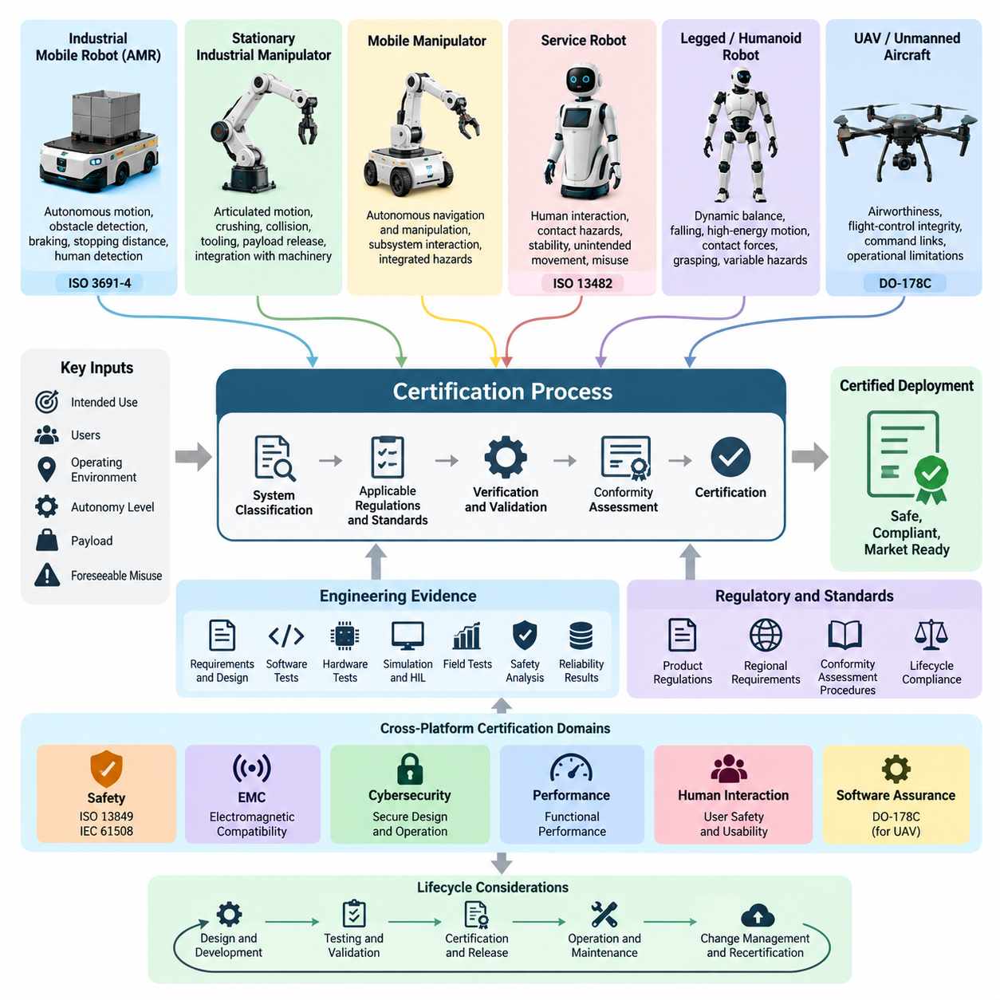
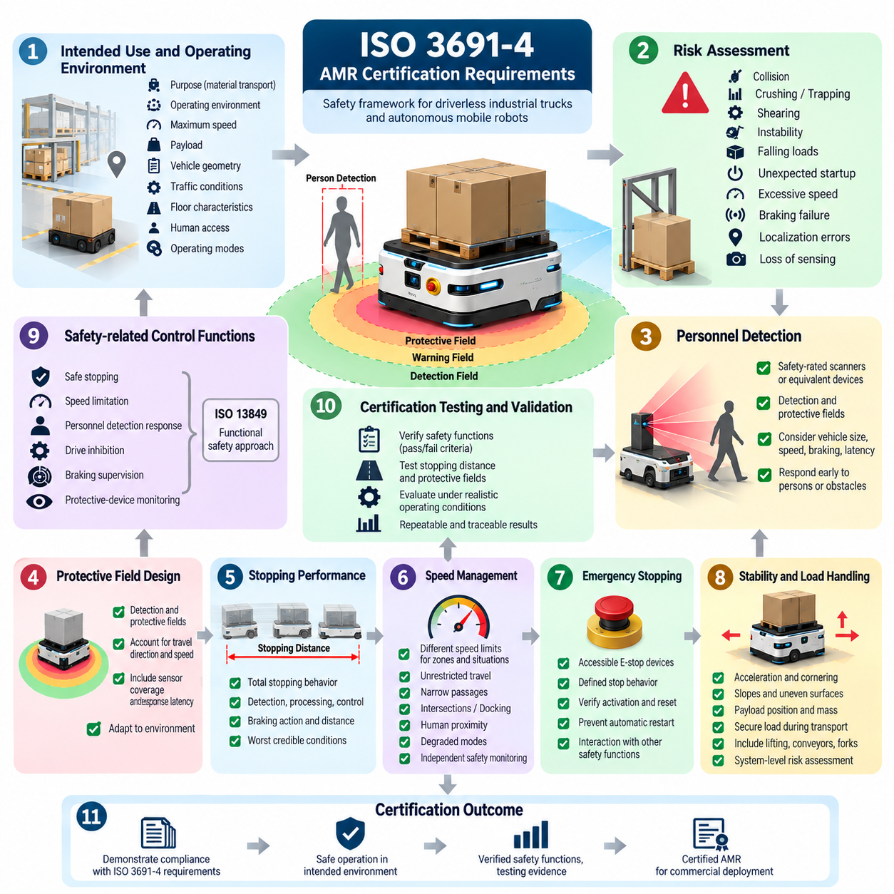
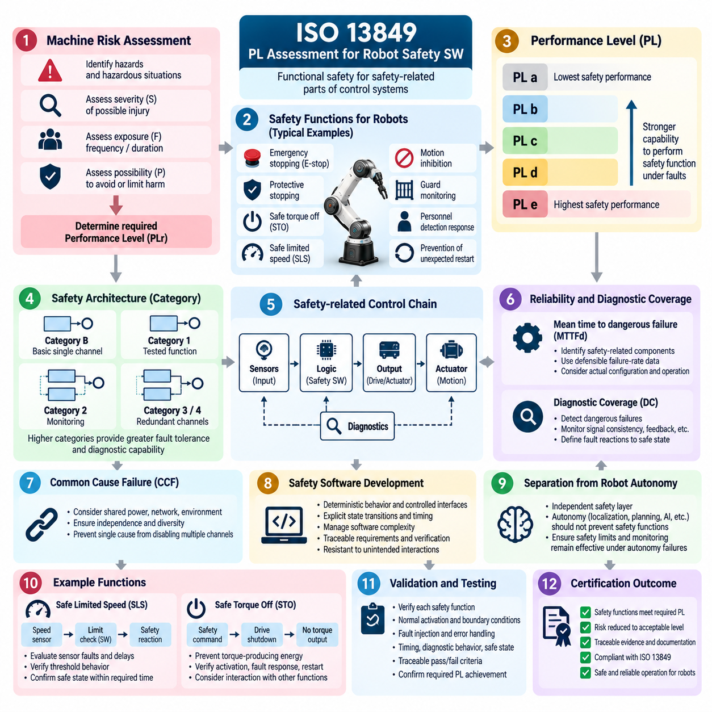
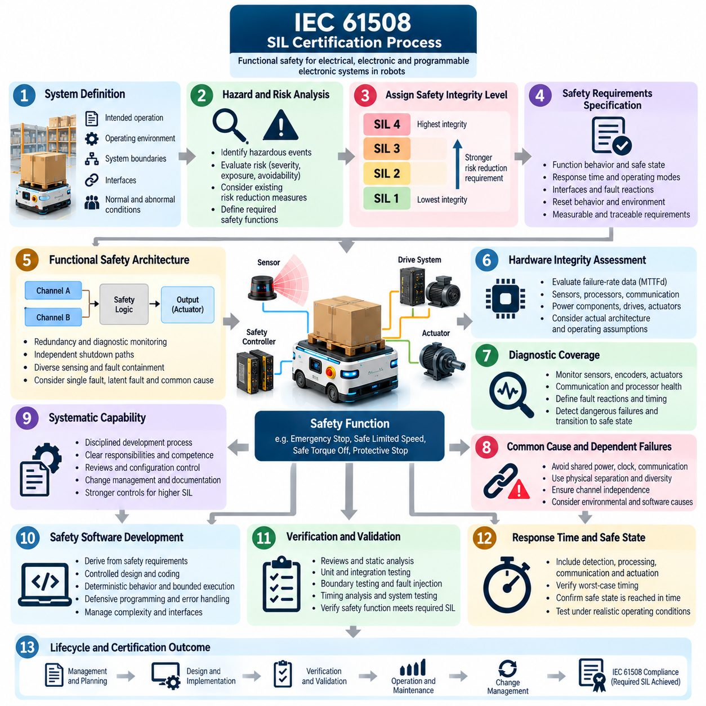
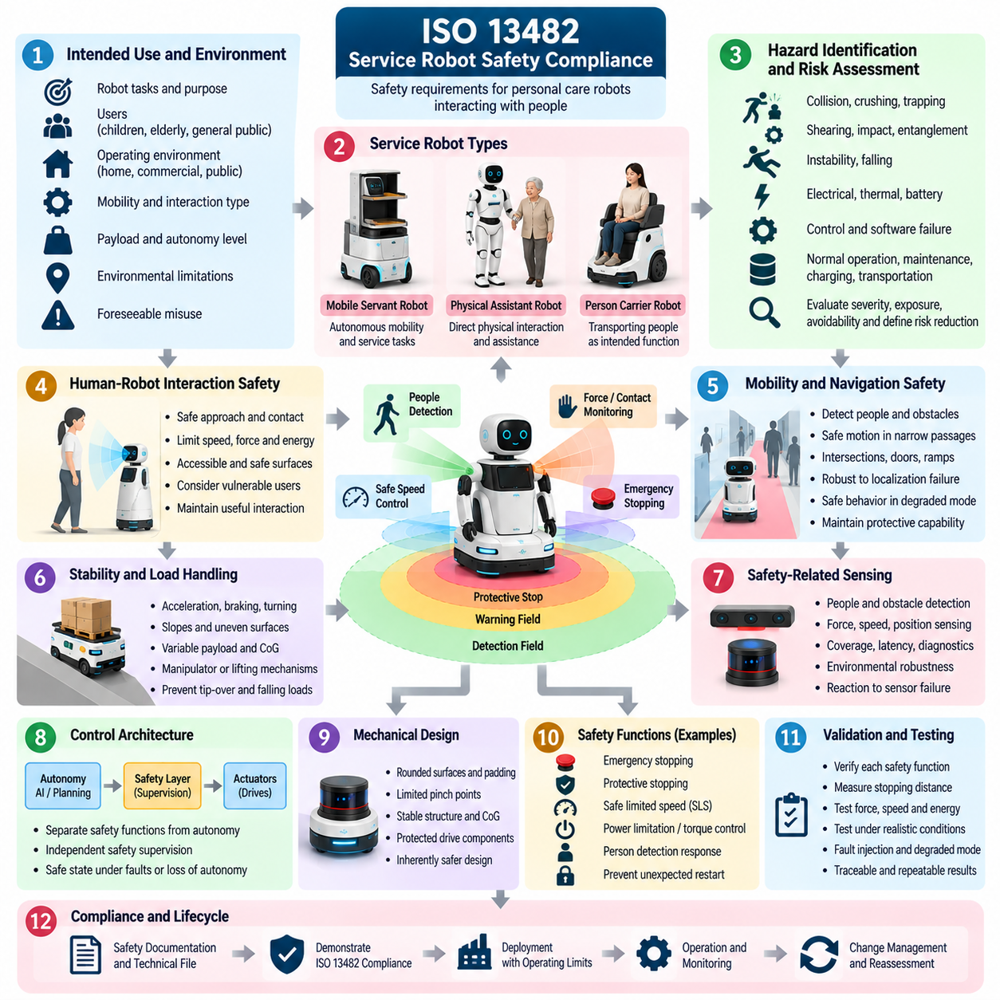
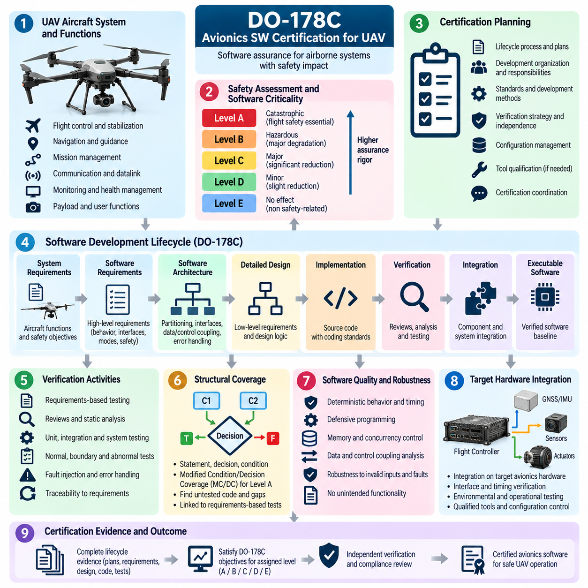
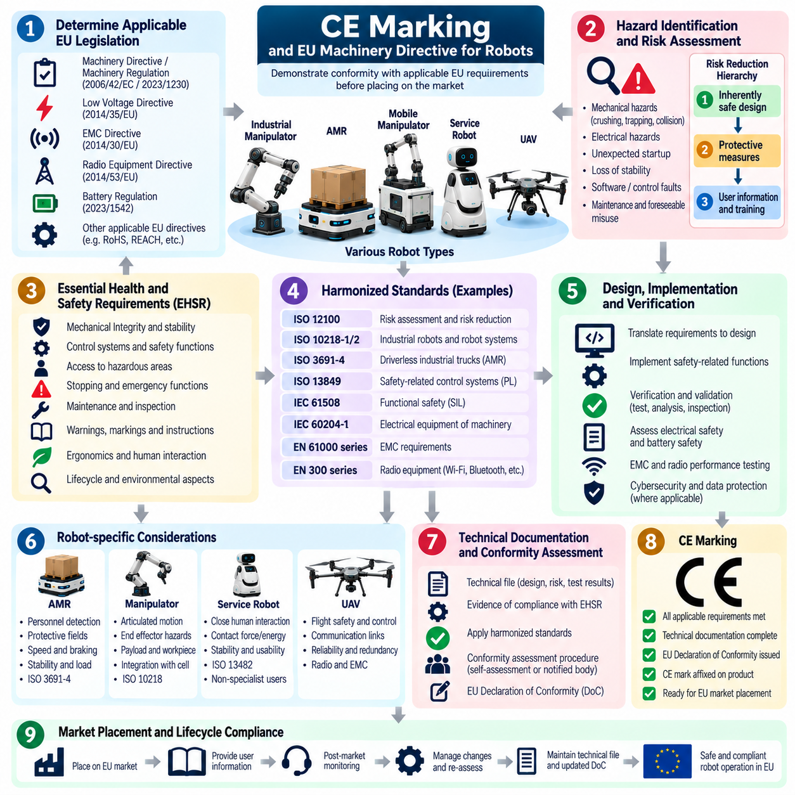
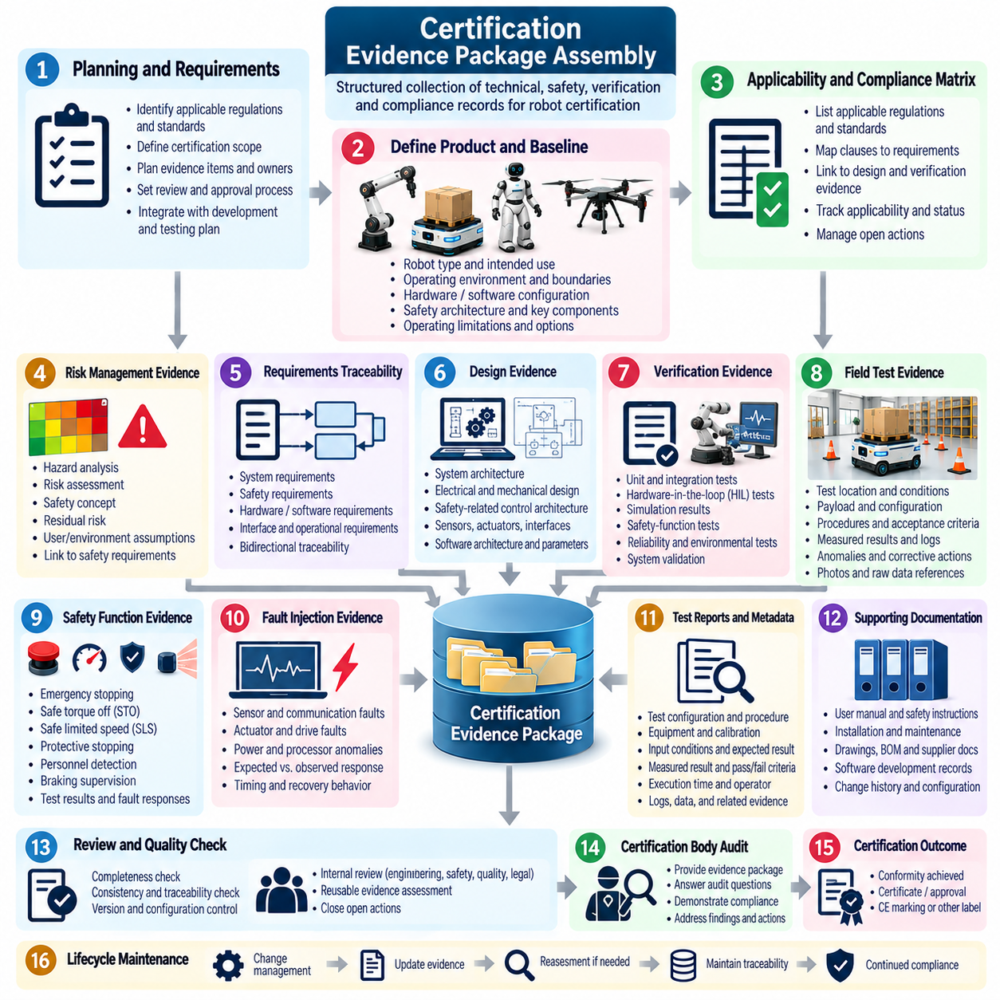
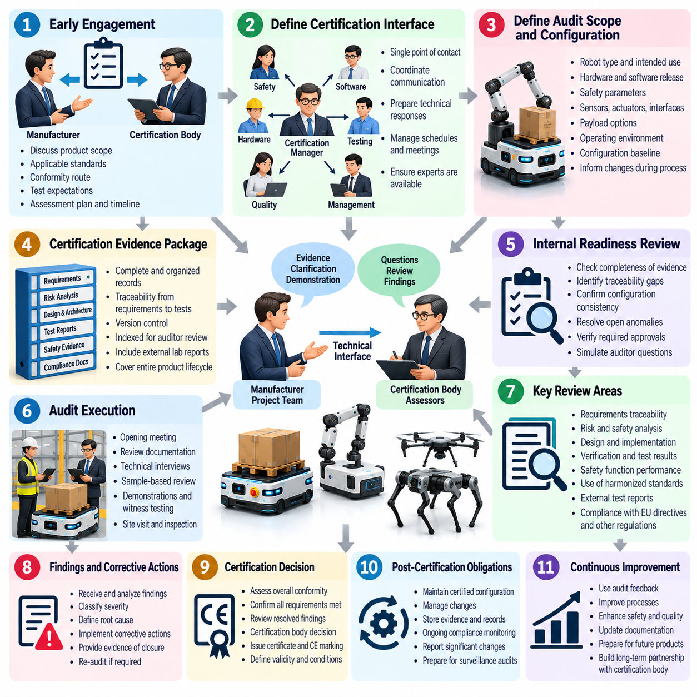
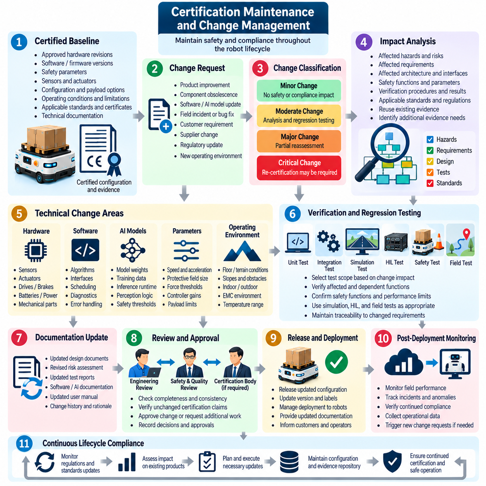

**Volume 25. Testing Validation and Benchmarking**

# Chapter 09. Certification and Compliance

## 09.01. Certification Process Overview by Robot Type

{width="7.268055555555556in" height="7.268055555555556in"}

로봇 인증(Robot Certification)은 로봇 시스템이 상업적으로 배치되기 전에 적용 가능한 안전(Safety), 성능(Performance), 전자기 적합성(Electromagnetic Compatibility), 사이버보안(Cybersecurity), 규제 요구사항(Regulatory Requirements)을 충족한다는 것을 입증하는 체계적인 과정이다. 구체적인 인증 경로(Certification Path)는 로봇 유형(Robot Type), 운영 환경(Operating Environment), 의도된 사용 목적(Intended Use), 자율성 수준(Autonomy Level), 탑재하중(Payload), 사람과의 상호작용(Human Interaction), 시스템이 사용되는 관할 지역(Jurisdiction)에 따라 크게 달라진다.

따라서 인증은 시험실 테스트(Laboratory Testing)보다 시스템 분류(System Classification)에서 시작해야 한다. 제조업체(Manufacturer)는 먼저 로봇의 의도된 목적(Intended Purpose), 예측 가능한 운영 조건(Foreseeable Operating Conditions), 사용 범위(Boundaries of Use), 사용자(Users), 환경적 제약조건(Environmental Constraints), 합리적으로 예측 가능한 오사용(Reasonably Foreseeable Misuse)을 정의한다. 이러한 정의를 기반으로 제품의 전체 수명주기(Lifecycle)에 적용되는 규정(Regulations), 표준(Standards), 적합성 평가 절차(Conformity-Assessment Procedures), 기술적 증거(Technical Evidence)가 결정된다.

인증 프로그램(Certification Program)은 보다 광범위한 검증 및 유효성 확인(Verification and Validation) 과정과 긴밀하게 연결된다. 요구사항(Requirements), 설계 기록(Design Records), 소프트웨어 시험(Software Tests), 하드웨어 시험(Hardware Tests), 시뮬레이션 결과(Simulation Results), 하드웨어 인 더 루프(Hardware-in-the-Loop, HIL) 증거, 현장 시험 데이터(Field-Test Data), 안전 분석(Safety Analyses), 신뢰성 결과(Reliability Results)는 점진적으로 규정 준수 평가(Compliance Assessment)에 사용되는 증거 기반(Evidence Base)을 구성한다. 따라서 인증은 개발이 완료된 후 자료를 취합하는 방식보다 개발 초기부터 규정 준수 요구사항(Compliance Requirements)을 엔지니어링 활동에 통합할 때 가장 효과적이다.

산업용 이동 로봇(Industrial Mobile Robot)과 자율 이동 로봇(Autonomous Mobile Robot, AMR)은 공유 작업공간(Shared Workspace)에서 자율 이동으로 발생하는 위험(Hazard)에 특별한 주의가 필요하다. 인증 활동에서는 일반적으로 보호 영역(Protective Field), 장애물 감지(Obstacle Detection), 제동 동작(Braking Behavior), 정지 거리(Stopping Distance), 속도 제어(Speed Control), 비상 정지(Emergency Stop), 안정성(Stability), 화물 취급(Load Handling), 사람 감지(Human Detection), 안전 관련 제어 기능(Safety-Related Control Function)을 평가한다. ISO 3691-4는 AMR 시스템에 정의되는 인증 체계에서 중요한 참조 표준(Reference Standard)이다.

고정형 산업용 매니퓰레이터(Stationary Industrial Manipulator)는 관절 운동(Articulated Motion), 압착(Crushing), 끼임(Trapping), 충돌(Collision), 툴링(Tooling), 탑재물 이탈(Payload Release), 주변 기계와의 상호작용(Interaction with Surrounding Machinery)이 주요 위험요소이기 때문에 다른 안전 모델(Safety Model)을 따른다. 평가는 로봇 자체뿐 아니라 통합된 로봇 응용 시스템(Integrated Robot Application)까지 고려해야 한다. 안전 토크 차단(Safe Torque Off, STO), 안전 제한 속도(Safe Limited Speed, SLS), 보호 정지(Protective Stopping), 인터록(Interlocking), 작업공간 제한(Workspace Restriction), 비상 정지(Emergency Stopping)와 같은 안전 기능은 추적 가능한 검증(Traceable Verification)을 필요로 한다.

모바일 매니퓰레이터(Mobile Manipulator)는 자율주행(Navigation)과 조작(Manipulation)의 인증 문제를 동시에 결합한다. 이동 베이스(Mobile Base)가 특정 안전 요구사항을 만족하더라도 매니퓰레이터(Manipulator), 엔드 이펙터(End Effector), 응용 시스템(Application)은 추가적인 위험을 발생시킬 수 있다. 따라서 개별적으로 인증된 구성요소를 전체 시스템의 안전성 증거로 간주하기보다는 서브시스템(Subsystem) 간의 상호작용을 평가해야 한다. 특히 통합 고장 조건(Integrated Failure Conditions)과 동시 운동(Simultaneous Motions)이 중요하다.

서비스 로봇(Service Robot)과 비전문 사용자(Non-Specialist User) 주변에서 작동하도록 설계된 로봇은 인간 상호작용(Human Interaction)을 중요하게 고려해야 한다. ISO 13482는 관련 개인 관리 로봇(Personal Care Robot) 응용 분야에서 중요한 안전 프레임워크(Safety Framework)를 제공한다. 평가에는 접촉 위험(Contact Hazard), 접근 가능한 표면(Accessible Surface), 안정성(Stability), 의도하지 않은 움직임(Unintended Movement), 제어 고장(Control Failure), 사람 감지(Human Detection), 예측 가능한 오사용(Foreseeable Misuse), 에너지 제한(Energy Limitation), 감지 또는 제어 기능을 사용할 수 없게 되었을 때의 안전 복구 동작(Safe Recovery Behavior) 등이 포함될 수 있다.

보행 로봇(Legged Robot)과 휴머노이드 로봇(Humanoid Robot)은 기존 고정형 기계(Fixed Machine)의 가정만으로는 충분히 다루기 어려운 인증 문제를 제기한다. 동적 균형(Dynamic Balance), 전도(Falling), 고에너지 관절 운동(High-Energy Joint Motion), 접촉력(Contact Force), 파지(Grasping), 탑재물 취급(Payload Handling), 빠르게 변화하는 지지 조건(Support Conditions)은 로봇 상태에 따라 달라지는 위험을 발생시킬 수 있다. 따라서 인증 증거(Certification Evidence)는 정상 작업 수행뿐 아니라 성능 저하 상태(Degraded State) 또는 비상 운영 상태(Emergency Operating State)로 전환되는 과정까지 특성화해야 한다.

보행 플랫폼(Legged Platform)의 인증 지향 검증(Certification-Oriented Validation)에는 지형 의존적 안정성(Terrain-Dependent Stability), 보행 전환(Gait Transition), 발 디딤 실패(Loss of Foothold), 액추에이터 고장(Actuator Fault), 센서 성능 저하(Sensor Degradation), 전원 이상(Power Anomaly), 비상 정지(Emergency Stopping), 필요한 경우 제어된 전도 또는 종료 전략(Controlled Fall or Shutdown Strategy)이 포함되어야 한다. 휴머노이드 시스템(Humanoid System)은 전신 상호작용(Whole-Body Interaction), 사람 주변에서의 조작(Manipulation Near Humans), 균형 복구(Balance Recovery), 다수 관절이 참여하는 협응 운동(Coordinated Motion)에 대한 추가 평가가 필요하다. 이러한 항목은 플랫폼별 현장 시험(Field Testing) 및 벤치마크 시험(Benchmark Testing)을 보완한다.

무인 항공기(Unmanned Aircraft)와 화물 무인항공기(Cargo UAV)는 고장이 즉각적인 운영 영역을 넘어 사람과 재산에 영향을 줄 수 있기 때문에 상당히 다른 보증 경로(Assurance Path)를 따른다. 인증 고려사항에는 항공기 감항성(Airworthiness), 비행 제어 무결성(Flight-Control Integrity), 명령 및 통신 링크(Command and Communication Link), 항법(Navigation), 이중화(Redundancy), 소프트웨어 보증(Software Assurance), 운영 제한(Operational Limitation), 체계적인 비행시험 캠페인(Flight-Test Campaign)에서 확보된 증거가 포함될 수 있다. 일반적으로 항공기의 위험과 운영 결과의 심각성이 증가할수록 요구되는 엄격성도 증가한다.

안전 필수 항공 기능(Safety-Critical Airborne Function)에 사용되는 소프트웨어는 DO-178C와 같은 항공 소프트웨어 보증 프레임워크(Aviation Software Assurance Framework)에 부합하는 개발 및 검증 증거(Development and Verification Evidence)를 요구할 수 있다. 이에 따라 시험의 역할은 일반적인 제품 품질 확인에서 요구사항 추적성(Requirements Traceability), 필요한 경우의 검증 독립성(Verification Independence), 형상 관리(Configuration Control), 구조적 커버리지(Structural Coverage), 통제된 인증 산출물(Certification Artifact)을 포함하는 체계적인 수명주기 보증(Lifecycle Assurance)으로 확장된다.

기능 안전(Functional Safety)은 플랫폼 전반에 적용되는 또 다른 인증 요소이다. ISO 13849와 IEC 61508 등의 표준은 안전 관련 제어 기능(Safety-Related Control Function)이 요구되는 위험 감소 수준(Risk Reduction Level)을 달성한다는 것을 입증하는 접근법을 제공한다. 엔지니어는 위험요소(Hazard)를 식별하고 안전 기능(Safety Function)을 정의하며 필요한 무결성 또는 성능 수준(Integrity or Performance Level)을 결정한 뒤 적절한 아키텍처를 설계하고 진단 범위(Diagnostic Coverage)와 고장 동작(Failure Behavior)을 평가하여 구현된 시스템이 안전 목표(Safety Objective)를 달성하는지 검증한다.

따라서 인증 증거(Certification Evidence)는 최종 시험 보고서(Final Test Report)를 훨씬 넘어선다. 완전한 증거 패키지(Evidence Package)에는 시스템 정의(System Definition), 적용 표준 매트릭스(Applicable-Standard Matrix), 위험 분석(Hazard Analysis), 위험 평가(Risk Assessment), 안전 요구사항(Safety Requirements), 아키텍처 설명(Architecture Description), 요구사항 추적성(Requirements Traceability), 소스 및 형상 기록(Source and Configuration Records), 검증 절차(Verification Procedure), 시험 결과(Test Results), 교정 기록(Calibration Records), 이상 보고서(Anomaly Reports), 사이버보안 증거(Cybersecurity Evidence), 사용자 문서(User Documentation), 선언서(Declarations), 미해결 문제가 어떻게 처리되었는지를 보여주는 기록 등이 포함될 수 있다.

제품(Product), 규정(Regulation), 시장(Market), 인증 체계(Certification Scheme)에 따라 제3자 평가(Third-Party Assessment)가 요구되거나 전략적으로 필요할 수 있다. 인증기관(Certification Body)과 시험기관(Test Laboratory)은 제출된 증거가 완전하고 일관되며 재현 가능하고 추적 가능한지 검토한다. 성공적인 인증 대응을 위해서는 형상 통제된 문서(Configuration-Controlled Documentation)와 함께 요구사항, 위험요소, 위험 완화 조치(Mitigation), 구현(Implementation), 검증 결과(Verification Results), 평가를 위해 제출된 정확한 하드웨어 및 소프트웨어 버전 사이의 명확한 대응관계가 필요하다.

지역별 시장 진입(Regional Market Access)은 인증 과정에 또 다른 계층을 추가한다. 여러 관할 지역에 출시되는 로봇은 기계 안전(Machinery Safety), 전기 안전(Electrical Safety), 전자기 적합성(Electromagnetic Compatibility), 무선 장비(Radio Equipment), 배터리(Battery), 환경 규제(Environmental Restrictions), 제품 사이버보안(Product Cybersecurity)과 관련된 중복 요구사항을 적용받을 수 있다. 예를 들어 유럽 시장 진입(European Market Access)에는 CE 관련 적합성 의무(CE-Related Conformity Obligations)가 포함될 수 있으며, 다른 시장에서는 각자의 규제 체계와 인정 표준(Recognized Standards)이 적용된다.

인공지능 기반 로봇(AI-Enabled Robot)은 시스템 동작이 전적으로 결정론적 소프트웨어 로직(Deterministic Software Logic)에 의존하지 않고 학습 모델(Learned Model)에 의해 결정될 수 있기 때문에 추가적인 보증상의 어려움을 발생시킨다. 인지 오류(Perception Error), 분포 외 입력(Out-of-Distribution Input, OOD), 모델 업데이트(Model Update), 정책 일반화(Policy Generalization), AI 의사결정과 기존 안전 제어 사이의 상호작용을 고려해야 한다. 따라서 AI 평가(AI Evaluation)는 강건성 시험(Robustness Test), 시나리오 커버리지(Scenario Coverage), 지연시간 측정(Latency Measurement), 인간 평가(Human Evaluation), 안전 유효성 확인(Safety Validation)을 통해 인증 증거와 지속적으로 연결되어야 한다.

실용적인 인증 전략(Certification Strategy)은 가능한 경우 안전 필수 기능(Safety-Critical Function)을 성능 중심의 자율 기능(Performance-Oriented Autonomy)과 분리한다. 결정론적 안전 메커니즘(Deterministic Safety Mechanism)은 상위 수준의 AI, 항법(Navigation), 조작(Manipulation), 계획(Planning) 구성요소를 감독하고 운영 한계(Operational Limit)가 위반될 경우 시스템을 정의된 안전 상태(Safe State)로 전환할 수 있다. 이러한 아키텍처 분리(Architectural Separation)는 첨단 자율 기능이 통제된 제약조건 아래에서 발전할 수 있도록 하면서 명확한 보증 경계(Assurance Boundary)를 설정하는 데 도움을 준다.

인증서(Certificate), 적합성 선언(Declaration), 시장 승인(Market Authorization)을 획득했다고 해서 인증 과정이 종료되는 것은 아니다. 소프트웨어 업데이트(Software Update), 하드웨어 교체(Hardware Substitution), 센서 변경(Sensor Change), AI 모델 교체(AI Model Replacement), 새로운 운영 환경(New Operating Environment), 탑재하중 변경(Payload Change), 사이버보안 패치(Cybersecurity Patch)는 기존에 평가된 가정(Assumption)을 변경할 수 있다. 형상 및 변경 관리(Configuration and Change Management)는 각 변경사항이 승인된 기준선(Approved Baseline) 내에 유지되는지 또는 부분적·전체적 재평가(Reassessment)가 필요한지를 결정해야 한다.

따라서 로봇 유형별 인증(Certification by Robot Type)은 단일 승인 이벤트(Single Approval Event)가 아니라 수명주기 보증 프레임워크(Lifecycle Assurance Framework)로 이해하는 것이 적절하다. AMR은 안전한 자율 이동(Safe Autonomous Mobility), 매니퓰레이터는 통제된 기계적 상호작용(Controlled Mechanical Interaction), 서비스 및 휴머노이드 로봇은 사람과의 근접성(Human Proximity), UAV는 감항성(Airworthiness)과 고무결성 비행 기능(High-Integrity Flight Function)을 중점적으로 다룬다. 모든 플랫폼에서 성공적인 인증은 추적 가능한 요구사항(Traceable Requirements), 위험 기반 엔지니어링(Risk-Based Engineering), 재현 가능한 검증(Reproducible Verification), 통제된 증거(Controlled Evidence), 지속적인 시스템 변경 관리(Continuous System Change Management)에 달려 있다.

## 09.02. ISO 3691 4 AMR Certification Requirements [w/Code]

{width="7.268055555555556in" height="7.268055555555556in"}

ISO 3691-4는 무인 산업용 트럭(Driverless Industrial Trucks)과 그 시스템을 위한 안전 프레임워크(Safety Framework)를 제공하며, 공장, 창고 및 산업 시설에서 자재 운송에 사용되는 자율 이동 로봇(Autonomous Mobile Robot, AMR)에 특히 관련성이 높다. 인증 중심 개발(Certification-Oriented Development)에서는 정상적인 주행 성능뿐만 아니라 자율 이동, 사람과의 상호작용, 운송 화물, 기반시설 및 안전 관련 기능(Safety-Related Function)의 고장으로 발생하는 위험요소(Hazard)까지 다루어야 한다.

인증 절차(Certification Process)는 AMR의 의도된 사용(Intended Use), 운영 환경(Operating Environment), 최대 속도(Maximum Speed), 탑재하중(Payload), 차량 형상(Vehicle Geometry), 교통 조건(Traffic Conditions), 바닥 특성(Floor Characteristics), 사람의 접근(Human Access), 예상 운영 모드(Operating Modes)를 정의하는 것에서 시작한다. 이러한 가정은 안전성이 입증되는 범위(Boundary)를 설정한다. 더 높은 속도, 더 무거운 탑재하중, 새로운 부착 장치, 더 급한 경사 또는 일반인이 접근할 수 있는 영역에서의 운영과 같은 변경은 추가적인 위험 평가(Risk Assessment)와 유효성 확인(Validation)을 요구할 수 있다.

위험 평가(Risk Assessment)는 로봇 설계(Robot Design)를 필요한 보호 조치(Protective Measures)와 연결한다. 엔지니어는 충돌(Collision), 압착(Crushing), 끼임(Trapping), 전단(Shearing), 불안정성(Instability), 화물 낙하(Falling Loads), 예기치 않은 기동(Unexpected Startup), 과속(Excessive Speed), 제동 실패(Braking Failure), 위치추정 오류(Localization Error), 감지 기능 상실(Loss of Sensing)과 관련된 위험을 식별한다. 각 위험 상황(Hazardous Situation)의 심각도와 노출 정도를 평가한 후 기계 설계, 안전 제어, 운영 절차 또는 환경적 제한에 위험 저감 조치(Risk Reduction Measures)를 할당한다.

인원 감지(Personnel Detection)는 AMR 안전의 핵심 요소이다. 안전 등급 스캐너(Safety-Rated Scanner) 또는 이에 상응하는 보호 장치는 이동 차량 주변에 감지 영역(Detection Field)과 보호 영역(Protective Field)을 설정한다. 이러한 영역은 주행 방향, 차량 크기, 속도, 제동 성능, 센서 커버리지(Sensor Coverage), 응답 지연(Response Latency), 환경 조건을 고려해야 한다. AMR은 사람이나 장애물을 감지했을 때 허용할 수 없는 접촉을 방지하거나 움직임을 정의된 안전 상태(Safe Condition)로 감소시킬 수 있을 만큼 충분히 빠르게 대응해야 한다.

보호 영역 설계(Protective Field Design)는 정지 성능(Stopping Performance)과 밀접하게 연관된다. 감지, 처리, 제어 및 제동 동작이 수행되는 동안에도 로봇은 계속 움직이기 때문에 센서 범위만으로 안전 영역을 결정할 수 없다. 따라서 인증 시험(Certification Testing)에서는 감지 지연(Detection Latency), 안전 제어기 반응 시간(Safety-Controller Reaction Time), 통신 지연(Communication Delay), 브레이크 작동(Brake Activation), 기계적 감속(Mechanical Deceleration), 차량이 안전 상태에 도달하기 전까지 이동하는 거리를 포함한 전체 정지 동작(Total Stopping Behavior)을 고려한다.

정지 거리(Stopping Distance)는 이상적인 시험실 조건에서만 평가하는 것이 아니라 대표적인 운영 조건 전반에서 평가해야 한다. 차량 속도, 탑재하중, 바닥 마찰(Floor Friction), 타이어 상태(Tire Condition), 경사도(Gradient), 배터리 상태(Battery State), 제동 시스템 특성(Braking-System Characteristics)은 최종 정지 거리를 변화시킬 수 있다. 측정은 반복 가능해야 하며 정의된 시스템 구성(Configuration)과 연결되어야 한다. 이를 통해 승인된 운영 범위(Operating Envelope)에서 예상 가능한 최악의 정지 동작을 기준으로 보호 영역 매개변수를 정당화할 수 있다.

속도 관리(Speed Management)는 또 다른 중요한 위험 저감 계층(Risk Reduction Layer)을 제공한다. AMR은 제한 없는 일반 주행, 좁은 통로, 교차로, 도킹(Docking), 회전, 사람 근접 상황 또는 성능 저하 운영 모드(Degraded Operating Mode)에 따라 서로 다른 속도 제한이 필요할 수 있다. 안전 관련 속도 감시(Safety-Related Speed Monitoring)는 명령된 움직임이 허용된 속도 제한을 초과하지 않도록 보장해야 한다. 안전 아키텍처(Safety Architecture)가 이러한 분리를 요구하는 경우 속도 위반은 일반 항법 또는 임무 계획 소프트웨어와 독립적으로 적절한 안전 대응을 발생시켜야 한다.

비상 정지(Emergency Stopping)는 운영자가 즉각적인 위험을 감지했을 때 AMR을 적절한 안전 상태(Safe Condition)로 전환해야 한다. 비상 정지 장치(Emergency-Stop Device)는 접근 가능해야 하며 전체 차량에 미치는 효과가 명확하게 정의되어야 한다. 검증(Verification)에서는 비상 정지 작동, 정지 응답, 리셋 동작(Reset Behavior), 재시작 방지(Restart Prevention), 다른 안전 기능과의 상호작용을 평가해야 한다. 비상 정지를 리셋하는 행위 자체가 필요한 재시작 조건이 충족되지 않은 상태에서 위험한 자동 움직임을 발생시켜서는 안 된다.

제동 및 운동 제어 안전(Braking and Motion-Control Safety)은 의도하지 않은 움직임(Unintended Movement)도 다루어야 한다. 모터 드라이브(Motor Drive), 조향(Steering), 통신(Communication), 엔코더(Encoder), 전원 공급장치(Power Supply), 제어 소프트웨어(Control Software)의 고장은 잠재적으로 통제되지 않는 움직임을 발생시킬 수 있다. 안전 기능은 관련 고장을 감지하고 차량을 정의된 안전 상태로 전환해야 한다. 필요한 경우 단일 고장(Single Failure)이 필요한 보호 기능을 인지되지 않은 상태에서 제거하지 못하도록 독립적이거나 충분한 고장 허용 능력(Fault Tolerance)을 갖는 메커니즘을 사용한다.

AMR 안정성(Stability)은 의도된 운영 범위에 포함되는 시스템 구성에 대해 입증되어야 한다. 가속, 감속, 코너링(Cornering), 경사면, 불균일한 노면, 탑재하중 위치, 탑재 질량, 부착 장치 형상(Attachment Geometry)은 안정성에 영향을 줄 수 있다. 따라서 인증 증거(Certification Evidence)는 허용 속도 및 기동 동작을 로봇의 물리적 구성과 연계해야 하며, 특히 높은 탑재하중이나 승강형 화물 취급 장치가 무게중심(Center of Gravity)을 크게 변화시키는 경우 이러한 검증이 중요하다.

화물 취급(Load Handling)은 차량 주행 이외의 추가적인 위험을 발생시킨다. 화물은 가속, 제동, 회전, 도킹 및 이송 작업 중 충분히 안정적으로 유지되어야 한다. 승강 장치(Lifting Mechanism), 컨베이어(Conveyor), 포크(Fork), 견인 인터페이스(Towing Interface), 맞춤형 페이로드 모듈(Customized Payload Module)은 압착 및 끼임 영역(Crushing and Trapping Zone)을 만들 수 있다. 따라서 이동 플랫폼과 화물 취급 장비를 서로 무관한 기계로 취급하지 않고 해당 장치의 움직임과 인터록(Interlock)을 시스템 수준 위험 평가(System-Level Risk Assessment)에 포함해야 한다.

안전 관련 제어 기능(Safety-Related Control Function)은 체계적인 검증을 필요로 한다. 안전 정지(Safe Stopping), 속도 제한(Speed Limitation), 인원 감지 대응(Personnel Detection Response), 구동 억제(Drive Inhibition), 제동 감시(Braking Supervision), 보호 장치 감시(Protective-Device Monitoring)와 같은 기능에는 명확한 요구사항과 합격·불합격 기준(Pass/Fail Criteria)이 정의되어야 한다. 이러한 기능의 구현은 ISO 13849와 같은 표준과 연계된 기능 안전 원칙(Functional-Safety Principles)에 의존할 수도 있다.

항법 소프트웨어(Navigation Software)와 안전 기능(Safety Function)은 각각의 책임 범위를 명확하게 정의해야 한다. 일반적인 자율주행 스택(Autonomy Stack)은 위치추정(Localization), 지도작성(Mapping), 경로 계획(Path Planning), 장애물 회피(Obstacle Avoidance), 임무 실행(Mission Execution)을 수행할 수 있으며, 안전 계층(Safety Layer)은 허용할 수 없는 위험을 발생시킬 수 있는 조건을 독립적으로 감시한다. 위치추정 상실이나 AI 인지 모델(AI Perception Model)의 고장이 로봇을 적절한 안전 상태로 전환하는 데 필요한 보호 기능의 상실로 직접 이어져서는 안 된다.

고장 동작(Fault Behavior)은 정상 운영이 성공했다는 사실로 추정해서는 안 되며 의도적으로 시험해야 한다. 관련 시나리오에는 센서 차단 또는 오염, 통신 두절(Communication Loss), 엔코더 고장(Encoder Fault), 위치추정 성능 저하(Localization Degradation), 제어기 재시작(Controller Restart), 전원 이상(Power Anomaly), 액추에이터 오작동(Actuator Malfunction), 안전 신호 불일치(Inconsistent Safety Signal) 등이 포함될 수 있다. 하드웨어 인 더 루프 시험(Hardware-in-the-Loop Testing, HIL)과 고장 주입(Fault Injection)은 최종 인증 중심 시험 이전에 비정상 조건을 반복적으로 검증함으로써 실제 물리 시험을 보완할 수 있다.

운영 환경(Operating Environment)은 안전 개념(Safety Concept)의 일부를 구성한다. 이동 경로(Route), 교차로(Intersection), 사각지대 코너(Blind Corner), 출입문(Door), 엘리베이터(Elevator), 충전소(Charging Station), 보행자 횡단 구역(Pedestrian Crossing), 이송 스테이션(Transfer Station), 제한 구역(Restricted Area)은 잔여 위험(Residual Risk)에 영향을 줄 수 있다. 따라서 현장 설계(Site Design)는 교통 분리(Traffic Separation), 표시(Marking), 접근 통제(Access Control), 경고 장치(Warning Device), 통제된 횡단 구역(Controlled Crossing), 속도 제한 구역(Speed-Restricted Zone) 등의 추가적인 보호 조치를 제공할 수 있다. 인증 증거에서는 로봇 수준 제어와 설치 환경에 의존하는 보호조치를 구분해야 한다.

검증(Verification)은 구성요소 시험(Component Test), 통합 시스템 시험(Integrated System Test), HIL 시험, 필요한 경우 시뮬레이션(Simulation), 통제된 현장 시험(Controlled Field Testing)을 결합해야 한다. 현장 시험은 대표적인 운영 조건에서 항법 안전(Navigation Safety), 정지 동작, 내구성(Endurance), 환경과의 상호작용, 반복성(Repeatability)을 확인하는 데 특히 중요하다. 시험 계측(Test Instrumentation)과 데이터 로깅(Data Logging)은 주요 이벤트를 재구성하고 사전에 정의된 승인 기준(Acceptance Criteria)이 충족되었음을 입증할 수 있을 정도로 충분한 정보를 보존해야 한다.

인증 증거(Certification Evidence)는 위험요소에서 요구사항으로, 그리고 요구사항에서 구현 및 검증으로 추적 가능해야 한다. 실용적인 증거 패키지(Evidence Package)에는 의도된 사용 정의(Intended-Use Definition), 위험 평가, 안전 기능 명세(Safety-Function Specification), 전기 및 제어 아키텍처(Electrical and Control Architecture), 소프트웨어 구성(Software Configuration), 센서 사양(Sensor Specification), 시험 절차(Test Procedure), 교정 기록(Calibration Record), 정지 거리 측정 결과, 고장 시험 결과, 현장 시험 보고서, 미해결 이상 기록(Unresolved Anomaly Record), 인증 대상 구성에 적용되는 운영 지침(Operating Instructions)이 포함될 수 있다.

인증 이후에도 규정 준수(Compliance)가 자동으로 유지되는 것은 아니다. 차량 질량(Vehicle Mass), 최대 속도, 제동 매개변수(Braking Parameter), 안전 스캐너(Safety Scanner), 모터 제어기(Motor Controller), 배터리, 타이어, 페이로드 모듈(Payload Module), 항법 소프트웨어, 안전 펌웨어(Safety Firmware), 운영 환경의 변경은 평가 과정에서 사용된 기존 가정을 무효화할 수 있다. 공식적인 변경 관리(Change Management)를 통해 회귀 시험(Regression Testing), 위험 분석 업데이트, 보호 영역 재계산(Protective-Field Recalculation), 새로운 적합성 평가(Conformity Assessment)가 필요한지를 판단해야 한다.

따라서 ISO 3691-4 기반 AMR 인증(ISO 3691-4-Oriented AMR Certification)은 최종 규정 준수 시험(Final Compliance Test)이 아니라 통합 안전 엔지니어링 프로세스(Integrated Safety Engineering Process)로 접근하는 것이 적절하다. 안전한 자율 이동(Safe Autonomous Mobility)은 차량 설계, 인원 감지, 제동, 속도 감시, 기능 안전, 화물 관리, 설치 환경 제어, 검증 및 형상 관리(Configuration Management)의 유기적인 결합을 통해 구현된다. 개발 초기부터 이러한 요구사항을 반영하면 더욱 강력한 인증 증거를 확보할 수 있으며 인증 후반 단계에서 발생하는 비용이 큰 재설계를 줄일 수 있다.

## 09.03. ISO 13849 PL Assessment for Robot Safety SW [w/Code]

{width="7.268055555555556in" height="7.268055555555556in"}

ISO 13849는 다양한 산업용 및 이동 로봇 응용 분야를 포함하여 기계류에 사용되는 제어 시스템의 안전 관련 부품(Safety-Related Parts of Control Systems)을 위한 기능 안전(Functional Safety) 프레임워크를 제공한다. 로봇 안전 소프트웨어(Robot Safety Software)의 핵심 목표는 각 안전 관련 제어 기능(Safety-Related Control Function)이 적절한 성능 수준(Performance Level, PL)을 통해 충분한 위험 저감(Risk Reduction)을 달성하고, 고장 및 예측 가능한 운영 조건에서도 예측 가능한 동작을 유지한다는 것을 입증하는 것이다.

성능 수준 평가(Performance Level Assessment)는 기계 위험 평가(Machine Risk Assessment)에서 도출된 안전 기능(Safety Function)을 식별하는 것에서 시작한다. 대표적인 로봇 안전 기능에는 비상 정지(Emergency Stopping), 보호 정지(Protective Stopping), 안전 토크 차단(Safe Torque Off, STO), 안전 제한 속도(Safe Limited Speed, SLS), 동작 억제(Motion Inhibition), 가드 감시(Guard Monitoring), 인원 감지 대응(Personnel Detection Response), 예기치 않은 재시작 방지(Prevention of Unexpected Restart)가 포함된다. 각 기능에는 명확한 입력, 필요한 논리, 출력, 응답 동작 및 안전 상태 조건(Safe-State Conditions)이 정의되어야 한다.

일반적으로 요구 성능 수준(Required Performance Level, PLr)으로 표현되는 목표 수준은 해당 안전 기능이 다루는 위험 상황(Hazardous Situation)의 위험도에 따라 결정된다. 평가에서는 발생 가능한 상해의 심각도(Severity), 위험에 노출되는 빈도 또는 지속시간(Frequency or Duration of Exposure), 위해를 회피하거나 제한할 가능성(Possibility of Avoiding or Limiting Harm)과 같은 요소를 고려한다. 그 결과 도출된 PLr은 구현된 제어 기능이 입증해야 하는 최소 안전 성능(Minimum Safety Performance)을 설정한다.

ISO 13849는 PL a에서 PL e까지의 성능 수준(Performance Level)을 사용하며, 이는 예측 가능한 조건과 고장 상황에서 안전 기능을 수행할 수 있는 능력이 단계적으로 강화됨을 나타낸다. 특정 PL의 달성 여부는 소프트웨어 품질만으로 결정되지 않는다. 센서(Sensor), 입력 인터페이스(Input Interface), 논리 처리(Logic Processing), 통신(Communication), 출력 단계(Output Stage), 액추에이터(Actuator), 진단(Diagnostics), 그리고 이러한 요소들을 연결하는 아키텍처를 포함하는 전체 안전 관련 제어 체인(Safety-Related Control Chain)에 의해 결정된다.

아키텍처(Architecture)는 고장 발생 시의 구조적 동작을 나타내는 지정된 카테고리(Category)를 통해 특성화된다. 요구되는 안전 성능에 따라 기본 단일 채널 구조(Single-Channel Structure), 시험된 아키텍처(Tested Architecture), 이중화 채널(Redundant Channel), 감시(Monitoring), 또는 이중화와 진단을 결합한 구조가 사용될 수 있다. 일반적으로 높은 안전 요구사항은 위험 고장(Dangerous Failure)에 대한 더 강한 내성과 안전 기능이 상실되기 전에 고장을 검출할 수 있는 높은 능력을 요구한다.

위험 고장 확률(Probability of Dangerous Failure)은 성능 수준 평가의 주요 정량적 요소이다. 구성요소 신뢰성(Component Reliability) 정보는 일반적으로 MTTFd로 표현되는 위험 고장까지의 평균 시간(Mean Time to Dangerous Failure)을 추정하는 데 사용된다. 엔지니어는 안전 관련 구성요소를 식별하고 신뢰할 수 있는 고장률 데이터(Failure-Rate Data)를 확보하며 관련 운영 조건을 결정하고, 계산 결과가 로봇에 실제 적용된 하드웨어 구성과 일치하도록 해야 한다.

진단 범위(Diagnostic Coverage, DC)는 위험 고장을 검출하는 진단 기능의 효과를 나타낸다. 로봇 안전 제어기(Robot Safety Controller)는 신호 일관성(Signal Consistency), 통신 무결성(Communication Integrity), 액추에이터 피드백(Actuator Feedback), 엔코더 불일치(Encoder Disagreement), 접촉기 상태(Contactor State), 브레이크 응답(Brake Response), 센서 상태(Sensor Health), 이중화 채널 일관성(Redundant-Channel Consistency)을 감시할 수 있다. 고장을 검출하더라도 시스템을 적절한 안전 상태로 전환하지 않는다면 의도한 위험 저감을 제공할 수 없으므로 진단 기능에는 명확한 고장 대응(Fault Reaction)이 정의되어야 한다.

이중화 채널을 사용하는 경우 공통 원인 고장(Common Cause Failure, CCF)도 고려해야 한다. 동일한 장치를 두 개 설치했다는 이유만으로 두 채널이 독립적이라고 가정할 수 없다. 공유 전원 공급장치, 커넥터, 통신 네트워크, 환경 스트레스(Environmental Stress), 소프트웨어 결함, 전자기적 교란(Electromagnetic Disturbance), 물리적 손상은 여러 채널을 동시에 무력화할 수 있다. 따라서 독립성(Independence)과 다양성(Diversity)은 안전 아키텍처 평가에서 중요한 요소가 된다.

로봇 안전 소프트웨어는 이러한 광범위한 안전 관련 제어 시스템 내에서 논리를 구현하며 체계적 고장 회피(Systematic Fault Avoidance)를 고려하여 개발되어야 한다. 안전 요구사항(Safety Requirements)은 통제된 인터페이스, 명시적인 상태 전이(State Transition), 정의된 시간 제약(Timing Constraint), 문서화된 고장 대응을 갖는 결정론적 소프트웨어 동작(Deterministic Software Behavior)으로 변환되어야 한다. 소프트웨어 복잡성(Software Complexity)은 안전 기능이 이해 가능하고 시험 가능하며 추적 가능하고 의도하지 않은 상호작용에 강건하도록 관리되어야 한다.

안전 소프트웨어(Safety Software)와 일반적인 로봇 자율 기능(Robot Autonomy)의 분리는 현대 로봇 시스템에서 특히 중요하다. 위치추정(Localization), 경로 계획(Path Planning), AI 인지(AI Perception), 조작 정책(Manipulation Policy), 임무 소프트웨어(Mission Software)는 운영 의사결정을 제공할 수 있으며, 독립적인 안전 계층(Safety Layer)은 안전 필수 한계(Safety-Critical Limit)를 감시한다. 상위 수준 자율 기능의 고장이나 불확실성이 필요한 안전 기능의 위험 상황 감지와 안전 대응 명령을 방해해서는 안 된다.

안전 제한 속도(Safe Limited Speed, SLS)는 소프트웨어, 센서 및 액추에이터가 어떻게 완전한 안전 기능을 구성하는지를 보여주는 대표적인 사례이다. 적절한 감지 경로(Sensing Path)를 통해 속도 정보를 획득하고 이를 허용된 한계와 비교한 후 한계를 초과하면 정의된 안전 대응을 수행해야 한다. 검증에서는 센서 고장, 측정값 불일치, 처리 지연(Processing Delay), 통신 고장, 임계값 동작(Threshold Behavior), 물리적 시스템이 안전 상태에 도달하는 데 필요한 시간을 고려해야 한다.

안전 토크 차단(Safe Torque Off, STO)은 또 다른 대표적인 안전 기능이다. 안전 명령(Safety Command)은 정의된 안전 개념(Safety Concept)에 따라 토크를 발생시키는 에너지가 위험한 움직임을 생성하지 못하도록 신뢰성 있게 차단해야 한다. 소프트웨어가 이 과정의 일부를 시작하거나 감시할 수 있지만, 인증 증거(Certification Evidence)는 전체 신호 경로와 최종 액추에이터 동작을 포함해야 한다. 시험에서는 작동, 고장 대응, 재시작 조건(Restart Conditions), 다른 운영 상태와의 상호작용을 확인해야 한다.

유효성 확인(Validation)은 구현된 각각의 안전 기능이 명시된 요구사항과 요구 성능 수준(Required Performance Level)을 만족한다는 것을 입증해야 한다. 시험은 정상 작동, 경계 조건(Boundary Conditions), 타이밍(Timing), 고장 조건, 복구(Recovery), 리셋 동작(Reset Behavior), 관련 운영 상태의 조합을 포함해야 한다. 따라서 기능 안전 검증(Functional Safety Verification)은 STO, SLS, 안전 정지 1(Safe Stop 1, SS1), 비상 정지 응답, 고장 주입 시험(Fault-Injection Testing)을 포함하는 보다 광범위한 안전 기능 시험 전략을 보완한다.

고장 주입(Fault Injection)은 진단 메커니즘(Diagnostic Mechanism)과 성능 저하 상태 동작(Degraded Behavior)을 검증하는 데 특히 유용하다. 시험에서는 센서 연결 해제, 고정된 센서 값(Frozen Value), 통신 중단, 손상된 신호(Corrupted Signal), 액추에이터 피드백 불일치, 제어기 재시작, 전원 이상, 이중화 채널 중 하나의 상실 등을 인위적으로 발생시킬 수 있다. 목적은 단순히 오류 메시지를 확인하는 것이 아니라 안전 관련 제어 시스템이 요구된 시간 내에 해당 상태를 검출하고 명시된 안전 대응을 수행하는지를 검증하는 것이다.

타이밍(Timing)은 안전 요구사항의 일부로 취급해야 한다. 논리적으로 올바른 안전 기능이라도 감지, 통신, 소프트웨어 처리, 출력 작동 또는 기계적 응답에 지나치게 많은 시간이 소요되면 안전하지 않을 수 있다. 따라서 응답 시간 예산(Response-Time Budget)은 소프트웨어 실행을 통신 및 물리적 정지 동작과 연결해야 한다. 평균 실행 성능(Average Execution Performance)보다 최악 조건(Worst-Case) 또는 적절하게 보수적으로 설정된 타이밍 증거가 인증에서 더 중요하다.

소프트웨어 검증(Software Verification)은 위험요소, 안전 요구사항, 소프트웨어 요구사항, 구현 및 시험 증거 사이에서 양방향 추적성(Bidirectional Traceability)을 유지해야 한다. 각 안전 요구사항에는 대응하는 검증 기준(Verification Criteria)과 결과가 존재해야 한다. 형상 관리(Configuration Management)는 평가 증거와 연결된 정확한 소프트웨어 버전, 컴파일러 및 빌드 구성(Build Configuration), 안전 매개변수(Safety Parameters), 하드웨어 의존성(Hardware Dependencies), 시험 환경(Test Environment)을 식별해야 한다.

소프트웨어 도구(Software Tool)가 안전 관련 산출물에 오류를 유입하거나 결함을 발견하지 못할 가능성이 있다면 도구 적격성(Tool Qualification) 또는 도구 신뢰성에 대한 검토가 중요해질 수 있다. 따라서 개발 조직은 안전 수명주기(Safety Lifecycle)에서의 역할에 따라 컴파일러(Compiler), 코드 생성기(Code Generator), 구성 도구(Configuration Tool), 정적 분석 도구(Static-Analysis Tool), 시험 프레임워크(Test Framework), 자동 빌드 파이프라인(Automated Build Pipeline)을 관리해야 한다. 자동화 시험(Automated Testing)은 유용하지만 검증 프로세스의 무결성(Integrity)을 입증해야 할 필요성을 제거하지는 않는다.

성능 수준 평가(Performance Level Assessment)는 개별 소프트웨어 모듈에 PL이라는 라벨을 부여하는 방식이 아니라 완전한 안전 기능(Complete Safety Function)을 대상으로 수행해야 한다. 센서 성능, 논리 아키텍처, 통신 무결성, 출력 장치, 진단 범위, 구성요소 신뢰성, 공통 원인 고장 방어, 체계적 안전 조치(Systematic Measures), 유효성 확인 결과가 종합적으로 해당 안전 기능이 목표 수준을 달성하는지를 결정한다. 이러한 시스템 관점(System Perspective)은 안전 PLC 또는 인증된 개별 구성요소만을 근거로 한 충분하지 않은 안전 성능 주장을 방지한다.

최종 인증 증거(Certification Evidence)는 위험 평가, PLr 결정, 안전 기능 명세(Safety-Function Specification), 아키텍처 설명, 신뢰성 계산(Reliability Calculation), 진단 분석(Diagnostic Analysis), CCF 대책, 소프트웨어 수명주기 기록(Software Lifecycle Records), 추적성, 시험 절차, 고장 주입 결과, 유효성 확인 보고서(Validation Report)를 통합해야 한다. 이러한 산출물은 식별된 로봇 위험요소에서 구현된 위험 저감 조치를 거쳐 객관적인 검증 증거(Objective Verification Evidence)에 이르는 감사 가능한 연결고리(Auditable Chain)를 구축한다.

따라서 ISO 13849 기반 평가(ISO 13849-Oriented Assessment)는 최종적인 수치 계산이 아니라 엔지니어링 수명주기(Engineering Lifecycle)로 이해해야 한다. 성공적인 로봇 안전 소프트웨어는 개발 초기부터 위험 분석, 아키텍처, 신뢰성 높은 구성요소, 진단, 결정론적 소프트웨어 동작, 체계적 검증(Systematic Verification), 형상 관리를 통합한다. 로봇이 발전하는 과정에서도 이러한 요소들의 추적성을 유지하면 성능 수준 증거(Performance Level Evidence)는 최초 인증뿐 아니라 시스템 변경 이후의 통제된 재평가(Controlled Reassessment)에도 활용될 수 있다.

## 09.04. IEC 61508 SIL Certification Process

{width="7.268055555555556in" height="7.268055555555556in"}

IEC 61508 안전 무결성 수준(Safety Integrity Level, SIL) 인증 프로세스는 전기·전자·프로그램 가능 전자 안전 관련 시스템(Electrical, Electronic and Programmable Electronic Safety-Related Systems)이 할당된 안전 기능(Safety Function)에 필요한 위험 저감(Risk Reduction)을 달성한다는 것을 입증하기 위한 체계적인 프레임워크를 제공한다. 로봇 분야에서는 특히 프로그램 가능 제어기, 센서, 통신 경로, 구동 시스템, 액추에이터 또는 소프트웨어의 고장이 위험한 움직임이나 보호 기능 상실을 발생시킬 수 있는 경우에 중요하다.

인증은 시스템(System), 의도된 운영(Intended Operation), 운영 환경(Operating Environment), 인터페이스(Interface), 수명주기 경계(Lifecycle Boundary), 합리적으로 예측 가능한 비정상 조건(Reasonably Foreseeable Abnormal Conditions)을 정의하는 것에서 시작한다. 엔지니어는 어떤 기능이 안전에 관여하고 어떤 기능이 일반적인 운영에만 해당하는지를 파악해야 한다. SIL 주장은 전체 로봇, 제어기 또는 소프트웨어 제품에 자동으로 적용되는 것이 아니라 정의된 안전 기능과 그 전체 구현에 적용되므로 이러한 경계 설정은 매우 중요하다.

위험요소 및 위험 분석(Hazard and Risk Analysis)은 기능 안전 프로세스의 기반을 형성한다. 의도하지 않은 움직임(Unintended Motion), 과도한 속도(Excessive Speed), 제동 기능 상실(Loss of Braking), 액추에이터 오작동(Actuator Malfunction), 센서 고장(Sensor Failure), 제어 오류(Control Error), 안전 상태 진입 실패(Failure to Enter a Safe State)와 관련된 위험 사건(Hazardous Event)을 식별하고 평가한다. 기존 위험 저감 조치를 고려하고, 필요한 경우 잔여 위험(Residual Risk)을 허용 가능한 수준으로 낮추기 위한 추가 안전 기능을 정의한다.

각 안전 기능에는 해당 기능이 제공해야 하는 위험 저감 수준을 기반으로 무결성 요구사항(Integrity Requirement)이 할당된다. IEC 61508은 SIL 1부터 SIL 4까지의 안전 무결성 수준(Safety Integrity Level)을 정의하며, 단계가 높아질수록 더욱 강력한 무결성 요구사항이 적용된다. 선택된 SIL은 안전 기능에 대한 정량적 및 체계적 요구사항을 설정하며 아키텍처, 구성요소 선정, 진단(Diagnostics), 개발 방법, 검증 엄격성(Verification Rigor), 독립성(Independence), 문서화 및 수명주기 통제에 영향을 준다.

안전 요구사항 명세(Safety Requirements Specification)는 위험 분석 결과를 구현 가능한 요구사항으로 변환한다. 여기에는 각 안전 기능이 무엇을 감지해야 하는지, 어떤 조건에서 동작해야 하는지, 요구되는 안전 상태(Safe State), 응답 시간(Response Time), 운영 모드(Operating Mode), 인터페이스, 고장 대응(Fault Reaction), 리셋 동작(Reset Behavior), 환경 가정(Environmental Assumption), 무결성 목표(Integrity Target)가 기술된다. 이후 검증을 통해 의도한 위험 저감이 실제로 구현되었는지를 입증할 수 있도록 요구사항은 측정 가능하고 추적 가능해야 한다.

기능 안전 아키텍처(Functional Safety Architecture)는 할당된 SIL을 만족하도록 개발된다. 설계에는 이중화(Redundancy), 진단 감시(Diagnostic Monitoring), 독립적인 셧다운 경로(Independent Shutdown Path), 다양한 감지 방식(Diverse Sensing), 워치독(Watchdog), 통신 보호(Communication Protection), 고장 격리 메커니즘(Fault-Containment Mechanism)이 포함될 수 있다. 아키텍처 결정에서는 단일 구성요소 고장, 잠재 고장(Latent Fault), 공유 자원(Shared Resource), 공통 원인(Common Cause)이 안전 기능의 필수 동작 수행을 방해할 수 있는지를 고려해야 한다.

하드웨어 무결성 평가(Hardware Integrity Assessment)는 안전을 저해할 수 있는 랜덤 하드웨어 고장(Random Hardware Failure)을 다룬다. 센서, 프로세서, 통신 인터페이스, 전원 구성요소, 출력 회로, 드라이브 및 액추에이터의 고장률 데이터(Failure-Rate Data)는 해당 구성요소가 안전 기능에서 수행하는 역할을 기준으로 평가된다. 정량적 분석(Quantitative Analysis)은 개별 구성요소의 인증 상태에만 의존하지 않고 실제 아키텍처와 운영 가정을 반영해야 한다.

진단 메커니즘(Diagnostic Mechanism)은 고장이 위험한 미검출 상태(Dangerous Undetected Condition)로 발전하기 전에 이를 검출하여 위험을 감소시킨다. 로봇 안전 시스템은 이중화 센서, 엔코더 일관성(Encoder Consistency), 액추에이터 피드백(Actuator Feedback), 통신 무결성(Communication Integrity), 프로세서 실행(Processor Execution), 전원 상태(Power Condition), 브레이크 상태(Brake Status), 출력 동작(Output Behavior)을 감시할 수 있다. 진단 범위(Diagnostic Coverage)는 명확한 고장 대응과 시간 요구사항에 연결되어야 하며, 검출된 고장은 시스템을 정의된 안전 상태로 적절하게 전환해야 한다.

공통 원인 고장(Common Cause Failure)과 종속 고장(Dependent Failure)은 이중화 설계에서 특히 중요하게 고려해야 한다. 두 안전 채널이 전원, 클록 소스(Clock Source), 통신 인프라, 커넥터, 냉각 시스템, 환경 노출 또는 공통 소프트웨어를 공유하면 동시에 고장날 수 있다. 따라서 외형적인 이중화가 실질적인 안전 무결성을 제공하도록 물리적 분리(Physical Separation), 전기적 독립성(Electrical Independence), 다양성(Diversity), 방어적 설계(Defensive Design), 통제된 인터페이스가 필요할 수 있다.

체계적 능력(Systematic Capability)은 랜덤 하드웨어 고장이 아니라 명세, 설계, 구현, 구성(Configuration), 통합 또는 유지보수 과정에서 유입되는 고장을 다룬다. 따라서 기능 안전 관리(Functional Safety Management)는 체계적인 엔지니어링 프로세스, 명확한 책임, 적격 인력(Competent Personnel), 검토(Review), 형상 관리(Configuration Control), 변경 관리(Change Management), 문서화된 검증 활동을 요구한다. 일반적으로 높은 무결성 목표일수록 더욱 강력한 개발 통제와 체계적 고장 회피(Systematic Fault Avoidance)에 대한 더 많은 증거가 요구된다.

프로그램 가능 논리(Programmable Logic)가 안전 기능에 기여하는 경우 소프트웨어는 안전 수명주기(Safety Lifecycle)의 필수적인 부분으로 취급된다. 안전 소프트웨어 요구사항(Safety Software Requirements)은 시스템 안전 요구사항에서 도출되어야 하며 통제된 설계 및 코딩 방법을 사용하여 구현되어야 한다. 결정론적 동작(Deterministic Behavior), 제한된 실행 시간(Bounded Execution), 방어적 프로그래밍(Defensive Programming), 인터페이스 검증(Interface Validation), 오류 처리(Error Handling), 상태 관리(State Management), 불필요한 복잡성 회피는 안전 동작을 분석하고 검증할 수 있도록 하는 데 도움이 된다.

소프트웨어 검증(Software Verification)은 요구사항, 아키텍처, 상세 설계, 구현, 통합 및 최종 안전 동작을 단계적으로 확인해야 한다. 검토, 정적 분석(Static Analysis), 단위 시험(Unit Testing), 통합 시험(Integration Testing), 경계값 시험(Boundary Testing), 고장 주입(Fault Injection), 타이밍 분석(Timing Analysis), 시스템 시험(System Testing)은 상호 보완적인 증거를 제공할 수 있다. 검증의 엄격성은 일반적인 소프트웨어 품질 지표에만 의존하는 것이 아니라 할당된 무결성 요구사항에 상응해야 한다.

로봇 시스템의 안전 기능은 응답 시간(Response Time)에 크게 의존하는 경우가 많다. 제어기가 과속이나 사람의 보호 영역 침입(Personnel Intrusion)을 올바르게 감지하더라도 감지, 통신, 처리, 출력 활성화 또는 기계적 정지에 지나치게 긴 시간이 소요되면 위해를 방지하지 못할 수 있다. 따라서 안전 요구사항은 종단 간 타이밍 제약(End-to-End Timing Constraint)을 설정해야 하며, 유효성 확인(Validation)은 전체 물리 시스템이 해당 제한 시간 내에 요구되는 안전 상태에 도달한다는 것을 입증해야 한다.

하드웨어 인 더 루프 시험(Hardware-in-the-Loop Testing, HIL)은 잠재적으로 위험한 고장을 실제 로봇에 적용하기 전에 중요한 증거를 제공할 수 있다. 센서 고장, 통신 중단, 액추에이터 고장, 제어기 리셋, 손상된 입력(Corrupted Input), 전원 이상(Power Anomaly), 안전 장치 고장을 통제된 조건에서 반복적으로 주입할 수 있다. 이러한 시험은 보다 광범위한 고장 주입 및 안전 기능 검증(Safety-Function Verification) 활동을 보완한다.

기능 안전 유효성 확인(Functional Safety Validation)은 통합된 안전 관련 시스템이 대표적인 조건에서 안전 요구사항 명세를 충족하는지를 평가한다. 시험에는 정상 작동, 경계 사례(Boundary Case), 성능 저하 운영(Degraded Operation), 검출 및 미검출 고장 시나리오, 리셋 동작, 재시작 방지(Restart Prevention), 모드 전환(Mode Transition), 안전 기능 간 상호작용이 포함된다. 증거는 개별 구성요소가 올바르게 작동한다는 것뿐 아니라 전체 안전 기능이 요구되는 대응을 제공한다는 것을 보여주어야 한다.

보증의 엄격성(Assurance Rigor)이 높아질수록 독립성(Independence)의 중요성도 증가한다. 검증, 유효성 확인, 검토 또는 기능 안전 평가(Functional Safety Assessment)는 평가 대상 개발 활동으로부터 적절한 독립성을 갖는 인력을 요구할 수 있다. 독립적인 평가는 개발팀이 간과할 수 있는 가정, 불완전한 증거, 체계적인 취약점(Systematic Weakness), 충돌 요소를 식별하는 데 도움이 되며 안전 주장이 객관적으로 뒷받침된다는 신뢰성을 강화한다.

인증 증거(Certification Evidence)는 수명주기 종료 시점에 한꺼번에 작성하는 것이 아니라 전체 수명주기에 걸쳐 축적된다. 일반적인 증거에는 위험요소 및 위험 분석, 안전 계획(Safety Plan), 안전 요구사항 명세, 아키텍처 설명, SIL 할당 기록(SIL Allocation Record), 하드웨어 신뢰성 분석(Hardware Reliability Analysis), 소프트웨어 수명주기 기록(Software Lifecycle Record), 검증 절차, 시험 결과, 이상 보고서(Anomaly Report), 형상 기준선(Configuration Baseline), 유효성 확인 보고서(Validation Report), 식별된 결함이 해결되거나 공식적으로 수용되었음을 보여주는 기록이 포함된다.

기능 안전 평가(Functional Safety Assessment)는 수명주기 활동, 기술적 구현, 검증 증거 및 조직적 통제가 전체적으로 주장된 안전 무결성(Claimed Safety Integrity)을 뒷받침하는지를 검토한다. 평가자는 위험요소에서 안전 요구사항을 거쳐 구현과 유효성 확인으로 이어지는 추적성(Traceability)을 검토한다. 또한 형상 관리와 평가된 하드웨어 및 소프트웨어가 안전 주장의 대상이 되는 정확한 시스템 구성과 일치하는지도 확인한다.

제3자 인증(Third-Party Certification)은 한 번의 최종 감사(Final Audit)가 아니라 독립적인 인증기관(Certification Body)과의 반복적인 상호작용을 포함할 수 있다. 안전 개념, 수명주기 계획, 아키텍처 및 예정된 증거에 대한 초기 검토는 상세 구현이 완료되기 전에 주요 격차를 식별하는 데 도움이 된다. 이후 평가에서는 인증 결정을 내리기 전에 완료된 분석, 시험 기록, 소프트웨어 증거, 유효성 확인 결과, 미해결 이상(Unresolved Anomaly), 형상 기록(Configuration Record)을 검토한다.

인증 이후에도 수명주기 통제(Lifecycle Control)의 필요성이 사라지는 것은 아니다. 안전 소프트웨어, 하드웨어, 센서, 드라이브, 통신 네트워크, 매개변수(Parameter), 개발 도구(Development Tool), 운영 가정(Operating Assumption)의 변경은 기존 안전 주장에 미치는 영향을 평가해야 한다. 중요한 변경은 위험 분석 업데이트, 재검증(Reverification), 회귀 시험(Regression Testing), 추가적인 유효성 확인 또는 영향을 받는 안전 기능에 대한 재평가(Reassessment)를 요구할 수 있다.

따라서 IEC 61508 SIL 인증(IEC 61508 SIL Certification)은 최종 안전 시험이나 독립적인 신뢰성 계산이 아니라 증거 기반 수명주기 보증(Evidence-Based Lifecycle Assurance)으로 이해하는 것이 적절하다. 성공적인 인증은 위험요소 분석, SIL 할당, 아키텍처, 하드웨어 무결성, 체계적 능력, 소프트웨어 엔지니어링, 검증, 유효성 확인, 독립 평가(Independent Assessment), 형상 관리를 하나의 추적 가능한 프로세스로 연결하며, 이를 통해 로봇 시스템의 전체 수명주기에 걸쳐 기능 안전이 지속적으로 유지됨을 입증한다.

## 09.05. ISO 13482 Service Robot Safety Compliance

{width="7.268055555555556in" height="7.268055555555556in"}

ISO 13482는 기존 산업용 로봇 환경(Industrial Robot Environment) 외부에서 사람과 긴밀하게 상호작용하는 작업을 수행하도록 설계된 개인 관리 로봇(Personal Care Robot)에 대한 안전 요구사항(Safety Requirements)을 규정한다. 서비스 로봇 규정 준수(Service Robot Compliance)를 위해 이 표준은 이동형 서비스 로봇(Mobile Servant Robot), 신체 보조 로봇(Physical Assistant Robot), 탑승형 로봇(Person Carrier Robot)을 대상으로 하는 위험 기반 프레임워크(Risk-Based Framework)를 제공한다. 그 목적은 자율 이동, 물리적 접촉, 불안정성, 제어 고장 및 인간 상호작용으로 발생하는 위험을 감소시키는 것이다.

규정 준수(Compliance)는 의도된 사용(Intended Use)과 합리적으로 예측 가능한 오사용(Reasonably Foreseeable Misuse)을 정확하게 정의하는 것에서 시작한다. 제조업체는 로봇의 작업, 사용자, 운영 환경, 이동 특성(Mobility Characteristics), 물리적 상호작용, 탑재하중(Payload), 자율성(Autonomy), 환경적 제한(Environmental Limitations)을 기술해야 한다. 통제된 상업 시설에서 사용되는 로봇은 어린이, 고령자, 방문객 또는 로봇 장비에 익숙하지 않은 사람 주변에서 작동하는 시스템과 서로 다른 보호 조치(Protective Measures)를 요구할 수 있다.

위험요소 식별 및 위험 평가(Hazard Identification and Risk Assessment)는 안전 프로세스의 기반을 형성한다. 기계적 움직임은 충돌(Collision), 압착(Crushing), 끼임(Trapping), 전단(Shearing), 충격(Impact), 얽힘(Entanglement), 불안정성(Instability), 낙하(Falling) 위험을 발생시킬 수 있다. 필요한 경우 전기적, 열적, 배터리, 제어, 인간공학적(Ergonomic), 환경적 위험도 고려해야 한다. 위험 평가는 정상 운영, 예측 가능한 오사용, 유지보수, 충전, 운송, 고장, 복구 및 비상 조건을 검토해야 한다.

사람과의 근접성(Human Proximity)은 서비스 로봇 안전을 주로 물리적 분리(Physical Separation)에 기반한 안전 개념과 근본적으로 다르게 만든다. 서비스 로봇은 의도적으로 사람에게 접근하거나 사람을 안내하고, 보조하고, 운송하거나 물리적으로 상호작용할 수 있다. 따라서 안전은 유용한 인간-로봇 상호작용(Human-Robot Interaction)을 유지하면서 속도, 힘, 에너지, 형상(Geometry), 정지 동작(Stopping Behavior), 접근 가능한 표면(Accessible Surfaces), 접촉 조건(Contact Conditions)을 제어하는 것에 달려 있다.

이동형 서비스 로봇(Mobile Service Robot)은 전체 운영 범위(Operating Envelope)에서 안전한 움직임을 유지해야 한다. 항법 기능(Navigation Function)은 사람, 장애물, 좁은 통로, 교차로, 출입문, 경사로, 노면 전환(Surface Transition), 동적으로 변화하는 환경을 고려해야 한다. 위치추정(Localization), 일반 장애물 회피(Obstacle Avoidance), 임무 계획(Mission Planning)의 성능이 저하되는 경우에도 안전 조치는 유효하게 유지되어야 한다. 비안전 자율 기능(Non-Safety Autonomy Function)의 상실이 안전 상태에 도달하는 데 필요한 보호 기능의 상실로 자동적으로 이어져서는 안 된다.

안정성(Stability)은 높은 구조물, 매니퓰레이터(Manipulator), 가변 탑재하중(Variable Payload), 사람 운송 기능(Person-Carrying Function)을 갖춘 로봇에서 특히 중요하다. 가속, 제동, 회전, 경사면, 불균일한 표면, 외력(External Force), 탑재하중 이동, 가동 메커니즘(Moving Mechanism)은 무게중심(Center of Gravity)을 변화시킬 수 있다. 규정 준수 증거(Compliance Evidence)는 허용된 운영 조건에서 적절한 안정성이 유지되거나 안정성 한계를 초과할 가능성이 있는 경우 보호 조치를 통해 작동이 방지된다는 것을 입증해야 한다.

신체 보조 로봇(Physical Assistant Robot)은 의도된 기능의 일부로 직접적인 접촉(Direct Contact)을 포함한다. 보조 기능에는 움직임 지원, 힘 전달, 사지 위치 조정(Positioning Limbs), 사용자의 신체와의 상호작용 등이 포함될 수 있다. 따라서 안전 평가에서는 과도한 힘(Excessive Force), 예상하지 못한 움직임(Unexpected Movement), 지지력 상실(Loss of Support), 잘못된 명령(Incorrect Command), 센서 고장, 액추에이터 고장, 사용자가 위험한 접촉 상태에서 신속하게 벗어날 수 없는 상황을 고려해야 한다.

탑승형 로봇(Person Carrier Robot)은 고장이 탑승자에게 직접적인 영향을 줄 수 있기 때문에 추가적인 주의가 필요하다. 출발, 정지, 회전, 탑승(Boarding), 하차(Exiting), 필요한 경우 구속 장치(Restraint), 속도 제어, 안정성, 비상 동작을 통합 시스템(Integrated System) 관점에서 평가해야 한다. 또한 예측 가능한 사용자 행동과 전원, 감지, 통신 또는 제어 기능의 상실이 사용자를 안전하지 않거나 복구하기 어려운 상태에 놓이게 할 가능성도 고려해야 한다.

보호 정지(Protective Stopping)와 비상 정지(Emergency Stopping)는 서로 다른 안전 역할을 수행하므로 각각에 맞게 명확하게 정의되어야 한다. 보호 정지는 로봇이 위험한 상태를 감지했을 때 자동으로 시작될 수 있으며, 비상 정지는 즉각적인 위험에 대응하기 위한 수단을 제공한다. 유효성 확인(Validation)에서는 작동, 정지 성능, 재시작 방지(Restart Prevention), 리셋 동작(Reset Behavior), 접근성(Accessibility), 다른 로봇 운영 모드와의 상호작용을 평가해야 한다.

로봇이 사람, 장애물, 접촉, 힘, 속도, 위치 또는 환경 조건을 감지하는 기능에 의존하는 경우 안전 관련 감지(Safety-Related Sensing)는 매우 중요하다. 센서는 개별 장치로 평가하기보다 완전한 안전 기능(Complete Safety Function)의 일부로 평가해야 한다. 감지 능력(Detection Capability), 커버리지(Coverage), 지연시간(Latency), 진단 동작(Diagnostic Behavior), 환경적 제한, 고장 모드(Failure Mode), 유효하지 않거나 사용할 수 없는 센서 정보에 대한 제어 시스템의 대응을 모두 고려해야 한다.

로봇 제어 아키텍처(Robot Control Architecture)는 필요한 경우 일반 기능 제어(Ordinary Functional Control)와 안전 관련 감독(Safety-Related Supervision)을 명확하게 구분해야 한다. 항법, AI 인지(AI Perception), 음성 상호작용(Speech Interaction), 작업 계획(Task Planning), 조작 정책(Manipulation Policy), 학습된 행동(Learned Behavior)은 로봇이 수행하려는 동작을 결정할 수 있으며, 안전 메커니즘(Safety Mechanism)은 요청된 동작이 허용 가능한지를 제한한다. 이러한 분리는 확률적 AI 구성요소(Probabilistic AI Component)가 사람 주변의 물리적 동작에 영향을 미칠수록 더욱 중요해진다.

기계 설계(Mechanical Design)는 본질적인 위험 저감(Inherent Risk Reduction)을 제공하는 중요한 계층이다. 둥근 표면(Rounded Surface), 통제된 간격(Controlled Gap), 제한된 접근 가능 끼임 지점(Accessible Pinch Point), 적절한 완충재(Padding), 제한된 관절 운동(Constrained Joint Motion), 안정적인 구조, 보호된 구동 구성요소, 적절한 재료는 소프트웨어와 독립적으로 상해 심각도를 감소시킬 수 있다. 따라서 안전 엔지니어링(Safety Engineering)은 감지, 제어 알고리즘, 경고 또는 운영 절차에만 의존하기 전에 본질적으로 안전한 설계(Inherently Safer Design)를 우선해야 한다.

사람과 접촉하거나 사람 가까이에서 작동하도록 설계된 로봇에는 힘, 속도 및 에너지 제한(Force, Speed and Energy Limitations)이 필요할 수 있다. 유효성 확인은 명령값(Commanded Value)뿐 아니라 대표적인 조건과 비정상 조건에서 나타나는 실제 물리적 동작을 고려해야 한다. 제어 지연(Control Latency), 액추에이터 동역학(Actuator Dynamics), 기계적 컴플라이언스(Mechanical Compliance), 탑재하중 변화, 충돌 형상(Collision Geometry)은 접촉 중 발생하는 힘에 영향을 줄 수 있으므로 전체 물리 시스템을 반영한 측정이 필요하다.

고장 조건(Fault Conditions)은 의도적으로 평가해야 한다. 관련 시나리오에는 센서 상실, 엔코더 불일치(Encoder Disagreement), 액추에이터 오작동, 통신 중단, 프로세서 재시작(Processor Restart), 배터리 고장, 브레이크 고장, 손상된 명령(Corrupted Command), 위치추정 상실 등이 포함될 수 있다. 고장 주입(Fault Injection)과 하드웨어 인 더 루프 시험(Hardware-in-the-Loop Testing, HIL)은 잠재적으로 위험한 시험을 전체 로봇에서 수행하기 전에 비정상 조건을 체계적으로 재현함으로써 물리적 시험을 보완할 수 있다.

안전 유효성 확인(Safety Validation)은 대표적인 작업, 사용자, 환경 및 운영 모드 전반에서 로봇을 검증해야 한다. 위험은 인지, 제어, 기계, 소프트웨어, 사람 및 환경 사이의 상호작용에서 발생하는 경우가 많으므로 구성요소 시험(Component Testing)만으로는 충분하지 않다. 따라서 통제된 현장 시험(Controlled Field Testing)은 정지 동작, 인간 상호작용, 항법 안전(Navigation Safety), 내구성(Endurance), 환경 영향(Environmental Effects), 비정상 상황으로부터의 복구에 관한 중요한 증거를 제공할 수 있다.

사용 정보(Information for Use) 역시 규정 준수 전략(Compliance Strategy)의 일부이다. 문서에는 의도된 응용 분야, 금지된 사용(Prohibited Uses), 운영 한계(Operating Limits), 설치 요구사항, 검사 절차(Inspection Procedures), 유지보수 주기(Maintenance Intervals), 충전 주의사항(Charging Precautions), 비상 조치(Emergency Actions), 잔여 위험(Residual Risks), 요구되는 사용자 역량(User Competence)을 정의해야 한다. 경고(Warning)가 실현 가능한 엔지니어링 제어(Engineering Control)를 대체할 수는 없지만 명확한 지침은 위험 평가에서 사용된 가정이 실제 배치 과정에서도 유효하게 유지되도록 지원한다.

검증 증거(Verification Evidence)는 식별된 위험요소에서 위험 저감 조치를 거쳐 구현 및 시험 결과까지 추적성(Traceability)을 유지해야 한다. 기술 증거 패키지(Technical Evidence Package)에는 시스템 설명, 위험 평가, 안전 요구사항, 아키텍처 기록, 하드웨어 및 소프트웨어 구성, 시험 절차, 측정 결과, 고장 시험 증거, 교정 기록(Calibration Records), 이상 보고서(Anomaly Reports), 운영 지침, 평가된 구성에 대한 유효성 확인 결론(Validation Conclusions)이 포함될 수 있다.

서비스 로봇은 소프트웨어, AI 모델, 센서, 배터리, 액추에이터, 페이로드 모듈(Payload Module), 새로운 응용 분야를 통해 지속적으로 발전하는 경우가 많으므로 규정 준수 평가 이후의 변경도 통제해야 한다. 속도, 힘, 정지 동작, 인지 능력(Perception Capability), 운영 환경 또는 인간 상호작용을 변경하는 수정은 기존의 안전 가정을 무효화할 수 있다. 영향 분석(Impact Analysis)을 통해 위험 평가, 회귀 시험(Regression Testing), 유효성 확인 또는 적합성 증거(Conformity Evidence)의 수정이 필요한지를 판단해야 한다.

따라서 ISO 13482 규정 준수(ISO 13482 Compliance)는 사람과 물리적 공간 및 상호작용을 공유하는 로봇을 위한 수명주기 안전 엔지니어링(Lifecycle Safety Engineering)으로 이해하는 것이 적절하다. 효과적인 규정 준수는 위험 평가, 본질적으로 안전한 기계 설계, 통제된 움직임(Controlled Motion), 안전 관련 감지, 고장 대응, 기능 안전(Functional Safety), 인적 요소(Human Factors), 검증, 문서화 및 변경 관리를 통합한다. 이러한 활동은 ISO 13482 서비스 로봇 안전을 AMR, 기능 안전 및 기타 로봇 인증 요구사항과 함께 다루는 보다 광범위한 인증 체계(Certification Structure)에 포함된다.

## 09.06. DO 178C Avionics SW Certification for UAV [w/Code]

{width="7.268055555555556in" height="7.268055555555556in"}

DO-178C는 항공 시스템 및 장비(Airborne Systems and Equipment)를 위한 체계적인 소프트웨어 보증 프레임워크(Software Assurance Framework)를 제공하며, 소프트웨어 기능의 고장이 항공기 안전에 영향을 줄 수 있는 무인항공기(Unmanned Aerial Vehicle, UAV)에 적용될 수 있다. 무인항공기에서 인증 중심 적용(Certification-Oriented Application)은 최종 비행시험만으로 소프트웨어 안전성을 입증하는 것이 아니라, 고장 결과(Failure Consequences)에 비례하는 엄격성을 적용하여 비행 필수 소프트웨어(Flight-Critical Software)가 개발되고 검증되었음을 입증하는 데 중점을 둔다.

프로세스는 항공 시스템 아키텍처(Airborne System Architecture)를 정의하고 비행 제어(Flight Control), 항법(Navigation), 유도(Guidance), 임무 관리(Mission Management), 통신(Communication), 감시(Monitoring), 안전(Safety)에 기여하는 소프트웨어 기능을 식별하는 것에서 시작한다. 시스템 안전 평가(System Safety Assessment)는 기능 고장의 결과를 결정하고 소프트웨어 개발로 이어지는 보증 목표(Assurance Objectives)를 설정한다. 안전 필수 소프트웨어와 고장이 상대적으로 낮은 운영 영향을 갖는 기능 사이에는 명확한 경계가 필요하다.

소프트웨어 보증 엄격성(Software Assurance Rigor)은 해당 소프트웨어가 기여하는 항공기 수준 기능(Aircraft-Level Function)의 고장 조건(Failure Condition)과 연계된다. 중요도가 높은 기능은 더욱 엄격한 개발, 검증, 독립성(Independence), 추적성(Traceability), 구조적 커버리지(Structural Coverage) 활동을 요구한다. 따라서 UAV의 안정화(Stabilization), 추진 제어(Propulsion Control), 비행 종료(Flight Termination), 항법 무결성(Navigation Integrity), 기타 필수 비행 동작에 영향을 주는 기능은 비필수 페이로드 또는 사용자 인터페이스 소프트웨어보다 훨씬 강력한 증거를 요구할 수 있다.

인증 계획(Certification Planning)은 개발 조직이 적용 가능한 소프트웨어 보증 목표를 어떻게 충족할 것인지를 정의한다. 계획에는 수명주기 프로세스(Lifecycle Processes), 표준, 개발 방법, 검증 전략(Verification Strategy), 형상 관리(Configuration Management), 품질 보증(Quality Assurance), 도구 사용(Tool Usage), 인증 협력(Certification Coordination)이 기술된다. 이러한 계획을 조기에 수립하면 구현 완료 후 핵심 증거를 다시 구성하는 상황을 방지할 수 있으며, 특히 누락된 추적성이나 검증 독립성을 사후에 복구하는 데 필요한 비용을 줄일 수 있다.

소프트웨어 요구사항(Software Requirements)은 시스템 수준 요구사항(System-Level Requirements)과 할당된 기능으로부터 도출된다. 상위 수준 요구사항(High-Level Requirements)은 외부에서 관찰 가능한 소프트웨어 동작, 인터페이스, 모드, 성능 제약, 고장 대응, 안전 관련 동작을 정의한다. 이러한 요구사항은 정확하고 일관되며 검증 가능해야 하고 출처까지 추적 가능해야 한다. 이를 통해 인증 증거는 각각의 구현된 동작이 존재하는 이유와 해당 동작이 의도된 항공기 기능에 어떻게 기여하는지를 입증할 수 있다.

하위 수준 요구사항(Low-Level Requirements)과 소프트웨어 아키텍처(Software Architecture)는 상위 수준 동작을 구현 가능한 논리로 구체화한다. 여기에는 알고리즘, 내부 데이터 관계, 상태 전이(State Transition), 제어 논리(Control Logic), 타이밍 동작(Timing Behavior), 인터페이스, 소스 코드에 필요한 상세 처리 과정이 기술된다. 또한 아키텍처는 파티셔닝(Partitioning), 자원 공유(Resource Sharing), 데이터 결합(Data Coupling), 제어 결합(Control Coupling), 하나의 소프트웨어 구성요소 고장이 더 높은 중요도의 기능에 악영향을 미치지 않도록 하는 메커니즘을 식별해야 한다.

구현(Implementation)은 정의된 소프트웨어 설계 및 코딩 표준(Software Design and Coding Standards)을 준수해야 한다. 소스 코드(Source Code)는 의도하지 않은 기능을 추가하지 않으면서 승인된 요구사항을 정확하게 구현해야 한다. 복잡성, 프로그래밍 언어 기능, 수치 연산 동작(Numerical Behavior), 동시성(Concurrency), 인터럽트 처리(Interrupt Handling), 메모리 사용, 하드웨어 상호작용은 체계적으로 통제되어야 한다. UAV 비행 소프트웨어에서는 소프트웨어가 폐루프 제어(Closed-Loop Control)에 직접 참여하는 경우 결정론적 실행(Deterministic Execution)과 예측 가능한 타이밍이 특히 중요하다.

검증(Verification)은 코딩이 완료된 후에만 수행하는 것이 아니라 전체 소프트웨어 수명주기에 걸쳐 수행된다. 검토 및 분석(Reviews and Analyses)은 요구사항, 아키텍처, 설계, 소스 코드, 추적성을 평가하며, 실행 기반 시험(Executable Tests)은 소프트웨어 동작을 확인한다. 검증은 요구사항이 정확하게 구현되었고 인터페이스가 명세대로 동작하며 비정상 조건과 경계 조건(Boundary Conditions)이 처리되고 인증 대상 소프트웨어 기준선(Certified Software Baseline)에 의도하지 않은 기능이 추가되지 않았음을 입증해야 한다.

요구사항 기반 시험(Requirements-Based Testing)은 DO-178C 기반 보증의 핵심이다. 시험 사례(Test Case)와 시험 절차(Test Procedure)는 단순히 소스 코드 구조에서 도출하는 것이 아니라 소프트웨어 요구사항에서 도출한다. 정상 범위 시험(Normal-Range Test)은 예상되는 동작을 확인하며, 강건성 시험(Robustness Test)은 비정상 입력, 유효하지 않은 조건, 경계값, 타이밍 이상(Timing Anomaly), 고장 관련 동작을 평가한다. 각 시험에는 정의된 예상 결과(Expected Result)가 있어야 하며 검증 대상 요구사항까지 추적 가능해야 한다.

구조적 커버리지 분석(Structural Coverage Analysis)은 구현된 코드 중 요구사항 기반 시험에서 실제로 실행된 부분을 분석하여 요구사항 기반 시험을 보완한다. 요구되는 커버리지 엄격성은 소프트웨어 보증 수준(Software Assurance Level)에 따라 달라진다. 커버리지 분석은 요구사항 기반 시험에서 실행되지 않은 코드를 발견할 수 있으며, 단순히 수치적 커버리지를 높이기 위한 임의의 시험을 추가하는 대신 누락된 시험, 불완전한 요구사항, 방어 코드(Defensive Code), 의도하지 않은 기능의 존재 여부를 조사하도록 한다.

수정 조건/결정 커버리지(Modified Condition/Decision Coverage, MC/DC)는 가장 높은 보증 수준의 소프트웨어에서 특히 중요해진다. MC/DC는 개별 불리언 조건(Boolean Condition)이 결정 결과(Decision Outcome)에 독립적으로 영향을 미칠 수 있음을 보여주는 증거를 제공한다. 의미 있는 MC/DC를 달성하려면 체계적인 요구사항, 구현, 계측(Instrumentation), 시험 설계가 필요하다. 커버리지 증거는 독립적인 코드 커버리지 목표로 취급하는 것이 아니라 요구사항 기반 검증과 지속적으로 연결되어야 한다.

데이터 결합 및 제어 결합 분석(Data Coupling and Control Coupling Analysis)은 소프트웨어 구성요소 간의 상호작용이 적절하게 실행되고 검증되었음을 입증하는 데 도움을 준다. UAV 비행 소프트웨어에는 상태 추정(Estimation), 유도, 항법, 제어, 액추에이터, 감시 기능이 긴밀하게 연결되어 있는 경우가 많다. 따라서 검증에서는 개별 모듈뿐만 아니라 데이터 흐름(Data Flow), 호출 관계(Invocation Relationship), 모드 전환(Mode Transition), 구성요소 간 상호작용이 승인된 소프트웨어 아키텍처와 일치하는지도 고려해야 한다.

하드웨어/소프트웨어 통합 시험(Hardware/Software Integration Testing)은 소프트웨어가 대상 프로세서, 센서, 버스(Bus), 입출력 장치(I/O Device), 비행 제어 하드웨어와 함께 실행될 때의 동작을 검증한다. 타이밍, 수치 정밀도(Numerical Precision), 인터럽트 동작, 통신 지연, 스케줄링(Scheduling), 자원 경합(Resource Contention), 하드웨어 고장은 호스트 기반 시험(Host-Based Testing)에서 나타나지 않는 영향을 발생시킬 수 있다. 하드웨어 인 더 루프 환경(Hardware-in-the-Loop Environment, HIL)은 위험도가 높은 비행시험을 시작하기 전에 반복 가능한 자극과 시험 조건을 제공할 수 있다.

UAV 비행시험(UAV Flight Testing)은 여전히 중요하지만 소프트웨어 검증만을 수행하는 것과는 다른 역할을 갖는다. 비행시험 캠페인(Flight-Test Campaign)은 항법, 제어, 통신, 환경적 교란(Environmental Disturbance), 임무 전환(Mission Transition)을 포함하여 대표적인 운영 조건에서 통합된 항공기 동작을 확인한다. 인증 증거는 관련 비행시험 결과를 시스템 목표와 연결하면서 통제되고 반복 가능한 시험 환경에서 생성된 하위 수준 소프트웨어 검증 증거를 유지해야 한다.

형상 관리(Configuration Management)는 요구사항, 소스 코드, 실행 가능한 오브젝트 코드(Executable Object Code), 시험 절차, 시험 결과, 개발 도구, 지원 기록이 통제된 소프트웨어 기준선(Controlled Software Baseline)과 연결되도록 보장한다. 변경사항은 식별되고 검토되며 승인되고 추적 가능해야 한다. 강력한 형상 관리가 없다면 성공적인 검증 결과가 실제 항공기에 설치된 정확한 소프트웨어 버전의 동작을 입증한다고 신뢰하기 어렵다.

소프트웨어 품질 보증(Software Quality Assurance)은 승인된 수명주기 프로세스와 표준이 준수되고 있다는 독립적인 신뢰를 제공한다. 감사(Audit)와 검토는 개발 및 검증 활동의 준수 여부, 문제 보고서(Problem Report)의 처리, 형상 상태(Configuration Status), 요구되는 기록의 완성도를 평가한다. 따라서 품질 보증은 개별 소프트웨어 산출물의 기술적 정확성뿐만 아니라 엔지니어링 프로세스 자체의 무결성(Integrity)도 평가한다.

개발 및 검증 도구(Development and Verification Tools)는 인증 증거에 영향을 줄 수 있다. 독립적으로 다시 검증되지 않는 활동을 도구가 자동화하는 경우 해당 도구의 역할과 잠재적인 영향에 따라 도구 적격성(Tool Qualification)을 고려해야 할 수 있다. 따라서 컴파일러(Compiler), 코드 생성기(Code Generator), 모델 기반 개발 환경(Model-Based Development Environment), 시험 생성기(Test Generator), 커버리지 도구(Coverage Tool), 검증 자동화 도구는 자동화에 대한 의존이 근거 없는 보증 주장으로 이어지지 않도록 통제되어야 한다.

문제 보고서 및 이상(Anomalies)은 인증 과정 전체에서 지속적으로 관리되어야 한다. 실패한 시험, 예상하지 못한 비행 동작, 요구사항 불일치, 커버리지 격차(Coverage Gap), 타이밍 위반(Timing Violation), 소프트웨어 결함은 문서화된 분석 및 처리(Disposition)를 필요로 한다. 이후 시험이 통과했다는 이유만으로 문제가 해결된 것으로 간주해서는 안 되며, 근본 원인(Root Cause), 영향을 받는 산출물, 수정 사항, 회귀 영향(Regression Impact), 검증 상태를 파악하고 추적할 수 있어야 한다.

인증 증거(Certification Evidence)는 전체 수명주기에 걸쳐 축적되며 감사 가능한 패키지(Auditable Package)로 구성된다. 여기에는 계획 문서(Planning Documents), 요구사항, 설계 데이터(Design Data), 소스 코드 기록, 추적성 매트릭스(Traceability Matrix), 검증 절차, 시험 결과, 구조적 커버리지 증거, 형상 기록, 품질 보증 기록, 문제 보고서, 소프트웨어 성취 요약(Software Accomplishment Summary) 등이 포함될 수 있다. 이러한 증거는 UAV 소프트웨어 인증을 전체 로봇 인증 및 감사 활동과 연결한다.

승인된 기준선 이후의 소프트웨어 변경은 통제된 영향 분석(Impact Analysis)을 요구한다. 비행 제어 알고리즘, 항법 논리, 센서 인터페이스, 통신 프로토콜, 운영 매개변수, 컴파일러, 대상 하드웨어 또는 재사용 소프트웨어 구성요소의 변경은 이전에 충족한 목표에 영향을 줄 수 있다. 회귀 분석(Regression Analysis)을 통해 어떤 요구사항, 시험, 커버리지 결과, 통합 증거, 인증 산출물을 반복하거나 업데이트해야 하는지를 결정한다.

자율 및 AI 기반 UAV(Autonomous and AI-Enabled UAV)의 경우 기존 DO-178C 소프트웨어 보증과 학습된 동작(Learned Behavior)에 대한 보증을 신중하게 구분해야 한다. 머신러닝 모델(Machine-Learning Model)은 기존의 결정론적 요구사항과 소스 코드 검증 방식으로 표현하기 어려운 특성을 포함할 수 있다. 따라서 실험적인 자율 기능(Experimental Autonomy)이 확립된 비행 안전 기능을 약화시키지 않도록 안전 아키텍처에는 명확하게 제한된 인터페이스(Bounded Interface)와 독립적으로 보증된 보호 기능(Independently Assured Protection)이 필요할 수 있다.

따라서 DO-178C 기반 UAV 인증(DO-178C-Oriented UAV Certification)은 항공기 수준의 안전 결과를 소프트웨어 계획, 요구사항, 아키텍처, 구현, 검증, 구조적 커버리지, 형상 관리, 품질 보증 및 통제된 변경과 연결하는 수명주기 보증 체계(Lifecycle Assurance Discipline)이다. 전체 시험 프레임워크 내에서 이는 UAV 비행시험 캠페인을 보완하며 안전 관련 항공 기능(Safety-Relevant Airborne Function)의 높은 신뢰도 운영을 지원하는 데 필요한 소프트웨어 증거를 제공한다.

## 09.07. CE Marking and EU Machinery Directive for Robots

{width="7.268055555555556in" height="7.268055555555556in"}

유럽 시장에 출시되는 로봇에 대한 CE 마킹(CE Marking) 절차는 제조업체가 제품을 시장에 제공하거나 사용하기 전에 적용 가능한 유럽연합(European Union, EU) 요구사항을 충족한다는 것을 입증하는 적합성 프레임워크(Conformity Framework)이다. 산업용 로봇, 자율 이동 로봇(Autonomous Mobile Robot, AMR), 모바일 매니퓰레이터(Mobile Manipulator) 및 관련 기계류의 경우 규정 준수는 개발 이후 단순히 CE 마크를 부착하는 것으로 취급해서는 안 되며, 완성된 기계 전체와 의도된 사용(Intended Use)을 대상으로 해야 한다.

규제 프로세스(Regulatory Process)는 로봇과 해당 구성에 어떤 EU 법규가 적용되는지를 결정하는 것에서 시작한다. 많은 로봇 시스템에서 기계류 관련 요구사항(Machinery Requirements)이 핵심이지만 전기 안전(Electrical Safety), 전자기 적합성(Electromagnetic Compatibility), 무선 장비(Radio Equipment), 배터리, 압력 장비(Pressure Equipment) 또는 기타 제품 특성으로 인해 추가적인 의무가 발생할 수 있다. 따라서 제조업체는 관련 법규와 이에 대응하는 적합성 의무(Conformity Obligations)를 식별하는 적용성 매트릭스(Applicability Matrix)를 수립해야 한다.

기계류의 경우 규제 프레임워크는 제조업체가 제품의 예측 가능한 전체 수명주기 동안 위험요소(Hazard)를 식별하고 위험(Risk)을 평가하도록 요구한다. 기계적 움직임, 압착(Crushing), 끼임(Trapping), 충돌(Collision), 전기 에너지, 예기치 않은 기동(Unexpected Startup), 안정성 상실(Loss of Stability), 제어 시스템 고장(Control-System Fault), 유지보수 활동, 예측 가능한 오사용(Foreseeable Misuse)을 고려해야 한다. 위험 저감(Risk Reduction)은 보호 조치와 사용자 정보에 의존하기 전에 본질적으로 안전한 설계(Inherently Safe Design)를 우선하는 체계적인 계층 구조를 따라야 한다.

EU 기계류 지침(EU Machinery Directive)에서 EU 기계류 규정(EU Machinery Regulation)으로의 전환 역시 제품 계획(Product Planning)에서 중요하다. 제조업체는 로봇이 시장에 출시되는 시점에 어떤 법적 프레임워크(Legal Framework)가 적용되는지를 식별하고 이에 따라 규제 계획을 유지해야 한다. 적용 법규, 적합성 절차 또는 문서화 의무가 변경될 수 있으므로 개발 조직은 과거의 규정 준수 방식이 계속해서 충분하다고 가정해서는 안 된다.

필수 보건 및 안전 요구사항(Essential Health and Safety Requirements)은 기계류 적합성(Machinery Conformity)의 규제 기반을 제공한다. 로봇 설계자는 적용 가능한 요구사항을 기계적 무결성(Mechanical Integrity), 제어 시스템, 정지, 안정성, 위험 영역 접근, 인간 상호작용(Human Interaction), 유지보수, 경고 및 기타 관련 특성을 포함하는 엔지니어링 명세(Engineering Specifications)로 변환해야 한다. 이러한 요구사항은 독립적인 법률 문구로 남아 있는 것이 아니라 설계 검증 및 유효성 확인(Verification and Validation)을 위한 추적 가능한 입력으로 관리되어야 한다.

조화 표준(Harmonized Standards)은 적용되는 요구사항에 대한 적합성을 입증하는 중요한 기술적 경로를 제공할 수 있다. 로봇 유형과 응용 분야에 따라 기계류 위험 평가, 안전 관련 제어 시스템(Safety-Related Control Systems), 산업용 로봇, 무인 산업용 트럭(Driverless Industrial Trucks), 전기 장비 또는 기타 기술 영역을 다루는 표준이 관련될 수 있다. 선택된 표준과 각각의 적용 가능성(Applicability)은 규정 준수 전략(Compliance Strategy)에 명확하게 기록되어야 한다.

AMR은 자율 이동이 영구적으로 보호된 작업공간 내부가 아니라 변화하는 환경 전반에서 위험을 발생시키므로 특별한 주의가 필요하다. 보호 영역(Protective Field), 인원 감지(Personnel Detection), 속도 제어, 제동, 정지 거리(Stopping Distance), 안정성, 비상 정지(Emergency Stopping), 화물 취급(Load Handling), 현장 환경과의 상호작용을 평가해야 한다. 따라서 ISO 3691-4 관련 요구사항은 이동 로봇 규정 준수를 위한 광범위한 인증 구조 내에서 중요한 기술적 요소를 구성한다.

산업용 매니퓰레이터(Industrial Manipulator)와 모바일 매니퓰레이터는 관절 운동(Articulated Motion), 엔드 이펙터(End Effector), 탑재하중(Payload), 작업물(Workpiece), 압착 영역(Crushing Zone), 예기치 않은 움직임, 주변 장비와의 상호작용에서 발생하는 위험을 평가해야 한다. 로봇이 더 큰 기계 또는 생산 셀(Production Cell)에 통합되는 경우 적합성 평가(Conformity Assessment)는 통합된 응용 시스템 전체를 고려해야 한다. 개별 구성요소의 규정 준수가 조립된 전체 시스템의 적합성을 자동으로 입증하는 것은 아니다.

많은 로봇 위험이 프로그램 가능 시스템(Programmable System)을 통해 제어되므로 안전 관련 제어 기능(Safety-Related Control Function)은 특별히 면밀한 검토가 필요하다. 비상 정지, 보호 정지(Protective Stopping), 안전 토크 차단(Safe Torque Off, STO), 안전 제한 속도(Safe Limited Speed, SLS), 가드 감시(Guard Monitoring), 동작 억제(Motion Inhibition), 인원 감지 대응에는 명확한 요구사항과 검증 증거(Verification Evidence)가 있어야 한다. 시스템 아키텍처와 안전 기능에 적절한 경우 기능 안전 평가(Functional Safety Assessment)에 ISO 13849 또는 IEC 61508과 연계된 접근법을 사용할 수 있다.

전기 안전(Electrical Safety)은 전력 분배(Power Distribution), 배터리, 충전기, 모터 드라이브, 제어기, 배선, 커넥터, 보호 본딩(Protective Bonding), 절연(Insulation), 접근 가능한 전기 부품에 대해 다루어야 한다. 검증은 정상 운영뿐만 아니라 합리적으로 예측 가능한 고장도 고려해야 한다. 배터리 기반 이동 로봇에서는 충전 인터페이스와 에너지 저장 시스템(Energy-Storage System)이 추가적인 열적, 전기적, 화재 및 유지보수 위험을 발생시킬 수 있으므로 이를 전체 위험 평가에 통합해야 한다.

로봇에는 프로세서, 모터 드라이브, 무선 인터페이스, 센서, 스위칭 전력 전자장치(Switching Power Electronics), 대전류 액추에이터가 포함되므로 전자기 적합성(Electromagnetic Compatibility, EMC) 역시 중요하다. 로봇은 허용할 수 없는 전자기 방해(Electromagnetic Disturbance)를 발생시켜서는 안 되며 관련 전자기 간섭에 노출되었을 때도 안전하지 않은 상태가 되어서는 안 된다. 따라서 EMC 시험은 규정 준수뿐 아니라 의도된 전자기 환경에서 안전 관련 제어 기능이 신뢰성 있게 유지된다는 확신을 제공한다.

와이파이(Wi-Fi), 블루투스(Bluetooth), 셀룰러(Cellular), 위성항법시스템 관련 무선 기능(GNSS-Related Radio Function) 또는 기타 의도적 무선 송신기(Intentional Radio Transmitter)를 포함하는 로봇에는 추가적인 EU 규제 요구사항이 적용될 수 있다. 따라서 무선 성능, 전자기 적합성, 전기 안전 및 적용 가능한 사이버보안 관련 의무가 기계류 적합성과 상호작용할 수 있다. 최종 규정 준수 계획은 통신 모듈만 개별 구성요소로 평가하는 것이 아니라 실제 판매되는 전체 구성(Commercial Configuration)을 고려해야 한다.

기술 문서(Technical Documentation)는 제조업체의 적합성 주장을 뒷받침하는 증거를 제공한다. 기술 파일(Technical File)은 일반적으로 제품 설명, 도면, 아키텍처 정보, 위험 평가, 적용 요구사항, 사용된 표준, 계산 자료, 구성요소 정보, 소프트웨어 구성, 검증 결과, 시험 보고서, 운영 문서를 통합한다. 모든 증거는 실제 시장에 출시되는 정확한 하드웨어 및 소프트웨어 구성과 일치해야 한다.

시험(Testing)은 서로 무관한 시험실 활동의 집합으로 수행하는 것이 아니라 규제 요구사항과 위험 평가를 기반으로 계획해야 한다. 구성요소 시험(Component Testing), 소프트웨어 검증(Software Verification), 하드웨어 인 더 루프 시험(Hardware-in-the-Loop Testing, HIL), 통합 시스템 시험(Integrated System Testing), 안전 기능 유효성 확인(Safety-Function Validation), EMC 시험, 통제된 현장 시험(Controlled Field Testing)은 서로 다른 유형의 증거를 제공할 수 있다. 인증 중심 현장 증거(Certification-Oriented Field Evidence)는 정의된 절차, 계측(Instrumentation), 승인 기준(Acceptance Criteria), 시스템 구성 및 재현 가능한 결과를 보존해야 한다.

첨단 로봇에서는 항법, 동작 제어(Motion Control), 인지(Perception), 안전 감독(Safety Supervision), 진단(Diagnostics), 업데이트 메커니즘(Update Mechanism)이 기계 동작에 영향을 줄 수 있으므로 CE 적합성(CE Conformity)에서 소프트웨어의 중요성이 계속 증가하고 있다. 따라서 소프트웨어 요구사항, 구성, 인터페이스, 고장 처리(Fault Handling), 검증은 추적 가능하게 유지되어야 한다. 확률적 동작(Probabilistic Behavior)이 물리적 움직임에 영향을 줄 수 있는 AI 기반 기능은 특별한 주의가 필요하며, 기존의 안전 메커니즘이 독립적으로 통제되는 보호 기능을 제공할 수 있다.

사용 설명서(Instructions for Use)는 적합성 패키지(Conformity Package)의 필수적인 부분이다. 문서에는 의도된 사용, 금지된 응용 분야(Prohibited Applications), 설치 요구사항, 운영 한계(Operating Limits), 잔여 위험(Residual Risks), 검사, 유지보수, 비상 절차(Emergency Procedures), 필요한 교육(Required Training), 환경적 제한(Environmental Restrictions)을 정의해야 한다. 설계 과정에서 사용된 안전 가정(Safety Assumptions)은 시스템 통합자와 운영자가 설치 및 운영 과정에서도 이를 유지할 수 있도록 충분히 명확하게 전달되어야 한다.

적용 법규와 적합성 평가 경로(Conformity-Assessment Route)에 따라 외부 시험기관(External Laboratory), 인증기관(Notified Body) 또는 기타 독립 기관이 시험이나 평가에 참여할 수 있다. 제조업체는 어떤 활동을 내부 적합성 평가(Internal Conformity Assessment)를 통해 수행할 수 있고 어떤 활동에 제3자 참여가 필요한지를 명확하게 이해해야 한다. 외부 평가기관과 조기에 협의하면 인증 후반 단계에서 증거 부족이나 부적절한 시험 방법이 발견되는 위험을 줄일 수 있다.

필요한 적합성 평가가 완료되면 제조업체는 적용되는 EU 적합성 선언(EU Declaration)을 작성하고 관련 요구사항에 따라 CE 마킹을 부착한다. 해당 선언은 제품과 관련 법규를 식별하고 제조업체의 적합성 주장(Conformity Claim)을 기록한다. 따라서 CE 마킹은 규정 준수 활동의 시작점이 아니라 문서화된 엔지니어링 및 법적 적합성 프로세스(Engineering and Legal Conformity Process)의 최종 결과를 의미해야 한다.

적합성 증거는 정의된 제품 구성(Product Configuration)에 적용되므로 형상 관리(Configuration Management)가 필수적이다. 센서, 안전 스캐너(Safety Scanner), 제어기, 모터 드라이브, 배터리, 무선 모듈, 기계 구조, 소프트웨어, AI 모델, 운영 매개변수(Operating Parameters), 페이로드 인터페이스(Payload Interface)의 변경은 기존 평가에 영향을 줄 수 있다. 중요한 변경사항마다 영향 분석(Impact Analysis)을 수행하여 기술 문서, 시험, 위험 평가 또는 적합성 절차를 업데이트해야 하는지를 결정해야 한다.

시장 출시 후 정보(Post-Market Information) 역시 규정 준수 수명주기(Compliance Lifecycle)에 다시 반영되어야 한다. 현장 사고(Field Incident), 아차 사고(Near Miss), 구성요소 고장, 소프트웨어 이상(Software Anomaly), 사이버보안 문제, 새롭게 식별된 위험은 재평가가 필요한 기존 가정을 드러낼 수 있다. 시정 조치(Corrective Action), 소프트웨어 업데이트, 안전 공지(Safety Notice), 설계 변경은 시스템의 다른 부분에 평가되지 않은 새로운 위험을 발생시키지 않으면서 위험 저감 효과가 유지되도록 통제해야 한다.

따라서 CE 마킹과 유럽 기계류 적합성(European Machinery Conformity)은 규제 요구사항을 위험 평가, 로봇 아키텍처, 기능 안전, 검증, 기술 문서, 사용자 정보 및 통제된 변경과 연결하는 수명주기 엔지니어링 활동(Lifecycle Engineering Activities)으로 다루는 것이 적절하다. 전체 인증 구조 내에서 이 프로세스는 로봇 유형별 표준(Robot-Specific Standards)을 보완하며 적용 대상 로봇 제품을 유럽 시장에 출시하기 위해 필요한 광범위한 적합성 프레임워크를 제공한다.

## 09.08. Certification Evidence Package Assembly [w/Code]

{width="7.268055555555556in" height="7.268055555555556in"}

인증 증거 패키지(Certification Evidence Package)는 로봇이 적용 가능한 인증 요구사항(Certification Requirements)을 충족한다는 것을 입증하기 위해 사용되는 기술, 안전, 검증 및 규정 준수 기록을 통제된 형태로 수집한 것이다. 전체 인증 구조에서 증거 패키지 조립(Evidence Package Assembly)은 ISO 3691-4, ISO 13849, IEC 61508, ISO 13482, DO-178C 및 유럽 적합성 평가(European Conformity Assessment)와 같은 로봇별 규정 준수 활동 이후에 수행되며, 제3자 감사(Third-Party Audit)와 인증기관(Certification Body) 대응을 준비한다.

증거 조립(Evidence Assembly)은 검증이 완료된 이후가 아니라 프로젝트 계획 단계부터 시작해야 한다. 인증 요구사항을 예상 증거 항목(Expected Evidence Items), 책임 담당자, 검토 권한자(Review Authority), 성숙도 상태(Maturity State), 형상 식별자(Configuration Identifier)로 변환해야 한다. 이러한 접근방식을 통해 개발 및 시험 팀은 엔지니어링 작업이 진행되는 동안 증거를 생성할 수 있으며, 인증 검토가 임박한 시점에서 중요한 기록을 사후에 재구성하는 문제를 방지할 수 있다.

패키지는 평가 대상 제품에 대한 명확한 설명을 수립해야 한다. 로봇 유형, 의도된 사용(Intended Use), 운영 환경, 시스템 경계(System Boundary), 하드웨어 구성, 소프트웨어 릴리스, 안전 아키텍처(Safety Architecture), 페이로드 옵션, 센서, 액추에이터, 통신 인터페이스 및 적용 가능한 운영 제한(Operating Limitations)을 식별해야 한다. 정확한 인증 기준선(Certification Baseline)이 없으면 시험 결과와 안전 분석이 평가 대상으로 제출된 제품의 적합성을 신뢰성 있게 입증할 수 없다.

적용성 및 규정 준수 매트릭스(Applicability and Compliance Matrix)는 패키지의 조직적 기반을 제공한다. 적용 가능한 규정, 표준, 조항, 안전 요구사항 및 내부 엔지니어링 요구사항을 이에 대응하는 설계 통제(Design Controls)와 검증 증거(Verification Evidence)에 매핑한다. 각 항목에는 요구사항의 적용 여부, 충족 방법, 객관적 증거(Objective Evidence)의 저장 위치, 인증 기준선이 릴리스되기 전에 해결해야 할 미결 조치의 존재 여부가 표시되어야 한다.

위험 관리 증거(Risk-Management Evidence)는 식별된 위험요소(Hazard)를 구현된 위험 저감(Risk Reduction) 조치와 연결한다. 위험요소 분석(Hazard Analysis), 위험 평가(Risk Assessment), 안전 개념(Safety Concept), 위험 사건 기록(Hazardous-Event Records), 잔여 위험 평가(Residual-Risk Evaluation), 사용자 또는 환경에 관한 가정은 서로 일관성을 유지해야 한다. 각각의 중요한 위험요소는 식별 가능한 보호 조치(Protective Measures)로 이어져야 하며, 이러한 조치는 의도한 위험 감소가 실제로 달성되었음을 입증하는 요구사항 및 검증 증거로 연결되어야 한다.

요구사항 추적성(Requirements Traceability)은 증거 패키지 전체를 연결하는 핵심 논리 체인을 제공한다. 시스템, 안전, 하드웨어, 소프트웨어, 인터페이스 및 운영 요구사항은 각각의 출처와 이를 구현하는 설계 요소에 연결되어야 한다. 이후 검증 절차와 결과를 해당 요구사항에 다시 연결함으로써 인증 의무에서 구현으로, 그리고 구현에서 정당화된 요구사항으로 이어지는 양방향 추적성(Bidirectional Traceability)을 구축한다.

설계 증거(Design Evidence)는 로봇 아키텍처가 이러한 요구사항을 어떻게 충족하는지를 설명한다. 관련 기록에는 시스템 아키텍처 설명, 안전 관련 제어 아키텍처(Safety-Related Control Architecture), 전기 설계 정보, 기계 사양, 통신 인터페이스, 센서 및 액추에이터 정의, 소프트웨어 아키텍처, 안전 매개변수(Safety Parameters), 고장 대응 메커니즘(Failure-Response Mechanisms)이 포함될 수 있다. 설계 증거는 검토자가 안전 및 규정 준수 주장이 기술적으로 어떻게 구현되는지를 이해할 수 있을 정도로 평가 대상 구성을 정확하게 설명해야 한다.

검증 증거(Verification Evidence)는 구현 결과가 명시된 요구사항을 준수한다는 것을 입증한다. 단위 시험(Unit Test), 통합 시험(Integration Test), 하드웨어 인 더 루프 시험(Hardware-in-the-Loop Test, HIL), 시뮬레이션 결과, 안전 기능 시험(Safety-Function Test), 신뢰성 시험(Reliability Test), 환경 시험(Environmental Test), 시스템 유효성 확인(System Validation)이 패키지에 포함될 수 있다. 전체 시험 구조는 HIL, 시뮬레이션, 현장 시험, 안전 시험 및 시스템 유효성 확인을 인증 활동과 연결하므로 이러한 단계 전반에서 증거 연속성(Evidence Continuity)을 유지하는 것이 중요하다.

현장 시험 증거(Field-Test Evidence)는 운영 조건이 로봇 성능에 큰 영향을 줄 수 있으므로 특히 신중하게 관리해야 한다. 시험 장소, 환경 조건, 바닥 또는 지형 특성, 페이로드, 소프트웨어 버전, 하드웨어 구성, 계측(Instrumentation), 교정 상태(Calibration State), 절차, 승인 기준(Acceptance Criteria), 이상(Anomalies), 원시 측정 데이터 참조 정보를 보존해야 한다. 인증 목적의 현장 시험 증거 수집(Certification Field-Test Evidence Collection)은 현장 시험 방법론의 중요한 구성요소로 관리되어야 한다.

안전 기능 증거(Safety-Function Evidence)는 정상적인 기능 수행뿐만 아니라 고장에 대한 통제된 대응도 입증해야 한다. 비상 정지(Emergency Stopping), 안전 토크 차단(Safe Torque Off, STO), 안전 제한 속도(Safe Limited Speed, SLS), 보호 정지(Protective Stopping), 인원 감지(Personnel Detection), 제동 감시(Braking Supervision) 및 기타 적용 가능한 기능은 요구사항, 절차, 측정 결과 및 고장 대응 기록으로 뒷받침되어야 한다. 안전 무결성 수준 달성 증거(Safety Integrity Level Achievement Evidence)와 기능 안전 검증(Functional Safety Verification)은 전체 시험 및 인증 구조에서 선행 입력으로 활용된다.

고장 주입 기록(Fault-Injection Records)은 예상된 시스템 가정이 더 이상 유지되지 않을 때 시스템이 어떻게 동작하는지를 보여줌으로써 증거 패키지를 강화한다. 센서 고장, 통신 상실, 액추에이터 고장, 프로세서 재시작, 유효하지 않은 신호, 전원 이상(Power Anomaly), 위치추정 성능 저하 등을 통제된 조건에서 주입할 수 있다. 증거에는 주입된 고장, 감지 메커니즘, 예상 안전 반응, 실제 관찰된 대응, 타이밍, 복구 동작 및 모든 편차에 대한 최종 처리 결과(Final Disposition)를 기록해야 한다.

시험 보고서(Test Report)는 단순한 통과 또는 실패 결론 이상의 정보를 보존해야 한다. 평가 대상 요구사항, 시험 구성, 시험 절차 개정판, 장비, 교정 정보, 입력 조건, 예상 결과, 측정 결과, 승인 기준, 작업자 또는 자동화 시스템 식별정보, 실행 시간 및 관련 로그를 포함해야 한다. 이러한 메타데이터(Metadata)를 통해 감사자는 해당 증거가 단순히 요구 시험과 유사한 것이 아니라 실제 인증 대상 구성에 적용되는지를 판단할 수 있다.

이상 및 실패한 시험(Anomalies and Failed Tests)은 증거 체인(Evidence Chain) 내에서 계속 확인 가능해야 한다. 성공한 결과만 포함된 인증 패키지는 해결되지 않은 엔지니어링 위험을 숨길 수 있다. 각 이상에는 식별자, 기술적 설명, 심각도 또는 영향 평가, 필요한 경우 근본 원인 분석(Root-Cause Analysis), 시정 조치(Corrective Action), 영향을 받는 산출물, 회귀 범위(Regression Scope), 검증 결과 및 종료 결정(Closure Decision)이 포함되어야 한다. 승인된 편차(Accepted Deviation)는 문서화된 정당성과 책임 권한자의 승인을 포함해야 한다.

형상 관리(Configuration Management)는 모든 증거를 재현 가능한 기준선(Reproducible Baseline)에 결합한다. 하드웨어 개정판, 펌웨어, 운영체제 이미지, 미들웨어, 안전 제어기 구성, 응용 소프트웨어, AI 모델, 교정 파일(Calibration Files), 지도, 매개변수, 시험 스크립트 및 검증 도구가 모두 결과에 영향을 줄 수 있다. 따라서 증거에는 정확한 버전과 종속성(Dependencies)을 식별하여 검토자가 각각의 인증 결과를 생성한 구성을 재구성할 수 있도록 해야 한다.

자동화된 증거 수집(Automated Evidence Collection)은 지속적 통합 파이프라인(Continuous Integration Pipeline, CI), HIL 시스템, 시뮬레이션 팜(Simulation Farm), 물리적 시험 환경 전반에서 인증 산출물이 생성될 때 발생할 수 있는 오류를 줄일 수 있다. 시험 자동화는 빌드 식별자(Build Identifier), 커밋 해시(Commit Hash), 구성 파일, 타임스탬프, 실행 로그, 커버리지 보고서 및 결과 요약을 통제된 워크플로에서 직접 수집할 수 있다. 자동화는 출처 추적성(Provenance), 접근 통제, 무결성(Integrity), 승인된 요구사항과의 연결이 유지될 때에만 유효한 가치를 제공한다.

정식 제출 전에 증거 품질(Evidence Quality)을 검토해야 한다. 완전성 검사(Completeness Check)는 모든 적용 가능한 요구사항에 대응하는 증거가 존재하는지를 확인하며, 일관성 검사(Consistency Check)는 서로 충돌하는 버전, 매개변수, 날짜 또는 결론을 탐지한다. 추적성 검사(Traceability Check)는 연결되지 않은 요구사항과 참조되지 않은 시험 결과를 식별한다. 또한 검토자는 참조 파일이 접근 가능하고 승인되었으며 판독 가능하고 고유하게 식별되고 통제되지 않은 변경으로부터 보호되고 있는지 확인해야 한다.

효과적인 패키지는 객관적 증거(Objective Evidence)와 설명 자료(Explanatory Material)를 구분해야 한다. 객관적 증거에는 승인된 요구사항, 계산 결과, 서명된 검토 기록, 시험 데이터, 로그, 측정값 및 통제된 형상 기록이 포함된다. 설명형 요약(Explanatory Summary)은 평가자가 이러한 산출물을 탐색하는 데 도움을 주지만 객관적 증거 자체를 대체해서는 안 된다. 간결한 증거 인덱스(Evidence Index)는 모든 기초 엔지니어링 기록을 중복하지 않으면서 인증기관이 대규모 저장소를 체계적으로 탐색할 수 있는 진입점을 제공할 수 있다.

문서 통제(Document Control)는 작성자, 개정 이력(Revision History), 승인 상태, 릴리스 날짜 및 폐기된 산출물과 현재 산출물 간의 관계를 보존해야 한다. 분석 또는 시험 보고서가 변경되면 이전 파일을 단순히 교체하는 것이 아니라 종속된 증거에 대한 영향을 검토해야 한다. 통제된 개정 이력은 감사자가 인증 결론이 어떻게 변화했는지를 이해할 수 있도록 하며, 오래된 증거(Obsolete Evidence)가 현재 승인된 기준선으로 잘못 인식되는 것을 방지한다.

최종 패키지는 효율적인 감사 탐색(Audit Navigation)을 지원해야 한다. 평가자는 적용 가능한 인증 요구사항에서 시작하여 대응하는 시스템 또는 안전 요구사항을 찾고, 구현 아키텍처를 식별하고, 검증 방법을 확인하고, 측정 결과를 검토하고, 관련 이상의 종료 상태를 확인할 수 있어야 한다. 이러한 종단 간 탐색(End-to-End Navigation)은 문서 저장소를 서로 단절된 파일 모음이 아니라 감사 가능한 보증 사례(Auditable Assurance Case)로 전환한다.

인증기관과 협력하기 전에 증거 준비도(Evidence Readiness)를 평가해야 한다. 내부 검토(Internal Review)를 통해 누락된 승인, 불완전한 추적성, 미해결 이상, 형상 불일치(Configuration Mismatch), 근거가 부족한 주장, 불충분한 시험 커버리지를 외부 지적사항(External Finding)이 되기 전에 식별할 수 있다. 인증 증거 패키지 조립은 전체 인증 구조에서 제3자 감사 및 인증기관 인터페이스(Third-Party Audit and Certification-Body Interface) 직전에 위치하므로 이러한 사전 준비가 특히 중요하다.

패키지는 최초 인증 이후에도 지속적으로 유지 관리할 수 있어야 한다. 제품 변경, 소프트웨어 업데이트, 구성요소 대체, 새로운 페이로드, 수정된 운영 환경 또는 안전 매개변수 변경은 기존 증거의 일부를 무효화할 수 있다. 영향 분석(Impact Analysis)을 통해 영향을 받는 요구사항과 산출물을 식별하고, 정당성이 확보된 증거만 재사용하는 동시에 필요한 분석, 회귀 시험(Regression Test), 유효성 확인 및 승인을 형상 관리 하에서 다시 생성해야 한다.

따라서 인증 증거 패키지 조립(Certification Evidence Package Assembly)은 엔지니어링 작업과 공식 적합성 입증(Formal Conformity Demonstration)을 연결하는 통합 지점이다. 이는 위험 분석, 요구사항, 아키텍처, 시험 결과, 현장 증거, 기능 안전 기록, 형상 기준선, 이상 종료 기록 및 승인을 일관되고 추적 가능한 증거 체계로 변환한다. 이러한 패키지를 지속적으로 구축하면 효율적인 평가, 방어 가능한 인증 주장(Defensible Certification Claims), 그리고 로봇 전체 수명주기에 걸친 규정 준수의 통제된 유지관리를 지원할 수 있다.

## 09.09. Third Party Audit and Certification Body Interface

{width="7.268055555555556in" height="7.268055555555556in"}

제3자 감사(Third-Party Audit)와 인증기관 상호작용(Certification-Body Interaction)은 로봇의 안전 및 규정 준수 주장(Safety and Compliance Claims)이 객관적 증거(Objective Evidence)에 의해 뒷받침된다는 독립적인 보증(Independent Assurance)을 제공한다. 이 프로세스는 단순히 승인을 위해 문서를 제출하는 것을 넘어선다. 제조업체, 시험기관, 평가자 및 인증기관 사이에 통제된 인터페이스를 구축하여 적용 요구사항, 제품 구성, 안전 논거(Safety Argument), 검증 결과 및 미해결 사항을 일관되게 평가할 수 있도록 한다.

가능한 경우 최종 인증 감사(Final Certification Audit) 이전부터 인증기관과 협의를 시작해야 한다. 초기 협의를 통해 제조업체와 인증기관은 제품 범위(Product Scope), 의도된 사용(Intended Use), 적용 표준(Applicable Standards), 적합성 평가 경로(Conformity Routes), 요구 증거, 시험 기대사항 및 평가 마일스톤(Assessment Milestones)에 대한 기준을 조정할 수 있다. 이를 통해 개발과 시험이 이미 완료된 이후에 주요 아키텍처 결정이나 검증 전략이 문제로 제기될 위험을 줄일 수 있다.

제조업체는 외부 평가기관과의 의사소통을 조정할 명확한 인증 인터페이스 담당자(Certification Interface)를 지정해야 한다. 이 역할은 기술 질의, 증거 요청, 일정, 회의 기록 및 공식 답변을 통합하여 관리하는 동시에 상세한 엔지니어링 설명이 필요한 경우 분야별 전문가(Subject-Matter Expert)가 참여할 수 있도록 한다. 통제된 의사소통 채널은 안전, 소프트웨어, 하드웨어, 시험 및 관리 조직 사이에서 서로 다른 해석이 발생하는 것을 방지한다.

감사 범위(Audit Scope)는 정확하게 정의된 제품 구성(Product Configuration)과 연결되어야 한다. 하드웨어 개정판, 소프트웨어 릴리스, 안전 제어기 매개변수(Safety-Controller Parameters), 센서, 액추에이터, 통신 인터페이스, 페이로드 옵션, 운영 모드 및 환경 가정(Environmental Assumptions)을 평가 전에 식별해야 한다. 인증 과정에서 구성이 변경되는 경우 기존에 검토된 분석이나 시험 결과가 더 이상 인증 대상 제품을 대표하지 않을 수 있으므로 그 영향을 인증기관에 전달해야 한다.

인증 증거 패키지(Certification Evidence Package)는 감사 과정에서 핵심적인 기술 인터페이스가 된다. 평가자는 적용 가능한 규정 또는 표준 요구사항에서 시스템 요구사항, 안전 요구사항, 아키텍처, 구현 기록, 검증 절차, 측정 결과, 이상 처리(Anomaly Disposition), 승인 기록까지 추적할 수 있어야 한다. 따라서 증거는 평가자가 엔지니어링 이력을 직접 재구성하지 않고도 효율적으로 독립 검토를 수행할 수 있도록 색인화되고 버전 관리되며 추적 가능한 형태로 구성되어야 한다.

감사 준비(Audit Preparation)에는 공식적인 외부 평가 이전의 내부 준비도 검토(Internal Readiness Review)가 포함되어야 한다. 프로젝트 팀은 누락된 증거, 불완전한 승인, 추적성 격차(Traceability Gap), 형상 불일치(Configuration Inconsistency), 미해결 이상, 오래된 문서, 근거가 부족한 안전 주장, 접근할 수 없는 기록을 식별해야 한다. 내부 검토에서는 예상되는 평가자 질문을 모의 검토하여 인증을 지연시키는 공식 감사 지적사항(Formal Audit Finding)이 되기 전에 결함을 수정해야 한다.

감사의 초기 단계에서는 범위, 책임, 평가 기준(Assessment Criteria), 일정, 의사소통 규칙 및 증거 접근 방법을 설정한다. 제조업체는 불필요한 세부사항으로 평가자에게 과도한 정보를 제공하지 않으면서 로봇 아키텍처, 의도된 사용, 안전 개념(Safety Concept), 인증 기준선(Certification Baseline), 적용 표준 및 주요 검증 활동을 설명해야 한다. 간결한 시스템 개요(System Overview)는 평가자가 개별 증거 산출물이 전체 안전 및 규정 준수 논거에 어떻게 연결되는지를 이해하는 데 도움을 준다.

평가자는 인증 주장이 체계적으로 뒷받침되고 있는지를 확인할 수 있기 때문에 추적성(Traceability)을 중점적으로 검토하는 경우가 많다. 선택된 위험요소(Hazard)는 안전 요구사항, 아키텍처 제어(Architectural Control), 구현, 시험 절차, 측정 결과 및 최종 승인 결정까지 추적될 수 있어야 한다. 반대로 소프트웨어 또는 하드웨어 안전 메커니즘(Safety Mechanism)은 해당 기능의 존재를 정당화하는 요구사항과 위험요소까지 역방향으로 추적될 수 있어야 한다. 연결이 끊어진 경우 개별 시험이 통과했더라도 엔지니어링 보증(Engineering Assurance)이 불완전할 수 있음을 의미한다.

기술 인터뷰(Technical Interview)는 제3자 평가의 중요한 부분이다. 안전 엔지니어, 소프트웨어 개발자, 하드웨어 엔지니어, 시험 엔지니어, 형상 관리자(Configuration Manager), 품질 담당자는 요구사항이 어떻게 해석되었고 증거가 어떻게 생성되었는지를 설명해야 할 수 있다. 답변은 개인의 기억이 아니라 통제된 기록(Controlled Records)을 기반으로 해야 한다. 답변이 불확실한 경우 책임 조직은 공식적인 기술 답변을 제공하기 전에 관련 증거를 확인해야 한다.

감사자는 모든 산출물을 동일한 깊이로 검토하는 대신 표본 검토(Sampling)를 수행할 수 있다. 표본은 고위험 기능, 복잡한 요구사항, 안전 필수 소프트웨어(Safety-Critical Software), 이전 이상, 형상 변경 또는 증거의 일관성이 부족해 보이는 영역을 중심으로 선정될 수 있다. 따라서 조직은 평가 대상이 될 것으로 예상되는 소수의 대표 문서만 준비하는 것이 아니라 전체 증거 체계(Evidence System)를 감사 가능한 품질로 유지해야 한다.

문서 증거만으로 충분하지 않은 경우 시연(Demonstration)과 입회 시험(Witness Testing)이 요구될 수 있다. 평가자는 비상 정지(Emergency Stopping), 보호 정지(Protective Stopping), 안전 제한 속도(Safe Limited Speed, SLS), 인원 감지(Personnel Detection), 제동, 고장 대응, 재시작 방지(Restart Prevention) 또는 기타 안전 기능의 작동을 직접 확인할 수 있다. 시연되는 로봇은 선언된 인증 구성과 일치해야 하며 시험 절차, 계측(Instrumentation), 환경 조건, 예상 결과 및 승인 기준(Acceptance Criteria)을 통제해야 한다.

독립 시험기관(Independent Laboratory)은 전자기 적합성(Electromagnetic Compatibility, EMC), 전기 안전(Electrical Safety), 환경 시험(Environmental Testing), 기능 안전(Functional Safety) 또는 기타 규제 대상 특성에 대한 전문적인 증거를 제공할 수 있다. 해당 시험 보고서는 시험 대상 구성과 적용 요구사항을 명확하게 식별하여 전체 증거 패키지에 통합해야 한다. 외부 시험기관의 결과가 존재하더라도 시험된 시제품이 최종 제품 구성을 대표한다는 것을 입증해야 하는 제조업체의 책임이 사라지는 것은 아니다.

감사 지적사항(Audit Findings)은 통제된 시정 조치 프로세스(Corrective-Action Process)를 통해 분류하고 관리해야 한다. 지적사항은 누락된 증거, 일관되지 않은 요구사항, 부적절한 검증, 형상 오류, 불완전한 위험 분석 또는 프로세스 부적합(Process Nonconformance)을 식별할 수 있다. 각 지적사항에는 담당자, 영향 평가(Impact Assessment), 시정 조치, 필요한 증거, 완료 기한 및 종료 상태(Closure Status)를 지정하여 제조업체와 인증기관 모두가 해결 진행 상태를 확인할 수 있도록 해야 한다.

시정 조치(Corrective Action)는 지적사항의 표면적인 현상만 수정하는 것이 아니라 그 원인까지 해결해야 한다. 평가자가 누락된 시험 결과를 발견했다면 근본적인 문제는 불완전한 요구사항 할당(Requirements Allocation), 부적절한 형상 관리 또는 검증 프로세스의 결함일 수 있다. 근본 원인 분석(Root-Cause Analysis)은 유사한 결함이 다른 영역에도 존재하는지를 판단하고 지적사항 종료를 정당화하기 전에 보다 광범위한 회귀 검증(Regression)이나 문서 업데이트가 필요한지를 결정하는 데 도움을 준다.

인증기관의 질의에 대한 답변은 간결하고 기술적으로 방어 가능하며(Technically Defensible), 통제된 증거까지 추적 가능해야 한다. 비공식적인 설명이 승인된 명세 또는 시험 기록과 모순되어서는 안 된다. 새로운 분석이 필요한 경우 다른 인증 산출물과 동일한 형상 관리 및 검토 통제를 적용하여 생성해야 한다. 이를 통해 감사 대응 문서(Audit Correspondence)와 공식 증거 기준선(Formal Evidence Baseline) 사이의 일관성을 유지할 수 있다.

평가 과정에서 요구되는 변경사항은 신중하게 통제해야 한다. 안전 매개변수, 센서, 소프트웨어 모듈, 기계적 가드(Mechanical Guard), 제동 구성 또는 운영 제한의 사소해 보이는 변경도 여러 요구사항과 시험 결과에 영향을 줄 수 있다. 변경 영향 분석(Change-Impact Analysis)을 통해 변경된 구성을 재평가 대상으로 제출하기 전에 영향을 받는 위험요소, 요구사항, 아키텍처, 검증 증거, 문서 및 이전에 승인된 지적사항을 식별해야 한다.

감사 종료(Audit Closure)는 회의를 완료하거나 답변을 제출하는 것만으로 이루어지지 않는다. 모든 지적사항은 책임 있는 평가기관이 만족할 수 있는 수준으로 해결되어야 하며, 필요한 증거가 승인되고 최종 제품 구성이 검토된 기준선과 일치해야 한다. 남아 있는 제한사항(Limitations), 조건(Conditions), 제외사항(Exclusions) 또는 운영 제약(Operational Constraints)은 최종 인증 주장이 증거가 뒷받침하는 범위를 초과하지 않도록 명확하게 문서화해야 한다.

인증 결정(Certification Decision) 및 관련 기록은 통제된 수명주기 산출물(Controlled Lifecycle Artifacts)로 보존해야 한다. 인증서, 평가 보고서, 승인된 편차(Approved Deviations), 공식 서신, 입회 시험 기록, 최종 증거 인덱스(Evidence Index), 형상 기준선은 향후 변경 및 재인증(Recertification)을 위한 역사적 기반을 제공한다. 이러한 기록을 통해 이후 엔지니어링 팀은 정확히 무엇이 평가되었고 어떤 가정이 승인되었으며 최초 승인에 어떤 조건이 적용되었는지를 이해할 수 있다.

인증기관과의 관계는 최초 승인 이후에도 중요하다. 중요한 제품 변경, 새롭게 발견된 안전 문제, 현장 사고(Field Incident), 규제 변경 또는 운영 조건 확대는 인증기관에 대한 통보, 재평가(Reassessment), 추가 시험 또는 문서 업데이트를 요구할 수 있다. 정의된 인증 후 인터페이스(Post-Certification Interface)는 기존 적합성 근거에 영향을 주는 변경사항을 평가하여 근거가 없는 인증 주장이 변경된 제품으로 확대되는 것을 방지한다.

따라서 제3자 감사 및 인증기관 상호작용(Third-Party Audit and Certification-Body Interaction)은 행정적 검사(Administrative Inspection)가 아니라 엔지니어링 보증 프로세스(Engineering Assurance Process)로 관리해야 한다. 효과적인 상호작용은 조기 협의, 통제된 의사소통, 형상 관리 원칙(Configuration Discipline), 증거 추적성, 기술적 투명성(Technical Transparency), 입회 시험, 시정 조치 관리 및 공식 종료(Formal Closure)를 통합한다. 이러한 활동을 개발 전반에 걸쳐 체계화하면 독립 평가는 프로젝트 종료 시점에서 전체 과정을 다시 구성하는 작업이 아니라 이미 축적된 증거를 확인하는 과정이 된다.

## 09.10. Certification Maintenance and Change Management

{width="7.268055555555556in" height="7.268055555555556in"}

로봇이 인증을 획득하거나 상업적 운영(Commercial Operation)에 진입했다고 해서 인증 활동이 종료되는 것은 아니다. 인증된 구성(Certified Configuration), 안전 가정(Safety Assumptions), 기술 증거(Technical Evidence), 운영 제한(Operating Limitations), 적용 가능한 규제 의무(Regulatory Obligations)는 제품 수명주기(Product Lifecycle) 전체에 걸쳐 지속적으로 통제되어야 한다. 따라서 인증 유지관리(Certification Maintenance)는 하드웨어, 소프트웨어, AI, 운영 또는 환경 변화가 이전에 승인된 안전 및 적합성 주장(Safety and Conformity Claims)에 영향을 미치는지를 지속적으로 판단하는 프로세스를 구축한다.

인증 유지관리의 기반은 명확하게 정의된 인증 기준선(Certification Baseline)이다. 이 기준선은 승인된 하드웨어 개정판, 소프트웨어 및 펌웨어 버전, 안전 매개변수(Safety Parameters), 센서, 액추에이터, 통신 인터페이스, 기계적 구성, 페이로드 옵션, 문서 및 운영 조건을 식별한다. 출시되는 모든 로봇 구성은 이 기준선 또는 공식적으로 평가된 후속 구성(Successor Configuration)까지 추적 가능해야 한다.

변경 관리(Change Management)는 제안된 수정사항을 통제된 변경 요청(Change Request)을 통해 기록하는 것에서 시작한다. 요청에는 변경 사유, 영향을 받는 구성요소, 예상 기능 영향(Expected Functional Impact), 구현 범위, 책임 담당자 및 예정된 릴리스를 기술해야 한다. 변경은 제품 개선, 구성요소 단종(Component Obsolescence), 현장 사고(Field Incident), 사이버보안 개선(Cybersecurity Remediation), 고객 요구사항, 공급업체 변경, 소프트웨어 결함, 규제 업데이트 또는 의도된 운영 환경의 확장으로부터 발생할 수 있다.

모든 변경사항이 동일한 인증 중요도(Certification Significance)를 갖는 것은 아니다. 체계적인 변경 분류 프로세스(Change Classification Process)를 통해 안전 또는 규정 준수에 영향을 주지 않는 변경과 분석, 회귀 시험(Regression Testing), 부분 재평가(Partial Reassessment) 또는 새로운 인증 활동이 필요한 변경을 구분해야 한다. 분류 기준에서는 변경이 위험요소, 안전 기능, 성능 한계, 아키텍처, 인터페이스, 신뢰성 가정, 운영 조건 또는 기존 승인 증거에 영향을 주는지를 고려해야 한다.

영향 분석(Impact Analysis)은 제안된 변경을 기존 인증 논거(Certification Argument)와 연결한다. 엔지니어는 영향을 받는 위험요소(Hazards), 위험 통제(Risk Controls), 요구사항, 아키텍처 요소, 안전 기능, 검증 절차, 시험 결과, 기술 문서, 사용자 지침 및 규제 의무를 식별해야 한다. 양방향 추적성(Bidirectional Traceability)을 통해 어떤 산출물을 변경해야 하는지뿐만 아니라 기존에 승인된 주장 중 어떤 부분이 여전히 유효하여 재사용할 수 있는지도 판단할 수 있다.

하드웨어 대체(Hardware Substitution)는 교체 구성요소가 기능적으로 동등해 보이는 경우에도 신중하게 평가해야 한다. 센서, 프로세서, 모터 드라이브, 브레이크, 배터리, 전원 공급장치, 통신 장치, 커넥터 또는 기계 구조의 변경은 신뢰성, 타이밍, 전자기 적합성(Electromagnetic Compatibility), 열적 동작(Thermal Behavior), 정지 성능(Stopping Performance), 고장 모드(Failure Modes)를 변화시킬 수 있다. 따라서 공급업체 선언(Supplier Declaration)만으로는 시스템 수준 영향 평가 없이 기존 인증의 지속적인 유효성을 정당화하기에 충분하지 않을 수 있다.

소프트웨어 변경(Software Change)은 알고리즘, 인터페이스, 스케줄링(Scheduling), 통신, 진단(Diagnostics), 구성 또는 오류 처리(Error Handling)를 통해 인증된 동작에 영향을 줄 수 있다. 작은 코드 수정도 변경된 모듈 외부의 타이밍이나 상태 전이(State Transition)에 영향을 미칠 수 있다. 따라서 변경 평가에서는 영향을 받는 요구사항과 종속성(Dependencies)을 식별하고 필요한 회귀 시험 범위를 결정하며 소스 코드, 빌드 구성(Build Configuration), 실행 소프트웨어(Executable Software), 검증 증거 사이의 정확한 관계를 유지해야 한다.

안전 관련 소프트웨어(Safety-Related Software)는 변경이 기존의 성능 수준(Performance Level, PL) 또는 안전 무결성 수준(Safety Integrity Level, SIL) 논거에 영향을 줄 수 있으므로 특히 엄격하게 통제해야 한다. 비상 정지(Emergency Stopping), 안전 토크 차단(Safe Torque Off, STO), 안전 제한 속도(Safe Limited Speed, SLS), 보호 정지(Protective Stopping), 인원 감지(Personnel Detection), 진단 논리(Diagnostic Logic), 고장 대응(Fault Reaction)의 변경은 새로운 기능 안전 분석(Functional Safety Analysis)을 요구할 수 있다. 기존 계산 및 유효성 확인 증거(Validation Evidence)는 해당 증거가 의존하는 가정이 명확하게 변경되지 않았음이 입증되는 경우에만 재사용해야 한다.

AI 모델(AI Model)은 기존 소스 코드 수정 없이도 동작이 변경될 수 있기 때문에 추가적인 형상 관리 차원(Configuration Dimension)을 도입한다. 모델 가중치(Model Weights), 학습 데이터(Training Data), 전처리 논리(Preprocessing Logic), 추론 런타임(Inference Runtime), 임계값(Thresholds), 인지 인터페이스(Perception Interfaces)를 변경하면 로봇의 의사결정과 물리적 동작이 달라질 수 있다. 따라서 인증 유지관리에서는 안전 관련 AI 산출물을 통제된 형상 항목(Configuration Items)으로 취급하고 모델 업데이트에 회귀 시험 또는 새로운 시스템 유효성 확인이 필요한 조건을 정의해야 한다.

매개변수 변경(Parameter Change) 역시 잠재적인 인증 변경으로 취급해야 한다. 최대 속도, 가속도, 제동 한계, 보호 영역 크기(Protective-Field Dimensions), 힘 임계값(Force Thresholds), 제어기 게인(Controller Gains), 페이로드 한계, 위치추정 허용오차(Localization Tolerances), 안전 타임아웃(Safety Timeouts)은 위험 수준을 직접적으로 변경할 수 있다. 매개변수 관리(Parameter Management)는 승인된 범위, 접근 권한, 유효성 확인 상태 및 승인되지 않은 값이 인증된 시스템에 배포되는 것을 방지하는 메커니즘을 식별해야 한다.

운영 환경의 변경(Operating-Environment Change)은 로봇 자체가 변경되지 않더라도 인증 가정을 무효화할 수 있다. 더 급한 경사, 마찰력이 낮은 바닥, 실외 지형, 혼잡한 공공장소, 더 좁은 통로, 서로 다른 전자기 환경 또는 새로운 온도 범위에서의 배치는 정지, 안정성, 감지, 항법 또는 인간 상호작용에 영향을 줄 수 있다. 따라서 현장 또는 응용 분야 변경은 기존의 의도된 사용(Intended Use) 및 환경 경계(Environmental Boundaries)를 기준으로 영향 평가를 수행해야 한다.

회귀 시험(Regression Testing)은 모든 과거 시험을 자동으로 반복하는 것이 아니라 변경 영향에 따라 선택해야 한다. 직접적으로 영향을 받는 요구사항은 검증이 필요하며 종속 기능(Dependent Functions)은 의도하지 않은 결과가 발생하는지를 검토해야 한다. 단위 시험(Unit Test), 통합 시험(Integration Test), HIL, 시뮬레이션, 안전 기능 시험(Safety-Function Test), 현장 시험(Field Test), 시스템 수준 시험(System-Level Test)을 조합하여 변경 이후에도 기존 인증 주장이 유효함을 입증하는 적절한 수준의 증거를 제공할 수 있다.

변경을 통해 이전의 위험 가정(Risk Assumptions)을 수정해야 한다는 사실이 발견될 수도 있다. 새로운 현장 데이터(Field Data), 고장 경험(Failure Experience), 아차 사고(Near Miss) 또는 변화된 사용 패턴은 이전에 과소평가되었거나 인식되지 않았던 위험요소를 드러낼 수 있다. 따라서 위험 평가(Risk Assessment)는 지속적으로 갱신되는 수명주기 산출물(Lifecycle Artifact)로 유지해야 한다. 위험이 변경되면 관련 안전 요구사항, 보호 조치, 검증 활동, 잔여 위험 설명(Residual-Risk Statements), 사용자 문서를 함께 검토해야 한다.

인증 증거(Certification Evidence)는 제품과 동일한 형상 관리 원칙(Configuration Discipline)에 따라 발전해야 한다. 업데이트된 요구사항, 분석, 도면, 소스 코드 기록, 시험 보고서, 교정 기록(Calibration Records), 위험 평가 및 운영 지침은 통제된 개정(Controlled Revision)을 적용해야 한다. 폐기된 증거(Superseded Evidence)는 조용히 덮어쓰지 않고 식별 가능한 상태로 유지하여 검토자가 각 인증 제품 기준선을 어떤 증거가 뒷받침했는지를 재구성할 수 있도록 해야 한다.

변경 통제 위원회(Change-Control Board)는 중요한 수정사항에 대해 다분야 거버넌스(Multidisciplinary Governance)를 제공할 수 있다. 안전, 시스템, 소프트웨어, 하드웨어, 시험, 품질, 규제, 사이버보안 및 제품 담당자가 공동으로 인증 영향을 판단하고 필요한 조치를 결정할 수 있다. 변경이 중요하지 않은 것으로 분류되었는지, 회귀 시험이 수행되었는지, 재평가되었는지 또는 외부 승인을 위해 제출되었는지를 향후 감사자가 이해할 수 있도록 결정 내용과 기술적 근거(Technical Rationale)를 문서화해야 한다.

변경사항이 기존 승인의 근거에 영향을 미치는 경우 외부 인증기관(External Certification Body)에 통보해야 할 수 있다. 조직은 통보 조건(Notification Conditions), 인증서 제한사항(Certificate Limitations), 적용 가능한 적합성 절차(Conformity Procedures), 최초 평가 과정에서 체결된 합의사항을 이해해야 한다. 변경의 중요성이 불확실한 경우 조기에 협의하는 것이 바람직하며, 규제 기준을 조정하기 전에 변경을 구현하면 비용이 큰 재작업이 발생할 수 있다.

시장 출시 후 모니터링(Post-Market Monitoring)은 인증 유지관리를 위한 필수 입력을 제공한다. 현장 고장(Field Failure), 안전 사건(Safety Event), 아차 사고, 고객 불만(Customer Complaints), 진단 추세(Diagnostic Trends), 유지보수 기록, 소프트웨어 이상(Software Anomalies), 사이버보안 취약점(Cybersecurity Vulnerabilities)은 새롭게 발생하는 위험을 드러낼 수 있다. 이러한 관찰 결과는 변경 관리에 반영하여 시정 조치가 운영 효과뿐 아니라 기존 인증 근거에 미치는 영향까지 평가되도록 해야 한다.

시정 업데이트(Corrective Update)는 계획된 제품 개선과 동일한 수준의 관리 원칙을 적용해야 한다. 긴급한 안전 또는 사이버보안 수정은 신속한 배포가 필요할 수 있지만 긴급성이 영향 평가, 통제된 구현, 검증, 승인 및 추적성의 필요성을 제거하지는 않는다. 조직은 중요한 현장 위험에 신속하게 대응하면서도 필수적인 보증 활동(Essential Assurance Activities)을 유지할 수 있는 신속 변경 절차(Expedited Change Procedure)를 구축해야 한다.

릴리스 관리(Release Management)는 승인되지 않은 구성이 인증된 제품에 적용되는 것을 방지해야 한다. 배포 파이프라인(Deployment Pipeline)은 출시 전에 승인된 하드웨어 호환성, 소프트웨어 버전, 펌웨어, 매개변수, 모델 산출물(Model Artifacts), 구성 파일을 검증해야 한다. 무선 업데이트(Over-the-Air Update, OTA)를 지원하는 경우 승인(Authorization), 무결성 검증(Integrity Verification), 롤백 기능(Rollback Capability), 배포 모니터링(Deployment Monitoring), 최종 적용 구성 확인이 인증 상태 유지의 일부가 된다.

정기적인 인증 검토(Periodic Certification Review)는 누적된 변경사항으로 인해 제품이 최초 승인 범위를 점진적으로 벗어나지 않았는지를 확인할 수 있다. 검토에서는 형상 이력(Configuration History), 미해결 이상(Open Anomalies), 규제 변경, 현장 경험, 공급업체 변경, 증거 상태 및 인증서 조건을 평가해야 한다. 이는 여러 해에 걸쳐 빈번한 소프트웨어 업데이트와 하드웨어 개정을 적용하는 장기 운용 로봇 플랫폼(Long-Lived Robotic Platform)에서 특히 중요하다.

규제 및 표준 감시(Regulatory and Standards Surveillance)는 기술적 변경 관리와 함께 운영되어야 한다. 새로운 규정, 개정된 표준, 전환 기간(Transition Periods), 인증 지침(Certification Guidance), 변경된 시장 요구사항은 엔지니어링 변경이 없는 제품에도 영향을 줄 수 있다. 조직은 기존 인증이 계속 유효한지, 향후 생산 제품에 업데이트된 증거가 필요한지, 계획된 제품 릴리스에 새로운 규정 준수 요구사항을 적용해야 하는지를 평가해야 한다.

개별 또는 누적 변경사항이 기존 증거 또는 승인 조건이 지원하는 범위를 초과하는 경우 재인증(Recertification)이 필요해진다. 목적은 불필요하게 최초 인증 전체를 반복하는 것이 아니라 영향을 받는 보증 경계(Assurance Boundary)를 식별하고 충분한 새로운 증거를 생성하는 것이다. 잘 유지된 추적성 시스템(Traceability System)은 시스템에서 변경되지 않은 부분의 유효한 증거를 보존하면서 필요한 범위에 집중하여 재평가할 수 있도록 한다.

따라서 인증 유지관리 및 변경 관리(Certification Maintenance and Change Management)는 현장 운영, 엔지니어링 변경, 위험 평가, 형상 관리, 회귀 시험, 증거 유지관리 및 인증기관 상호작용을 연결하는 지속적인 보증 루프(Continuous Assurance Loop)를 형성한다. 이 루프를 로봇 개발 수명주기(Robot Development Lifecycle)에 통합하면 인증은 시스템이 발전함에 따라 점차 유효성을 잃는 일회성 마일스톤이 아니라 명확하게 정의된 제품 구성에 대해 지속적으로 통제되는 속성으로 유지될 수 있다.
