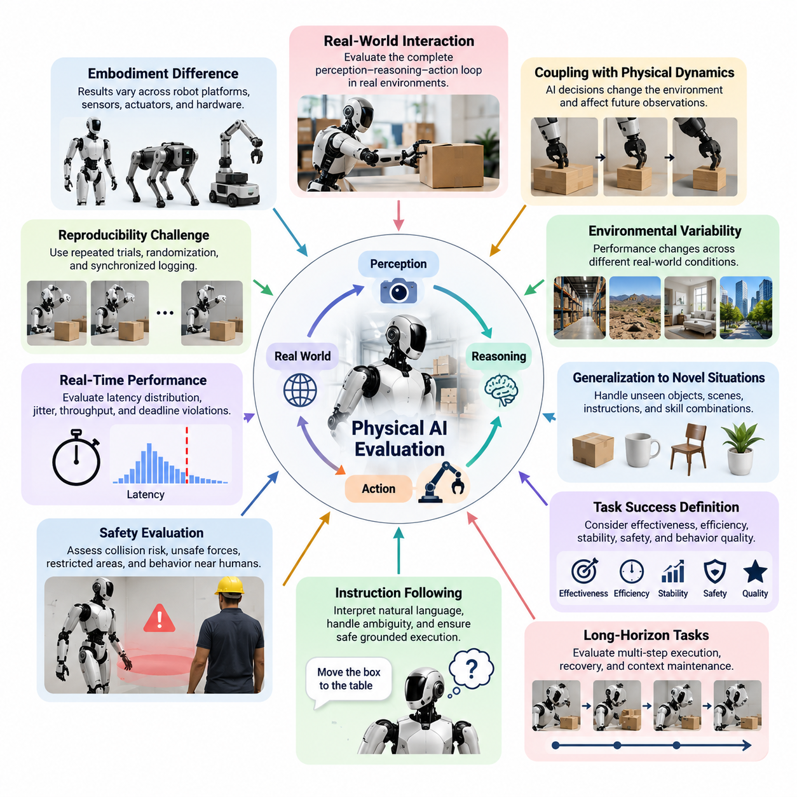
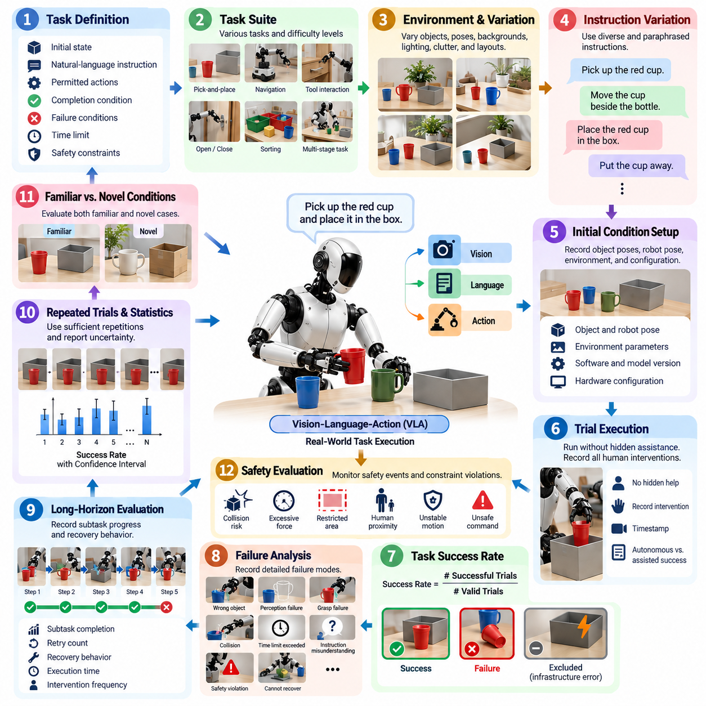
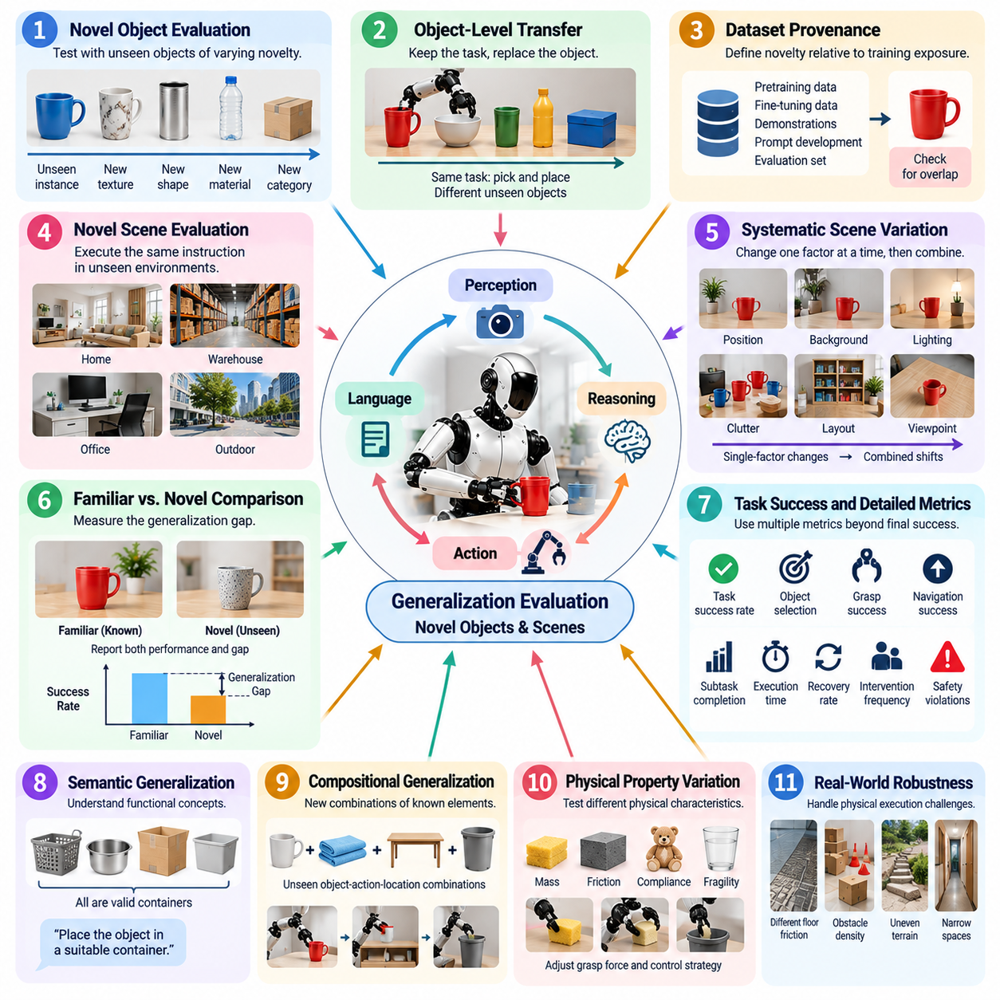
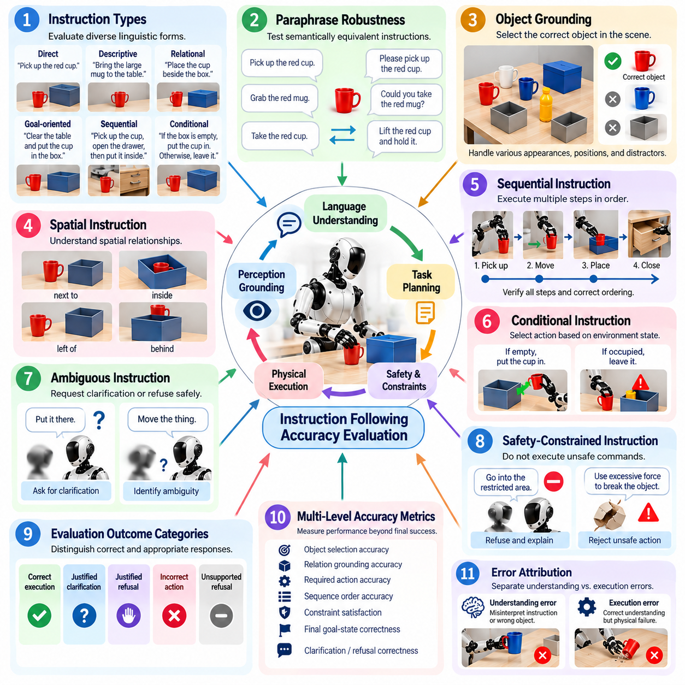
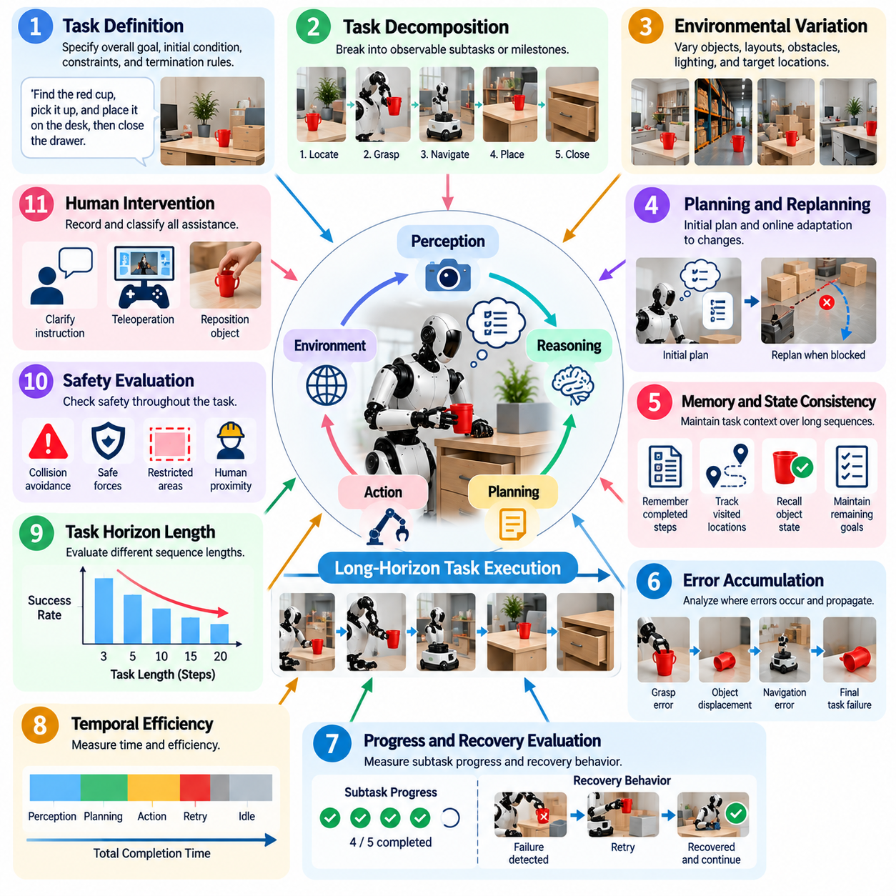
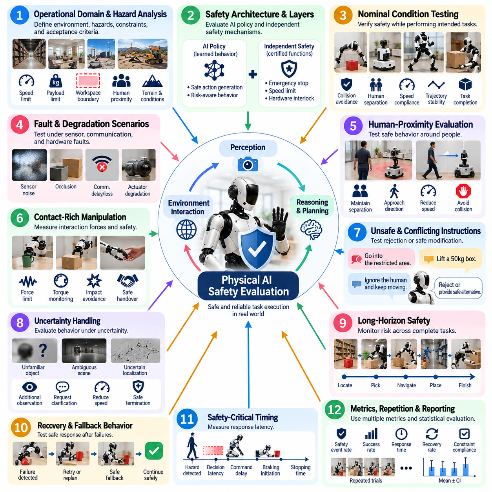
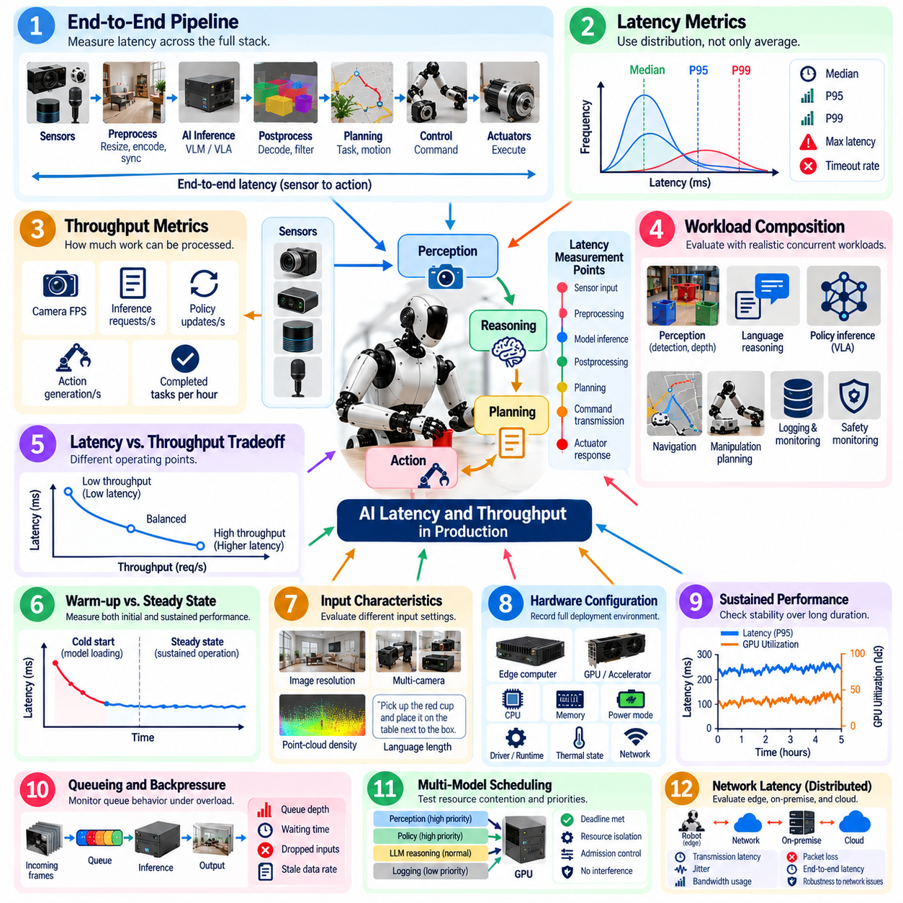
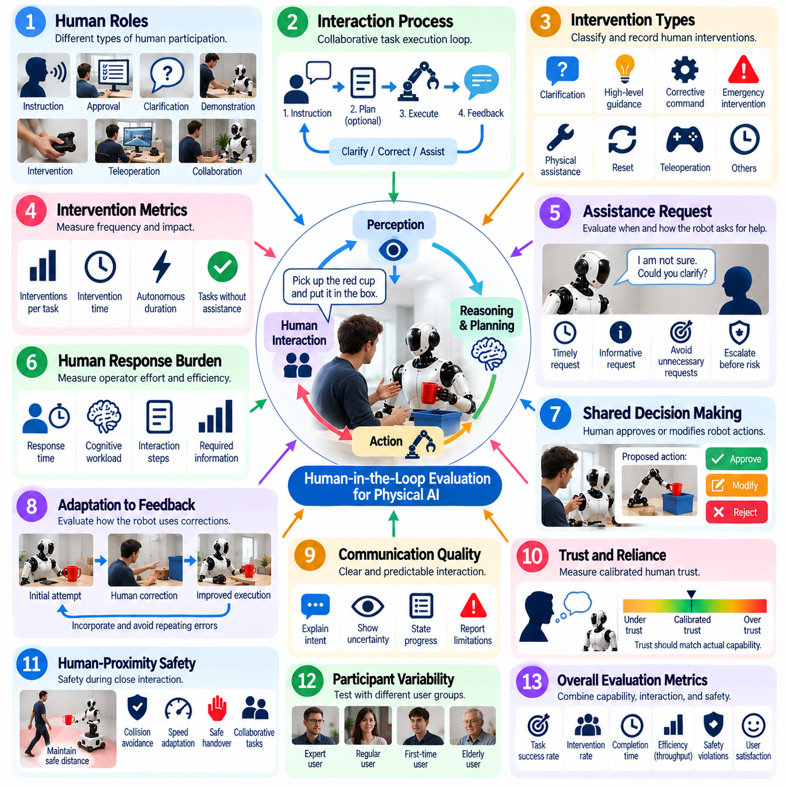
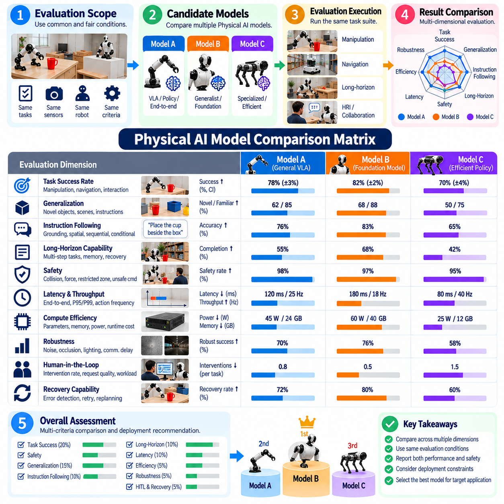
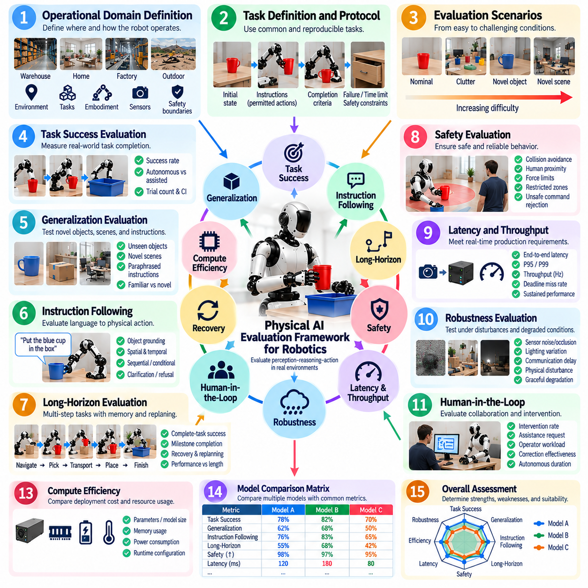

**Volume 25. Testing Validation and Benchmarking**

# Chapter 10. Physical AI Evaluation

## 10.01. Physical AI Evaluation Unique Challenges

{width="7.268055555555556in" height="7.268055555555556in"}

피지컬 AI 평가(Physical AI Evaluation)는 지능이 현실 세계와의 물리적 상호작용(Physical Interaction)을 통해 표현된다는 점에서 기존 소프트웨어 또는 AI 모델 시험과 근본적으로 다르다. 모델이 의미적으로 정확한 예측을 생성하더라도 인지 불확실성(Perception Uncertainty), 액추에이터 동역학(Actuator Dynamics), 타이밍, 접촉 조건 또는 환경 교란이 실제 행동을 변화시키면 로봇은 실패할 수 있다. 따라서 평가는 개별 모델 정확도가 아니라 전체 인지--추론--행동 루프(Perception--Reasoning--Action Loop)를 측정해야 한다.

핵심적인 과제 중 하나는 AI 의사결정(AI Decision)과 물리 동역학(Physical Dynamics)의 결합이다. 기존 머신러닝(Machine Learning)에서는 잘못된 예측을 정답 레이블과 독립적으로 비교하여 평가할 수 있는 경우가 많다. 반면 피지컬 AI(Physical AI)에서는 잘못된 행동이 환경 자체를 변화시키고, 그 결과 이후에 들어오는 모든 관측도 달라진다. 객체 자세 추정(Object Pose Estimation), 파지 선택(Grasp Selection), 발 배치(Foot Placement), 조향 또는 힘 제어의 작은 오차가 수초 또는 수분 후의 작업 실패로 누적될 수 있어 인과관계를 규명하기 어렵다.

물리적 환경(Physical Environment)은 통제된 데이터셋(Dataset)보다 훨씬 큰 변동성을 포함한다. 조명, 표면 마찰, 객체 형상, 적재 하중, 지형, 사람의 움직임, 센서 노이즈, 통신 상태 및 기계적 마모 등이 모두 성능에 영향을 줄 수 있다. 하나의 실험실 환경에서 반복적으로 성공하는 로봇이라도 창고, 야외 현장, 가정, 병원, 공장 또는 다른 운영 영역에서는 실패할 수 있다. 따라서 평가는 단일 명목 환경의 성능이 아니라 다양한 분포(Distribution)에 걸친 강건성(Robustness)을 특성화해야 한다.

일반화(Generalization)는 비전-언어-행동 모델(Vision-Language-Action Model), 파운데이션 모델(Foundation Model), 범용 정책(Generalist Policy)을 기반으로 하는 피지컬 AI 시스템에서 특히 중요하다. 시스템은 학습 과정에서 존재하지 않았던 객체, 배치, 명령, 시점 및 작업 조합을 접할 수 있다. 평가는 학습된 표현이 이러한 새로운 상황에 의미 있게 적응하면서도 불안전하거나 임의적인 행동을 생성하지 않는지를 판단해야 한다. 이를 위해 새로운 객체, 장면, 명령 및 기존에 학습한 기술의 새로운 조합을 명시적으로 시험해야 한다.

또 다른 어려움은 작업 성공(Task Success) 자체를 정의하는 것이다. 이진적인 성공과 실패 레이블은 유용하지만 실행 품질(Execution Quality)의 중요한 차이를 숨길 수 있다. 조작 작업이 기술적으로 성공하더라도 과도한 재시도, 힘, 에너지 또는 완료 시간이 필요할 수 있다. 내비게이션(Navigation)은 목적지에 도달했더라도 요구되는 안전거리를 위반할 수 있으며, 휴머노이드 보행(Humanoid Locomotion)은 불안정한 복구 동작을 보이면서도 경로를 완주할 수 있다. 따라서 피지컬 AI 평가는 효과성, 효율성, 안정성, 안전성 및 행동 품질을 포괄하는 다차원 지표(Multidimensional Metrics)를 요구한다.

장기 작업(Long-Horizon Task)은 서로 의존하는 인지, 추론, 계획 및 행동 단계로 구성되기 때문에 추가적인 복잡성을 발생시킨다. 로봇은 아홉 단계를 올바르게 수행한 뒤 열 번째 단계에서 실패할 수도 있고, 초기 오류에서 복구한 뒤 최종적으로 작업을 완료할 수도 있다. 단순한 행동별 정확도(Per-Action Accuracy)만으로는 이러한 행동을 적절하게 표현할 수 없다. 따라서 평가는 완료율, 하위 작업 진행도, 복구 능력, 누적 오류, 개입 빈도 및 장시간 실행 동안 작업 문맥(Task Context)을 유지하는 능력을 측정해야 한다.

명령 수행(Instruction Following)은 언어가 물리적 행동과 직접 연결될 때 또 다른 고유한 과제를 발생시킨다. 자연어 명령(Natural-Language Command)은 모호하거나 불완전할 수 있으며, 문맥에 의존하거나 현재의 물리적 상태에서 실행 불가능할 수도 있다. 유능한 시스템은 물리적 실현 가능성과 안전 제약(Safety Constraint)을 준수하면서 의도된 목표를 해석해야 한다. 따라서 평가는 언어 이해(Language Understanding)와 실제 환경에 기반한 실행(Grounded Execution)을 구분하고, 로봇이 불확실한 상황에서 적절하게 추가 설명을 요청하거나 위험한 명령을 거부하고 합리적인 행동을 선택하는지 판단해야 한다.

안전 평가(Safety Evaluation)는 능력 평가(Capability Evaluation)와 분리될 수 없다. 높은 작업 성공률을 달성하더라도 간헐적으로 위험한 동작을 생성하는 피지컬 AI 시스템은 실제 배치에 적합하지 않을 수 있다. 시험에서는 충돌 위험, 위험한 접촉력, 금지 영역 진입, 불안정한 움직임, 예상하지 못한 액추에이터 명령 및 사람과 가까운 환경에서의 행동을 검토해야 한다. 또한 안전 제약은 정상 작동뿐 아니라 AI 오류, 센서 성능 저하, 통신 장애 및 익숙하지 않은 상황에서도 효과적으로 유지되어야 한다.

실시간 성능(Real-Time Performance)은 또 다른 평가 차원을 형성한다. 올바른 의사결정이라도 지나치게 늦게 전달되면 잘못된 물리적 행동이 될 수 있기 때문이다. 인지 추론, 멀티모달 추론(Multimodal Reasoning), 궤적 생성(Trajectory Generation), 정책 실행, 통신 및 액추에이터 제어가 종단간 지연시간(End-to-End Latency)에 영향을 준다. 평균 지연시간만으로는 충분하지 않으며, 드물게 발생하는 지연시간 급증도 제어를 불안정하게 만들거나 환경에 대한 기존 가정을 무효화할 수 있다. 따라서 피지컬 AI 벤치마킹(Physical AI Benchmarking)은 현실적인 연산 부하에서 지연시간 분포, 지터(Jitter), 처리량(Throughput), 데드라인 위반 및 자원 경합(Resource Contention)을 평가해야 한다.

재현성(Reproducibility) 확보도 어렵다. 물리적 시험에서는 초기 조건을 완벽하게 동일하게 재현할 수 없기 때문이다. 객체 배치는 수 밀리미터씩 달라질 수 있고, 배터리 상태가 변하며, 모터 온도가 상승하고, 표면이 마모되며, 센서 드리프트(Sensor Drift)가 발생하고, 사람의 행동도 시험마다 달라질 수 있다. 따라서 통계적 평가(Statistical Evaluation)에는 반복 시험, 통제된 무작위화(Controlled Randomization), 동기화된 로깅(Synchronized Logging), 환경 메타데이터(Environmental Metadata) 및 명확한 신뢰도 기준이 필요하다. 시뮬레이션(Simulation)은 반복성을 향상시킬 수 있지만, 그 결과는 시뮬레이션-현실 간 격차(Sim-to-Real Gap)와 함께 해석해야 한다.

임바디먼트(Embodiment)는 모델 간 비교를 더욱 복잡하게 만든다. 동일한 정책 아키텍처(Policy Architecture)라도 서로 다른 카메라, 매니퓰레이터(Manipulator), 그리퍼(Gripper), 관절 제한, 제어 주파수, 컴퓨팅 플랫폼 또는 이동 시스템을 사용하는 로봇에서는 서로 다른 행동을 나타낼 수 있다. 따라서 벤치마크 결과에는 지능 품질과 임바디먼트 특성이 동시에 반영될 수 있다. 의미 있는 평가를 위해서는 어떤 지표가 모델 종속적(Model-Dependent)인지, 플랫폼 종속적(Platform-Dependent)인지, 시스템 종속적(System-Dependent)인지 구분하고 하드웨어 및 런타임 구성을 충분히 문서화해야 한다.

인간과의 상호작용(Human Interaction)은 자동화된 지표만으로 항상 표현할 수 없는 주관적이고 사회적인 평가 기준을 추가한다. 사람 주변에서 작동하는 로봇은 예측 가능한 움직임, 이해 가능한 의도, 적절한 응답 시간, 편안한 대인 거리 및 오해로부터의 효과적인 복구 능력이 필요할 수 있다. 인간 참여형 평가(Human-in-the-Loop Evaluation)는 정량적 시험을 보완하여 사용성, 신뢰 보정(Trust Calibration), 인지된 안전성, 인간 개입 부담 및 공유 작업에서 로봇 행동이 합리적인 인간의 기대와 일치하는지를 측정한다.

데이터 누출(Data Leakage)과 벤치마크 과적합(Benchmark Overfitting) 역시 피지컬 AI 모델이 점점 더 큰 멀티모달 데이터셋(Multimodal Dataset)으로 학습됨에 따라 중요해지고 있다. 평가에 사용되는 객체, 장면, 시연, 명령 또는 시뮬레이션 자산이 학습 데이터에 직접 또는 간접적으로 포함되어 있을 수 있다. 따라서 높은 일반화 성능처럼 보이는 결과가 실제로는 암기(Memorization) 또는 거의 동일한 데이터에 대한 사전 노출에서 비롯될 수 있다. 평가 프로토콜은 추적 가능한 데이터셋 분할을 유지하고 진정한 전이(Transfer) 능력을 측정할 수 있도록 충분히 구별되는 시나리오를 의도적으로 구성해야 한다.

실패 분석(Failure Analysis)은 단순한 전체 성공률을 보고하는 것보다 훨씬 어렵다. 하나의 작업 실패는 인지, 의미 추론(Semantic Reasoning), 세계 상태 추정(World-State Estimation), 계획, 정책 생성, 제어, 하드웨어 실행 또는 여러 구성요소 사이의 상호작용에서 발생할 수 있다. 포괄적인 텔레메트리(Telemetry)는 관측값, 모델 출력, 행동, 로봇 상태, 타이밍 정보, 안전 이벤트 및 환경 문맥을 보존해야 한다. 이러한 증거를 활용하면 모든 실패를 동일한 실패 사례로 취급하는 대신 발생 메커니즘에 따라 체계적으로 분류할 수 있다.

평가는 궁극적으로 실험실 지표(Laboratory Metrics)를 실제 운영 유용성(Operational Usefulness)과 연결해야 한다. 시스템이 빈번한 인간 개입을 요구하거나, 과도한 연산 자원을 소비하거나, 운영 환경의 지연시간에서 성능이 저하되거나, 드문 상황에서 예측할 수 없는 방식으로 실패한다면 높은 벤치마크 성능의 실질적 가치는 제한된다. 따라서 실용적인 프레임워크는 작업 성공, 일반화, 명령 수행, 장기 작업 완료, 안전성, 운영 지연시간, 인간 평가 및 모델 비교를 통합하여 피지컬 AI의 실제 배치 가능성을 종합적으로 평가해야 한다.

결과적으로 핵심 과제는 하나의 보편적인 피지컬 AI 점수(Physical AI Score)를 찾는 것이 아니라, 임바디드 지능 시스템(Embodied Intelligent System)이 현실적인 운영 조건 전반에서 지속적으로 유능하고, 강건하며, 안전하고, 적시에 동작하며, 이해 가능한지를 입증하는 평가 증거(Evaluation Evidence)를 구축하는 것이다. 평가는 시뮬레이션, 통제된 실험실 시험, 하드웨어 시험, 현장 시험(Field Trial), 운영 환경 모니터링(Production Monitoring)을 단계적으로 연결해야 한다. 이러한 시스템 수준 관점(System-Level Perspective)을 통해 피지컬 AI 평가는 전체 로봇 시험, 검증(Validation), 벤치마킹, 안전성 및 지속적 운영 시험(Continuous Production Testing) 체계와 통합될 수 있다.

## 10.02. VLA Task Success Rate in Real World Protocol [w/Code]

{width="7.268055555555556in" height="7.268055555555556in"}

실세계 작업 성공률(Real-World Task Success Rate)은 멀티모달 이해(Multimodal Understanding)가 효과적인 물리적 행동(Physical Behavior)으로 전환되는지를 측정하기 때문에 비전-언어-행동(Vision-Language-Action, VLA) 시스템의 핵심 평가 지표이다. 언어 출력이나 예측 행동을 기준 데이터와 비교하는 오프라인 VLA 평가(Offline VLA Evaluation)와 달리, 실세계 프로토콜(Real-World Protocol)은 물리적 제약, 불확실성 및 환경 변화 속에서 로봇이 실제로 요청된 작업을 완료하는지를 관찰한다.

엄격한 프로토콜은 성공(Success)에 대한 운영적 정의(Operational Definition)에서 시작한다. 각 작업은 시험 시작 전에 초기 상태, 자연어 명령(Natural-Language Instruction), 허용된 행동, 완료 조건, 실패 조건, 시간 제한 및 안전 제약(Safety Constraints)을 명확하게 정의해야 한다. 성공 기준은 가능한 경우 외부에서 관찰 가능해야 한다. 예를 들어, "요청된 객체를 목표 컨테이너에 배치한다"는 작업은 올바른 객체 선택, 성공적인 파지, 운반, 해제 및 유효한 최종 객체 상태를 요구한다.

작업 성공률(Task Success Rate)은 일반적으로 성공한 시험 횟수를 전체 유효 시험 횟수로 나누어 표현한다. 그러나 분모는 신중하게 관리되어야 한다. 인프라 장애, 실험자 오류 또는 관련 없는 하드웨어 고장으로 종료된 시험은 VLA 시스템에 기인한 실패와 구분해야 한다. 실패한 실행 결과를 관찰한 후 선택적으로 제거하지 못하도록 평가를 시작하기 전에 제외 규칙(Exclusion Rules)을 정의해야 한다.

작업 시험군(Task Suite)은 모델에 유리하도록 구성된 시연 집합이 아니라 실제 목표 운영 영역(Intended Operating Domain)을 대표해야 한다. 평가에는 객체 검색, 집어서 배치하기(Pick-and-Place), 객체까지의 내비게이션(Navigation-to-Object), 도구 상호작용, 개폐 장치 조작, 전달, 분류 및 다단계 조작(Multi-Stage Manipulation) 등이 포함될 수 있다. 작업 성공률이 명령 그라운딩(Instruction Grounding)과 임바디드 실행 능력(Embodied Execution Capability)을 모두 반영하도록 의미적 복잡성과 물리적 난이도를 다양하게 구성해야 한다.

실세계 평가는 객체, 위치, 방향, 배경, 조명, 혼잡도 및 공간 구성을 체계적으로 변화시켜야 한다. 동일한 장면을 반복하면 실행 일관성(Execution Consistency)을 측정할 수 있지만 강건성(Robustness)에 대한 증거는 제한적이다. 통제된 변화(Controlled Variation)를 적용하면 VLA 정책이 학습 또는 보정 과정에서 경험한 제한된 배치를 단순히 암기한 것인지, 아니면 언어, 인지 및 행동 사이의 전이 가능한 관계(Transferable Relationship)를 학습한 것인지 판단할 수 있다.

동일한 작업 의도를 유지하면서 명령 표현도 변화시켜야 한다. 로봇은 "빨간 컵을 집어라"와 같은 직접 명령, "컵을 병 옆으로 옮겨라"와 같은 관계 기반 명령(Relational Instruction), 또는 중간 행동을 구체적으로 지정하지 않는 목표 지향 요청(Goal-Oriented Request)을 받을 수 있다. 바꿔 표현한 명령(Paraphrased Instruction)은 성능이 특정 언어 템플릿에 의존하는지를 확인하는 데 도움이 된다. 모호한 명령은 명확하게 지정된 명령과 서로 다른 추론 능력을 평가하므로 별도로 구분해야 한다.

각 평가 시험(Evaluation Trial)은 문서화된 초기 조건에서 시작해야 한다. 객체 자세(Object Pose), 로봇 자세, 매니퓰레이터 구성(Manipulator Configuration), 관련 환경 매개변수, 소프트웨어 버전, 모델 체크포인트(Model Checkpoint), 프롬프트 구성 및 하드웨어 구성을 기록해야 한다. 완벽한 재현이 불가능한 경우에는 프로토콜에서 허용 가능한 초기화 허용오차(Initialization Tolerance)를 정의해야 한다. 이를 통해 반복 실험에서 정책 변동성과 통제되지 않은 물리적 시험 환경의 차이를 구분할 수 있다.

인간 개입(Human Intervention)이 명시적인 평가 조건에 포함되지 않는 한 시험 실행 과정에서는 숨겨진 실험자 지원이 없어야 한다. 수동 위치 재조정, 언어적 힌트, 원격조작(Teleoperation), 긴급 교정 또는 작업 재설정은 기록되지 않을 경우 겉으로 보이는 자율성(Autonomy)을 크게 부풀릴 수 있다. 따라서 모든 인간 개입에는 타임스탬프(Timestamp)를 부여하고 유형을 분류해야 한다. 완전 자율 성공(Fully Autonomous Success)과 지원을 받은 완료(Assisted Completion)는 하나의 성공률로 결합하지 않고 별도로 보고해야 한다.

실패 유형(Failure Category)은 종합 성공률을 해석하는 데 필수적인 문맥을 제공한다. 로봇이 잘못된 객체를 선택하거나, 명령을 오해하거나, 시각 추적(Visual Tracking)을 상실하거나, 실행 불가능한 행동을 생성하거나, 파지에 실패하거나, 충돌하거나, 시간 제한을 초과하거나, 안전 규칙을 위반하거나, 중간 오류에서 복구하지 못해 작업이 실패할 수 있다. 이러한 실패 모드(Failure Mode)를 기록하면 성공률 시험을 단순한 순위 지표가 아니라 공학적 진단 과정(Engineering Diagnostic Process)으로 활용할 수 있다.

장시간 작업(Longer Task)에서는 부분 진행도(Partial Progress)도 추가로 기록해야 한다. 다섯 개의 하위 작업 중 네 개를 올바르게 완료한 VLA 시스템은 첫 번째 단계에서 실패한 시스템과 다른 능력을 가지고 있지만, 최종 작업 성공값은 두 경우 모두 0이 될 수 있다. 따라서 최종 완료 여부를 핵심 결과로 유지하면서 하위 작업 완료율, 재시도 횟수, 복구 행동(Recovery Behavior), 실행 시간 및 개입 빈도를 이진 성공 지표(Binary Success Metric)를 보완하는 지표로 사용할 수 있다.

로봇 행동은 확률적(Stochastic)이며 물리적 조건도 실행마다 변하기 때문에 반복 시험(Repeated Trials)이 필요하다. 반복 횟수는 소수의 시도에서 단순한 성공 백분율을 보고하는 것이 아니라 의미 있는 불확실성을 포함하여 성능을 추정할 수 있을 정도로 충분해야 한다. 결과에는 작업 성공률과 함께 시험 횟수 및 적절한 신뢰구간(Confidence Interval)을 포함하여 실제 성능 차이와 표본 변동(Sampling Variation)을 구별할 수 있도록 해야 한다.

평가는 익숙한 조건(Familiar Conditions)과 새로운 조건(Novel Conditions)을 구분해야 한다. 익숙한 조건 시험은 개발 환경과 유사한 환경 및 객체 범주에서 신뢰성을 측정하고, 새로운 조건 시험은 변경된 객체, 배치, 시점, 배경 또는 명령 표현에 대한 일반화(Generalization)를 평가한다. 하나로 통합된 성공률은 로봇이 일반적인 운영 분포(Operating Distribution)를 벗어난 조건을 만났을 때 발생하는 심각한 성능 저하를 감출 수 있기 때문에 이러한 구분이 중요하다.

안전 이벤트(Safety Event)는 특별하게 처리해야 한다. 금지된 충돌, 과도한 힘, 위험한 사람 접근 또는 기타 안전 위반이 발생한 이후 원하는 최종 상태에 도달한 시험을 자동으로 성공으로 간주해서는 안 된다. 프로토콜은 실행 전에 안전 중요 무효화 기준(Safety-Critical Invalidation Criteria)을 정의해야 한다. 능력과 안전 지표는 별도로 보고할 수 있지만, 작업 성공은 명시적으로 금지된 행동을 통해 목표에 도달한 경우를 성공으로 평가해서는 안 된다.

시간(Timing) 역시 중요한 제약 조건이다. 무한정 느린 시스템이 높은 완료율을 달성하면 실제 성능보다 과장된 결과를 나타낼 수 있기 때문이다. 따라서 각 작업에는 목표 응용 분야에 적합한 현실적인 완료 시간 범위(Completion Window)를 정의해야 한다. 프로토콜은 전체 작업 시간과 필요한 경우 인지-행동 지연시간(Perception-to-Action Latency), 계획 지연, 조작 시간 및 유휴 시간을 기록해야 한다. 시간 초과 실패(Timeout Failure)는 불완전 시험이나 제외된 시험으로 변환하지 않고 명확하게 유지해야 한다.

재현성(Reproducibility)과 실패 분석을 위해 포괄적인 로깅(Comprehensive Logging)이 필요하다. 동기화된 카메라 스트림, 로봇 상태, 언어 명령, VLA 모델 출력, 선택된 행동, 컨트롤러 상태, 타임스탬프, 안전 이벤트 및 최종 작업 상태를 각 시험별로 보존해야 한다. 시험 식별자(Trial Identifier)는 이러한 기록을 모델 및 소프트웨어 버전과 연결하여 개별 성공과 실패를 이후에 재구성하고 시스템 개정 버전 사이에서 비교할 수 있도록 해야 한다.

VLA 모델 간 비교에는 동일하거나 동등하게 무작위화된 시험 조건(Randomized Test Conditions)이 필요하다. 기술적으로 가능한 경우 모델들은 동일한 로봇 임바디먼트(Robot Embodiment), 센서 구성, 작업 정의, 재설정 절차, 안전 제한 및 평가 예산(Evaluation Budget)을 사용해야 한다. 모델별로 서로 다른 추론 하드웨어나 행동 인터페이스가 필요한 경우 실행 주파수, 지연시간 및 제어 아키텍처(Control Architecture)가 실세계 성공률에 실질적인 영향을 줄 수 있으므로 이러한 차이를 문서화해야 한다.

운영 지향 VLA 평가 프로토콜(Production-Oriented VLA Evaluation Protocol)은 궁극적으로 하나의 대표 백분율보다 더 많은 정보를 제공해야 한다. 전체 작업 성공률과 함께 작업 범주, 환경 조건, 명령 유형, 신규성 수준(Novelty Level) 및 실패 유형별 결과를 보고해야 한다. 완료 시간, 인간 개입률, 안전 위반 및 복구 성능과 이러한 측정값을 함께 분석함으로써 VLA 시스템이 멀티모달 지능(Multimodal Intelligence)을 신뢰할 수 있는 실세계 로봇 행동(Real-World Robotic Behavior)으로 전환할 수 있는지를 종합적으로 평가할 수 있다.

## 10.03. Generalization Evaluation Novel Objects Scenes [w/Code]

{width="7.268055555555556in" height="7.268055555555556in"}

일반화 평가(Generalization Evaluation)는 피지컬 AI(Physical AI) 시스템이 학습 과정에서 직접적으로 경험하지 않은 객체와 환경에도 학습된 인지, 추론 및 행동 능력을 적용할 수 있는지를 판단한다. 비전-언어-행동 모델(Vision-Language-Action Model)과 범용 로봇 정책(Generalist Robot Policy)에서는 익숙한 시험 장면에서의 높은 성능만으로 충분하지 않다. 객체의 외관, 형상, 공간 배치, 의미 범주 또는 환경 문맥이 변화하더라도 로봇이 유용한 행동 능력을 유지하는지를 평가해야 한다.

새로운 객체 평가(Novel-Object Evaluation)는 모든 미관측 객체를 동일하게 취급하기보다 신규성(Novelty)의 정도를 구분해야 한다. 익숙한 범주의 새로운 인스턴스(New Instance)는 익숙하지 않은 형상이나 물리적 특성을 가진 미관측 범주의 객체보다 작은 분포 변화(Distribution Shift)를 발생시킨다. 따라서 평가 세트는 미관측 인스턴스와 텍스처에서 시작하여 새로운 범주, 형상, 재질, 크기 및 기능적 특성으로 점진적으로 확장할 수 있으며, 요청된 작업 자체는 해석 가능한 상태로 유지해야 한다.

객체 신규성(Object Novelty)은 모델이 학습 및 개발 과정에서 경험한 데이터와의 관계를 기준으로 정의해야 한다. 최종 검증 시험에 등장하지 않았다는 이유만으로 객체를 새로운 객체라고 정의해서는 안 된다. 사전학습(Pretraining), 미세조정(Fine-Tuning), 시연 또는 프롬프트 개발 과정에서 매우 유사한 객체가 사용되었을 수 있기 때문이다. 따라서 데이터셋 출처(Dataset Provenance)와 평가 세트 구축 과정을 신중하게 문서화하고, 알려졌거나 의심되는 데이터 중복을 일반화 결과 해석에 반영해야 한다.

실용적인 새로운 객체 프로토콜(Novel-Object Protocol)은 작업 자체를 유지하면서 조작 대상 객체를 교체하는 방식으로 구성할 수 있다. 예를 들어 특정 컵, 상자, 도구 또는 컨테이너를 중심으로 개발된 정책을 색상, 크기, 형상, 텍스처, 투명도 또는 파지 어포던스(Grasp Affordance)가 다른 미관측 객체로 시험할 수 있다. 이러한 설계는 작업 구조를 충분히 안정적으로 유지하면서 객체 수준 전이(Object-Level Transfer)를 분리하여 익숙한 객체 조건의 성능과 의미 있게 비교할 수 있도록 한다.

새로운 장면 평가(Novel-Scene Evaluation)는 분포 변화를 개별 객체에서 주변 환경 전체로 확장한다. 동일한 명령을 이전에 경험하지 않은 실내 배치, 작업 셀, 선반, 테이블, 복도, 창고 또는 혼잡한 환경 구성에서 실행할 수 있다. 배경 외관, 조명, 시점, 장애물 배치, 공간적 관계 및 방해 객체(Distractor Object)의 변화는 로봇이 암기된 공간 패턴에 의존하지 않고 현재 장면에 대한 유용한 표현을 구성할 수 있는지를 평가한다.

장면 신규성(Scene Novelty)은 체계적으로 도입해야 한다. 모든 환경 요소를 동시에 변경하면 실패 원인을 규명하기 어렵기 때문이다. 초기 시험에서는 객체 범주를 유지하면서 위치와 배경을 변경하고, 이후 배치, 혼잡도, 조명 및 시점을 변화시킬 수 있다. 더 어려운 시험에서는 여러 분포 변화를 결합할 수 있다. 이러한 단계적 접근법(Staged Approach)을 통해 어떤 환경 변화가 성능 저하를 발생시키는지 파악하고 추가적인 강건성 또는 적응(Adaptation)이 필요한 영역을 식별할 수 있다.

일반화 성능은 익숙한 조건 기준선(Familiar-Condition Baseline)을 기준으로 측정해야 한다. 시스템이 알려진 객체와 장면에서는 높은 작업 성공률을 달성하지만 새로운 조건에서 급격히 성능이 저하된다면, 새로운 조건의 절대 점수만으로는 일반화 격차(Generalization Gap)의 크기를 파악하기 어렵다. 익숙한 조건과 새로운 조건의 성능을 함께 보고하면 유지된 능력의 수준을 정량화하고, 실패가 기본적인 실행 한계에서 발생하는지 또는 분포 변화에서 주로 발생하는지를 식별할 수 있다.

작업 성공률(Task Success Rate)은 여전히 중요한 지표이지만 일반화 평가에는 추가적인 측정값이 필요하다. 객체 선택 정확도, 파지 성공률, 내비게이션 성공률, 하위 작업 완료율, 복구율(Recovery Rate), 실행 시간, 인간 개입 빈도 및 안전 위반은 최종적인 이진 결과(Binary Result)가 감추는 성능 저하를 드러낼 수 있다. 로봇이 새로운 객체 작업을 최종적으로 완료하더라도 익숙한 조건보다 더 많은 재시도, 느린 추론 또는 상당히 많은 수정 행동이 필요할 수 있다.

평가에서는 의미적 일반화(Semantic Generalization)도 시험해야 한다. 로봇은 시각적으로 크게 다른 여러 객체가 동일한 기능적 역할을 공유한다는 사실을 이해할 수 있어야 한다. 적절한 컨테이너 선택, 적합한 도구 탐색 또는 물체를 사용할 수 있는 표면에 배치하는 것과 같은 명령은 언어, 시각 인지, 물리적 어포던스(Physical Affordance) 및 작업 문맥 사이의 관계를 요구한다. 이러한 시험은 모델이 단순히 시각적 패턴을 대응시키는 것이 아니라 개념을 전이하는지를 평가한다.

조합적 일반화(Compositional Generalization) 역시 중요한 평가 차원이다. 개별 객체, 행동, 위치 및 언어적 개념이 각각 이전에 등장했더라도 이들의 특정 조합은 새로운 것일 수 있다. 여러 객체를 파지하고 여러 위치에 물체를 배치하는 방법을 학습한 로봇이라면 이전에 경험하지 않은 객체-행동-위치(Object-Action-Location) 조합에서도 평가해야 한다. 성공적인 실행은 시스템이 익숙한 작업 템플릿을 재생하는 것이 아니라 학습된 능력을 새롭게 재조합할 수 있다는 강력한 증거를 제공한다.

물리적 특성(Physical Properties)은 시각적 신규성만으로 평가할 수 없는 과제를 발생시킨다. 새로운 객체는 익숙한 객체와 외관이 유사하더라도 질량, 무게중심, 유연성, 마찰, 취약성 또는 변형 가능성(Deformability)이 다를 수 있다. 로봇은 상호작용 이후 파지력, 궤적, 접촉 전략 또는 복구 행동을 조정해야 할 수 있다. 따라서 목표 응용 분야에서 단순한 시각 인식을 넘어선 조작이 요구된다면 평가에 물리적으로 의미 있는 변화를 포함해야 한다.

새로운 장면 역시 인지만이 아니라 물리적 실행에 영향을 주는 변화를 포함할 수 있다. 서로 다른 바닥 마찰, 표면 높이, 출입구 폭, 장애물 밀도, 조도 또는 작업공간 접근성은 실행 가능한 행동을 변화시킬 수 있다. 모바일 매니퓰레이터(Mobile Manipulator), 휴머노이드(Humanoid) 및 기타 임바디드 시스템(Embodied System)의 일반화 평가에서는 의미적으로 합리적이지만 물리적으로 실행 불가능한 계획을 생성하는 것이 아니라 장면 이해가 동역학적으로 실행 가능한 움직임(Dynamically Feasible Motion)과 연결되는지를 판단해야 한다.

유리한 객체 배치나 장면 구성이 결과를 지배하지 않도록 반복적인 무작위 시험(Randomized Trials)이 필요하다. 객체 자세, 목표 위치, 방해 객체 및 기타 통제 변수는 사전에 정의된 범위에 따라 샘플링해야 한다. 적용 가능한 경우 난수 시드(Random Seed) 또는 구성 식별자(Configuration Identifier)를 보존해야 한다. 여러 객체 인스턴스와 장면에서 반복 시험을 수행하면 하나의 새로운 사례만을 여러 번 시험하는 것보다 일반화 성능을 더욱 신뢰성 있게 추정할 수 있다.

실패 분류(Failure Classification)는 일반화가 어느 단계에서 무너지는지를 식별해야 한다. 새로운 조건에서의 실패는 검출, 분할(Segmentation), 객체 그라운딩(Object Grounding), 공간 추론, 어포던스 추정, 계획, 파지 생성, 제어 또는 복구 과정에서 발생할 수 있다. 동일한 작업 수준의 실패라도 원인에 따라 필요한 공학적 대응이 크게 달라질 수 있으므로 이러한 메커니즘을 구분하는 것이 중요하다. 따라서 각 평가 시험에는 동기화된 관측값, 모델 출력, 행동, 로봇 상태 및 환경 메타데이터(Environmental Metadata)를 함께 기록해야 한다.

익숙한 조건에서 새로운 조건으로 이동하더라도 안전 제약(Safety Constraints)은 동일하게 유지되어야 한다. 일반화 모델은 불확실성이 증가했을 때 더 공격적인 움직임, 과도한 접촉력, 위험한 탐색 또는 금지된 지름길을 사용하여 높은 성공률을 얻어서는 안 된다. 안전 위반(Safety Violation)은 독립적으로 보고해야 하며 프로토콜에서 정의한 경우 성공 결과를 무효화해야 한다. 강건한 일반화(Robust Generalization)는 작업 수행 능력뿐 아니라 허용 가능한 물리적 행동의 유지까지 요구한다.

최종 결과는 하나의 점수가 아니라 일반화 프로파일(Generalization Profile)로 표현하는 것이 적절하다. 익숙한 객체, 미관측 인스턴스, 미관측 범주, 새로운 장면 및 객체-장면 결합 변화(Combined Object-Scene Shift)에 따른 성능을 관련 신뢰구간(Confidence Interval)과 실패 분포(Failure Distribution)와 함께 비교할 수 있다. 이러한 프로파일은 조건이 개발 경험에서 멀어질수록 시스템 능력이 얼마나 빠르게 저하되는지를 보여주며 피지컬 AI 시스템을 비교하기 위한 실용적인 기준을 제공한다.

성숙한 평가 프레임워크(Evaluation Framework)는 신규성을 실세계 작업 성공과 점진적으로 어려워지는 분포 변화를 연결하는 통제된 시험 차원으로 취급해야 한다. 객체 신규성, 장면 신규성, 의미적 전이(Semantic Transfer), 조합적 전이(Compositional Transfer) 및 물리적으로 의미 있는 변화를 구분함으로써 피지컬 AI 시스템이 재사용 가능한 임바디드 능력(Reusable Embodied Capability)을 학습했는지 판단할 수 있다. 목표는 단순히 새로운 사례에서 성공하는 것이 아니라 실제 배치 환경에서 예상되는 변화하는 조건 전반에 걸쳐 신뢰할 수 있고 안전하게 적응하는 것이다.

## 10.04. Instruction Following Accuracy Evaluation [w/Code]

{width="7.268055555555556in" height="7.268055555555556in"}

명령 수행 정확도(Instruction-Following Accuracy)는 피지컬 AI(Physical AI) 시스템이 인간의 명령을 올바르게 해석하고 그 의도된 의미를 적절한 물리적 행동으로 변환하는지를 평가한다. 비전-언어-행동(Vision-Language-Action, VLA) 시스템에서는 생성된 텍스트를 기준 응답과 비교하는 것만으로 정확도를 판단할 수 없다. 언어 이해, 환경 그라운딩(Environmental Grounding), 작업 계획 및 물리적 실행이 요청된 목표와 일관되게 유지되는지를 검증해야 한다.

평가 프로토콜(Evaluation Protocol)은 시험을 시작하기 전에 올바른 명령 수행의 기준을 정의해야 한다. 예상 목표 상태, 관련 객체, 공간적 관계, 허용 행동, 금지 행동, 완료 조건 및 허용 가능한 변형을 명확하게 규정해야 한다. 이를 통해 실행 이후의 주관적인 판단을 방지할 수 있다. 로봇의 정확한 행동 순서가 기준 시연(Reference Demonstration)과 다르더라도 허용 가능한 전략을 통해 의도된 결과를 달성한다면 성공으로 인정해야 한다.

명령 세트(Instruction Set)는 실제 운영 환경에서 예상되는 언어적 다양성을 대표해야 한다. 직접 명령, 설명형 요청, 관계 기반 명령(Relational Instruction), 목표 지향적 표현, 순차 명령 및 조건부 명령을 통해 서로 다른 능력을 시험할 수 있다. "파란색 컨테이너를 가져와라", "도구를 상자 옆에 놓아라", "서랍을 닫은 후 스테이션으로 돌아가라"와 같은 표현은 점차 더 높은 수준의 그라운딩, 순서 이해 및 시간적 추론(Temporal Reasoning)을 요구한다.

사용자는 동일한 의도를 항상 동일한 문장으로 표현하지 않기 때문에 바꿔 표현하기 강건성(Paraphrase Robustness)이 중요하다. 따라서 의미적으로 동일한 명령을 서로 다른 어휘, 문장 구조, 격식 수준 및 어순으로 제시해야 한다. 바꿔 표현한 명령에서도 안정적인 성능이 유지된다면 의미적 이해(Semantic Understanding)에 대한 더 강력한 증거가 되며, 성능 차이가 크다면 언어 템플릿이나 빈번하게 관찰된 표현에 의존하고 있을 가능성을 나타낼 수 있다.

명령이 물리적 장면의 개체를 참조하는 경우 객체 그라운딩(Object Grounding)을 별도로 평가해야 한다. 시스템은 "빨간 컵", "가장 가까운 패키지", "트레이 옆의 렌치"와 같은 표현을 올바르게 인지된 객체와 연결해야 한다. 성공적인 행동을 위해 언어를 현재의 시각 및 공간 정보와 연결해야 하도록 객체의 외관, 위치, 방해 객체(Distractor) 및 관계적 설명을 변화시키면서 그라운딩 능력을 시험해야 한다.

공간 명령 평가(Spatial Instruction Evaluation)는 언어적 관계가 올바른 기하학적 행동으로 변환되는지를 검증한다. 왼쪽, 오른쪽, 위, 내부, 뒤, 가장 가까운, 사이 및 옆과 같은 표현은 기준 좌표계(Reference Frame)와 장면 문맥에 따라 의미가 달라질 수 있다. 모호성이 발생할 수 있는 경우 프로토콜에서 의도된 기준 좌표계를 정의하고 선택된 목표와 최종 배치를 모두 검증해야 한다. 이를 통해 실제 공간 이해와 우연한 작업 성공을 구분할 수 있다.

순차 명령(Sequential Instruction)은 단일 단계 명령에는 존재하지 않는 시간적 의존성(Temporal Dependency)을 포함한다. 하나의 요청이 객체 탐색, 파지, 다른 영역으로의 이동, 객체 배치 및 지정된 순서에 따른 최종 행동을 요구할 수 있다. 평가에서는 필요한 모든 단계가 수행되었는지, 순서 제약(Ordering Constraint)이 준수되었는지, 그리고 시스템이 가장 최근의 하위 목표만 수행하는 것이 아니라 전체 실행 과정에서 명령 문맥(Instruction Context)을 유지하는지를 기록해야 한다.

조건부 명령(Conditional Instruction)은 시스템이 관측된 상태와 언어로 지정된 의사결정 논리(Decision Logic)를 연결할 수 있는지를 평가한다. 컨테이너가 비어 있으면 하나의 행동을 수행하고 점유되어 있으면 다른 행동을 수행하도록 요구하는 명령에는 인지, 조건 판단 및 행동 선택이 필요하다. 모델이 하나의 암기된 분기만 반복하여 성공하지 못하도록 관련 환경 조건을 명령 표현과 독립적으로 변화시키면서 시험해야 한다.

모호성(Ambiguity)은 특별하게 다루어야 한다. 불확실한 명령을 무조건 실행하면 작업 실패뿐 아니라 안전 문제도 발생할 수 있기 때문이다. 일부 시험에는 의도적으로 불충분하게 지정된 객체 참조, 불명확한 목적지, 상충되는 제약 또는 누락된 정보를 포함해야 한다. 유능한 피지컬 AI 시스템은 신뢰도가 충분하지 않은 상황을 인식하고 추가 설명을 요청하거나, 허용된 경우에만 안전한 해석을 선택하거나, 신뢰할 수 있는 그라운딩이 불가능하면 실행을 거부해야 한다.

따라서 명령 수행 정확도는 잘못된 실행과 적절한 미실행(Appropriate Non-Execution)을 구분해야 한다. 위험한 명령을 거부하거나 모호한 목표에 대해 추가 설명을 요청한 로봇을 자동으로 명령 수행 실패로 분류해서는 안 된다. 평가 레이블(Evaluation Label)은 올바른 실행, 정당한 명확화 요청(Justified Clarification), 정당한 거부(Justified Refusal), 잘못된 행동 및 근거 없는 거부(Unsupported Refusal)를 포함하여 명령과 문맥에 대한 응답의 적절성을 반영해야 한다.

안전 제약(Safety Constraints)은 문자 그대로의 명령 준수보다 우선해야 한다. 명령은 의도적으로 또는 실수로 충돌 제한, 제한 구역, 힘 제한, 적재하중 제약 또는 인간 안전 요구사항을 위반하는 행동을 요청할 수 있다. 시스템은 요청된 행동을 그대로 완료할 수 없다는 사실을 설명하거나 신호로 전달하면서 안전 정책(Safety Policy)을 유지해야 한다. 높은 명령 수행 정확도가 언어적으로 이해했다는 이유만으로 위험한 명령까지 실행해야 한다는 의미가 되어서는 안 된다.

최종 작업 성공만으로는 명령 오류를 숨길 수 있으므로 정확도는 여러 수준에서 측정해야 한다. 유용한 측정값에는 목표 객체 선택 정확도, 관계 그라운딩 정확도(Relation-Grounding Accuracy), 요구 행동 정확도, 순서 정확도, 제약 충족 여부, 최종 목표 상태 정확도 및 명확화 요청 또는 거부의 정확성이 포함된다. 이러한 측정값을 통해 실패가 의미 해석, 그라운딩, 계획 또는 물리적 실행 중 어느 단계에서 발생했는지 식별할 수 있다.

가능한 경우 물리적 실행 오류(Physical Execution Error)와 명령 이해 오류(Instruction-Understanding Error)도 구분해야 한다. 로봇이 요청된 컵과 목적지를 올바르게 식별했지만 파지 실패나 액추에이터 고장으로 작업을 완료하지 못할 수 있다. 반대로 잘못된 객체를 완벽하게 조작했다면 모터 실행에는 성공했더라도 명령 수행에는 실패한 것이다. 동기화된 언어, 인지, 모델 출력, 계획 행동 및 로봇 상태 로그를 통해 이러한 차이를 구분할 수 있다.

평가에는 익숙한 언어 표현(Familiar Linguistic Formulation)과 새로운 언어 표현(Novel Linguistic Formulation)을 모두 포함해야 한다. 익숙한 템플릿은 기준 신뢰성을 확립하고, 이전에 사용되지 않은 바꿔 표현하기, 드문 설명, 새로운 객체 참조 및 알려진 개념의 새로운 조합은 언어 일반화(Linguistic Generalization)를 평가한다. 두 조건 사이의 성능 저하는 명령 일반화 격차(Instruction-Generalization Gap)를 제공하며 피지컬 AI 시스템의 새로운 객체 및 새로운 장면 평가를 보완한다.

명령이 정당한 의미적 유연성(Semantic Flexibility)을 포함하는 경우 인간 평가(Human Evaluation)를 자동화된 채점과 함께 사용할 수 있다. 여러 개의 유효한 해결책이 존재하는 개방형 또는 목표 지향 명령에서는 독립 평가자가 실행된 행동이 사용자의 의도를 합리적으로 충족하는지를 판단할 수 있다. 평가 기준과 판정 절차(Adjudication Procedure)는 사전에 정의해야 하며, 일관되지 않은 채점이 모델 비교 결과를 지배하지 않도록 평가자 간 일치도(Inter-Rater Agreement)를 관리해야 한다.

인지, 정책 샘플링(Policy Sampling) 및 물리적 상호작용으로 인해 동일한 명령에서도 서로 다른 결과가 발생할 수 있으므로 반복 시험(Repeated Trials)이 필요하다. 하나의 유리한 실행만 평가하는 대신 여러 객체 배치와 환경 구성에서 동일한 명령을 시험해야 한다. 시험 횟수, 성공 빈도, 신뢰구간(Confidence Interval) 및 실패 유형을 함께 사용하면 소수의 시연만으로 판단하는 것보다 명령 수행 신뢰성을 더욱 타당하게 추정할 수 있다.

성숙한 명령 수행 평가(Instruction-Following Evaluation)는 궁극적으로 단순한 언어 일치가 아니라 물리적으로 그라운딩된 명령 준수(Grounded Obedience)를 측정한다. 시스템은 무엇이 요청되었는지를 이해하고, 관련 물리적 개체와 제약을 식별하며, 적절한 행동 순서를 구성하고, 이를 성공적으로 실행하는 동시에 추가 설명이나 거부가 필요한 상황을 인식해야 한다. 의미 정확성, 물리적 그라운딩, 시간적 추론, 안전성 및 실행 능력의 결합은 피지컬 AI 시스템이 실제 환경에서 인간의 명령에 신뢰성 있게 행동할 수 있다는 의미 있는 평가 증거를 제공한다.

## 10.05. Long Horizon Task Completion Evaluation [w/Code]

{width="7.268055555555556in" height="7.268055555555556in"}

장기 작업 완료 평가(Long-Horizon Task Completion Evaluation)는 피지컬 AI(Physical AI) 시스템이 장시간에 걸친 물리적 상호작용 과정에서 일관된 인지, 추론, 계획 및 행동을 지속할 수 있는지를 측정한다. 단일 파지, 이동 또는 응답만 요구하는 단기 작업(Short-Horizon Task)과 달리 장기 작업은 초기 의사결정이 이후 상태에 영향을 미치는 여러 개의 상호 의존적인 단계로 구성된다. 따라서 평가는 개별 행동 정확도가 아니라 전체 작업 실행을 검증해야 한다.

장기 작업 평가 프로토콜(Long-Horizon Evaluation Protocol)은 전체 목표를 정의하고, 로봇이 하나의 사전에 결정된 행동 순서만 따르도록 강제하지 않으면서 이를 관찰 가능한 하위 작업(Subtask) 또는 마일스톤(Milestone)으로 분해해야 한다. 예를 들어 창고 작업은 물품 탐색, 해당 위치까지의 이동, 물품 조작, 운반, 목적지 배치 및 완료 확인을 요구할 수 있다. 각 마일스톤은 진행 상황에 대한 증거를 제공하며 최종 물리적 상태가 전체 작업의 성공 여부를 결정한다.

작업 정의(Task Definition)에는 초기 조건, 요구 결과, 허용 행동, 안전 제약(Safety Constraints), 최대 실행 시간 및 시험 종료 조건을 명시해야 한다. 또한 프로토콜은 하위 작업 사이의 의존성을 식별해야 한다. 일부 단계는 엄격한 순서로 수행되어야 하지만 다른 단계는 대체 전략을 허용할 수 있다. 이러한 구분을 통해 필수적인 작업 논리나 물리적 제약을 위반하는 실행은 배제하면서 유효한 적응 행동(Adaptive Behavior)을 인정할 수 있다.

장기 작업은 짧은 시연보다 오류 누적(Error Accumulation)을 더욱 명확하게 드러낸다. 작은 위치추정 오류, 불완전한 객체 그라운딩(Object Grounding), 불확실한 파지, 계획 오차 또는 지연된 행동은 초기에는 큰 문제가 없어 보이지만 이후 단계로 전파될 수 있다. 따라서 평가는 오류가 처음 발생한 지점, 시간이 지나면서 오류가 증가하는지 여부, 그리고 시스템이 국부적인 부정확성이 전체 작업 실패로 발전하는 것을 방지할 수 있는지를 기록해야 한다.

메모리(Memory)와 상태 일관성(State Consistency)은 핵심적인 평가 차원이다. 로봇은 이미 처리한 객체, 방문한 위치, 아직 활성화되어 있는 명령 및 이전 행동이 환경을 어떻게 변화시켰는지를 기억해야 할 수 있다. 완료된 영역을 반복해서 탐색하거나 이전 결과를 잊는 시스템은 개별 기술을 올바르게 수행하더라도 전체 임무에는 실패할 수 있다. 따라서 평가에서는 장시간 실행 과정에서 관련 작업 상태(Task State)가 유지되는지를 측정해야 한다.

계획 능력(Planning Capability)은 초기 작업 분해뿐 아니라 온라인 재계획(Online Replanning)을 통해서도 평가해야 한다. 실제 환경은 작업 시작 시점에 가정한 상태를 그대로 유지하는 경우가 드물다. 객체가 이동하거나, 이동 경로가 차단되거나, 파지가 실패하거나, 사람이 작업공간을 변경할 수 있다. 유능한 피지컬 AI 시스템은 더 이상 유효하지 않은 행동 순서를 그대로 계속하는 대신 새로운 관측 정보를 사용하여 계획을 갱신해야 한다.

오류 없는 장기 실행을 항상 요구하는 것은 현실적이지 않기 때문에 복구 행동(Recovery Behavior)은 특히 중요하다. 평가에서는 시스템이 실패한 행동을 감지하고, 복구 가능한 상태를 식별하며, 적절하게 재시도하거나, 대체 전략을 선택하거나, 복구가 불가능한 경우 안전하게 종료할 수 있는지를 판단해야 한다. 복구 성공률, 재시도 횟수, 복구 시간 및 최종 작업 완료로 전환된 실패의 비율은 유용한 보완 지표가 된다.

진행도 측정(Progress Measurement)은 이진적인 최종 성공 여부만으로 가려질 수 있는 중요한 능력 차이를 보여준다. 두 시스템 모두 전체 작업에는 실패했더라도 하나는 거의 모든 필수 하위 작업을 완료하고 다른 하나는 첫 단계에서 실패할 수 있다. 따라서 최종 완료를 핵심 지표로 유지하면서 마일스톤 완료 비율, 가중 하위 작업 진행도(Weighted Subtask Progress), 최대 도달 단계 및 목표까지 남은 거리를 보완 지표로 활용할 수 있다.

시간적 효율성(Temporal Efficiency)도 고려해야 한다. 과도한 대기, 반복적인 계획 주기 또는 불필요한 행동을 거친 후에야 작업을 완료하는 로봇은 실제 운영에 적합하지 않을 수 있다. 평가에서는 필요한 경우 전체 완료 시간, 실제 실행 시간, 계획 시간, 유휴 시간, 재시도 오버헤드(Retry Overhead) 및 시간 초과 빈도를 기록해야 한다. 더 빠른 실행이 물리적 위험 증가로 보상받지 않도록 효율성 지표는 안전성과 함께 해석해야 한다.

장기 작업 시험에서는 인간 개입(Human Intervention)을 명확하게 추적해야 한다. 운영자는 추가 설명을 제공하거나, 객체 위치를 조정하거나, 로봇을 재설정하거나, 내비게이션 실패를 수정하거나, 어려운 단계를 원격조작(Teleoperation)으로 통과시킬 수 있다. 이러한 지원은 작업 완료의 의미를 변화시킨다. 따라서 완전 자율 완료, 상위 수준의 명확화 이후 완료, 물리적 지원 또는 원격조작이 필요한 완료를 서로 구분하여 평가해야 한다.

안전 평가(Safety Evaluation)는 개별 행동에만 적용하는 것이 아니라 전체 작업 수행 과정에서 지속적으로 활성화되어야 한다. 반복적인 상호작용은 점진적으로 위험한 환경 구성, 누적된 위치 오류, 불안정한 적재 상태 또는 점점 위험해지는 복구 행동을 발생시킬 수 있다. 금지된 충돌, 위험한 힘, 제한 구역 위반 또는 명시적으로 정의된 기타 안전 위반을 통해 최종 목표에 도달했다면 해당 작업을 성공적으로 완료한 것으로 간주해서는 안 된다.

장기 작업 평가에는 서로 다른 순서 길이(Sequence Length)와 의존 구조(Dependency Structure)를 가진 작업을 포함해야 한다. 3단계 작업에서의 성능이 20단계 임무의 성능을 예측하지 못할 수 있는데, 작업 길이가 증가할수록 메모리 손실, 계획 드리프트(Planning Drift) 및 누적 오류가 발생할 기회가 증가하기 때문이다. 작업 길이에 따른 완료 성능을 보고하면 시스템 신뢰성이 저하되기 시작하는 지점을 식별하고 피지컬 AI 모델 간의 더욱 의미 있는 비교가 가능하다.

비교 가능한 작업 목표를 유지하면서 환경 변화(Environmental Variation)를 도입해야 한다. 객체 위치, 장애물 배치, 목표 위치, 방해 요소(Distractor), 조명 및 기타 관련 조건을 사전에 정의된 범위 내에서 무작위화할 수 있다. 일부 시험에서는 실행 중 객체 이동이나 경로 차단과 같은 통제된 교란(Controlled Disturbance)을 추가하여 환경이 변화한 이후에도 시스템이 작업 의도를 유지하고 적절하게 재계획할 수 있는지를 평가해야 한다.

장기 작업 실행에는 여러 확률적 변동(Stochastic Variation)의 원인이 존재하므로 반복 시험(Repeated Trials)이 필요하다. 평가는 전체 작업 성공률과 함께 시험 횟수 및 불확실성 추정치(Uncertainty Estimate)를 보고해야 한다. 또한 작업 길이, 복잡도, 신규성(Novelty) 및 교란 수준에 따라 결과를 구분해야 한다. 이를 통해 하나의 종합 성공률이 가장 어려운 임무나 변화하는 환경 조건에서 발생하는 심각한 성능 저하를 감추는 것을 방지할 수 있다.

실패 분류(Failure Classification)는 작업 완료 실패를 발생시킨 단계와 메커니즘을 식별해야 한다. 관련 유형에는 명령 해석, 객체 그라운딩, 인지, 메모리, 작업 계획, 내비게이션, 조작, 제어, 복구, 시간 초과, 안전 개입 및 하드웨어 고장이 포함될 수 있다. 가능한 경우 최초의 인과적 실패(First Causal Failure)를 이후 발생한 2차 결과와 구분하여 공학 개발팀이 실패 연쇄(Failure Chain)를 시작한 구성요소를 직접 개선할 수 있도록 해야 한다.

장시간 실행을 재구성하기 위해서는 포괄적인 동기화 로깅(Synchronized Logging)이 필수적이다. 언어 명령, 센서 관측, 세계 상태 추정(World-State Estimate), 작업 계획, 모델 출력, 로봇 행동, 컨트롤러 상태, 안전 이벤트, 인간 개입, 재시도 및 마일스톤 전환을 공통 시간축(Common Timeline)에 기록해야 한다. 또한 로그에는 소프트웨어, 모델, 프롬프트 및 하드웨어 구성을 식별할 수 있는 정보를 포함하여 버전 간 회귀(Regression)를 비교하고 실패한 실행 순서를 재현할 수 있도록 해야 한다.

성숙한 장기 작업 평가 프레임워크(Long-Horizon Evaluation Framework)는 궁극적으로 성공적인 단기 기술의 집합이 아니라 지속적인 임바디드 역량(Sustained Embodied Competence)을 측정한다. 시스템은 작업 문맥을 유지하고, 상호 의존적인 하위 작업을 조정하며, 환경 변화에 대응하고, 복구 가능한 오류에서 회복하며, 안전 제약을 준수하고, 실용적인 자원 및 시간 제한 내에서 의도된 최종 상태에 도달해야 한다. 이러한 측정은 피지컬 AI가 개별 능력을 신뢰할 수 있는 실세계 자율성(Real-World Autonomy)으로 전환할 수 있는지를 보여준다.

## 10.06. Physical AI Safety Evaluation Protocol [w/Code]

{width="7.268055555555556in" height="7.268055555555556in"}

피지컬 AI 안전 평가(Physical AI Safety Evaluation)는 임바디드 지능 시스템(Embodied Intelligent System)이 사람, 장비, 재산 또는 환경에 허용할 수 없는 물리적 위험을 발생시키지 않으면서 작업 목표를 수행할 수 있는지를 판단한다. 주로 디지털 출력에 초점을 맞추는 기존 AI 안전 시험과 달리 피지컬 AI 평가는 생성된 행동의 물리적 결과를 검증해야 한다. 따라서 인지, 추론, 계획, 제어, 하드웨어 및 환경 상호작용을 하나의 안전 관련 실행 체계로 평가해야 한다.

안전 평가 프로토콜(Safety Evaluation Protocol)은 시험 전에 운영 영역(Operational Domain), 위험요인(Hazard), 안전 제약(Safety Constraints) 및 측정 가능한 합격 기준(Acceptance Criteria)을 정의하는 것에서 시작해야 한다. 관련 조건에는 로봇 속도, 적재하중, 작업공간 경계, 사람과의 거리, 허용 접촉, 액추에이터 제한, 지형, 환경 조건 및 통신 상태 등이 포함된다. 시험 사례는 AI가 안전하게 행동한다는 일반적인 표현에 의존하지 않고 이러한 조건을 관찰 가능한 안전 결과와 연결해야 한다.

안전 요구사항(Safety Requirements)은 AI 정책(AI Policy)에 의해 적용되는 제약과 독립적인 안전 메커니즘(Independent Safety Mechanism)에 의해 구현되는 보호 기능을 구분해야 한다. 비전-언어-행동(Vision-Language-Action, VLA) 또는 범용 정책(Generalist Policy)은 학습된 행동으로 충돌을 회피할 수 있지만, 인증된 안전 기능, 비상정지(Emergency Stop), 속도 제한 또는 하드웨어 인터록(Hardware Interlock)은 별도의 보호를 제공한다. 평가는 두 계층을 모두 검증하고 AI의 실패가 기본 안전 아키텍처(Safety Architecture)가 설정한 경계를 넘어 전파될 수 있는지를 판단해야 한다.

정상 조건 시험(Nominal-Condition Testing)은 시스템이 예상된 운영 조건에서 의도된 작업을 수행하면서 안전하게 행동하는지를 확인한다. 시험에서는 충돌 회피, 사람과의 분리 거리, 궤적 안정성, 접촉력, 속도 제한 준수, 제한 구역에서의 행동 및 안전한 작업 종료를 측정해야 한다. 정상 조건에서의 성공은 필수적이지만 충분하지 않다. 많은 안전 중요 취약점은 인지, 추론, 통신 또는 물리적 실행이 예상된 동작에서 벗어날 때만 나타나기 때문이다.

따라서 고장 및 성능 저하 시나리오(Fault and Degradation Scenario)를 체계적으로 도입해야 한다. 센서 노이즈, 부분 가림(Partial Occlusion), 오래된 관측값, 위치추정 오류, 통신 지연, 메시지 손실, 액추에이터 성능 저하, 예상하지 못한 장애물 및 모델 불확실성(Model Uncertainty)은 AI 의사결정 과정을 어렵게 만들 수 있다. 프로토콜은 로봇이 성능 저하 상태를 감지하고, 적절하게 기능을 제한하며, 안전 상태(Safe State)로 전환하거나, 지원을 요청하거나, 충분한 근거 없이 계속 작동하는지를 판단해야 한다.

사람과 작업공간을 공유하는 로봇에서는 사람 근접 평가(Human-Proximity Evaluation)가 특히 중요하다. 시험 시나리오에서는 사람의 위치, 접근 방향, 이동 속도, 예상하지 못한 진입 및 상호작용 시점을 변화시키면서 로봇의 반응을 모니터링해야 한다. 평가는 시스템이 요구되는 분리 거리를 유지하고, 필요한 경우 속도를 감소시키며, 사람을 가두거나 충돌하는 상황을 방지하고, 사람이 안전 민감 영역(Safety-Sensitive Region)에 진입했을 때 예측 가능한 방식으로 상태를 전환하는지를 검증해야 한다.

접촉이 많은 조작(Contact-Rich Manipulation)은 작업을 성공적으로 완료하더라도 위험한 힘을 발생시킬 수 있으므로 추가적인 안전 측정이 필요하다. 파지, 밀기, 삽입, 물체 전달, 도구 사용 및 협업 조작(Collaborative Manipulation)은 힘, 토크, 접촉 지속시간, 예상하지 못한 충격 및 해제 행동을 기준으로 평가해야 한다. 과도한 힘을 사용하여 조작 작업을 완료한 정책은 의도한 최종 객체 상태에 도달했더라도 조건 없는 성공으로 평가해서는 안 된다.

안전 평가에서는 위험한 명령(Unsafe Instruction)과 상충되는 목표도 검증해야 한다. 사용자 또는 상위 수준 계획기(High-Level Planner)가 작업공간 제한, 적재하중 제한, 충돌 제약 또는 인간 안전 규칙을 위반하는 행동을 요청할 수 있다. 피지컬 AI 시스템은 문자 그대로의 명령 수행을 우선하기보다 이러한 요청을 거부하거나 수정하거나 안전하게 종료해야 한다. 따라서 실행이 사전에 정의된 제약을 위반하는 경우 적절한 거부(Appropriate Refusal)는 작업 실패가 아니라 안전 측면에서의 성공이다.

불확실성 처리(Uncertainty Handling)는 또 다른 핵심 평가 차원이다. 피지컬 AI 모델은 익숙하지 않은 객체, 모호한 장면, 불확실한 위치추정 또는 분포 외 관측(Out-of-Distribution Observation)을 접할 수 있다. 평가는 불확실성이 보수적인 행동, 추가 관측, 명확화 요청, 속도 감소 또는 안전한 종료로 이어지는지를 판단해야 한다. 충분한 인지적 또는 의미적 근거가 없는 상태에서 높은 확신을 가진 물리적 행동을 계속하는 것은 별도의 안전 취약점으로 평가해야 한다.

장기 안전(Long-Horizon Safety)은 시간이 지나면서 위험이 누적될 수 있으므로 전체 임무에 걸쳐 평가해야 한다. 반복적인 위치추정 오류, 재시도, 불안정한 파지, 배터리 성능 저하, 열적 상태 또는 점점 공격적으로 변하는 복구 행동은 시스템을 점진적으로 위험한 상태로 이동시킬 수 있다. 따라서 안전 모니터링은 전체 작업 동안 지속적으로 활성화되어야 하며, 반복되는 실패가 물리적 위험 노출을 증가시키거나 안전 여유(Safety Margin)를 감소시키는 방향으로 행동을 변화시키는지를 기록해야 한다.

비정상 이벤트 이후의 복구 및 폴백 행동(Recovery and Fallback Behavior)도 명시적으로 시험해야 한다. 시스템은 정지, 후퇴, 객체 해제, 재계획, 인간 지원 요청 또는 성능 저하 운전 모드(Degraded Operating Mode)로의 전환이 필요할 수 있다. 평가는 이러한 복구 과정이 2차 위험(Secondary Hazard)을 발생시키지 않는지를 검증해야 한다. 예를 들어 불안정한 긴급 회피 동작으로 충돌을 피했더라도 그 동작이 다른 허용할 수 없는 위험을 발생시킨다면 안전한 행동으로 평가할 수 없다.

안전 중요 타이밍(Safety-Critical Timing)도 측정해야 한다. 올바른 대응이라도 지나치게 늦게 실행되면 실질적인 보호 기능을 제공하지 못할 수 있기 때문이다. 관련 측정값에는 위험 감지 지연시간, 의사결정 지연시간, 명령 전달 지연, 제동 시작 시간, 정지 시간 및 위험 발생부터 안전 상태 도달까지의 전체 응답시간이 포함될 수 있다. 동적인 물리 환경에서는 드물게 발생하는 지연시간 급증이 위험을 지배할 수 있으므로 평균값뿐 아니라 꼬리 지연(Tail Behavior)과 관측된 최악 조건도 함께 평가해야 한다.

신뢰할 수 있는 안전 증거(Safety Evidence)를 확보하기 위해 반복 시험과 통제된 시나리오 변화가 필요하다. 사람의 이동 궤적, 장애물 위치, 객체 특성, 환경 조건 및 고장 발생 시점을 사전에 정의된 범위에서 변화시킬 수 있다. 안전 성능은 정성적인 시연만으로 제시하지 않고 시험 횟수와 이벤트 발생 빈도를 함께 보고해야 한다. 전체 작업 성공률이 높더라도 발생 빈도가 낮지만 심각한 실패는 결과에서 명확하게 유지되어야 한다.

안전 지표(Safety Metrics)는 일반적인 능력 지표(Capability Metrics)와 구분하여 관리하면서도 최종 평가 결정에는 함께 반영해야 한다. 유용한 측정값에는 충돌 횟수, 최소 분리 거리, 힘 제한 위반, 제한 구역 진입, 비상정지 횟수, 위험 명령 수락, 안전 상태 전환 성공 및 인간 개입 빈도가 포함된다. 높은 작업 성공 점수는 안전 중요 합격 기준(Safety-Critical Acceptance Criteria)의 위반을 보상할 수 없다.

실패 분석(Failure Analysis)은 모든 중요한 안전 이벤트로 이어진 인과관계 연쇄(Causal Chain)를 재구성해야 한다. 동기화된 센서 관측, 모델 출력, 불확실성 추정값, 계획된 행동, 컨트롤러 명령, 로봇 상태, 안전 시스템 작동 및 환경 문맥을 보존해야 한다. 분석에서는 최초 원인(Initiating Cause)과 2차 결과를 구분하고, AI, 제어 시스템, 하드웨어, 안전 계층 또는 이들의 상호작용 중 어떤 요소가 위험 상태의 발생과 진행을 허용했는지를 판단해야 한다.

모델, 프롬프트, 인지 구성요소, 계획기, 컨트롤러, 하드웨어 구성 또는 운영 매개변수가 변경될 때마다 회귀 시험(Regression Testing)이 필수적이다. 이전에 통과한 안전 시나리오는 변경된 구성요소를 대상으로 하는 새로운 시험과 함께 다시 실행해야 한다. 이를 통해 능력 향상이 기존의 안전 행동을 알지 못하는 사이에 저하시키는 것을 방지하고, 연속적인 피지컬 AI 시스템 버전 전체에서 안전 증거의 추적성(Traceability)을 유지할 수 있다.

성숙한 피지컬 AI 안전 평가 프로토콜(Physical AI Safety Evaluation Protocol)은 궁극적으로 지능적 능력이 신뢰할 수 있는 물리적 행동의 경계 안에서 유지된다는 것을 입증해야 한다. 시스템은 안전 제약을 준수하고, 불확실성을 인식하며, 위험한 요청을 거부하고, 고장에 올바르게 대응하며, 자율 운전을 계속하는 것이 더 이상 정당하지 않을 때 안전 상태에 도달하면서 유용한 작업을 수행해야 한다. 따라서 안전 평가는 AI 행동, 물리적 실행, 독립적인 보호 기능 및 실세계 운영 증거를 연결하는 지속적인 시스템 수준 프로세스(System-Level Process)가 된다.

## 10.07. AI Latency and Throughput in Production [w/Code]

{width="7.268055555555556in" height="7.268055555555556in"}

운영 환경의 지연시간 및 처리량 평가(Production Latency and Throughput Evaluation)는 피지컬 AI(Physical AI) 시스템이 실제 로봇 운영에 필요한 시간 및 연산 제약 내에서 인지, 추론 및 행동 워크로드를 실행할 수 있는지를 판단한다. 오프라인 모델 정확도만으로는 AI 파이프라인이 실제 배치 조건에서 충분히 빠르게 응답할 수 있는지를 알 수 없다. 따라서 현실적인 센서 스트림, 로봇 프로세스, 통신 및 경쟁 워크로드가 활성화된 상태에서 전체 런타임 경로(Runtime Path)를 측정해야 한다.

하나의 추론 시간(Inference Time)만으로는 중요한 지연을 숨길 수 있으므로 지연시간(Latency)은 여러 경계에서 정의해야 한다. 측정 항목에는 센서-모델 지연시간(Sensor-to-Model Latency), 전처리 시간, 모델 추론, 후처리, 계획, 명령 전송 및 액추에이터 응답이 포함될 수 있다. 물리적 관측에서 실행 가능한 명령까지의 종단간 지연시간(End-to-End Latency)은 폐쇄형 인지--추론--행동 루프가 실제로 경험하는 지연을 나타내므로 특히 중요하다.

평균 지연시간(Average Latency)만으로는 운영 평가에 충분하지 않다. 물리 시스템은 타이밍 변화에 민감하며 간헐적으로 발생하는 긴 지연은 오래된 인지 정보, 제어 데드라인 누락, 불안정한 행동 또는 위험한 반응을 발생시킬 수 있다. 따라서 지연시간 분포에는 중앙값과 함께 P95 및 P99와 같은 상위 백분위 값, 관측된 최대 지연시간 및 데드라인 누락 빈도(Deadline-Miss Frequency)를 포함해야 한다. 꼬리 지연(Tail Behavior)은 평균값이 숨기는 배치 위험을 드러내는 경우가 많다.

처리량(Throughput)은 배치된 시스템이 일정 시간 동안 처리할 수 있는 AI 작업량을 측정한다. 아키텍처에 따라 초당 카메라 프레임, 초당 멀티모달 요청, 초당 정책 갱신, 행동 생성 주파수 또는 초당 완료된 추론 주기 등이 유용한 측정값이 될 수 있다. 처리량은 항상 로봇에 필요한 갱신 주기(Update Rate)를 기준으로 해석해야 한다. 수치상 높은 처리량이라도 빠르게 변화하는 물리적 프로세스에는 충분하지 않을 수 있기 때문이다.

지연시간과 처리량은 하나를 최적화하면 다른 하나가 저하될 수 있으므로 함께 평가해야 한다. 배치 처리(Batching)는 가속기 활용률과 전체 처리량을 증가시키는 반면 개별 요청의 지연시간을 증가시킬 수 있다. 반대로 모든 관측을 즉시 처리하면 단일 요청 지연시간은 최소화할 수 있지만 여러 모델이나 로봇이 연산 자원을 공유할 때 전체 효율이 저하될 수 있다. 운영 평가는 응답성과 지속적인 워크로드 요구사항을 동시에 만족하는 운용 지점(Operating Point)을 식별해야 한다.

현실적인 워크로드 구성(Workload Composition)이 필수적이다. 실제 배치된 로봇은 객체 검출, 분할(Segmentation), 위치추정, VLA 추론, 월드 모델(World Model) 갱신, 내비게이션, 조작 계획, 로깅 및 안전 모니터링을 동시에 수행할 수 있다. 다른 작업이 없는 유휴 가속기에서 하나의 모델만 벤치마킹하면 운영 지연시간을 크게 과소평가할 수 있다. 시험에서는 CPU, GPU, 가속기 메모리, 저장장치 및 네트워크 인터페이스의 대표적인 동시 워크로드와 자원 경합(Resource Contention)을 재현해야 한다.

워밍업 동작(Warm-Up Behavior)은 정상 상태 성능(Steady-State Performance)과 구분해야 한다. 초기 모델 로딩, 그래프 컴파일, 메모리 할당, 캐시 채우기 또는 가속기 초기화는 여러 번의 추론 이후 사라지는 지연을 발생시킬 수 있다. 그러나 이러한 지연은 부팅, 프로세스 재시작, 모델 전환 또는 고장 복구 이후에는 여전히 중요하다. 따라서 가장 유리한 조건만 보고하지 않고 콜드 스타트 지연시간(Cold-Start Latency)과 지속적인 정상 상태 성능을 모두 특성화해야 한다.

입력 특성(Input Characteristics)은 런타임 성능에 실질적인 영향을 줄 수 있다. 이미지 해상도, 카메라 수, 포인트 클라우드 밀도, 언어 문맥 길이, 토큰 생성량, 행동 지평(Action Horizon), 배치 크기 및 모델 정밀도(Model Precision)는 지연시간과 처리량에 영향을 준다. 성능 측정의 재현성과 피지컬 AI 시스템 간 기술적으로 의미 있는 비교를 위해 이러한 매개변수를 모델 버전 및 런타임 구성과 함께 문서화해야 한다.

하드웨어 구성(Hardware Configuration)도 정확하게 기록해야 한다. CPU 유형, 가속기 모델, 가속기 수, 메모리 용량, 전력 모드, 클록 정책, 열적 상태, 드라이버 버전, 추론 런타임(Inference Runtime) 및 통신 토폴로지는 측정 성능을 크게 변화시킬 수 있다. 실제 배치 로봇이 서로 다른 전력 및 열 제한을 가진 제약된 엣지 컴퓨팅 플랫폼(Edge-Computing Platform)을 사용하는 경우 개발 서버에서 얻은 결과를 운영 환경의 성능 증거로 간주해서는 안 된다.

짧은 벤치마크는 열 스로틀링(Thermal Throttling), 메모리 단편화, 큐 증가, 자원 누수 또는 백그라운드 서비스 간섭을 숨길 수 있으므로 지속 시험(Sustained Testing)이 필요하다. 운영 지향 시험은 대표적인 열 및 자원 활용 상태에 도달할 수 있을 정도로 충분히 오래 실행해야 한다. 이후 시간에 따른 지연시간과 처리량을 분석하여 장시간 로봇 운영에서도 성능이 안정적으로 유지되는지 또는 점진적으로 저하되는지를 판단해야 한다.

입력되는 작업이 AI 파이프라인의 처리 능력보다 빠르게 증가하면 큐잉 동작(Queueing Behavior)이 중요해진다. 큐가 증가하면 개별 추론 실행 자체가 빠르더라도 관측 정보의 경과 시간(Observation Age)이 증가한다. 따라서 평가에서는 큐 깊이(Queue Depth), 대기 시간, 삭제된 입력, 오래된 데이터 발생 빈도 및 백프레셔 동작(Backpressure Behavior)을 측정해야 한다. 많은 피지컬 AI 시스템에서는 오래된 세계 상태를 기반으로 지연된 행동을 실행하는 것보다 더 이상 유효하지 않은 관측을 의도적으로 삭제하는 것이 안전할 수 있다.

다중 모델 스케줄링(Multi-Model Scheduling)은 또 다른 운영상의 과제를 발생시킨다. 인지, 언어 추론, 정책 추론 및 안전 관련 워크로드가 동일한 가속기를 두고 경쟁할 수 있다. 평가에서는 연산 비용이 높은 낮은 우선순위 작업이 활성화되어 있을 때에도 높은 우선순위의 실시간 워크로드가 데드라인을 유지할 수 있는지를 판단해야 한다. 자원 격리(Resource Isolation), 스케줄링 우선순위, 메모리 예약 및 승인 제어(Admission Control)를 정상 부하와 최대 부하 조건에서 모두 시험해야 한다.

추론이 엣지(Edge), 온프레미스(On-Premise) 또는 클라우드(Cloud) 자원에 분산되는 경우 네트워크 지연시간(Network Latency)을 포함해야 한다. 전송 지연, 직렬화, 네트워크 혼잡, 패킷 손실, 재전송 및 일시적인 연결 단절이 모델 실행 시간보다 더 큰 영향을 미칠 수 있다. 평가는 연산 지연과 통신 지연을 구분하면서 전체 종단간 동작도 함께 보고해야 한다. 원격 추론(Remote Inference)에 의존하는 시스템은 요구되는 타이밍 보장을 유지할 수 없을 때 정의된 폴백 동작(Fallback Behavior)을 제공해야 한다.

운영 성능은 정상 상태뿐 아니라 성능 저하 조건(Degraded Conditions)에서도 측정해야 한다. 연산 자원 감소, 열 스로틀링, 네트워크 혼잡, 센서 데이터 급증, 동시 로깅 또는 일시적인 가속기 과부하는 지연시간 급증을 발생시킬 수 있다. 시스템은 제어되지 않은 지연 누적을 허용하기보다 워크로드 감소, 모델 실행 빈도 저하, 모델 전환, 오래된 데이터 삭제 또는 성능 저하 모드(Degraded Mode) 진입을 통해 예측 가능한 방식으로 대응해야 한다.

지연시간 평가는 물리적 결과(Physical Consequences)와 직접 연결되어야 한다. 100밀리초의 지연은 하나의 조작 작업에서는 무시할 수 있지만 사람 주변에서 빠르게 이동하는 다른 로봇에서는 허용되지 않을 수 있다. 따라서 합격 기준(Acceptance Criteria)은 작업 동역학, 제어 주파수, 정지 요구사항, 환경 변화 속도 및 안전 여유(Safety Margin)를 기반으로 도출해야 한다. 타이밍 요구사항은 AI 출력에 의존하는 실제 물리적 프로세스와 연결될 때 의미를 가진다.

운영 성능 문제를 진단하려면 포괄적인 텔레메트리(Comprehensive Telemetry)가 필요하다. 각 처리 단계는 동기화된 타임스탬프(Synchronized Timestamp)를 사용하여 센서 획득, 전처리, 큐 대기, 추론, 계획, 통신 및 명령 실행을 재구성할 수 있어야 한다. CPU 및 가속기 사용률, 메모리 소비량, 온도, 전력 및 네트워크 통계와 같은 자원 텔레메트리를 타이밍 데이터와 연계하여 성능 저하의 원인을 식별해야 한다.

성숙한 운영 평가 프레임워크(Production Evaluation Framework)는 AI 지연시간과 처리량을 개별 모델 벤치마크가 아니라 시스템 수준 속성(System-Level Properties)으로 취급한다. 목표는 피지컬 AI가 현실적인 동시 워크로드, 환경 변화 및 장시간 운영 조건에서도 요구되는 응답시간, 처리 용량 및 타이밍 안정성을 유지한다는 것을 입증하는 것이다. 이러한 측정은 AI 능력이 신뢰할 수 있고 안전한 실세계 로봇 행동(Real-World Robotic Behavior)을 지원할 만큼 일관되게 제공될 수 있는지를 판단하는 근거가 된다.

## 10.08. Human in the Loop Evaluation for Physical AI

{width="7.268055555555556in" height="7.268055555555556in"}

인간 참여형 평가(Human-in-the-Loop Evaluation)는 사람이 감독, 명령, 수정, 지원 또는 공동 작업 수행에 참여할 때 피지컬 AI(Physical AI) 시스템이 얼마나 효과적으로 작동하는지를 평가한다. 완전 자율 작업 성공만으로는 실제 환경에서 운영자 또는 사용자와 협력해야 하는 시스템의 성능을 충분히 설명할 수 없다. 따라서 평가는 로봇의 능력뿐 아니라 전체 물리적 운영 과정에서 인간 참여의 품질, 빈도, 시점 및 그 결과까지 함께 측정해야 한다.

평가 프로토콜(Evaluation Protocol)은 먼저 인간의 역할(Human Role)을 정의해야 한다. 참여 형태에 따라 서로 다른 시스템 특성을 측정하기 때문이다. 사람은 자연어 명령을 제공하거나, 제안된 행동을 승인하거나, 모호한 목표를 명확하게 하거나, 작업을 시연하거나, 실패 상황에 개입하거나, 일시적으로 원격조작(Teleoperation)을 수행하거나, 로봇과 물리적으로 협업할 수 있다. 각 역할의 경계를 명확하게 정의하여 인간의 지원이 의도하지 않게 로봇의 자율 성능으로 계산되지 않도록 해야 한다.

인간 개입(Human Intervention)은 비공식적인 실험 세부사항이 아니라 측정 가능한 이벤트로 기록해야 한다. 각각의 개입은 발생 원인, 유형, 지속시간 및 작업 실행에 미친 영향에 따라 분류할 수 있다. 유용한 구분에는 명확화 요청 대응, 상위 수준 지침, 수정 명령, 긴급 개입, 물리적 지원, 재설정 및 원격조작 등이 포함된다. 이러한 정보는 겉으로 성공적으로 보이는 작업 완료가 실제로는 숨겨진 인간의 노력에 크게 의존하고 있는지를 보여준다.

개입률(Intervention Rate)은 실질적인 자율성(Practical Autonomy)을 평가하는 핵심 지표이다. 대부분의 작업을 완료하더라도 빈번한 지원이 필요한 로봇은 명목상 능력이 약간 낮더라도 훨씬 적은 개입을 요구하는 시스템보다 실제 배치 가능성이 낮을 수 있다. 따라서 작업당 개입 횟수, 개입 시간, 개입 사이의 자율 운영 시간 및 지원 없이 완료된 작업의 비율을 보고하여 자율성을 정량적으로 해석할 수 있도록 해야 한다.

시스템이 지원을 요청하는 능력은 운영자가 개입할 수 있는 능력만큼 중요하다. 피지컬 AI는 불확실성, 모호성, 불충분한 인지, 예상하지 못한 환경 변화 또는 반복적인 실패로 인해 자율 행동을 계속하는 것이 신뢰할 수 없는 상황을 인식해야 한다. 평가에서는 지원 요청이 적절한 시점에 발생하는지, 사람이 대응하기에 충분한 정보를 포함하는지, 불필요한 요청과 위험할 정도로 늦은 에스컬레이션(Escalation)을 모두 방지하는지를 판단해야 한다.

인간의 대응 부담(Human Response Burden)도 측정해야 한다. 운영자가 방대한 로그를 조사하거나, 로봇의 내부 상태를 재구성하거나, 반복적으로 저수준 명령을 제공해야 한다면 해당 지원 메커니즘은 효율적이라고 보기 어렵다. 평가에서는 응답 시간, 상호작용 단계 수, 인지 부하(Cognitive Workload) 및 자율 운영을 복구하는 데 필요한 정보량을 측정할 수 있다. 목표는 인간 지원 방식이 실험실 시연을 넘어 현실적인 규모로 확장될 수 있는지를 판단하는 것이다.

공유 의사결정(Shared Decision Making)은 또 다른 평가 차원을 제공한다. 일부 피지컬 AI 시스템은 특히 불확실성이 높거나 결과의 영향이 큰 상황에서 실행 전에 계획 또는 행동을 제안하고 인간의 승인을 요청할 수 있다. 시험에서는 제안된 행동이 이해 가능한지, 사람이 위험하거나 잘못된 제안을 식별할 수 있는지, 승인 메커니즘이 허용 가능한 수준의 지연을 발생시키는지를 측정해야 한다. 인간 감독은 제공된 정보가 신뢰할 수 있는 의사결정을 지원할 때에만 효과적이다.

인간이 피드백을 제공한 이후의 수정 행동(Correction Behavior)도 평가해야 한다. 로봇은 수정된 명령, 목표 수정, 웨이포인트 조정, 파지 수정 또는 의도된 행동에 대한 시연을 제공받을 수 있다. 평가에서는 시스템이 수정 내용을 즉시 반영하고, 이후 행동에서도 이를 유지하며, 동일한 오류를 반복하지 않는지를 판단해야 한다. 작업을 최종적으로 완료하더라도 동일한 수정을 반복적으로 요구한다면 적응 능력(Adaptation Capability)이 부족하다는 것을 의미한다.

인간-로봇 의사소통(Human-Robot Communication)은 명확성과 예측 가능성을 기준으로 평가해야 한다. 로봇은 안전한 협업에 영향을 미치는 경우 관련된 행동 의도, 불확실성, 상태 전환, 지원 요청 및 작업을 계속할 수 없는 상황을 전달해야 한다. 인간은 내부 AI 아키텍처에 대한 상세한 지식이 없어도 중요한 로봇 행동을 예측할 수 있어야 한다. 물리적 사고가 발생하지 않았더라도 로봇과 운영자 사이의 오해는 상호작용 실패(Interaction Failure)로 기록해야 한다.

신뢰(Trust)는 사용자가 시스템을 좋아하는지를 단순히 질문하는 것이 아니라 보정된 의존(Calibrated Reliance)의 관점에서 평가해야 한다. 과도한 신뢰는 사람이 오류를 무시하게 만들 수 있으며, 부족한 신뢰는 불필요한 개입을 증가시키고 유용한 자율성을 방해할 수 있다. 따라서 사용자가 로봇이 성공할 가능성이 높은 상황과 감독이 필요한 상황을 구분할 수 있는지를 평가해야 한다. 적절한 신뢰는 표현 방식만이 아니라 실제로 입증된 시스템 능력과 불확실성 수준에 대응해야 한다.

사람 근접 및 협업 작업에서는 명시적인 안전 평가(Safety Evaluation)가 필요하다. 사람이 접근하거나, 작업공간에 진입하거나, 객체를 전달하거나, 도구를 공유하거나, 예상하지 못하게 환경을 변경할 때 로봇이 적절하게 대응하는지를 관찰해야 한다. 최소 분리 거리, 접촉 행동, 속도 조절, 긴급 개입 및 복구를 기록해야 한다. 인간 개입이 불충분한 기본 안전 제어(Underlying Safety Control)를 보완하는 주요 수단으로 사용되어서는 안 된다.

상호작용 품질은 사용자의 경험에 따라 크게 달라질 수 있으므로 참가자 변동성(Participant Variability)을 고려해야 한다. 로봇공학 전문가는 시스템의 한계를 이해하고 처음 사용하는 운영자와 다른 방식으로 명령을 구성할 수 있다. 따라서 평가에서는 목표 응용 분야와 관련된 참가자의 특성을 식별하고 고도로 훈련된 사용자만을 대상으로 한 결과에서 광범위한 결론을 도출하지 않아야 한다. 시험 전에 제공되는 교육(Training) 역시 표준화하고 문서화해야 한다.

시나리오 설계(Scenario Design)는 정상적인 상호작용뿐 아니라 모호성, 실패 및 예상하지 못한 이벤트도 포함해야 한다. 참가자는 불명확한 로봇 요청, 파지 실패, 차단된 경로, 불확실한 객체 참조, 변화하는 작업 우선순위 또는 제어권 인수(Takeover)가 필요한 상황을 경험할 수 있다. 이러한 시나리오는 모든 과정이 정상적으로 진행될 때의 협력 능력뿐 아니라 인간과 AI가 공동으로 실패 상황에서 복구할 수 있는지를 보여준다. 복구 품질(Recovery Quality)은 정상 상호작용 성능보다 운영 준비도를 더 강하게 나타내는 지표가 될 수 있다.

주관적 측정(Subjective Measurement)은 객관적인 성능 데이터를 보완할 수 있다. 참가자는 인지된 안전성, 예측 가능성, 작업부하, 개입 용이성, 로봇 의도의 명확성, 복구에 대한 신뢰 및 전반적인 사용성을 평가할 수 있다. 이러한 응답은 일관된 절차를 통해 수집하고 행동 기반 증거와 함께 해석해야 한다. 주관적 만족도가 관측된 안전 위반, 과도한 개입 빈도 또는 낮은 작업 성능보다 우선해서는 안 된다.

인간과 로봇의 행동은 경험에 따라 모두 변화할 수 있으므로 반복 시험(Repeated Trials)이 필요하다. 참가자는 효과적인 명령 패턴을 학습하거나, 시스템의 약점을 예상하거나, 개입 속도가 빨라질 수 있으며 확률적인 AI 행동도 실행마다 달라질 수 있다. 평가에서는 최초 사용성(Initial Usability)과 시스템에 익숙해진 이후의 성능을 구분해야 하며, 주로 운영자의 학습으로 발생한 개선을 피지컬 AI 모델 자체의 성능 향상으로 제시해서는 안 된다.

포괄적인 로깅(Comprehensive Logging)은 인간의 행동과 로봇의 행동을 동기화된 시간축(Synchronized Timeline)에서 연결해야 한다. 명령, 명확화 요청, 승인, 수정, 원격조작 구간, 긴급 개입, 모델 출력, 로봇 상태, 안전 이벤트 및 작업 마일스톤(Task Milestone)을 보존해야 한다. 이러한 기록을 통해 개입이 필요한 이유, 협업을 통해 작업 진행이 얼마나 빠르게 복구되었는지, 유사한 상호작용 실패가 여러 작업이나 시스템 버전에서 반복되는지를 분석할 수 있다.

성숙한 인간 참여형 평가 프레임워크(Human-in-the-Loop Evaluation Framework)는 인간을 외부의 시험 관찰자나 무제한적인 폴백 자원(Fallback Resource)으로 취급하지 않는다. 인간은 운영 시스템의 일부이며, 인간의 작업부하, 의사결정, 개입 및 안전 상호작용을 AI 성능과 함께 측정해야 한다. 목표는 피지컬 AI가 인간의 지침을 효율적으로 활용하고, 적절한 시점에 지원을 요청하며, 인간과 협력하여 실패에서 복구하고, 안전하고 이해 가능한 실세계 행동을 유지하면서도 의미 있는 자율성(Meaningful Autonomy)을 보존할 수 있음을 입증하는 것이다.

## 10.09. Physical AI Model Comparison Matrix

{width="7.268055555555556in" height="7.268055555555556in"}

피지컬 AI 모델 비교 매트릭스(Physical AI Model Comparison Matrix)는 개별적인 벤치마크 점수만을 비교하는 대신 공통된 기준에 따라 여러 임바디드 AI 시스템(Embodied AI System)을 평가하기 위한 구조화된 방법을 제공한다. 모델은 인지 능력, 언어 그라운딩(Language Grounding), 행동 생성, 일반화, 지연시간, 안전성 및 하드웨어 요구사항에서 서로 다를 수 있다. 따라서 비교 매트릭스는 하나의 정확도 값으로 비교를 축소하기보다 시스템 수준의 능력과 실제 배치 특성을 표현해야 한다.

비교 과정은 공통 평가 범위(Common Evaluation Scope)를 정의하는 것에서 시작해야 한다. 기술적으로 가능한 경우 후보 모델들은 동등한 작업 정의, 운영 조건, 로봇 임바디먼트(Robot Embodiment), 센서 입력, 안전 제약 및 성공 기준을 사용하여 시험해야 한다. 하드웨어, 제어 인터페이스, 입력 모달리티(Input Modality) 또는 평가 조건의 차이는 기본 모델 품질과 독립적으로 관측 성능에 큰 영향을 미칠 수 있으므로 명확하게 문서화해야 한다.

작업 성공률(Task Success Rate)은 주요 능력 평가 차원을 제공한다. 매트릭스에서는 하나의 유리한 시나리오에 의존하지 않고 대표적인 조작, 내비게이션, 상호작용 또는 복합 작업 전반의 성능을 보고해야 한다. 완전 자율 성공(Fully Autonomous Success)은 지원을 받은 완료와 구분해야 하며, 무효 시험은 사전에 정의된 제외 규칙(Exclusion Rules)을 따라야 한다. 소규모 실험 결과가 결정적인 모델 차이로 해석되지 않도록 성공률과 함께 시험 횟수 및 불확실성을 제시해야 한다.

익숙한 조건에서의 높은 성능이 유용한 피지컬 AI 능력을 보장하지 않으므로 일반화(Generalization)는 별도의 비교 차원을 구성해야 한다. 모델은 미관측 객체 인스턴스, 새로운 범주, 변경된 장면, 새로운 공간 배치, 바꿔 표현한 명령 및 알려진 개념의 익숙하지 않은 조합에서 평가할 수 있다. 익숙한 조건과 새로운 조건의 성능을 비교하면 일반화 격차(Generalization Gap)를 확인하고 배치 조건이 개발 경험에서 멀어질수록 각 모델의 성능이 얼마나 빠르게 저하되는지를 파악할 수 있다.

명령 수행 능력(Instruction-Following Capability)은 단순한 언어 이해보다 넓은 범위를 포함해야 한다. 매트릭스에서는 목표 객체 그라운딩(Target-Object Grounding), 공간 관계 이해, 순차 실행, 조건부 추론, 제약 충족 및 최종 목표 상태의 정확성을 비교할 수 있다. 적절한 명확화 요청(Clarification)과 정당한 거부(Justified Refusal)도 인정해야 한다. 모호하거나 위험한 명령을 문자 그대로 수행하는 모델이 불확실성에 안전하게 대응하는 모델보다 높은 명령 수행 점수를 받아서는 안 된다.

장기 작업 능력(Long-Horizon Capability)은 모델이 개별 기술을 지속적인 자율 행동으로 전환할 수 있는지를 평가한다. 관련 비교 요소에는 전체 작업 성공, 마일스톤 완료, 메모리 일관성, 계획 안정성, 복구율, 재시도 행동 및 작업 길이가 증가할 때의 성능이 포함된다. 이 평가 차원은 짧은 작업에서는 유사한 성공률을 보이는 모델들이 장시간 임무에서 오류, 상태 변화 및 작업 간 의존성이 누적될 때 상당히 다른 성능을 나타낼 수 있기 때문에 특히 중요하다.

안전성(Safety)은 전체 작업 성공률에 포함하여 희석시키지 않고 독립적인 비교 축으로 유지해야 한다. 충돌 이벤트, 분리 거리 위반, 과도한 힘, 제한 구역 진입, 위험 명령 수락, 긴급 개입 및 안전 상태(Safe State)로의 성공적인 전환은 중요한 평가 증거를 제공한다. 공격적이거나 제약을 위반하는 행동으로 높은 작업 성능을 달성한 모델은 설정된 안전 경계 안에서 유사한 능력을 유지하는 시스템과 명확하게 구분해야 한다.

지연시간과 처리량(Latency and Throughput)은 모델의 능력을 운영 환경의 시간 제약 내에서 제공할 수 있는지를 나타낸다. 비교에는 종단간 지연시간(End-to-End Latency), 추론 지연시간, P95 및 P99 지연 특성, 행동 생성 주파수, 처리량, 데드라인 누락 및 지속 성능(Sustained Performance)을 포함해야 한다. 유휴 상태의 가속기에서 수행한 단독 모델 벤치마크는 실제 로봇 배치 조건을 반영하지 못할 수 있으므로 대표적인 동시 워크로드 환경에서 이러한 값을 측정해야 한다.

후보 모델의 규모가 크게 다른 경우 연산 효율성(Compute Efficiency)이 중요하다. 매개변수 수(Parameter Count)만으로는 배치 비용을 충분히 설명할 수 없으므로 매트릭스에는 가속기 요구사항, 메모리 사용량, 프로세서 활용률, 전력 요구량, 모델 정밀도(Model Precision) 및 관련 런타임 구성을 포함해야 한다. 벤치마크 성능이 약간 낮더라도 목표 엣지 플랫폼(Target Edge Platform)에서 실시간 요구사항을 안정적으로 충족하는 소형 모델이 더 높은 운영 가치를 제공할 수 있다.

성능 저하 조건에서의 강건성(Robustness Under Degraded Conditions)은 또 다른 중요한 비교 차원이다. 모델은 통제된 센서 노이즈, 부분 가림(Partial Occlusion), 변화하는 조명, 통신 지연, 객체 이동, 혼잡도 또는 목표 운영 영역과 관련된 기타 교란에 노출되어야 한다. 평가에서는 성능이 점진적으로 저하되는지, 불확실성을 인식하는지, 예측할 수 없는 방식으로 실패하는 대신 복구하거나 안전 운전 모드(Safe Operating Mode)로 전환할 수 있는지를 판단해야 한다.

배치 환경에서 감독이나 협업이 필요한 경우 인간 참여형 특성(Human-in-the-Loop Characteristics)을 포함해야 한다. 모델은 인간 개입률, 지원 요청 품질, 명확화 요청 빈도, 운영자 작업부하, 수정 이후의 복구 성능 및 개입 사이의 자율 운영 시간에 따라 비교할 수 있다. 이를 통해 인간이 빈번하게 오류를 수정해 주기 때문에 성공적으로 보이는 모델이 동일한 작업을 훨씬 높은 자율성으로 완료하는 모델과 동등하게 평가되는 것을 방지할 수 있다.

실세계 피지컬 AI는 오류 없는 운영을 가정하여 평가할 수 없기 때문에 복구 능력(Recovery Capability)을 명시적으로 표현해야 한다. 매트릭스에서는 실패한 행동을 감지하고, 지능적으로 재시도하며, 환경 변화 이후 재계획하고, 적절하게 지원을 요청하는 모델과 유효하지 않은 계획을 계속 수행하거나 동일한 실패를 반복하는 모델을 구분해야 한다. 초기 행동 정확도가 비슷하더라도 성공적인 복구 능력은 실제 작업 신뢰성을 크게 향상시킬 수 있다.

재현성(Reproducibility)은 보고된 모델 차이를 얼마나 신뢰할 수 있는지를 나타내야 한다. 비교에서는 시험 횟수, 무작위화 절차, 환경 구성, 모델 버전, 프롬프트, 소프트웨어 버전, 하드웨어 플랫폼 및 통계적 불확실성을 문서화해야 한다. 여러 객체와 장면에서 반복 시험을 수행하면 유리한 초기화, 작은 시험 표본 또는 통제되지 않은 실험 변동에 의해 모델 순위가 결정될 위험을 줄일 수 있다.

개별 지표를 자동으로 하나의 종합 점수(Composite Score)로 통합해서는 안 된다. 작업 성공, 안전성, 지연시간, 일반화 및 연산 비용에 가중치를 부여하여 하나의 숫자로 만드는 방식은 중요한 절충관계(Tradeoff)를 숨길 수 있으며 응용 분야의 우선순위에 크게 의존한다. 다차원 매트릭스(Multidimensional Matrix)는 이러한 차이를 보존한다. 특정 배치 결정을 위해 종합 점수가 필요한 경우에는 모델 결과를 확인하기 전에 가중치 규칙과 필수 안전 게이트(Mandatory Safety Gate)를 정의해야 한다.

응용 분야별 가중치(Application-Specific Weighting)를 적용하면 일반적인 비교 매트릭스를 실제 배치 의사결정 도구로 전환할 수 있다. 창고 매니퓰레이터(Warehouse Manipulator)는 파지 신뢰성과 사이클 시간을 중요하게 평가할 수 있고, 서비스 로봇은 명령 이해와 인간 상호작용에 더 높은 중요도를 부여할 수 있다. 실외 이동 로봇은 강건성과 위치추정 관련 복구 능력을 우선할 수 있다. 따라서 동일한 모델이라도 운영 영역과 요구되는 물리적 능력에 따라 적합성이 달라질 수 있다.

피지컬 AI 모델과 주변 런타임 시스템은 빠르게 변화하므로 버전 추적(Version Tracking)을 포함해야 한다. 각 비교 결과에는 정확한 모델 체크포인트(Model Checkpoint), 프롬프트 구성, 인지 파이프라인, 행동 인터페이스, 컨트롤러, 런타임 및 하드웨어 환경을 식별할 수 있어야 한다. 변경 이후 재평가를 수행하면 회귀(Regression)를 감지하고 하나의 시스템 구성에서 얻어진 성능 결과가 다른 버전의 성능으로 잘못 해석되는 것을 방지할 수 있다.

성숙한 피지컬 AI 모델 비교 매트릭스(Physical AI Model Comparison Matrix)는 궁극적으로 단순한 순위표(Leaderboard)가 아니라 평가 증거 프레임워크(Evidence Framework)로 기능한다. 이는 통제된 평가 조건에서 실세계 작업 성공, 일반화, 명령 수행, 장기 작업 완료, 안전성, 운영 성능, 인간 참여, 복구 및 연산 요구사항을 연결한다. 이러한 다차원적 관점을 통해 개별 AI 벤치마크의 우수성보다 신뢰할 수 있는 임바디드 성능(Embodied Performance)과 실제 배치 적합성(Deployment Suitability)을 기준으로 모델을 선택할 수 있다.

## 10.10. Physical AI Evaluation Framework Hills Robotics

{width="7.268055555555556in" height="7.268055555555556in"}

로보틱스를 위한 피지컬 AI 평가 프레임워크(Physical AI Evaluation Framework for Robotics)는 임바디드 지능(Embodied Intelligence)이 실제 물리 환경에서 효과적이고 안전하며 신뢰성 있게 작동할 수 있는지를 판단하기 위한 통합 구조를 제공한다. 기존 AI 벤치마크는 인지, 언어 또는 예측 정확도를 개별적으로 평가하는 경우가 많지만, 로봇 시스템은 센싱, 추론, 계획, 행동 및 피드백을 연결해야 한다. 따라서 평가는 전체 인지--의사결정--행동 루프(Perception--Decision--Action Loop)와 그 물리적 결과를 측정해야 한다.

프레임워크는 목표 운영 영역(Intended Operational Domain)을 명확하게 정의하는 것에서 시작해야 한다. 로봇 임바디먼트(Robot Embodiment), 작업 유형, 작업공간 특성, 환경 조건, 인간 상호작용, 적재하중, 이동성 제약, 센서 구성 및 안전 경계가 성공적인 운영의 의미를 결정한다. 평가 기준은 이러한 조건으로부터 도출하여 벤치마크 성능이 추상적인 모델 능력이 아니라 실제 배치 요구사항과 연결되도록 해야 한다.

작업 수준 평가(Task-Level Evaluation)는 AI 능력이 유용한 물리적 결과를 생성한다는 핵심 증거를 제공한다. 각 작업에서는 초기 조건, 명령, 허용 행동, 완료 기준, 실패 조건, 시간 제한 및 안전 제약을 정의해야 한다. 작업 성공률(Task Success Rate)은 개별 시연이 아니라 반복 시험을 통해 측정해야 한다. 완전 자율 완료(Fully Autonomous Completion)는 명확화 요청, 인간 개입, 원격조작(Teleoperation) 또는 물리적 지원이 필요한 완료와 명확하게 구분해야 한다.

일반화 평가(Generalization Evaluation)는 성능이 익숙한 개발 조건을 넘어 확장되는지를 판단한다. 프레임워크에는 미관측 객체 인스턴스, 새로운 범주, 변경된 장면, 새로운 공간 구성, 바꿔 표현한 명령 및 알려진 개념의 익숙하지 않은 조합을 포함해야 한다. 익숙한 조건과 새로운 조건의 결과를 별도로 보고하여 일반화 격차(Generalization Gap)를 명확하게 나타내고, 모델이 학습 환경과 유사한 조건에서 높은 성능을 보였다는 이유만으로 과대평가되지 않도록 해야 한다.

명령 수행 평가(Instruction-Following Evaluation)는 언어 이해를 물리적으로 그라운딩된 실행(Grounded Physical Execution)과 연결한다. 로봇은 요청된 개체를 식별하고, 공간적·시간적 관계를 이해하며, 제약을 충족하고, 명령 문맥을 유지하며, 의도된 물리적 목표에 도달해야 한다. 평가에는 직접 명령, 관계 기반 명령, 순차 명령, 조건부 명령 및 모호한 명령을 포함해야 한다. 신뢰할 수 있거나 안전한 실행이 정당화되지 않는 경우 적절한 명확화 요청(Clarification) 또는 거부(Refusal)를 올바른 대응으로 인정해야 한다.

장기 작업 평가(Long-Horizon Evaluation)는 여러 개의 상호 의존적인 행동과 변화하는 세계 상태에 걸쳐 능력 평가를 확장한다. 작업은 지속적인 문맥 유지, 하위 작업 조정, 메모리, 재계획(Replanning) 및 장시간 실행 과정에서의 복구를 요구해야 한다. 전체 작업 성공은 여전히 중요하지만, 마일스톤 완료, 재시도 횟수, 복구율, 계획 안정성 및 작업 길이가 증가할 때 나타나는 성능 저하는 개별 로봇 기술이 지속적인 자율성(Sustained Autonomy)으로 발전할 수 있는지를 보여주는 추가적인 증거를 제공한다.

안전성(Safety)은 선택적인 성능 지표가 아니라 필수적인 평가 차원을 구성한다. 프레임워크는 충돌, 최소 분리 거리, 과도한 힘, 제한 구역 위반, 위험 명령 수락, 긴급 개입 및 안전 상태(Safe State)로의 전환을 측정해야 한다. 학습된 AI 행동은 독립적인 안전 메커니즘(Independent Safety Mechanism)과 함께 평가하여 작업 수행 능력이 사전에 정의된 물리적 안전 경계의 위반을 보상하지 못하도록 해야 한다.

운영 성능 평가(Production Performance Evaluation)는 지능이 실시간 연산 제약(Real-Time Computational Constraints) 내에서 작동할 수 있는지를 판단한다. 종단간 지연시간(End-to-End Latency), 추론 지연시간, P95 및 P99 타이밍, 처리량, 행동 생성 주파수, 데드라인 누락, 큐 증가 및 지속적인 런타임 동작을 현실적인 동시 워크로드 환경에서 측정해야 한다. 하드웨어, 모델 정밀도(Model Precision), 런타임 구성, 전력 모드 및 열적 조건은 배치 성능에 직접적인 영향을 미치므로 반드시 기록해야 한다.

강건성 평가(Robustness Evaluation)는 통제된 교란과 성능 저하 운영 조건을 도입한다. 센서 노이즈, 가림(Occlusion), 조명 변화, 통신 지연, 객체 이동, 차단된 경로, 연산 과부하 및 부분적인 구성요소 성능 저하는 정상 시험에서 드러나지 않는 취약점을 발견할 수 있다. 프레임워크는 성능이 예측 가능한 방식으로 저하되는지, 그리고 로봇이 불확실성을 감지하여 재계획하거나, 기능을 제한하거나, 지원을 요청하거나, 안전 운전 상태(Safe Operating State)로 전환하는지를 평가해야 한다.

인간 참여형 평가(Human-in-the-Loop Evaluation)는 자율성과 인간 지원 사이의 관계를 측정한다. 인간 개입률, 지원 요청 품질, 명확화 요청 빈도, 운영자 작업부하, 수정 효과 및 개입 사이의 자율 운영 시간을 기록해야 한다. 인간의 지원이 성공적인 작업 결과 안에 숨겨져서는 안 된다. 프레임워크는 완전 자율 완료와 상위 수준 지침, 물리적 지원, 재설정 또는 원격조작을 통해 달성된 결과를 구분해야 한다.

실세계 로봇은 파지 실패, 인지 오류, 차단된 경로, 환경 변화 및 불완전한 계획을 필연적으로 경험하기 때문에 복구 능력(Recovery Capability)을 핵심 속성으로 평가해야 한다. 시스템은 실패를 감지하고, 복구 가능 여부를 판단하며, 지능적으로 재시도하고, 필요한 경우 재계획하며, 자율 복구를 계속하는 것이 더 이상 정당하지 않을 때 지원을 요청해야 한다. 동일한 실패 행동을 반복적으로 실행하는 현상은 명확한 실패 특성으로 식별해야 한다.

평가 시나리오(Evaluation Scenario)는 통제된 정상 조건에서 시작하여 신규성, 교란, 불확실성 및 작업 지속시간이 점차 증가하는 어려운 조건으로 진행해야 한다. 이러한 단계적 구성은 단순한 최종 합격 또는 불합격 결과만을 생성하는 것이 아니라 시스템의 능력 경계(Capability Boundary)를 식별하는 데 도움이 된다. 시나리오 난이도는 추적 가능해야 하며, 이를 통해 성능 저하를 실험 간 통제되지 않은 변화가 아니라 특정 환경 또는 작업 요인과 연결할 수 있어야 한다.

통계적으로 의미 있는 증거를 확보하려면 반복 및 무작위 시험(Repeated and Randomized Trials)이 필요하다. 객체 자세, 목표 위치, 방해 요소(Distractor), 장면 구성 및 관련 교란을 비교 가능한 목표를 유지하면서 사전에 정의된 범위에서 변화시켜야 한다. 보고되는 지표에는 시험 횟수, 성공 빈도, 신뢰구간(Confidence Interval) 및 실패 분포를 함께 포함해야 한다. 이를 통해 유리한 초기 조건이나 소규모 표본이 시스템 능력에 대한 결론을 결정할 가능성을 줄일 수 있다.

포괄적인 동기화 로깅(Comprehensive Synchronized Logging)은 재현성과 진단에 필요한 평가 증거를 제공한다. 센서 관측, 언어 명령, 세계 상태 추정(World-State Estimate), 모델 출력, 계획된 행동, 컨트롤러 명령, 로봇 상태, 인간 개입, 안전 이벤트, 지연시간 측정값 및 작업 마일스톤은 추적 가능한 공통 시간축을 공유해야 한다. 또한 모델 체크포인트(Model Checkpoint), 프롬프트, 소프트웨어 버전, 하드웨어 구성 및 평가 매개변수를 각 실험과 함께 보존해야 한다.

실패 분석(Failure Analysis)은 최초 원인(Initiating Cause)과 이후 발생한 결과를 구분해야 한다. 최종 작업 실패는 인지, 그라운딩, 추론, 계획, 내비게이션, 조작, 제어, 통신, 하드웨어 또는 안전 개입에서 시작될 수 있다. 최초의 인과적 실패(First Causal Failure)를 식별하면 2차적인 증상을 근본 원인으로 잘못 판단하는 것을 방지할 수 있다. 집계된 실패 분포는 모델 개선, 시스템 재설계, 추가 데이터 수집 및 목표화된 회귀 시험(Targeted Regression Testing)을 위한 근거로 활용할 수 있다.

모델 비교(Model Comparison)는 모든 결과를 하나의 순위 점수로 축소하기보다 여러 평가 차원을 유지해야 한다. 작업 성공, 일반화, 명령 수행, 장기 작업 능력, 안전성, 지연시간, 강건성, 인간 개입, 복구 및 연산 효율성(Compute Efficiency)은 서로 다른 배치 특성을 나타낸다. 응용 분야별 가중치(Application-Specific Weighting)를 사용하여 모델 선택을 지원할 수 있지만, 필수 안전 게이트(Mandatory Safety Gate)와 가중치 규칙은 후보 모델의 결과를 확인하기 전에 정의해야 한다.

지속적인 회귀 평가(Continuous Regression Evaluation)는 프레임워크를 로보틱스 개발 생명주기(Robotics Development Lifecycle)와 연결한다. 모델, 프롬프트, 데이터셋, 인지 파이프라인, 계획기, 컨트롤러, 런타임 또는 하드웨어의 변경은 하나의 능력을 향상시키면서 다른 능력을 저하시킬 수 있다. 따라서 관련 변경 이후 이전에 검증된 시나리오를 다시 실행하고 변경된 기능에 대한 새로운 시험을 추가해야 한다. 버전이 관리된 평가 증거(Versioned Evidence)를 통해 실제 배치 전에 성능 및 안전 회귀를 탐지할 수 있다.

성숙한 피지컬 AI 평가 프레임워크(Physical AI Evaluation Framework)는 궁극적으로 임바디드 자율성(Embodied Autonomy)을 검증하기 위한 증거 시스템(Evidence System)으로 기능한다. 이는 작업 달성, 일반화, 물리적으로 그라운딩된 명령 수행, 장기 행동, 안전성, 운영 타이밍, 강건성, 인간 협업, 복구 및 재현성을 하나의 일관된 방법론 안에서 연결한다. 목표는 단순히 AI 모델이 높은 성능을 보인다는 것을 입증하는 것이 아니라 완전한 로봇 시스템이 물리 세계에서 신뢰할 수 있고, 측정 가능하며, 안전한 지능을 제공할 수 있음을 입증하는 것이다.
