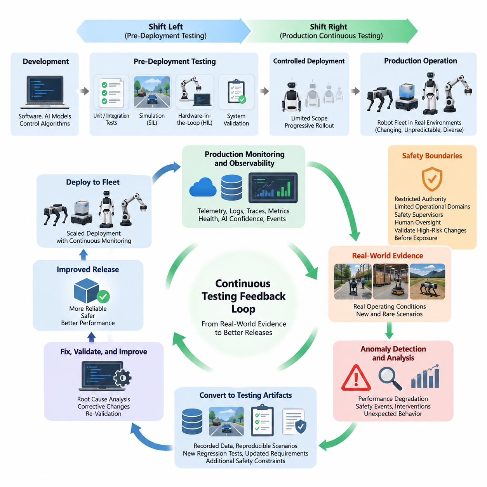
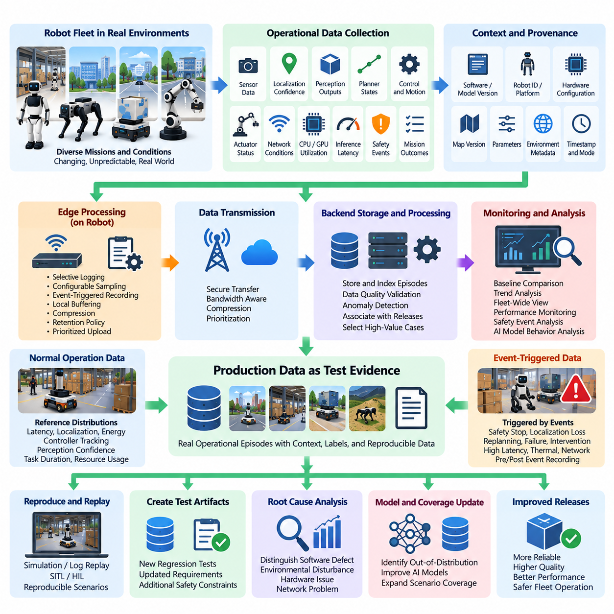
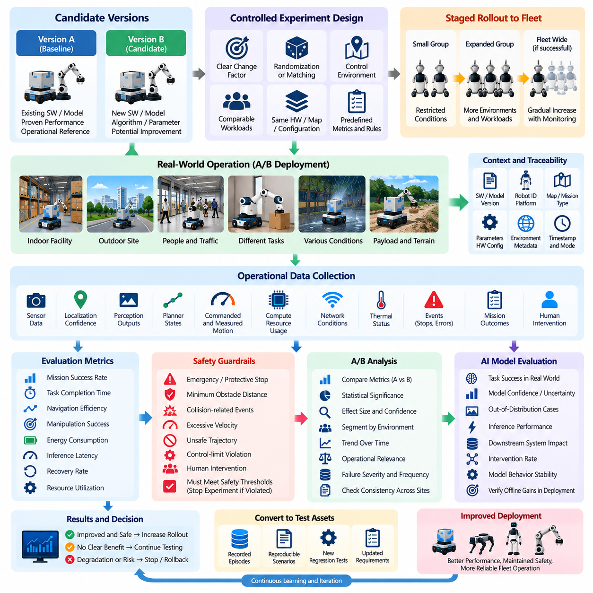
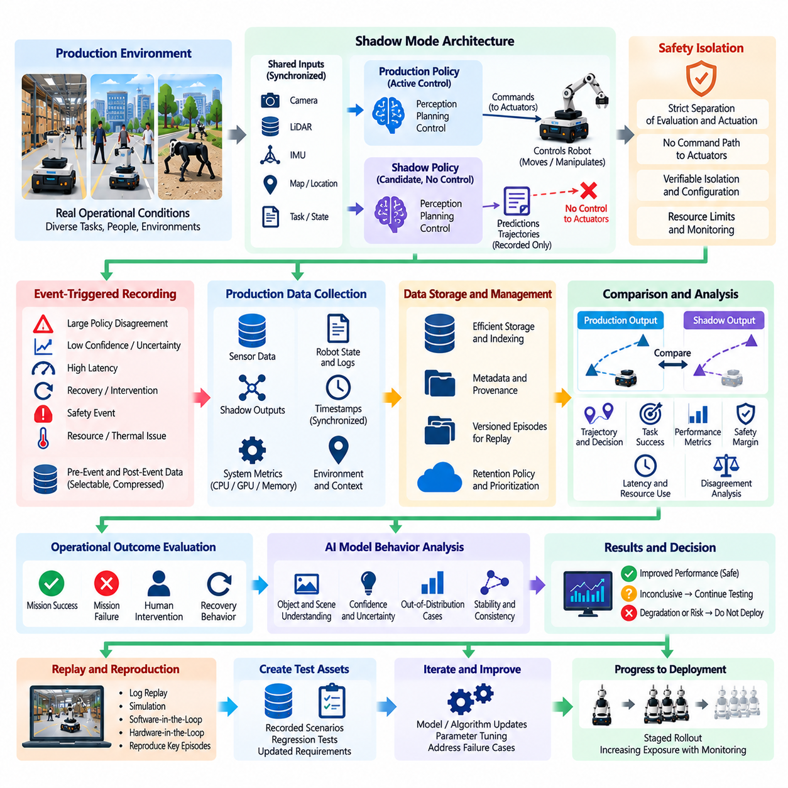
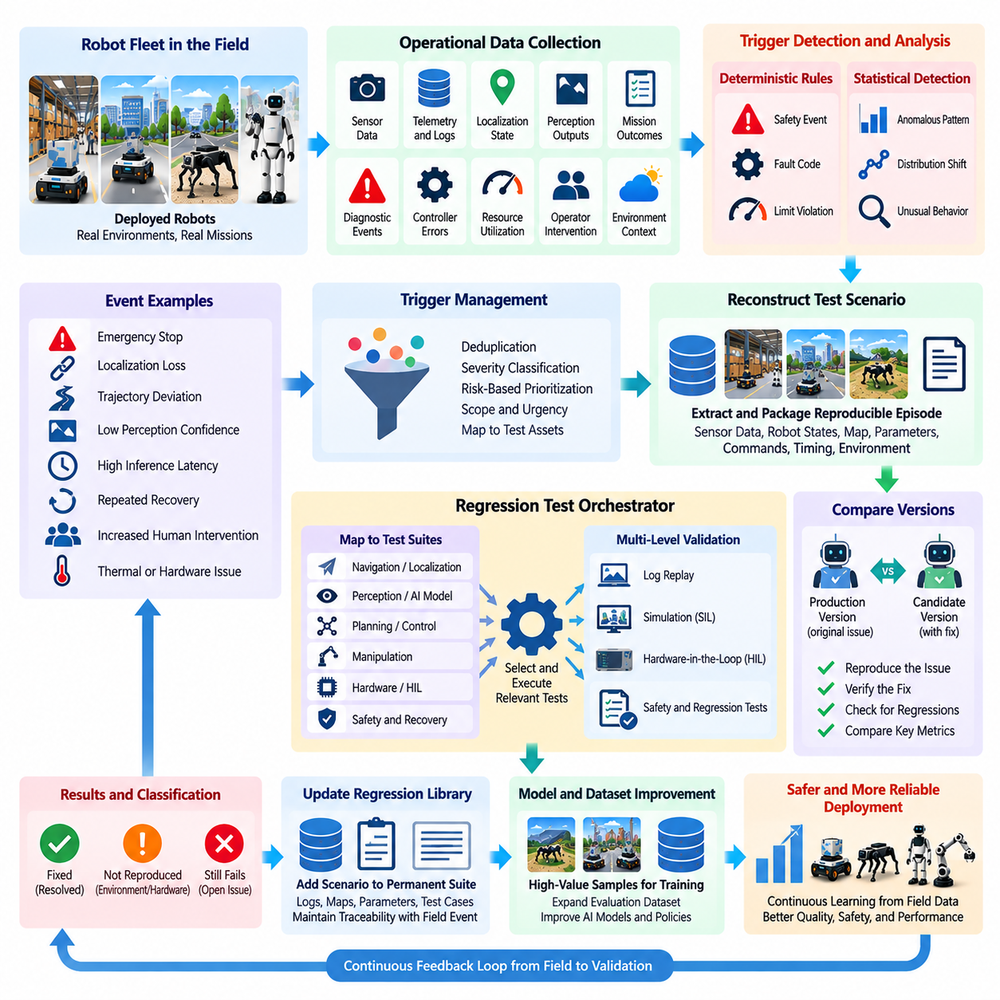
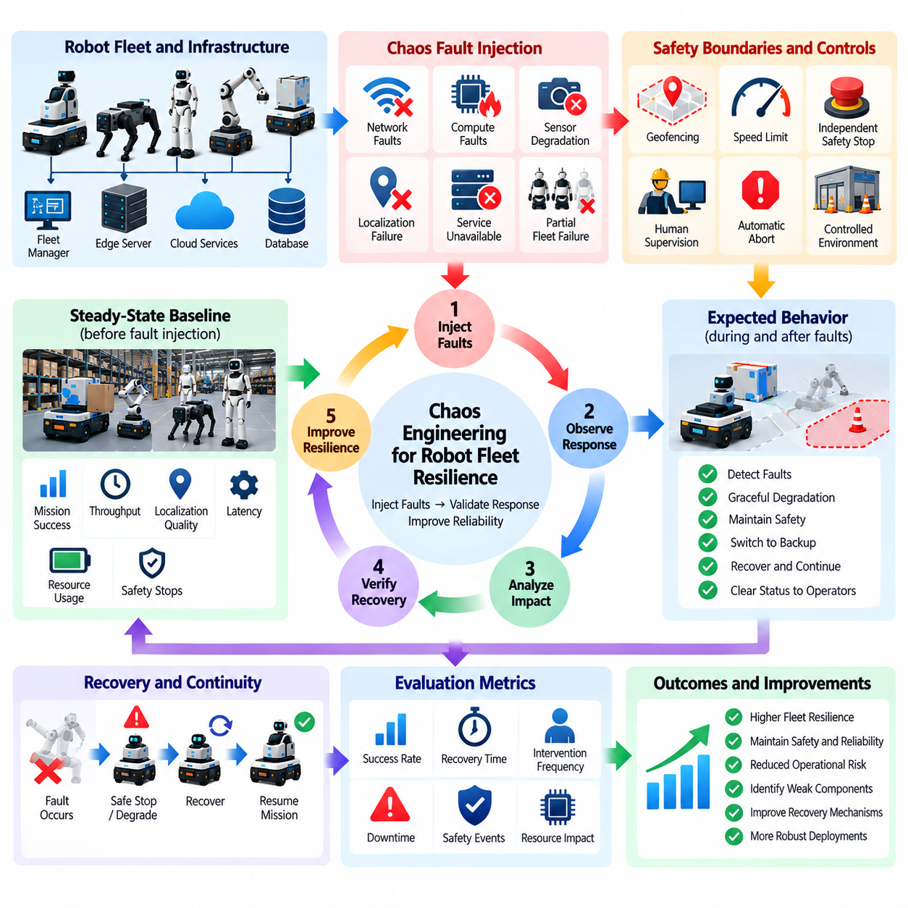
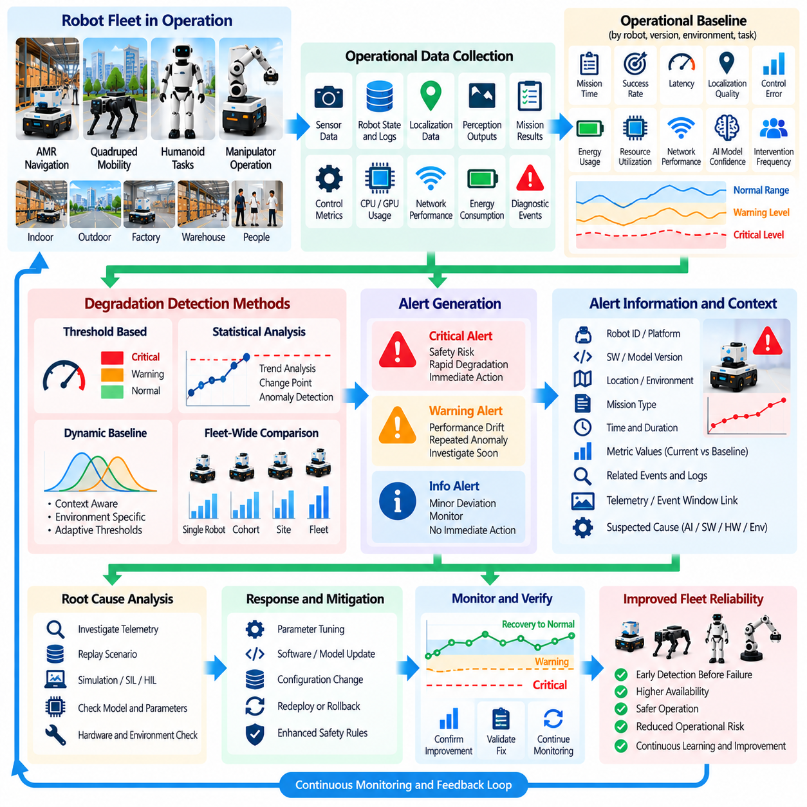
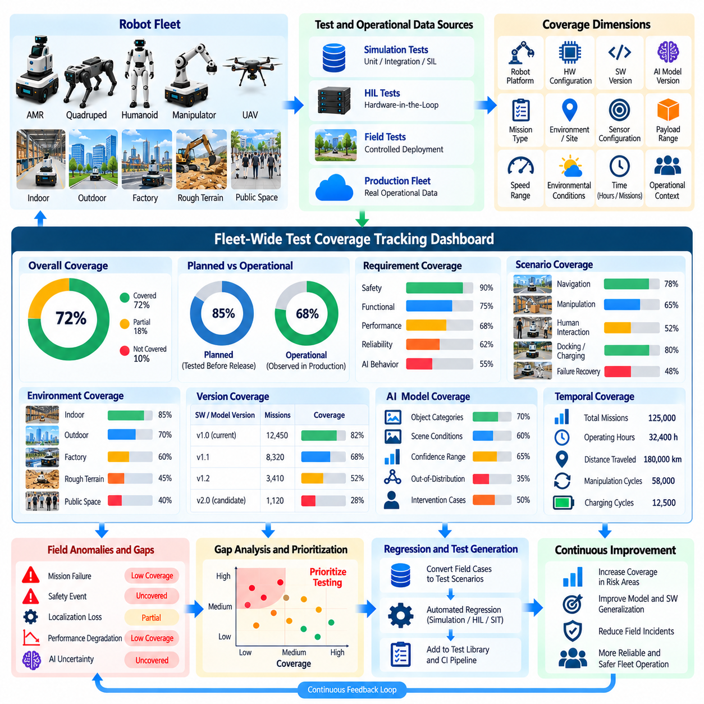
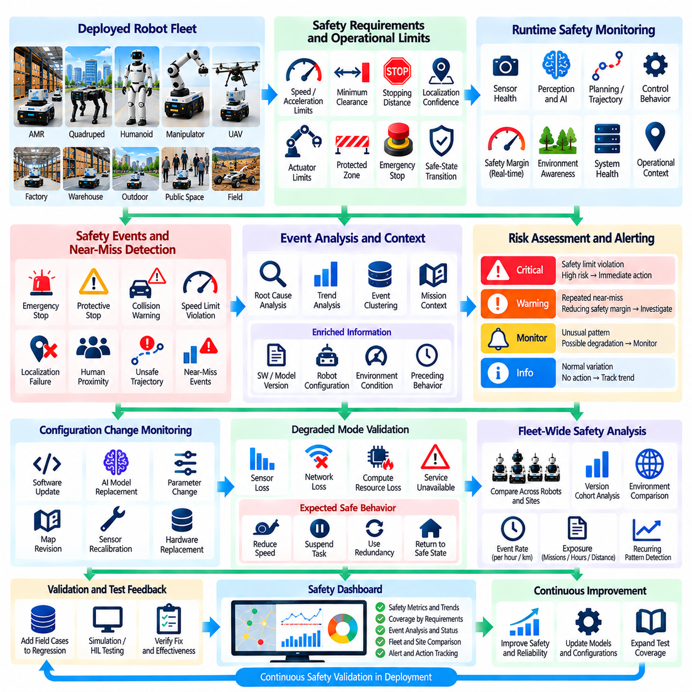
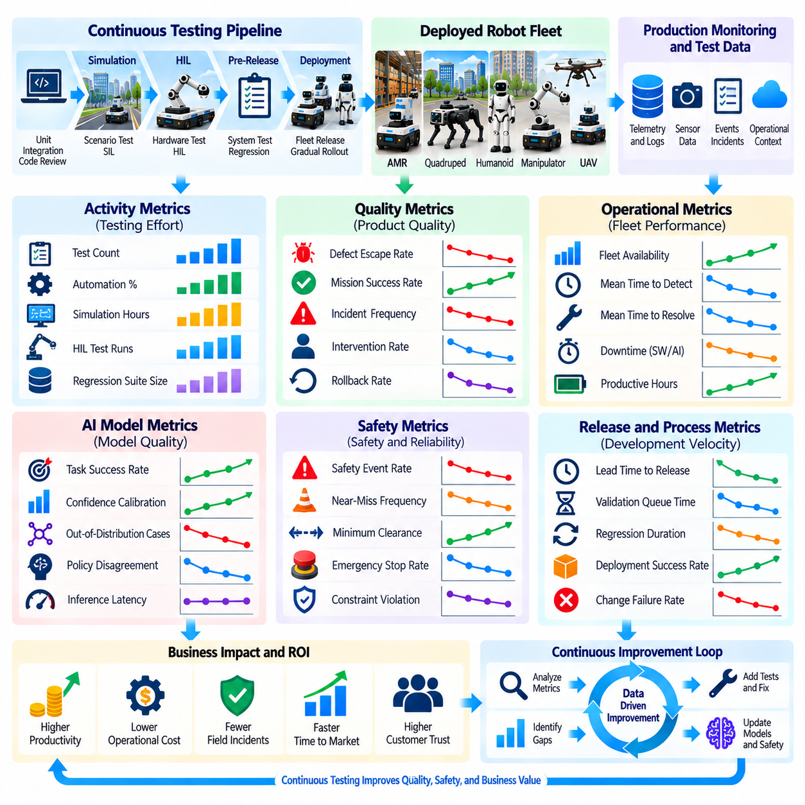

**Volume 25. Testing Validation and Benchmarking**

# Chapter 11. Continuous Testing in Production

## 11.01. Continuous Testing Philosophy Shift Right

{width="7.268055555555556in" height="7.268055555555556in"}

Continuous testing in production extends software and system validation beyond development laboratories and pre-release pipelines into the operational environment. This philosophy, commonly associated with shift-right testing, recognizes that robots encounter conditions that cannot be completely reproduced during design-time verification. Real environments contain changing layouts, unpredictable human behavior, sensor degradation, communication variability, hardware aging, and rare combinations of events. Production therefore becomes an additional source of validation evidence rather than merely the destination of a completed testing process.

Traditional testing emphasizes detecting defects before deployment through unit tests, integration tests, simulation, hardware-in-the-loop testing, system validation, and controlled field trials. These activities remain essential, but they cannot exhaustively represent the operational state space of autonomous robots. Shift-right testing complements the earlier shift-left philosophy by observing how released software, AI models, control algorithms, and hardware interfaces behave under real workloads. The objective is not to replace pre-deployment verification, but to establish a continuous feedback loop between development and operation.

In robotics, shift-right testing is particularly important because software behavior is inseparable from physical interaction. A conventional application may process unexpected input without affecting the physical world, whereas a robot converts perception and decisions into motion, force, manipulation, or flight. Small deviations in localization, perception confidence, control latency, actuator response, or planning behavior can accumulate into significant operational effects. Continuous testing must therefore evaluate both computational correctness and the physical consequences of software behavior.

The production robot fleet can be viewed as a distributed observation environment that continuously generates evidence about system quality. Telemetry, diagnostic events, sensor statistics, localization uncertainty, planner behavior, controller errors, mission outcomes, intervention records, resource utilization, and safety events reveal conditions that laboratory testing may never encounter. The chapter structure consequently connects shift-right philosophy with production monitoring, field-data-driven regression, performance degradation detection, fleet-wide coverage tracking, and continuous safety validation.

A fundamental principle of shift-right testing is observability. A deployed system cannot be continuously evaluated if its internal state and operational outcomes cannot be reconstructed. Robot software should therefore expose meaningful metrics, structured logs, traces, health indicators, AI confidence values, timing information, mission states, and fault events. Observability must be designed as part of the architecture rather than added after failures occur. High-quality operational evidence allows engineers to distinguish software defects from environmental disturbances, hardware problems, network failures, and expected behavioral variation.

Continuous testing also changes the meaning of a test case. In pre-deployment environments, engineers normally define inputs, expected outputs, and pass/fail criteria before execution. Production environments frequently expose previously unknown conditions for which no explicit test case exists. An unusual obstacle configuration, repeated localization recovery, unexpected grasp failure, abnormal inference latency, or operator intervention can become the starting point for a new test scenario. Operational observations are therefore transformed into reproducible simulation, software-in-the-loop, hardware-in-the-loop, or regression tests.

This feedback mechanism creates a closed testing lifecycle. Development produces a candidate release, pre-deployment pipelines evaluate it, controlled deployment introduces it into production, operational monitoring collects evidence, and detected anomalies are converted into engineering artifacts. Those artifacts may include defect reports, recorded data segments, reconstructed scenarios, updated requirements, new regression tests, or additional safety constraints. After corrective changes are validated, the improved software returns to deployment. Testing consequently evolves from a finite project phase into a persistent lifecycle capability.

Shift-right testing should not mean experimenting indiscriminately with operational robots. Production testing must operate within explicit safety boundaries, especially when autonomous machines interact with people, vehicles, infrastructure, or valuable equipment. New functionality can initially operate with restricted authority, limited operational domains, conservative safety supervisors, or human oversight. High-risk behavioral changes should be validated through simulation and controlled testing before any production exposure. The production environment provides evidence, but safety engineering determines which experiments are permissible.

Progressive deployment is therefore closely related to continuous testing. Instead of deploying a new software or AI version simultaneously across an entire fleet, engineers can expose it to a small representative subset of robots and compare its behavior with the established baseline. Deployment scope can increase when operational metrics remain acceptable and can be stopped or reversed when anomalies appear. This approach reduces the blast radius of defects while still allowing real-world evidence to contribute to release decisions.

For AI-enabled robots, shift-right testing addresses an additional problem: operational data distributions change over time. Lighting, weather, objects, human behavior, facility layouts, payloads, terrain, and task combinations may differ from the datasets used during training and validation. A model that performs well during qualification may gradually encounter more out-of-distribution situations after deployment. Continuous evaluation should therefore monitor not only task success but also confidence, failure patterns, intervention frequency, latency, resource consumption, and indicators of distribution or performance drift.

Production failures should be treated as information about incomplete test coverage rather than isolated operational incidents. When a robot encounters a previously untested condition, engineers should determine whether the condition represents a missing requirement, missing scenario, inadequate dataset, weak model generalization, integration defect, timing problem, or hardware interaction. The resulting knowledge should flow back into the validation infrastructure. Over time, the regression suite becomes a structured memory of real operational experience and increasingly reflects the true complexity of deployed systems.

Fleet-scale deployment makes this philosophy even more powerful because different robots naturally experience different environments and operating conditions. A sufficiently instrumented fleet can reveal rare combinations of software versions, hardware configurations, workloads, environments, and behavioral states. However, fleet data must be normalized with version identifiers, configuration metadata, timestamps, operating context, and platform information. Without such provenance, engineers may observe a failure but be unable to reproduce or attribute it reliably.

Shift-right testing also requires carefully defined operational quality gates. Metrics should connect production behavior with engineering decisions rather than merely populate dashboards. Mission success rate, intervention rate, safety-stop frequency, localization recovery, collision margin, control tracking error, inference latency, resource saturation, communication reliability, and fault recurrence can provide actionable signals when appropriate to the robot platform. Thresholds and trends can trigger investigation, rollback, additional simulation, regression execution, or temporary restrictions on deployment.

The organizational implication is that development, testing, operations, safety, and AI teams must share responsibility for production quality. Test engineers need access to operational evidence, operations teams need interpretable quality indicators, developers need reproducible failure artifacts, and safety engineers need traceable evidence that deployed behavior remains within approved boundaries. Continuous testing therefore becomes an interdisciplinary operating model connecting CI/CD, observability, fleet management, incident analysis, simulation, AI evaluation, and safety assurance.

Ultimately, shift-right testing establishes production as the final and continuously evolving layer of a broader verification strategy. Shift-left practices prevent defects early, simulation expands scenario coverage, HIL verifies physical interfaces, field testing validates representative operation, and shift-right techniques reveal behavior under sustained real-world exposure. The intended result is a learning testing system in which every meaningful production anomaly can strengthen future validation, allowing robot software and Physical AI systems to become progressively more observable, reproducible, robust, and operationally trustworthy.

## 11.02. Production Monitoring as Test Data Collection [w/Code]

{width="7.268055555555556in" height="7.268055555555556in"}

Production monitoring becomes a testing capability when operational telemetry is collected with enough context to reproduce, classify, and evaluate robot behavior. Instead of treating logs only as diagnostic records after failures, continuous testing treats production observations as potential test evidence. Robot missions continuously expose software to environmental variability, workload changes, hardware conditions, and interaction patterns that are difficult to reproduce completely before deployment.

Useful production test data must represent both what the robot experienced and how the system responded. Sensor health, localization confidence, perception outputs, planner states, commanded and measured motion, controller errors, actuator status, network conditions, CPU and GPU utilization, memory consumption, inference latency, safety events, and mission outcomes can collectively describe an operational episode. Isolated metrics rarely provide enough information to reconstruct the causal sequence behind an anomaly.

Context is therefore essential to production data collection. Each relevant observation should be associated with software and model versions, robot identity or platform class, hardware configuration, parameter sets, map versions, mission identifiers, timestamps, environmental metadata, and operating mode. This provenance allows engineers to determine whether a behavior is specific to one release, configuration, location, sensor combination, or operational condition rather than incorrectly interpreting it as a fleet-wide defect.

Time synchronization is especially important in robotic systems because failures frequently emerge from interactions among multiple asynchronous components. Camera frames, LiDAR scans, IMU measurements, localization estimates, planner decisions, actuator commands, safety signals, and network events must be correlated along a consistent timeline. Accurate timestamps make it possible to reconstruct whether perception errors preceded planning changes, whether communication delays affected control, or whether hardware faults occurred before software recovery behavior.

Continuous collection does not imply storing every raw sensor stream from every robot indefinitely. High-bandwidth cameras, LiDARs, depth sensors, radar, and diagnostic traces can generate data volumes that exceed practical communication and storage capacity. A production monitoring architecture therefore needs selective logging, configurable sampling, event-triggered recording, local buffering, compression, retention policies, and prioritized upload mechanisms that preserve valuable evidence without overwhelming edge or cloud resources.

Event-triggered collection is particularly useful for transforming routine monitoring into focused test-data acquisition. A trigger may be generated by emergency stops, localization loss, repeated replanning, unusually low perception confidence, trajectory deviation, excessive control error, mission failure, operator intervention, thermal throttling, inference latency, or communication interruption. The system can preserve data from a configurable interval before and after the event, providing engineers with the temporal context needed for investigation and replay.

Normal operation must also be collected because failure-only datasets create an incomplete representation of production behavior. Successful missions establish reference distributions for latency, localization quality, energy use, controller tracking, perception confidence, task duration, and resource utilization. Comparing abnormal episodes against these baselines helps determine whether an event is genuinely anomalous and supports detection of gradual degradation that might otherwise remain invisible until a hard failure occurs.

Production monitoring should capture outcome labels whenever they can be obtained reliably. Mission completion, navigation success, docking success, manipulation success, human intervention, safety stop, recovery behavior, and operator feedback provide weak or explicit labels for subsequent analysis. These operational labels can connect telemetry patterns to meaningful system outcomes and help prioritize recorded episodes according to engineering significance rather than simply according to the amount of generated data.

For AI-enabled robots, production data collection provides evidence about the gap between validation datasets and real operational distributions. Changes in lighting, weather, viewpoints, object appearance, facility layouts, human activity, terrain, payload, and sensor condition may expose combinations that were rare or absent during development. Monitoring confidence, uncertainty, prediction distributions, task outcomes, and intervention rates helps identify candidate out-of-distribution cases and potential model degradation.

Collected production episodes become substantially more valuable when they can be replayed. Relevant sensor messages, software states, parameters, maps, model versions, and timing information should be retained in forms that allow engineers to reproduce behavior in software-in-the-loop, simulation, log replay, or hardware-in-the-loop environments. Replay converts a transient field observation into a repeatable engineering experiment and provides a foundation for confirming root causes and validating corrective changes.

A practical data pipeline separates collection from interpretation. Robots first capture telemetry and event records while maintaining operational priorities, after which edge processing can filter, summarize, compress, anonymize, or rank the data before transmission. Backend services can then index episodes, calculate quality metrics, detect anomalies, associate events with releases, and select high-value cases for deeper analysis. This separation prevents testing workloads from interfering with safety-critical or real-time robot functions.

Data quality must itself be monitored because corrupted or incomplete telemetry can produce misleading conclusions. Missing timestamps, dropped sensor messages, inconsistent units, invalid coordinate frames, stale parameters, incorrect version metadata, and partial uploads can make an incident impossible to reproduce. Collection pipelines should therefore validate schemas, timestamps, sequence continuity, metadata completeness, and storage integrity so that operational evidence remains trustworthy enough for engineering and validation purposes.

Production data should ultimately flow back into the formal testing lifecycle. A representative failure episode can be converted into a deterministic regression test, reconstructed simulation scenario, HIL fault-injection case, perception dataset sample, navigation benchmark, or AI evaluation case. Once incorporated into automated testing, the previously unseen condition can be evaluated against future releases, preventing the same class of defect from silently reappearing during subsequent software or model changes.

Prioritization becomes necessary when fleets generate more candidate test data than engineering teams can inspect. Episodes can be ranked according to safety relevance, novelty, severity, recurrence, customer impact, model uncertainty, intervention requirements, or deviation from established performance distributions. Rare but safety-relevant events may deserve immediate preservation, while frequent low-impact events can be aggregated statistically. This approach turns production monitoring into an efficient mechanism for discovering high-value test scenarios.

Privacy, security, and governance requirements must remain part of the collection architecture, particularly when robots operate around people or sensitive facilities. Production datasets may contain images, location information, operational processes, or customer-specific information. Access control, encryption, retention limits, data minimization, auditability, and controlled sharing should therefore accompany technical logging requirements so that continuous testing does not create unnecessary information-security or privacy exposure.

The resulting production monitoring system creates a closed evidence loop between deployed robots and the validation infrastructure. Operational behavior generates telemetry, significant episodes are detected and preserved, engineering teams analyze and reproduce them, and valuable cases are transformed into regression assets. Future releases are then tested against conditions discovered by earlier deployments, allowing the validation suite to evolve together with the operational experience of the robot fleet.

When implemented systematically, production monitoring changes field data from passive operational history into an active testing resource. The objective is not simply to collect more logs, but to collect sufficiently synchronized, contextualized, reproducible, and actionable evidence. This foundation supports subsequent capabilities such as automated regression triggers, degradation detection, fleet-wide coverage tracking, continuous safety validation, and increasingly data-driven decisions about whether robot software and AI models are ready for broader deployment.

## 11.03. A B Testing Robot SW and AI Models [w/Code]

{width="7.268055555555556in" height="7.268055555555556in"}

A/B testing for robot software and AI models is a controlled production evaluation method in which two candidate configurations are exposed to comparable operational conditions and their outcomes are measured against predefined criteria. Version A normally represents the established baseline, while version B introduces a software, parameter, algorithm, or model change. The purpose is to determine whether the new candidate produces measurable improvement without introducing unacceptable safety, reliability, or operational risk.

Unlike conventional web-service A/B testing, robotic experiments affect physical systems and cannot assume that every trial is independent or harmless. A navigation policy may change vehicle motion, a perception model may alter obstacle interpretation, and a manipulation policy may produce different forces or trajectories. Experimental design must therefore combine statistical comparison with operational constraints, safety supervision, deployment controls, and explicit termination conditions before production exposure is permitted.

The compared variants should differ in a clearly identifiable factor whenever practical. Candidate changes may include perception models, navigation planners, trajectory parameters, localization algorithms, manipulation policies, inference runtimes, recovery strategies, or resource-management settings. Limiting unnecessary differences improves causal interpretation because engineers can associate observed performance changes with the intended modification rather than with unrelated software or configuration differences.

Experiment assignment requires careful control of operational context. Robots assigned to variants A and B may encounter different facilities, routes, payloads, operators, traffic levels, lighting conditions, terrain, or task difficulty. Direct comparison without accounting for these factors can produce misleading conclusions. Randomization, matched operating conditions, stratification by environment, or repeated crossover experiments can reduce bias and provide stronger evidence that measured differences originate from the candidate change.

The evaluation metrics must be defined before the experiment begins. Depending on the robot application, primary metrics may include mission success rate, task completion time, navigation efficiency, localization quality, manipulation success, intervention frequency, energy consumption, inference latency, or recovery rate. Secondary metrics can capture computational load, communication performance, thermal behavior, component utilization, and other effects that reveal tradeoffs hidden behind a single headline performance indicator.

Safety metrics require separate treatment because an average performance improvement cannot compensate for increased hazardous behavior. Emergency stops, protective stops, minimum obstacle distance, collision-related events, excessive velocity, unsafe trajectory generation, control-limit violations, and human intervention should be monitored as guardrail metrics. A candidate that improves productivity while degrading an established safety boundary should fail the experiment regardless of its improvement in other performance indicators.

For AI models, A/B testing provides evidence about whether offline evaluation improvements translate into actual operational benefits. A perception model with higher validation accuracy may consume more computation and increase end-to-end latency, while a more capable policy may behave less predictably in unfamiliar environments. Production comparison therefore evaluates the complete deployed behavior, including model quality, inference performance, downstream system response, resource consumption, recovery behavior, and real task outcomes.

A staged rollout is preferable to immediate fleet-wide experimentation. Version B can initially be deployed to a small group of representative robots under restricted conditions while version A remains the operational reference. If the candidate satisfies safety and quality gates, exposure can progressively increase across additional robots, environments, and workloads. Unexpected degradation can stop the experiment and trigger rollback before the change affects a substantial portion of the fleet.

Reliable experiments require strict version and configuration traceability. Every observation should identify the software build, AI model, parameters, hardware configuration, map, mission type, robot platform, and relevant environmental context associated with the trial. Without this provenance, measurements from different variants can become mixed or incorrectly attributed, preventing engineers from reproducing results and weakening confidence in the final deployment decision.

Statistical significance alone should not determine whether version B is accepted. Large fleets can make very small differences statistically significant even when the operational value is negligible, while safety-relevant events may be too rare for conventional significance testing. Engineering teams should therefore consider effect size, confidence intervals, operational relevance, exposure duration, sample representativeness, failure severity, and consistency across environments when interpreting experimental results.

The duration of an A/B test should reflect the operational variability of the robot system. Short experiments may miss rare failures, battery-cycle effects, thermal conditions, changing traffic patterns, hardware degradation, or environment-specific behavior. Longer observation periods provide stronger evidence but delay deployment decisions. Experiment planning should therefore define minimum exposure requirements based on missions, operating hours, environmental diversity, and risk rather than relying only on elapsed calendar time.

Human intervention is an important measurement because operators often compensate for robot weaknesses before a formal mission failure is recorded. Manual recovery, remote assistance, repeated task commands, route overrides, emergency intervention, or manipulation correction can reveal degraded autonomy that success-rate metrics alone may conceal. Recording the timing and reason for intervention helps distinguish genuine autonomous improvement from performance maintained through increased human support.

Production A/B testing should integrate with observability and test-data collection infrastructure. Telemetry, event logs, mission outcomes, model confidence, controller states, safety events, and resource metrics should be associated automatically with the assigned experimental variant. Significant failures can preserve pre-event and post-event data for investigation, allowing unexpected behavior discovered during the experiment to become a reproducible regression case for simulation, replay, or HIL validation.

Experiments should include explicit stop and rollback criteria before deployment begins. A rise in safety events, intervention frequency, mission failures, latency, resource saturation, or other protected metrics can automatically suspend version B. Predefined criteria reduce the risk of continuing an experiment simply because substantial engineering effort has already been invested in the candidate and provide an objective mechanism for protecting production operations while evidence is still being collected.

Some robot changes cannot safely execute actions during an initial comparison. In these cases, A/B testing can be preceded by shadow evaluation in which the candidate receives production inputs and generates predictions or decisions without controlling the robot. Once shadow results demonstrate acceptable behavior, limited active A/B deployment can follow. This progression creates a risk-controlled path from offline validation to passive production observation and finally to controlled physical execution.

The final experiment record should preserve more than the conclusion that one variant performed better. It should document experiment scope, variant definitions, deployment populations, operational conditions, exposure volume, metric definitions, safety guardrails, anomalies, statistical results, rollback events, and the rationale for the release decision. This evidence supports reproducibility, auditability, later regression analysis, and comparison with subsequent software or AI model versions.

When systematically integrated into continuous testing, A/B testing becomes a controlled mechanism for learning from real robot operation rather than merely a release optimization technique. It connects production evidence with engineering decisions while limiting the exposure of unproven changes. Combined with staged deployment, strong observability, safety guardrails, and reproducible data collection, it enables robot software and AI models to evolve through measurable operational evidence rather than assumptions based solely on pre-deployment testing.

## 11.04. Shadow Mode Testing New Policy in Production [w/Code]

{width="7.268055555555556in" height="7.268055555555556in"}

Shadow mode testing evaluates a new robot software policy or AI model using real production inputs while preventing the candidate from directly controlling the physical system. The deployed production policy remains authoritative, whereas the shadow policy processes the same observations and independently generates predictions, decisions, trajectories, or actions. Its outputs are recorded for comparison rather than executed, providing operational evidence without immediately exposing the robot to the behavioral risk of an unproven policy.

This approach creates an intermediate validation stage between offline testing and active production deployment. Simulation, recorded datasets, software-in-the-loop, and HIL testing can establish initial confidence, but they cannot reproduce every combination of environment, workload, sensor condition, and human interaction encountered in service. Shadow mode exposes the candidate to authentic production distributions while retaining the validated controller as the sole source of commands that affect robot motion or manipulation.

A shadow architecture must ensure strict separation between evaluation and actuation. The candidate may subscribe to camera, LiDAR, IMU, localization, map, task, and system-state information, but its output path must not reach actuators or safety-critical command interfaces. Architectural isolation should be explicit and verifiable so that software configuration errors, message-routing mistakes, or unexpected component interactions cannot accidentally grant the shadow policy control authority.

Meaningful comparison requires the production and shadow policies to receive equivalent input context. Sensor observations, timestamps, robot state, maps, mission objectives, environmental information, and relevant parameters should be synchronized sufficiently for both policies to evaluate the same operational situation. Differences caused by stale inputs or inconsistent preprocessing can otherwise be mistaken for genuine policy disagreement and reduce the value of the collected evidence.

Policy disagreement is one of the most useful shadow-mode signals. Engineers can compare selected routes, predicted objects, velocity commands, manipulation targets, recovery decisions, task sequences, or other outputs generated by the candidate with those produced by the active system. Agreement does not automatically prove correctness, but systematic disagreement identifies operational situations that deserve investigation and can reveal behavior not represented adequately in offline validation datasets.

The comparison should consider more than whether two outputs are numerically identical. Two navigation policies may generate different trajectories that are both safe and efficient, while small numerical differences near a safety boundary may be operationally important. Evaluation therefore requires semantic and task-level metrics such as path feasibility, clearance, predicted task success, control smoothness, constraint satisfaction, confidence, computational latency, and expected safety margin.

Shadow mode is especially valuable for AI policies because production data may contain distributions that differ significantly from development datasets. Changes in lighting, weather, object appearance, human activity, payload, terrain, facility configuration, or sensor quality can expose unfamiliar inputs. Monitoring candidate confidence, uncertainty, output stability, and disagreement with the deployed policy helps identify potential out-of-distribution behavior before the new model is granted physical control.

Latency and computational behavior must also be evaluated because a policy that produces better decisions offline may still be unsuitable for real-time deployment. Shadow execution reveals actual inference latency, memory consumption, CPU and GPU utilization, accelerator contention, thermal effects, and scheduling interference under production workloads. These measurements determine whether the candidate can satisfy real-time constraints without degrading other perception, planning, control, or safety functions running on the robot.

Resource isolation is important when production and shadow workloads execute concurrently. A computationally expensive candidate can consume GPU memory, processor cycles, memory bandwidth, storage, or network capacity even when it does not control the robot. Shadow testing must therefore define resource limits and monitor interference with the active stack. A passive candidate that degrades the production controller through resource contention is not operationally passive from a system perspective.

Every shadow observation should retain sufficient provenance for later analysis. Software builds, model identifiers, parameter versions, robot platform, hardware configuration, mission type, map version, timestamps, and operating conditions should accompany the recorded outputs. This traceability allows engineers to reproduce significant disagreements, compare candidate revisions, and determine whether problematic behavior is associated with a specific environment, platform configuration, or software dependency.

Event-triggered recording can reduce the data volume generated by long shadow campaigns. Detailed context can be preserved when disagreement exceeds a threshold, confidence falls unexpectedly, latency violates a limit, the production system initiates recovery, an operator intervenes, or a safety event occurs. Pre-event and post-event buffers provide surrounding context, converting important moments into replayable episodes without requiring continuous storage of every high-bandwidth sensor stream.

Shadow results should be compared with actual operational outcomes whenever possible. If the production robot successfully completes a mission, the recorded candidate decisions can be examined to estimate whether the shadow policy would have maintained feasible and safe behavior. However, counterfactual interpretation must remain cautious because the robot state would have evolved differently if the candidate actions had actually been executed. Shadow testing provides strong observational evidence, but it cannot fully replace controlled active trials.

Safety analysis should focus particularly on candidate outputs that approach or violate established constraints. Proposed trajectories crossing restricted regions, unsafe velocity commands, inadequate obstacle clearance, unstable control targets, invalid manipulation poses, or delayed reactions can be flagged even though they were never executed. Such observations allow potentially hazardous behavior to be discovered under realistic inputs without creating the physical consequences that would accompany direct production testing.

Shadow testing can also support progressive release decisions. A candidate may begin with offline validation, proceed to shadow deployment on a limited robot subset, expand to broader fleet observation, and then enter controlled active testing after predefined criteria are satisfied. Transition gates can consider disagreement rates, task-level quality, latency, resource usage, safety-rule violations, environmental coverage, and the number of unresolved anomalous episodes before control authority is granted.

Not every disagreement requires modification of the candidate. The deployed baseline may itself be conservative, inefficient, or incorrect in particular situations, and the shadow policy may reveal an improved alternative. Engineers should therefore investigate disagreements against mission outcomes, safety constraints, human review, simulation replay, and additional validation evidence rather than assuming that deviation from the baseline represents failure. Shadow mode compares behaviors; it does not automatically define which behavior is correct.

High-value shadow episodes should flow back into the continuous testing pipeline. Significant disagreements and unexpected candidate behavior can become regression scenarios, simulation cases, dataset additions, HIL experiments, or targeted AI evaluations. Candidate revisions can then be retested against the accumulated cases before another production shadow campaign begins, creating a closed feedback loop between operational observation, engineering analysis, model improvement, and automated validation.

When implemented with strict actuation isolation, synchronized inputs, comprehensive observability, and explicit promotion criteria, shadow mode provides a practical bridge between laboratory confidence and physical deployment. It allows new robot policies and AI models to experience real production conditions while limiting direct behavioral risk. Combined with subsequent staged rollout and A/B testing, it supports evidence-driven progression from passive observation to controlled authority and eventually to validated production operation.

## 11.05. Automated Regression Trigger from Field Data [w/Code]

{width="7.268055555555556in" height="7.268055555555556in"}

Automated regression triggering from field data connects production monitoring directly with the validation pipeline. Instead of waiting for engineers to manually review every operational anomaly, the system detects predefined events or statistically unusual behavior and automatically initiates relevant regression tests. This mechanism transforms field experience into continuous verification activity and shortens the time between discovering a production problem and evaluating whether the problem exists in current or candidate software releases.

The process begins with structured collection of operational evidence from deployed robots. Telemetry, mission outcomes, diagnostic events, localization states, perception confidence, controller errors, safety events, resource utilization, operator interventions, and environmental context can provide trigger signals. Each event should retain software, model, parameter, hardware, map, and mission metadata so that the regression system can associate observed behavior with the configuration that produced it.

A trigger represents a condition indicating that existing validation coverage should be exercised or extended. Examples include repeated mission failures, localization loss, emergency stops, abnormal trajectory deviation, excessive control error, perception-confidence collapse, inference-latency violations, unexpected recovery behavior, or increased human intervention. Trigger definitions should reflect operational significance rather than every minor variation, otherwise excessive test execution can overwhelm validation infrastructure and reduce the value of alerts.

Trigger logic may combine deterministic rules with statistical detection. A deterministic rule can activate when a safety limit is exceeded or a specific fault code appears, while statistical methods can identify deviations from established distributions of latency, task duration, energy consumption, intervention rate, or controller performance. Combining both approaches allows the system to detect known failure signatures as well as gradual or previously unseen degradation patterns that do not correspond to a predefined fault.

Single events should not always cause a complete regression campaign. Trigger severity can determine the scope and urgency of testing. A safety-critical event may immediately initiate high-priority simulation, HIL, and safety regression suites, while a small performance deviation may first trigger a targeted software test. Repeated occurrences can escalate the test scope. This risk-based approach preserves computational resources while ensuring that high-consequence field observations receive rapid and comprehensive validation.

Field events must be converted into reproducible test inputs whenever possible. Relevant sensor messages, robot states, maps, parameters, environmental conditions, commands, and timing information can be extracted from event windows and packaged as replayable episodes. The objective is to transform a transient production observation into a deterministic or statistically controlled scenario that can be executed repeatedly against the affected version and subsequent candidate releases.

Scenario reconstruction may occur at several validation levels. Software defects can be reproduced through log replay or software-in-the-loop testing, interaction and timing problems may require simulation or HIL, and AI failures may require extracting representative sensor samples for model evaluation. Selecting the lowest-cost environment capable of reproducing the behavior improves test efficiency, while escalation to more realistic environments can occur when simpler representations fail to capture the relevant physical interaction.

The regression orchestrator should map field triggers to appropriate test assets rather than execute every available test indiscriminately. A localization anomaly may invoke mapping, sensor-fusion, and navigation tests, whereas an actuator fault may activate controller, communication, HIL, and safety suites. Maintaining relationships between operational events, system components, requirements, hazards, and regression tests enables targeted execution while preserving traceability from production evidence to validation results.

Automated triggering becomes especially valuable for AI-enabled robots because field data continuously reveals cases outside the original training and validation distributions. Low-confidence predictions, disagreement between redundant models, unusual object combinations, novel environments, or repeated policy failures can initiate targeted evaluation against stored production episodes. High-value samples may subsequently be added to curated datasets, allowing operational discoveries to strengthen both regression coverage and future model development.

Regression execution should compare the production version with candidate fixes whenever practical. Replaying the same field-derived scenario against both versions determines whether the proposed change resolves the original failure and whether behavior changes in unexpected ways. The scenario should then remain in the permanent regression library so that future releases are continuously checked against a problem that has already occurred in real operation.

Automated regression must distinguish between reproducible software defects and events dominated by environmental or hardware factors. A mission failure caused by a damaged sensor, temporary network outage, unusual terrain, or operator action may not reproduce in a software-only environment. The pipeline should preserve classification uncertainty and avoid automatically labeling every trigger as a software regression. Failed reproduction attempts are themselves useful evidence for determining the appropriate next validation stage.

Deduplication is necessary because fleet deployments may generate thousands of similar events. Trigger systems can group episodes using fault codes, affected components, behavioral signatures, environmental context, or feature similarity. Representative cases can then be selected for regression while occurrence counts remain available as severity evidence. This prevents repeated execution of nearly identical tests while retaining information about whether a problem is isolated or widespread across the fleet.

Rate limiting and scheduling protect validation infrastructure from trigger storms. A software defect affecting many robots can produce a large number of events within a short period, but executing an independent regression suite for every occurrence provides little additional value. Trigger aggregation, cooldown periods, priority queues, and resource-aware scheduling allow the system to maintain responsiveness to critical events without exhausting simulation, HIL, GPU, storage, or CI resources.

Regression results should feed back into operational decision making. If a field-derived test reproduces a safety-critical failure in the currently deployed version, the result may justify deployment restrictions, rollback, or increased monitoring. If a candidate release passes the new test while maintaining existing regression performance, the evidence supports controlled redeployment. Continuous testing therefore connects field detection, automated validation, release management, and fleet operation through a shared evidence chain.

Every automatically generated regression artifact should preserve provenance and traceability. The originating field event, robot configuration, software and model versions, event timestamp, extracted data, reconstructed scenario, triggered test suites, results, and subsequent corrective changes should remain linked. This history allows engineers and auditors to understand why a test exists, which real-world failure motivated it, and whether later releases continue to satisfy the corresponding requirement or safety expectation.

The regression library consequently evolves as operational experience accumulates. Early releases may rely primarily on engineering-designed scenarios, while mature fleets contribute increasingly diverse cases discovered through real operation. Rare environmental combinations, integration failures, timing problems, AI edge cases, and recovery anomalies become permanent validation assets. The test suite therefore develops into an institutional memory of failures and difficult conditions encountered across the robot lifecycle.

A well-designed automated regression trigger system does not remove engineers from the validation process. Automation detects events, selects tests, executes pipelines, and organizes evidence, while engineers remain responsible for interpreting ambiguous behavior, confirming root causes, approving new permanent scenarios, and making safety or release decisions. Human review is especially important when physical interactions, AI uncertainty, or incomplete field evidence prevent deterministic conclusions.

When integrated with production monitoring, replay infrastructure, simulation, HIL, CI pipelines, and fleet management, automated regression triggering creates a closed-loop validation mechanism. Field observations continuously challenge the assumptions established before deployment, and significant events automatically become opportunities to re-evaluate the system. This allows robot software and Physical AI systems to convert operational failures and anomalies into durable regression knowledge, progressively strengthening validation coverage throughout production life.

## 11.06. Chaos Engineering for Robot Fleet Resilience [w/Code]

{width="7.268055555555556in" height="7.268055555555556in"}

Chaos engineering for robot fleets is a controlled resilience-testing discipline that intentionally introduces faults, degradation, and dependency failures to verify how deployed robotic systems respond under abnormal conditions. Rather than waiting for unpredictable failures to occur in the field, engineers create bounded experiments that challenge assumptions about recovery, redundancy, isolation, and graceful degradation. The objective is to discover weaknesses before uncontrolled operational incidents expose them.

Applying chaos engineering to robotics requires greater caution than applying it to conventional cloud services because failures can influence physical motion and interaction. Network loss, delayed commands, corrupted sensor streams, unavailable localization, or compute overload may affect navigation and control behavior. Experiments must therefore operate within explicit safety boundaries, with predefined abort conditions, independent safety functions, human supervision when required, and environments appropriate to the potential physical consequences.

A chaos experiment begins by defining the expected steady-state behavior of the system. Engineers establish measurable indicators such as mission success, task throughput, fleet availability, command latency, localization quality, recovery time, intervention frequency, and safety-stop behavior. The experiment then introduces a specific disturbance and observes whether these indicators remain within acceptable boundaries. Without a measurable steady-state hypothesis, fault injection becomes disruption rather than structured resilience validation.

Network faults are important targets because robot fleets depend on communication among robots, fleet managers, edge servers, on-premise systems, and cloud services. Controlled experiments can introduce packet loss, latency, jitter, bandwidth reduction, temporary disconnection, or service unavailability. The purpose is to verify whether robots maintain safe local behavior, preserve essential mission state, buffer required data, reconnect correctly, and recover coordination without generating duplicate commands or inconsistent fleet state.

Compute-resource failures provide another class of resilience experiments. CPU saturation, GPU contention, memory pressure, storage exhaustion, process termination, accelerator unavailability, or thermal throttling can reveal hidden dependencies within the software stack. A resilient robot should prioritize safety-critical and real-time functions, reject nonessential workloads when necessary, expose degraded health status, and transition toward a controlled operating mode rather than allowing resource exhaustion to propagate unpredictably through the system.

Sensor degradation can be introduced to evaluate whether perception and state-estimation systems detect unreliable inputs and respond appropriately. Experiments may simulate missing messages, increased noise, frozen values, timestamp errors, reduced update rates, or temporary sensor loss. The goal is not merely to observe whether an algorithm continues running, but to determine whether uncertainty is recognized, redundant information is used correctly, operational capability is reduced when necessary, and unsafe confidence is avoided.

Localization and mapping failures are especially relevant to mobile robots. Controlled degradation can test behavior during GNSS loss, LiDAR interruption, visual feature degradation, map-server unavailability, transform errors, or localization divergence. The expected response may include reduced speed, localization recovery, transition to a safe stopping state, or restricted operation. Chaos testing verifies that the system fails predictably rather than continuing autonomous motion with invalid or increasingly uncertain position estimates.

Fleet-level experiments examine failures that cannot be understood by testing a single robot in isolation. Loss of the fleet manager, task-allocation delays, duplicated assignments, database unavailability, message-broker interruption, or partial network partitions can create inconsistent distributed states. Resilience testing should verify that individual robots remain safe, ownership of tasks remains unambiguous, conflicting commands are rejected, and fleet coordination can recover without corrupting mission or operational records.

Fault containment is a central objective of robot fleet chaos engineering. A defect affecting one robot, service, network segment, or compute node should not automatically propagate throughout the fleet. Experiments can measure whether isolation boundaries, watchdogs, circuit breakers, health checks, redundant services, and recovery mechanisms restrict the blast radius. The ability to preserve partial fleet operation during localized failure is often more valuable than attempting to maintain full functionality under every disturbance.

Graceful degradation should be defined before experiments are executed. A robot may lose high-level optimization while retaining local navigation, reduce speed when perception quality falls, pause task execution when connectivity is unavailable, or return to a designated safe state when essential dependencies disappear. Chaos testing evaluates whether these degraded modes are entered at appropriate thresholds and whether the system clearly communicates its reduced capability to operators and fleet-management services.

Recovery behavior must be evaluated as carefully as failure detection. Restarting a process or restoring connectivity does not guarantee that the system has returned to a consistent state. Robots may retain stale commands, duplicated tasks, outdated maps, inconsistent timestamps, or incomplete mission records. Chaos experiments should therefore measure recovery time, state reconciliation, command validity, data synchronization, and whether human intervention is required before autonomous operation can safely resume.

Experiments should progress from low-risk environments toward more representative production conditions. Initial faults can be injected in simulation, software-in-the-loop, or HIL environments, followed by controlled tests on isolated robots and limited fleet subsets. Only well-understood experiments with verified safeguards should reach operational deployments. This progressive approach preserves the value of realistic testing while reducing the probability that resilience evaluation itself creates unacceptable operational risk.

The blast radius of each experiment should be explicitly controlled. Deployment scope, affected robots, fault duration, environmental boundaries, mission types, and maximum degradation should be defined before execution. Automated abort mechanisms can terminate the experiment if safety events, excessive intervention, unexpected motion, resource instability, or other guardrail violations occur. Small initial exposure allows engineers to validate assumptions before expanding an experiment across additional fleet resources.

Observability is essential because resilience cannot be assessed from a simple pass-or-fail result. Telemetry should capture the injected fault, detection time, component reactions, mode transitions, safety responses, operator interventions, recovery sequence, and final system state. Correlating these events on a synchronized timeline enables engineers to determine whether the designed resilience mechanism actually caused recovery or whether the system survived only because the disturbance was too limited to expose the weakness.

Chaos experiments should become reproducible regression assets rather than one-time demonstrations. A discovered weakness can be converted into an automated fault-injection scenario and incorporated into simulation, HIL, CI, or scheduled resilience testing. Future software releases can then be challenged by the same disturbance to ensure that recovery behavior remains intact. Production incidents can similarly generate new chaos scenarios, linking field experience with systematic resilience validation.

AI-enabled robot fleets introduce additional resilience concerns because models may react unpredictably when inputs become degraded rather than completely unavailable. Partial sensor corruption, unusual latency, missing modalities, or resource pressure can change confidence and policy behavior without generating conventional software faults. Chaos experiments should therefore observe uncertainty, action stability, fallback behavior, and safety constraints in addition to process health and infrastructure availability.

Safety mechanisms used during chaos testing should remain independent of the component being challenged whenever practical. If an experiment intentionally disrupts the main compute stack, the emergency-stop path or protective controller should not depend on that same failure domain. Independent supervision, hardware safety functions, restricted test zones, speed limits, and remote abort capability provide defense in depth and allow aggressive resilience hypotheses to be evaluated without relying solely on the system under test.

The long-term purpose of chaos engineering is not to prove that a robot fleet never fails, but to establish confidence that failures are detected, contained, and recovered in predictable ways. Integrated with continuous monitoring, automated regression, simulation, HIL, and fleet operations, chaos engineering turns resilience assumptions into testable evidence. Robot fleets can then evolve from systems designed merely to avoid faults into systems engineered to remain safe and operationally controlled when faults inevitably occur.

## 11.07. Performance Degradation Detection Alerting [w/Code]

{width="7.268055555555556in" height="7.268055555555556in"}

Performance degradation detection identifies when deployed robot software, AI models, or supporting infrastructure gradually move away from their validated operating baseline before a complete failure occurs. Continuous testing therefore monitors not only explicit faults but also trends in mission quality, latency, accuracy, resource consumption, control behavior, and recovery frequency. Early detection allows engineering and operations teams to intervene while the robot remains functional and before degradation develops into a safety or availability incident.

A reliable detection system begins with an operational baseline representing acceptable behavior under known conditions. Baselines may describe mission completion time, navigation efficiency, localization uncertainty, controller tracking error, inference latency, perception confidence, energy consumption, CPU and GPU utilization, network performance, or intervention frequency. Because these metrics depend on environment and workload, baselines should be associated with robot type, software version, mission class, hardware configuration, and relevant operating context.

Performance degradation may appear suddenly or develop gradually over many missions. A software update can immediately increase inference latency, while sensor contamination, hardware aging, storage growth, thermal limitations, or changing environments may produce slow deterioration. Detection mechanisms must therefore recognize both abrupt changes and long-term trends. Comparing only individual measurements against fixed thresholds can miss gradual drift that remains within nominal limits until operational quality has already become unacceptable.

Threshold-based detection provides a simple mechanism for identifying known unacceptable conditions. Alerts can be generated when localization uncertainty exceeds a limit, task duration becomes excessive, GPU utilization remains saturated, control error crosses a safety-related boundary, or inference latency violates a real-time requirement. Static thresholds are useful when engineering limits are well understood, but they should distinguish warning, critical, and emergency conditions so that minor deviations do not generate the same response as severe degradation.

Dynamic baselines are useful when robot performance naturally changes across missions and environments. Expected navigation time may differ between crowded and empty facilities, energy consumption may depend on payload, and perception confidence may vary with lighting or weather. Context-aware detection compares current behavior with an appropriate reference distribution rather than a single global value. This reduces false alarms while preserving sensitivity to degradation that is abnormal for the specific operational situation.

Statistical trend analysis can identify deterioration before individual values cross a fixed limit. Moving averages, percentiles, rate-of-change measurements, control charts, and change-point detection can reveal persistent shifts in latency, error rates, intervention frequency, or resource consumption. Production monitoring should distinguish short-lived noise from sustained degradation by considering observation windows, recurrence, magnitude, and confidence rather than reacting to every temporary fluctuation.

AI-enabled robots require additional monitoring because model quality can degrade even when software processes remain healthy. Changes in object appearance, scene composition, human behavior, terrain, weather, sensor characteristics, or task distributions can reduce model effectiveness without producing conventional system faults. Confidence trends, uncertainty, out-of-distribution indicators, prediction stability, task success, and human intervention provide complementary evidence about whether deployed AI behavior remains consistent with validation expectations.

End-to-end metrics are essential because component-level health does not guarantee acceptable robot behavior. A perception model may remain within its latency budget while increased network delay causes stale planning information, or localization accuracy may remain nominal while controller performance deteriorates under a new payload. Monitoring should therefore connect component metrics with mission outcomes and physical behavior, enabling engineers to identify degradation emerging from interactions among individually healthy subsystems.

Fleet-wide analysis provides additional evidence by comparing robots operating under similar conditions. If one robot shows increasing localization error while comparable robots remain stable, the cause may involve sensor calibration, hardware condition, or local configuration. If an entire software cohort degrades after a release, the problem may be systematic. Peer comparison, version cohorts, platform groups, and site-level aggregation help distinguish isolated equipment problems from fleet-wide software or model regressions.

Alert quality is as important as detection sensitivity. Excessive alerts create alarm fatigue and can cause operators to ignore important warnings, while overly conservative alerting may allow significant degradation to continue unnoticed. Alert policies should incorporate severity, persistence, recurrence, operational impact, and confidence. Related symptoms can be grouped into a single incident so that operators receive a coherent description of the problem rather than multiple independent notifications for the same underlying condition.

Each alert should contain enough context to support rapid investigation. Relevant information includes the affected robot or fleet segment, software and model versions, metric values, baseline comparison, first detection time, duration, recent changes, mission context, and related diagnostic events. Links to preserved telemetry or event windows can further reduce investigation time. An alert that reports only that performance is degraded provides little assistance in determining what changed or what action should follow.

Alert escalation should reflect operational consequence. A small increase in task duration may create an engineering warning, persistent inference-latency violations may require operational review, and degradation affecting safety margins may require immediate restriction or safe stopping. Escalation policies can notify different teams, increase monitoring frequency, suspend deployment expansion, or activate rollback procedures according to severity. Safety-related responses should remain deterministic and should not depend solely on statistical anomaly detection.

Detected degradation should also trigger appropriate validation activities. A newly observed performance shift can initiate log replay, targeted regression tests, simulation scenarios, HIL evaluation, or comparison with previous software versions. If a field-derived scenario reliably reproduces the degradation, it should become a permanent regression asset. Detection and alerting therefore serve not only operations but also the continuous testing pipeline by converting performance anomalies into repeatable validation evidence.

Root-cause analysis requires correlation across multiple layers of the robot system. Increased mission duration may result from slower perception, repeated replanning, localization recovery, network congestion, thermal throttling, battery condition, or environmental changes. Synchronized telemetry and dependency information allow engineers to reconstruct the sequence of degradation. Correlation does not automatically establish causality, but it narrows the investigation and helps identify which subsystem should receive deeper testing.

Recovery should be monitored after corrective action because clearing an alert does not prove that system performance has returned to normal. A restarted service, recalibrated sensor, rolled-back release, or replaced component should be observed against the original baseline for a defined period. The system should verify that metrics stabilize, secondary symptoms disappear, and mission quality recovers before the incident is considered resolved. Recurrence can indicate that the initial corrective action addressed only a symptom.

Performance history provides valuable evidence for reliability and lifecycle management. Long-term trends can reveal hardware aging, sensor drift, increasing computational demand, battery deterioration, model drift, or infrastructure capacity limits. Aggregated degradation records can support preventive maintenance, software optimization, hardware replacement, model retraining, and capacity planning. Continuous testing thereby extends from release validation into sustained evaluation of system health throughout operational life.

Detection logic itself should be validated and version controlled. Changes to thresholds, statistical models, observation windows, baselines, or alert-routing rules can alter which operational conditions are considered abnormal. These configurations should therefore be tested against historical normal and failure data to measure false-positive and false-negative behavior. Maintaining traceability between detection-rule versions and generated alerts helps explain why the same operational pattern may be classified differently over time.

A mature degradation-detection system creates a closed loop between observability, operations, and validation. Production telemetry establishes current behavior, detection mechanisms identify significant deviation, alerts initiate investigation and protective actions, and relevant episodes are converted into regression tests or maintenance knowledge. Corrective changes are then monitored against the same metrics after deployment, allowing evidence to demonstrate whether performance has actually recovered.

When integrated with fleet monitoring, automated regression, shadow testing, A/B deployment, and continuous safety validation, degradation detection becomes an active quality-control mechanism rather than a passive dashboard function. Its purpose is to identify meaningful loss of capability early, explain the operational context, and trigger proportionate action. This enables robot fleets and Physical AI systems to maintain validated performance boundaries as software, models, hardware, environments, and workloads evolve throughout production operation.

## 11.08. Fleet Wide Test Coverage Tracking Dashboard [w/Code]

{width="7.268055555555556in" height="7.268055555555556in"}

Fleet-wide test coverage tracking provides a unified view of how thoroughly deployed robot configurations, operating conditions, software versions, and AI models have been exercised across production. Traditional test coverage focuses primarily on code or predefined test cases, whereas fleet coverage incorporates real operational exposure. The dashboard connects laboratory validation with field evidence so engineering teams can understand not only what was tested before release but also what has actually been encountered after deployment.

Coverage should be represented across multiple dimensions because a single percentage cannot describe the validation state of a heterogeneous robot fleet. Relevant dimensions include robot platform, hardware configuration, software release, AI model version, mission type, operating environment, geographic or site context, sensor configuration, payload range, speed range, and environmental conditions. Combining these dimensions reveals whether important configurations have sufficient evidence or remain effectively untested in production.

The dashboard should distinguish planned test coverage from observed operational coverage. Planned coverage represents scenarios intentionally exercised through unit tests, integration tests, simulation, HIL, field validation, and certification activities. Operational coverage represents conditions actually encountered by deployed robots. Comparing the two exposes gaps where validated scenarios have not yet appeared in production and, more importantly, production conditions that were not adequately represented in pre-deployment testing.

Requirements-based coverage provides another essential perspective. Safety, functional, performance, reliability, and AI requirements should be linked to relevant test cases and production evidence whenever possible. The dashboard can indicate whether each requirement has been verified in simulation, HIL, controlled field testing, or operational observation. This traceability prevents high test volume from being mistaken for adequate validation when important requirements remain unsupported by evidence.

Scenario coverage should describe the diversity of situations experienced by the fleet. Navigation examples include narrow passages, intersections, dynamic obstacles, docking, slopes, low-friction surfaces, congestion, and localization-challenging areas. Manipulation systems may track object types, grasp conditions, poses, force ranges, and human interaction. Coverage tracking should measure meaningful scenario combinations rather than merely counting missions, because thousands of repeated easy missions provide limited evidence about difficult conditions.

Environmental coverage is particularly important for Physical AI systems because behavior depends strongly on interaction with the physical world. Lighting, weather, temperature, terrain, surface condition, visibility, human density, electromagnetic interference, and facility layout can influence perception and control. A coverage dashboard should reveal whether validation evidence spans the intended operating domain and highlight regions where exposure remains sparse or completely absent.

AI model coverage requires metrics beyond conventional software testing. The dashboard can track data-distribution coverage, confidence ranges, uncertainty, object and scene categories, task outcomes, intervention rates, and observed out-of-distribution cases. Model versions should be associated with the conditions under which they were evaluated. This enables teams to determine whether a new model has broad operational evidence or appears successful only within a narrow subset of environments and tasks.

Fleet coverage should also include temporal exposure. A configuration tested for a few missions may not provide evidence equivalent to one operating successfully for thousands of hours. Mission count, operating hours, distance traveled, manipulation cycles, charging cycles, and time since deployment can therefore complement scenario-based metrics. Temporal evidence is particularly useful for detecting rare failures, resource leaks, thermal behavior, hardware aging, and other effects that emerge only after sustained operation.

Coverage information should be segmented by software and model version rather than aggregated indiscriminately across the fleet. Evidence collected from an older release may not remain valid after changes to perception, planning, control, middleware, or AI models. The dashboard should clearly identify which coverage belongs to each release and which evidence can legitimately be inherited. This prevents historical fleet experience from creating a false impression that a substantially modified candidate has already been validated.

A useful dashboard emphasizes coverage gaps rather than only reporting completed testing. Missing combinations of platform, software version, environment, mission, payload, or sensor state should be visible and prioritized according to risk. A rarely encountered condition associated with a safety-critical requirement may deserve more attention than a frequently tested low-risk scenario. Risk-weighted coverage therefore provides a more meaningful validation indicator than raw counts or uniform percentages.

Field anomalies should be linked directly to coverage information. Mission failures, safety events, operator interventions, localization losses, performance degradation, and AI uncertainty can identify regions of the operating domain where validation evidence is weak. When an anomaly occurs in a poorly covered scenario, the dashboard can flag both the incident and the coverage deficiency. This connection helps teams determine whether additional simulation, HIL, field testing, or data collection is required.

Automated regression results should also contribute to the coverage model. When a field event becomes a replayable regression scenario, subsequent releases can accumulate evidence against that scenario. The dashboard can show whether known production failures remain protected by active regression tests and whether those tests have been executed against the latest software and model versions. Coverage thus becomes an evolving record of operational lessons rather than a static pre-release checklist.

Coverage freshness is important because evidence can become stale. Changes in hardware, maps, environmental conditions, dependencies, infrastructure, or operating procedures may reduce the relevance of earlier test results. The dashboard should record when evidence was collected and identify coverage that requires renewal after significant system changes. Freshness rules can prevent old validation results from being treated as permanently applicable to a continuously evolving robotic system.

Confidence in coverage depends on data quality. Missing version metadata, incomplete mission logs, unsynchronized timestamps, inconsistent scenario labels, or corrupted telemetry can make operational evidence unusable. The dashboard should therefore distinguish valid evidence from incomplete or low-quality records. Data-quality indicators help engineering teams understand whether a coverage gap reflects genuinely missing testing or simply insufficient observability and metadata collection.

Fleet-level visualization should support progressive drill-down from overall status to individual evidence. Teams may begin with release-level coverage and then inspect a platform, site, scenario, requirement, model version, or specific robot. Each level should preserve links to underlying tests, field episodes, telemetry, and validation results. This structure allows management to assess readiness at a high level while enabling engineers to investigate the evidence behind a particular coverage claim.

Coverage thresholds can support release and deployment gates, but they should not be treated as universal numerical targets. A candidate release may require complete evidence for safety-critical scenarios while accepting lower coverage for low-risk environmental variations. Deployment expansion can be conditioned on achieving defined coverage across representative platforms, sites, and workloads. Such gates transform the dashboard from a reporting interface into an evidence-based release-management tool.

Alerts can be generated when coverage falls below expectations or when fleet evolution creates new gaps. Deployment of a new hardware variant, AI model, map, mission type, or operating site can automatically identify missing validation combinations. Similarly, if a software release reaches a large portion of the fleet without sufficient exposure to critical scenarios, the system can request targeted testing. Coverage monitoring therefore remains active throughout deployment rather than ending at release approval.

Historical coverage trends provide insight into validation maturity. Teams can observe whether each release reaches representative operational coverage faster, whether recurring gaps persist across deployments, and whether newly discovered field scenarios are being incorporated into regression assets. These trends also help evaluate the effectiveness of simulation, HIL, shadow testing, A/B testing, and field-validation strategies by showing how well pre-deployment evidence predicts actual operational experience.

A mature fleet-wide coverage dashboard ultimately functions as an evidence map connecting requirements, tests, releases, robots, environments, incidents, and operational outcomes. It does not claim that high coverage guarantees correctness, but it makes uncertainty visible and identifies where confidence is supported or weak. Integrated with continuous monitoring and automated regression, coverage tracking enables robot and Physical AI teams to make deployment decisions based on accumulated, traceable evidence across the complete production lifecycle.

## 11.09. Continuous Safety Validation in Deployment

{width="7.268055555555556in" height="7.268055555555556in"}

Continuous safety validation extends safety assurance beyond pre-deployment verification by continuously evaluating whether deployed robots remain within their validated safety boundaries. A robot that passed laboratory, HIL, field, and certification testing may later encounter software changes, hardware degradation, environmental variation, or unexpected interactions. Deployment therefore becomes another source of safety evidence rather than the point at which safety validation is considered complete.

The foundation of continuous safety validation is a clearly defined set of safety requirements, constraints, and operational limits that can be observed during production. These may include speed and acceleration limits, minimum obstacle clearance, stopping distance, localization confidence, actuator limits, protected-zone behavior, emergency-stop response, communication health, and safe-state transitions. Runtime observations should remain traceable to the safety requirements and hazards that originally motivated these constraints.

Safety monitoring must distinguish between ordinary performance variation and behavior that approaches a safety boundary. A robot may complete its mission successfully while operating closer than expected to obstacle-clearance limits or requiring increasingly frequent protective stops. Monitoring leading indicators such as safety-margin reduction, intervention frequency, repeated recovery, or near-limit control behavior can reveal emerging risk before an actual hazardous event or safety-function activation occurs.

Runtime safety functions should remain independent from higher-level autonomy wherever practical. AI perception, planning, and policy components can improve operational capability, but deterministic safety mechanisms should supervise critical limits when required by the system architecture. Protective stopping, speed limitation, emergency-stop handling, actuator constraints, and restricted-zone enforcement should not depend solely on probabilistic AI outputs whose behavior may change under unfamiliar production conditions.

Safety events require richer interpretation than simple event counts. Emergency stops, protective stops, collision warnings, speed-limit violations, unsafe trajectory proposals, localization failures, and operator interventions should be associated with mission context, software version, robot configuration, environmental conditions, and preceding system behavior. This context allows engineering teams to distinguish expected protective actions from recurring patterns that indicate weakening safety margins or systemic defects.

Near-miss information is especially valuable because serious safety incidents should be rare in a properly engineered fleet. Minimum-distance excursions, sudden braking, aborted trajectories, unstable control corrections, unexpected human proximity, or last-moment operator intervention may reveal hazards without producing an actual accident. Capturing and analyzing such precursors increases the amount of safety evidence available and supports preventive action before a severe event occurs.

Continuous safety validation must account for configuration changes throughout deployment. Software updates, AI model replacements, parameter modifications, map revisions, sensor recalibration, hardware replacement, and infrastructure changes can alter previously validated assumptions. Each significant change should therefore be evaluated for its effect on existing safety evidence. Where assumptions are no longer valid, targeted regression, simulation, HIL, or controlled field testing should refresh the relevant validation evidence.

AI-enabled robots require particular attention because model behavior can change as operational data moves away from the development distribution. Reduced confidence, increased uncertainty, unstable predictions, novel object combinations, or repeated disagreement with safety monitors may indicate that the AI component is approaching the limits of its validated domain. Continuous safety validation should therefore observe both task performance and whether AI behavior remains inside the operational envelope supported by existing evidence.

Safety validation should also evaluate degraded operating modes. Loss of localization quality, sensor availability, network connectivity, compute capacity, or external services should lead to predefined reductions in capability rather than uncontrolled continuation of normal operation. Production monitoring can verify whether robots actually reduce speed, suspend tasks, switch to redundant sensing, request assistance, or transition to a safe state at the intended thresholds when degradation occurs.

Fleet-wide analysis provides stronger safety evidence than isolated robot monitoring. Events can be compared across software versions, hardware variants, sites, mission types, and environmental conditions to identify recurring patterns. A safety anomaly affecting one robot may indicate local hardware degradation, whereas similar events across a release cohort may indicate a systematic software problem. Cohort analysis therefore helps determine both the severity and likely scope of emerging safety concerns.

Safety metrics should include exposure as well as event frequency. Ten safety interventions during one hundred operating hours represent a different risk profile from ten interventions during one hundred thousand hours. Mission count, operating time, distance traveled, manipulation cycles, human interaction time, and other relevant exposure measures provide denominators for interpreting event rates. Exposure-aware metrics allow meaningful comparison between robots, sites, versions, and operational periods.

Alerting and escalation rules should reflect the consequence and confidence of detected safety conditions. Some events may require engineering review, while others should immediately stop deployment expansion, restrict affected missions, initiate rollback, or place robots into a controlled safe mode. Critical protective actions should use deterministic rules where appropriate, while statistical detection can supplement them by identifying gradual changes in safety-related behavior before hard limits are exceeded.

Field safety events should automatically connect with the regression and validation pipeline. Relevant telemetry, sensor observations, commands, states, maps, and timing information can be preserved around an event and transformed into replayable scenarios. The same condition can then be evaluated in simulation, software-in-the-loop, HIL, or controlled field testing. Once reproduced, the scenario should become a regression asset that protects future releases against recurrence of the observed safety weakness.

Safety evidence should retain complete provenance. Each observation should identify the robot platform, hardware configuration, software build, AI model, parameters, map, mission, operating environment, event timestamp, and applicable safety requirement. The resulting traceability connects operational observations with hazards, requirements, tests, corrective actions, and release decisions. This evidence chain is essential when teams must explain why continued operation or deployment expansion remains justified.

Continuous validation also requires monitoring the health of the safety mechanisms themselves. Emergency-stop circuits, protective controllers, safety sensors, watchdogs, communication supervision, and diagnostic functions may degrade or become misconfigured over time. Periodic self-tests, diagnostic checks, proof tests where appropriate, and maintenance evidence help confirm that protective functions remain available rather than assuming that successful certification at deployment guarantees continued effectiveness.

Corrective actions must be validated after implementation. A software rollback, parameter adjustment, model update, sensor recalibration, or hardware replacement should be followed by targeted testing and monitored production exposure. The original safety indicators should return to acceptable levels without creating new hazards elsewhere in the system. Closing an incident should therefore require evidence of restored safety performance rather than merely confirmation that a modification was deployed.

Safety coverage should evolve with operational experience. Newly encountered environments, mission types, human interaction patterns, payload conditions, and failure combinations may expose gaps in the original validation plan. These discoveries should update hazard analyses, scenario libraries, regression suites, and coverage dashboards where relevant. Continuous safety validation consequently creates a feedback mechanism through which real deployment experience progressively strengthens the safety assurance framework.

Governance remains necessary because automated monitoring cannot independently determine every safety decision. Engineering, safety, operations, and quality teams should have defined responsibilities for reviewing evidence, classifying incidents, approving corrective actions, accepting residual risk, and authorizing deployment continuation. Automation can detect, preserve, correlate, and prioritize evidence, but accountability for significant safety decisions must remain explicit and auditable.

When integrated with production monitoring, degradation detection, automated regression, chaos engineering, fleet-wide coverage tracking, and controlled deployment strategies, continuous safety validation creates a closed safety-assurance loop. Operational evidence continuously challenges the assumptions established before release, while significant deviations trigger investigation and renewed testing. Safety therefore becomes a continuously maintained property supported by traceable evidence throughout the deployed lifecycle of robot and Physical AI systems.

## 11.10. Continuous Testing ROI and Quality Metrics

{width="7.268055555555556in" height="7.268055555555556in"}

Continuous testing requires sustained investment in automation, simulation, HIL infrastructure, production monitoring, data storage, compute resources, and engineering effort. Its value should therefore be measured not only by the number of tests executed but by improvements in product quality and operational outcomes. Return on investment links testing activities to avoided failures, faster releases, reduced field support, improved fleet availability, and lower lifecycle cost while preserving safety and reliability expectations.

A useful measurement framework separates activity metrics from outcome metrics. Test count, execution frequency, automation percentage, simulation hours, and regression-suite size describe how much testing is performed, but they do not demonstrate that testing is effective. Outcome metrics such as escaped-defect rate, mission reliability, incident frequency, recovery time, rollback rate, intervention rate, and customer-impacting downtime provide stronger evidence that continuous testing is improving deployed system quality.

Defect escape rate is one of the most important indicators of validation effectiveness. It measures defects that reach field operation despite pre-deployment testing and can be classified by severity, subsystem, root cause, and detection stage. A decreasing escape rate suggests that validation is identifying problems earlier. However, the metric should be normalized by release volume and operational exposure because a growing fleet or faster release cadence naturally creates more opportunities for defects to appear.

Detection timing strongly influences economic value. A defect discovered during unit testing is generally less expensive to investigate and correct than the same defect discovered during HIL, field trials, or customer operation. Continuous testing should therefore measure where failures are first detected and how quickly evidence reaches the responsible engineering team. Shifting defect discovery toward earlier automated stages reduces rework, operational disruption, deployment rollback, and expensive field investigation.

Mean time to detect and mean time to resolution provide complementary measures of testing responsiveness. Production monitoring and automated regression should reduce the time between abnormal behavior and engineering awareness, while replay, traceability, and reproducible scenarios should shorten root-cause analysis and corrective validation. These metrics should be measured by severity and failure type because a minor performance anomaly and a safety-critical event require different response expectations.

Regression effectiveness measures whether previously discovered failures remain prevented across subsequent releases. A mature continuous-testing program converts significant field incidents, defects, and edge cases into permanent regression assets. Useful metrics include the percentage of eligible incidents converted into regression tests, execution frequency of those tests, recurrence rate of previously resolved defects, and time required to add a newly discovered field scenario to the automated validation pipeline.

Automation coverage contributes to ROI by reducing repetitive manual effort, but automation percentage alone can be misleading. Automating thousands of low-value tests provides less benefit than automating a smaller set of high-risk, frequently executed scenarios. Automation metrics should therefore consider execution frequency, manual effort avoided, defect-detection value, stability, maintenance cost, and risk coverage. Flaky or poorly maintained automated tests can consume engineering time and reduce confidence rather than improve productivity.

Test reliability should be measured explicitly. False failures, nondeterministic simulation behavior, unstable HIL environments, corrupted datasets, and infrastructure outages can make continuous testing expensive and slow. Flaky-test rate, rerun frequency, infrastructure-failure rate, invalid-result rate, and average investigation time for false alarms indicate the health of the validation system itself. Improving these metrics increases trust in automated gates and reduces wasted engineering effort.

Release velocity provides another important business metric. Continuous testing should allow teams to make deployment decisions more quickly because evidence is generated automatically and repeatedly. Lead time from code or model change to validated release, validation queue time, regression execution duration, deployment approval time, and rollback recovery time can quantify this effect. Faster release velocity is valuable only when safety, reliability, and field quality remain stable or improve.

Fleet availability connects validation quality directly with operational value. Software defects, model failures, repeated interventions, emergency maintenance, and unsuccessful updates can reduce productive robot time. Metrics such as mission availability, autonomous operating time, mean time between operational interruptions, intervention hours, and downtime attributed to software or AI defects show whether improved testing translates into more reliable fleet operation. These measures can often be converted directly into economic impact.

For AI-enabled robots, quality metrics must capture model behavior as well as conventional software reliability. Task success, confidence calibration, out-of-distribution frequency, policy disagreement, human intervention, inference latency, and performance across environmental segments provide evidence about deployed AI quality. Model evaluation should also measure whether improvements observed offline produce operational gains, because higher benchmark accuracy does not necessarily translate into better physical task performance.

Safety quality metrics should remain separate from productivity metrics so that economic optimization cannot hide unacceptable risk. Safety-stop frequency, near-miss rate, safety-margin violations, hazardous trajectory proposals, intervention severity, and recurrence of safety-related defects provide evidence about deployed safety performance. ROI analysis may estimate the cost avoided through earlier safety detection, but financial value should never be used to justify violation of mandatory safety requirements or acceptance criteria.

Coverage quality determines whether testing effort addresses meaningful operating conditions. Metrics can track requirements coverage, scenario coverage, platform and configuration coverage, environmental coverage, field-derived regression coverage, and evidence freshness. Risk-weighted coverage is particularly useful because it gives greater importance to safety-critical and high-consequence conditions. Increasing raw test volume without improving coverage of important scenarios should not be interpreted as increased validation maturity.

The cost side of ROI should include more than testing infrastructure. Simulation compute, HIL equipment, cloud and storage consumption, telemetry transfer, test maintenance, data labeling, engineering investigation, laboratory operation, and field validation all contribute to continuous-testing expenditure. These costs should be compared with avoided rework, reduced field visits, fewer emergency fixes, lower downtime, improved engineering productivity, and reduced probability or consequence of major operational failures.

ROI should be evaluated over the lifecycle rather than release by release. Building simulation infrastructure, automated regression, telemetry pipelines, and replay systems may require substantial initial investment while producing limited immediate savings. Their value increases as test assets are reused across releases, platforms, sites, and incidents. A field-derived regression scenario that prevents the same failure across many future deployments can provide value far beyond the cost of creating the original test.

Quality trends are often more informative than isolated metric values. Dashboards should show whether defect escape, intervention rate, validation duration, test flakiness, fleet downtime, and regression recurrence improve or deteriorate across releases. Trends can also reveal unintended tradeoffs, such as faster releases accompanied by increasing field incidents. Comparing quality, velocity, cost, and coverage together prevents local optimization of one metric from degrading overall system performance.

Metrics should be segmented sufficiently to support action. Fleet-wide averages can hide a problem limited to one robot platform, hardware revision, software release, AI model, site, mission type, or environmental condition. Cohort analysis allows teams to identify where quality improvement is occurring and where additional validation investment is required. The same segmentation also helps determine whether a testing initiative produces broad benefits or only improves a narrow operational subset.

Metric governance is necessary because poorly designed targets can distort engineering behavior. Teams may increase test counts, suppress alerts, or avoid difficult scenarios if incentives reward superficial improvements. Metrics should therefore have clear definitions, data sources, owners, calculation methods, and review intervals. Important decisions should use a balanced set of indicators rather than a single score, and changes to metric definitions should remain traceable so historical comparisons remain meaningful.

A mature continuous-testing program connects technical quality metrics with operational and business outcomes through an evidence chain. Tests detect defects earlier, earlier detection reduces correction cost, regression prevents recurrence, improved releases reduce field incidents, and lower incident rates increase fleet availability and customer confidence. This relationship enables investment decisions to be based on measurable system outcomes while maintaining safety and engineering quality as non-negotiable constraints.

The ultimate measure of continuous-testing ROI is whether the organization can evolve robot and Physical AI systems faster while maintaining or improving safety, reliability, performance, and operational availability. The most effective metrics therefore combine cost, speed, coverage, defect prevention, field quality, and safety evidence. When tracked consistently across the lifecycle, they transform continuous testing from an engineering expense into a measurable capability for reducing uncertainty and sustaining dependable production operation.
