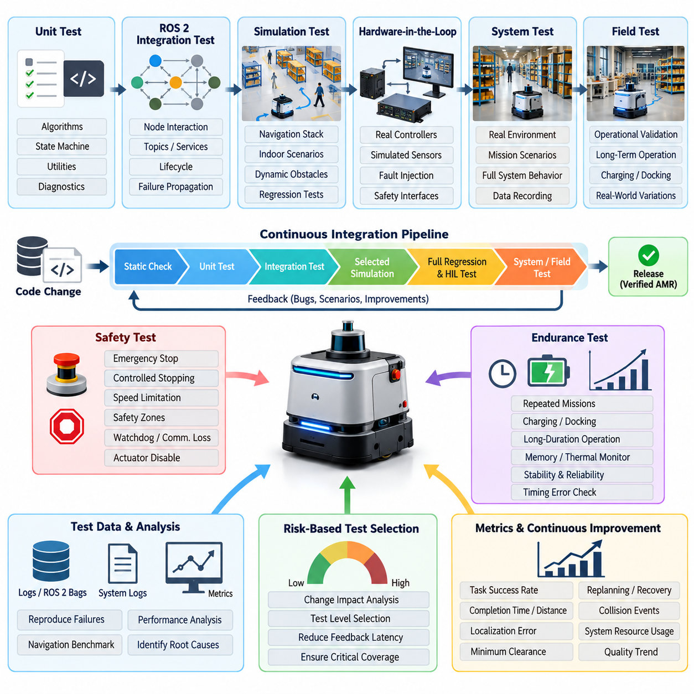
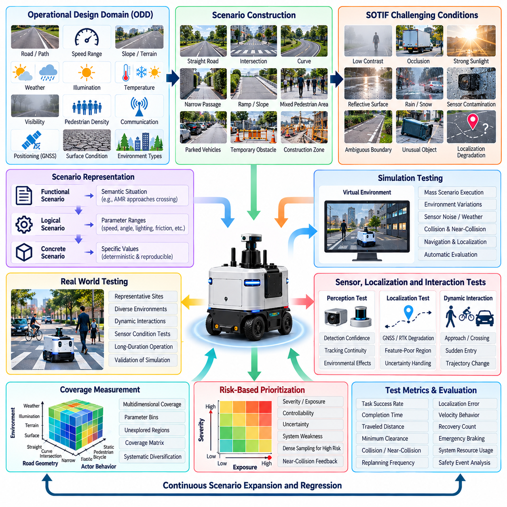
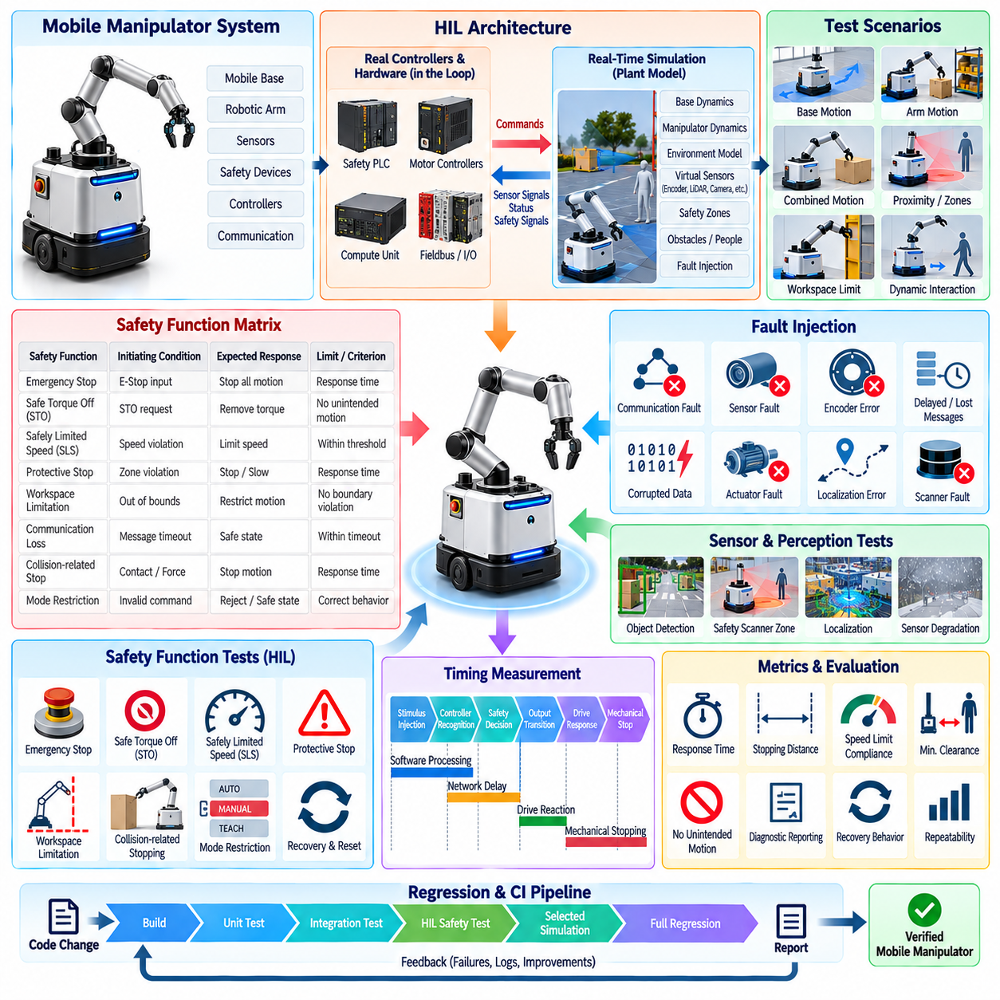
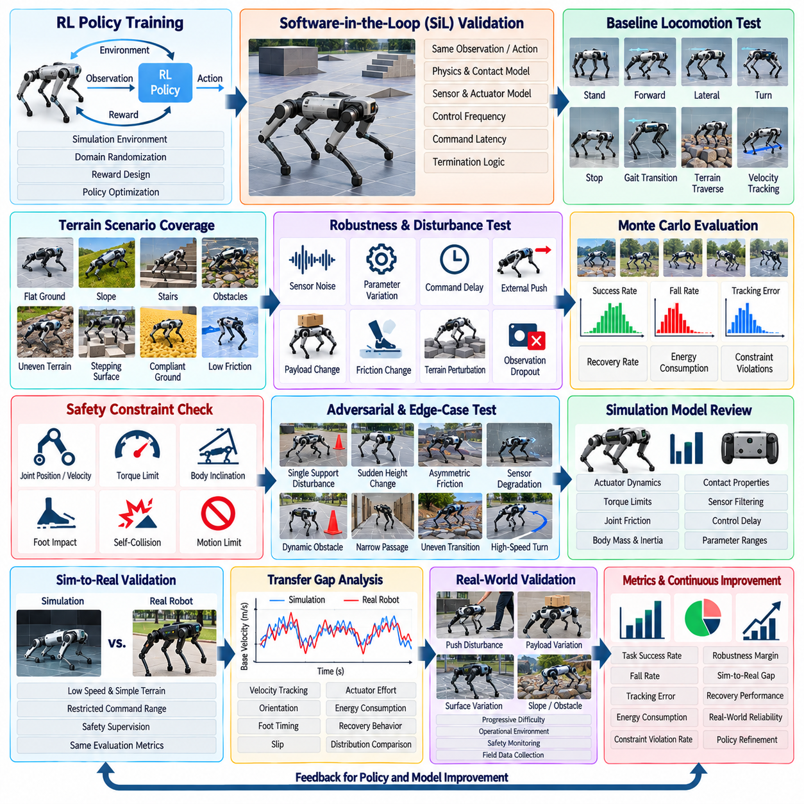
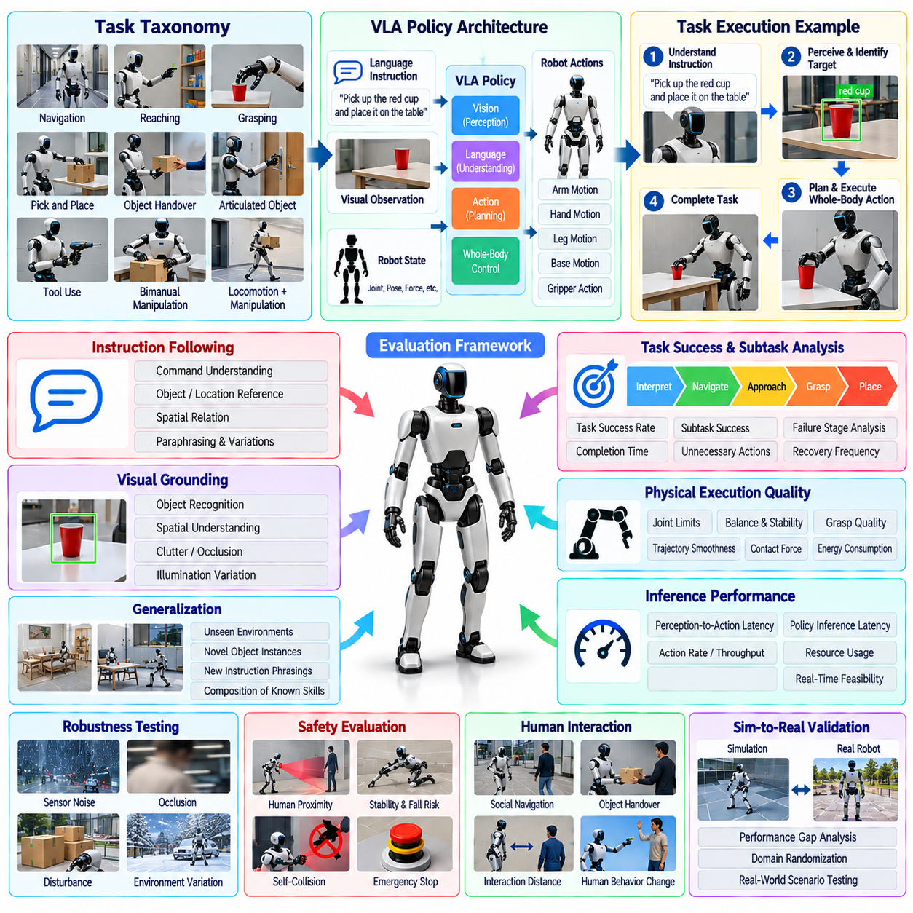
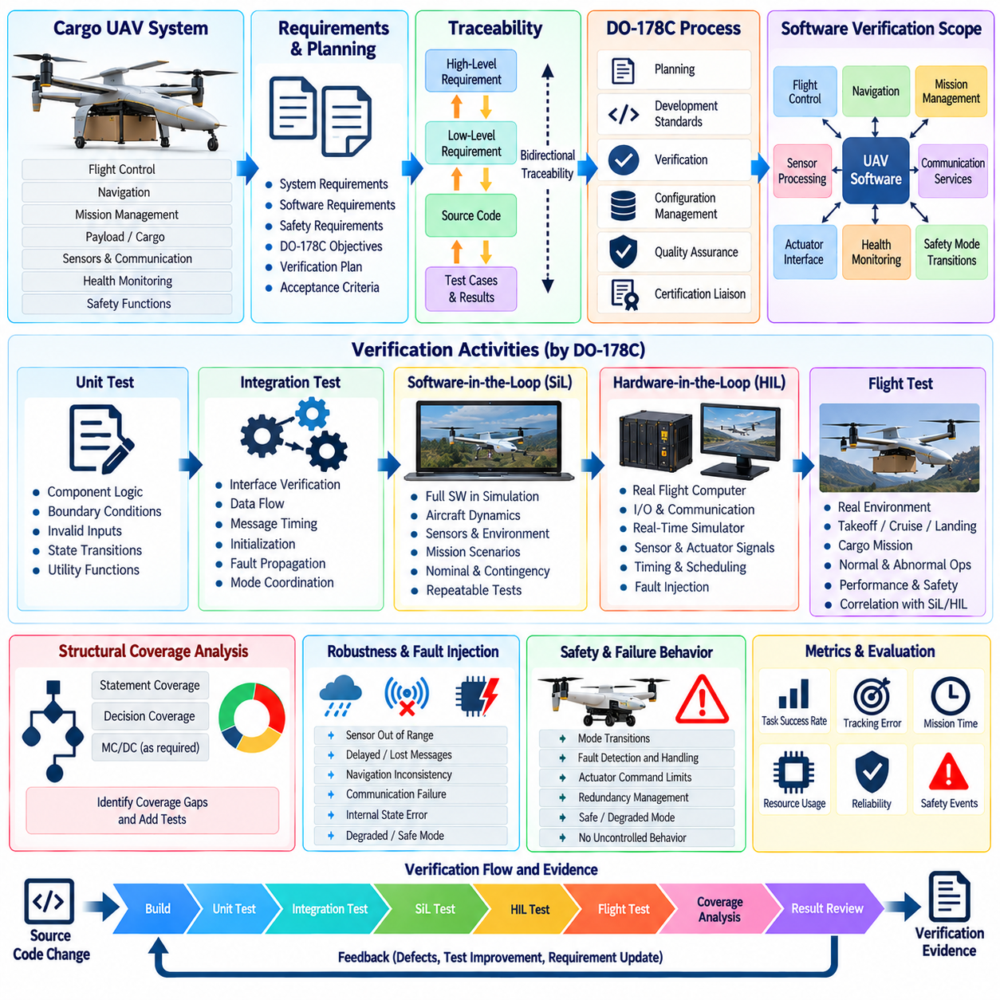
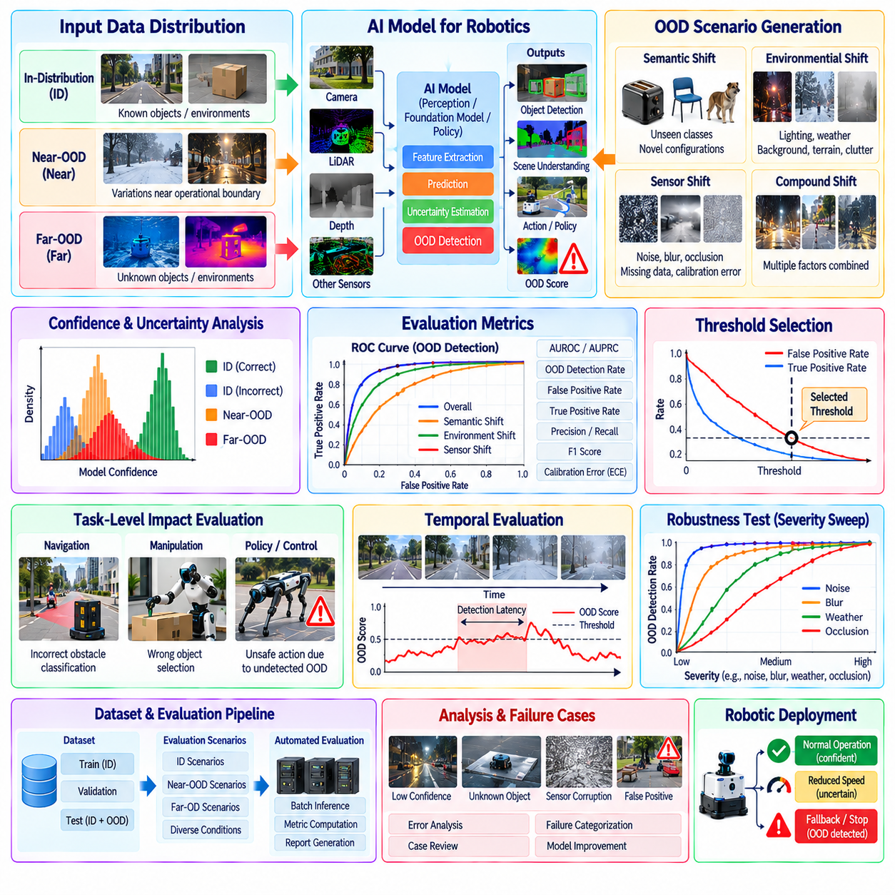
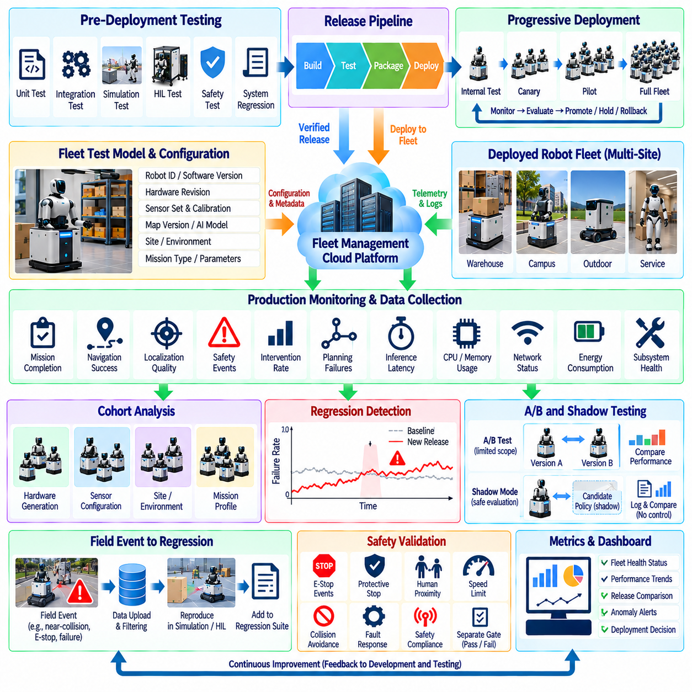
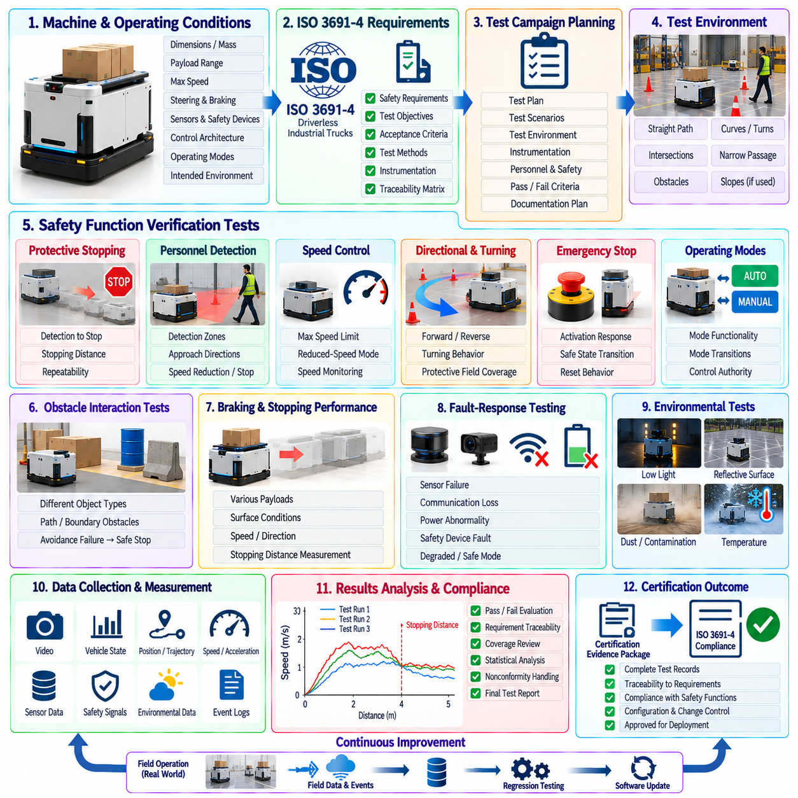
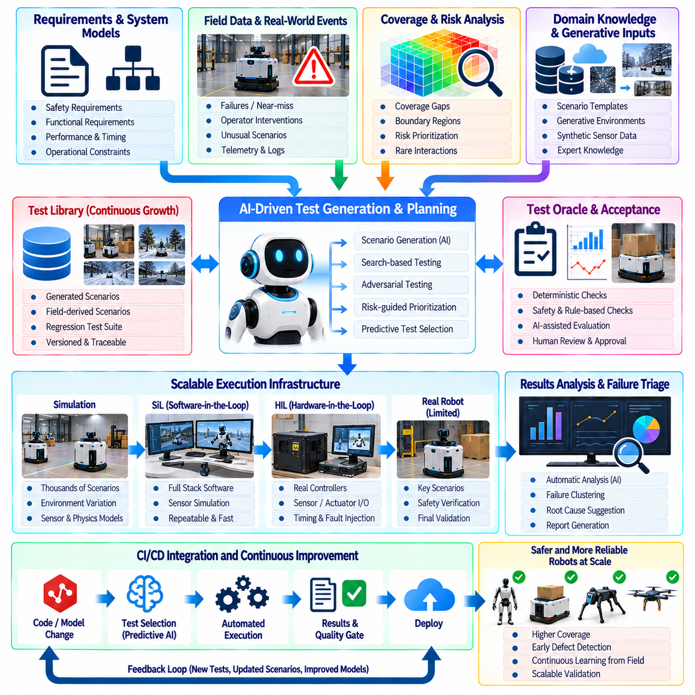

**Volume 25. Testing Validation and Benchmarking**


# Chapter 12. Testing Case Studies

##  

## 12.01. Indoor AMR Full Test Suite Build and CI Case

{width="7.268055555555556in" height="7.268055555555556in"}

An indoor autonomous mobile robot requires a test strategy that treats software quality, navigation performance, hardware behavior, and operational safety as one integrated system rather than independent verification activities. In this case, the engineering team constructed a full test suite spanning unit, integration, simulation, hardware-in-the-loop, system, and field testing, consistent with the broader testing structure used for robotics software. Volume_25_Testing_Validation_an...

Development began with deterministic unit tests for components whose behavior could be verified without a complete robot. Localization utilities, coordinate transformations, velocity limiters, path-processing functions, obstacle filters, state machines, recovery logic, and diagnostic modules were isolated from physical dependencies. Sensor and actuator interfaces were replaced with mocks or stubs so that normal conditions, boundary values, invalid messages, timeouts, and communication failures could be reproduced reliably.

ROS 2 integration testing then verified behavior that emerged only when multiple nodes operated together. Test environments launched selected portions of the production node graph and checked topic connectivity, message timing, lifecycle transitions, service responses, action execution, parameter loading, and failure propagation. Navigation tests injected controlled odometry, map, LiDAR, and obstacle information while recording planner commands and robot states to determine whether subsystem contracts remained valid after software changes.

The next layer used simulation to exercise the complete navigation stack against reproducible indoor scenarios. Virtual warehouses and corridors contained intersections, narrow passages, static obstacles, moving pedestrians, blocked routes, docking stations, and changing traffic conditions. Scenario definitions included initial pose, destination, obstacle configuration, expected behavior, timeout limits, and measurable acceptance criteria. Simulation therefore transformed complex robot behavior into repeatable regression tests rather than relying exclusively on manual demonstrations. Volume_25_Testing_Validation_an...

Navigation validation was organized around measurable mission outcomes. Each scenario recorded task success, completion time, traveled distance, localization error, minimum obstacle clearance, replanning frequency, recovery count, velocity behavior, and collision events. Repeated trials were used where stochastic behavior or dynamic obstacles could influence results. This approach allowed the team to distinguish a functional regression from normal run-to-run variation and supported systematic AMR navigation benchmarking. Volume_25_Testing_Validation_an...

Hardware-in-the-loop testing provided the transition from software-dominated validation to physical-system verification. Real controllers, safety interfaces, communication devices, or selected compute hardware were connected to simulated plant and sensor signals. Fault injection reproduced encoder loss, delayed sensor packets, corrupted measurements, actuator faults, communication interruptions, and abnormal safety inputs without exposing a complete mobile robot or nearby personnel to unnecessary risk. Volume_25_Testing_Validation_an...

Safety functions were deliberately separated from ordinary mission-success criteria. Emergency stop behavior, controlled stopping, speed limitation, obstacle detection, safety scanner zones, command watchdogs, communication-loss responses, and actuator-disable mechanisms were verified through explicit procedures. Measurements focused not only on whether a safe state was reached but also on response latency, stopping behavior, state transitions, diagnostic reporting, and recovery conditions after the initiating fault disappeared.

A dedicated physical test area was then used for system-level AMR testing. Representative corridors, shelves, intersections, docking targets, pedestrian crossings, reflective surfaces, and restricted zones reproduced important operational conditions. Instrumentation captured ROS 2 bags, controller states, localization estimates, safety events, network statistics, system logs, CPU and memory utilization, and mission-level KPIs so that every significant failure could be reconstructed rather than classified only from operator observation. Volume_25_Testing_Validation_an...

Endurance testing extended the suite beyond individual navigation missions. The AMR repeatedly executed routes, charging cycles, docking operations, task transitions, and recovery procedures over long durations. Engineers monitored memory growth, process restarts, localization drift, thermal behavior, communication degradation, storage consumption, sensor instability, and accumulated timing errors. Defects that were almost invisible during short acceptance tests became reproducible when the same workload was executed hundreds or thousands of times.

The central engineering challenge was integrating these layers into continuous integration rather than maintaining them as separate laboratory procedures. Every source-code change triggered fast static checks and unit tests first. Successful builds progressed to software integration tests and selected simulation scenarios. More expensive regression simulations and hardware-dependent tests were scheduled for appropriate branches, release candidates, or dedicated runners, following the volume\'s explicit emphasis on CI-integrated testing and simulation regression pipelines. Volume_25_Testing_Validation_an... Volume_25_Testing_Validation_an...

Test selection was risk-based because executing the entire AMR validation campaign for every commit would have produced excessive feedback latency. Changes affecting isolated utilities could stop after fast software tests, while modifications to localization, planning, control, safety, or sensor interfaces triggered progressively broader suites. Dependency metadata and historical failure information helped determine which scenarios were relevant, allowing CI resources to concentrate on areas where a change could realistically alter robot behavior.

A practical pipeline also required disciplined test-data management. Maps, robot configurations, simulation worlds, sensor recordings, expected outputs, calibration files, and scenario definitions were versioned alongside compatible software releases. Random seeds and environment parameters were recorded where reproducibility mattered. Test artifacts were retained with build identifiers so that an engineer investigating a regression could reconstruct the exact software, configuration, environment, input data, and acceptance thresholds used during the failed execution.

Pass-or-fail decisions were derived from machine-readable criteria rather than visual inspection wherever possible. A mission could require successful arrival within a defined time, zero collisions, acceptable localization error, valid safety-state transitions, bounded command latency, and minimum clearance from obstacles. The pipeline aggregated these results into reports that distinguished functional failures, performance regressions, infrastructure errors, and flaky tests, preventing unreliable automation from gradually becoming accepted as normal behavior.

Field failures were also converted into permanent regression assets. When deployed robots encountered unusual layouts, sensor degradation, traffic interactions, or recovery failures, relevant telemetry and environmental conditions were reconstructed as simulation or integration scenarios. This created a feedback loop between production operation and pre-deployment verification, matching the volume\'s shift-right model in which production monitoring, field data, automated regression triggers, and continuous safety validation extend the conventional CI process. Volume_25_Testing_Validation_an...

The completed AMR test architecture therefore functioned as a verification chain rather than a collection of unrelated test scripts. Unit tests detected local software defects quickly, integration tests protected ROS 2 interfaces, simulation provided scalable behavioral coverage, HIL exposed hardware-dependent failures, physical testing verified real-world behavior, and field telemetry continuously supplied new regression cases. Failures discovered at a later stage were systematically pushed toward earlier and less expensive stages whenever reproduction was technically possible.

The case demonstrates that effective AMR continuous integration is ultimately an evidence-management system for robot behavior. Each software revision accumulates evidence about correctness, navigation capability, timing, robustness, safety, and regression risk before deployment approval. By combining automated testing with simulation, HIL, controlled field trials, measurable benchmarks, and production feedback, the organization can evolve an indoor AMR rapidly while maintaining traceability between software changes and verified physical behavior.

실내 자율이동로봇(Indoor Autonomous Mobile Robot, AMR)은 소프트웨어 품질(Software Quality), 내비게이션 성능(Navigation Performance), 하드웨어 동작(Hardware Behavior), 운영 안전성(Operational Safety)을 서로 독립적인 검증 활동이 아니라 하나의 통합 시스템으로 다루는 시험 전략(Test Strategy)이 필요하다. 이 사례에서 엔지니어링 팀은 로봇 소프트웨어의 전반적인 시험 구조에 맞추어 단위 시험(Unit Test), 통합 시험(Integration Test), 시뮬레이션(Simulation), 하드웨어 인 더 루프(Hardware-in-the-Loop, HIL), 시스템 시험(System Test), 현장 시험(Field Test)을 포괄하는 전체 시험 스위트(Full Test Suite)를 구축하였다.

개발은 완전한 로봇 없이도 동작을 검증할 수 있는 구성요소에 대한 결정론적 단위 시험(Deterministic Unit Test)부터 시작하였다. 위치추정 유틸리티(Localization Utility), 좌표 변환(Coordinate Transformation), 속도 제한기(Velocity Limiter), 경로 처리 함수(Path-Processing Function), 장애물 필터(Obstacle Filter), 상태 머신(State Machine), 복구 로직(Recovery Logic), 진단 모듈(Diagnostic Module)을 물리적 종속성에서 분리하였다. 센서와 액추에이터 인터페이스는 목(Mock) 또는 스텁(Stub)으로 대체하여 정상 조건, 경계값, 잘못된 메시지, 타임아웃, 통신 장애를 안정적으로 재현할 수 있도록 하였다.

이후 ROS 2 통합 시험(ROS 2 Integration Testing)을 통해 여러 노드(Node)가 함께 동작할 때만 나타나는 시스템 행동을 검증하였다. 시험 환경은 실제 운영 노드 그래프(Production Node Graph)의 일부를 실행하고 토픽 연결성(Topic Connectivity), 메시지 타이밍(Message Timing), 수명주기 전환(Lifecycle Transition), 서비스 응답(Service Response), 액션 실행(Action Execution), 파라미터 로딩(Parameter Loading), 장애 전파(Failure Propagation)를 검사하였다. 내비게이션 시험에서는 제어된 오도메트리(Odometry), 지도(Map), 라이다(LiDAR), 장애물 정보를 주입하고 플래너 명령(Planner Command)과 로봇 상태를 기록하여 소프트웨어 변경 이후에도 서브시스템 계약(Subsystem Contract)이 유지되는지 판단하였다.

다음 계층에서는 시뮬레이션(Simulation)을 사용하여 재현 가능한 실내 시나리오에서 전체 내비게이션 스택(Navigation Stack)을 시험하였다. 가상 창고와 복도에는 교차로, 좁은 통로, 정적 장애물, 이동하는 보행자, 차단된 경로, 도킹 스테이션(Docking Station), 변화하는 교통 상황을 구성하였다. 시나리오 정의에는 초기 자세(Initial Pose), 목적지, 장애물 구성, 예상 행동, 타임아웃 제한, 측정 가능한 합격 기준(Acceptance Criteria)이 포함되었다. 이를 통해 복잡한 로봇 행동을 수동 시연에만 의존하지 않고 반복 가능한 회귀 시험(Regression Test)으로 전환할 수 있었다.

내비게이션 검증(Navigation Validation)은 측정 가능한 임무 결과(Mission Outcome)를 중심으로 구성하였다. 각 시나리오는 작업 성공 여부, 완료 시간, 이동 거리, 위치추정 오차(Localization Error), 최소 장애물 이격거리(Minimum Obstacle Clearance), 재계획 빈도(Replanning Frequency), 복구 횟수, 속도 거동, 충돌 이벤트를 기록하였다. 확률적 행동이나 동적 장애물이 결과에 영향을 줄 수 있는 경우 반복 시험을 수행하였다. 이러한 방식으로 정상적인 실행 간 편차와 실제 기능 회귀(Functional Regression)를 구분하고 체계적인 AMR 내비게이션 벤치마킹(Navigation Benchmarking)을 수행할 수 있었다.

하드웨어 인 더 루프 시험(Hardware-in-the-Loop Testing, HIL)은 소프트웨어 중심 검증에서 실제 물리 시스템 검증으로 전환하는 연결 단계로 사용되었다. 실제 컨트롤러(Controller), 안전 인터페이스(Safety Interface), 통신 장치 또는 일부 컴퓨팅 하드웨어를 시뮬레이션된 플랜트(Plant) 및 센서 신호와 연결하였다. 결함 주입(Fault Injection)을 통해 엔코더 손실, 센서 패킷 지연, 손상된 측정값, 액추에이터 장애, 통신 중단, 비정상적인 안전 입력을 재현하여 완전한 이동로봇이나 주변 작업자를 불필요한 위험에 노출하지 않고 장애 상황을 시험하였다.

안전 기능(Safety Function)은 일반적인 임무 성공 기준과 명확하게 분리하여 검증하였다. 비상 정지(Emergency Stop), 제어 정지(Controlled Stopping), 속도 제한(Speed Limitation), 장애물 감지(Obstacle Detection), 안전 스캐너 영역(Safety Scanner Zone), 명령 워치독(Command Watchdog), 통신 손실 대응, 액추에이터 비활성화 메커니즘을 명시적인 절차를 통해 시험하였다. 측정 항목은 단순히 안전 상태(Safe State)에 도달했는지뿐만 아니라 응답 지연(Response Latency), 정지 거동, 상태 전환, 진단 보고, 장애 원인이 제거된 이후의 복구 조건까지 포함하였다.

전용 물리 시험 구역(Physical Test Area)에서는 시스템 수준 AMR 시험(System-Level AMR Testing)을 수행하였다. 대표적인 복도, 선반, 교차로, 도킹 목표물, 보행자 횡단 구역, 반사 표면, 제한 구역을 구성하여 주요 운영 조건을 재현하였다. 계측 시스템(Instrumentation)은 ROS 2 백(ROS 2 Bag), 컨트롤러 상태, 위치추정 결과, 안전 이벤트, 네트워크 통계, 시스템 로그, CPU 및 메모리 사용량, 임무 수준 핵심성과지표(Key Performance Indicator, KPI)를 수집하였다. 이를 통해 중요한 장애를 작업자의 관찰만으로 분류하지 않고 이후에 정확하게 재구성할 수 있도록 하였다.

내구 시험(Endurance Testing)은 개별 내비게이션 임무를 넘어 장시간의 반복 운용까지 시험 범위를 확장하였다. AMR은 경로 이동, 충전 사이클, 도킹 작업, 작업 상태 전환, 복구 절차를 장시간 반복 수행하였다. 엔지니어는 메모리 증가, 프로세스 재시작, 위치추정 드리프트(Localization Drift), 열적 거동(Thermal Behavior), 통신 성능 저하, 저장공간 소비, 센서 불안정성, 누적 타이밍 오차를 모니터링하였다. 짧은 인수 시험(Acceptance Test)에서는 거의 드러나지 않던 결함도 동일한 작업 부하를 수백 번 또는 수천 번 반복하면 재현할 수 있었다.

핵심적인 엔지니어링 과제는 이러한 시험 계층을 서로 분리된 실험실 절차로 유지하는 것이 아니라 지속적 통합(Continuous Integration, CI)에 통합하는 것이었다. 모든 소스 코드 변경은 먼저 빠른 정적 검사(Static Check)와 단위 시험을 실행하였다. 성공한 빌드는 소프트웨어 통합 시험과 선택된 시뮬레이션 시나리오로 진행되었다. 더 많은 자원을 필요로 하는 회귀 시뮬레이션(Regression Simulation)과 하드웨어 의존 시험은 적절한 브랜치(Branch), 릴리스 후보(Release Candidate), 전용 실행기(Dedicated Runner)를 대상으로 실행되도록 구성하였다.

모든 커밋(Commit)에서 전체 AMR 검증 캠페인(Validation Campaign)을 실행하면 피드백 지연이 지나치게 증가하므로 시험 선택은 위험 기반(Risk-Based) 방식으로 이루어졌다. 독립적인 유틸리티 변경은 빠른 소프트웨어 시험까지만 실행할 수 있었지만, 위치추정, 계획(Planning), 제어(Control), 안전(Safety), 센서 인터페이스 변경은 단계적으로 더 광범위한 시험 스위트를 실행하도록 하였다. 종속성 메타데이터(Dependency Metadata)와 과거 장애 정보를 이용해 관련 시나리오를 결정함으로써 CI 자원을 실제 로봇 행동을 변경할 가능성이 있는 영역에 집중하였다.

실용적인 파이프라인(Pipeline)을 구축하기 위해서는 체계적인 시험 데이터 관리(Test Data Management)도 필요하였다. 지도, 로봇 구성, 시뮬레이션 월드(Simulation World), 센서 기록, 예상 출력, 보정 파일(Calibration File), 시나리오 정의는 호환되는 소프트웨어 릴리스와 함께 버전 관리되었다. 재현성이 중요한 경우 난수 시드(Random Seed)와 환경 파라미터도 기록하였다. 시험 산출물(Test Artifact)은 빌드 식별자(Build Identifier)와 함께 보존하여 엔지니어가 회귀 문제를 분석할 때 장애가 발생한 소프트웨어, 구성, 환경, 입력 데이터, 합격 기준을 정확하게 재구성할 수 있도록 하였다.

가능한 경우 합격 또는 불합격 결정은 육안 검사 대신 기계 판독 가능한 기준(Machine-Readable Criteria)을 기반으로 하였다. 하나의 임무는 지정된 시간 내 성공적인 도착, 충돌 0건, 허용 가능한 위치추정 오차, 정상적인 안전 상태 전환, 제한 범위 내 명령 지연, 최소 장애물 이격거리 등을 동시에 요구할 수 있다. 파이프라인은 이러한 결과를 통합하여 기능 장애, 성능 회귀(Performance Regression), 시험 인프라 오류, 불안정 시험(Flaky Test)을 구분하는 보고서를 생성함으로써 신뢰할 수 없는 자동화가 정상적인 현상으로 받아들여지는 것을 방지하였다.

현장에서 발생한 장애(Field Failure) 역시 영구적인 회귀 시험 자산(Regression Asset)으로 변환하였다. 배치된 로봇이 특이한 공간 배치, 센서 성능 저하, 교통 상호작용, 복구 실패를 경험하면 관련 텔레메트리(Telemetry)와 환경 조건을 시뮬레이션 또는 통합 시험 시나리오로 재구성하였다. 이를 통해 생산 환경 운영과 배치 전 검증 사이에 피드백 루프(Feedback Loop)를 형성하였으며, 생산 모니터링(Production Monitoring), 현장 데이터, 자동 회귀 트리거(Automated Regression Trigger), 지속적 안전 검증(Continuous Safety Validation)이 기존 CI 프로세스를 확장하도록 하였다.

완성된 AMR 시험 아키텍처(Test Architecture)는 서로 관련 없는 시험 스크립트(Test Script)의 집합이 아니라 하나의 검증 체인(Verification Chain)으로 동작하였다. 단위 시험은 지역적인 소프트웨어 결함을 빠르게 탐지하고, 통합 시험은 ROS 2 인터페이스를 보호하며, 시뮬레이션은 확장 가능한 행동 커버리지(Behavioral Coverage)를 제공하였다. HIL은 하드웨어 의존 장애를 발견하고, 물리 시험은 실제 환경의 행동을 검증하며, 현장 텔레메트리는 지속적으로 새로운 회귀 시험 사례를 공급하였다. 후반 단계에서 발견된 장애는 기술적으로 재현할 수 있는 경우 더 빠르고 비용이 낮은 초기 시험 단계로 체계적으로 이동시켰다.

이 사례는 효과적인 AMR 지속적 통합(Continuous Integration)이 궁극적으로 로봇 행동을 위한 증거 관리 시스템(Evidence Management System)이라는 점을 보여준다. 각 소프트웨어 리비전(Software Revision)은 배포 승인을 받기 전에 정확성, 내비게이션 능력, 타이밍, 강건성(Robustness), 안전성, 회귀 위험에 관한 검증 증거를 축적한다. 자동화 시험(Automated Testing), 시뮬레이션, HIL, 통제된 현장 시험, 측정 가능한 벤치마크(Benchmark), 운영 환경 피드백을 결합함으로써 조직은 소프트웨어 변경과 검증된 물리적 행동 사이의 추적성(Traceability)을 유지하면서 실내 AMR을 지속적으로 발전시킬 수 있다.

##  

## 12.02. Outdoor AMR SOTIF Scenario Test Coverage Case

{width="7.268055555555556in" height="7.268055555555556in"}

The outdoor autonomous mobile robot presents a fundamentally different validation problem from an indoor AMR because its operational environment cannot be fully constrained. Roads, sidewalks, industrial yards, campuses, and public facilities expose the robot to continuously changing illumination, weather, terrain, traffic, vegetation, pedestrians, and sensor conditions. A SOTIF-oriented scenario test program therefore evaluates not only component failures but also hazardous behavior arising when correctly functioning perception and autonomy systems encounter difficult operating conditions.

The test campaign begins by defining the operational design domain, or ODD, in measurable terms. The ODD describes permitted road and pathway types, speed ranges, slopes, surface conditions, illumination, precipitation, temperature, visibility, pedestrian density, communication availability, and positioning conditions. These boundaries establish where the outdoor AMR is expected to operate and provide the reference against which scenario coverage and validation completeness can be evaluated.

Scenario construction starts with nominal operational situations before progressively introducing challenging conditions. Representative scenarios include straight driving, intersections, curves, narrow passages, ramps, mixed pedestrian areas, parked vehicles, temporary obstacles, construction zones, and transitions between open and constrained spaces. Each scenario is parameterized so that speed, obstacle position, trajectory, visibility, surface condition, and environmental complexity can be systematically varied instead of being represented by a single fixed test.

SOTIF scenario analysis focuses especially on triggering conditions that can expose functional insufficiencies even when no hardware or software fault exists. Examples include low-contrast pedestrians, partially occluded objects, reflective surfaces, strong shadows, direct sunlight, rain-contaminated sensors, unusual obstacle geometry, ambiguous drivable boundaries, and temporary localization degradation. The objective is to discover combinations in which perception, localization, planning, or control remains technically operational but produces an unsafe or insufficient response.

The scenario library is organized using functional, logical, and concrete representations. A functional scenario describes the semantic situation, such as an AMR approaching a pedestrian crossing. A logical scenario converts that situation into parameter ranges for robot speed, pedestrian velocity, crossing angle, detection distance, illumination, and friction. Concrete scenarios assign specific values to these parameters so that individual experiments can be executed deterministically and reproduced during regression testing.

Simulation provides the first scalable mechanism for exploring this scenario space. Thousands of parameter combinations can be executed using variations in obstacle behavior, sensor noise, weather, lighting, localization uncertainty, and vehicle dynamics. Automated scenario execution records collisions, minimum separation distance, time to collision, emergency braking events, path deviation, localization error, mission completion, and recovery behavior. Large-scale simulation therefore identifies potentially hazardous regions before expensive physical testing begins.

Coverage measurement must represent the explored operational space rather than simply count executed test cases. The engineering team tracks combinations of environmental conditions, road geometry, actor behavior, robot state, sensor condition, and autonomy response. Parameter bins and multidimensional coverage matrices reveal combinations that remain insufficiently tested. A campaign with ten thousand similar clear-weather runs may therefore provide less meaningful coverage than a smaller but systematically diversified collection of scenarios.

Risk-based prioritization prevents scenario explosion from making the validation campaign impractical. Scenarios are ranked according to potential severity, exposure, controllability, uncertainty, and observed system weakness. High-priority scenarios receive denser parameter sampling and more physical validation, while lower-risk regions may rely primarily on simulation evidence. Near-collision events, unexpected emergency stops, localization instability, and perception uncertainty can automatically increase the priority of related scenario families.

Sensor perception receives particular attention because outdoor conditions can create performance limitations without explicit sensor failure. Camera exposure can degrade under backlighting, LiDAR returns can change with rain or reflective materials, and GNSS accuracy can deteriorate near buildings or vegetation. Tests therefore vary individual and combined sensing conditions while monitoring object detection confidence, tracking continuity, localization uncertainty, obstacle-map stability, and the resulting navigation decisions rather than evaluating sensors independently.

Localization and navigation scenarios evaluate how the AMR behaves when positioning quality changes gradually rather than disappearing completely. GNSS multipath, temporary RTK correction loss, feature-poor regions, wheel slip, IMU bias, and inconsistent map observations are introduced with controlled severity. Acceptance criteria examine whether uncertainty is detected, whether speed or operating mode is appropriately adjusted, and whether the robot transitions toward a minimal-risk condition when reliable navigation can no longer be maintained.

Dynamic interaction scenarios address pedestrians, bicycles, vehicles, and other mobile equipment whose future motion is uncertain. Tests vary approach direction, relative velocity, occlusion, sudden entry, stopping behavior, and trajectory changes. Successful performance requires more than avoiding collision: the robot should maintain suitable separation, avoid excessive oscillation or unnecessary emergency braking, and behave predictably enough that nearby people can understand and safely interact with its motion.

Environmental testing extends the scenario matrix across day, night, rain, wet pavement, glare, shadows, dust, and surface irregularities within the intended ODD. Rather than treating these as isolated environmental qualification tests, they are combined with navigation situations. A pedestrian crossing at night on wet pavement, for example, evaluates perception degradation, stopping distance, planning response, and vehicle dynamics simultaneously, exposing interactions that component-level testing may not reveal.

Selected high-risk simulation scenarios are transferred to controlled physical tests using equivalent geometry, robot state, actor trajectories, and environmental conditions whenever practical. Differences between simulated and real outcomes are measured to identify the simulation-to-real gap. Scenarios whose physical behavior differs significantly from simulation receive additional investigation, model calibration, or conservative acceptance margins before simulation results are allowed to contribute strongly to validation evidence.

Field testing then evaluates scenario families that cannot be represented adequately in controlled facilities. Instrumented outdoor runs collect synchronized perception outputs, localization estimates, planning decisions, control commands, safety events, environmental observations, and ground-truth references where available. Every significant disengagement, unexpected stop, near miss, or abnormal trajectory becomes a candidate scenario for reconstruction, analysis, and inclusion in the permanent regression library.

Scenario coverage evolves continuously because deployment reveals conditions that were not anticipated during initial design. Production telemetry can identify new combinations of weather, geometry, traffic behavior, sensor uncertainty, or localization degradation. These observations are classified and compared against the existing scenario database. Missing or weakly represented conditions generate new simulation and physical tests, connecting field operation with continuous validation and preventing the test suite from becoming static.

The final SOTIF evidence is therefore not a claim that every possible outdoor event has been tested. Instead, it demonstrates a systematic process for defining the ODD, identifying potentially hazardous scenarios, exploring triggering conditions, measuring scenario-space coverage, prioritizing residual risk, and feeding operational discoveries back into regression testing. This provides a defensible argument that known insufficiencies have been addressed and unknown unsafe scenarios are being progressively reduced.

This outdoor AMR case illustrates why scenario coverage must become a lifecycle capability rather than a one-time release activity. Simulation, controlled testing, field validation, telemetry analysis, and automated regression form a closed evidence loop. As software, sensors, maps, operating environments, and AI models change, the same scenario framework can determine which assumptions have changed, which tests must be repeated, and whether the robot remains acceptably safe throughout continued deployment.

실외 자율이동로봇(Outdoor Autonomous Mobile Robot, AMR)은 운영 환경(Operational Environment)을 완전히 통제할 수 없기 때문에 실내 AMR과 근본적으로 다른 검증 문제(Validation Problem)를 가진다. 도로, 보도, 산업 현장, 캠퍼스, 공공시설에서는 지속적으로 변화하는 조명, 날씨, 지형, 교통, 식생, 보행자, 센서 조건에 로봇이 노출된다. 따라서 의도된 기능의 안전성(Safety of the Intended Functionality, SOTIF) 중심의 시나리오 시험 프로그램(Scenario Test Program)은 구성요소 고장뿐만 아니라 정상적으로 작동하는 인지 및 자율주행 시스템이 까다로운 운용 조건을 만났을 때 발생할 수 있는 위험 행동까지 평가한다.

시험 캠페인(Test Campaign)은 운행 설계 영역(Operational Design Domain, ODD)을 측정 가능한 조건으로 정의하는 것에서 시작한다. ODD는 허용되는 도로 및 이동 경로 유형, 속도 범위, 경사도, 노면 상태, 조도, 강수, 온도, 가시거리, 보행자 밀도, 통신 가용성, 위치추정 조건 등을 정의한다. 이러한 경계는 실외 AMR이 운용될 것으로 예상되는 범위를 설정하며, 시나리오 커버리지(Scenario Coverage)와 검증 완전성(Validation Completeness)을 평가하기 위한 기준을 제공한다.

시나리오 구성(Scenario Construction)은 정상적인 운용 상황(Nominal Operational Situation)에서 시작하여 점진적으로 더 까다로운 조건을 도입한다. 대표적인 시나리오에는 직선 주행, 교차로, 곡선 구간, 좁은 통로, 경사로, 보행자 혼재 구역, 주차 차량, 임시 장애물, 공사 구역, 개방 공간과 제한 공간 사이의 전환 등이 포함된다. 각 시나리오는 속도, 장애물 위치, 이동 궤적, 가시성, 노면 상태, 환경 복잡도를 체계적으로 변화시킬 수 있도록 매개변수화(Parameterization)하여 단일 고정 시험으로 표현되지 않도록 한다.

SOTIF 시나리오 분석(Scenario Analysis)은 하드웨어 또는 소프트웨어 고장이 존재하지 않더라도 기능적 불충분성(Functional Insufficiency)을 드러낼 수 있는 유발 조건(Triggering Condition)에 특히 집중한다. 낮은 대비의 보행자, 부분적으로 가려진 물체, 반사 표면, 강한 그림자, 직사광선, 빗물에 오염된 센서, 비정상적인 장애물 형상, 모호한 주행 가능 영역 경계, 일시적인 위치추정 성능 저하 등이 이에 해당한다. 목표는 인지, 위치추정, 계획, 제어 기능이 기술적으로는 정상 동작하면서도 안전하지 않거나 불충분한 대응을 생성하는 조건 조합을 발견하는 것이다.

시나리오 라이브러리(Scenario Library)는 기능적 시나리오(Functional Scenario), 논리적 시나리오(Logical Scenario), 구체적 시나리오(Concrete Scenario)를 사용하여 구성한다. 기능적 시나리오는 AMR이 보행자 횡단 구역에 접근하는 상황과 같이 의미론적 상황을 설명한다. 논리적 시나리오는 로봇 속도, 보행자 속도, 횡단 각도, 감지 거리, 조명, 마찰계수 등의 매개변수 범위로 상황을 변환한다. 구체적 시나리오는 이러한 매개변수에 특정 값을 할당하여 개별 실험을 결정론적으로 실행하고 회귀 시험(Regression Testing)에서 동일하게 재현할 수 있도록 한다.

시뮬레이션(Simulation)은 이러한 시나리오 공간(Scenario Space)을 탐색하기 위한 최초의 확장 가능한 수단을 제공한다. 장애물 행동, 센서 노이즈, 날씨, 조명, 위치추정 불확실성, 차량 동역학을 변화시키면서 수천 개의 매개변수 조합을 실행할 수 있다. 자동화된 시나리오 실행은 충돌, 최소 이격거리, 충돌 예상 시간(Time to Collision), 비상 제동 이벤트, 경로 편차, 위치추정 오차, 임무 완료 여부, 복구 행동을 기록한다. 따라서 대규모 시뮬레이션은 비용이 높은 물리적 시험을 시작하기 전에 잠재적으로 위험한 영역을 식별할 수 있도록 한다.

커버리지 측정(Coverage Measurement)은 단순히 실행된 시험 사례의 개수를 계산하는 것이 아니라 실제로 탐색한 운용 공간(Operational Space)을 표현해야 한다. 엔지니어링 팀은 환경 조건, 도로 형상, 이동 객체 행동, 로봇 상태, 센서 조건, 자율 시스템 대응의 조합을 추적한다. 매개변수 구간(Parameter Bin)과 다차원 커버리지 매트릭스(Multidimensional Coverage Matrix)는 충분히 시험되지 않은 조합을 식별한다. 따라서 맑은 날씨 조건에서 수행한 10,000회의 유사한 시험보다 체계적으로 다양화된 소수의 시나리오가 더 의미 있는 커버리지를 제공할 수 있다.

위험 기반 우선순위화(Risk-Based Prioritization)는 시나리오 폭발(Scenario Explosion)로 인해 검증 캠페인이 비현실적으로 확대되는 것을 방지한다. 시나리오는 잠재적 심각도(Severity), 노출도(Exposure), 제어 가능성(Controllability), 불확실성(Uncertainty), 관찰된 시스템 취약성을 기준으로 우선순위를 지정한다. 높은 우선순위의 시나리오는 더 높은 밀도의 매개변수 샘플링과 더 많은 물리적 검증을 수행하며, 상대적으로 위험이 낮은 영역은 주로 시뮬레이션 증거(Simulation Evidence)에 의존할 수 있다. 근접 충돌, 예상하지 못한 비상 정지, 위치추정 불안정성, 인지 불확실성은 관련 시나리오 계열의 우선순위를 자동으로 높이는 요소가 될 수 있다.

센서 인지(Sensor Perception)는 명시적인 센서 고장이 없어도 실외 조건에 의해 성능 한계가 발생할 수 있기 때문에 특별히 중요하게 다룬다. 카메라 노출은 역광에서 저하될 수 있고, 라이다(LiDAR) 반사 신호는 비나 반사성 물질에 의해 변화할 수 있으며, 위성항법시스템(Global Navigation Satellite System, GNSS)의 정확도는 건물이나 식생 주변에서 저하될 수 있다. 따라서 시험에서는 개별 및 복합 센싱 조건을 변화시키면서 객체 감지 신뢰도, 추적 연속성, 위치추정 불확실성, 장애물 지도 안정성, 그 결과로 발생하는 내비게이션 의사결정을 함께 모니터링한다.

위치추정 및 내비게이션 시나리오(Localization and Navigation Scenario)는 위치 품질이 완전히 상실되는 상황뿐만 아니라 점진적으로 저하되는 상황에서 AMR이 어떻게 행동하는지를 평가한다. GNSS 다중경로(GNSS Multipath), 일시적인 실시간 이동측위(Real-Time Kinematic, RTK) 보정 손실, 특징이 부족한 영역, 휠 슬립(Wheel Slip), 관성측정장치(Inertial Measurement Unit, IMU) 바이어스, 일관되지 않은 지도 관측 등을 제어된 수준으로 도입한다. 합격 기준은 불확실성이 탐지되는지, 속도나 운용 모드가 적절하게 조정되는지, 신뢰할 수 있는 내비게이션을 더 이상 유지할 수 없을 때 로봇이 최소 위험 상태(Minimal-Risk Condition)로 전환하는지를 평가한다.

동적 상호작용 시나리오(Dynamic Interaction Scenario)는 미래 움직임을 정확하게 예측하기 어려운 보행자, 자전거, 차량 및 기타 이동 장비를 대상으로 한다. 시험에서는 접근 방향, 상대 속도, 가림 현상(Occlusion), 갑작스러운 진입, 정지 행동, 궤적 변경 등을 변화시킨다. 성공적인 성능은 단순히 충돌을 피하는 것에 그치지 않는다. 로봇은 적절한 이격거리를 유지하고, 과도한 진동성 움직임이나 불필요한 비상 제동을 방지하며, 주변 사람이 로봇의 움직임을 이해하고 안전하게 상호작용할 수 있을 정도로 예측 가능한 행동을 수행해야 한다.

환경 시험(Environmental Testing)은 의도된 ODD 범위 내에서 주간, 야간, 비, 젖은 노면, 눈부심, 그림자, 먼지, 노면 불규칙성까지 시나리오 매트릭스(Scenario Matrix)를 확장한다. 이러한 조건을 독립적인 환경 적합성 시험(Environmental Qualification Test)으로만 다루는 것이 아니라 실제 내비게이션 상황과 결합한다. 예를 들어 야간의 젖은 노면에서 보행자가 횡단하는 상황은 인지 성능 저하, 정지 거리, 계획 대응, 차량 동역학을 동시에 평가하여 구성요소 수준 시험에서는 발견하기 어려운 상호작용을 드러낼 수 있다.

시뮬레이션에서 확인된 고위험 시나리오 중 일부는 가능한 경우 동일한 기하 구조, 로봇 상태, 이동 객체 궤적, 환경 조건을 적용하여 통제된 물리 시험(Controlled Physical Test)으로 전환한다. 시뮬레이션 결과와 실제 결과의 차이를 측정하여 시뮬레이션과 현실 간 격차(Sim-to-Real Gap)를 식별한다. 실제 물리적 행동이 시뮬레이션 결과와 크게 다른 시나리오는 추가 분석, 모델 보정(Model Calibration), 보수적인 합격 마진(Acceptance Margin)을 적용한 후에야 시뮬레이션 결과를 강력한 검증 증거로 활용한다.

현장 시험(Field Testing)은 통제된 시험 시설에서 충분히 재현하기 어려운 시나리오 계열을 평가한다. 계측된 실외 주행에서는 인지 출력, 위치추정 결과, 계획 의사결정, 제어 명령, 안전 이벤트, 환경 관측값, 가능한 경우 실제 기준값(Ground Truth Reference)을 시간 동기화하여 수집한다. 중요한 운행 중단(Disengagement), 예상하지 못한 정지, 근접 사고(Near Miss), 비정상 궤적은 모두 재구성, 분석 및 영구 회귀 라이브러리(Permanent Regression Library) 편입을 위한 후보 시나리오가 된다.

배치(Deployment) 이후에는 초기 설계 단계에서 예상하지 못했던 조건이 발견되기 때문에 시나리오 커버리지는 지속적으로 발전해야 한다. 운영 텔레메트리(Production Telemetry)는 날씨, 지형, 교통 행동, 센서 불확실성, 위치추정 성능 저하의 새로운 조합을 식별할 수 있다. 이러한 관측 결과는 분류된 후 기존 시나리오 데이터베이스와 비교된다. 누락되었거나 충분히 표현되지 않은 조건은 새로운 시뮬레이션 및 물리 시험을 생성하여 현장 운영과 지속적 검증(Continuous Validation)을 연결하고 시험 스위트가 정적인 상태로 고착되는 것을 방지한다.

최종적인 SOTIF 증거(SOTIF Evidence)는 가능한 모든 실외 상황을 시험했다는 것을 의미하지 않는다. 대신 ODD를 정의하고, 잠재적으로 위험한 시나리오를 식별하며, 유발 조건을 탐색하고, 시나리오 공간 커버리지를 측정하며, 잔여 위험(Residual Risk)의 우선순위를 결정하고, 실제 운용에서 새롭게 발견된 상황을 회귀 시험으로 다시 반영하는 체계적인 프로세스를 입증한다. 이를 통해 알려진 기능적 불충분성이 적절히 처리되었으며 알려지지 않은 위험 시나리오(Unknown Unsafe Scenario)가 지속적으로 감소하고 있다는 방어 가능한 안전 논거(Safety Argument)를 구축할 수 있다.

이 실외 AMR 사례는 시나리오 커버리지가 일회성 출시 활동이 아니라 전체 수명주기 역량(Lifecycle Capability)이 되어야 하는 이유를 보여준다. 시뮬레이션, 통제 시험, 현장 검증, 텔레메트리 분석, 자동 회귀 시험은 폐쇄형 증거 루프(Closed Evidence Loop)를 형성한다. 소프트웨어, 센서, 지도, 운용 환경, 인공지능 모델(AI Model)이 변경될 때 동일한 시나리오 프레임워크를 활용하여 어떤 가정이 변경되었는지, 어떤 시험을 다시 수행해야 하는지, 그리고 지속적인 배치 과정에서 로봇이 허용 가능한 안전 수준을 계속 유지하는지를 판단할 수 있다.

##  

## 12.03. Mobile Manipulator Safety Function HIL Case

{width="7.268055555555556in" height="7.268055555555556in"}

A mobile manipulator combines the hazards of an autonomous mobile base with those of a multi-axis robotic arm, creating safety interactions that cannot be validated adequately by testing either subsystem alone. The HIL campaign therefore treats mobility, manipulation, safety sensing, drive control, and supervisory software as one coordinated safety system. The objective is to verify that safety functions remain deterministic when hazardous motion, communication faults, sensor abnormalities, or conflicting commands occur during combined robot operation.

The test architecture connects production controllers and safety-relevant hardware interfaces to a real-time simulation of the mobile platform, manipulator, actuators, sensors, and surrounding environment. Depending on the verification stage, actual safety PLCs, motor controllers, fieldbus interfaces, emergency-stop circuits, and compute units remain in the loop. Simulated plant models generate encoder, velocity, torque, position, proximity, and safety-zone signals while receiving the same commands that would normally drive physical hardware.

A formal safety-function matrix establishes what must be verified before individual HIL scenarios are created. Each function is associated with its initiating condition, monitored signals, expected state transition, permitted motion, response-time requirement, reset condition, and evidence to be recorded. Emergency stop, safe torque off, safely limited speed, protective stop, communication-loss response, workspace limitation, collision-related stopping, and mode-dependent motion restrictions become independently measurable functions rather than informal observations of robot behavior.

Emergency-stop testing verifies the complete chain from input activation to elimination of hazardous motion. The HIL environment triggers emergency-stop signals while the base is moving, the arm is moving, or both are operating simultaneously. Measurements capture input recognition, safety-controller processing, drive response, torque removal, simulated stopping behavior, and final state. Repeated tests at different velocities and manipulator configurations expose timing dependencies that may not appear during stationary acceptance checks.

Safe Torque Off, or STO, testing focuses on whether torque-producing capability is removed according to the defined safety behavior. STO requests are injected during representative base and manipulator states while drive feedback and command paths are monitored. The test verifies that ordinary motion software cannot override the safety action and that restoration of the safety signal does not automatically produce unexpected motion. Restart behavior is therefore evaluated as carefully as the initial transition into the safe state.

Safely Limited Speed, or SLS, requires a different verification strategy because motion remains permitted within defined limits. The HIL simulator creates conditions in which commanded or simulated velocity approaches and exceeds configured thresholds. Tests determine whether speed supervision detects the violation, whether the appropriate protective response occurs within the required interval, and whether different operating modes apply the correct limits to the mobile base and manipulator joints.

Protective fields and proximity-based safety functions are evaluated by injecting virtual people or obstacles into monitored regions around the robot. The simulator varies approach direction, distance, relative velocity, and robot motion while safety scanners or their interfaces generate corresponding zone states. Tests verify transitions between normal operation, reduced-speed operation, protective stop, and recovery, including difficult cases in which the manipulator extends beyond the footprint of the mobile base.

Combined-motion scenarios are particularly important because the arm can alter the effective hazard envelope while the platform is moving. HIL tests reproduce base translation while the arm extends, rotates, carries a payload, or approaches a workspace boundary. The safety system must correctly interpret the resulting robot state and enforce restrictions appropriate to the combined configuration. This exposes integration defects that isolated mobile-base or manipulator tests cannot detect.

Communication fault injection evaluates whether safety behavior remains valid when information exchange becomes unreliable. EtherCAT, CAN, Ethernet, ROS 2, or controller-level messages can be delayed, dropped, duplicated, frozen, or corrupted according to the interface under test. The campaign measures watchdog behavior, timeout detection, state transitions, command suppression, and recovery. Safety-relevant functions must not depend on continued availability of non-safety communication paths when those paths are lost.

Sensor and actuator abnormalities are introduced systematically through the HIL plant model. Encoder disagreement, implausible joint positions, stale velocity feedback, actuator saturation, brake-state inconsistencies, scanner faults, and localization abnormalities can be generated without damaging physical equipment. The expected response depends on the fault classification, allowing engineers to verify whether diagnostic logic distinguishes recoverable degradation from conditions requiring an immediate or controlled safety stop.

Timing measurement is a central advantage of HIL safety verification. Each event is timestamped from stimulus injection through controller recognition, safety decision, output transition, drive response, and simulated mechanical stopping. Engineers analyze nominal latency as well as repeated-run distributions and worst observed values. This separates software processing delay, network delay, drive reaction time, and mechanical stopping behavior, making failures easier to localize and safety margins easier to justify.

Reset and recovery testing ensures that reaching a safe state does not create a new hazard when operation resumes. The test suite checks whether faults must be cleared, safety inputs restored, reset conditions satisfied, and deliberate restart commands issued before motion is enabled. Scenarios also verify behavior when reset is attempted prematurely or repeatedly. Unexpected automatic restart is treated as a critical failure even when the original stopping function performed correctly.

Automation integrates these safety scenarios into a repeatable regression framework. Test definitions configure the initial robot state, simulated environment, motion command, fault or safety stimulus, expected transition sequence, timing limits, and final condition. The framework executes scenarios, synchronizes logs, calculates response metrics, and generates pass-or-fail evidence. This follows the broader HIL structure of safety-function verification, fault injection, automation, coverage measurement, and managed HIL infrastructure established for robot testing.

Regression testing becomes essential when controller software, safety parameters, drive firmware, robot geometry, payload limits, or communication configurations change. The CI system selects affected safety scenarios and executes them on available HIL stations before release approval. Critical functions receive mandatory regression coverage, while broader scenario combinations can run periodically. A previously validated safety function is therefore not assumed to remain valid merely because its source module was unchanged.

Traceability connects every automated HIL result to the corresponding safety requirement and configuration. Evidence includes software and firmware versions, hardware identifiers, parameter sets, scenario versions, stimulus timestamps, controller states, response measurements, logs, and final verdicts. Failed runs preserve sufficient information for reconstruction and root-cause analysis. This transforms HIL output from laboratory data into structured verification evidence that can support broader functional-safety assessment activities.

The completed campaign demonstrates that safety validation for a mobile manipulator must focus on interactions as strongly as individual functions. A base that stops correctly and an arm that stops correctly do not automatically guarantee that the combined machine behaves safely during simultaneous motion, faults, or recovery. HIL provides a controlled environment in which these interactions can be exercised repeatedly, including hazardous conditions that would be expensive, difficult, or unsafe to reproduce on the complete physical robot.

The resulting HIL system becomes a reusable safety regression asset throughout the robot lifecycle. As motion algorithms, hardware, payloads, safety zones, and operating modes evolve, the same framework can re-execute safety functions under controlled conditions and identify behavioral changes before deployment. By combining real controllers, simulated physical dynamics, precise fault injection, timing measurement, automated verdicts, and requirement traceability, the organization maintains continuous evidence that critical safety behavior remains effective as the mobile manipulator evolves.

모바일 매니퓰레이터(Mobile Manipulator)는 자율이동 베이스(Autonomous Mobile Base)의 위험 요소와 다축 로봇 팔(Multi-Axis Robotic Arm)의 위험 요소를 결합하기 때문에 두 서브시스템을 각각 독립적으로 시험하는 것만으로는 충분히 검증할 수 없는 안전 상호작용(Safety Interaction)이 발생한다. 따라서 하드웨어 인 더 루프(Hardware-in-the-Loop, HIL) 시험 캠페인은 이동성, 조작, 안전 센싱, 드라이브 제어, 상위 감독 소프트웨어(Supervisory Software)를 하나의 통합된 안전 시스템으로 다룬다. 목표는 결합된 로봇 운용 중 위험한 움직임, 통신 장애, 센서 이상 또는 상충하는 명령이 발생하더라도 안전 기능이 결정론적으로 유지되는지를 검증하는 것이다.

시험 아키텍처(Test Architecture)는 실제 양산 컨트롤러(Production Controller)와 안전 관련 하드웨어 인터페이스를 모바일 플랫폼, 매니퓰레이터, 액추에이터, 센서 및 주변 환경의 실시간 시뮬레이션(Real-Time Simulation)에 연결한다. 검증 단계에 따라 실제 안전 PLC(Safety PLC), 모터 컨트롤러, 필드버스(Fieldbus) 인터페이스, 비상 정지 회로, 컴퓨팅 장치가 루프에 포함된다. 시뮬레이션된 플랜트 모델(Plant Model)은 엔코더, 속도, 토크, 위치, 근접 및 안전 영역 신호를 생성하면서 실제 물리 하드웨어를 구동할 때와 동일한 명령을 입력받는다.

개별 HIL 시나리오를 생성하기 전에 공식적인 안전 기능 매트릭스(Safety-Function Matrix)를 통해 검증해야 할 항목을 정의한다. 각 기능은 시작 조건, 감시 신호, 예상 상태 전환, 허용되는 움직임, 응답 시간 요구사항, 리셋 조건 및 기록해야 할 증거와 연결된다. 비상 정지(Emergency Stop), 안전 토크 차단(Safe Torque Off, STO), 안전 제한 속도(Safely Limited Speed, SLS), 보호 정지(Protective Stop), 통신 손실 대응, 작업 공간 제한, 충돌 관련 정지 및 운전 모드별 움직임 제한을 비공식적인 로봇 행동 관찰이 아니라 독립적으로 측정 가능한 기능으로 정의한다.

비상 정지 시험(Emergency-Stop Testing)은 입력 활성화부터 위험한 움직임이 제거될 때까지 전체 안전 체인(Safety Chain)을 검증한다. HIL 환경은 이동 베이스가 움직이는 동안, 로봇 팔이 움직이는 동안 또는 두 시스템이 동시에 동작하는 동안 비상 정지 신호를 발생시킨다. 측정 항목에는 입력 인식, 안전 컨트롤러 처리, 드라이브 응답, 토크 제거, 시뮬레이션된 정지 거동 및 최종 상태가 포함된다. 서로 다른 속도와 매니퓰레이터 자세에서 반복 시험함으로써 정지 상태의 인수 시험에서는 발견되지 않을 수 있는 타이밍 의존성을 식별한다.

안전 토크 차단(Safe Torque Off, STO) 시험은 정의된 안전 동작에 따라 토크를 생성하는 능력이 제거되는지를 중점적으로 평가한다. 대표적인 이동 베이스 및 매니퓰레이터 상태에서 STO 요청을 주입하면서 드라이브 피드백과 명령 경로를 감시한다. 시험에서는 일반적인 모션 소프트웨어(Motion Software)가 안전 동작을 무효화할 수 없는지 확인하고, 안전 신호가 복구되더라도 예상하지 못한 움직임이 자동으로 발생하지 않는지를 검증한다. 따라서 재시작 동작(Restart Behavior)은 초기 안전 상태 진입 과정과 동일하게 중요하게 평가된다.

안전 제한 속도(Safely Limited Speed, SLS)는 정의된 제한 범위 내에서 움직임이 계속 허용되므로 다른 검증 전략이 필요하다. HIL 시뮬레이터는 명령 속도 또는 시뮬레이션 속도가 설정된 임계값에 접근하거나 이를 초과하는 조건을 생성한다. 시험에서는 속도 감시 기능이 제한 위반을 탐지하는지, 적절한 보호 대응이 요구된 시간 이내에 수행되는지, 서로 다른 운전 모드가 이동 베이스와 매니퓰레이터 관절에 올바른 속도 제한을 적용하는지를 확인한다.

보호 영역(Protective Field)과 근접 기반 안전 기능(Proximity-Based Safety Function)은 로봇 주변의 감시 영역에 가상의 사람이나 장애물을 주입하여 평가한다. 시뮬레이터는 접근 방향, 거리, 상대 속도 및 로봇 움직임을 변화시키며, 안전 스캐너 또는 해당 인터페이스는 이에 대응하는 영역 상태를 생성한다. 시험에서는 정상 운전, 감속 운전, 보호 정지 및 복구 사이의 전환을 검증하며, 특히 매니퓰레이터가 이동 베이스의 물리적 외곽 영역(Footprint)을 넘어 확장되는 어려운 조건도 포함한다.

결합 움직임 시나리오(Combined-Motion Scenario)는 이동 플랫폼이 움직이는 동안 로봇 팔의 자세가 실질적인 위험 영역(Hazard Envelope)을 변화시킬 수 있기 때문에 특히 중요하다. HIL 시험에서는 베이스가 이동하는 동안 로봇 팔이 확장되거나 회전하고, 페이로드(Payload)를 운반하거나 작업 공간 경계에 접근하는 상황을 재현한다. 안전 시스템은 결합된 로봇 상태를 정확하게 해석하고 해당 구성에 적합한 제한을 적용해야 한다. 이를 통해 이동 베이스나 매니퓰레이터를 개별적으로 시험할 때는 발견할 수 없는 통합 결함(Integration Defect)을 식별할 수 있다.

통신 장애 주입(Communication Fault Injection)은 정보 교환의 신뢰성이 저하되었을 때에도 안전 동작이 유효하게 유지되는지를 평가한다. 시험 대상 인터페이스에 따라 EtherCAT, CAN, Ethernet, ROS 2 또는 컨트롤러 수준 메시지를 지연시키거나 손실시키고, 중복시키거나 정지시키며, 손상된 형태로 주입할 수 있다. 시험 캠페인은 워치독(Watchdog) 동작, 타임아웃 탐지, 상태 전환, 명령 억제 및 복구를 측정한다. 안전 관련 기능은 비안전 통신 경로가 손실되었을 때 해당 경로의 지속적인 가용성에 의존해서는 안 된다.

센서 및 액추에이터 이상(Sensor and Actuator Abnormality)은 HIL 플랜트 모델을 통해 체계적으로 주입한다. 엔코더 불일치, 비현실적인 관절 위치, 오래된 속도 피드백, 액추에이터 포화(Actuator Saturation), 브레이크 상태 불일치, 스캐너 장애 및 위치추정 이상을 실제 장비를 손상시키지 않고 생성할 수 있다. 예상되는 대응은 장애 분류(Fault Classification)에 따라 달라지며, 이를 통해 진단 로직(Diagnostic Logic)이 복구 가능한 성능 저하와 즉각적인 안전 정지 또는 제어된 안전 정지가 필요한 조건을 정확하게 구분하는지 검증한다.

타이밍 측정(Timing Measurement)은 HIL 안전 검증의 핵심적인 장점이다. 각 이벤트는 자극 주입(Stimulus Injection)부터 컨트롤러 인식, 안전 판단, 출력 전환, 드라이브 응답 및 시뮬레이션된 기계적 정지에 이르기까지 타임스탬프(Timestamp)를 기록한다. 엔지니어는 정상 지연시간뿐만 아니라 반복 실행 분포와 관찰된 최악의 값(Worst Observed Value)도 분석한다. 이를 통해 소프트웨어 처리 지연, 네트워크 지연, 드라이브 반응 시간 및 기계적 정지 거동을 분리하여 장애 위치를 보다 쉽게 파악하고 안전 마진(Safety Margin)의 타당성을 설명할 수 있다.

리셋 및 복구 시험(Reset and Recovery Testing)은 안전 상태에 도달한 이후 운전을 재개하는 과정에서 새로운 위험이 발생하지 않는지를 확인한다. 시험 스위트는 움직임을 다시 활성화하기 전에 장애가 제거되고, 안전 입력이 복원되며, 리셋 조건이 충족되고, 의도적인 재시작 명령이 입력되어야 하는지를 검사한다. 또한 리셋이 너무 일찍 또는 반복적으로 시도되는 경우의 동작도 검증한다. 원래의 정지 기능이 정상적으로 수행되었더라도 예상하지 못한 자동 재시작(Unexpected Automatic Restart)은 중대한 실패로 간주한다.

자동화(Automation)는 이러한 안전 시나리오를 반복 가능한 회귀 시험 프레임워크(Regression Framework)에 통합한다. 시험 정의에는 초기 로봇 상태, 시뮬레이션 환경, 모션 명령, 장애 또는 안전 자극, 예상 상태 전환 순서, 타이밍 제한 및 최종 조건을 설정한다. 프레임워크는 시나리오를 실행하고 로그를 동기화하며 응답 지표를 계산하고 합격 또는 불합격 증거를 생성한다. 이는 로봇 시험에서 안전 기능 검증, 장애 주입, 자동화, 커버리지 측정 및 체계적으로 관리되는 HIL 인프라를 하나의 통합 구조로 연결한다.

컨트롤러 소프트웨어, 안전 파라미터, 드라이브 펌웨어, 로봇 형상, 페이로드 제한 또는 통신 구성이 변경될 때 회귀 시험(Regression Testing)은 필수적이다. 지속적 통합(Continuous Integration, CI) 시스템은 영향을 받는 안전 시나리오를 선택하고 릴리스 승인 전에 사용 가능한 HIL 시험 장비에서 실행한다. 핵심 안전 기능에는 필수적인 회귀 커버리지(Regression Coverage)를 적용하며, 더 광범위한 시나리오 조합은 주기적으로 실행할 수 있다. 따라서 이전에 검증된 안전 기능이라도 해당 소스 모듈이 변경되지 않았다는 이유만으로 계속 유효하다고 가정하지 않는다.

추적성(Traceability)은 모든 자동화된 HIL 결과를 해당 안전 요구사항과 시스템 구성에 연결한다. 검증 증거에는 소프트웨어 및 펌웨어 버전, 하드웨어 식별자, 파라미터 세트, 시나리오 버전, 자극 발생 타임스탬프, 컨트롤러 상태, 응답 측정값, 로그 및 최종 판정이 포함된다. 실패한 시험 실행은 재구성과 근본 원인 분석(Root-Cause Analysis, RCA)에 충분한 정보를 보존한다. 이를 통해 HIL 출력은 단순한 실험실 데이터가 아니라 더 광범위한 기능 안전 평가(Functional-Safety Assessment)를 지원할 수 있는 구조화된 검증 증거로 전환된다.

완성된 시험 캠페인은 모바일 매니퓰레이터의 안전 검증에서 개별 기능만큼이나 기능 간 상호작용에 집중해야 한다는 점을 보여준다. 이동 베이스가 올바르게 정지하고 로봇 팔이 올바르게 정지한다고 해서 두 시스템이 동시에 움직이거나 장애 또는 복구 상황이 발생했을 때 결합된 장비 전체가 자동으로 안전하게 동작하는 것은 아니다. HIL은 이러한 상호작용을 반복적으로 시험할 수 있는 통제된 환경을 제공하며, 완전한 물리 로봇에서 재현하기에는 비용이 높거나 어렵거나 위험한 조건까지 검증할 수 있도록 한다.

최종적으로 구축된 HIL 시스템은 로봇 전체 수명주기(Robot Lifecycle)에 걸쳐 재사용할 수 있는 안전 회귀 자산(Safety Regression Asset)이 된다. 모션 알고리즘, 하드웨어, 페이로드, 안전 영역 및 운전 모드가 발전함에 따라 동일한 프레임워크에서 통제된 조건으로 안전 기능을 반복 실행하고 배포 전에 행동 변화를 식별할 수 있다. 실제 컨트롤러, 시뮬레이션된 물리 동역학, 정밀한 장애 주입, 타이밍 측정, 자동 판정 및 요구사항 추적성을 결합함으로써 조직은 모바일 매니퓰레이터가 발전하는 과정에서도 핵심 안전 동작이 지속적으로 유효하다는 검증 증거를 유지할 수 있다.

##  

## 12.04. Quadruped RL Policy SiL Sim2Real Validation Case

{width="7.268055555555556in" height="7.268055555555556in"}

Quadruped locomotion based on reinforcement learning introduces a validation problem that differs fundamentally from conventional deterministic control. A policy may achieve high reward during training while remaining sensitive to terrain geometry, contact timing, actuator delay, observation noise, or model mismatch. The validation campaign therefore evaluates not only task success but also stability, robustness, repeatability, safety, and the transfer gap between simulated and physical robot behavior.

The process begins with Software-in-the-Loop, or SiL, validation using the trained policy inside a controlled simulation environment. The policy receives the same observation structure expected on the physical robot and produces equivalent joint-level or task-level commands. Robot dynamics, contact models, sensors, actuator characteristics, control frequency, command latency, and termination logic are configured explicitly so that evaluation is separated from the assumptions and randomization used during training.

A baseline test suite first measures performance under nominal conditions. The quadruped executes standing, forward and lateral locomotion, turning, velocity tracking, stopping, gait transitions, and representative terrain traversal. Each trial records command-tracking error, base velocity, orientation, body height, joint motion, torque, foot contact, slip, energy consumption, and episode termination. Repeated runs establish distributions rather than relying on a single successful demonstration.

Terrain coverage is expanded systematically because locomotion policies often fail outside the geometry emphasized during training. The simulation suite includes flat ground, slopes, stairs, discrete obstacles, stepping surfaces, uneven terrain, compliant regions, and low-friction patches where supported by the simulator. Terrain parameters are varied across increasing difficulty so that validation identifies performance boundaries rather than reporting only whether the robot can complete a predefined course.

Robustness testing perturbs observations and physical parameters independently before combining them. IMU noise, joint-position error, velocity estimation uncertainty, command delay, packet jitter, actuator strength variation, payload changes, center-of-mass shifts, friction changes, and external disturbances are injected within defined ranges. The resulting sensitivity profiles reveal which uncertainties produce gradual degradation and which can trigger abrupt instability or falls.

Monte Carlo evaluation provides statistical evidence across randomized initial states and environment parameters. Large batches of episodes vary terrain, friction, mass, latency, sensor noise, commanded velocity, and disturbance timing while preserving the policy version and evaluation protocol. Success rate, fall rate, tracking error, recovery rate, energy use, and constraint violations are aggregated with distributions and confidence measures, making comparisons between policy revisions more defensible.

Safety constraints are monitored independently from accumulated reinforcement-learning reward. A policy can obtain acceptable task reward while producing excessive joint velocity, torque peaks, foot impact, body inclination, self-collision risk, or unstable recovery behavior. Validation therefore introduces explicit limits for joint state, actuator load, orientation, contact behavior, and commanded motion. Constraint violations can fail a test even when the simulated robot reaches its destination.

Adversarial and edge-case scenarios concentrate evaluation around the boundaries discovered during broad simulation testing. Disturbances can be applied during single-support transitions, terrain height can change immediately before contact, friction can decrease asymmetrically, or observation quality can degrade during rapid turning. These tests are intended to expose fragile policy dependencies and identify combinations that ordinary randomized evaluation may encounter too rarely to characterize reliably.

Before physical deployment, the simulation model is reviewed for parameters that strongly influence locomotion transfer. Actuator dynamics, torque limits, joint friction, control delay, contact properties, sensor filtering, body mass distribution, and command execution frequency are compared with measurements or specifications from the real platform. Parameters with significant uncertainty are retained as ranges rather than tuned to one ideal value, preventing validation from becoming dependent on an unrealistically precise digital model.

The Sim-to-Real validation stage begins conservatively on the physical quadruped. Initial experiments use low velocities, simple terrain, restricted command ranges, controlled surroundings, and appropriate safety supervision. The same metrics used in simulation are collected where practical, including base motion, joint states, estimated contacts, actuator behavior, command tracking, and policy inference timing. This common measurement structure enables direct comparison between simulated and physical executions.

Transfer-gap analysis compares distributions rather than expecting identical trajectories. Differences in velocity tracking, body orientation, foot timing, slip, actuator effort, oscillation, energy consumption, and recovery behavior indicate where the simulator fails to reproduce relevant physical dynamics. A policy that succeeds in both domains may still require investigation when physical margins are substantially smaller than those predicted in simulation.

Real-world disturbances are then introduced progressively after nominal transfer has been demonstrated. Tests can include moderate pushes, payload variation, surface friction changes, slopes, uneven terrain, obstacles, and command transitions within the intended operating envelope. Difficulty increases through predefined gates so that a policy must demonstrate adequate stability and recovery at one level before being exposed to more demanding conditions that could increase hardware risk.

Failures discovered on the physical robot are converted into reproducible simulation cases whenever the underlying condition can be modeled. Logs identify robot state, command history, terrain characteristics, contact sequence, sensor behavior, and actuator response near the failure. Engineers reconstruct the event in simulation and determine whether model calibration, broader domain randomization, policy retraining, safety constraints, or controller integration changes are required before repeating the physical test.

Policy revisions are evaluated through regression testing rather than replacing previous evidence with new demonstrations. A candidate policy executes the established SiL scenario library, Monte Carlo campaign, robustness suite, safety checks, and selected physical benchmarks. Results are compared against the approved baseline to detect tradeoffs such as improved speed accompanied by increased energy use, reduced stability margin, greater torque demand, or weaker disturbance recovery.

Reproducibility requires strict control of evaluation artifacts. Policy weights, observation normalization, robot model, simulator version, terrain definitions, random seeds, control configuration, safety thresholds, and analysis scripts are versioned together. Physical tests additionally record robot hardware configuration, payload, calibration state, software revision, environment, and test conditions. This allows a reported improvement or regression to be traced to the exact configuration that produced it.

The validation result is therefore expressed as an operating envelope rather than a binary statement that the RL policy works. Evidence describes the terrain classes, velocity ranges, disturbance levels, payload conditions, uncertainty ranges, and safety margins under which acceptable performance has been demonstrated. Conditions outside this validated envelope remain unsupported until additional evidence is produced, preventing successful simulation behavior from being generalized beyond what testing actually establishes.

This quadruped case demonstrates that Sim-to-Real validation is a continuous evidence loop rather than a final transfer experiment. SiL provides scalable scenario exploration, randomized testing quantifies robustness, physical trials reveal modeling gaps, and real failures generate new regression scenarios. By repeatedly connecting simulation evidence with measured robot behavior, the organization can evolve RL locomotion policies while controlling transfer risk and preserving traceable evidence of stability, performance, and safety.

강화학습(Reinforcement Learning, RL) 기반 사족보행 로봇(Quadruped Robot)의 보행은 기존의 결정론적 제어(Deterministic Control)와 근본적으로 다른 검증 문제를 발생시킨다. 정책(Policy)은 학습 과정에서 높은 보상(Reward)을 달성하더라도 지형 형상, 접촉 타이밍, 액추에이터 지연, 관측 노이즈 또는 모델 불일치에 민감할 수 있다. 따라서 검증 캠페인(Validation Campaign)은 작업 성공 여부뿐만 아니라 안정성, 강건성(Robustness), 반복성, 안전성, 그리고 시뮬레이션과 실제 로봇 행동 사이의 전이 격차(Transfer Gap)를 함께 평가한다.

검증 과정은 학습된 정책을 통제된 시뮬레이션 환경에서 실행하는 소프트웨어 인 더 루프(Software-in-the-Loop, SiL) 검증으로 시작한다. 정책은 실제 로봇에서 사용할 것과 동일한 구조의 관측값을 입력받고 이에 대응하는 관절 수준 또는 작업 수준 명령을 생성한다. 로봇 동역학, 접촉 모델, 센서, 액추에이터 특성, 제어 주파수, 명령 지연, 종료 로직을 명시적으로 구성하여 평가 과정이 학습 단계에서 사용된 가정 및 무작위화(Randomization)와 분리되도록 한다.

기준 시험 스위트(Baseline Test Suite)는 먼저 정상 조건에서의 성능을 측정한다. 사족보행 로봇은 정지 자세 유지, 전후 및 측면 보행, 회전, 속도 추종, 정지, 보행 패턴 전환(Gait Transition), 대표적인 지형 횡단을 수행한다. 각 시험에서는 명령 추종 오차, 베이스 속도, 자세, 몸체 높이, 관절 움직임, 토크, 발 접촉, 미끄러짐, 에너지 소비 및 에피소드 종료 상태를 기록한다. 단일 성공 사례에 의존하지 않고 반복 실행을 통해 성능 분포를 구축한다.

보행 정책은 학습 과정에서 중점적으로 경험한 지형 형상을 벗어날 경우 실패할 수 있으므로 지형 커버리지(Terrain Coverage)를 체계적으로 확장한다. 시뮬레이션 시험 스위트에는 평지, 경사면, 계단, 개별 장애물, 디딤 지형, 불규칙 지형, 변형 가능한 영역 및 시뮬레이터에서 지원되는 저마찰 영역을 포함한다. 지형 매개변수를 난이도 증가에 따라 변화시켜 로봇이 사전에 정의된 코스를 완주할 수 있는지만 확인하는 것이 아니라 정책의 성능 한계(Performance Boundary)를 식별한다.

강건성 시험(Robustness Testing)에서는 관측값과 물리적 매개변수를 개별적으로 교란한 후 이들을 결합한다. 관성측정장치(Inertial Measurement Unit, IMU) 노이즈, 관절 위치 오차, 속도 추정 불확실성, 명령 지연, 패킷 지터(Packet Jitter), 액추에이터 출력 변화, 페이로드 변화, 무게중심 이동, 마찰 변화 및 외부 교란을 정의된 범위 내에서 주입한다. 이를 통해 어떤 불확실성이 점진적인 성능 저하를 일으키고 어떤 조건이 갑작스러운 불안정이나 전도를 유발하는지 민감도 특성(Sensitivity Profile)을 파악한다.

몬테카를로 평가(Monte Carlo Evaluation)는 무작위화된 초기 상태와 환경 매개변수에 대해 통계적 검증 증거를 제공한다. 대규모 에피소드 배치에서 정책 버전과 평가 프로토콜은 고정한 상태로 지형, 마찰, 질량, 지연시간, 센서 노이즈, 명령 속도 및 외란 발생 시점을 변화시킨다. 성공률, 전도율, 추종 오차, 복구율, 에너지 사용량, 제약조건 위반을 분포 및 신뢰도 지표와 함께 집계함으로써 정책 리비전(Policy Revision) 간 비교의 객관성을 높인다.

안전 제약조건(Safety Constraint)은 누적된 강화학습 보상과 독립적으로 감시한다. 정책은 허용 가능한 작업 보상을 획득하면서도 과도한 관절 속도, 토크 피크(Torque Peak), 발 충격, 몸체 기울기, 자기 충돌 위험 또는 불안정한 복구 행동을 발생시킬 수 있다. 따라서 검증에서는 관절 상태, 액추에이터 부하, 자세, 접촉 행동 및 명령 움직임에 명시적인 제한을 설정한다. 시뮬레이션 로봇이 목적지에 도달하더라도 이러한 제약조건을 위반하면 해당 시험은 실패로 판정할 수 있다.

적대적 및 엣지 케이스 시나리오(Adversarial and Edge-Case Scenario)는 광범위한 시뮬레이션 시험에서 발견된 성능 경계 주변을 집중적으로 평가한다. 단일 지지 전환 시점에 외란을 가하거나, 발 접촉 직전에 지형 높이를 변화시키거나, 좌우 마찰계수를 비대칭적으로 감소시키거나, 빠르게 회전하는 동안 관측 품질을 저하시킬 수 있다. 이러한 시험은 취약한 정책 의존성을 발견하고 일반적인 무작위 평가에서는 발생 빈도가 너무 낮아 신뢰성 있게 특성을 파악하기 어려운 조건 조합을 식별하는 것을 목적으로 한다.

실제 로봇에 배포하기 전에 보행 전이에 큰 영향을 미치는 시뮬레이션 모델의 매개변수를 검토한다. 액추에이터 동역학, 토크 제한, 관절 마찰, 제어 지연, 접촉 특성, 센서 필터링, 몸체 질량 분포 및 명령 실행 주파수를 실제 플랫폼의 측정값 또는 사양과 비교한다. 불확실성이 큰 매개변수는 하나의 이상적인 값으로 조정하지 않고 범위로 유지하여 검증 결과가 비현실적으로 정밀한 디지털 모델에 의존하는 것을 방지한다.

시뮬레이션-현실(Sim-to-Real) 검증 단계는 실제 사족보행 로봇에서 보수적인 조건으로 시작한다. 초기 시험에서는 낮은 속도, 단순한 지형, 제한된 명령 범위, 통제된 주변 환경 및 적절한 안전 감독을 적용한다. 가능한 경우 시뮬레이션에서 사용한 것과 동일한 지표를 수집하며, 여기에는 베이스 움직임, 관절 상태, 추정 접촉 상태, 액추에이터 동작, 명령 추종 및 정책 추론 시간(Policy Inference Timing)이 포함된다. 이러한 공통 측정 구조를 통해 시뮬레이션 실행과 실제 실행을 직접 비교할 수 있다.

전이 격차 분석(Transfer-Gap Analysis)은 완전히 동일한 궤적을 기대하는 대신 성능 분포를 비교한다. 속도 추종, 몸체 자세, 발 접촉 타이밍, 미끄러짐, 액추에이터 출력, 진동, 에너지 소비 및 복구 행동의 차이를 분석하여 시뮬레이터가 실제 물리 동역학을 충분히 재현하지 못하는 영역을 식별한다. 정책이 시뮬레이션과 실제 환경 모두에서 성공하더라도 실제 로봇의 안정성 마진이 시뮬레이션에서 예측한 값보다 현저하게 작다면 추가적인 분석이 필요하다.

정상적인 전이 성능이 확인된 이후에는 실제 환경의 외란(Real-World Disturbance)을 단계적으로 도입한다. 시험에는 의도된 운용 범위 내에서 중간 수준의 외력, 페이로드 변화, 노면 마찰 변화, 경사면, 불규칙 지형, 장애물 및 명령 전환을 포함할 수 있다. 난이도는 사전에 정의된 게이트(Gate)를 통해 단계적으로 증가시키며, 정책이 한 단계에서 충분한 안정성과 복구 성능을 입증한 이후에만 하드웨어 위험을 증가시킬 수 있는 더 어려운 조건으로 진행한다.

실제 로봇에서 발견된 실패는 해당 조건을 모델링할 수 있는 경우 재현 가능한 시뮬레이션 사례로 변환한다. 로그를 이용하여 실패 발생 전후의 로봇 상태, 명령 이력, 지형 특성, 접촉 순서, 센서 동작 및 액추에이터 응답을 식별한다. 엔지니어는 해당 이벤트를 시뮬레이션에서 재구성하고 실제 시험을 다시 수행하기 전에 모델 보정(Model Calibration), 더 광범위한 도메인 무작위화(Domain Randomization), 정책 재학습, 안전 제약조건 또는 컨트롤러 통합 변경이 필요한지를 판단한다.

정책 리비전은 기존의 검증 증거를 새로운 시연으로 대체하는 방식이 아니라 회귀 시험(Regression Testing)을 통해 평가한다. 후보 정책은 기존의 SiL 시나리오 라이브러리, 몬테카를로 캠페인, 강건성 시험 스위트, 안전 검사 및 선택된 실제 로봇 벤치마크를 실행한다. 결과는 승인된 기준선(Baseline)과 비교하여 속도 향상과 동시에 에너지 소비 증가, 안정성 마진 감소, 토크 요구량 증가 또는 외란 복구 성능 저하와 같은 상충관계(Trade-Off)를 탐지한다.

재현성(Reproducibility)을 확보하기 위해서는 평가 산출물을 엄격하게 관리해야 한다. 정책 가중치, 관측값 정규화, 로봇 모델, 시뮬레이터 버전, 지형 정의, 난수 시드(Random Seed), 제어 구성, 안전 임계값 및 분석 스크립트를 함께 버전 관리한다. 실제 로봇 시험에서는 추가로 로봇 하드웨어 구성, 페이로드, 보정 상태, 소프트웨어 리비전, 환경 및 시험 조건을 기록한다. 이를 통해 보고된 성능 향상이나 회귀 현상을 해당 결과를 생성한 정확한 시스템 구성까지 추적할 수 있다.

따라서 최종 검증 결과는 강화학습 정책이 단순히 작동한다는 이진적인 판단이 아니라 운용 가능 영역(Operating Envelope)의 형태로 표현한다. 검증 증거에는 허용 가능한 성능이 입증된 지형 유형, 속도 범위, 외란 수준, 페이로드 조건, 불확실성 범위 및 안전 마진이 포함된다. 이 검증 영역을 벗어난 조건은 추가적인 증거가 확보될 때까지 지원되지 않는 조건으로 유지함으로써 성공적인 시뮬레이션 결과가 실제 시험으로 입증된 범위를 넘어 과도하게 일반화되는 것을 방지한다.

이 사족보행 로봇 사례는 시뮬레이션-현실 검증(Sim-to-Real Validation)이 최종 단계에서 한 번 수행하는 전이 실험이 아니라 지속적인 증거 루프(Continuous Evidence Loop)라는 점을 보여준다. SiL은 확장 가능한 시나리오 탐색을 제공하고, 무작위 시험은 강건성을 정량화하며, 실제 로봇 시험은 모델링 격차를 발견하고, 실제 실패는 새로운 회귀 시나리오를 생성한다. 시뮬레이션 증거와 측정된 실제 로봇 행동을 반복적으로 연결함으로써 조직은 전이 위험(Transfer Risk)을 통제하면서 강화학습 보행 정책을 발전시키고 안정성, 성능 및 안전성에 대한 추적 가능한 검증 증거를 지속적으로 유지할 수 있다.

##  

## 12.05. Humanoid VLA Policy Evaluation Framework Case

{width="7.268055555555556in" height="7.268055555555556in"}

Humanoid Vision-Language-Action evaluation requires a framework that measures more than whether a robot eventually completes a commanded task. A VLA policy must interpret language, understand visual context, select appropriate actions, coordinate whole-body behavior, and maintain safety across long interaction sequences. The evaluation framework therefore separates task success from semantic understanding, action quality, generalization, robustness, latency, and physical execution reliability.

The case begins by defining a standardized task taxonomy for humanoid operation. Tasks are grouped by capabilities such as navigation, reaching, grasping, pick-and-place, object handover, articulated-object interaction, tool use, bimanual manipulation, and combined locomotion-manipulation. Each task includes an instruction, initial scene state, permitted interaction region, success condition, failure condition, timeout, and required safety constraints so that different policy versions can be evaluated consistently.

Task success rate provides the primary outcome metric but is decomposed into intermediate stages to expose where failures occur. A command such as retrieving an object may require instruction interpretation, target identification, navigation, approach, grasp preparation, grasp execution, transport, and placement. Recording completion at each stage distinguishes perception or language-grounding failures from planning, manipulation, locomotion, or low-level execution failures.

Instruction-following evaluation measures whether the policy correctly associates natural-language commands with the intended physical objective. Tests vary vocabulary, sentence structure, object references, spatial relations, ordering constraints, and paraphrased instructions while preserving task meaning. The framework records whether the correct object, location, action, and sequence are selected, preventing successful physical motion toward an incorrectly interpreted objective from being counted as task success.

Visual grounding is evaluated by changing object appearance, position, orientation, background, clutter, illumination, and partial occlusion. The humanoid must connect linguistic references to entities in the current scene rather than memorize fixed layouts or object positions. Evaluation distinguishes target recognition, spatial understanding, object-state interpretation, and action-relevant perception so that visual failures can be traced to the stage at which they influence physical behavior.

Generalization testing introduces novel combinations of known capabilities. Objects may appear in unseen positions, familiar tasks may be performed in new rooms, instructions may use previously unseen phrasing, or known actions may be required in different sequences. More difficult evaluations introduce novel object instances or scene configurations. Performance is reported separately for in-distribution and increasingly out-of-distribution conditions to avoid hiding generalization weakness inside an aggregate success score.

Long-horizon evaluation examines whether the VLA policy can maintain task coherence across extended action sequences. Multi-stage activities require the humanoid to preserve context, recognize completed subtasks, recover from minor execution errors, and continue toward the original objective. Metrics include full-task success, subtask completion, unnecessary action count, recovery frequency, repeated actions, time to completion, and the point within the sequence where irreversible failure occurs.

Physical execution quality is evaluated independently from semantic correctness. A policy may select the correct action but execute it with unstable posture, inefficient motion, excessive force, poor grasp quality, or unnecessary contact. Joint limits, balance indicators, end-effector trajectories, contact forces, object displacement, execution time, energy-related measures, and motion smoothness can therefore supplement task-level metrics when supported by the humanoid platform and instrumentation.

Safety evaluation operates as a parallel gate rather than a component of average task reward. Tests monitor unsafe human proximity, excessive contact force, unstable whole-body motion, prohibited workspace entry, object dropping, self-collision risk, loss of balance, and failure to respond to stop conditions. A task that reaches its semantic goal while violating a critical safety constraint is classified as unsuccessful regardless of the apparent quality of the final result.

Robustness testing introduces controlled disturbances into perception, language, and physical execution. Camera noise, temporary occlusion, ambiguous instructions, displaced objects, grasp perturbations, localization uncertainty, communication delay, and minor external disturbances are applied individually and in combinations. The evaluation measures whether the policy continues correctly, requests clarification where supported, replans, recovers, or transitions to a safe state when reliable execution is no longer possible.

Human interaction introduces additional evaluation dimensions when tasks involve shared spaces or handovers. The framework measures whether the humanoid detects people, respects interaction distance, coordinates timing, responds to changed human behavior, and avoids unexpected motion. For object handover, successful completion may require appropriate approach, stable presentation, release timing, and recognition that the receiving person has securely acquired the object before the robot withdraws.

Inference performance is measured because VLA intelligence is useful only when decisions arrive within the timing requirements of physical interaction. The framework records perception-to-action latency, policy inference latency, action generation rate, throughput, accelerator utilization, and latency variation under representative workloads. Tail latency is particularly important because occasional slow decisions can disrupt balance, manipulation timing, or interaction even when average inference performance appears acceptable.

Evaluation is executed across simulation, controlled laboratory environments, and physical humanoid trials. Simulation enables broad scenario variation and inexpensive repetition, while laboratory testing reveals sensor, actuator, contact, and timing effects that simulation cannot reproduce perfectly. A shared task definition and metric schema allows results from both environments to be compared, making simulation-to-real performance gaps visible instead of treating simulated success as equivalent to physical success.

Repeated trials are required because VLA policies and physical environments can produce stochastic outcomes. Each task is executed across multiple seeds, initial conditions, object configurations, and environmental variations where appropriate. Reports include success distributions, failure categories, latency statistics, safety violations, and confidence measures rather than presenting a single demonstration. This makes comparisons between candidate models more resistant to favorable scenario selection.

Failure analysis uses a structured taxonomy linking observed outcomes to perception, language grounding, reasoning, planning, action generation, locomotion, manipulation, control, safety, or system integration. Complex failures may receive multiple contributing labels rather than one simplified cause. Video, sensor logs, model outputs, robot states, actions, and timestamps are synchronized so that evaluators can reconstruct the decision sequence that produced the physical outcome.

Model comparison is performed using a multidimensional evaluation matrix rather than a single leaderboard score. Candidate VLA policies are compared across task success, generalization, instruction following, long-horizon completion, robustness, safety, latency, and physical execution quality. This reveals tradeoffs such as a larger model achieving stronger semantic reasoning while producing slower inference, or a faster model achieving higher throughput but weaker performance on novel tasks.

Reproducibility requires the complete evaluation context to be versioned. Model weights, prompts or instruction templates, robot software, perception configuration, action representation, task definitions, scene layouts, object sets, random seeds, safety thresholds, and metric implementations are associated with every evaluation campaign. Physical trials additionally record hardware configuration and calibration so that improvements can be distinguished from changes in the experimental environment.

The resulting framework treats humanoid VLA evaluation as continuous system validation rather than a one-time model benchmark. New field failures, novel tasks, difficult instructions, and previously unseen scene conditions are converted into permanent regression cases. By connecting semantic evaluation, physical execution, safety, generalization, latency, and reproducible real-world testing, the organization can determine not merely whether a VLA model appears capable, but where its demonstrated capability is sufficiently reliable for humanoid deployment.

휴머노이드 비전-언어-행동(Humanoid Vision-Language-Action, VLA) 평가는 로봇이 명령받은 작업을 최종적으로 완료했는지만 측정하는 것 이상의 평가 프레임워크(Evaluation Framework)를 필요로 한다. VLA 정책(Policy)은 언어를 해석하고, 시각적 맥락을 이해하며, 적절한 행동을 선택하고, 전신 행동(Whole-Body Behavior)을 조정하면서 장시간의 상호작용 과정에서도 안전을 유지해야 한다. 따라서 평가 프레임워크는 작업 성공률과 의미 이해, 행동 품질, 일반화, 강건성(Robustness), 지연시간(Latency), 물리적 실행 신뢰성을 구분하여 평가한다.

이 사례는 휴머노이드 운용을 위한 표준화된 작업 분류체계(Task Taxonomy)를 정의하는 것에서 시작한다. 작업은 내비게이션, 도달(Reaching), 파지(Grasping), 픽앤플레이스(Pick-and-Place), 물체 전달(Object Handover), 관절형 물체 상호작용(Articulated-Object Interaction), 도구 사용, 양손 조작(Bimanual Manipulation), 이동과 조작의 결합(Combined Locomotion-Manipulation)과 같은 능력을 기준으로 분류한다. 각 작업에는 명령, 초기 장면 상태, 허용된 상호작용 영역, 성공 조건, 실패 조건, 제한시간 및 필수 안전 제약조건을 정의하여 서로 다른 정책 버전을 일관된 기준으로 평가할 수 있도록 한다.

작업 성공률(Task Success Rate)은 주요 결과 지표를 제공하지만, 실패가 발생한 위치를 파악하기 위해 중간 단계로 세분화한다. 예를 들어 물체를 가져오는 명령은 지시 해석, 목표물 식별, 내비게이션, 접근, 파지 준비, 파지 실행, 운반 및 배치 단계를 요구할 수 있다. 각 단계의 완료 여부를 기록하면 인지 또는 언어 그라운딩(Language Grounding) 실패를 계획, 조작, 이동 또는 저수준 실행 실패와 구분할 수 있다.

명령 수행 평가(Instruction-Following Evaluation)는 정책이 자연어 명령을 의도된 물리적 목표와 올바르게 연결하는지를 측정한다. 시험에서는 작업의 의미를 유지하면서 어휘, 문장 구조, 물체 지칭, 공간 관계, 순서 제약 및 재표현된 명령(Paraphrased Instruction)을 변화시킨다. 프레임워크는 올바른 물체, 위치, 행동 및 순서가 선택되었는지를 기록하여 잘못 해석된 목표를 향해 성공적으로 물리적 움직임을 수행한 경우가 작업 성공으로 평가되는 것을 방지한다.

시각적 그라운딩(Visual Grounding)은 물체의 외관, 위치, 방향, 배경, 복잡도, 조명 및 부분 가림(Partial Occlusion)을 변화시키면서 평가한다. 휴머노이드는 고정된 공간 배치나 물체 위치를 암기하는 대신 언어적 지시를 현재 장면의 실제 개체와 연결해야 한다. 평가는 목표물 인식, 공간 이해, 물체 상태 해석 및 행동 관련 인지(Action-Relevant Perception)를 구분하여 시각적 실패가 어느 단계에서 물리적 행동에 영향을 주었는지 추적할 수 있도록 한다.

일반화 시험(Generalization Testing)은 이미 학습한 능력의 새로운 조합을 제시한다. 물체가 이전에 보지 못한 위치에 나타나거나, 익숙한 작업을 새로운 공간에서 수행하거나, 이전에 사용되지 않은 표현의 명령을 제시하거나, 알려진 행동을 다른 순서로 수행하도록 할 수 있다. 더 어려운 평가에서는 새로운 물체 인스턴스나 새로운 장면 구성을 도입한다. 분포 내(In-Distribution) 조건과 점차 어려워지는 분포 외(Out-of-Distribution, OOD) 조건의 성능을 분리하여 보고함으로써 일반화 성능의 취약성이 전체 평균 성공률에 가려지는 것을 방지한다.

장기 작업 평가(Long-Horizon Evaluation)는 VLA 정책이 긴 행동 시퀀스(Action Sequence)에서도 작업의 일관성을 유지할 수 있는지를 평가한다. 다단계 작업에서는 휴머노이드가 문맥을 유지하고, 완료된 하위 작업을 인식하며, 작은 실행 오류에서 복구하고, 원래의 목표를 향해 계속 진행해야 한다. 평가 지표에는 전체 작업 성공률, 하위 작업 완료율, 불필요한 행동 횟수, 복구 빈도, 반복 행동, 완료 시간 및 시퀀스 내에서 복구 불가능한 실패가 발생한 지점이 포함된다.

물리적 실행 품질(Physical Execution Quality)은 의미론적 정확성(Semantic Correctness)과 독립적으로 평가한다. 정책이 올바른 행동을 선택하더라도 불안정한 자세, 비효율적인 움직임, 과도한 힘, 낮은 파지 품질 또는 불필요한 접촉으로 행동을 수행할 수 있다. 따라서 휴머노이드 플랫폼과 계측 시스템이 지원하는 경우 관절 제한, 균형 지표, 말단장치 궤적(End-Effector Trajectory), 접촉력, 물체 변위, 실행 시간, 에너지 관련 지표 및 움직임 부드러움(Motion Smoothness)을 작업 수준 평가 지표와 함께 측정한다.

안전 평가(Safety Evaluation)는 평균 작업 보상의 일부가 아니라 독립적인 병렬 게이트(Parallel Gate)로 동작한다. 시험에서는 위험한 사람과의 근접, 과도한 접촉력, 불안정한 전신 움직임, 금지된 작업 공간 진입, 물체 낙하, 자기 충돌 위험, 균형 상실 및 정지 조건에 대한 대응 실패를 감시한다. 작업이 의미론적 목표를 달성했더라도 중요한 안전 제약조건(Critical Safety Constraint)을 위반하면 최종 결과의 외형적인 품질과 관계없이 실패로 분류한다.

강건성 시험(Robustness Testing)은 인지, 언어 및 물리적 실행 과정에 통제된 교란을 도입한다. 카메라 노이즈, 일시적인 가림, 모호한 명령, 이동된 물체, 파지 교란, 위치추정 불확실성, 통신 지연 및 작은 외부 외란을 개별적으로 또는 조합하여 적용한다. 평가에서는 정책이 올바른 행동을 지속하는지, 지원되는 경우 추가 설명을 요청하는지, 재계획(Replanning)하거나 복구하는지, 또는 신뢰할 수 있는 실행이 더 이상 불가능할 때 안전 상태(Safe State)로 전환하는지를 측정한다.

작업이 공유 공간 또는 물체 전달을 포함하는 경우 인간 상호작용(Human Interaction)은 추가적인 평가 차원을 제공한다. 프레임워크는 휴머노이드가 사람을 감지하고, 적절한 상호작용 거리를 유지하며, 타이밍을 조정하고, 변화된 인간 행동에 대응하며, 예상하지 못한 움직임을 방지하는지를 측정한다. 물체 전달(Object Handover)의 성공에는 적절한 접근, 안정적인 물체 제시, 정확한 해제 타이밍, 상대방이 물체를 안전하게 전달받았음을 인식한 후 로봇이 손을 회수하는 과정까지 포함될 수 있다.

VLA 지능은 물리적 상호작용의 시간 요구조건 안에서 의사결정이 제공될 때만 실질적으로 활용될 수 있으므로 추론 성능(Inference Performance)을 측정한다. 프레임워크는 인지에서 행동까지의 지연시간(Perception-to-Action Latency), 정책 추론 지연시간, 행동 생성 주기, 처리량(Throughput), 가속기 활용률 및 대표적인 작업 부하에서의 지연시간 변동을 기록한다. 특히 꼬리 지연시간(Tail Latency)은 평균 추론 성능이 양호하더라도 간헐적으로 느린 의사결정이 균형, 조작 타이밍 또는 상호작용을 방해할 수 있기 때문에 중요하다.

평가는 시뮬레이션, 통제된 실험실 환경 및 실제 휴머노이드 시험에 걸쳐 수행한다. 시뮬레이션은 광범위한 시나리오 변화와 저비용 반복 시험을 가능하게 하며, 실험실 시험은 시뮬레이션에서 완벽하게 재현하기 어려운 센서, 액추에이터, 접촉 및 타이밍 효과를 확인한다. 공통 작업 정의(Common Task Definition)와 지표 스키마(Metric Schema)를 사용하여 두 환경의 결과를 비교함으로써 시뮬레이션 성공을 실제 물리적 성공과 동일하게 취급하지 않고 시뮬레이션-현실 성능 격차(Sim-to-Real Performance Gap)를 명확하게 확인할 수 있다.

VLA 정책과 물리 환경은 확률적인 결과를 생성할 수 있으므로 반복 시험(Repeated Trial)이 필요하다. 각 작업은 필요한 경우 여러 난수 시드(Random Seed), 초기 조건, 물체 구성 및 환경 변화에 걸쳐 반복 실행한다. 보고서에는 단일 시연 결과가 아니라 성공률 분포, 실패 유형, 지연시간 통계, 안전 위반 및 신뢰도 지표를 포함한다. 이를 통해 후보 모델 간 비교가 유리한 시나리오만 선택하는 편향(Favorable Scenario Selection)에 영향을 받지 않도록 한다.

실패 분석(Failure Analysis)은 관찰된 결과를 인지, 언어 그라운딩, 추론, 계획, 행동 생성, 이동, 조작, 제어, 안전 또는 시스템 통합과 연결하는 구조화된 분류체계(Structured Taxonomy)를 사용한다. 복잡한 실패에는 하나의 단순화된 원인만 지정하지 않고 여러 기여 요인을 동시에 부여할 수 있다. 비디오, 센서 로그, 모델 출력, 로봇 상태, 행동 및 타임스탬프를 동기화하여 평가자가 실제 물리적 결과를 발생시킨 의사결정 시퀀스를 재구성할 수 있도록 한다.

모델 비교(Model Comparison)는 단일 리더보드 점수(Leaderboard Score)가 아니라 다차원 평가 매트릭스(Multidimensional Evaluation Matrix)를 사용하여 수행한다. 후보 VLA 정책은 작업 성공률, 일반화, 명령 수행 능력, 장기 작업 완료율, 강건성, 안전성, 지연시간 및 물리적 실행 품질을 기준으로 비교한다. 이를 통해 더 큰 모델이 우수한 의미 추론 능력을 제공하지만 추론 속도가 느리거나, 더 빠른 모델이 높은 처리량을 제공하지만 새로운 작업에서 낮은 성능을 보이는 것과 같은 상충관계(Trade-Off)를 확인할 수 있다.

재현성(Reproducibility)을 확보하려면 전체 평가 환경을 버전 관리해야 한다. 모델 가중치, 프롬프트 또는 명령 템플릿, 로봇 소프트웨어, 인지 시스템 구성, 행동 표현(Action Representation), 작업 정의, 장면 배치, 물체 세트, 난수 시드, 안전 임계값 및 평가 지표 구현을 모든 평가 캠페인과 연결한다. 실제 로봇 시험에서는 하드웨어 구성과 보정 상태(Calibration State)도 추가로 기록하여 성능 향상이 모델 자체의 변화인지 실험 환경 변화에 따른 것인지를 구분할 수 있도록 한다.

최종적으로 이 프레임워크는 휴머노이드 VLA 평가를 일회성 모델 벤치마크(Model Benchmark)가 아니라 지속적인 시스템 검증(Continuous System Validation)으로 다룬다. 새로운 현장 실패, 새로운 작업, 어려운 명령 및 이전에 경험하지 못한 장면 조건은 영구적인 회귀 시험 사례(Permanent Regression Case)로 변환한다. 의미론적 평가, 물리적 실행, 안전성, 일반화, 지연시간 및 재현 가능한 실제 환경 시험을 연결함으로써 조직은 단순히 VLA 모델이 능력을 보이는지를 판단하는 것을 넘어, 어떤 영역에서 그 능력이 휴머노이드 배포에 충분할 정도로 신뢰성 있게 입증되었는지를 판단할 수 있다.

##  

## 12.06. Cargo UAV DO 178C SW Verification Campaign Case

{width="7.268055555555556in" height="7.268055555555556in"}

A cargo unmanned aerial vehicle requires software verification discipline beyond ordinary robotic testing because software behavior can directly affect flight safety, vehicle control, navigation, and mission execution. In this case, the verification campaign is organized around DO-178C principles while remaining integrated with the broader UAV testing architecture. The objective is to establish traceable evidence that airborne software requirements are correctly implemented and verified under representative and abnormal operating conditions.

The campaign begins by defining the software verification scope and its relationship to system and safety requirements. Flight-control functions, navigation logic, mission management, actuator interfaces, sensor processing, communication services, health monitoring, and safety-related mode transitions are identified according to their contribution to aircraft behavior. Verification activities are then planned so that requirements, implementation, test procedures, results, anomalies, and configuration records remain connected throughout the development lifecycle.

Requirements-based testing forms the foundation of the verification strategy. Each software requirement is associated with one or more verification methods and explicit acceptance criteria. Normal-range behavior, boundary conditions, invalid inputs, initialization, mode transitions, timing behavior, and failure responses are considered when deriving test cases. This prevents verification from becoming a collection of demonstrations and instead establishes objective evidence that specified software behavior has been exercised.

High-level requirements are progressively traced to low-level requirements and source-code implementation where applicable. Bidirectional traceability allows engineers to determine which software elements implement each requirement and which verification cases demonstrate compliance. It also exposes unintended functionality because executable code without a justified requirement requires investigation. Traceability therefore becomes both a coverage mechanism and a control against software behavior that has not been formally specified.

Unit verification addresses software components whose logic can be tested independently from the complete flight system. Guidance calculations, state-machine transitions, sensor validation, limit checking, coordinate conversion, command arbitration, fault detection, and utility functions can be exercised with controlled inputs. Boundary values and abnormal conditions receive particular attention because numerical saturation, invalid state transitions, or unhandled data can propagate rapidly into flight-control behavior.

Software integration testing verifies interfaces and data flows between airborne software components. Tests examine message validity, execution ordering, shared data, communication timing, initialization dependencies, mode coordination, and fault propagation. Flight-control software must continue to receive valid and timely information as navigation, mission, health-monitoring, and communication functions interact. Interface failures are therefore evaluated as system behaviors rather than merely as defects inside individual modules.

Software-in-the-Loop testing extends verification into executable flight scenarios without requiring physical avionics. The integrated software is exercised against simulated aircraft dynamics, sensors, navigation states, environmental conditions, and mission commands. Nominal takeoff, climb, cruise, route following, descent, landing, cargo mission transitions, and contingency behaviors can be repeated deterministically while collecting internal software states and outputs that may be difficult to observe during actual flight.

Hardware-in-the-Loop verification introduces representative flight computers, communication interfaces, I/O devices, and control hardware into the campaign. A real-time simulator supplies sensor and aircraft-state signals while receiving commands from the actual avionics configuration. Timing, scheduling, driver behavior, hardware interfaces, actuator commands, and fault responses can therefore be evaluated under conditions closer to flight while retaining the repeatability and controlled fault injection required for rigorous verification.

Structural coverage analysis determines whether requirements-based testing has exercised the implemented software structure to the extent required by the applicable assurance objectives. Statement, decision, and where applicable modified condition/decision coverage are examined according to the selected software assurance level. Coverage gaps trigger analysis to determine whether additional requirements-based tests are necessary, whether code is unreachable, or whether unintended functionality exists.

Coverage closure is not achieved simply by creating tests that execute previously uncovered code. Any additional test must remain justified by software requirements or by analysis consistent with the verification process. If coverage analysis exposes executable behavior for which no requirement exists, the appropriate response may be to correct the requirements or implementation rather than manufacture a test solely to increase the numerical coverage percentage. This preserves the requirements-based nature of the campaign.

Robustness verification evaluates software responses to abnormal and unexpected inputs. Sensor values can exceed valid ranges, messages can arrive late or become unavailable, navigation information can become inconsistent, communication can be interrupted, and internal states can violate expected assumptions. Tests verify that such conditions are detected and handled without uncontrolled software behavior and that appropriate degraded, contingency, or safe modes are entered when required.

Timing and resource behavior are also verified because correct logical output is insufficient if computation is delivered too late. Execution periods, task deadlines, worst-observed processing times, CPU loading, memory consumption, communication latency, and scheduling interactions are measured under representative high-load conditions. Particular attention is given to flight-critical control loops and mode transitions where excessive delay could reduce stability or prevent timely safety responses.

Fault-injection testing complements normal requirements-based verification by exercising defined failure-handling paths. Simulated sensor loss, invalid navigation data, actuator-interface abnormalities, communication timeouts, processor-related events, or subsystem unavailability can be introduced under controlled conditions. The purpose is not arbitrary destructive testing but verification that specified monitoring, isolation, degradation, and recovery logic behaves according to the approved software requirements.

Configuration management ensures that every verification result corresponds to a known software and test baseline. Source code, executable object code, requirements, test procedures, test data, simulation models, scripts, tool versions, configuration parameters, and generated evidence are identified and controlled. When a software change occurs, impact analysis determines which requirements, tests, coverage results, and verification artifacts must be reviewed or repeated before the modified baseline can be accepted.

Problem reporting and corrective action are integrated into the campaign rather than handled outside the verification process. Failed tests, unexpected outputs, coverage anomalies, traceability gaps, tool problems, and configuration inconsistencies are recorded with sufficient evidence for investigation. Corrective changes are subjected to regression analysis so that fixing one defect does not invalidate previously verified behavior elsewhere in the airborne software.

Independence is applied where required by the applicable assurance objectives so that verification is not reduced to developer self-confirmation. Reviews, test execution, result assessment, coverage analysis, and artifact approval can involve personnel or organizational separation appropriate to the software level and verification objective. The degree of independence is planned explicitly and preserved in records so that the resulting evidence demonstrates both technical completion and process integrity.

Flight testing is used to complement, rather than replace, software verification performed at lower levels. Selected scenarios confirm integrated behavior in the actual aircraft environment, particularly where aerodynamic effects, navigation performance, communication conditions, propulsion behavior, or real operational interactions cannot be represented completely in laboratory testing. Flight results are connected to requirements and prior SiL or HIL evidence, preserving continuity across the verification chain.

The completed campaign produces an evidence package rather than a single pass-or-fail result. Requirements traceability, review records, test procedures, test results, structural coverage analysis, problem reports, configuration records, regression evidence, and verification summaries collectively demonstrate the state of software assurance. This case shows how a cargo UAV can combine disciplined DO-178C-oriented software verification with SiL, HIL, fault injection, and flight validation to maintain traceable confidence as airborne software evolves.

화물 무인항공기(Cargo Unmanned Aerial Vehicle, UAV)는 소프트웨어 동작이 비행 안전, 기체 제어, 항법 및 임무 수행에 직접적인 영향을 미칠 수 있기 때문에 일반적인 로봇 시험보다 높은 수준의 소프트웨어 검증 규율(Software Verification Discipline)이 요구된다. 이 사례에서 검증 캠페인(Verification Campaign)은 DO-178C 원칙을 중심으로 구성하면서 전체 UAV 시험 아키텍처와 통합한다. 목표는 항공 탑재 소프트웨어(Airborne Software) 요구사항이 올바르게 구현되고 대표적인 정상 및 비정상 운용 조건에서 검증되었다는 추적 가능한 증거를 확보하는 것이다.

검증 캠페인은 소프트웨어 검증 범위와 시스템 및 안전 요구사항(System and Safety Requirements)과의 관계를 정의하는 것에서 시작한다. 비행 제어 기능, 항법 로직, 임무 관리, 액추에이터 인터페이스, 센서 처리, 통신 서비스, 상태 감시(Health Monitoring), 안전 관련 모드 전환을 항공기 동작에 대한 기여도에 따라 식별한다. 이후 요구사항, 구현, 시험 절차, 시험 결과, 이상 현상 및 형상 기록이 전체 개발 수명주기 동안 서로 연결되도록 검증 활동을 계획한다.

요구사항 기반 시험(Requirements-Based Testing)은 검증 전략의 기반을 형성한다. 각 소프트웨어 요구사항은 하나 이상의 검증 방법과 명확한 합격 기준(Acceptance Criteria)에 연결한다. 시험 사례를 도출할 때 정상 범위 동작, 경계 조건, 유효하지 않은 입력, 초기화, 모드 전환, 타이밍 동작 및 장애 대응을 고려한다. 이를 통해 검증이 단순한 기능 시연의 집합으로 변하는 것을 방지하고 명시된 소프트웨어 동작이 실제로 시험되었다는 객관적인 증거를 확보한다.

상위 수준 요구사항(High-Level Requirements)은 적용 가능한 경우 하위 수준 요구사항(Low-Level Requirements)과 소스 코드 구현까지 단계적으로 추적한다. 양방향 추적성(Bidirectional Traceability)을 통해 각 요구사항을 구현하는 소프트웨어 요소와 해당 요구사항의 충족을 입증하는 검증 사례를 확인할 수 있다. 또한 정당한 요구사항과 연결되지 않은 실행 가능 코드는 조사가 필요하기 때문에 의도하지 않은 기능(Unintended Functionality)을 발견할 수 있다. 따라서 추적성은 커버리지 메커니즘이면서 공식적으로 명시되지 않은 소프트웨어 동작을 통제하는 수단으로 작동한다.

단위 검증(Unit Verification)은 전체 비행 시스템과 독립적으로 논리를 시험할 수 있는 소프트웨어 구성요소를 대상으로 한다. 유도 계산(Guidance Calculation), 상태 머신 전환, 센서 유효성 검사, 제한값 검사, 좌표 변환, 명령 중재(Command Arbitration), 장애 탐지 및 유틸리티 함수를 통제된 입력으로 시험할 수 있다. 수치 포화(Numerical Saturation), 유효하지 않은 상태 전환 또는 처리되지 않은 데이터가 비행 제어 동작으로 빠르게 전파될 수 있기 때문에 경계값과 비정상 조건을 특히 중요하게 다룬다.

소프트웨어 통합 시험(Software Integration Testing)은 항공 탑재 소프트웨어 구성요소 사이의 인터페이스와 데이터 흐름을 검증한다. 시험에서는 메시지 유효성, 실행 순서, 공유 데이터, 통신 타이밍, 초기화 종속성, 모드 조정 및 장애 전파를 확인한다. 항법, 임무, 상태 감시 및 통신 기능이 상호작용하는 동안에도 비행 제어 소프트웨어는 유효하고 적시에 제공되는 정보를 지속적으로 받아야 한다. 따라서 인터페이스 장애는 개별 모듈 내부의 결함만이 아니라 전체 시스템 동작으로 평가한다.

소프트웨어 인 더 루프(Software-in-the-Loop, SiL) 시험은 실제 항공전자 하드웨어 없이 실행 가능한 비행 시나리오까지 검증 범위를 확장한다. 통합된 소프트웨어는 시뮬레이션된 항공기 동역학, 센서, 항법 상태, 환경 조건 및 임무 명령과 함께 실행한다. 정상 이륙, 상승, 순항, 경로 추종, 하강, 착륙, 화물 임무 전환 및 비상 대응 동작을 결정론적으로 반복하면서 실제 비행에서는 관찰하기 어려울 수 있는 내부 소프트웨어 상태와 출력을 수집할 수 있다.

하드웨어 인 더 루프(Hardware-in-the-Loop, HIL) 검증은 대표적인 비행 컴퓨터, 통신 인터페이스, 입출력 장치 및 제어 하드웨어를 검증 캠페인에 포함한다. 실시간 시뮬레이터(Real-Time Simulator)는 실제 항공전자 구성에서 생성된 명령을 입력받으면서 센서 및 항공기 상태 신호를 공급한다. 이를 통해 비행 환경에 더욱 가까운 조건에서 타이밍, 스케줄링, 드라이버 동작, 하드웨어 인터페이스, 액추에이터 명령 및 장애 대응을 평가하면서도 엄격한 검증에 필요한 반복성과 통제된 장애 주입(Fault Injection)을 유지할 수 있다.

구조적 커버리지 분석(Structural Coverage Analysis)은 요구사항 기반 시험이 적용되는 보증 목표에 필요한 수준까지 구현된 소프트웨어 구조를 실행했는지를 확인한다. 선택된 소프트웨어 보증 수준(Software Assurance Level)에 따라 구문 커버리지(Statement Coverage), 결정 커버리지(Decision Coverage), 그리고 필요한 경우 수정 조건/결정 커버리지(Modified Condition/Decision Coverage, MC/DC)를 평가한다. 커버리지 공백이 발견되면 추가적인 요구사항 기반 시험이 필요한지, 코드가 도달 불가능한지 또는 의도하지 않은 기능이 존재하는지를 분석한다.

커버리지 종료(Coverage Closure)는 이전에 실행되지 않았던 코드를 실행하는 시험을 단순히 추가하는 것으로 달성되지 않는다. 추가되는 모든 시험은 소프트웨어 요구사항 또는 검증 프로세스와 일관된 분석에 의해 정당화되어야 한다. 커버리지 분석에서 요구사항이 존재하지 않는 실행 가능한 동작이 발견되면 단순히 수치상의 커버리지 비율을 높이기 위한 시험을 만드는 대신 요구사항이나 구현을 수정하는 것이 적절할 수 있다. 이를 통해 검증 캠페인의 요구사항 기반 특성을 유지한다.

강건성 검증(Robustness Verification)은 비정상적이고 예상하지 못한 입력에 대한 소프트웨어의 대응을 평가한다. 센서 값이 유효 범위를 초과하거나, 메시지가 지연되거나 사용할 수 없게 되거나, 항법 정보가 불일치하거나, 통신이 중단되거나, 내부 상태가 예상된 가정을 위반할 수 있다. 시험에서는 이러한 조건이 제어되지 않은 소프트웨어 동작을 발생시키지 않고 탐지 및 처리되는지 확인하며, 필요한 경우 적절한 성능 저하 모드(Degraded Mode), 비상 모드(Contingency Mode) 또는 안전 모드(Safe Mode)로 전환되는지를 검증한다.

올바른 논리적 출력도 계산 결과가 너무 늦게 제공되면 충분하지 않기 때문에 타이밍 및 자원 동작(Timing and Resource Behavior)도 검증한다. 실행 주기, 작업 마감시간(Task Deadline), 관찰된 최악의 처리 시간, CPU 부하, 메모리 소비, 통신 지연시간 및 스케줄링 상호작용을 대표적인 고부하 조건에서 측정한다. 과도한 지연이 안정성을 저하시키거나 적시에 안전 대응을 수행하지 못하게 할 수 있는 비행 핵심 제어 루프(Flight-Critical Control Loop)와 모드 전환을 특히 중요하게 평가한다.

장애 주입 시험(Fault-Injection Testing)은 정의된 장애 처리 경로를 실행하여 정상적인 요구사항 기반 검증을 보완한다. 시뮬레이션된 센서 손실, 유효하지 않은 항법 데이터, 액추에이터 인터페이스 이상, 통신 타임아웃, 프로세서 관련 이벤트 또는 서브시스템 가용성 상실을 통제된 조건에서 주입할 수 있다. 목적은 임의적인 파괴 시험이 아니라 명시된 감시, 격리, 성능 저하 및 복구 로직이 승인된 소프트웨어 요구사항에 따라 동작하는지를 검증하는 것이다.

형상 관리(Configuration Management)는 모든 검증 결과가 알려진 소프트웨어 및 시험 기준선(Baseline)에 대응하도록 보장한다. 소스 코드, 실행 가능한 오브젝트 코드, 요구사항, 시험 절차, 시험 데이터, 시뮬레이션 모델, 스크립트, 도구 버전, 구성 파라미터 및 생성된 증거를 식별하고 통제한다. 소프트웨어 변경이 발생하면 영향 분석(Impact Analysis)을 통해 변경된 기준선을 승인하기 전에 어떤 요구사항, 시험, 커버리지 결과 및 검증 산출물을 검토하거나 다시 수행해야 하는지를 결정한다.

문제 보고(Problem Reporting)와 시정 조치(Corrective Action)는 검증 프로세스 외부에서 별도로 처리하지 않고 검증 캠페인에 통합한다. 실패한 시험, 예상하지 못한 출력, 커버리지 이상, 추적성 공백, 도구 문제 및 형상 불일치를 조사에 충분한 증거와 함께 기록한다. 시정 변경에는 회귀 분석(Regression Analysis)을 적용하여 하나의 결함을 수정하는 과정에서 항공 탑재 소프트웨어의 다른 영역에서 이미 검증된 동작이 무효화되지 않도록 한다.

적용되는 보증 목표에서 요구하는 경우 독립성(Independence)을 적용하여 검증이 개발자 자신의 확인 과정으로 축소되지 않도록 한다. 검토, 시험 실행, 결과 평가, 커버리지 분석 및 산출물 승인은 소프트웨어 수준과 검증 목표에 적합한 인력 또는 조직적 분리를 통해 수행할 수 있다. 독립성의 수준은 명확하게 계획하고 기록으로 유지하여 최종 검증 증거가 기술적 완료뿐만 아니라 프로세스 무결성(Process Integrity)까지 입증하도록 한다.

비행 시험(Flight Testing)은 하위 수준에서 수행한 소프트웨어 검증을 대체하는 것이 아니라 이를 보완하기 위해 사용한다. 특히 공기역학적 영향, 항법 성능, 통신 조건, 추진 시스템 동작 또는 실제 운용 상호작용을 실험실 시험에서 완전하게 재현할 수 없는 경우 선택된 시나리오를 통해 실제 항공기 환경에서 통합 동작을 확인한다. 비행 시험 결과는 요구사항 및 기존 SiL 또는 HIL 증거와 연결하여 전체 검증 체인(Verification Chain)의 연속성을 유지한다.

완성된 검증 캠페인은 하나의 합격 또는 불합격 결과가 아니라 증거 패키지(Evidence Package)를 생성한다. 요구사항 추적성, 검토 기록, 시험 절차, 시험 결과, 구조적 커버리지 분석, 문제 보고서, 형상 기록, 회귀 검증 증거 및 검증 요약 자료를 종합하여 소프트웨어 보증 상태를 입증한다. 이 사례는 화물 UAV가 체계적인 DO-178C 중심 소프트웨어 검증과 SiL, HIL, 장애 주입 및 비행 검증을 결합하여 항공 탑재 소프트웨어가 발전하는 과정에서도 추적 가능한 신뢰성을 지속적으로 유지할 수 있음을 보여준다.

##  

## 12.07. AI Model OOD Detection Evaluation Case

{width="7.268055555555556in" height="7.268055555555556in"}

AI models deployed on physical robots encounter operating conditions that cannot be completely represented by training and validation datasets. New objects, unusual environments, sensor degradation, weather changes, lighting variations, unexpected human behavior, or combinations of familiar factors can move observations outside the training distribution. OOD detection evaluation therefore determines whether a model can recognize uncertainty before unreliable predictions propagate into navigation, manipulation, or safety-critical decisions.

The evaluation begins by defining what constitutes in-distribution, near-OOD, and far-OOD data for the target robotic application. In-distribution samples reflect conditions adequately represented during development, while near-OOD cases contain realistic variations close to the operational boundary. Far-OOD samples represent substantially different objects, scenes, sensor characteristics, or environmental conditions. This separation prevents fundamentally different forms of distribution shift from being hidden inside one aggregate metric.

A representative reference dataset is constructed from the approved operational domain and divided carefully to avoid leakage between training and evaluation. Object categories, environments, robot platforms, sensor configurations, locations, acquisition periods, and environmental conditions are considered when creating splits. OOD evaluation data must remain genuinely unseen by the evaluated model and by any calibration procedure used to determine confidence thresholds or uncertainty parameters.

OOD scenarios are generated along several dimensions rather than through a single unknown-object dataset. Semantic shifts introduce unseen classes or object configurations, environmental shifts modify lighting, weather, background, terrain, or clutter, and sensor shifts introduce noise, blur, missing regions, calibration error, or changed sensing characteristics. Compound shifts combine multiple factors to evaluate whether detection performance deteriorates when realistic disturbances occur simultaneously.

The framework evaluates model confidence because incorrect predictions with high confidence represent a particularly important risk for physical AI. Confidence distributions are compared between correct in-distribution predictions, incorrect in-distribution predictions, and OOD samples. A useful detector should preserve confidence for familiar valid inputs while assigning sufficiently different uncertainty or OOD scores to observations for which the model lacks reliable evidence.

Threshold selection is treated as an operational design decision rather than a purely statistical optimization. A low threshold may detect more unfamiliar inputs but produce excessive false alarms, while a high threshold may allow dangerous unknown cases to pass undetected. Thresholds are therefore selected using validation data and application-specific risk requirements, with particular attention to the consequences of false acceptance and false rejection for the downstream robot behavior.

Evaluation metrics characterize both discrimination quality and operational error. Area under the receiver operating characteristic curve, area under the precision-recall curve, false-positive rate at a selected true-positive rate, OOD detection rate, and calibration-related measures can be used depending on the detector. Metrics are reported separately for OOD categories and severity levels because a single average value can conceal serious weaknesses under particular environmental or semantic shifts.

Confidence calibration is evaluated independently from OOD discrimination. Expected calibration error, reliability relationships, confidence histograms, or related measures determine whether predicted confidence corresponds meaningfully to observed correctness. A detector may rank OOD samples effectively while still producing poorly calibrated confidence values. For robotic deployment, both properties matter because downstream decision logic often uses thresholds to trigger reduced-speed, fallback, or human-supervision modes.

The evaluation also measures task-level impact rather than stopping at model-level statistics. For perception systems, an undetected OOD condition may produce incorrect obstacle classifications, missed objects, or unstable scene interpretation. For navigation or manipulation policies, distribution shift may alter action selection directly. Tests therefore trace OOD events through the downstream pipeline and determine whether detection occurs early enough to prevent unsafe or severely degraded physical behavior.

Temporal evaluation is particularly important for robotics because observations arrive as sequences rather than isolated samples. A single uncertain frame may not justify intervention, while sustained uncertainty can indicate genuine distribution shift. The framework measures detection latency, score persistence, temporal stability, and recovery after the robot returns to familiar conditions. This reveals detectors that appear accurate on independent frames but oscillate excessively when deployed in continuous operation.

Robustness testing varies the severity of each distribution shift progressively. Image brightness, sensor noise, occlusion, blur, weather intensity, localization uncertainty, or environmental novelty can be increased from nominal conditions toward clearly unfamiliar states. Performance curves show where confidence separation begins to collapse and where OOD detection becomes reliable. These transition regions help define practical operating boundaries rather than only evaluating extreme unknown cases.

False-positive analysis receives special attention because excessive OOD alarms can make a robot operationally unusable. Frequent unnecessary stops, fallback transitions, or requests for human intervention may reduce mission availability even when safety is preserved. Evaluation therefore records which valid conditions are incorrectly classified as OOD and groups them by scene, object, sensor, and environmental characteristics so that detector thresholds or training data can be improved systematically.

False-negative analysis focuses on unfamiliar conditions that the detector accepts as normal. These cases are prioritized according to the severity of downstream consequences. An unfamiliar visual texture with no behavioral effect may carry limited risk, while an unknown obstacle accepted with high confidence can directly affect collision avoidance. Risk-weighted analysis therefore complements aggregate statistical metrics by connecting detection failure to potential physical outcomes.

Comparative evaluation applies the same dataset splits, perturbations, thresholds, and reporting protocol to candidate OOD methods. Confidence-based baselines, uncertainty estimators, feature-space approaches, or dedicated detection models can then be compared under identical conditions. Model selection considers detection quality together with computational cost, memory consumption, inference latency, accelerator utilization, and integration complexity because an accurate detector must still operate within the robot\'s edge-computing budget.

Real-world testing follows offline evaluation to expose shifts that synthetic corruption or curated datasets may not reproduce. Robots collect data across different locations, times, lighting conditions, surfaces, object populations, and operational states while OOD scores and downstream decisions are logged. Human review or additional ground truth is used for significant events, allowing engineers to determine whether the detector identifies genuinely unfamiliar conditions rather than merely reacting to superficial visual changes.

Production monitoring extends OOD evaluation beyond the initial release. Score distributions, alarm frequency, false alarms, intervention events, and representative high-uncertainty samples are tracked over time. Newly discovered OOD cases are reviewed and, where appropriate, added to permanent regression datasets. This creates a continuous evaluation loop in which field operation expands the evidence base and prevents the detector from being validated only against a static benchmark.

Reproducibility requires strict versioning of the AI model, OOD detector, datasets, preprocessing, calibration procedure, threshold configuration, perturbation definitions, metric implementation, and hardware environment. Every reported result must identify the exact configuration that produced it. When the underlying AI model or training dataset changes, previously established OOD performance is reassessed because confidence behavior and feature distributions can change even if the detector implementation itself remains unchanged.

The final evaluation does not claim that an OOD detector can identify every possible unknown condition. Instead, it documents the distribution shifts tested, detection performance achieved, threshold tradeoffs, known failure regions, computational cost, and downstream safety behavior. By combining statistical evaluation, calibration analysis, temporal testing, risk-weighted failure analysis, real-world trials, and continuous regression, the organization can use OOD detection as a measurable safeguard against AI uncertainty in physical robot deployment.

물리 로봇(Physical Robot)에 배포되는 인공지능 모델(AI Model)은 학습 및 검증 데이터셋(Training and Validation Dataset)으로 완전히 표현할 수 없는 운용 조건을 경험한다. 새로운 물체, 비정상적인 환경, 센서 성능 저하, 날씨 변화, 조명 변화, 예상하지 못한 인간 행동 또는 익숙한 요소들의 새로운 조합은 관측 데이터를 학습 분포(Training Distribution) 밖으로 이동시킬 수 있다. 따라서 분포 외 탐지(Out-of-Distribution Detection, OOD Detection) 평가는 신뢰할 수 없는 예측이 내비게이션, 조작 또는 안전 중요 의사결정으로 전달되기 전에 모델이 불확실성을 인식할 수 있는지를 판단한다.

평가는 대상 로봇 애플리케이션에서 무엇을 분포 내(In-Distribution), 근거리 분포 외(Near-OOD), 원거리 분포 외(Far-OOD) 데이터로 정의할 것인지 결정하는 것에서 시작한다. 분포 내 샘플은 개발 과정에서 충분히 표현된 조건을 반영하고, 근거리 OOD 사례는 운용 경계에 가까운 현실적인 변화를 포함한다. 원거리 OOD 샘플은 상당히 다른 물체, 장면, 센서 특성 또는 환경 조건을 나타낸다. 이러한 구분을 통해 근본적으로 다른 형태의 분포 변화(Distribution Shift)가 하나의 통합 지표에 가려지는 것을 방지한다.

대표적인 기준 데이터셋(Reference Dataset)은 승인된 운용 영역을 기반으로 구축하며, 학습과 평가 사이의 데이터 누출(Data Leakage)을 방지하도록 신중하게 분할한다. 데이터 분할 과정에서는 물체 범주, 환경, 로봇 플랫폼, 센서 구성, 위치, 데이터 수집 시기 및 환경 조건을 고려한다. OOD 평가 데이터는 평가 대상 모델뿐만 아니라 신뢰도 임계값(Confidence Threshold)이나 불확실성 파라미터를 결정하기 위해 사용하는 모든 보정 절차(Calibration Procedure)에서도 실제로 관측되지 않은 데이터로 유지되어야 한다.

OOD 시나리오는 하나의 미지 물체 데이터셋에 의존하지 않고 여러 차원에서 생성한다. 의미론적 변화(Semantic Shift)는 이전에 보지 못한 클래스나 물체 구성을 도입하고, 환경 변화(Environmental Shift)는 조명, 날씨, 배경, 지형 또는 복잡도를 변화시키며, 센서 변화(Sensor Shift)는 노이즈, 블러(Blur), 누락 영역, 보정 오차 또는 변화된 센싱 특성을 도입한다. 복합 변화(Compound Shift)는 여러 요인을 결합하여 현실적인 교란이 동시에 발생할 때 탐지 성능이 어떻게 저하되는지를 평가한다.

잘못된 예측을 높은 신뢰도로 생성하는 것은 물리 인공지능(Physical AI)에서 특히 중요한 위험이므로 프레임워크는 모델 신뢰도(Model Confidence)를 평가한다. 올바른 분포 내 예측, 잘못된 분포 내 예측 및 OOD 샘플 사이의 신뢰도 분포를 비교한다. 효과적인 탐지기는 익숙하고 유효한 입력에 대해서는 높은 신뢰도를 유지하면서 모델이 신뢰할 수 있는 근거를 충분히 갖지 못한 관측값에는 명확하게 구분되는 불확실성 또는 OOD 점수를 부여해야 한다.

임계값 선택(Threshold Selection)은 단순한 통계적 최적화 문제가 아니라 운용 설계 결정(Operational Design Decision)으로 다룬다. 낮은 임계값은 더 많은 비정상 입력을 탐지할 수 있지만 과도한 오경보(False Alarm)를 발생시킬 수 있으며, 높은 임계값은 위험한 미지 사례가 탐지되지 않은 채 통과하도록 만들 수 있다. 따라서 임계값은 검증 데이터와 애플리케이션별 위험 요구사항을 기반으로 결정하며, 특히 잘못된 수용(False Acceptance)과 잘못된 거부(False Rejection)가 후속 로봇 행동에 미치는 영향을 중요하게 고려한다.

평가 지표(Evaluation Metric)는 판별 성능과 운용 오류를 모두 특성화한다. 탐지 방식에 따라 수신자 조작 특성 곡선 아래 면적(Area Under the Receiver Operating Characteristic Curve, AUROC), 정밀도-재현율 곡선 아래 면적(Area Under the Precision-Recall Curve, AUPR), 특정 참양성률에서의 거짓양성률(False-Positive Rate), OOD 탐지율 및 보정 관련 지표를 사용할 수 있다. 하나의 평균값이 특정 환경 또는 의미론적 변화에서 나타나는 심각한 취약성을 가리지 않도록 OOD 범주와 변화 강도별로 지표를 구분하여 보고한다.

신뢰도 보정(Confidence Calibration)은 OOD 판별 성능과 독립적으로 평가한다. 기대 보정 오차(Expected Calibration Error, ECE), 신뢰도 관계, 신뢰도 히스토그램 또는 관련 지표를 사용하여 예측 신뢰도가 실제 관측된 정확성과 의미 있게 대응하는지를 판단한다. 탐지기가 OOD 샘플의 순위를 효과적으로 구분하더라도 신뢰도 값 자체는 제대로 보정되지 않을 수 있다. 로봇 배포에서는 후속 의사결정 로직이 감속, 폴백(Fallback), 인간 감독 모드를 활성화하기 위해 임계값을 사용하는 경우가 많으므로 두 특성 모두 중요하다.

평가는 모델 수준 통계(Model-Level Statistics)에만 머물지 않고 작업 수준 영향(Task-Level Impact)도 측정한다. 인지 시스템에서 탐지되지 않은 OOD 조건은 잘못된 장애물 분류, 물체 미탐지 또는 불안정한 장면 해석을 발생시킬 수 있다. 내비게이션이나 조작 정책에서는 분포 변화가 행동 선택 자체를 직접 변경할 수 있다. 따라서 시험에서는 OOD 이벤트가 후속 파이프라인으로 전달되는 과정을 추적하고, 위험하거나 심각하게 저하된 물리적 행동을 방지할 수 있을 만큼 충분히 이른 시점에 탐지가 이루어지는지를 판단한다.

로봇의 관측값은 독립적인 단일 샘플이 아니라 연속적인 시퀀스(Sequence)로 입력되므로 시간적 평가(Temporal Evaluation)가 특히 중요하다. 하나의 불확실한 프레임만으로는 개입이 필요하지 않을 수 있지만 지속적인 불확실성은 실제 분포 변화를 나타낼 수 있다. 프레임워크는 탐지 지연시간(Detection Latency), 점수 지속성, 시간적 안정성 및 로봇이 익숙한 조건으로 복귀한 이후의 회복 특성을 측정한다. 이를 통해 독립 프레임에서는 정확해 보이지만 연속 운용 과정에서 지나치게 진동하는 탐지기를 식별할 수 있다.

강건성 시험(Robustness Testing)은 각 분포 변화의 강도를 단계적으로 변화시킨다. 영상 밝기, 센서 노이즈, 가림(Occlusion), 블러, 날씨 강도, 위치추정 불확실성 또는 환경의 신규성을 정상 조건에서 명확하게 낯선 상태까지 점진적으로 증가시킬 수 있다. 성능 곡선(Performance Curve)은 신뢰도 분리가 무너지기 시작하는 영역과 OOD 탐지가 안정적으로 이루어지기 시작하는 영역을 보여준다. 이러한 전환 영역(Transition Region)은 극단적인 미지 조건만 평가하는 것보다 실질적인 운용 경계(Operating Boundary)를 정의하는 데 도움이 된다.

과도한 OOD 경보는 로봇을 실제 운용하기 어렵게 만들 수 있으므로 거짓양성 분석(False-Positive Analysis)을 중요하게 수행한다. 불필요한 정지, 폴백 모드 전환 또는 인간 개입 요청이 빈번하게 발생하면 안전성이 유지되더라도 임무 가용성(Mission Availability)이 크게 저하될 수 있다. 따라서 평가에서는 정상 조건이 OOD로 잘못 분류된 사례를 기록하고 장면, 물체, 센서 및 환경 특성별로 분류하여 탐지 임계값이나 학습 데이터를 체계적으로 개선할 수 있도록 한다.

거짓음성 분석(False-Negative Analysis)은 탐지기가 정상적인 조건으로 잘못 수용한 비정상 상황에 집중한다. 이러한 사례는 후속 결과의 심각도에 따라 우선순위를 부여한다. 물리적 행동에 영향을 주지 않는 새로운 시각적 질감은 제한적인 위험만 가질 수 있지만, 높은 신뢰도로 정상 장애물로 잘못 처리되는 미지 물체는 충돌 회피에 직접적인 영향을 미칠 수 있다. 따라서 위험 가중 분석(Risk-Weighted Analysis)은 탐지 실패를 잠재적인 물리적 결과와 연결함으로써 전체 통계 지표를 보완한다.

비교 평가(Comparative Evaluation)는 후보 OOD 방법에 동일한 데이터셋 분할, 교란 조건, 임계값 및 보고 프로토콜을 적용한다. 이를 통해 신뢰도 기반 기준 모델(Confidence-Based Baseline), 불확실성 추정기(Uncertainty Estimator), 특징 공간 기반 접근법(Feature-Space Approach) 또는 전용 탐지 모델을 동일한 조건에서 비교할 수 있다. 정확한 탐지기도 로봇의 엣지 컴퓨팅(Edge Computing) 자원 내에서 동작해야 하므로 모델 선택에서는 탐지 성능과 함께 계산 비용, 메모리 사용량, 추론 지연시간, 가속기 활용률 및 통합 복잡도를 고려한다.

오프라인 평가(Offline Evaluation) 이후에는 합성 교란이나 선별된 데이터셋에서 재현하기 어려운 분포 변화를 발견하기 위해 실제 환경 시험(Real-World Testing)을 수행한다. 로봇은 서로 다른 장소, 시간, 조명 조건, 노면, 물체 구성 및 운용 상태에서 데이터를 수집하며 OOD 점수와 후속 의사결정을 기록한다. 중요한 이벤트에는 인간 검토(Human Review) 또는 추가적인 실제 기준값(Ground Truth)을 적용하여 탐지기가 단순한 외관 변화에 반응하는 것이 아니라 실제로 낯선 조건을 식별하는지를 판단한다.

운영 모니터링(Production Monitoring)은 초기 출시 이후에도 OOD 평가를 지속하도록 확장한다. 점수 분포, 경보 빈도, 오경보, 개입 이벤트 및 대표적인 고불확실성 샘플을 시간에 따라 추적한다. 새롭게 발견된 OOD 사례는 검토 후 필요한 경우 영구 회귀 데이터셋(Permanent Regression Dataset)에 추가한다. 이를 통해 현장 운용이 검증 증거 기반을 지속적으로 확장하고 탐지기가 정적인 벤치마크만을 대상으로 검증되는 것을 방지하는 지속적 평가 루프(Continuous Evaluation Loop)를 구축한다.

재현성(Reproducibility)을 확보하려면 인공지능 모델, OOD 탐지기, 데이터셋, 전처리, 보정 절차, 임계값 구성, 교란 정의, 평가 지표 구현 및 하드웨어 환경을 엄격하게 버전 관리해야 한다. 보고되는 모든 결과는 해당 결과를 생성한 정확한 구성을 식별할 수 있어야 한다. 기반 인공지능 모델이나 학습 데이터셋이 변경되면 탐지기 구현 자체가 변경되지 않았더라도 신뢰도 동작과 특징 분포가 달라질 수 있으므로 기존에 확보한 OOD 성능을 다시 평가한다.

최종 평가는 OOD 탐지기가 가능한 모든 미지 조건을 식별할 수 있다고 주장하지 않는다. 대신 시험된 분포 변화, 달성된 탐지 성능, 임계값 상충관계(Threshold Trade-Off), 알려진 실패 영역, 계산 비용 및 후속 안전 동작을 문서화한다. 통계적 평가, 보정 분석, 시간적 시험, 위험 가중 실패 분석, 실제 환경 시험 및 지속적 회귀 검증을 결합함으로써 조직은 물리 로봇 배포 과정에서 발생하는 인공지능 불확실성(AI Uncertainty)에 대응하기 위한 측정 가능한 안전장치로 OOD 탐지를 활용할 수 있다.

##  

## 12.08. Fleet Wide Continuous Testing at Scale Case

{width="7.268055555555556in" height="7.268055555555556in"}

Fleet-wide continuous testing extends robot verification from controlled development environments into the operation of hundreds or thousands of deployed systems. A software or AI update that performs correctly on one reference robot may behave differently across hardware revisions, sites, workloads, networks, maps, and environmental conditions. The testing architecture therefore treats the deployed fleet as a distributed source of validation evidence while maintaining strict controls over safety, release progression, and regression detection.

The case begins with a common fleet test model that connects software versions, robot configurations, operational sites, mission types, and measurable quality indicators. Every deployed robot reports sufficient configuration metadata to identify its software build, hardware revision, sensor set, calibration state, map version, AI model, and relevant runtime parameters. Without this context, field observations cannot reliably distinguish a software regression from differences in hardware, environment, or deployment configuration.

Pre-deployment testing remains the first gate before any candidate release reaches operational robots. Unit, integration, simulation, HIL, safety, and system regression suites provide evidence that known requirements and previously discovered failures remain satisfied. Fleet testing does not replace these stages. Instead, it addresses variability that laboratory environments cannot reproduce economically and provides a shift-right extension of the existing continuous testing pipeline.

Release deployment is performed progressively rather than updating the complete fleet simultaneously. A candidate build first reaches internal or designated test robots, followed by a small canary population operating under controlled risk. If health indicators remain within defined limits, deployment expands through progressively larger cohorts. Each stage has explicit promotion, hold, and rollback criteria so that a regression can be contained before it affects a significant portion of the operational fleet.

Cohort design is critical because fleet averages can conceal configuration-specific failures. Robots are grouped according to hardware generation, sensor configuration, site, environmental class, mission profile, software dependency, or other relevant dimensions. Performance is compared both within each cohort and against an approved baseline. A release can therefore be stopped even when fleet-wide averages appear healthy if one hardware revision or operational environment shows significant degradation.

Production monitoring converts normal robot operation into structured test evidence. Mission completion, navigation success, localization quality, recovery frequency, safety events, intervention rate, planning failures, inference latency, CPU and memory usage, network behavior, energy consumption, and subsystem health can be collected continuously. These metrics provide a behavioral signature for each release and allow the organization to detect changes that conventional pass-or-fail tests may not expose.

Regression detection relies on comparison with historical and control distributions rather than fixed thresholds alone. Statistical baselines capture normal variation by robot type, site, mission, and operating condition. A candidate release is evaluated for changes in failure rate, latency, recovery behavior, resource consumption, or safety-related events. Persistent deviations trigger investigation even when individual observations remain inside absolute operating limits, enabling earlier detection of gradual performance degradation.

A/B testing can be used for non-safety-critical behavior when controlled comparison provides useful evidence. Different robot cohorts may operate approved software variants while mission outcomes and performance indicators are measured under comparable conditions. Experimental assignment must respect operational constraints, and safety-critical functions remain protected by independent validation gates. The purpose is to measure real operational effects without treating uncontrolled fleet deployment as an experiment.

Shadow-mode testing provides a lower-risk method for evaluating new planning or AI policies. The candidate component receives production sensor data and system state but does not control the robot. Its proposed outputs are logged and compared with those of the active approved system. Disagreement rates, predicted trajectories, confidence, latency, and hypothetical constraint violations can be analyzed before authority is granted to the candidate policy, providing field-scale evidence without directly changing physical behavior.

Field events automatically generate regression candidates when predefined triggers are detected. Unexpected emergency stops, repeated recovery behavior, localization loss, near-collision indicators, abnormal planner oscillation, perception uncertainty, excessive latency, or operator intervention can preserve relevant telemetry and context. The event is reconstructed in simulation, software integration testing, HIL, or another appropriate environment whenever possible and then added to the permanent regression suite.

Fleet-scale testing requires careful management of telemetry volume because continuous raw-data upload from every robot is rarely practical. Robots perform local filtering, aggregation, event detection, or selective recording so that high-value evidence is retained while routine data is summarized. Triggered uploads preserve detailed sensor and system context around important events, while fleet dashboards use aggregated statistics to track trends without overwhelming network and storage infrastructure.

Safety validation operates independently from general performance optimization. Safety events, protective stops, emergency-stop activations, speed-limit violations, collision indicators, and safety-system faults are monitored with stricter thresholds and escalation rules. A release that improves throughput or mission completion cannot be promoted if safety-related evidence deteriorates beyond accepted limits. Safety regression therefore acts as a release-blocking condition rather than one metric within an averaged quality score.

Rollback capability is designed as part of the test architecture rather than as an emergency afterthought. The deployment system maintains known-good software and configuration baselines and can stop rollout or return affected cohorts to an approved version when defined conditions are met. Rollback decisions use versioned evidence so engineers can determine whether the problem originated from application software, an AI model, configuration, firmware, map data, or interactions among multiple changed components.

Continuous coverage tracking shows which portions of the fleet have actually exercised important operating conditions after a release. Coverage can be classified by robot configuration, mission type, site, environmental condition, runtime duration, scenario category, and safety-relevant state. This prevents a release from being considered broadly validated merely because many operating hours have accumulated on a homogeneous subset of robots that represents only a small part of the intended deployment space.

Scaling the test system also requires control of false alarms and flaky signals. Temporary network loss, maintenance activity, operator behavior, or site-specific disturbances can resemble software regressions. Detection logic therefore correlates multiple metrics, compares affected cohorts, and preserves event context before escalation. Repeatedly noisy indicators are investigated and refined so that engineering teams do not become desensitized to alerts that lack actionable diagnostic value.

Traceability connects every production observation to the deployed configuration and corresponding release decision. Software builds, AI models, configuration packages, deployment cohorts, test results, telemetry summaries, incidents, rollback events, and approval records are retained as linked evidence. When a defect is discovered months later, engineers can determine which fleet populations were exposed, which operational conditions were encountered, and which earlier verification evidence must be reconsidered.

The resulting architecture creates a closed continuous-testing loop between development and production. Laboratory regression suites prevent known defects from reaching the field, progressive deployment limits exposure to unknown defects, fleet monitoring discovers real-world weaknesses, and captured failures become new automated tests. Each deployment therefore expands the organization\'s regression knowledge rather than producing operational data that remains disconnected from engineering verification.

This fleet-wide case demonstrates that testing at scale is not simply running the same test on more robots. It is a coordinated evidence system combining pre-release verification, staged rollout, cohort analysis, shadow testing, telemetry-driven regression, continuous safety validation, coverage tracking, and controlled rollback. By treating fleet operation as a governed extension of the verification process, an organization can evolve robot software and AI rapidly while containing deployment risk and continuously strengthening validation evidence.

플릿 전체 지속적 시험(Fleet-Wide Continuous Testing)은 로봇 검증을 통제된 개발 환경에서 수백 또는 수천 대의 배포된 시스템 운영 영역까지 확장한다. 하나의 기준 로봇에서 정상적으로 동작하는 소프트웨어 또는 인공지능 업데이트라도 하드웨어 리비전, 사이트, 작업 부하, 네트워크, 지도 및 환경 조건에 따라 서로 다른 결과를 나타낼 수 있다. 따라서 시험 아키텍처(Test Architecture)는 안전, 릴리스 진행 및 회귀 탐지(Regression Detection)를 엄격하게 통제하면서 배포된 플릿(Fleet)을 분산형 검증 증거(Distributed Validation Evidence)의 원천으로 활용한다.

이 사례는 소프트웨어 버전, 로봇 구성, 운영 사이트, 임무 유형 및 측정 가능한 품질 지표를 연결하는 공통 플릿 시험 모델(Common Fleet Test Model)을 정의하는 것에서 시작한다. 배포된 모든 로봇은 소프트웨어 빌드, 하드웨어 리비전, 센서 구성, 보정 상태, 지도 버전, 인공지능 모델 및 관련 런타임 파라미터를 식별할 수 있는 충분한 구성 메타데이터(Configuration Metadata)를 보고한다. 이러한 정보가 없으면 현장에서 관찰된 문제가 소프트웨어 회귀인지 하드웨어, 환경 또는 배포 구성 차이에 따른 것인지 신뢰성 있게 구분하기 어렵다.

배포 전 시험(Pre-Deployment Testing)은 후보 릴리스가 실제 운용 로봇에 적용되기 전에 통과해야 하는 첫 번째 게이트로 유지한다. 단위 시험, 통합 시험, 시뮬레이션, 하드웨어 인 더 루프(Hardware-in-the-Loop, HIL), 안전 시험 및 시스템 회귀 시험을 통해 알려진 요구사항과 이전에 발견된 장애가 계속 정상적으로 처리되는지를 검증한다. 플릿 시험은 이러한 단계를 대체하지 않는다. 대신 실험실 환경에서 경제적으로 재현하기 어려운 변동성을 다루고 기존 지속적 시험 파이프라인을 운영 단계로 확장하는 시프트 라이트(Shift-Right) 역할을 수행한다.

릴리스 배포(Release Deployment)는 전체 플릿을 동시에 업데이트하는 대신 단계적으로 수행한다. 후보 빌드는 먼저 내부 시험 로봇 또는 지정된 시험 로봇에 적용되고, 이후 통제된 위험 조건에서 운용되는 소규모 카나리 집단(Canary Population)에 배포된다. 상태 지표가 정의된 범위 내에서 유지되면 점차 더 큰 코호트(Cohort)로 배포 범위를 확대한다. 각 단계에는 명확한 승격(Promotion), 보류(Hold), 롤백(Rollback) 기준을 설정하여 회귀 문제가 전체 운용 플릿의 상당 부분에 영향을 미치기 전에 차단할 수 있도록 한다.

플릿 평균값은 특정 구성에서만 발생하는 장애를 숨길 수 있으므로 코호트 설계(Cohort Design)가 중요하다. 로봇은 하드웨어 세대, 센서 구성, 사이트, 환경 유형, 임무 프로파일, 소프트웨어 종속성 또는 기타 관련 특성에 따라 그룹화한다. 성능은 각 코호트 내부뿐만 아니라 승인된 기준선(Baseline)과도 비교한다. 따라서 플릿 전체 평균이 정상으로 보이더라도 특정 하드웨어 리비전이나 운용 환경에서 심각한 성능 저하가 나타나면 릴리스 진행을 중단할 수 있다.

운영 모니터링(Production Monitoring)은 정상적인 로봇 운용을 구조화된 시험 증거로 변환한다. 임무 완료율, 내비게이션 성공률, 위치추정 품질, 복구 빈도, 안전 이벤트, 개입률, 계획 실패, 추론 지연시간, CPU 및 메모리 사용량, 네트워크 동작, 에너지 소비 및 서브시스템 상태를 지속적으로 수집할 수 있다. 이러한 지표는 각 릴리스의 행동 특성(Behavioral Signature)을 제공하며 일반적인 합격 또는 불합격 시험만으로는 발견하기 어려운 변화를 탐지할 수 있도록 한다.

회귀 탐지(Regression Detection)는 고정된 임계값에만 의존하지 않고 과거 및 제어 분포(Control Distribution)와의 비교를 활용한다. 통계적 기준선(Statistical Baseline)은 로봇 유형, 사이트, 임무 및 운용 조건별 정상 변동 범위를 나타낸다. 후보 릴리스에서는 장애율, 지연시간, 복구 행동, 자원 소비 또는 안전 관련 이벤트의 변화를 평가한다. 개별 관측값이 절대적인 운용 제한 범위 내에 있더라도 지속적인 편차가 나타나면 조사를 시작하여 점진적인 성능 저하를 조기에 탐지할 수 있다.

통제된 비교가 유용한 증거를 제공할 수 있는 비안전 중요 동작(Non-Safety-Critical Behavior)에는 A/B 시험(A/B Testing)을 적용할 수 있다. 서로 다른 로봇 코호트가 승인된 소프트웨어 변형을 운용하면서 비교 가능한 조건에서 임무 결과와 성능 지표를 측정할 수 있다. 실험 할당은 운용 제약조건을 준수해야 하며 안전 중요 기능은 독립적인 검증 게이트를 통해 보호한다. 목적은 통제되지 않은 플릿 배포 자체를 실험으로 취급하는 것이 아니라 실제 운용 환경에서 변경의 영향을 측정하는 것이다.

섀도 모드 시험(Shadow-Mode Testing)은 새로운 계획 또는 인공지능 정책을 평가하기 위한 위험도가 낮은 방법을 제공한다. 후보 구성요소는 실제 운용 센서 데이터와 시스템 상태를 입력받지만 로봇을 직접 제어하지 않는다. 후보 시스템이 제안한 출력은 로그로 기록하고 현재 활성화된 승인 시스템의 출력과 비교한다. 후보 정책에 실제 제어 권한을 부여하기 전에 불일치율, 예측 궤적, 신뢰도, 지연시간 및 가상의 제약조건 위반을 분석하여 실제 물리적 행동을 변경하지 않고도 플릿 규모의 검증 증거를 확보할 수 있다.

현장 이벤트(Field Event)는 사전에 정의된 트리거가 탐지되면 자동으로 회귀 시험 후보를 생성한다. 예상하지 못한 비상 정지, 반복적인 복구 행동, 위치추정 손실, 근접 충돌 지표, 비정상적인 플래너 진동, 인지 불확실성, 과도한 지연시간 또는 운영자 개입이 발생하면 관련 텔레메트리(Telemetry)와 상황 정보를 보존할 수 있다. 해당 이벤트는 가능한 경우 시뮬레이션, 소프트웨어 통합 시험, HIL 또는 기타 적절한 환경에서 재구성한 후 영구 회귀 시험 스위트(Permanent Regression Suite)에 추가한다.

플릿 규모 시험에서는 모든 로봇에서 지속적으로 원시 데이터를 업로드하는 것이 현실적이지 않은 경우가 많기 때문에 텔레메트리 데이터 양을 신중하게 관리해야 한다. 로봇은 로컬 필터링, 집계, 이벤트 탐지 또는 선택적 기록을 수행하여 가치가 높은 검증 증거를 보존하고 일상적인 데이터는 요약한다. 트리거 기반 업로드(Triggered Upload)는 중요한 이벤트 전후의 상세한 센서 및 시스템 정보를 보존하고, 플릿 대시보드는 집계된 통계를 사용하여 네트워크와 저장 인프라에 과도한 부하를 발생시키지 않으면서 추세를 추적한다.

안전 검증(Safety Validation)은 일반적인 성능 최적화와 독립적으로 수행한다. 안전 이벤트, 보호 정지, 비상 정지 활성화, 속도 제한 위반, 충돌 지표 및 안전 시스템 장애는 더욱 엄격한 임계값과 에스컬레이션 규칙(Escalation Rule)을 적용하여 감시한다. 처리량이나 임무 완료율을 향상시키는 릴리스라도 안전 관련 검증 증거가 허용된 범위를 넘어 악화되면 승격할 수 없다. 따라서 안전 회귀(Safety Regression)는 평균화된 품질 점수의 하나의 지표가 아니라 릴리스를 차단하는 조건으로 작동한다.

롤백 기능(Rollback Capability)은 비상 상황에서 뒤늦게 추가하는 기능이 아니라 시험 아키텍처의 일부로 설계한다. 배포 시스템은 검증된 정상 소프트웨어와 구성 기준선을 유지하며, 정의된 조건이 충족되면 배포를 중단하거나 영향을 받는 코호트를 승인된 버전으로 되돌릴 수 있다. 롤백 결정에는 버전이 관리된 증거를 사용하여 문제가 애플리케이션 소프트웨어, 인공지능 모델, 구성, 펌웨어, 지도 데이터 또는 여러 변경 구성요소 사이의 상호작용에서 발생했는지를 엔지니어가 판단할 수 있도록 한다.

지속적 커버리지 추적(Continuous Coverage Tracking)은 릴리스 이후 플릿의 어떤 부분이 실제로 중요한 운용 조건을 경험했는지를 보여준다. 커버리지는 로봇 구성, 임무 유형, 사이트, 환경 조건, 운용 시간, 시나리오 범주 및 안전 관련 상태에 따라 분류할 수 있다. 이를 통해 의도된 전체 배포 공간의 작은 부분만 대표하는 동질적인 로봇 집단에서 많은 운용 시간이 누적되었다는 이유만으로 해당 릴리스가 광범위하게 검증되었다고 판단하는 것을 방지한다.

시험 시스템을 대규모로 확장하기 위해서는 오경보(False Alarm)와 불안정한 신호(Flaky Signal)도 통제해야 한다. 일시적인 네트워크 손실, 유지보수 작업, 운영자 행동 또는 사이트별 교란은 소프트웨어 회귀와 유사하게 보일 수 있다. 따라서 탐지 로직은 여러 지표를 상호 연계하고, 영향을 받은 코호트를 비교하며, 에스컬레이션 전에 이벤트 상황 정보를 보존한다. 반복적으로 노이즈를 발생시키는 지표는 조사하고 개선하여 엔지니어링 팀이 실제 조치로 연결되지 않는 경보에 무감각해지는 것을 방지한다.

추적성(Traceability)은 모든 운영 관측 결과를 배포된 구성과 해당 릴리스 의사결정에 연결한다. 소프트웨어 빌드, 인공지능 모델, 구성 패키지, 배포 코호트, 시험 결과, 텔레메트리 요약, 사고, 롤백 이벤트 및 승인 기록을 서로 연결된 증거로 유지한다. 수개월 후 결함이 발견되더라도 어떤 플릿 집단이 해당 버전에 노출되었는지, 어떤 운용 조건을 경험했는지, 이전의 어떤 검증 증거를 다시 검토해야 하는지를 확인할 수 있다.

최종적으로 구축된 아키텍처는 개발과 운영 환경 사이에 폐쇄형 지속적 시험 루프(Closed Continuous-Testing Loop)를 형성한다. 실험실 회귀 시험 스위트는 알려진 결함이 현장에 도달하는 것을 방지하고, 단계적 배포는 알려지지 않은 결함에 대한 노출 범위를 제한하며, 플릿 모니터링은 실제 환경의 취약점을 발견하고, 수집된 실패 사례는 새로운 자동화 시험으로 변환된다. 따라서 각각의 배포는 운용 데이터를 엔지니어링 검증과 분리된 상태로 남겨두는 것이 아니라 조직의 회귀 검증 지식을 지속적으로 확장한다.

이 플릿 전체 사례는 대규모 시험(Testing at Scale)이 단순히 동일한 시험을 더 많은 로봇에서 실행하는 것을 의미하지 않는다는 점을 보여준다. 이는 출시 전 검증, 단계적 롤아웃(Staged Rollout), 코호트 분석, 섀도 시험, 텔레메트리 기반 회귀 검증, 지속적 안전 검증, 커버리지 추적 및 통제된 롤백을 결합하는 통합 증거 시스템(Coordinated Evidence System)이다. 플릿 운영을 관리되는 검증 프로세스의 확장으로 다룸으로써 조직은 배포 위험을 통제하면서 로봇 소프트웨어와 인공지능을 빠르게 발전시키고 검증 증거를 지속적으로 강화할 수 있다.

##  

## 12.09. ISO 3691 4 Certification Test Campaign Case

{width="7.268055555555556in" height="7.268055555555556in"}

An ISO 3691-4 certification test campaign for an autonomous mobile robot requires more than demonstrating that the vehicle can navigate successfully. The campaign must establish objective evidence that the driverless industrial truck and its associated control functions manage foreseeable hazards throughout intended operation. Testing therefore combines requirements traceability, safety-function verification, stopping performance, personnel detection, operating-mode behavior, environmental conditions, and documented evidence suitable for conformity assessment.

The campaign begins by defining the machine configuration and intended operating conditions to which the certification evidence applies. Vehicle dimensions, mass, payload range, maximum speed, steering configuration, braking system, sensing equipment, safety devices, control architecture, operating modes, and permitted environments are placed under configuration control. The intended operating zone and foreseeable interactions with people, obstacles, infrastructure, and other vehicles provide the context for subsequent safety tests.

A certification requirements matrix translates applicable safety requirements into verifiable test objectives. Each requirement is connected to the relevant robot function, hazard, test method, acceptance criterion, required instrumentation, and resulting evidence. This structure prevents important requirements from being evaluated only indirectly and allows assessors to trace each compliance claim to a specific analysis, inspection, measurement, or physical test result.

Protective stopping behavior is evaluated under representative combinations of speed, payload, direction, and surface condition. Tests measure the response from detection of a hazardous condition through command processing, brake or drive reaction, deceleration, and complete stopping. Repeated trials establish whether stopping behavior remains within the defined protective limits and whether variation caused by payload, tire condition, floor characteristics, or control timing has been adequately considered.

Personnel detection testing verifies the protective sensing system across the regions in which people may be exposed to vehicle motion. Test objects or representative targets are introduced at defined positions and approach directions while the vehicle operates in applicable modes. The campaign examines whether detection causes the required speed reduction or protective stop and whether the resulting response remains effective near straight paths, curves, intersections, and other relevant operating geometries.

Speed control is tested because protective measures frequently depend on the relationship between vehicle velocity, sensing range, and stopping capability. The robot is commanded through normal and restricted operating conditions while actual speed and safety-system state are recorded. Tests confirm that configured speed limits are respected, that reduced-speed modes are entered when required, and that a violation does not persist in a manner that invalidates the protective separation assumed by the safety concept.

Directional and turning behavior receive separate attention because the hazard envelope can change substantially during steering. A scanner field that is sufficient during straight travel may not provide equivalent protection when the vehicle turns, rotates, or changes direction. Test scenarios therefore examine forward motion, reverse motion, curves, tight turns, and transitions between motion states while verifying that protective fields, speed limits, and stopping responses remain appropriate to the actual vehicle trajectory.

Emergency-stop functions are tested from accessible activation devices through the complete control chain to the resulting machine state. Activation is performed during representative motion and operating conditions to verify that hazardous movement is brought to the required condition and cannot restart unexpectedly. Reset behavior is also evaluated to ensure that releasing or resetting an emergency-stop device does not itself initiate motion without the additional deliberate actions required by the safety architecture.

Automatic and manual operating modes are evaluated independently and during transitions between modes. The campaign verifies that mode selection produces the intended control authority, speed limitations, protective functions, and operator interaction behavior. Transitions are tested while the vehicle is stationary and, where relevant and permitted, during controlled operating states. Ambiguous or conflicting commands must not result in uncontrolled movement or unintended bypass of safety functions.

Obstacle interaction scenarios examine objects that differ in geometry, position, and detectability. The test set includes conditions relevant to the intended environment, such as obstacles located within the travel path, near path boundaries, or in regions affected by turning motion. The purpose is not merely to demonstrate obstacle avoidance performance but to verify that the safety-related response prevents unacceptable contact when normal navigation or avoidance behavior cannot resolve the situation safely.

Braking and stopping tests account for foreseeable variations that influence physical stopping distance. Vehicle mass, payload distribution, travel speed, direction, surface friction, slope where applicable, and braking condition are controlled or recorded. Instrumentation measures velocity and stopping distance with sufficient accuracy to compare observed behavior against the assumptions used to configure protective fields and other risk-reduction measures.

Fault-response testing examines whether safety-related functions transition appropriately when required information or components become unavailable. Representative cases can include protective sensor faults, communication loss, invalid control information, drive-related abnormalities, or monitoring failures according to the system design. The expected response is defined before testing so that the campaign verifies specified fault behavior rather than accepting any stop or shutdown as automatically compliant.

Environmental and operational conditions are incorporated where they can influence safety performance. Lighting, reflective surroundings, contamination, floor characteristics, temperature, vibration, electromagnetic conditions, or other relevant factors may affect sensing, braking, control, or communication. The certification campaign identifies which conditions require physical testing, supporting analysis, component evidence, or operational restrictions so that the claimed operating envelope remains consistent with demonstrated safety performance.

Human interaction tests address foreseeable encounters between the mobile robot and workers within shared operating areas. Scenarios include approach from different directions, crossing movement, entry into protected regions, and situations in which a person remains near the vehicle. The robot\'s sensing and control responses are observed together because personnel safety depends on the complete chain from detection through decision and motion reduction rather than on sensor performance alone.

Test instrumentation and data acquisition are controlled as part of the certification process. Speed, position, safety inputs, controller states, braking commands, detection events, and stopping behavior are synchronized where required. Measurement equipment is selected with appropriate accuracy and calibration status, and the test procedure defines how results are calculated. This ensures that acceptance decisions are based on reproducible measurements rather than visual judgment of robot behavior.

Any failed or ambiguous result enters a documented resolution process. Engineers determine whether the cause originates from design, software, configuration, test setup, environmental conditions, or measurement uncertainty. Corrective changes are subjected to impact analysis and appropriate regression testing. Previously passed tests are repeated when the modification can influence their assumptions, preventing local corrections from silently invalidating other parts of the certification evidence.

Configuration management ensures that the robot presented for final assessment corresponds to the configuration represented by the accumulated evidence. Software versions, safety parameters, sensor models, firmware, braking configuration, mechanical characteristics, payload assumptions, maps where relevant, and test procedures are identified. Changes after formal testing are evaluated to determine whether existing evidence remains applicable or whether partial or complete retesting is required.

The completed campaign produces a structured certification evidence package linking requirements, hazards, safety functions, test configurations, procedures, measurements, deviations, corrective actions, and final results. ISO 3691-4-oriented certification testing therefore becomes an evidence-driven validation process rather than a final demonstration event. By maintaining traceability from safety requirements to repeatable physical results, the organization can support conformity assessment while preserving a reusable regression baseline for future AMR revisions.

자율이동로봇(Autonomous Mobile Robot, AMR)을 위한 ISO 3691-4 인증 시험 캠페인(Certification Test Campaign)은 차량이 성공적으로 자율주행할 수 있음을 입증하는 것 이상의 검증을 요구한다. 시험 캠페인은 무인 산업용 트럭(Driverless Industrial Truck)과 관련 제어 기능이 의도된 운용 전반에서 합리적으로 예측 가능한 위험을 적절하게 관리한다는 객관적인 증거를 확립해야 한다. 따라서 시험은 요구사항 추적성, 안전 기능 검증, 정지 성능, 사람 감지, 운전 모드 동작, 환경 조건 및 적합성 평가(Conformity Assessment)에 활용할 수 있는 문서화된 증거를 통합한다.

시험 캠페인은 인증 증거가 적용되는 기계 구성과 의도된 운용 조건을 정의하는 것에서 시작한다. 차량 치수, 질량, 페이로드 범위, 최대 속도, 조향 구성, 제동 시스템, 센싱 장비, 안전 장치, 제어 아키텍처, 운전 모드 및 허용 환경을 형상 관리(Configuration Control) 대상으로 설정한다. 의도된 운용 구역과 사람, 장애물, 기반시설 및 다른 차량과의 합리적으로 예측 가능한 상호작용은 이후 수행되는 안전 시험의 기준 환경을 제공한다.

인증 요구사항 매트릭스(Certification Requirements Matrix)는 적용되는 안전 요구사항을 검증 가능한 시험 목표로 변환한다. 각 요구사항은 관련 로봇 기능, 위험, 시험 방법, 합격 기준, 필요한 계측 장비 및 최종적으로 생성되는 증거와 연결한다. 이러한 구조는 중요한 요구사항이 간접적으로만 평가되는 것을 방지하며, 평가자가 각각의 적합성 주장(Compliance Claim)을 특정 분석, 검사, 측정 또는 물리적 시험 결과까지 추적할 수 있도록 한다.

보호 정지 동작(Protective Stopping Behavior)은 속도, 페이로드, 이동 방향 및 노면 조건의 대표적인 조합에서 평가한다. 시험에서는 위험 조건의 감지부터 명령 처리, 브레이크 또는 드라이브 반응, 감속 및 완전 정지까지의 응답을 측정한다. 반복 시험을 통해 정지 동작이 정의된 보호 한계 내에서 유지되는지를 확인하고, 페이로드, 타이어 상태, 바닥 특성 또는 제어 타이밍에 따른 변동이 충분히 고려되었는지를 평가한다.

사람 감지 시험(Personnel Detection Testing)은 차량 움직임에 사람이 노출될 가능성이 있는 영역 전체에서 보호 센싱 시스템(Protective Sensing System)을 검증한다. 차량이 적용 가능한 운전 모드로 동작하는 동안 정의된 위치와 접근 방향에서 시험 물체 또는 대표 표적을 진입시킨다. 시험 캠페인은 감지가 요구되는 감속 또는 보호 정지를 발생시키는지 확인하고, 직선 경로, 곡선, 교차 구역 및 기타 관련 운용 형상 주변에서도 그 대응이 효과적으로 유지되는지를 평가한다.

보호 조치는 차량 속도, 센싱 범위 및 정지 능력 사이의 관계에 의존하는 경우가 많기 때문에 속도 제어(Speed Control)를 시험한다. 로봇에 정상 운전 조건과 제한된 운전 조건을 명령하면서 실제 속도와 안전 시스템 상태를 기록한다. 설정된 속도 제한이 준수되는지, 필요한 경우 감속 모드(Reduced-Speed Mode)로 전환되는지, 그리고 제한 위반이 안전 개념에서 가정한 보호 이격거리(Protective Separation)를 무효화할 정도로 지속되지 않는지를 확인한다.

조향 중에는 위험 영역(Hazard Envelope)이 크게 변화할 수 있으므로 이동 방향 및 회전 동작(Directional and Turning Behavior)을 별도로 평가한다. 직선 주행에서 충분한 스캐너 보호 영역(Scanner Field)이 차량의 회전, 제자리 회전 또는 방향 전환 중에는 동일한 수준의 보호를 제공하지 못할 수 있다. 따라서 시험 시나리오는 전진, 후진, 곡선 주행, 급회전 및 이동 상태 사이의 전환을 평가하면서 보호 영역, 속도 제한 및 정지 대응이 실제 차량 궤적에 적합하게 유지되는지를 검증한다.

비상 정지 기능(Emergency-Stop Function)은 접근 가능한 작동 장치의 입력부터 전체 제어 체인을 거쳐 최종적으로 기계가 도달하는 상태까지 시험한다. 대표적인 이동 및 운전 조건에서 비상 정지를 작동시켜 위험한 움직임이 요구되는 상태까지 정지하고 예상하지 못한 재시작이 발생하지 않는지를 검증한다. 또한 비상 정지 장치를 해제하거나 리셋하는 행위 자체가 안전 아키텍처에서 요구하는 추가적인 의도적 조작 없이 로봇의 움직임을 시작시키지 않는지 확인하기 위해 리셋 동작(Reset Behavior)도 평가한다.

자동 및 수동 운전 모드(Automatic and Manual Operating Modes)는 각각 독립적으로 평가하고 모드 사이의 전환 과정도 시험한다. 시험 캠페인은 모드 선택에 따라 의도된 제어 권한, 속도 제한, 보호 기능 및 작업자 상호작용 동작이 적용되는지를 검증한다. 차량이 정지한 상태에서 모드 전환을 시험하며, 관련성이 있고 허용되는 경우에는 통제된 운전 상태에서도 전환을 평가한다. 모호하거나 상충하는 명령으로 인해 제어되지 않은 움직임이나 안전 기능의 의도하지 않은 우회가 발생해서는 안 된다.

장애물 상호작용 시나리오(Obstacle Interaction Scenario)는 형상, 위치 및 탐지 가능성이 서로 다른 물체를 대상으로 평가한다. 시험 세트에는 이동 경로 내부, 경로 경계 주변 또는 회전 움직임의 영향을 받는 영역에 위치한 장애물 등 의도된 환경과 관련된 조건을 포함한다. 목적은 단순히 장애물 회피 성능을 입증하는 것이 아니라 정상적인 내비게이션 또는 회피 동작만으로 상황을 안전하게 해결할 수 없을 때 안전 관련 대응이 허용할 수 없는 접촉을 방지하는지를 검증하는 것이다.

제동 및 정지 시험(Braking and Stopping Test)은 실제 정지 거리에 영향을 미칠 수 있는 합리적으로 예측 가능한 변화를 고려한다. 차량 질량, 페이로드 분포, 이동 속도, 이동 방향, 노면 마찰, 적용 가능한 경우 경사도 및 제동 상태를 통제하거나 기록한다. 계측 시스템은 관찰된 동작을 보호 영역 및 기타 위험 저감 조치(Risk-Reduction Measure)를 설정할 때 사용된 가정과 비교할 수 있도록 충분한 정확도로 속도와 정지 거리를 측정한다.

장애 대응 시험(Fault-Response Testing)은 필요한 정보나 구성요소를 사용할 수 없게 되었을 때 안전 관련 기능이 적절한 상태로 전환되는지를 평가한다. 시스템 설계에 따라 대표적인 시험 사례에는 보호 센서 장애, 통신 손실, 유효하지 않은 제어 정보, 드라이브 관련 이상 또는 감시 기능 장애가 포함될 수 있다. 예상되는 대응을 시험 전에 정의하여 단순히 어떠한 형태로든 정지하거나 종료되었다는 이유만으로 적합하다고 판단하지 않고 명시된 장애 대응 동작을 검증한다.

안전 성능에 영향을 줄 수 있는 환경 및 운용 조건(Environmental and Operational Conditions)도 시험에 포함한다. 조명, 반사 환경, 오염, 바닥 특성, 온도, 진동, 전자기 환경 또는 기타 관련 요인은 센싱, 제동, 제어 또는 통신에 영향을 줄 수 있다. 인증 시험 캠페인은 어떤 조건에 물리적 시험, 지원 분석, 구성요소 수준 증거 또는 운용 제한이 필요한지를 식별하여 주장하는 운용 가능 영역(Operating Envelope)이 실제로 입증된 안전 성능과 일치하도록 한다.

인간 상호작용 시험(Human Interaction Test)은 공유 운용 영역에서 모바일 로봇과 작업자 사이에 합리적으로 예상할 수 있는 상황을 다룬다. 시나리오에는 서로 다른 방향에서의 접근, 횡단 이동, 보호 영역 진입 및 사람이 차량 가까이에 계속 머무르는 상황 등이 포함된다. 사람의 안전은 센서 성능만으로 결정되는 것이 아니라 감지에서 판단과 움직임 감소까지 이어지는 전체 체인에 의존하므로 로봇의 센싱과 제어 대응을 함께 관찰한다.

시험 계측 및 데이터 수집(Test Instrumentation and Data Acquisition)도 인증 프로세스의 일부로 통제한다. 필요한 경우 속도, 위치, 안전 입력, 컨트롤러 상태, 제동 명령, 감지 이벤트 및 정지 동작을 시간 동기화하여 기록한다. 측정 장비는 적절한 정확도와 교정 상태(Calibration Status)를 기준으로 선정하고 시험 절차에는 결과 계산 방법을 정의한다. 이를 통해 합격 여부가 로봇 동작에 대한 육안 판단이 아니라 재현 가능한 측정 결과를 기반으로 결정되도록 한다.

실패하거나 모호한 결과는 모두 문서화된 해결 프로세스(Resolution Process)로 전달한다. 엔지니어는 원인이 설계, 소프트웨어, 구성, 시험 설정, 환경 조건 또는 측정 불확실성에서 발생했는지를 판단한다. 수정 사항에는 영향 분석(Impact Analysis)과 적절한 회귀 시험(Regression Testing)을 적용한다. 변경이 기존 시험의 가정에 영향을 줄 수 있는 경우 이미 합격한 시험도 다시 수행하여 국부적인 수정으로 인해 인증 증거의 다른 부분이 암묵적으로 무효화되는 것을 방지한다.

형상 관리(Configuration Management)는 최종 평가에 제시되는 로봇이 누적된 검증 증거가 나타내는 구성과 일치하도록 보장한다. 소프트웨어 버전, 안전 파라미터, 센서 모델, 펌웨어, 제동 구성, 기계적 특성, 페이로드 가정, 관련되는 경우 지도 및 시험 절차를 식별하고 관리한다. 공식 시험 이후 변경이 발생하면 기존 증거를 계속 적용할 수 있는지 또는 부분적 혹은 전체 재시험이 필요한지를 평가한다.

완성된 시험 캠페인은 요구사항, 위험, 안전 기능, 시험 구성, 시험 절차, 측정값, 편차, 시정 조치 및 최종 결과를 연결하는 구조화된 인증 증거 패키지(Certification Evidence Package)를 생성한다. 따라서 ISO 3691-4 중심의 인증 시험은 최종 단계에서 수행하는 단순한 시연 이벤트가 아니라 증거 중심 검증 프로세스(Evidence-Driven Validation Process)가 된다. 안전 요구사항에서 반복 가능한 물리적 시험 결과까지 추적성을 유지함으로써 조직은 적합성 평가를 지원하는 동시에 향후 AMR 리비전에 재사용할 수 있는 회귀 검증 기준선(Regression Baseline)을 유지할 수 있다.

##  

## 12.10. Future Testing Automation and AI Driven Test

{width="7.268055555555556in" height="7.268055555555556in"}

Future robot testing will evolve from manually authored test collections toward continuously adaptive verification systems that can generate, prioritize, execute, and analyze tests automatically. As Physical AI systems combine perception, foundation models, planning, control, distributed computing, and physical interaction, fixed regression suites alone cannot explore the growing state space. Automation and AI-driven testing therefore become mechanisms for expanding coverage while preserving repeatability, traceability, and human oversight.

The future architecture begins with machine-readable requirements connected directly to test specifications and evidence. Safety, functional, performance, timing, AI, and operational requirements can be represented with structured identifiers, parameters, acceptance criteria, and dependencies. Automated systems use these relationships to determine which tests apply to a software or hardware change, reducing unnecessary execution while ensuring that affected requirements and previously discovered failure modes remain covered.

AI-assisted test generation expands conventional parameterized testing by proposing scenarios from requirements, system models, field failures, and historical test results. A generation engine can vary environment geometry, robot state, actor behavior, sensor conditions, communication quality, payload, weather, and timing while respecting defined operational boundaries. Engineers retain control of scenario constraints and acceptance logic so that generated cases remain meaningful rather than becoming arbitrary combinations with little verification value.

Coverage-guided generation directs computational resources toward poorly explored regions of the operating space. Instead of repeatedly executing scenarios that provide similar evidence, the test system tracks combinations of robot configuration, environment, behavior, uncertainty, and failure conditions. Generation policies then search for coverage gaps, boundary regions, rare interactions, and transitions where existing evidence is weak, allowing simulation capacity to contribute directly to measurable validation completeness.

Risk-guided testing further prioritizes scenarios according to potential physical consequences. Hazard severity, exposure, uncertainty, historical failure frequency, safety margin, and downstream system impact can influence scheduling. High-risk scenarios receive denser sampling and stronger regression requirements, while lower-risk combinations may receive reduced execution frequency. This approach prevents large-scale automation from treating every possible test combination as equally important.

Search-based and adversarial testing can actively discover conditions that push the robot toward failure. Optimization algorithms vary terrain, obstacle motion, sensor degradation, latency, friction, disturbances, or human behavior to minimize safety margins or maximize selected failure indicators. The objective is not to create unrealistic attacks on the system but to identify plausible combinations near operational boundaries that conventional test design or random sampling may overlook.

Digital twins and scalable simulation provide the execution substrate for this expanded scenario space. Thousands of virtual robots can evaluate software, AI policies, safety logic, and system configurations before physical deployment. Simulation fidelity is managed according to the verification objective rather than maximized uniformly. Fast abstract models support broad exploration, while higher-fidelity dynamics, sensor simulation, SiL, and HIL are applied to scenarios where physical timing and interaction significantly affect the result.

AI can also support automatic test-oracle generation, although this capability requires strong governance. Deterministic requirements can produce explicit expected outputs, while complex AI behaviors may require invariant checks, safety envelopes, reference policies, statistical expectations, or human-reviewed evaluation criteria. An AI-generated verdict should not become authoritative merely because it is automated. Critical acceptance decisions require transparent criteria and evidence that can be independently reviewed.

Failure triage is another area where AI-driven automation can substantially reduce engineering effort. Large campaigns may generate thousands of failed or anomalous runs whose symptoms originate from a smaller number of root causes. Automated analysis can cluster similar traces, compare logs, identify correlated configuration changes, summarize failure signatures, and rank likely causes. Engineers can then focus on high-value investigation rather than manually reviewing every individual execution.

Field data creates a continuous source of new test scenarios. Unexpected stops, operator interventions, near-collision indicators, localization degradation, unusual perception uncertainty, manipulation failures, and abnormal timing behavior can trigger selective data capture. Automated pipelines reconstruct suitable events in simulation or HIL and convert them into regression cases. The test library therefore evolves from actual operational experience instead of depending exclusively on scenarios imagined before deployment.

Generative models can assist with synthetic environment and sensor-data creation when real examples are scarce, but generated data must be validated before it contributes to safety claims. Synthetic objects, scenes, weather conditions, visual variations, or language instructions can increase diversity and expose model weaknesses. Provenance, generation parameters, realism checks, and separation from evaluation ground truth are maintained so that synthetic scale does not create misleading confidence.

Predictive test selection reduces the cost of continuous integration by estimating which tests are most relevant to a proposed change. Source-code modifications, model revisions, configuration changes, hardware dependencies, historical failures, and requirement links can inform selection. Critical safety tests remain mandatory, while broader regression suites are scheduled according to impact and risk. Periodic full campaigns verify that optimization has not gradually removed important coverage.

Testing infrastructure itself becomes increasingly autonomous. Simulation farms, HIL benches, physical robot laboratories, and fleet shadow-testing resources can be scheduled according to test priority, equipment availability, runtime, and risk. Failed infrastructure checks can quarantine unreliable stations, while reproducibility controls preserve software, models, configuration, random seeds, calibration state, and tool versions. Automation therefore manages not only test execution but also the trustworthiness of the environment producing evidence.

AI-model evaluation will increasingly require continuous monitoring for distribution shift, uncertainty, generalization loss, and behavioral drift. New model versions can be compared against approved baselines across standardized tasks and automatically generated edge cases. Performance improvements are accepted only when safety, robustness, latency, resource consumption, and previously validated capabilities remain within required limits. A higher average task score alone is insufficient evidence for release.

Human oversight remains essential even as automation expands. Engineers define safety objectives, operational boundaries, acceptance rules, escalation policies, and the authority granted to automated systems. AI can recommend scenarios, classify failures, and prioritize evidence, but significant changes to safety assumptions or certification claims require accountable review. The future testing organization therefore shifts human effort from repetitive execution toward supervision, interpretation, risk judgment, and assurance.

Traceability becomes the backbone connecting autonomous testing decisions to engineering evidence. Every generated scenario records why it was created, which requirement, risk, coverage gap, field event, or software change motivated it, and which configuration executed it. Results, failures, model versions, test-oracle logic, and approval decisions remain linked. This allows automated testing to scale without creating an opaque collection of results whose relevance cannot later be explained.

The long-term objective is a closed-loop verification system in which development changes trigger targeted tests, coverage gaps generate new scenarios, failures create regression cases, field operation supplies new evidence, and release decisions update future test priorities. Such a system continuously learns where verification effort provides the greatest value while maintaining controlled baselines. Testing evolves from a downstream project phase into an always-active engineering function spanning development, deployment, and operation.

AI-driven testing does not eliminate the need for deterministic verification, physical experiments, safety engineering, or certification discipline. Its value lies in extending those practices across a state space too large for manual methods alone. By combining requirements-based testing, risk and coverage guidance, scalable simulation, SiL, HIL, field feedback, automated analysis, and governed AI assistance, future Physical AI programs can increase validation depth while preserving reproducible and defensible evidence.

미래의 로봇 시험(Future Robot Testing)은 사람이 직접 작성한 시험 집합에서 시험을 자동으로 생성하고, 우선순위를 결정하며, 실행하고, 분석할 수 있는 지속적으로 적응하는 검증 시스템(Adaptive Verification System)으로 발전할 것이다. 물리 인공지능(Physical AI) 시스템이 인지, 파운데이션 모델(Foundation Model), 계획, 제어, 분산 컴퓨팅 및 물리적 상호작용을 결합함에 따라 고정된 회귀 시험 스위트(Regression Suite)만으로는 확대되는 상태 공간(State Space)을 충분히 탐색할 수 없다. 따라서 시험 자동화(Testing Automation)와 인공지능 기반 시험(AI-Driven Testing)은 반복성, 추적성 및 인간 감독을 유지하면서 커버리지를 확장하기 위한 핵심 수단이 된다.

미래의 아키텍처는 기계 판독 가능한 요구사항(Machine-Readable Requirements)을 시험 명세(Test Specification) 및 검증 증거와 직접 연결하는 것에서 시작한다. 안전, 기능, 성능, 타이밍, 인공지능 및 운용 요구사항을 구조화된 식별자, 파라미터, 합격 기준 및 종속성으로 표현할 수 있다. 자동화 시스템은 이러한 관계를 활용하여 소프트웨어 또는 하드웨어 변경에 어떤 시험이 적용되는지를 판단함으로써 불필요한 실행을 줄이는 동시에 영향을 받는 요구사항과 이전에 발견된 실패 유형이 계속 검증되도록 한다.

인공지능 지원 시험 생성(AI-Assisted Test Generation)은 요구사항, 시스템 모델, 현장 실패 및 과거 시험 결과를 기반으로 시나리오를 제안함으로써 기존의 매개변수 기반 시험(Parameterized Testing)을 확장한다. 생성 엔진은 정의된 운용 경계를 준수하면서 환경 형상, 로봇 상태, 이동 객체 행동, 센서 조건, 통신 품질, 페이로드, 날씨 및 타이밍을 변화시킬 수 있다. 엔지니어는 시나리오 제약조건과 합격 판정 로직을 계속 통제하여 생성된 시험이 검증 가치가 낮은 임의의 조합으로 변하지 않고 의미 있는 사례로 유지되도록 한다.

커버리지 유도 생성(Coverage-Guided Generation)은 계산 자원을 충분히 탐색되지 않은 운용 공간 영역에 집중한다. 유사한 증거만 반복적으로 생성하는 시나리오를 계속 실행하는 대신 시험 시스템은 로봇 구성, 환경, 행동, 불확실성 및 장애 조건의 조합을 추적한다. 이후 생성 정책(Generation Policy)은 기존 증거가 부족한 커버리지 공백, 경계 영역, 희귀 상호작용 및 전환 조건을 탐색하여 시뮬레이션 자원이 측정 가능한 검증 완전성(Validation Completeness)에 직접 기여하도록 한다.

위험 유도 시험(Risk-Guided Testing)은 잠재적인 물리적 결과에 따라 시나리오의 우선순위를 더욱 세분화한다. 위험 심각도, 노출도, 불확실성, 과거 실패 빈도, 안전 마진 및 후속 시스템 영향을 시험 일정 결정에 반영할 수 있다. 고위험 시나리오에는 더 높은 밀도의 샘플링과 강력한 회귀 검증 요구사항을 적용하고, 상대적으로 위험이 낮은 조합은 실행 빈도를 줄일 수 있다. 이러한 접근은 대규모 자동화가 가능한 모든 시험 조합을 동일하게 중요한 것으로 취급하는 것을 방지한다.

탐색 기반 및 적대적 시험(Search-Based and Adversarial Testing)은 로봇을 실패 경계로 유도하는 조건을 능동적으로 발견할 수 있다. 최적화 알고리즘은 지형, 장애물 움직임, 센서 성능 저하, 지연시간, 마찰, 외란 또는 인간 행동을 변화시켜 안전 마진을 최소화하거나 선택된 실패 지표를 최대화한다. 목적은 비현실적인 방식으로 시스템을 공격하는 것이 아니라 기존 시험 설계나 무작위 샘플링(Random Sampling)이 놓칠 수 있는 운용 경계 주변의 현실적인 조건 조합을 식별하는 것이다.

디지털 트윈(Digital Twin)과 확장 가능한 시뮬레이션(Scalable Simulation)은 확대된 시나리오 공간을 실행하기 위한 기반을 제공한다. 수천 개의 가상 로봇을 이용하여 실제 배포 전에 소프트웨어, 인공지능 정책, 안전 로직 및 시스템 구성을 평가할 수 있다. 시뮬레이션 충실도(Simulation Fidelity)는 모든 영역에서 일률적으로 최대화하는 것이 아니라 검증 목적에 따라 관리한다. 빠른 추상 모델은 광범위한 탐색에 활용하고, 물리적 타이밍과 상호작용이 결과에 크게 영향을 주는 시나리오에는 고충실도 동역학, 센서 시뮬레이션, 소프트웨어 인 더 루프(Software-in-the-Loop, SiL) 및 하드웨어 인 더 루프(Hardware-in-the-Loop, HIL)를 적용한다.

인공지능은 자동 시험 오라클 생성(Automatic Test-Oracle Generation)도 지원할 수 있지만, 이 기능에는 강력한 거버넌스(Governance)가 필요하다. 결정론적 요구사항은 명시적인 예상 출력을 정의할 수 있지만 복잡한 인공지능 행동에는 불변조건 검사(Invariant Check), 안전 영역(Safety Envelope), 참조 정책, 통계적 기대값 또는 사람이 검토한 평가 기준이 필요할 수 있다. 자동화되었다는 이유만으로 인공지능이 생성한 판정을 권위 있는 결과로 간주해서는 안 된다. 중요한 합격 결정에는 투명한 기준과 독립적으로 검토 가능한 증거가 필요하다.

실패 분류 및 분석(Failure Triage)은 인공지능 기반 자동화가 엔지니어링 작업량을 크게 줄일 수 있는 또 다른 영역이다. 대규모 시험 캠페인에서는 수천 건의 실패 또는 이상 실행이 발생할 수 있지만 실제 원인은 훨씬 적은 수의 근본 원인(Root Cause)에서 비롯될 수 있다. 자동 분석은 유사한 실행 추적을 군집화하고, 로그를 비교하며, 관련 구성 변경을 식별하고, 실패 특성을 요약하며, 가능성이 높은 원인의 우선순위를 결정할 수 있다. 이를 통해 엔지니어는 모든 개별 실행을 수동으로 검토하는 대신 가치가 높은 조사에 집중할 수 있다.

현장 데이터(Field Data)는 새로운 시험 시나리오를 지속적으로 제공하는 원천이 된다. 예상하지 못한 정지, 운영자 개입, 근접 충돌 지표, 위치추정 성능 저하, 비정상적인 인지 불확실성, 조작 실패 및 비정상적인 타이밍 동작은 선택적인 데이터 수집을 발생시킬 수 있다. 자동화 파이프라인은 적절한 이벤트를 시뮬레이션 또는 HIL 환경에서 재구성하고 회귀 시험 사례로 변환한다. 따라서 시험 라이브러리는 배포 전에 상상한 시나리오에만 의존하지 않고 실제 운용 경험을 기반으로 지속적으로 발전한다.

생성형 모델(Generative Model)은 실제 사례가 부족한 경우 합성 환경 및 센서 데이터(Synthetic Environment and Sensor Data) 생성을 지원할 수 있지만, 생성된 데이터가 안전 주장에 사용되기 전에 반드시 검증되어야 한다. 합성 물체, 장면, 날씨 조건, 시각적 변화 또는 언어 명령은 데이터 다양성을 증가시키고 모델의 취약점을 발견하는 데 활용할 수 있다. 합성 데이터의 규모가 잘못된 신뢰를 생성하지 않도록 데이터 출처(Provenance), 생성 파라미터, 현실성 검사 및 평가 실제 기준값(Ground Truth)과의 분리를 유지한다.

예측 기반 시험 선택(Predictive Test Selection)은 제안된 변경과 가장 관련성이 높은 시험을 추정하여 지속적 통합(Continuous Integration, CI)의 비용을 줄인다. 소스 코드 수정, 모델 리비전, 구성 변경, 하드웨어 종속성, 과거 실패 및 요구사항 연결 관계를 시험 선택에 활용할 수 있다. 핵심 안전 시험은 항상 필수적으로 수행하며, 보다 광범위한 회귀 시험 스위트는 영향도와 위험 수준에 따라 실행 일정을 결정한다. 주기적인 전체 시험 캠페인을 통해 최적화 과정에서 중요한 커버리지가 점진적으로 제거되지 않았는지를 확인한다.

시험 인프라(Testing Infrastructure) 자체도 점차 자율화된다. 시뮬레이션 팜(Simulation Farm), HIL 시험 장비, 실제 로봇 실험실 및 플릿 섀도 시험(Fleet Shadow Testing) 자원을 시험 우선순위, 장비 가용성, 실행 시간 및 위험 수준에 따라 스케줄링할 수 있다. 인프라 검사에 실패한 시험 장비는 자동으로 격리할 수 있으며, 재현성 제어를 통해 소프트웨어, 모델, 구성, 난수 시드(Random Seed), 보정 상태 및 도구 버전을 보존한다. 따라서 자동화는 시험 실행뿐만 아니라 검증 증거를 생성하는 환경 자체의 신뢰성까지 관리한다.

인공지능 모델 평가(AI-Model Evaluation)는 점차 분포 변화(Distribution Shift), 불확실성, 일반화 성능 저하 및 행동 드리프트(Behavioral Drift)를 지속적으로 감시하는 방향으로 발전한다. 새로운 모델 버전은 표준화된 작업과 자동 생성된 엣지 케이스(Edge Case)에서 승인된 기준 모델과 비교할 수 있다. 성능 향상은 안전성, 강건성(Robustness), 지연시간, 자원 소비 및 이전에 검증된 능력이 요구 범위 내에서 유지될 때만 승인한다. 평균 작업 점수가 높아졌다는 사실만으로는 릴리스에 충분한 검증 증거가 되지 않는다.

자동화가 확대되더라도 인간 감독(Human Oversight)은 필수적으로 유지된다. 엔지니어는 안전 목표, 운용 경계, 합격 규칙, 에스컬레이션 정책 및 자동화 시스템에 부여할 권한을 정의한다. 인공지능은 시나리오를 추천하고, 실패를 분류하며, 증거의 우선순위를 정할 수 있지만 안전 가정이나 인증 주장에 중대한 변경이 발생하는 경우에는 책임 있는 검토가 필요하다. 따라서 미래 시험 조직에서 인간의 역할은 반복적인 시험 실행에서 감독, 해석, 위험 판단 및 보증(Assurance) 중심으로 이동한다.

추적성(Traceability)은 자율화된 시험 의사결정과 엔지니어링 증거를 연결하는 핵심 기반이 된다. 생성된 모든 시나리오는 왜 생성되었는지, 어떤 요구사항, 위험, 커버리지 공백, 현장 이벤트 또는 소프트웨어 변경으로부터 도출되었는지, 그리고 어떤 시스템 구성에서 실행되었는지를 기록한다. 시험 결과, 실패, 모델 버전, 시험 오라클 로직 및 승인 결정도 서로 연결된 상태로 유지한다. 이를 통해 자동화 시험의 규모가 확대되더라도 이후에 그 의미와 관련성을 설명할 수 없는 불투명한 결과 집합이 생성되는 것을 방지한다.

장기적인 목표는 개발 변경이 표적화된 시험(Targeted Test)을 실행하고, 커버리지 공백이 새로운 시나리오를 생성하며, 실패가 회귀 시험 사례를 만들고, 현장 운용이 새로운 증거를 제공하며, 릴리스 결정이 향후 시험 우선순위를 갱신하는 폐쇄 루프 검증 시스템(Closed-Loop Verification System)을 구축하는 것이다. 이러한 시스템은 통제된 기준선을 유지하면서 검증 자원이 가장 높은 가치를 제공하는 영역을 지속적으로 학습한다. 이에 따라 시험은 개발 프로젝트 후반부에 수행되는 단계가 아니라 개발, 배포 및 운영 전체에 걸쳐 항상 활성화되는 엔지니어링 기능으로 발전한다.

인공지능 기반 시험(AI-Driven Testing)이 결정론적 검증, 실제 물리 시험, 안전 엔지니어링 또는 인증 규율의 필요성을 제거하는 것은 아니다. 그 가치는 수동적인 방법만으로는 처리하기 어려울 정도로 거대한 상태 공간까지 기존 검증 방식을 확장하는 데 있다. 요구사항 기반 시험, 위험 및 커버리지 유도, 확장 가능한 시뮬레이션, SiL, HIL, 현장 피드백, 자동 분석 및 통제된 인공지능 지원을 결합함으로써 미래의 물리 인공지능 프로그램(Physical AI Program)은 재현 가능하고 방어 가능한 검증 증거를 유지하면서 검증의 깊이와 범위를 확대할 수 있다.
